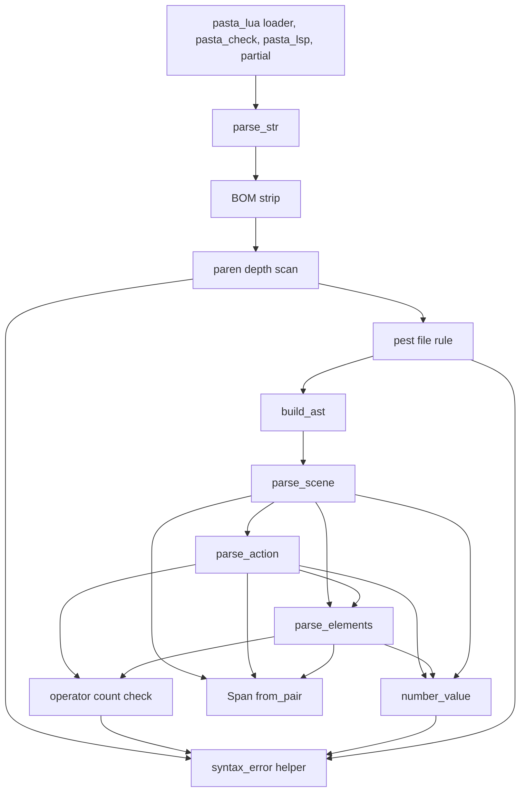
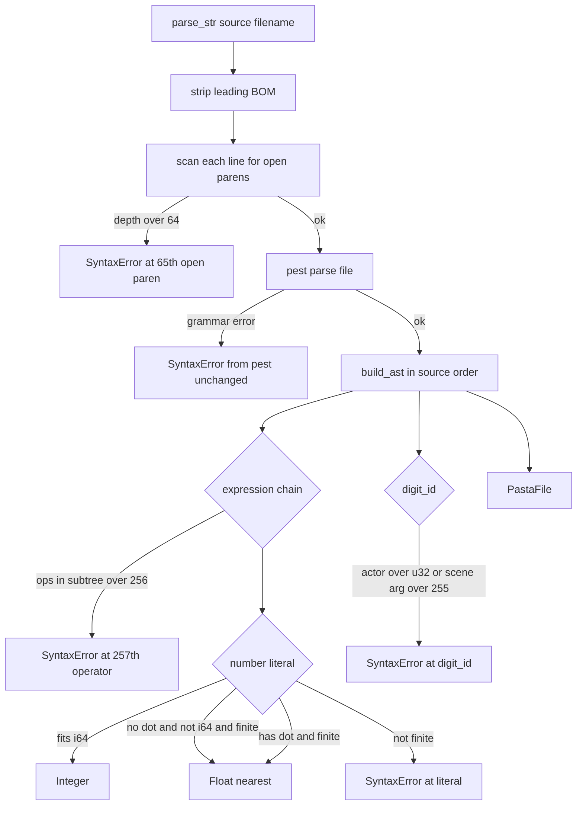

# 設計書: ponytail-dsl-parser

## Overview

**Purpose**: この設計は、`pasta_dsl` のパーサ（`parser/ast/span.rs`・`parse_scene.rs`・`parse_action.rs`・`parse_elements.rs`・`parser/mod.rs`・`error.rs`・`lib.rs` の再輸出）について、2026-10-19 の監査の 1〜5 番と、ギャップ分析で増えた指摘（N1〜N7）を、既存の部品の中で残らず直す。ゴーストの作者には、大きい辞書でも行数に比例する読み込みと、大きな数・深い括弧・長い式への「決まった値」か「位置つきの構文の誤り」を返す。

**Users**: ゴーストの作者（pasta.dll・`pasta_check`・VSCode 拡張で同じ辞書を読む）と、pasta の開発者（作られない誤りの型・誤った `PastaFile.span`・届かない分岐を読まずに済む）。

**Impact**: span の行と桁の出し方を、入力の先頭から数え直す形から、pest の行の索引を使う形に変える（値は変えない）。数の字句を 1 つの補助に集め、範囲の外の番号・大きすぎる数・深すぎる括弧・長すぎる式を構文の誤りにする。誤りの型を `SyntaxError` と `IoError` だけにし、`PastaFile.span`・`Span::byte_len` を消す。新しいファイルはテストだけで、依存の追加と文法（`grammar.pest`）の変更は無い。

### Goals

- 1 シーン 4 行の辞書 8,000 行を release で 1 秒未満で解析し、32,000 行でも伸びを 8 倍以内にする。span の値は 1 つも変えない（1.1〜1.3）。
- 数の字句を、式・属性値・キューの引数のどこでも同じ規則で値にする。項・演算子・引数を落とさない（2.1〜2.6）。
- 範囲の外の番号・大きすぎる数・深い括弧・長い式を、`parse_str` の今の誤りの形（`SyntaxError` と `Parse error in {file} at {l}:{c}: ` の前置き）で返し、x86・x64 の 1 MiB のスタックでプロセスを落とさない（2.5・2.7・2.8・3.1〜3.6・4.3）。
- 作られない誤りの型・`PastaFile.span`・`Span::byte_len`・届かない分岐を消す（4.1・5.1・6.1〜6.4）。
- 直した挙動をマニュアル・README・`lib.rs` の説明・スキルの参照に写す（7.1〜7.4）。

### Non-Goals

- 文法（`grammar.pest`）の意味と、受け付ける字句の形の変更。
- 部分解析（`partial.rs`）と、その誤りの出し方。誤りをどの行に出すかは `ponytail-editor-tooling` が決める。
- `pasta_lua` のコード生成（`code_gen/`）。`＄２５５` の番号の桁あふれと `!select` の大きな小数は `ponytail-lua-transpiler` が直す（申し送り済み）。
- AST の片付けやコード生成を再帰でない形に直すこと（上限で守る。要件ディスカッションの持ち越し 3 の (c) は採らない）。
- 1 行が極端に長い辞書の、その行の中での速さ（「Performance」の節の制限）。
- `parse_global_scene_start` の誤りの文言（`Parse error in …` の前置きが無い）。今の挙動のまま残す。

## Boundary Commitments

### This Spec Owns

- **span の計算**：`Span` の値を pest の `Pair` から作る方法（`parser/ast/span.rs`）と、17 か所の呼び出し（`parse_scene.rs`・`parse_action.rs`・`parse_elements.rs`・`parser/mod.rs`）。
- **数の字句の値**：小数点の有無・i64 の範囲・有限の f64 の範囲で値を決める規則と、それを使う 3 か所（式の項・属性値・キューの引数）（`parse_elements.rs`・`parse_action.rs`・`parse_scene.rs`）。
- **番号の範囲の検査**：アクターの番号（0〜4294967295、`parse_scene.rs`）とシーン引数の番号（0〜255、`parse_action.rs`）。
- **深さと長さの守り**：`parse_str` の入口の括弧の重なりの走査（`parser/mod.rs`）と、1 つの式の二項演算子の数の検査（`parse_action.rs`・`parse_elements.rs`）。
- **位置つきの誤りの作り方**：新しい誤りを `ParseError::SyntaxError` の今の形で作る補助（`parser/mod.rs`）と、それに要る `filename` の受け渡し。
- **誤りの型と再輸出**：`error.rs` の型の整理と `lib.rs` の `pub use`。
- **AST の撤去**：`PastaFile.span`（`parser/ast/mod.rs`・`parser/mod.rs`）・`Span::byte_len`（`parser/ast/span.rs`）。
- **小物**：`try_parse_expr` の既定の腕・キューのスコープの分け方・`build_ast` の同語反復の分岐。
- **テスト**：`crates/pasta_dsl/tests/` の新しい 4 本（`span_oracle_test.rs`・`parse_speed_test.rs`・`number_literal_test.rs`・`nesting_guard_test.rs`）と、既存の `error_api_test.rs`・`span_byte_offset_test.rs` の直し、`crates/pasta_check/tests/validate_rules_test.rs` への 1 本の追加、`crates/pasta_lua/tests/parser_limit_stack_test.rs`（新しい 1 本）。
- **文書**：`book/src/grammar/literals.md`・`variables.md`・`actor-dictionary.md`・`book/src/internals/transpiler.md`・`crates/pasta_dsl/README.md`・`lib.rs` の説明と、`gen-skill-refs.mjs` の生成物（`.claude/skills/pasta-ghost-authoring/references/`）。

### Out of Boundary

- `crates/pasta_dsl/src/partial.rs` と `crates/pasta_dsl/tests/partial_parse_test.rs`（`ponytail-editor-tooling`）。`partial.rs` は `parse_str` を呼ぶので、この spec の守りは届くが、ファイルは変えない。
- `crates/pasta_dsl/src/parser/grammar.pest` と `ast/` の `span.rs`・`mod.rs` 以外（`action.rs`・`scene.rs`・`cue.rs` の型は変えない）。
- `crates/pasta_lua/src/code_gen/`（`ponytail-lua-transpiler`）・`pasta_core`（`ponytail-core-registry`）。
- `pasta_check`・`pasta_lsp`・`pasta_lua` のソース（`src/`）。どれも `parse_str` の結果と `ParseError::SyntaxError` を今のまま読むので、直さずに済む。
- ルートの `Cargo.toml`・`Cargo.lock`（このウェーブは `ponytail-editor-tooling` が席を持つ）。pest の下限 2.8.6 のままで足りる（Research Log「pest の Pair::line_col」）。
- README と `.kiro/steering/tech.md` の公開 API の断り書き（`ponytail-lua-loader` が書いた。7.4）。

### Allowed Dependencies

- pest 2.8.6 以降（ワークスペースの下限。今の `Cargo.lock` は 2.9.2）の `Pair::line_col`・`Pair::as_str`・`Pairs::as_str`・`Pairs::flatten`。
- 標準ライブラリの `str::parse::<i64>`・`str::parse::<f64>`・`f64::is_finite`・`str::split_once`。
- 既存の `pasta_dsl` の部品：`normalize_number_str`・`bin_op_from_rule`・`build_left_assoc_expr`・`PastaParser2`・`Rule`。
- 依存の向き：`parser/mod.rs`（入口・誤りの補助・定数）→ `parse_scene.rs` → `parse_action.rs`・`parse_elements.rs` → `ast/`。`ast/span.rs` は `Rule` に依らない（`pest::RuleType` で受ける）。`error.rs` は何にも依らない。テストのほかに、新しいクレートは使わない。

### Revalidation Triggers

- `Span` の値の計算の変更（`pasta_lua` のソースの対応表・デバッガのブレークポイント・`pasta_check` の位置・`pasta_lsp` の位置がこの値を読む）。この spec は値を変えない。
- `ParseError` の型の変更（この spec で `PestError`・`MultipleErrors`・`ParseErrorInfo`・`ParseResult`・3 つのコンストラクタを消す。外のクレートの使い手は 0）。
- 上限（括弧 64 段・演算子 256 個）と数え方の変更（`ponytail-editor-tooling` の診断・`pasta_lua` のコード生成の再帰の深さ）。
- 数の値の規則の変更（`ponytail-lua-transpiler` の `!select` の扱い。`Float(1e19)` が届くようになる）。
- pest の版の変更（`pest-2-9-4-upgrade`）。`Pair::line_col` の数え方と、pest 2.9.3 から入った「stack limit reached」の守り（Research Log）。

## Architecture

### Existing Architecture Analysis

- `parse_str` は BOM を外し、pest で `file` 規則を解析してから、`build_ast` が `Pair` を記述順にたどって AST を組む。誤りは `ParseError::SyntaxError` で、文言は `Parse error in {file} at {line}:{column}: {pest の Display}`。
- span は 17 か所の `Span::from(&pair.as_span())` が作る。中で `Position::line_col()` を 2 回呼び、どちらも入力の先頭から数え直す。これが 2 乗の遅さの根である。
- 数の字句は 4 か所で別々に読む。`try_parse_expr` は `Option` を返し、`parse().ok()?` で項を落とす。属性値とキューの引数は `unwrap_or(0)`、アクターの番号は `.ok()` で自動の番号へ戻る。シーン引数の番号は `unwrap_or(0)` で `＄０` になる。
- 式は `term ~ (bin_op ~ term)*` を `build_left_assoc_expr` が左に深い `Expr::Binary` の木にする。項の数だけ深くなり、片付け（`Box<Expr>` の Drop）は再帰である。
- `filename` を受け取る解析の関数は `parse_global_scene_scope` と `parse_global_scene_start` だけで、ほかは位置つきの誤りを作れない。

### Architecture Pattern & Boundary Map



**Architecture Integration**:
- 採る形：既存の部品の中で直す（ギャップ分析の Option A）。新しい層やモジュールは作らない。
- 新しい部品と理由：
  - `Span::from_pair`：始まりを pest の行の索引（`Pair::line_col`）から取り、終わりを節の文の中だけで数える。数え直しを無くす唯一の部品。
  - `number_value`：4 か所のばらばらな数の読み方を 1 つの規則にする。
  - `check_paren_depth`：pest の再帰（開き括弧 1 つで 1 段）が始まる前に、深さの上限を守る。pest 2.x の `set_call_limit` は呼び出しの累計を数えるので使えない。
  - `check_op_count`：括弧の守りでは防げない長い式（N1）の上限を守る。
  - `syntax_error`：新しい誤りと pest の誤りを、同じ形・同じ前置きで作る。
- 守る既存の形：`Result<_, ParseError>` を返す解析の関数の並び・`filename` を引数で渡す形（`parse_global_scene_scope` と同じ）・AST の型（`Expr`・`AttrValue`・`CueArgToken` の `Integer(i64)`・`Float(f64)`、`VarScope::Args(u8)`、`SceneActorItem.number: u32`）。
- steering：pest の PEG → AST の 2 段（`tech.md`）、テストは `crates/*/tests/`（`tech.md` のテスト戦略）、x86 のテストを省かない、リファクタリングは小さく戻せる手順で。

### Technology Stack

| Layer | Choice / Version | Role in Feature | Notes |
|-------|------------------|-----------------|-------|
| パーサ | pest 2.8.6 以降（`Cargo.lock` は 2.9.2）・pest_derive 同 | 文法の照合・`Pair::line_col` の行の索引 | 依存の追加と下限の変更は無い。2.8.6 にも同じ `LineIndex` と `Pair::line_col` がある |
| 言語 | Rust（edition 2024） | `str::parse`・`f64::is_finite`・`split_once` | 新しいクレートは無い |
| テスト | 標準の `#[test]`・`std::thread::Builder::stack_size` | 1 MiB のスレッドでの深さの確かめ・span の正解の計算 | pest の `Position::line_col` を、テストの中の正解に使う |
| 文書 | mdBook・`book/tools/gen-skill-refs.mjs` | マニュアルの頁とスキルの参照 | 今の仕組みのまま |

## File Structure Plan

### Modified Files

- `crates/pasta_dsl/src/parser/ast/span.rs` — `Span::from_pair` を足し、`impl From<&pest::Span> for Span` と `Span::byte_len` を消す。`extract_source`・`is_valid`・`SpanError` は残す。
- `crates/pasta_dsl/src/parser/ast/mod.rs` — `PastaFile` の `span` の欄と、`PastaFile::new` のその初期化を消す。
- `crates/pasta_dsl/src/parser/mod.rs` — 定数 `MAX_PAREN_DEPTH`・`MAX_EXPR_OPS`、補助 `syntax_error`・`check_paren_depth` を置く。`parse_str` で BOM を外した後に `check_paren_depth` を呼び、pest の誤りの写しを `syntax_error` に寄せる（文言は同じ）。`build_ast` から `file.span` の計算と `Rule::EOI => {}` の腕を消す。`parse_file_scope`・`parse_actor_scope` に `filename` を足し、`Span::from_pair` を使う。単体テストに `try_parse_expr` の既定の腕のテストを足す。
- `crates/pasta_dsl/src/parser/parse_elements.rs` — `Number` と `number_value` を置き、`parse_attr_number` を消す。`parse_attr`・`parse_var_set` に `filename` を足し、`parse_var_set` で `check_op_count` を呼ぶ。`Span::from_pair` を使う。
- `crates/pasta_dsl/src/parser/parse_action.rs` — `check_op_count` を置く。`try_parse_expr`・`parse_expr_from_parts`・`parse_var_ref_local_inner`・`parse_dyn_name` を `Result<Option<_>, ParseError>` にし、`.ok()?` で誤りを飲む 3 か所を `?` にする。数の項に `number_value` を使い、シーン引数の番号の範囲を検査する。`try_parse_expr` の演算子の腕と既定の腕を、誤りを返す 1 つの腕にする。式を読む関数に `filename` を足し、`parse_expr_from_parts`・`parse_key_arg` で `check_op_count` を呼ぶ。`Span::from_pair` を使う。
- `crates/pasta_dsl/src/parser/parse_scene.rs` — アクターの番号の範囲を検査し、キューの引数に `number_value` を使う。`parse_cue_cmd_scope` を `split_once` 1 つにする。番号・式・属性を読む関数に `filename` を足す。`Span::from_pair` を使う。
- `crates/pasta_dsl/src/error.rs` — `ParseError` を `SyntaxError`・`IoError` だけにし、`ParseResult`・`ParseErrorInfo`・3 つのコンストラクタを消す。`From<std::io::Error>` は残す。
- `crates/pasta_dsl/src/lib.rs` — `pub use error::ParseError` だけにし、説明の `ParseErrorInfo` の行を今の型に書き直す。
- `crates/pasta_dsl/README.md` — 「Features」と「Error Types」の誤りの型の一覧を今の型に書き直す。
- `crates/pasta_dsl/tests/error_api_test.rs` — 消した型とコンストラクタのテストを消し、`SyntaxError` の形のテストを `parse_str` が返す誤りで確かめる形にする。`file.span` を読むテストを「空行だけの辞書の解析が成功し、項目が無い」に直す。
- `crates/pasta_dsl/tests/span_byte_offset_test.rs` — `byte_len` のテストを消す。`ast.span` を読む 2 本を、各節の span（シーン・アクション行）で同じ観点を確かめる形にする。
- `crates/pasta_check/tests/validate_rules_test.rs` — 新しい誤り（大きすぎる数・アクターの番号・シーン引数の番号・括弧・演算子）と大きい整数（誤り無し）を `validate_ghost` に通すテストを 1 本足す。
- `book/src/grammar/literals.md` — 「数値（i64 / f64）」の節に、要件 7.1 で確定した文を足す。
- `book/src/grammar/variables.md` — 93 行の「256 以上を書くと 0 として扱われ…」を「256 以上は構文の誤りになる」に直し、「優先順位と括弧」の節に上限（1 行の括弧の重なり 64 段・1 つの式の演算子 256 個。台詞やコメントの括弧も数える）を足す。
- `book/src/grammar/actor-dictionary.md` — `％` 行の番号の行に「0〜4294967295 を超える番号は構文の誤りになる」を足す。
- `book/src/internals/transpiler.md` — 「パースと AST 構築時の正規化」に、数の値の規則・番号の範囲の検査・括弧と演算子の守りを足す。
- `.claude/skills/pasta-ghost-authoring/references/`（生成物） — `node book/tools/gen-skill-refs.mjs` で作り直す（手で直さない）。

### New Files

- `crates/pasta_dsl/tests/span_oracle_test.rs` — 振る舞いを固めるテスト。リポジトリのすべての `.pasta` と、CRLF・BOM・全角・絵文字・単独の `\r` を含む小さな辞書で、AST のすべての span の行と桁が、バイトの位置から pest の `Position::line_col` で出した値（直す前の計算そのもの）と一致することを確かめる。`#[ignore]` の、AST を外へ書き出すテスト（直す前と後の比べ）も置く。
- `crates/pasta_dsl/tests/parse_speed_test.rs` — 速さのテスト（1.1・1.2）。時間を測るので、ほかのテストと同じプロセスで並んで走らないよう、1 本だけの別のテストのファイルにする。
- `crates/pasta_dsl/tests/number_literal_test.rs` — 数の値・番号の範囲・誤りの位置と文言のテスト（要件 2・4.3）。
- `crates/pasta_dsl/tests/nesting_guard_test.rs` — 括弧の重なりと演算子の数の上限のテスト。1 MiB のスタックのスレッドで、解析・片付け・部分解析（`parse_str_partial`）を走らせる（要件 3）。
- `crates/pasta_lua/tests/parser_limit_stack_test.rs` — 上限ちょうどの式を、1 MiB のスタックのスレッドでトランスパイルし、あふれないことを確かめる（要件 3.6。`code_gen/` は変えない）。同じファイルに、65 段の括弧の行を含む辞書のゴーストを、既存のローダのテストと同じ形で読み込み、プロセスを落とさず構文の誤りの読み込みエラーで返ることを確かめるテストを 1 本置く（要件 3.4。議題 8）。

## System Flows



- 括弧の走査は pest の前に走る。pest の再帰は開き括弧 1 つにつき 1 段で、式は 1 行の中で閉じる（`s` は改行を含まず、文字列も行をまたげない）。だから 1 行ずつ数えれば、再帰の深さの上限になる。台詞・文字列・コメント・Lua ブロックの括弧も数える（3.1 の確定）。数えすぎる向きにしかずれないので、あふれは必ず防げる。
- 走査が pest の前に走るので、65 段以上の行より前に文法の誤りがある辞書では、深い括弧の誤りが出る（2026-11-02 確定。議題 7）。直す前の pest は、前の行の誤りで止まって深い行まで進まないので、この辞書は落ちずに前の行の文法の誤りを返していた。この辞書だけは 1.4 と 3.1 の両方が当てはまり、誤りは 1 つしか返せないので、3.1 を採る（3.3 と同じく、1.4 は 64 段以内の辞書についての約束と読む）。64 段以内の辞書の文法の誤りは、位置も文言も今と同じである（1.4）。
- 演算子の検査は、式の鎖を組む前（`build_left_assoc_expr` の前）に走るので、深い木は作られない。値の誤りは、AST を組む順（記述順）で最初の 1 つを返す。

## Requirements Traceability

| Requirement | Summary | Components | Interfaces | Flows |
|-------------|---------|------------|------------|-------|
| 1.1 | 8,000 行を 1 秒未満 | SpanFromPair・ParseSpeedTest | `Span::from_pair` | — |
| 1.2 | 4 倍の行で 8 倍以内 | SpanFromPair・ParseSpeedTest | `Span::from_pair` | — |
| 1.3 | span の値が同じ | SpanFromPair・SpanOracleTest | `Span::from_pair` | — |
| 1.4 | pest の誤りの位置と文言が同じ | ParseEntry | `syntax_error` | parse_str の流れ |
| 2.1 | i64 に収まる整数は今と同じ | NumberValue | `number_value` | 数の分岐 |
| 2.2 | 収まらない整数はいちばん近い小数 | NumberValue | `number_value` | 数の分岐 |
| 2.3 | どこでも同じ規則 | NumberValue・ExprPlumbing | `number_value` の 3 つの使い手 | — |
| 2.4 | 項・演算子・引数を落とさない | ExprPlumbing・NumberValue | `try_parse_expr` などの `Result<Option<_>>` | — |
| 2.5 | 有限でない数は構文の誤り | NumberValue | `number_value`・`syntax_error` | 数の分岐 |
| 2.6 | 小数点のある数は小数 | NumberValue | `number_value` | 数の分岐 |
| 2.7 | アクターの番号の範囲 | IndexRange | `parse_actors_item` | digit_id の分岐 |
| 2.8 | シーン引数の番号の範囲 | IndexRange | `parse_var_ref_local_inner` | digit_id の分岐 |
| 2.9 | `pasta_check` が同じ結果 | ParseEntry（`pasta_check` は直さない） | `parse_str` | — |
| 3.1 | 括弧 64 段を超えると誤り | ParenGuard | `check_paren_depth` | 走査 |
| 3.2 | 演算子 256 個を超えると誤り | OpGuard | `check_op_count` | 式の分岐 |
| 3.3 | 上限の中は今と同じ AST | ParenGuard・OpGuard・SpanOracleTest | — | — |
| 3.4 | pasta.dll が落ちず読み込みエラー | ParenGuard・OpGuard・ParserLimitStackTest（`pasta_lua` のソースは直さない） | `parse_str` | — |
| 3.5 | VSCode 拡張の解析が落ちない | ParenGuard・OpGuard（`partial.rs` は直さない） | `parse_str` | — |
| 3.6 | x86・x64、release・debug の 1 MiB で落ちない | ParenGuard・OpGuard・NestingGuardTest・ParserLimitStackTest | 定数 `MAX_PAREN_DEPTH`・`MAX_EXPR_OPS` | — |
| 4.1 | 作られない型を提供しない | ErrorTypes | `ParseError` | — |
| 4.2 | `SyntaxError`・`IoError` を今の形で | ErrorTypes | `ParseError` | — |
| 4.3 | 新しい誤りの形と前置き | SyntaxErrorHelper | `syntax_error` | 全部の誤りの分岐 |
| 4.4 | `pasta_check` の報告 | SyntaxErrorHelper（`pasta_check` は直さない） | `syntax_error` | — |
| 5.1 | `PastaFile.span` を消す | AstRemoval | `PastaFile` | — |
| 5.2 | テストの観点を各節の span で | AstRemoval（テスト） | — | — |
| 6.1 | 扱っていない規則を黙って拾わない | ExprPlumbing | `try_parse_expr` | — |
| 6.2 | `Span::byte_len` を消す | SpanFromPair | `Span` | — |
| 6.3 | キューのスコープの分け方 | SmallCleanups | `parse_cue_cmd_scope` | — |
| 6.4 | 同語反復の分岐を 1 つに | SmallCleanups | `build_ast` | — |
| 7.1 | マニュアルの頁 | Docs | — | — |
| 7.2 | README と `lib.rs` の説明 | Docs | — | — |
| 7.3 | スキルの参照の作り直し | Docs | — | — |
| 7.4 | 公開 API の断り書きを足さない | Docs | — | — |
| 8.1 | 全 `.pasta` で AST が同じ | SpanOracleTest（書き出しの比べ） | — | — |
| 8.2 | 括弧式の回帰テストを保つ | 既存の `expr_parse_test.rs` | — | — |
| 8.3 | 固めるテストを先に・1 直し 1 コミット | Migration Strategy | — | — |
| 8.4 | 品質の関門 | Testing Strategy | — | — |
| 8.5 | `partial.rs` を変えない | Boundary Commitments | — | — |

## Components and Interfaces

| Component | Domain/Layer | Intent | Req Coverage | Key Dependencies (P0/P1) | Contracts |
|-----------|--------------|--------|--------------|--------------------------|-----------|
| SpanFromPair | ast/span.rs | `Pair` から span を数え直さずに作る | 1.1-1.3, 6.2 | pest `Pair::line_col`（P0） | Service |
| ParseEntry | parser/mod.rs | `parse_str` の入口の順番と pest の誤りの写し | 1.4, 2.9, 3.4, 3.5 | pest（P0） | Service |
| SyntaxErrorHelper | parser/mod.rs | 位置つきの誤りを今の形で作る | 4.3, 4.4 | `ParseError`（P0） | Service |
| ParenGuard | parser/mod.rs | 1 行の括弧の重なりの上限 | 3.1, 3.3-3.6 | SyntaxErrorHelper（P0） | Service |
| OpGuard | parse_action.rs | 1 つの式の演算子の数の上限 | 3.2, 3.3-3.6 | pest `Pairs::flatten`（P0） | Service |
| NumberValue | parse_elements.rs | 数の字句を 1 つの規則で値にする | 2.1-2.6 | `normalize_number_str`（P0） | Service |
| IndexRange | parse_scene.rs・parse_action.rs | アクターとシーン引数の番号の範囲 | 2.7, 2.8 | SyntaxErrorHelper（P0） | Service |
| ExprPlumbing | parse_action.rs・parse_elements.rs・parse_scene.rs・parser/mod.rs | 誤りを上へ返す形と `filename` の受け渡し | 2.4, 6.1 | NumberValue・IndexRange（P0） | Service |
| ErrorTypes | error.rs・lib.rs | 誤りの型を本番で作るものだけにする | 4.1, 4.2 | — | Service |
| AstRemoval | ast/mod.rs・parser/mod.rs | `PastaFile.span` を消す | 5.1, 5.2 | — | State |
| SmallCleanups | parse_scene.rs・parser/mod.rs | 届かない守りと同語反復を消す | 6.3, 6.4 | — | — |
| Docs | book・README・lib.rs | 直した挙動を文書に写す | 7.1-7.4 | gen-skill-refs（P1） | — |
| SpanOracleTest・ParseSpeedTest・NumberLiteralTest・NestingGuardTest・ParserLimitStackTest | tests | 固めるテスト・速さ・再現するテスト・深さのテスト | 1.1, 1.2, 1.3, 3.6, 8.1, 8.3 | pest `Position::line_col`（P0） | — |

### span の計算

#### SpanFromPair

| Field | Detail |
|-------|--------|
| Intent | `Pair` の span を、入力の先頭から数え直さずに作る |
| Requirements | 1.1, 1.2, 1.3, 6.2 |

**Responsibilities & Constraints**
- 始まりの行と桁は `pair.line_col()`（pest が 1 回だけ作る行の索引 `LineIndex` を二分探索し、行の頭からの文字の数を数える）。
- 終わりの行と桁は、`pair.as_str()` の中だけを数える。`'\n'` の数を `n` とし、`n == 0` なら終わりの行は始まりの行で、終わりの桁は始まりの桁＋文字の数。`n > 0` なら終わりの行は始まりの行＋`n` で、終わりの桁は最後の `'\n'` の後の文字の数＋1。
- バイトの位置は `pair.as_span().start()`・`end()`（今と同じ）。
- 数え方は pest の `Position::line_col` と同じである。`"\r\n"` は 1 つの改行（`'\n'` だけを数え、`'\r'` は前の行の文字になる）、単独の `'\r'` は 1 桁。2.8.6 と 2.9.2 で `LineIndex` と `Position::line_col` が同じであることを読んで確かめた。
- 手間は節ごとに自分の文の長さで、全体は「入力の長さ × AST の深さ（5〜6）」になる。

**Dependencies**
- Inbound: 17 か所の解析の関数 — span を作る（P0）
- External: pest `Pair::line_col`・`Pair::as_str`・`Pair::as_span`（P0）

**Contracts**: Service [x]

##### Service Interface
```rust
impl Span {
    /// 直す前の `From<&pest::Span>` と同じ値を、数え直さずに作る。
    pub(crate) fn from_pair<R: pest::RuleType>(pair: &pest::iterators::Pair<'_, R>) -> Span;
}
// 消す: impl<'i> From<&pest::Span<'i>> for Span
// 消す: pub fn byte_len(&self) -> usize
// 残す: Span::new・extract_source・is_valid・SpanError
```
- Preconditions: `pair` は `parse_str` の解析結果（BOM を外した文）の節である。
- Postconditions: 6 つの値が、`Position::new(src, start_byte).line_col()` と `Position::new(src, end_byte).line_col()` の値と一致する。
- Invariants: `start_byte <= end_byte`。

**Implementation Notes**
- Integration: 17 か所の `Span::from(&pair.as_span())` を `Span::from_pair(&pair)` に置き換える（`parse_scene.rs` 7・`parse_action.rs` 5（`parse_actions` の `Span::from(&inner.as_span())` を含む）・`parse_elements.rs` 4・`parser/mod.rs` 1）。`parse_scene.rs:94` の誤りの道の `start_pos().line_col()` は、遅さに効かず値も同じなので変えない。
- Validation: SpanOracleTest（全 `.pasta` と端の辞書）。
- Risks: 1 行が極端に長い辞書では、その行の節ごとに行の頭から数えるので、その行の中では 2 乗が残る（Performance の節）。

### 入口と誤り

#### ParseEntry と SyntaxErrorHelper

| Field | Detail |
|-------|--------|
| Intent | `parse_str` の順番（BOM → 括弧の走査 → pest → AST）と、位置つきの誤りの形を 1 か所で決める |
| Requirements | 1.4, 2.9, 3.4, 3.5, 4.3, 4.4 |

**Responsibilities & Constraints**
- `parse_str` は BOM を外した後に `check_paren_depth` を呼び、通れば今と同じく pest を呼ぶ。
- pest の誤りの写しは `syntax_error(filename, (line, column), &e.to_string())` にする。作る値は今と 1 文字も変わらない（1.4）。
- 新しい誤りの `what` は 1 行の日本語で、何が範囲を超えたかと上限の値を書く（4.3）。改行を含めない（`pasta_check` は前置きを外した後、`"\n  = "` が無ければ文をそのまま使う）。
- `parse_global_scene_start` の誤り（前置きが無い）は変えない。

**Dependencies**
- Inbound: `pasta_lua` の loader（`loader/process.rs`・`source_map_build.rs`）・`pasta_check validate`（`validate/syntax.rs`）・`pasta_lsp`（`analysis/mod.rs`）・`partial.rs` — `parse_str` を呼ぶ（P0）
- Outbound: ParenGuard・`build_ast`（P0）

**Contracts**: Service [x]

##### Service Interface
```rust
// 公開（形は今のまま）
pub fn parse_str(source: &str, filename: &str) -> Result<PastaFile, ParseError>;
pub fn parse_file(path: &Path) -> Result<PastaFile, ParseError>;

// parser/mod.rs の内部
pub(crate) const MAX_PAREN_DEPTH: usize = 64;
pub(crate) const MAX_EXPR_OPS: usize = 256;

/// `SyntaxError { file, line, column, message: "Parse error in {file} at {line}:{column}: {what}" }`
pub(crate) fn syntax_error(filename: &str, line_col: (usize, usize), what: &str) -> ParseError;
```
- Postconditions: `line` と `column` は 1 から数えた行と桁（桁は文字の数）。BOM を外した文での位置で、pest の誤りの位置とそろう。

**新しい誤りの文（2026-11-02 確定。議題 2）**

| 誤り | 位置 | `what` |
|------|------|--------|
| 有限の小数に収まらない数（2.5） | 数の字句の始まり（符号を含む） | `数が大きすぎます（小数で表せるのは、およそ 1.8×10^308 まで）` |
| アクターの番号（2.7） | `digit_id` の始まり | `アクターの番号 {書いたとおりの数字} は 0〜4294967295 の範囲を超えています` |
| シーン引数の番号（2.8） | `digit_id` の始まり（`＄` の次） | `シーン引数の番号 {書いたとおりの数字} は 0〜255 の範囲を超えています` |
| 括弧の重なり（3.1） | 65 段目の開き括弧 | `括弧の重なりが 64 段を超えています` |
| 演算子の数（3.2） | 257 個目の演算子 | `1 つの式の演算子が 256 個を超えています` |
| 扱っていない規則（6.1） | その規則の始まり | `内部の誤り：式の項として扱えない規則 {規則の名前}` |

例：`＊挨拶\n  ％さくら、うにゅう＝4294967296\n` → `SyntaxError { file: "dic/a.pasta", line: 2, column: 13, message: "Parse error in dic/a.pasta at 2:13: アクターの番号 4294967296 は 0〜4294967295 の範囲を超えています" }`。`pasta_check validate` は `構文エラー: アクターの番号 4294967296 は 0〜4294967295 の範囲を超えています` を 2 行 13 桁に出す。

#### ParenGuard

| Field | Detail |
|-------|--------|
| Intent | pest の再帰が始まる前に、1 行の括弧の重なりを 64 段に抑える |
| Requirements | 3.1, 3.3, 3.4, 3.5, 3.6 |

**Responsibilities & Constraints**
- 文を `'\n'` で行に分け、各行の文字を頭から読む。`（`・`(` で深さに 1 を足し、64 を超えたらその文字の行と桁で誤りを返す。`）`・`)` で 1 を引く（0 より下げない）。行が変わると 0 に戻す。
- 行と桁の数え方は `LineIndex` と同じ（`'\n'` だけで行を分け、桁は文字の数＋1）。
- 台詞・文字列・コメント・Lua ブロックの括弧も数える（3.1 の確定）。

##### Service Interface
```rust
/// 1 行の閉じていない開き括弧の重なりが MAX_PAREN_DEPTH を超えたら、
/// 超えた開き括弧の位置の SyntaxError を返す。
pub(crate) fn check_paren_depth(source: &str, filename: &str) -> Result<(), ParseError>;
```

**Implementation Notes**
- 例：`  ＄x＝` の後に `（` を 65 個（2 行目）→ `Parse error in dic/a.pasta at 2:70: 括弧の重なりが 64 段を超えています`。`  さくら：` の後に `（` を 65 個書いた台詞も同じ誤りになる（マニュアルに書く）。
- Risks: 1 行に括弧を 65 段重ねた Lua のコードは誤りになる。リポジトリでいちばん深い行は 8 段。

#### OpGuard

| Field | Detail |
|-------|--------|
| Intent | 1 つの式の二項演算子を 256 個に抑え、AST の片付けとコード生成の再帰を浅く保つ |
| Requirements | 3.2, 3.3, 3.4, 3.5, 3.6 |

**Responsibilities & Constraints**
- 「1 つの式」は、式を書ける位置（変数の代入の右辺・Call の動的ターゲット・関数呼び出しと Call の 1 つの引数）に書いた式の全体で、その中の括弧と関数呼び出しの引数の中の式を含む（2026-11-02 確定。議題 1）。
- 式の鎖を組む 3 つの関数（`parse_var_set`・`parse_expr_from_parts`・`parse_key_arg`）の頭で、渡された `Pair` の子孫を `Pairs::flatten` で記述順にたどり、演算子の規則（`add_op`・`sub_op`・`mul_op`・`div_op`・`modulo_op`・`concat_op`）を数える。257 個目でその演算子の位置の誤りを返す。
- 外側の式が内側の式を含むので、外側の検査が先に走って先に止まる。内側の鎖でもう一度数えるが、手間は「式の長さ × 入れ子の深さ（64 段まで）」で済む。
- 鎖を組む前に止まるので、深い木は作られない。

##### Service Interface
```rust
/// `pair` の子孫の二項演算子が MAX_EXPR_OPS を超えたら、
/// 超えた演算子の位置の SyntaxError を返す。
pub(crate) fn check_op_count(pair: &Pair<Rule>, filename: &str) -> Result<(), ParseError>;
```

**Implementation Notes**
- 例：`＄x＝1` の後に `＋1` を 257 個 → 257 個目の `＋` の位置の誤り。`＄x＝（1＋…＋1）＋（1＋…＋1）` で演算子が合わせて 257 個なら誤り。`さくら：＠f（A）＠g（B）`（A と B は 200 個ずつ）は、別の式なので誤りにならない。
- 測った深さ（Research Log。pest 2.9.2）：括弧 64 段・関数呼び出し 64 段の内側に演算子 256 個を置いた、上限ちょうどの式は、1 MiB のスレッドで、解析と片付けが x64・x86 の debug・release で通り、トランスパイルまで含めても x64・x86 の debug（768 KiB でも）で通る。いちばん厳しい x64 debug の解析と片付けは 640 KiB で通り、512 KiB であふれる（1 MiB に対し余裕は約 1.6 倍）。release のトランスパイルは測っていない（debug より浅い見込み。`parser_limit_stack_test.rs` を `--release` で走らせて確かめる）。

### 数の値と番号

#### NumberValue

| Field | Detail |
|-------|--------|
| Intent | 数の字句を、書いた場所によらず 1 つの規則で値にする |
| Requirements | 2.1, 2.2, 2.3, 2.4, 2.5, 2.6 |

**Responsibilities & Constraints**
- `normalize_number_str` で全角を半角にした後、次の順で決める。
  1. 小数点が無く、`i64` に収まる → `Integer`（2.1）。
  2. 小数点が無く、`i64` に収まらない → `str::parse::<f64>` のいちばん近い値で `Float`（2.2。10 進の字句からいちばん近い 64 ビットの浮動小数点数への丸めで、Lua の字句の読み方と同じ結果になる）。
  3. 小数点がある → `Float`（2.6）。
  4. 2 か 3 の値が有限でない（`inf`）→ 字句の位置の誤り（2.5）。
- 使い手は 3 か所：`try_parse_expr` の数の腕（式・位置の引数・名前つきの引数・Call の動的ターゲット・括弧の中）、`parse_attr`（属性値）、`parse_cue_cmd_args`（キューの引数）。それぞれ 2 腕の `match` で自分の型（`Expr`・`AttrValue`・`CueArgToken`）に写す。
- `parse_attr_number` は消す。

##### Service Interface
```rust
pub(crate) enum Number {
    Integer(i64),
    Float(f64), // 常に有限
}

/// 数の字句（Rule::number_literal）の値。有限の f64 に収まらなければ SyntaxError。
pub(crate) fn number_value(pair: &Pair<Rule>, filename: &str) -> Result<Number, ParseError>;
```

**Implementation Notes**
- 例：`＄x＝10000000000000000000` → `Float(1e19)`、`＄y＝1＋10000000000000000000` → `1 ＋ 1e19`、`＞t（10000000000000000000、2）` → 引数 2 つ、`!wait(99999999999999999999)` → `Float(1e20)`、`＆n：99999999999999999999` → `AttrValue::Float(1e20)`、`＄z＝-9223372036854775808` → `Integer(i64::MIN)`（今と同じ）、`＄z＝9223372036854775808` → `Float(9223372036854775808.0)`、`＄h＝1` の後に `0` を 400 個 → 誤り。
- コード生成は `Float` を `write!("{}", f)` で書く。Rust の `f64` の表示は指数を使わず `10000000000000000000` と書くので、Lua でも同じ値になる（`code_gen/` は直さない）。

#### IndexRange

| Field | Detail |
|-------|--------|
| Intent | `digit_id` の番号の範囲を検査し、範囲の外を黙って別の番号にしない |
| Requirements | 2.7, 2.8 |

**Responsibilities & Constraints**
- アクターの番号（`parse_actors_item`）：`normalize_number_str` の後 `parse::<u32>` に失敗したら、`digit_id` の位置の誤り。成功したら今と同じ採番（`saturating_add(1)` で、4294967295 の次の省いた番号は 4294967295 に留まる）。
- シーン引数の番号（`parse_var_ref_local_inner`）：`parse::<u8>` に失敗したら、`digit_id` の位置の誤り。`＄２５６` を書ける所（アクション行・式の項・動的な単語参照と関数呼び出しの名前）は、すべてこの関数を通る。
- `VarScope::Args(u8)`・`SceneActorItem.number: u32` の型は変えない。

### 誤りを上へ返す形

#### ExprPlumbing

| Field | Detail |
|-------|--------|
| Intent | 式の中の誤りを `.ok()?` で飲まずに上へ返し、位置つきの誤りに要る `filename` を渡す |
| Requirements | 2.4, 6.1 |

**Responsibilities & Constraints**
- 戻り値を `Option<T>` から `Result<Option<T>, ParseError>` に変える関数：`try_parse_expr`・`parse_expr_from_parts`・`parse_var_ref_local_inner`・`parse_dyn_name`。`None` の意味（項にならない）は今のまま。
- `try_parse_expr` の `parse_fn_call_inner(pair).ok()?`・`parse_dyn_fn_call_inner(pair).ok()?`（3 か所）は `?` で上へ返す。
- `try_parse_expr` の演算子の腕（呼び出し元が先に `bin_op_from_rule` で分けるので届かない）と既定の腕（扱いの無い規則の中をたどり、最初の値を項にする）を、1 つの腕にまとめ、位置つきの誤り（`内部の誤り：…`）を返す（6.1。2026-11-02 確定。議題 5）。今の文法で項の位置に来る規則（`paren_expr`・`fn_call_local`・`fn_call_global`・`fn_call_dynamic`・`var_ref_local`・`var_ref_global`・`var_ref_property`・`number_literal`・`string_contents`・`string_blank`）は、すべて明示の腕があるので、AST は変わらない（Research Log）。
- `filename: &str` を足す関数（`parse_global_scene_scope` と同じ形）：`parse_file_scope`・`parse_actor_scope`・`parse_attr`・`parse_var_set`・`parse_scene_actors_line`・`parse_actors_item`・`parse_local_start_scene_scope`・`parse_local_scene_scope`・`parse_local_scene_item`・`parse_cue_cmd_line`・`parse_cue_cmd_args`・`parse_call_scene`・`parse_action_line`・`parse_continue_action_line`・`parse_actions`・`parse_fn_call_inner`・`parse_dyn_fn_call_inner`・`parse_dyn_name`・`parse_args`・`parse_key_arg`・`parse_expr_from_parts`・`try_parse_expr`・`parse_var_ref_local_inner`。すべて `pub(crate)` か非公開で、`pasta_dsl` の外からは呼ばれない。

**Implementation Notes**
- `filename` を渡す変更は、挙動を変えない 1 コミットとして先に入れる（Migration Strategy の手順 2）。
- Risks: 引数の追加は機械的だが行数が多い。`cargo build` が呼び出しの漏れを見つける。

### 撤去と小物

#### ErrorTypes

**Contracts**: Service [x]
```rust
#[derive(Error, Debug, Clone)]
pub enum ParseError {
    #[error("Parse error: {file}:{line}:{column}: {message}")]
    SyntaxError { file: String, line: usize, column: usize, message: String },
    #[error("IO error: {0}")]
    IoError(String),
}
impl From<std::io::Error> for ParseError { /* 今のまま */ }
// lib.rs: pub use error::ParseError;
// 消す: PestError・MultipleErrors・ParseErrorInfo・ParseResult・syntax_error・pest_error・io_error
```
- `Display` の文言と `SyntaxError` の位置の二重（`Display` と `message` の両方に位置が出る）は変えない（`partial.rs` が `Display` を誤りの文にしている）。
- `pasta_check/src/validate/syntax.rs` は `SyntaxError` と `other =>` で受けるので直さずに済む。

#### AstRemoval

- `PastaFile` を `path` と `items` だけにする。`build_ast` の `line_count`・`last_line_len`・`file.span` の 4 行を消す。
- 読んでいたのは `error_api_test.rs:194-195` と `span_byte_offset_test.rs:177-179・203` だけ（`partial.rs` は `pasta_file.items` だけを読む。`pasta_lua`・`pasta_check`・`pasta_lsp` に使い手は無い）。
- テストの観点（5.2）：空行だけ・コメントだけの辞書の解析が成功して項目が無いこと、各節（グローバルシーン・アクション行）の `start_byte < end_byte` と `extract_source` が元の文に合うこと。

#### SmallCleanups

- `parse_cue_cmd_scope`：`cue_cmd_scope = { at ~ cue_scoped_ident }` の子の文を `pair.into_inner().as_str()` で取り、`split_once([':', '：'])` の結果で `ScopedName` を作る。`if let Some(colon_char)` の守りと「should not be reached」の戻り値を消す（6.3。`cue_ident_part` は `@`・`＠`・`:`・`：` を含まないので、結果は今と同じ）。
- `build_ast`：`Rule::EOI => {}` を消し、`_ => {}` だけにする（6.4）。

### 文書

#### Docs

- 7.1 の頁を、挙動を変える直しと同じコミットで直す。`literals.md` の文は要件 7.1 の確定のとおり。`variables.md` の上限の文（2026-11-02 確定）：「1 行の中で閉じていない括弧を重ねられるのは 64 段まで、1 つの式に書ける演算子は 256 個までである。超えると構文の誤りになる。数えるのは、台詞・文字列・コメント・Lua ブロックの中を含む、その行のすべての括弧である。」
- `internals/transpiler.md` には、`number_value` の規則・番号の範囲の検査・`check_paren_depth` と `check_op_count` の位置と上限を、今の箇条書きの形で足す。
- 7.2：README の「独立エラー型」と「Error Types」、`lib.rs` の `ParseErrorInfo` の行を、`ParseError`（`SyntaxError`・`IoError`）に書き直す。
- 7.3：`node book/tools/gen-skill-refs.mjs` で作り直し、`--check` で差分が無いことを確かめる。
- 7.4：断り書きは足さない。

## Data Models

### Domain Model

- AST の型の変化は 2 つだけ：`PastaFile` から `span` の欄が無くなり、`Span` から `byte_len` が無くなる。
- 値の不変条件（新しく保つもの）：`Expr::Float`・`AttrValue::Float`・`CueArgToken::Float` の値は、解析の結果では常に有限である。`Expr::Binary` の鎖は、1 つの式の中で 256 段まで。

## Error Handling

### Error Strategy

- 誤りはすべて `ParseError::SyntaxError` で、最初の 1 つだけを返す（今の `parse_str` と同じ。誤りを集めない）。
- 順番：括弧の重なり（入口の走査）→ 文法の誤り（pest）→ 値の誤り（AST を組む順。数・番号・演算子の数）。
- `pasta_lua` の読み込み（pasta.dll）は、今の構文の誤りと同じ経路で読み込みエラーにする（3.4。`loader/process.rs` は `parse_str` の `Err` を今のまま扱う）。`pasta_lsp` は全体の解析の `Err` で部分解析に進み、部分解析の各チャンクも `parse_str` を通るので、落ちない（3.5）。

### Monitoring

- 足さない。誤りの文が、pasta.dll の読み込みエラーの記録と `pasta_check` の報告にそのまま出る。

## Testing Strategy

テストは要件の受け入れ基準から作る。挙動を変えない直しは、先に入れた固めるテストが直した後も通ることで確かめる。挙動を変える直しは、直す前の誤りを再現するテストを書いて、直す前に失敗する（あふれはテストのプロセスが落ちる）ことを確かめてから、直しと一緒にコミットする。

### 固めるテスト（先に入れる。span_oracle_test.rs）

- **span の正解**（1.3・3.3）：リポジトリの全 `.pasta`（`CARGO_MANIFEST_DIR` の 2 つ上の `crates/` と `.kiro/` の下を歩き、`target`・`node_modules` を除く。2026-11-02 で 56 本はすべてこの 2 つの下にある。ルートから歩くと、本体の作業ツリーでは `.claude/worktrees/` の別のワークツリーの複製まで拾うので、ルートからは歩かない。解析に成功したものだけ）と、端の辞書（`"＊挨拶\r\n  さくら：こんにちは\r\n  ＄x＝（１＋２）\n"`・BOM つき・絵文字 `🎈` と全角を含む行・単独の `\r` を含む台詞・最後の改行の無い辞書）で、AST の `{:?}` から `Span { … }` をすべて拾い、既定の span（全部 0）を除いて、行と桁が `pest::Position::new(src, byte).unwrap().line_col()` と一致することを確かめる。拾った span が 1 つ以上あることも確かめる。
- **AST の書き出し**（8.1。`#[ignore]`）：環境変数 `PASTA_AST_DUMP_DIR` のフォルダへ、全 `.pasta` の `items` の `{:#?}`（誤りなら `Err` の `{:?}`）を書く。直す前に 1 回、全部の直しの後に 1 回書き出し、`diff -r` で差分が無いことを確かめる（2026-11-02 確定。議題 3）。
- **速さ**（1.1・1.2。parse_speed_test.rs）：通常のテストで、同じ形の辞書 2,000 行と 8,000 行をそれぞれ 3 回解析した最短の時間の比が 8 倍以内であること。`#[ignore]` のテストで、release の 8,000 行が 1 秒未満、32,000 行と 8,000 行の比が 8 倍以内であること（`cargo test -p pasta_dsl --release --test parse_speed_test -- --ignored`。2026-11-02 確定。議題 4）。
- **誤りの形**（1.4）：今の `error_api_test.rs` の `parse_str` の誤りのテスト（位置・`SyntaxError`）を残す。

### 単体・統合テスト（number_literal_test.rs）

- i64 の上限・下限・上限＋1、20 桁の整数、400 桁の整数、`1000…0.5`（400 桁）の値と誤り（2.1・2.2・2.5・2.6）。
- 式・位置の引数・名前つきの引数・Call の動的ターゲット・括弧の中・属性値・キューの引数で、同じ字句が同じ値になること（2.3）と、項・演算子・引数の数（2.4 の 4 つの例）。
- `％a、b＝4294967296` と `％a＝4294967295、b`（b は 4294967295）の採番、`＄２５５` と `＄２５６`（アクション行・式・`＠＄２５６`）（2.7・2.8）。
- 誤りの `line`・`column`・`message` の前置きと文（4.3）。全角の字句の桁が文字の数で出ること。
- `parser/mod.rs` の単体テスト：`PastaParser2::parse(Rule::id, "abc")` の `Pair` を `try_parse_expr` に渡すと誤りになること（6.1）。

### 深さのテスト（nesting_guard_test.rs・parser_limit_stack_test.rs）

- すべて `std::thread::Builder::new().stack_size(1024 * 1024)` のスレッドで、解析と片付けまで走らせる（3.6）。
- 括弧 64 段（`（`・`＠f（`・`＠＄f（`）は通り、65 段は 65 段目の位置の誤り。1 万段もプロセスを落とさず誤り（3.1・3.4）。
- 台詞・コメント・Lua ブロックの行の括弧 65 段も誤り。閉じ括弧の多い行で深さが負にならないこと（3.1）。
- 演算子 256 個（括弧 64 段の内側に置いた上限ちょうどの形を含む）は通り、257 個は 257 個目の位置の誤り。括弧をまたいで合わせて 257 個も誤り。2 つの関数呼び出しの引数に 200 個ずつは通る。1 万個もプロセスを落とさず誤り（3.2・3.3）。
- `parse_str_partial` に 65 段の行と 1 万個の演算子の行を含む文書を渡しても落ちないこと（3.5。`partial.rs` は変えない）。
- `parser_limit_stack_test.rs`：上限ちょうどの 5 つの形（関数呼び出し 64 段・括弧 64 段・動的な関数呼び出し 64 段・アクション行の関数呼び出し 64 段・Call の引数の中の 63 段。どれも演算子 256 個）を、1 MiB のスレッドで `LuaTranspiler::default().transpile` まで走らせる（3.6）。
- `parser_limit_stack_test.rs` のローダのテスト：65 段の括弧の行を含む辞書のゴーストを読み込むと、プロセスが落ちず、`parse_str` と同じ行・桁の構文の誤りで読み込みエラーになる（3.4）。
- x86 は省かない。期待は x86 と x64 で同じなので、`cfg(target_pointer_width)` で分けない。確かめる手順：`cargo test -p pasta_dsl --test nesting_guard_test --test span_oracle_test --test number_literal_test` と `cargo test -p pasta_lua --test parser_limit_stack_test` を、`--target i686-pc-windows-msvc`・`--target x86_64-pc-windows-msvc` のそれぞれで、debug と `--release` の 4 通り走らせる。
- VSCode 拡張の WASM（`wasm-pack build --release`、wasm32 のスタックは既定の 1 MiB。`build-wasm.ps1` は変えていない）は、上の native の release の余裕（x64 release は 256 KiB でも通る）から通る見込みとし、実機では測らない（2026-11-02 確定。議題 6）。

### `pasta_check`（validate_rules_test.rs）

- 大きすぎる数・アクターの番号・シーン引数の番号・括弧の重なり・演算子の数の辞書で、`syntax` の誤りが 1 つずつ、`parse_str` と同じ行・桁で、`構文エラー: {what}` の文で出ること。20 桁の整数の辞書は誤り無し（2.9・4.4）。

### 品質の関門（8.4）

- `cargo fmt --check`・`cargo clippy --all-targets`（警告 0）・`cargo test -p pasta_dsl -p pasta_lua -p pasta_check -p pasta_lsp`・`node book/tools/gen-skill-refs.mjs --check`。cargo の前に `NoDefaultCurrentDirectoryInExePath` を外す。`pasta_lua` のテストが `sample.generated.lua` の改行だけを書き換えたら、`git checkout --` で戻す。

## Performance & Scalability

- 目標：1 シーン 4 行の辞書 8,000 行を release で 1 秒未満（今 2.26 秒）、32,000 行と 8,000 行の比が 8 倍以内（1.1・1.2）。監査の内訳では、`Pair::line_col` にすれば 8,000 行で約 45 ms（pest だけで 17〜45 ms）。
- 制限（shortcut）：`LineIndex::line_col` も終わりの計算も、桁を出すのに行の頭から文字を数える。1 行が極端に長く、その行に節が多い辞書では、その行の中で 2 乗が残る。行が普通の長さの辞書では効かない。困る辞書が出たら、行の中の文字の数の索引を足す。
- 括弧の走査は入力を 1 回読むだけ。演算子の検査は、式ごとに「式の長さ × 入れ子の深さ」。

## Migration Strategy

1 つ直すごとに確かめて 1 コミットにする（8.3）。どのコミットでも品質の関門が通る。挙動を変えるコミットは、そのコミットでマニュアルとスキルの参照も直す（7.1・7.3）。

1. 固めるテスト（span の正解・速さ・AST の書き出し）を入れる。この手順は単独の 1 コミットにする。AST を書き出す（直す前の控え。スクラッチに置き、手順 11 まで消さない）。
2. `filename` の受け渡しと `syntax_error`（pest の誤りの写しを寄せる。挙動は変えない）。
3. `Span::from_pair` で 17 か所を置き換え、`From<&pest::Span>` を消す（速さ。span の正解のテストが関門）。
4. `number_value` と 4 か所、`Result<Option<_>>` の形（2.1〜2.6）。`literals.md`・`transpiler.md`。
5. アクターの番号とシーン引数の番号の範囲（2.7・2.8）。`actor-dictionary.md`・`variables.md` 93 行・`transpiler.md`。
6. 括弧の走査（3.1）。`variables.md` の上限の文・`transpiler.md`。
7. 演算子の数（3.2）と `parser_limit_stack_test.rs`。
8. 誤りの型の撤去（4.1・4.2）と `error_api_test.rs`・README・`lib.rs` の説明（7.2）。
9. `PastaFile.span` の撤去（5.1・5.2）と 2 つのテストの直し。
10. 小物（6.1〜6.4）と `byte_len` のテスト。
11. `pasta_check` のテスト（2.9・4.4）、AST を書き出して手順 1 の控えと `diff -r` で比べ、差分が無いという出力をタスクの証拠に残す（8.1）、x86 の debug・release のテスト、品質の関門。

戻すときは、そのコミットだけを revert すればよい。手順 3 と 6・7 は、ほかの手順に依らない。

## Open Questions / Risks

2026-11-02 の設計ディスカッションで、1〜8 をすべて推奨案で確定した（開発者の一括承認）。

1. **演算子 256 個を数える「1 つの式」の範囲**（3.2）
   - 案：(a) 式を書ける位置に書いた式の全体（括弧と、中の関数呼び出しの引数の式を含む）、(b) 文法の `expr` の 1 つの鎖ごと（括弧の中は別の式）、(c) 1 行ごと。
   - 推奨：(a)。(b) は括弧 64 段の各段に 256 個を置けて、木の深さが約 16,000 になる。1 MiB の release で 10,000 個の鎖があふれた測定があるので、3.6 を守れない。(c) は台詞の行に関数呼び出しを 2 つ書いただけで合わさり、3.3（上限の中は今と同じ）を破る。
   - 例：`＄x＝（1＋…128 個）＋（1＋…128 個）` は (a) で 257 個の誤り、(b) では通る。`さくら：＠f（200 個）＠g（200 個）` は (a) でも通る。
2. **新しい誤りの文**（4.3）
   - 案：(a) 日本語（ParseEntry の表のとおり）、(b) pest に合わせた英語。
   - 推奨：(a)。`pasta_check` は `構文エラー: ` の後ろにこの文をそのまま出し、ほかの報告も日本語である。
3. **全 `.pasta` の AST の比べ方**（8.1）
   - 案：(a) `#[ignore]` のテストで直す前と後に書き出して比べる（控えはスクラッチ）、(b) 全辞書の AST をスナップショットとしてリポジトリに置く、(c) AST の文字列のハッシュを置く。
   - 推奨：(a)。(b) は数 MB の控えがサンプルゴーストの変更のたびに崩れ、(c) は崩れたときに差分が読めない。span の値は、控えに頼らない正解のテスト（span_oracle_test.rs）が常に守る。
4. **速さのテスト**（1.1・1.2）
   - 案：(a) 通常のテストで 2,000 行と 8,000 行の比（3 回の最短）＋ `#[ignore]` の release の絶対の時間、(b) `#[ignore]` だけ、(c) 測って記録するだけ。
   - 推奨：(a)。比は直す前 16 倍・直した後 4 倍で、8 倍の線から両側に 2 倍の幅があり、機械の速さに依らない。(b)・(c) は後の変更で 2 乗に戻っても気づかない。
5. **`try_parse_expr` に扱っていない規則が来たとき**（6.1）
   - 案：(a) 位置つきの `内部の誤り` を返す、(b) `Ok(None)`（項にしない）、(c) `unreachable!`。
   - 推奨：(a)。(b) は項が黙って消え、演算子との数がずれる（2 番の不具合と同じ形）。(c) は pasta.dll の中で SSP ごと落ちる。今の文法では届かないので、AST は変わらない。
6. **VSCode 拡張の WASM の確かめ方**（3.5・3.6）
   - 案：(a) native の余裕から通る見込みとし、測らない、(b) `wasm-pack test` などで wasm32 の上で上限の式を解析する。
   - 推奨：(a)。WASM は release でビルドし、x64 release は 256 KiB でも上限の式を通す（1 MiB の 1/4）。(b) は wasm のテストの仕組みを新しく足すことになる。

7. **65 段以上の行より前に文法の誤りがある辞書で、どちらの誤りを返すか**（1.4・3.1）
   - 案：(a) 深い括弧の誤り（走査を pest の前に置くだけ）、(b) 深い行の前までを pest に通し、そこで誤りが出ればそれを返す、(c) 走査で見つけた深い行を空の行に置き換えて pest に通し、文法の誤りが前にあればそれを返す。
   - 推奨：(a)。3.1 は「64 段を超えたら 65 段目の位置の誤り」を求めていて、(a) はそれをそのまま満たす。(b)・(c) は pest の誤りの文言（期待した規則の一覧）が、切った・置き換えた文のせいで今と変わらないことを証明できない。作者は、どちらの誤りを直しても次の誤りが出るので、困らない。
   - 例：`＊挨拶\n  ＠\n  ＄x＝（…65 段…）\n` は、今は 2 行目の文法の誤り、(a) では 3 行目の括弧の誤り。

8. **pasta.dll の読み込みで落ちないことを、テストで確かめるか**（3.4。設計レビューの指摘 3）
   - 案：(a) `parser_limit_stack_test.rs` に、ローダから 65 段の括弧の辞書を読むテストを 1 本足す、(b) 同じ `parse_str` を通るという構造の説明だけにする。
   - 確定：(a)。小さなテスト 1 本で、3.4 を構造の説明でなく実物で確かめられる。

**他の spec への申し送り（この spec では直さない）**

- `pest-2-9-4-upgrade`：pest 2.9.3 から、既定の native の対象で、スタックの残りを見て「stack limit reached」で解析を失敗させる守りが入った（`parser_state.rs` の `set_call_limit` の説明。probe で、pest 2.9.5 の x64 debug・512 KiB のスレッドが、あふれずにこの誤りを返した）。上げた後も、この spec の括弧の走査が先に走るので、64 段までの辞書の結果は変わらない。上げるときは、`Pair::line_col` の数え方（`LineIndex`）が変わっていないことを、span_oracle_test.rs で確かめる。
- `ponytail-lua-transpiler`：`!select(10000000000000000000)` が `CueArgToken::Float(1e19)` で届くようになる（research.md の持ち越し 10 で申し送り済み）。

**Risks**

- 1 行が極端に長い辞書の速さ（Performance の節）。
- 括弧の走査が台詞・Lua の括弧も数えるので、1 行に 65 段重ねた台詞や Lua のコードは誤りになる（確定した挙動。マニュアルに書く）。
- 引数の追加（`filename`）は行数が多い。挙動を変えない手順 2 に切り分け、`cargo build` とテストで確かめる。
