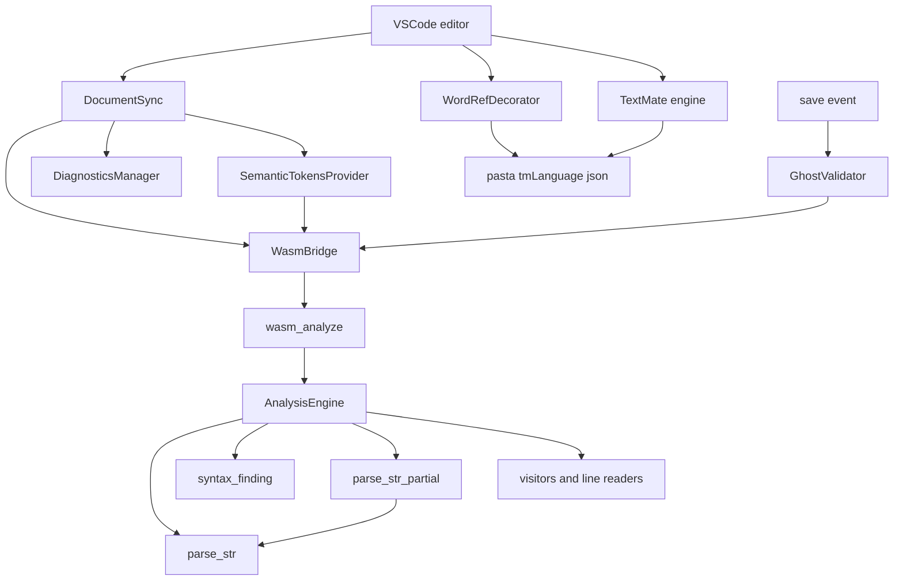
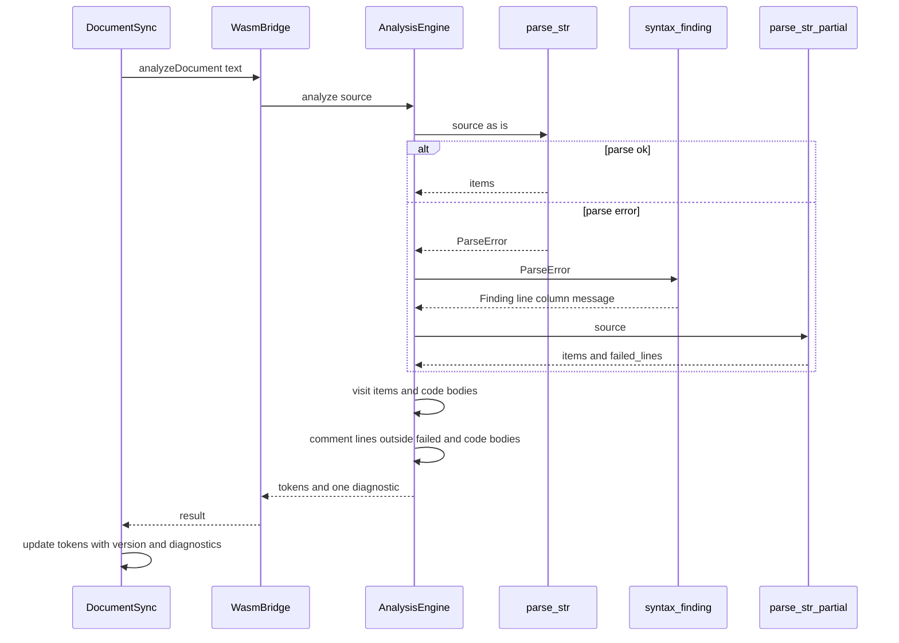
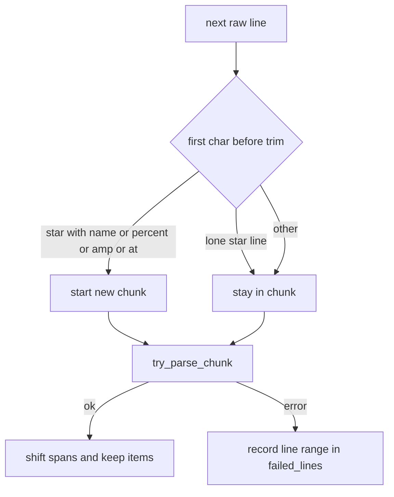

# 設計書: ponytail-editor-tooling

## Overview

**目的**: VSCode で辞書を書くゴーストの作者に、本当の文法どおりの診断と色を届ける。書き間違いが 1 つなら、波線は本当の位置に 1 件だけ、保存時と同じ文で出る。誤りの外のシーンは色を保つ。箱・コメント・属性・Lua のフェンス・エスケープの色は文法と一致する。

**利用者**: ゴーストの作者（拡張の診断と色を見る）と、pasta の開発者（`pasta_lsp`・拡張・`partial.rs` を保守する）。

**変わること**: 入力のたびの診断を、部分解析の誤りから `parse_str` の誤りへ替える。部分解析は色だけに使う。`pasta_lsp` から言語サーバと tower-lsp を外し、WASM の解析器だけにする。TextMate の文法・箱・意味の色の控えを、文法と版に合わせて直す。

### Goals

- 構文の誤りは、入力のたびの診断として本当の行と桁に 1 件だけ、`pasta_check validate` と同じ文で出る（要件 1・2・11）。
- 誤りのシーンの外は、誤りが無いときと同じ意味の色を保つ（要件 3）。
- コメント・属性・名前・箱・エスケープ・フェンスの色が、文法と一致する（要件 4〜6）。
- 凡例の食い違いはテストで落ちる。古い版の色を返さない（要件 7・8）。
- `pasta_lsp` は WASM の 3 つの入口だけを持つ。死んだコードと同語反復のテストを消す（要件 9・12）。
- マニュアル・README・steering が、直した挙動と構成に合う（要件 13）。関門を通る（要件 14）。

### Non-Goals

- 文法そのものの変更（`pasta_dsl/src/parser/**`）。最後の改行を要らなくすることも含む。
- 選択肢の行の意味の色（「将来実装」のまま）。
- DAP の側（`package.json` の `debuggers`・`debugAttachTarget.ts`・`runSceneAtCursor.ts`・`reloadShiori.ts`・`book/src/debug/{source-level,troubleshooting,vscode-setup}.md`）。`vscode-mcp-client` の持ち場。
- `pasta_lsp` のクレート名の変更。マニュアルのハイライトの CI（`ponytail-manual-ci`）。
- wasm の trap の後にインスタンスを読み直す仕組み。

## Boundary Commitments

### This Spec Owns

- 入力のたびの診断の作り方（`pasta_lsp/src/analysis/mod.rs`）。出どころは `parse_str` の誤り 1 件と、`pasta_check` の `syntax_finding`。
- 部分解析（`pasta_dsl/src/partial.rs`）。役目は色のための AST と、色を付けない行の範囲を返すことだけ。
- 意味の色の作り方（`pasta_lsp/src/analysis/**`）。宣言の行の読み取りと、行末のコメントの助け手を含む。
- `pasta_lsp` の公開の形：`analysis` の `AnalysisResult` と、WASM の 3 つの入口（`wasm_analyze`・`wasm_select_ghost_files`・`wasm_validate_ghost`）。JS へ渡す形は今と同じに保つ。
- `pasta_check::validate::syntax_finding` の公開（pub 化）と、`FindingKind::code()`・`ALL` の撤去。
- TextMate の文法（`editors/vscode/syntaxes/pasta.tmLanguage.json`）。箱は、この文法の規則を読む。
- 拡張の箱（`wordRefDecorator.ts`）・意味の色の控え（`semanticTokensProvider.ts`・`documentSync.ts`）・診断の変換（`diagnosticsManager.ts`）・`extension.ts` の `fallbackMode` の行。
- ルートの `Cargo.toml` の tower-lsp の行と `Cargo.lock`（このウェーブの席）。
- 要件 13 に挙がった文書の直し。

### Out of Boundary

- `pasta_dsl/src/parser/**`（`ponytail-dsl-parser`）。`parse_str` の誤りの形は、あちらが保つ。宣言の行の属性を AST に入れるのは `scene-attribute-store`。
- ゴースト全体の検査の起動の条件・集め方・表示（`ghostValidator.ts`）。要件 2 の規則（開いた文書の syntax を隠す）は今のまま使い、ファイルは直さない（テストだけ足す）。
- `pasta_lua/src/debug`、DAP の側のファイル、`package.json` の `debuggers`。
- `release.yml`・`build.yml`・`manual.yml`。
- `book/src/debug/*.md` のうち `validate.md` の「エディタの診断」の外。

### Allowed Dependencies

- `pasta_lsp` → `pasta_dsl`（`parse_str`・`parse_str_partial`・AST）・`pasta_check`（`default-features = false`。`syntax_finding`・`Finding`・ゴースト全体の検査）・`serde`。wasm32 では `wasm-bindgen`・`serde-wasm-bindgen`。dev は `serde_json`。
- `pasta_check` の dev-dependencies に `serde_json`（workspace）を足す（D7。OPEN QUESTION）。
- 拡張 → `vscode` の API・WASM の生成物・`syntaxes/pasta.tmLanguage.json`（JSON の import。esbuild が束ねる）。本番の依存は足さない。
- 依存の向き：`pasta_dsl` ← `pasta_check` ← `pasta_lsp` ← 拡張（WASM 越し）。`pasta_dsl` は `pasta_check` を知らない。`partial.rs` は `parser` の公開の関数だけを使う。

### Revalidation Triggers

- `parse_str` の誤りの形（`SyntaxError` の行・桁・文、文の頭の `Parse error in {file} at {line}:{column}: `、末尾の `\n  = 説明`）が変わる。→ 入力のたびの診断と保存時の診断が、両方とも変わる。
- AST に名前の span か宣言の行の属性が入る（`scene-attribute-store`）。→ 宣言の行の読み取りを AST に替えられる。
- 文法が最後の改行を要らなくする。→ 改行で終わらないファイルの診断が消える（R3）。
- `PartialParseResult` の形・`AnalysisResult` の JSON の形・凡例の並びが変わる。→ 拡張（`wasmBridge.ts`・`semanticTokensProvider.ts`）を見直す。
- tmLanguage の `match` の名前（`inline-*`・`action-line`・`continue-action-line`・`lua-code-block`）や、JS で読めない書き方。→ 箱が compile できなくなる。

## Architecture

### Existing Architecture Analysis

- 拡張は、入力のたびに `wasm_analyze`（WASM）を呼び、トークンと診断を受け取る。保存のたびに `wasm_validate_ghost` でゴースト全体を検査する。開いている文書の syntax は、保存時の側で隠す（`ghostValidator.ts:266`）。
- 今の `analyze` は、改行を補って `parse_str` を走らせ、失敗すると `parse_str_partial` の誤り（塊ごと・行ごと）を診断にする。これが監査の 1・2 番の根である。
- `partial.rs` は、字下げを取った行で区切りを決める（2 番の B の根）。解けない塊は、各行をファイルとして解き直す（第 3 段。正しい行も誤りになる）。
- 色は、AST の span から作る。コメントは AST に無いので、行全体のコメントだけを文字から拾う。宣言の行は印から行末までを名前の色にする（4 番の根）。
- 箱は、行を見ない正規表現で全文に付く（3 番の根）。

### Architecture Pattern & Boundary Map



- **形**: 今の層をそのまま保つ。新しい部品は無い。Rust は「診断の出どころを 1 つにする」「部分解析を色だけにする」、拡張は「箱と TextMate を同じ規則にする」に絞る。
- **境界**: 診断の文は `pasta_check` が持つ。部分解析の区切りは `pasta_dsl/src/partial.rs` が持つ。色の規則は意味の色（Rust）と TextMate の文法（JSON）の 2 か所で、箱は TextMate の文法を読む。
- **守る形**: 解析は副作用の無い関数。JS へ渡す形（`tokens`・`diagnostics`・ゴースト全体の報告）は変えない。TextMate の scope の名前は変えない（マニュアルのハイライトが読む）。
- **steering**: 公開クレートの pub API は予告なく消してよい（`tech.md:178`）。`pasta_lsp` は `publish = false` になり、`tech.md` の公開ポリシーの例外に加わる。

### Technology Stack

| 層 | 選択・版 | この spec での役目 | 備考 |
| -- | -------- | ------------------ | ---- |
| 解析器 | Rust 2024・`pasta_dsl`・`pasta_check`・`serde` 1 | 診断と意味の色 | `tower-lsp` 0.20・`thiserror` を外す。`lsp-types` は足さない |
| WASM | `wasm-bindgen` 0.2・`serde-wasm-bindgen` 0.6 | 3 つの入口 | `catch_unwind` の包みを外す |
| 拡張 | TypeScript・esbuild・VSCode API 1.85 | 箱・控え・診断の表示 | JSON の import（`resolveJsonModule` は有効） |
| 文法 | TextMate（vscode-textmate 9・vscode-oniguruma 2.0.1） | WASM の外の色・マニュアルのハイライト | `\p{XID_Start}`・`\p{XID_Continue}` を使う（R2） |
| 試験 | `cargo test`・`npm test`・`book/tools/highlight/*-test.mjs` | 関門 | `pasta_check` の dev に `serde_json` |

## File Structure Plan

### Directory Structure（消すもの・足すもの）

```
crates/pasta_lsp/
├── src/
│   ├── lib.rs              # pub mod analysis; pub mod transport; だけにする
│   ├── server.rs           # 消す
│   ├── document.rs         # 消す
│   ├── error.rs            # 消す
│   ├── transport.rs        # WASM の 3 つの入口だけ。Wasm* の型・From・native・catch_unwind を消す
│   └── analysis/
│       ├── mod.rs          # AnalysisResult・Diagnostic・Range・Position。analyze の流れ（診断・色・コメント行）
│       ├── token_types.rs  # TOKEN_TYPES・TOKEN_MODIFIERS（文字列）・SemanticToken・RawToken・encode_tokens
│       ├── visit_scope.rs  # 宣言の行の読み取り（scan_decl_line）・属性・単語定義・アクター指定の行末コメント・コードブロックの本文の行
│       ├── visit_action.rs # Call・キュー・選択肢の行末コメント
│       ├── visit_expr.rs   # 変数代入の行末コメント
│       └── text_utils.rs   # push_trailing_comment・桁（文字）から UTF-16 への直し
└── tests/
    ├── lsp_lifecycle_test.rs   # 消す
    ├── document_sync_test.rs   # 消す
    ├── crash_recovery_test.rs  # 消す
    └── legend_sync_test.rs     # 足す：TS の凡例と Rust の凡例を比べる
editors/vscode/scripts/build-wasm.bat  # 消す
```

### Modified Files

**Rust**

- `crates/pasta_check/src/validate/syntax.rs` — `syntax_finding` を `pub fn` にする。文言の作り方は変えない。
- `crates/pasta_check/src/validate/mod.rs` — `pub use syntax::syntax_finding;` を足す。
- `crates/pasta_check/src/validate/report.rs` — `FindingKind::ALL`・`FindingKind::code()` を消す。`code()` を引く doc の行を直す。
- `crates/pasta_check/tests/validate_report_test.rs` — 重さと code の表を、網羅の `match` と serde の値で確かめる形に直す。
- `crates/pasta_check/tests/validate_config_test.rs` — `f.code.code() == "config-actor-font"` を `f.code == FindingKind::ConfigActorFont` にする。
- `crates/pasta_check/Cargo.toml` — dev-dependencies に `serde_json.workspace = true`。
- `crates/pasta_dsl/src/partial.rs` — 区切り・失敗した塊の範囲・撤去（D2）。モジュールの doc を直す。
- `crates/pasta_dsl/src/lib.rs` — 再輸出から `PartialParseError` を外す。
- `crates/pasta_dsl/tests/partial_parse_test.rs` — `infer_rule_from_line` と誤りの文のテストを消し、区切り・`failed_lines`・字下げした行・続きの `＊` のテストにする。
- `crates/pasta_dsl/tests/cue_cmd_parse_test.rs` — `infer_rule_from_line` の 4 つのテスト（350〜379 行）と `use` を消す。
- `crates/pasta_lsp/Cargo.toml` — `tower-lsp`・`thiserror` を外す。`publish = false`。`description` を「WASM の解析器」に直す。
- `crates/pasta_lsp/tests/*.rs` — `tower_lsp` の `use` を自前の型に替える（`code_block_token_test.rs`・`diagnostics_test.rs`）。`diagnostics_test.rs` は本当の位置と件数のテストに置き換える（要件 12.5）。色の直しのテストを `semantic_token_test.rs`・`partial_token_test.rs`・`code_block_token_test.rs` に足す。
- `Cargo.toml`（ルート） — `tower-lsp` の行（59 行）を消す。
- `Cargo.lock` — 作り直す。

**拡張**

- `editors/vscode/syntaxes/pasta.tmLanguage.json` — 規則の直し（下の TextMate Grammar）。
- `editors/vscode/src/wordRefDecorator.ts` — 純関数 `findWordRefRanges` と、それを使う装飾。
- `editors/vscode/src/semanticTokensProvider.ts` — 控えを `{ version, tokens }` にする。`updateTokens` に版を足す。コメントの「analysis.rs」を `token_types.rs` に直す。
- `editors/vscode/src/documentSync.ts` — 版を渡す。解析に失敗したら控えも消す。
- `editors/vscode/src/diagnosticsManager.ts` — `clearAll`・`convertSeverity` を消し、重さは常に Error。
- `editors/vscode/src/extension.ts` — `ActivationState.fallbackMode` とその書き込みを消す（ほかの行は触らない）。
- `editors/vscode/src/test/tmGrammar.test.ts` — 誤った今の色を固めるテストを、要件 4〜6 の色のテストに置き換える。
- `editors/vscode/src/test/vscodeModules.test.ts` — 箱の純関数・控えの版・`clearAll` と `fallbackMode` のテストの直し。
- `editors/vscode/src/test/e2e.test.ts` — 200〜288 行を消す。
- `editors/vscode/src/test/ghostValidator.test.ts` — 開いた文書で syntax が二重に出ないこと・閉じたら出ることのテストを足す（要件 2.1・2.2。既にあれば足さない）。

**文書**

- `book/src/debug/validate.md` — 「エディタの診断」の「構文エラーの重複」の文。
- `book/src/internals/talk-output.md` — 350 行の「単位の読み方の写し」の文。
- `crates/pasta_lsp/README.md`・`TEST_COVERAGE.md`（75・185・273 行）・`.kiro/steering/tech.md`（15・66〜69・111・124 行）・`.kiro/steering/structure.md`（186〜205 行）。
- （OPEN QUESTION）`book/src/grammar/markers.md:39`・`crates/pasta_dsl/README.md`（45・63・77 行）・`book/src/internals/transpiler.md:42`。直した挙動とずれる記述。

## System Flows

### 入力のたびの解析



- `parse_str` には改行を補わない（R3）。改行で終わらないファイルは、保存時と同じ 1 件が出る。色は部分解析が最後の塊に改行を補うので残る。
- 部分解析は、全体が解けないときにだけ呼ぶ（N1。2 回解かない）。
- 失敗した塊の行と Lua ブロックの本文の行には、行全体のコメントの色を付けない（要件 3.3・4.5）。

### 部分解析の塊



- 区切りは、字下げする前の行頭の 1 文字で決める。字下げした `　％…`・`　＠…`・`　＆…` は区切りにならない（要件 3.2）。
- 名前の無い `＊` の行（続きのシーン）は区切りにしない。前の名前付きのシーンと一緒に解く（R6）。

## Requirements Traceability

| 要件 | 要約 | 部品 | 契約 | 流れ |
| ---- | ---- | ---- | ---- | ---- |
| 1.1 | 構文の誤りは 1 件 | AnalysisEngine | `analyze` | 入力のたびの解析 |
| 1.2 | 5 行の例で 4 行目 4 文字目 | AnalysisEngine | `analyze` | 同上 |
| 1.3 | 行と桁は `parse_str` の位置・UTF-16 | AnalysisEngine・text_utils | `char_column_to_utf16` | 同上 |
| 1.4 | 文は `pasta_check validate` と同じ | SyntaxFinding | `syntax_finding` | 同上 |
| 1.5 | 頭・最後・改行なし・CRLF | AnalysisEngine | 改行を補わない | 同上 |
| 1.6 | 直したら消える | AnalysisEngine・DocumentSync | `setDiagnostics` で置き換え | 同上 |
| 1.7 | 誤りが無ければ出さない | AnalysisEngine | `analyze` | 同上 |
| 1.8 | 幅の無い点 | AnalysisEngine | `Diagnostic.range` | 同上 |
| 2.1 | 開いた文書は入力のたびの 1 件だけ | GhostValidator（今のまま）・AnalysisEngine | 今の規則 | — |
| 2.2 | 閉じたら保存時の syntax | GhostValidator（今のまま） | 今の規則 | — |
| 2.3 | 同じ中身なら同じ行・桁・文 | SyntaxFinding・AnalysisEngine | `syntax_finding`・改行を補わない | 入力のたびの解析 |
| 3.1 | 誤りの外は同じ色 | PartialParser・AnalysisEngine | `parse_str_partial` | 部分解析の塊 |
| 3.2 | 字下げした行で割れない | PartialParser | 区切りの規則 | 同上 |
| 3.3 | 誤りのシーンは TextMate に任せる | PartialParser・AnalysisEngine | `failed_lines` | 同上 |
| 3.4 | 誤りが無いときの色は今と同じ | AnalysisEngine・Visitors | — | — |
| 4.1 | 宣言の行の名前と行末コメント | DeclLineReader | `scan_decl_line` | — |
| 4.2 | 宣言の行の属性 | DeclLineReader | `scan_decl_line` | — |
| 4.3 | 書ける行の行末コメント | TrailingComment・Visitors | `push_trailing_comment` | — |
| 4.4 | 本文の `＃` はコメントにしない | TrailingComment | 本体の終わりの後だけ | — |
| 4.5 | Lua の中の `#` 行はコメントにしない | AnalysisEngine | コードブロックの本文の行を飛ばす | 入力のたびの解析 |
| 4.6 | TextMate も同じ範囲 | TextMateGrammar | 規則の表 | — |
| 5.1 | 箱は `＠`＋名前だけ | WordRefDecorator | `findWordRefRanges` | — |
| 5.2 | `＠＠` に箱を付けない | WordRefDecorator・TextMateGrammar | `inline-escape` を先に当てる | — |
| 5.3 | 単語定義・コメント・Lua・キューに付けない | WordRefDecorator | 台詞の部分だけ | — |
| 5.4 | TextMate の単語参照の範囲 | TextMateGrammar | `inline-word-ref`・`inline-dynamic-ref` | — |
| 5.5 | TextMate のエスケープ | TextMateGrammar | `inline-escape` | — |
| 5.6 | `inline-fn-call` を持たない | TextMateGrammar | 規則の撤去 | — |
| 5.7 | 選択肢の行 | TextMateGrammar | `choice` の規則 | — |
| 6.1 | 同じ数のフェンスまで Lua | TextMateGrammar | `lua-code-block` の `begin`・`end` | — |
| 6.2 | 閉じの後ろの空白・コメント | TextMateGrammar | `end` | — |
| 6.3 | 4 連の中の 3 連で閉じない | TextMateGrammar | `end` の `\1` | — |
| 6.4 | 字下げ・言語名の後ろの空白で開かない | TextMateGrammar | `begin` | — |
| 6.5 | 意味の色はフェンスの行だけ | Visitors（今のまま） | `visit_code_block` | — |
| 7.1 | 凡例の食い違いでテストが落ちる | LegendSyncTest | `TOKEN_TYPES`・`TOKEN_MODIFIERS` | — |
| 7.2 | `semanticTokenScopes` の覆い | 拡張のテスト（今のまま） | — | — |
| 8.1 | 今の版の結果を返す | SemanticTokensProvider | `{ version, tokens }` | 入力のたびの解析 |
| 8.2 | 失敗したら前の版を返さない | SemanticTokensProvider・DocumentSync | `clearTokens` | 同上 |
| 8.3 | 閉じたら控えを消す | DocumentSync（今のまま） | `clearTokens`・`clear` | — |
| 9.1 | サーバとそのテストを持たない | WasmTransport | ファイルの撤去 | — |
| 9.2 | tower-lsp・thiserror に依存しない | WasmTransport・AnalysisResult | 自前の型 | — |
| 9.3 | `publish = false` | WasmTransport | `Cargo.toml` | — |
| 9.4 | 3 つの入口と JS の形を保つ | WasmTransport・AnalysisResult | JSON の形 | — |
| 9.5 | panic で拡張を落とさない | WasmBridge（今のまま） | try/catch | — |
| 9.6 | `code()`・`ALL` を持たない | FindingKind | serde の名前 | — |
| 9.7 | `from_analysis`・4 通りの重さを持たない | WasmTransport・AnalysisResult | `severity` は常に 1 | — |
| 10 | （欠番）`host` の廃止 | — | この spec では扱わない | — |
| 11.1 | `SyntaxError` の形から作る | AnalysisEngine・SyntaxFinding | `syntax_finding` | 入力のたびの解析 |
| 11.2 | 位置の無い誤りは 1 行目の頭 | AnalysisEngine | `Finding.line == None` | 同上 |
| 11.3 | `partial.rs` のほかの parser を変えない | PartialParser | 境界 | — |
| 11.4 | `debug/*.md` は `validate.md` の節だけ | Docs | — | — |
| 12.1 | `build-wasm.bat` を持たない | ExtensionCleanup | ファイルの撤去 | — |
| 12.2 | 同語反復の e2e を持たない | ExtensionCleanup | テストの撤去 | — |
| 12.3 | `clearAll`・`fallbackMode` を持たない | ExtensionCleanup | — | — |
| 12.4 | 第 3 段・`chunk_lines`・推測・span を持たない | PartialParser | — | — |
| 12.5 | 緩い診断のテストを置き換える | 解析器のテスト | — | — |
| 12.6 | 誤った色を固めるテストを置き換える | 拡張のテスト | — | — |
| 13.1 | `validate.md` の文 | Docs | — | — |
| 13.2 | `talk-output.md` の写しの文 | Docs | — | — |
| 13.3 | README・`TEST_COVERAGE.md`・steering | Docs | — | — |
| 14.1 | 先に再現のテスト | 全部品（タスクの順） | — | — |
| 14.2 | fmt・clippy・cargo test・npm test | 関門 | — | — |
| 14.3 | VSIX を作れる | 関門 | — | — |
| 14.4 | マニュアルのハイライトの自己テスト | 関門 | — | — |
| 14.5 | ゴースト全体の検査は今のまま | GhostValidator（触らない） | — | — |

## Components and Interfaces

| 部品 | 層 | 役目 | 要件 | 主な依存 | 契約 |
| ---- | -- | ---- | ---- | -------- | ---- |
| SyntaxFinding | pasta_check | 構文の誤りを報告の 1 件にする | 1.4, 2.3, 11.1 | `pasta_dsl::ParseError`（P0） | Service |
| FindingKind | pasta_check | 報告の種類（code は serde の名前） | 9.6 | serde（P0） | State |
| PartialParser | pasta_dsl | 色のための塊の解析 | 3.1, 3.2, 3.3, 11.3, 12.4 | `parse_str`（P0） | Service |
| AnalysisEngine | pasta_lsp | 診断 1 件とトークンを作る | 1.x, 2.3, 3.x, 4.5, 11.1, 11.2 | SyntaxFinding・PartialParser（P0） | Service |
| DeclLineReader | pasta_lsp | 宣言の行の名前・属性・行末コメント | 4.1, 4.2 | 行の文字（P0） | Service |
| TrailingComment | pasta_lsp | 行末のコメントのトークン | 4.3, 4.4 | AST の span（P0） | Service |
| TokenLegend | pasta_lsp | 凡例とトークンの形 | 7.1, 9.2, 9.4 | — | State |
| WasmTransport | pasta_lsp | WASM の 3 つの入口 | 9.1〜9.5, 9.7 | AnalysisEngine・pasta_check（P0） | API |
| TextMateGrammar | 拡張 | WASM の外の色・マニュアルのハイライト | 4.6, 5.2, 5.4〜5.7, 6.1〜6.4 | Oniguruma（P0） | State |
| WordRefDecorator | 拡張 | 単語参照の箱 | 5.1〜5.3 | TextMateGrammar の JSON（P0） | Service |
| SemanticTokensProvider | 拡張 | 版つきの色の控え | 8.1〜8.3 | WasmBridge（P0） | State |
| ExtensionCleanup | 拡張 | 死んだコードの撤去 | 9.7, 12.1〜12.3 | — | — |
| LegendSyncTest | 試験 | 凡例の一致 | 7.1 | TS のファイル（P1） | — |
| Docs | 文書 | 直した挙動と構成 | 13.x, 11.4 | — | — |

### pasta_check

#### SyntaxFinding

| 欄 | 内容 |
| -- | ---- |
| 役目 | `parse_str` の誤りを、`pasta_check validate` の syntax の報告 1 件にする（保存時と入力のたびで同じ関数） |
| 要件 | 1.4, 2.3, 11.1 |

**責務と制約**

- 文の作り方は今のまま（頭の `Parse error in {file} at {line}:{column}: ` を外し、`rsplit_once("\n  = ")` の後ろだけを `msg::syntax` に包む）。
- `SyntaxError` 以外の誤りは、行・桁を持たない報告にする（今のまま）。

**契約**: Service [x]

```rust
// crates/pasta_check/src/validate/syntax.rs（pub にする）
// mod.rs で `pub use syntax::syntax_finding;`
pub fn syntax_finding(path: &str, e: pasta_dsl::ParseError) -> Finding;
```

- 事前条件: `e` は `pasta_dsl::parse_str` が返した誤り。
- 事後条件: `code == FindingKind::Syntax`・`severity == Error`。`line`・`column` は 1 始まり（桁は文字）か `None`。`message` は `構文エラー: …` の 1 行。

#### FindingKind

- `ALL` と `code()` を消す。報告の `code`（kebab-case）は serde の `rename_all = "kebab-case"` が今と同じ文字列を出す（要件 9.6）。
- テストは、種類ごとの重さと code を返す網羅の `match`（ワイルドカード無し）を持ち、`serde_json::to_value(kind)` と比べる（D7）。

### pasta_dsl

#### PartialParser

| 欄 | 内容 |
| -- | ---- |
| 役目 | 全体が解けないときに、塊ごとに解いて色のための AST と、解けない塊の行の範囲を返す |
| 要件 | 3.1, 3.2, 3.3, 11.3, 12.4 |

**責務と制約**

- 区切りは、字下げする前の行頭の 1 文字が `＊`・`*`・`％`・`%`・`＆`・`&`・`＠`・`@` の行。ただし `＊`・`*` の後ろが空白とコメントだけの行（名前の無い `＊`）は区切りにしない。
- 塊は元のソースの部分の文字列で、行の終わり（`\n`・`\r\n`）を保つ（今のまま）。解けた塊の span は、今の `shift_*` で元の座標に直す。
- 解けない塊は、その行の範囲（1 始まり・終わりを含まない）だけを `failed_lines` に積む。誤りの文は作らない。
- 全体を解く第 1 段は持たない。呼び手が全体の失敗を知っているときに呼ぶ。全体が正しいソースを渡しても、塊ごとに解いた同じ AST を返す。
- `chunk_lines`・第 3 段のループ・`infer_rule_from_line`・`PartialParseError` を持たない。
- `pasta_dsl/src/parser/**` を変えない。使うのは `parse_str`（`crate::parser`）と AST の型だけ。
- `shortcut:` Lua ブロックの本文の 0 桁目にある `＊`・`％`・`＆`・`＠` も区切りにする。Lua の文の頭には来ない文字なので追わない。困る例が出たら、フェンスを数えて区切りを止める。

**契約**: Service [x]

```rust
// crates/pasta_dsl/src/partial.rs
pub struct PartialParseResult {
    /// 解けた塊の AST（span は元のソースの座標）
    pub items: Vec<FileItem>,
    /// 解けない塊の行（1 始まり・半開区間）。昇順で重ならない
    pub failed_lines: Vec<std::ops::Range<usize>>,
}
pub fn parse_str_partial(source: &str) -> PartialParseResult;
```

- 事後条件: `items` と `failed_lines` の行は重ならない。どの行も、どちらか 1 つの塊に入る（空の行の塊を除く）。

### pasta_lsp

#### AnalysisEngine

| 欄 | 内容 |
| -- | ---- |
| 役目 | 1 つの文書から、構文の診断 0〜1 件と意味の色を作る |
| 要件 | 1.1〜1.8, 2.3, 3.1, 3.3, 3.4, 4.5, 11.1, 11.2 |

**責務と制約**

- 診断：`parse_str(source, "<lsp>")` を、受け取った文字のまま 1 回だけ呼ぶ（改行を補わない）。失敗したら `syntax_finding("<lsp>", e)` の 1 件を、次の点の診断にする。
  - 行 = `finding.line - 1`（`None` なら 0）。
  - 桁 = その行の文字の、頭から `finding.column - 1` 文字の UTF-16 の長さ（`None` なら 0）。行の文字は CRLF の `\r` を除いて数える。行より長い桁は行の長さで止める。
  - 範囲は始まりと終わりが同じ点。重さは 1（Error）。文は `finding.message`。
- 色：解けたら、その AST をそのまま走査する。解けなければ `parse_str_partial(source)` の `items` を走査する。
- 行全体のコメント（`＃`・`#` で始まる行）は、`failed_lines` とコードブロックの本文の行を除いて COMMENT にする。本文の行は、走査したコードブロックの開きの次の行から閉じの行の手前まで。開きと閉じの行は、走査が出した CODE_BLOCK のトークン（フェンスの行に 1 つずつ。解けたブロックは開きと閉じが別の行）を行の順に 2 つずつ組にして決める。走査の関数の引数は増やさない。
- 純粋な関数。共有する状態を持たない。panic を包まない（wasm32 では包みが効かない。R4）。

**依存**

- Outbound: SyntaxFinding — 文と位置（P0）。PartialParser — 色の AST と範囲（P0）。
- External: `pasta_dsl::parse_str` — 位置の形は `ponytail-dsl-parser` が保つ（P0）。

**契約**: Service [x]

```rust
// crates/pasta_lsp/src/analysis/mod.rs
#[derive(Debug, Clone, Default, serde::Serialize)]
pub struct AnalysisResult {
    pub tokens: Vec<SemanticToken>,     // LSP の delta の並び
    pub diagnostics: Vec<Diagnostic>,   // 0 か 1 件
}

#[derive(Debug, Clone, PartialEq, Eq, serde::Serialize)]
pub struct Diagnostic {
    pub range: Range,
    pub message: String,
    /// 常に 1（Error）。JS の形を保つために欄を残す
    pub severity: u32,
}

#[derive(Debug, Clone, Copy, PartialEq, Eq, serde::Serialize)]
pub struct Range { pub start: Position, pub end: Position }

#[derive(Debug, Clone, Copy, PartialEq, Eq, serde::Serialize)]
pub struct Position { pub line: u32, pub character: u32 } // 0 始まり・UTF-16

impl AnalysisEngine {
    pub fn analyze(source: &str) -> AnalysisResult;
}

/// 報告 1 件を、幅の無い点の診断にする（行・桁が無ければ 1 行目の頭）
fn finding_to_diagnostic(finding: &pasta_check::validate::Finding, source: &str) -> Diagnostic;
```

```rust
// crates/pasta_lsp/src/analysis/text_utils.rs
/// 行の頭から `chars` 文字の UTF-16 の長さ。行より長ければ行の長さ
pub(crate) fn char_column_to_utf16(line_text: &str, chars: usize) -> u32;
```

- 事後条件: `diagnostics.len() <= 1`。`parse_str` が成功すれば 0 件。
- 不変条件: 同じ入力から同じ結果。トークンは重ならない。

**実装メモ**

- 統合: `analysis` の型は JS の形（今の `Wasm*`）と同じ欄・同じ順に並べる（`tokens`・`diagnostics`、`range`・`message`・`severity`）。`transport.rs` は `AnalysisResult` をそのまま `serde_wasm_bindgen::to_value` に渡す。
- 検証: 要件 1.2 の 5 行・CRLF・1 行目・最後の行・改行で終わらない行・サロゲートペア（`𠮷`）・名前の無い `＊` で始まるファイル（AST の組み立ての誤り。1:1 を持つ）を、`diagnostics_test.rs` で行・桁・文・件数まで確かめる。同じ文字を `pasta_check::validate::validate_ghost` に渡した syntax の報告と、行・桁（UTF-16 に直して）・文が一致することも確かめる（要件 2.3）。位置の無い誤り（要件 11.2）は今の `parse_str` から作れないので、行・桁が `None` の `Finding` を手で作り、`finding_to_diagnostic` が `(0, 0)` にすることを単体で確かめる。
- 危険: 改行で終わらないファイルに、今は出ない誤りが出る（R3）。

#### DeclLineReader（`visit_scope.rs`）

| 欄 | 内容 |
| -- | ---- |
| 役目 | 解けた宣言の行（`＊名前`・`＊`・`　・名前`・`％名前`）の、名前・属性・行末のコメントの位置を決める |
| 要件 | 4.1, 4.2 |

**責務と制約**

- 文法の `印 ~ id? ~ s ~ attrs? ~ or_comment_eol` に沿って行の文字を読む。名前は印の直後の、空白・`＆`・`&`・`＃`・`#` の手前まで。属性は `＆`・`&` から次の `＆`・`&` か行末のコメントの手前まで（後ろの空白は含めない）。行末のコメントは、属性の外で引用（`「…」`・`"…"`）の外の最初の `＃`・`#` から行末まで。
- 行はもう解けている前提で読む（誤りの行には呼ばない）。
- トークン: 印と名前に NAMESPACE（グローバル）・SCENE（ローカル）・ACTOR（アクター辞書）、属性ごとに DECORATOR、行末のコメントに COMMENT。ローカルシーンの印のトークンは印の位置から始める（字下げを含めない）。
- `marker_line_token`（行末まで）を、この読み取りに置き換える。

**契約**: Service [x]

```rust
// crates/pasta_lsp/src/analysis/visit_scope.rs（モジュールの中だけ）
struct DeclParts {
    name_end: usize,                    // 印と名前の終わり（行の中のバイト）
    attrs: Vec<std::ops::Range<usize>>, // 属性ごとの範囲（行の中のバイト）
    comment_start: Option<usize>,       // 行末のコメントの始まり（行の中のバイト）
}
fn scan_decl_line(line_text: &str, marker_start: usize) -> DeclParts;
```

#### TrailingComment（`text_utils.rs` とその呼び手）

| 欄 | 内容 |
| -- | ---- |
| 役目 | 行末のコメントを書ける行で、本体の後ろの `＃`・`#` から行末までを COMMENT にする |
| 要件 | 4.3, 4.4 |

**責務と制約**

- `from_byte`（その行の本体の終わり）から空白（`space_chars`）を飛ばし、次の文字が `＃`・`#` なら行末までを 1 つの COMMENT にする。それ以外は何もしない。
- 呼び手と本体の終わりは次の表のとおり。アクション行・継続行には呼ばない（台詞の `＃` は本文。要件 4.4）。

| 行 | 本体の終わり |
| -- | ------------ |
| グローバル・ローカルシーン・名前の無い `＊`・アクター辞書の宣言 | `scan_decl_line` |
| 属性の行（ファイル・シーン・アクター） | その行の最後の `Attr.span` の終わり |
| 単語定義の行 | `KeyWords.span` の終わり（囲まない値は `＃` 以降も span に入るので何も出ない） |
| アクター指定の行（`　％さくら、うにゅう`） | その行の最後の `SceneActorItem.span` の終わり |
| 変数代入・Call | `VarSet.span`・`CallScene.span` の終わり |
| キューコマンド | 引数の閉じ括弧の後ろ。無ければスコープの span の終わり、無ければ名前の終わり |
| 選択肢 | 見出し（`「…」`）の閉じの後ろ。無ければ名前の終わり |
| Lua ブロックの閉じのフェンス | 連続する `` ` `` の終わり。フェンスの CODE_BLOCK はそこで止める |

```rust
// crates/pasta_lsp/src/analysis/text_utils.rs
pub(crate) fn push_trailing_comment(
    source: &str,
    line: usize,          // 1 始まり
    from_byte: usize,     // ファイルの頭からのバイト（その行の中）
    tokens: &mut Vec<RawToken>,
);
```

- 選択肢の行は、行末のコメントの COMMENT だけを出す。選択肢の部品の色は足さない（要件 5.7。OPEN QUESTION）。

#### TokenLegend（`token_types.rs`）

- `TOKEN_TYPES: &[&str]`・`TOKEN_MODIFIERS: &[&str]` に替える（並びと文字列は今と同じ）。`semantic_tokens_legend()` を消す。`token_type::*` の番号は今のまま。
- `SemanticToken` を自前で持つ。Rust の欄の名前は今の LSP の名前のままにし、JS の名前は serde の rename で付ける（テストの書き換えを減らす）。

```rust
#[derive(Debug, Clone, Copy, PartialEq, Eq, serde::Serialize)]
pub struct SemanticToken {
    #[serde(rename = "deltaLine")] pub delta_line: u32,
    #[serde(rename = "deltaStartCharacter")] pub delta_start: u32,
    pub length: u32,
    #[serde(rename = "tokenType")] pub token_type: u32,
    #[serde(rename = "tokenModifiers")] pub token_modifiers_bitset: u32,
}
```

#### WasmTransport（`transport.rs`・`lib.rs`・`Cargo.toml`）

| 欄 | 内容 |
| -- | ---- |
| 役目 | WASM の 3 つの入口だけを持つ |
| 要件 | 9.1〜9.5, 9.7 |

**契約**: API [x]

| 入口 | 入力 | 出力 | 誤り |
| ---- | ---- | ---- | ---- |
| `wasm_analyze(source: &str) -> JsValue` | 文書の文字 | `{ tokens: [{deltaLine, deltaStartCharacter, length, tokenType, tokenModifiers}], diagnostics: [{range: {start: {line, character}, end}, message, severity}] }` | 直列化の失敗で `null` |
| `wasm_select_ghost_files(input) -> JsValue` | `GhostInput`（camelCase） | `string[]` | 形の誤りで `null` |
| `wasm_validate_ghost(input, files) -> JsValue` | `GhostInput`・`Record<string, FileText>` | `Report`（今の形） | 形の誤りで `null` |

- `catch_unwind` の包み（`wasm_analyze`・`ghost_call`）を消す。形の誤りで `null` を返す動きは残す（`ghost_call` は `Option` を `null` にするだけの関数になる。要らなければ消す）。
- `Wasm*` の型・`From` の実装・`from_analysis`・4 通りの重さの対応・native の空のモジュールを消す。
- `lib.rs` は `pub mod analysis; pub mod transport;` だけにする。`server.rs`・`document.rs`・`error.rs` を消す。
- `Cargo.toml`: `tower-lsp`・`thiserror` を外す。`publish = false`。`release.yml` は変えない（`pasta_lsp` は元から出していない）。
- JSON の形のテスト（今の `transport.rs:367-404` 相当）は、`AnalysisResult` の直列化で同じ文字列になることを確かめる形で残す。重さは 1 だけを固める。

### 拡張

#### TextMateGrammar（`pasta.tmLanguage.json`）

| 欄 | 内容 |
| -- | ---- |
| 役目 | WASM の外の色と、マニュアルのハイライトの色を、文法に合わせる |
| 要件 | 4.6, 5.2, 5.4〜5.7, 6.1〜6.4 |

**責務と制約**

- scope の名前は変えない。足すのは同じ名前の組み合わせだけ（`comment.line.pasta`・`entity.other.attribute-name.pasta` など）。
- 名前の文字は `[\p{XID_Start}_]\p{XID_Continue}*`（文法の `id`）。空白は `[\s　]`。
- 規則の直しは次の表のとおり（「名前」「属性」「コメント」は上の scope）。

| 規則 | 直し |
| ---- | ---- |
| `global-scene`・`local-scene` | 印・名前・残り。残りに `decl-attr` と `line-end-comment` を当てる。名前は名前の文字だけ |
| `actor`（宣言・アクター指定） | 本体と `line-end-comment` に分ける |
| `attribute` | 本体（引用の外の `＃` の手前まで）と `line-end-comment` に分ける |
| `word` | `＠？`・`@?` で始まる行を除く。最後の値が引用（`」`・`"`）で終わるときだけ、後ろの `＃` からを `line-end-comment` にする |
| `choice`（新しい規則・`word` の前） | `＠？`・名前・見出し（`「…」`）・`line-end-comment`。単語定義の scope を付けない |
| `variable`・`call` | 本体（引用の外の `＃` の手前まで。scope は今のまま）と `line-end-comment` |
| `cue-command` | 名前を名前の文字に合わせ、最後に `line-end-comment` を足す |
| `lua-code-block` | begin `^(`{3,})([\p{XID_Start}_]\p{XID_Continue}*)?$`、end `^(\1)[\s　]*([＃#].*)?$`。字下げと言語名の後ろの空白では開かない。endCaptures の 2 を `comment.line.pasta`。`contentName` は今のまま |
| `action-line` | 名前を名前の文字（`[\p{XID_Start}_]\p{XID_Continue}*`）に合わせる |
| `continue-action-line`（新しい規則） | `^([\s　]+)([：:])(.*)$`。台詞の部分に `action-line` と同じ inline の規則を当てる（OPEN QUESTION） |
| `inline-escape` | `[＠@]{2}`・`[＄$]{2}`・`\\[\\%]` だけ。inline の規則の頭に置く |
| `inline-word-ref` | `[＠@][＊*]?[\p{XID_Start}_]\p{XID_Continue}*`（`word_ref` と、`fn_call_local`・`fn_call_global` の名前。関数呼び出しも名前だけ） |
| `inline-dynamic-ref` | `[＠@][＄$](?:[＊*][\p{XID_Start}_]\p{XID_Continue}*\|[\p{XID_Start}_]\p{XID_Continue}*\|[0-9０-９]+)`（`dyn_name` の `var_id`・`＊id`。前の `(?<![＠@])(?:[＠@]{2})*` は、エスケープを先に当てるので消す） |
| `inline-var-ref` | 名前を文法の `var_id`（`id` か数字）・`＊id`・`property_id`（`＄％` の後ろ）に合わせる |
| `inline-fn-call` | 消す |

- 台詞の inline の規則の並びは `inline-escape`・`inline-sakura-script`・`inline-dynamic-ref`・`inline-word-ref`・`inline-var-ref`・`inline-talk`。TextMate は、いちばん左で当たる規則を取り、同じ位置なら先の規則を取る。

**契約**: State [x]（scope の名前と規則の名前が、箱とマニュアルのハイライトの契約）

**実装メモ**

- 統合: 変えた後に `book/tools/highlight/tokenizer-test.mjs`・`highlight-html-test.mjs` を走らせる。`book/node_modules` が無いワークツリーでは、main の作業コピーのものを使う。
- 検証: `tmGrammar.test.ts` に、要件 4.1〜4.6・5.2・5.4〜5.7・6.1〜6.4 の行を足す。「既存: エスケープ ＠＠単語・＄＄x の色分けは不変」と、動的な関数呼び出しの引数まで単語参照とするテストは、新しい範囲のテストに置き換える。
- 危険: マニュアルの見た目が変わる（直したい変化）。

#### WordRefDecorator（`wordRefDecorator.ts`）

| 欄 | 内容 |
| -- | ---- |
| 役目 | アクション行・継続行の台詞の中の単語参照（関数呼び出しの名前と動的な単語参照を含む）にだけ箱を付ける |
| 要件 | 5.1, 5.2, 5.3 |

**責務と制約**

- 規則はすべて `pasta.tmLanguage.json` から読む（import）。自分の正規表現の写しを持たない。
  - 行の種類: `lua-code-block` の `begin`・`end`（`end` の `\1` は開きの印に置き換える）、`action-line`・`continue-action-line` の `match`。
  - 台詞の中: `inline-escape`・`inline-sakura-script`・`inline-dynamic-ref`・`inline-word-ref` の `match` を、この順の選択肢に並べた 1 つの JS の正規表現（`gu`）。単語参照と動的な単語参照に当たった所だけを箱にする。
- 行全体のコメント・単語定義・キュー・選択肢の行は、アクション行・継続行の規則に当たらないので、箱が付かない。Lua ブロックの中の行は見ない。
- WASM が読めないときも、書きかけの誤りがあるときも、今と同じく箱を付ける。

**契約**: Service [x]

```typescript
// editors/vscode/src/wordRefDecorator.ts
/** 文書全体の文字から、箱を付ける範囲（UTF-16 の位置・半開区間）を返す */
export function findWordRefRanges(text: string): ReadonlyArray<readonly [start: number, end: number]>;
export function activateWordRefDecorator(context: vscode.ExtensionContext): void;
```

- 事後条件: 範囲は昇順で重ならない。`＠＠` の中に始まる範囲は無い。

**実装メモ**

- 統合: JSON の import は esbuild が束ねる。`tsconfig.json` の `rootDir: src` の外を読むので、型の検査で文句が出たら `require` で読む形にする。
- 検証: `vscodeModules.test.ts` に、`＠挨拶。こんにちは`・`＠＠メール`・`＠＠＠メール`・単語定義の行・`＃ ＠メモ`・Lua ブロックの `---@param`・`！cmd＠scope`・`＠関数（１）`・`＠＄x`・継続行・さくらスクリプトの引数の `＠` の表を置く。同じ行を `tmGrammar.test.ts` でも確かめ、箱と単語参照の scope の範囲が同じであることを見る。正規表現が JS で compile できることも確かめる。

#### SemanticTokensProvider・DocumentSync

| 欄 | 内容 |
| -- | ---- |
| 役目 | 今の版の文書の色だけを返す |
| 要件 | 8.1, 8.2, 8.3 |

**契約**: State [x]

```typescript
// editors/vscode/src/semanticTokensProvider.ts
interface CachedTokens {
  readonly version: number;
  readonly tokens: ReadonlyArray<SemanticTokenData>;
}
class SemanticTokensProvider {
  /** DocumentSync が解析した結果を、その版と一緒に控える */
  updateTokens(uri: string, version: number, tokens: ReadonlyArray<SemanticTokenData>): void;
  clearTokens(uri: string): void;
}
```

- 状態: URI ごとに `CachedTokens` を 1 つ。
- `provideDocumentSemanticTokens(document)`: 控えの版が `document.version` と同じなら控えを返す。違うか無ければ、その場で解いて控える。解析に失敗したら控えを消して `null`（TextMate に任せる）。
- `DocumentSync.analyzeDocument`: 成功したら `updateTokens(uri, document.version, tokens)`。失敗したら診断と控えを両方消す。閉じたら両方消す（今のまま）。

#### ExtensionCleanup

- `scripts/build-wasm.bat` を消す（12.1）。`src/test/e2e.test.ts` の 200〜288 行を消す（12.2）。
- `DiagnosticsManager.clearAll` と、テスト（`vscodeModules.test.ts:347`）を消す（12.3）。`convertSeverity` を消し、重さは常に Error にする（N9 の拡張の側。OPEN QUESTION）。
- `extension.ts` の `ActivationState.fallbackMode` と、その書き込み（40・104 行）を消す。`vscodeModules.test.ts:925` を合わせる（12.3）。`getActivationState` は残す。

#### LegendSyncTest（`crates/pasta_lsp/tests/legend_sync_test.rs`）

- `CARGO_MANIFEST_DIR` から `../../editors/vscode/src/semanticTokensProvider.ts` を読み、`PASTA_TOKEN_TYPES`・`PASTA_TOKEN_MODIFIERS` の配列の中の引用の文字列を順に取り出す。`TOKEN_TYPES`・`TOKEN_MODIFIERS` と並び・数・文字列が同じことを確かめる（要件 7.1）。
- ファイルが無いときは落ちる（黙って通さない）。`pasta_lsp` は `publish = false` なので、クレートの外のファイルを読んでよい。

### 文書（Docs）

- `book/src/debug/validate.md` の「構文エラーの重複」に、入力のたびの診断が保存時と同じ位置・同じ文で 1 件だけ出ること、改行で終わらない最後の行も含むことを書く（13.1）。ほかの節は触らない（11.4）。
- `book/src/internals/talk-output.md:350` は、`inline-escape` を「`sakura_escape`（`\\`・`\%`）と `at_escape`・`dollar_escape` の写し」に直す。箱が `inline-sakura-script` を読むことは、写しを増やさないので書き足さない（13.2）。
- `crates/pasta_lsp/README.md`・`TEST_COVERAGE.md`・`tech.md`・`structure.md` から、言語サーバ・tower-lsp・`document.rs`・`server.rs`・`error.rs` の記述を消し、WASM の解析器として書く。`tech.md` の公開ポリシーに `pasta_lsp` の `publish = false` を書く（13.3）。

## Data Models

### Data Contracts & Integration

- **`wasm_analyze` の JSON**: 欄の名前・順・型は今と同じ（要件 9.4）。`diagnostics` は 0 か 1 件、`severity` は常に 1、`range.start == range.end`。
- **`PartialParseResult`**（`pasta_dsl` の公開の型）: `errors: Vec<PartialParseError>` を `failed_lines: Vec<Range<usize>>` に替える。読み手は `pasta_lsp` だけ（grep で確かめた）。
- **保存時の報告**: 形は変えない。`code` は serde の kebab-case のまま。

## Error Handling

### Error Strategy

- **構文の誤り**: 診断 1 件にする。色は部分解析で残す。誤りのシーンは TextMate に任せる。
- **位置の無い誤り**: 1 行目の頭に 1 件（要件 11.2）。今の `parse_str` は、文字列に対して位置の無い誤りを返さない（名前の無い `＊` で始まるファイルの誤りも 1:1 を持つ）。守りは `finding_to_diagnostic` の `None` の枝だけで、単体で確かめる。
- **解析器の panic**: wasm32 では trap になり、`WasmBridge` の try/catch が受ける。出力チャンネルに理由を書き、診断と控えを消し、TextMate の色を残す（要件 9.5）。インスタンスは読み直さない（R4）。
- **箱の正規表現が compile できない**: 束ねた JSON は実行中に変わらないので、拡張のテストで compile を確かめて落とす。実行時の守りは足さない。

### Monitoring

- 今の出力チャンネル「Pasta Language」に、解析の失敗を書く（今のまま）。

## Testing Strategy

挙動を変える直しは、直す前の誤りを再現するテストを先に置き、直したあとに通す（要件 14.1）。

### 単体（Rust）

- `diagnostics_test.rs`: 要件 1.2 の 5 行が `(3, 3)`・1 件・`構文エラー: expected id or call_target_expr`。CRLF・1 行目（`＞＞`）・最後の行・改行で終わらない最後の行・`𠮷` を含む行の桁（UTF-16 で 2 と数える）・名前の無い `＊` で始まるファイル。誤りが無ければ 0 件。範囲は点。今の「100 行より前」「トークンか診断のどちらか」を置き換える（12.5）。
- `diagnostics_test.rs`（2.3）: 同じ文字で `validate_ghost` の syntax の報告と、行・桁・文が一致する。
- `partial_parse_test.rs`: 字下げした `　％さくら、うにゅう`・`　＠挨拶：こんにちは`・`　＠？はい「はい」`・`　＆朝：1` を含むシーンが割れない。誤りのシーンの行だけが `failed_lines` に入る。続きの `＊` が前のシーンと一緒に解ける。
- `semantic_token_test.rs`: `＊OnTest ＃ メモ` が名前（長さ 7）と COMMENT（長さ 4）。`＊挨拶 ＆朝：1`・`・ローカル ＆朝：1` の DECORATOR。`％さくら ＃ メモ`。変数代入・Call・キュー・選択肢・囲んだ単語定義・閉じのフェンスの行末コメント。台詞と囲まない単語定義の `＃` に COMMENT が無い。
- `code_block_token_test.rs`: Lua ブロックの中の `# x` の行に COMMENT が無い（要件 4.5）。閉じのフェンスの行末コメント。
- `validate_report_test.rs`: 網羅の `match` と serde の値（9.6）。

### 統合（Rust）

- `partial_token_test.rs`: 1 つのシーンに誤りがある辞書で、前後のシーン・アクター辞書・ファイルの単語定義・ファイルの属性のトークンが、誤りの無い辞書と同じ（要件 3.1）。誤りのシーンの行にトークンが無い（3.3）。
- `legend_sync_test.rs`: 凡例の一致（7.1）。
- `transport.rs` のテスト: `AnalysisResult` の JSON の形が今の文字列と同じ（9.4）。

### 拡張

- `tmGrammar.test.ts`: 宣言の行の名前・属性・行末コメント、属性・変数・Call・キュー・選択肢・囲んだ単語定義の行末コメント、`＠＠＠メール`・`＄＄x`・`\＠`（エスケープの色にしない）・`＠挨拶。こんにちは`、継続行、選択肢の行、フェンスの 6.1〜6.4（4 連・閉じの後ろのコメント・字下げ・言語名の後ろの空白）。
- `vscodeModules.test.ts`: `findWordRefRanges` の表（5.1〜5.3）。控えの版（違う版で控えを返さない・失敗で前の版を返さない・閉じたら消える）。`clearAll`・`fallbackMode` の撤去。
- `ghostValidator.test.ts`: 開いた文書の syntax が出ない・閉じたら出る（2.1・2.2）。
- マニュアルのハイライトの自己テスト（14.4）。

### 関門

- `cargo fmt --check`・`cargo clippy`（警告 0）・`cargo test -p pasta_lsp -p pasta_dsl -p pasta_check`・拡張の `npm test`・`build-wasm.ps1`＋`vsce package`（14.2・14.3）。

## Performance & Scalability

- 誤りのある辞書で、全体を 2 回解かない（N1）。成功は 1 回、失敗は 1 回＋塊ごと 1 回。今の第 3 段（行ごとにファイルとして解く）が無くなる。
- 控えの版が合えば、色を求められても解き直さない。

## Migration Strategy

- 公開の形の変化は `pasta_dsl::PartialParseResult`（`errors` → `failed_lines`・`PartialParseError` の撤去）・`pasta_dsl::partial::infer_rule_from_line`・`pasta_check::validate::FindingKind::{ALL, code}`・`pasta_lsp` の `server`・`document`・`error`・`transport::Wasm*`。どれも読み手はワークスペースの中だけ。断り書きは `README.md:88`・`tech.md:178` に既にある。
- `Cargo.lock` は、tower-lsp の行を消した後に作り直す。`ponytail-core-registry` が後から入るなら、あちらが作り直す。

## Open Questions（設計ディスカッションへ）

設計は下の推奨案を前提に書いた。違う案に決まったら、その節を直す。

1. **改行で終わらないファイル（R3・N13）**
   - 推奨：入力のたびの診断も、保存時と同じく誤りを 1 件出す（要件 2.3 の帰結）。`book/src/grammar/markers.md:39` の「エディタ拡張の診断は…報告しない」を直す。文法が最後の改行を要らなくするかは、パーサの持ち場として開発者が決める（申し送り先の候補は `ponytail-dsl-parser`）。
   - 理由：pasta.dll はこのファイルを読めない。今は開いている間、誤りが 1 件も見えない。
2. **続きの `＊` の塊（D2・R6）**
   - 推奨：名前の無い `＊` の行は区切りにせず、前の塊と一緒に解く。前のシーンに誤りがあると、続きのシーンも TextMate の色だけになる（要件 3.1 の端の例外）。
   - 代案：仮の名前付きの行を前に付けて解き、仮の項目を捨てる（正しいが、span の補正に引き算が要る）。
3. **箱の方式（D6・R7）**
   - 推奨：A（文字から作る。規則は tmLanguage の JSON から読む）。
   - 理由：書きかけの誤りがあるときと、WASM が読めないときも箱が消えない（今と同じ）。TextMate の色と同じ規則になり、写しが増えない。B（意味の色から作る）は、誤りのシーンで箱が点滅し、凡例に修飾子が要る。
4. **継続行の TextMate の色と箱（TextMateGrammar）**
   - 推奨：`continue-action-line` の規則を足し、継続行の台詞にもアクション行と同じ色と箱を付ける。
   - 理由：今の TextMate は継続行（`　：…`）に当たる規則が無く、台詞の色が付かない。今の箱は継続行にも付くので、箱を台詞だけにすると継続行の箱が消えてしまう。
5. **選択肢の行の行末コメント（TrailingComment）**
   - 推奨：意味の色の COMMENT だけを出す（要件 4.3）。要件 5.7 の「意味の色を足さない」は、選択肢の部品（`＠？`・名前・見出し）のことと読む。
6. **要件 13 の一覧の外の文書**
   - 推奨：同じ変更で直す。`book/src/grammar/markers.md:39`（1 の帰結）・`crates/pasta_dsl/README.md`（45・63・77 行。部分解析の 3 段と `PartialParseError`）・`book/src/internals/transpiler.md:42`（「行単位で解析を続ける」）。
   - 理由：直した挙動と食い違う記述が残る。どれも 1〜2 文の直しで、ほかの spec の節と重ならない。
7. **`pasta_check` の dev-dependencies に `serde_json` を足す（D7）**
   - 推奨：足す（workspace の依存・テストだけ）。
   - 代案：`toml::Value::try_from(kind)` で文字列にする（依存は増えないが、確かめていない）。
8. **拡張の重さの 4 通り（ExtensionCleanup）**
   - 推奨：`diagnosticsManager.ts` の `convertSeverity` も消し、常に Error にする（N9 の拡張の側）。
   - 理由：解析器は Error しか出さない。要件 9.7 は `pasta_lsp` の側だけを書くが、同じ同語反復である。

## Task Estimate

- 見込みは 17〜18 タスク（pasta_check 1・partial 1・型と撤去 2・診断 1・色 3・凡例 1・TextMate 3・箱 1・控え 1・拡張の整理とテスト 2・文書 1・関門 1）。20 を超えないので、分けない（OQ-8 のとおり）。
- 型と撤去の 2 つは、この順にする：先にサーバ・文書管理・エラー型・native・その 3 つのテストを消す（tower-lsp はまだ型のために残る）。次に解析の型を自前にし、tower-lsp・thiserror を外し、`Cargo.lock` を作り直す。逆の順では、`server.rs` が途中で compile できない。
- 箱（D6）は TextMate の直し（`continue-action-line`・XID の名前・エスケープ）の後に置く。箱は TextMate の規則を読むので。
- 20 を超えたら、research.md の案どおり「診断とサーバの撤去（`pasta_lsp`・`partial.rs`・`pasta_check` の 2 ファイル・`Cargo.lock`）」と「VSCode 拡張の色と整理（tmLanguage・`src/*.ts`）」の 2 本に分ける。境目のファイルは重ならない。
