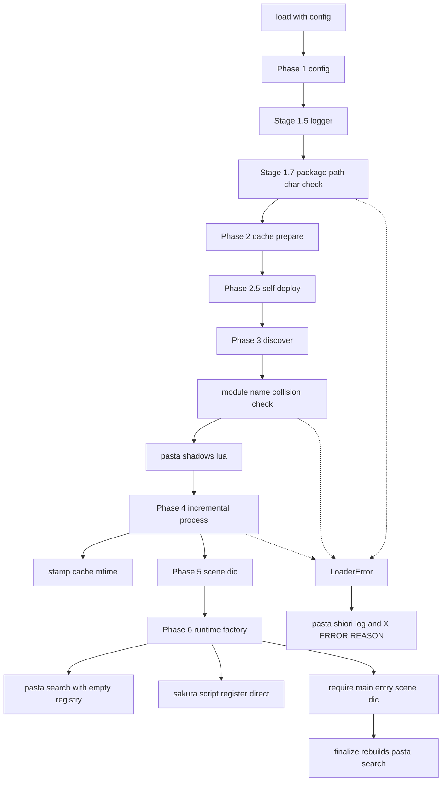
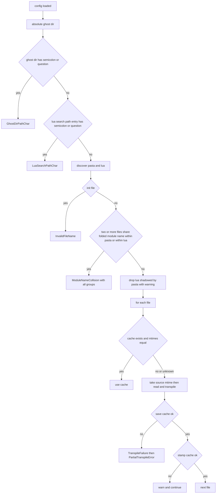
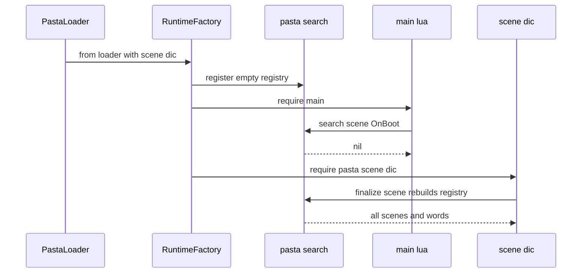

# 設計書: ponytail-lua-loader

## Overview

**Purpose**: この設計は、`pasta_lua` の読み込みまわり（`loader/`・`runtime/`・`presentation/`・`encoding/` と `lib.rs` の再輸出）について、2026-10-19 の監査の 2〜8 番とギャップ分析で増えた指摘を、既存の部品の中で残らず直す。ゴーストの作者には、古い日付に戻した辞書・同じモジュール名の辞書・finalize 前の検索・`;` を含むフォルダの 4 つで、黙った誤りの代わりに「決まった結果」か「直す場所を名指しする読み込みエラー」を返す。

**Users**: ゴーストの作者（辞書の復元・置き方・`main.lua` の書き方で迷わない）と、pasta の開発者（本番から呼ばれない抽象と古い構築の道を読まずに済む）。

**Impact**: キャッシュの判定を「新しければ」から「時刻が違えば」に変え、起動の前の検査を 2 つ（衝突・パスの文字）足し、finalize 前の `@pasta_search` を常に空の表にする。約 900 行の使われない抽象と、テストだけが使う構築の道を消す。新しいファイル・依存・記録の形式は無い。

### Goals

- 要件 1〜4 の挙動を変える直しを、直す前の誤りを再現するテストを先に置いて入れる（9.2）。
- 要件 5〜7 の撤去を、外から見える挙動（`talk_to_script` の出力・`@enc` の変換・起動の順）を変えずに入れる（5.3・5.4・6.4・9.1）。
- ローダーと `pasta_check validate` が、同じ辞書の組み合わせをエラーにする（2.3・2.8）。
- マニュアル・steering・スキルの参照を、直した挙動と構成に合わせる（8.1〜8.5）。

### Non-Goals

- 読めないセーブの退避（監査の 1 番。`toml-serialization` で完了）。
- 内容のハッシュによるキャッシュの判定（時刻を保ったまま中身だけ変えるコピーは対象外。要件 1 は時刻だけで決める）。
- `pasta_check` のパスからモジュール名を決める規則の変更（比べ方だけを変える）。
- `src/context.rs`（`TranspileContext`）・`search/context.rs`・`runtime/finalize.rs`・`sakura_script/`・`src/debug/` の変更。

## Boundary Commitments

### This Spec Owns

- **キャッシュの新しさの判定**：`CacheManager::needs_transpile` の比べ方、キャッシュへ元の更新時刻を写すこと（`stamp_cache`）、`.pasta` のキャッシュの書き込みの失敗の扱い（`loader/cache.rs`・`loader/process.rs`）。
- **起動の前の検査**：同じモジュール名（大文字と小文字の違いを除く）の衝突の検出と、`package.path` を壊す文字（`;`・`?`）の検出。それぞれの `LoaderError` の種類と表示の文（`loader/process.rs`・`loader/context.rs`・`loader/error.rs`・`loader/mod.rs`）。
- **finalize 前の `@pasta_search` に渡す登録表**：常に空にすること（`loader/process.rs`・`loader/mod.rs`・`runtime/factory.rs`）。
- **本番の構築の道の形**：`PastaLuaRuntime::from_loader_with_scene_dic` の引数（`runtime/factory.rs`）。
- **撤去**：`presentation/`・`runtime/renderer_injection.rs`・`from_loader`・`load_scene_dic`・`TranspileResult`・`Encoder`・`Encoding`（`OEM` を含む）・`LoaderError::{Parse, Transpile}`・旧 `scene_dic.lua` の片付け・2 回目の孤立キャッシュの警告・`LoaderContext::new`、と `lib.rs`・`runtime/mod.rs` のそれらの再輸出。
- **`pasta_check validate` の衝突の比べ方**：モジュール名を大文字と小文字を区別せずに比べること（`pasta_check/src/validate/module_name.rs`）。
- **マニュアルと steering の該当箇所**（要件 8 の頁・`.kiro/steering/structure.md`・スキルの参照の生成物）。

### Out of Boundary

- `runtime/persistence.rs`・`runtime/lifecycle.rs`・`pasta-persistence.md`（`toml-serialization`）。
- `src/code_gen/`・`src/normalize.rs`・`src/config.rs`・`src/context.rs`・`src/transpiler.rs`（`ponytail-lua-transpiler`）。`TranspileContext::merge_from` は本番の使い手を失うが、消すかどうかはその spec が決める。
- `src/debug/`・`pasta_scripts/`・`search/context.rs`・`sakura_script/`・`pasta_shiori` の `enc.rs`・`runtime/searcher.rs` の FFI の道・`runtime/finalize.rs`。
- `pasta_check` のパスからモジュール名を決める規則（`module_name_of`）と、ローダーのそれ（`source_to_module_name`）。
- `pasta_shiori` の読み込みエラーの経路（ログと `X-ERROR-REASON`）。この spec は新しい種類を足すだけで、経路は変えない。
- `PastaLuaRuntime::new`・`with_config`・`exec`・`exec_file`・`exec_named`（残す）。

### Allowed Dependencies

- 標準ライブラリ：`std::fs::File::set_modified`（Rust 1.75 以降）・`str::to_lowercase`・`std::path::absolute`。
- 既存の `pasta_lua` の部品：`CacheManager::source_to_module_name`・`get_relative_path`・`TranspileFailure`・`LoaderError::partial_transpile`・`crate::sakura_script::register`・`crate::search::register`（呼び方は変えない）・`TranspileContext::new`。
- `pasta_check` は、これまでどおり `pasta_lua` に通常の依存を持たない（wasm でもビルドするため）。パリティのテストだけが dev-dependency の `pasta_lua` を使う。
- 依存の向き：`loader` → `runtime`（`PastaLuaRuntime` の構築）→ `search`・`sakura_script`・`encoding`。`runtime` から `loader` へは `LoaderContext`・`PastaConfig` の型だけ（今と同じ）。逆向きの追加は無い。

### Revalidation Triggers

- `LoaderError` の種類の追加と削除（`pasta_shiori` の `MyError::Load` の表示・`X-ERROR-REASON` の値の形が変わる）。
- `pasta_lua` の公開 API の削除（`presentation`・`RendererInjection` など・`Encoder`/`Encoding`・`TranspileResult`・`from_loader`・`load_scene_dic`・`LoaderContext::new`・`LoaderError::{Parse, Transpile}`）。外のクレート（`pasta_shiori`・`pasta_check`・`pasta_lsp`）からの使い手は 0 であることを確かめた。
- `from_loader_with_scene_dic` の引数の変更（`book/src/internals/debug.md` が名前を書いている。名前は変えない）。
- `pasta_check` の `module-pasta-collision`・`module-lua-collision`・`module-lua-shadowed` の組み合わせの変更（`debug/validate.md` とパリティのテスト）。
- `lib.rs` の再輸出の行（`ponytail-lua-transpiler` と共有）。

## Architecture

### Existing Architecture Analysis

- `PastaLoader::load_with_config`（`loader/mod.rs`）が、段階 1（設定）→ 1.5（ロガー）→ 2（キャッシュの準備）→ 2.5（内蔵スクリプトの自己展開）→ 3（辞書の発見）→ 4（差分の変換と写し）→ 5（`scene_dic.lua`）→ 5.5（デバッグのときだけソースマップ）→ 6（ランタイムの構築）の順に進む。この順は変えない（9.1・6.4）。
- 段階 3 の `discover_all_files`（`loader/process.rs`）は、`init.*` を断り（`LoaderError::InvalidFileName`）、`.pasta` と同じ名前の `.lua` を警告つきで外す。ここが、起動の前の検査を足す場所の前例である。
- 段階 4 の `process_incremental` は、`.pasta` を変換して `TranspileContext` を `merge_from` で集め、段階 6 で `@pasta_search` の最初の登録に渡す。finalize（`scene_dic.lua` の末尾）は Lua 側の登録から `@pasta_search` を作り直す。最初の登録の中身が「今回変換したファイルだけ」なのが監査の 4 番である。
- 段階 6 の `from_loader_with_scene_dic`（`runtime/factory.rs`）が本番の道で、`from_loader`（変換済みのコードを直接読む）と `load_scene_dic` はテストだけが使う古い道である。
- `@pasta_sakura_script` は `RendererInjection::default()` を通して登録されるが、中身は `crate::sakura_script::register` を呼ぶだけで、差し替える道は無い。

### Architecture Pattern & Boundary Map

既存の段階の並び（パイプライン）を保ち、2 つの検査を前に足し、1 つの受け渡しを空にする。



**Architecture Integration**:
- Selected pattern: 既存の段階のパイプラインの中での直し（research.md の Option A）。新しい層や継ぎ目は作らない。
- Domain/feature boundaries: 検査（`loader`）・キャッシュ（`loader/cache.rs`）・構築（`runtime/factory.rs`）の持ち場は今のまま。`pasta_check` は比べ方の 1 行だけを持つ。
- Existing patterns preserved: `LoaderError` の種類で読み込みエラーを表し、`pasta_shiori` がそのまま届ける。`TranspileFailure` を集めて `PartialTranspileError` にする。`.pasta` が `.lua` を隠す。
- New components rationale: 新しい部品は無い。足すのは `CacheManager::stamp_cache`・`LoaderContext::check_package_path_chars`・衝突を集める関数と、`LoaderError` の 3 種類だけである。
- Steering compliance: `tech.md` のテストの関門（fmt・clippy 0・`cargo test`）、pasta.dll の x86 出荷（ポインタ幅に依る処理は無い）、`PASTA_DEBUG` の中和、`std::path::absolute` の形を保つ規則（8.3 の短い名前）を守る。

### Technology Stack

| Layer | Choice / Version | Role in Feature | Notes |
| ----- | ---------------- | --------------- | ----- |
| Backend / Services | Rust edition 2024・`pasta_lua` 0.4.x | ローダー・ランタイムの直しと撤去 | 新しい crate は無い |
| Data / Storage | ファイルシステムの更新時刻（`std::fs::File::set_modified`） | キャッシュに元の `.pasta`・`.lua` の時刻を写す | 新しい依存（`filetime`）は使わない |
| Infrastructure / Runtime | mlua 0.12・LuaJIT 2.1 | `@pasta_search`・`@pasta_sakura_script`・`@enc` の登録 | 呼び方は変えない |
| CLI | `pasta_check`（wasm も対象） | 衝突の比べ方を揃える | `pasta_lua` への通常の依存は足さない |

## File Structure Plan

新しいファイルは作らない。変更と削除だけである。

### Deleted Files

- `crates/pasta_lua/src/presentation/mod.rs`・`crates/pasta_lua/src/presentation/marker.rs` — 使われない presentation の契約（5.1）。
- `crates/pasta_lua/src/runtime/renderer_injection.rs` — 実装が 1 つの注入の継ぎ目（5.2）。

### Modified Files

**`crates/pasta_lua/src/loader/`**
- `cache.rs` — `needs_transpile` を `source_mtime != cache_mtime` に変える（1.1〜1.3）。`stamp_cache` を足す（1.7）。`generate_scene_dic` から旧位置の片付けを消す（5.6）。`find_orphaned_caches` は今のまま（いつも出す警告を持つ方。7.1・7.2）。
- `process.rs` — `discover_all_files` に衝突の検査を足し、隠す判定を畳んだ名前で行う（2.1〜2.4・2.6・2.7）。`process_incremental` は `TranspileContext` を集めず返さない（3.1〜3.3）。元の時刻を読む前に取り、`save_cache` の後に `stamp_cache` を呼ぶ。`.pasta` の `save_cache` の失敗を `TranspileFailure` にする（1.6）。
- `context.rs` — `check_package_path_chars` を足す（4.1・4.2）。`LoaderContext::new` を消し、単体テストを `from_config` に移す。
- `error.rs` — `ModuleNameCollision`・`GhostDirPathChar`・`LuaSearchPathChar` を足す（2.1・2.2・2.7・4.1・4.2）。`Parse`・`Transpile`・`parse`・`parse_with_source` とそのテスト、`use crate::TranspileError` を消す（5.5）。
- `mod.rs` — 段階 1.7（`LoaderContext` を作って検査）を足し、段階 6 でそれを使う（4.1〜4.4）。2 回目の孤立キャッシュの警告を消す（7.1・7.2）。`TranspileResult` を消す（6.1）。`from_loader_with_scene_dic` を新しい引数で呼ぶ。`pub use error::{…}` に `CollidingFile` を足す。`generate_scene_dic` の戻り値（`scene_dic.lua` のパス）は使わなくなるので受けない。

**`crates/pasta_lua/src/runtime/`**
- `factory.rs` — `from_loader`・`load_scene_dic` を消す（6.1）。`from_loader_with_scene_dic` から `context` と `_scene_dic_path` を外し、中で `TranspileContext::new()` を渡す（3.1・6.2）。`register_sakura_script_module` を新しい形で呼ぶ。`fatal_startup_module` の旧経路の説明を消す。
- `module_registry.rs` — `register_sakura_script_module(lua, config)` が `crate::sakura_script::register` を直に呼ぶ（5.2・5.3）。
- `mod.rs` — `pub mod renderer_injection` と再輸出を消す。モジュールの説明の例（`from_loader` を含まない）は今のまま。
- `enc.rs`・`ffi_load/resolve.rs` — `Encoding::ANSI.to_bytes`/`to_string` を `encoding::utf8_to_ansi`/`ansi_to_utf8` に読み替える（5.4）。

**`crates/pasta_lua/src/encoding/`**
- `mod.rs` — `Encoder`・`Encoding` を消し、2 つの関数の宣言（プラットフォームの実装への委譲）と共通のテストにする（5.4）。
- `windows.rs` — `codepage()` を `GetACP()` だけにし、`GetOEMCP` と OEM のテストを消す。
- `unix.rs` — UTF-8 の素通しを関数にし、OEM のテストを消す。

**`crates/pasta_lua/src/lib.rs`** — `pub mod presentation`・`pub use encoding::{Encoder, Encoding}`・`TranspileResult` の再輸出を消す。`pub mod encoding` は残す。

**`crates/pasta_lua/tests/`**
- `loader/cache_test.rs` — `test_needs_transpile_cache_newer`・`test_needs_transpile_cache_older` を「時刻が同じなら省く／違えば新旧を問わず変換」に書き直す。`stamp_cache` のテストを足す。`test_generate_scene_dic_removes_legacy_location` を消す。
- `loader/` に新しいテストの関数を足す（既存のファイルへ）：`lua_passthrough_test.rs`（衝突・隠す判定）、`path_robustness_test.rs`（`;`・`?`）、`startup_test.rs`（日付の戻し・書き込みの失敗・finalize 前の検索・孤立キャッシュの警告の回数）。
- `runtime/encoding_test.rs`・`runtime/runtime_api_test.rs` — 古い道のテストを `PastaLoader::load` と一時ゴーストへ移す（6.3。下の「Testing Strategy」）。
- `ffi/compare_test.rs` — `Encoding::ANSI.to_string` を `encoding::ansi_to_utf8` に。
- `chunk_name_validation_test.rs` — `save_cache` の呼び方は変わらないので触らない。
- `sakura_script/` に特性化のテストを 1 つ足す（5.3。撤去の前に置く）。

**`crates/pasta_check/`**
- `src/validate/module_name.rs` — `by_module` を畳んだ名前（`to_lowercase`）で集め、各ファイルの実際のモジュール名を報告に使う。隠す判定も畳んだ名前で引く（2.7・2.8）。
- `tests/validate_rules_test.rs` — 大文字と小文字だけ違う組み合わせのエラーを足す。
- `tests/validate_parity_test.rs` — 大文字と小文字だけ違う名前の畳みの一致と、衝突の組み合わせの一致（ローダーと `pasta_check`）を足す（2.3・2.8）。

**マニュアル・steering・生成物**（要件 8）
- `book/src/internals/transpiler.md`・`internals/loader.md`・`reference/startup.md`・`lua/modules/pasta-search.md`・`lua/modules/index.md`・`internals/internal-modules.md`・`debug/validate.md`（8.1）。
- `book/src/internals/shiori.md`・`internals/talk-output.md`・`internals/execution-model.md`・`internals/logging-encoding.md`・`internals/index.md`（8.2）。
- `.kiro/steering/structure.md`（8.3）。
- `.claude/skills/pasta-lua-coding/references/` の生成物（`node book/tools/gen-skill-refs.mjs`。8.4）。
- `README.md`・`.kiro/steering/tech.md`（8.5。実装の時点で断り書きが無いときだけ）。
- `TEST_COVERAGE.md:131` — `runtime_api_test.rs` の行から `from_loader` を外す（記述の食い違いを残さないため）。

## System Flows

### 起動の前の検査と変換の判定



- 検査はどれも、辞書の変換と Lua の実行より前に終わる（2.1・4.1）。
- 衝突は、見つかったすべての組を 1 つのエラーにまとめる（作者が 1 回の起動で全部を直せるように）。
- 元の時刻は内容を読む**前に**取る。読んでいる間に保存されても、写した時刻が新しい内容の時刻と違うので、次の起動で必ず変換し直される。
- 時刻を取れないとき（`needs_transpile` の誤り・元の時刻の取得の失敗）は、変換し直し（1.4）、写しは省く（`debug!`）。写さなかったキャッシュの時刻は書いた時刻なので、次の起動でも元と違い、変換し直される。

### finalize 前の検索



- 最初の登録は、キャッシュの状態や今回変換したファイルによらず、いつも空である（3.1〜3.3）。finalize の作り直しは今のまま（3.4）。

## Requirements Traceability

| Requirement | Summary | Components | Interfaces | Flows |
| ----------- | ------- | ---------- | ---------- | ----- |
| 1.1 | 時刻が違えば `.pasta` を変換し直す | CacheFreshness | `needs_transpile` | 変換の判定 |
| 1.2 | 時刻が違えば `.lua` を写し直す | CacheFreshness・IncrementalProcessor | `needs_transpile`・`stamp_cache` | 変換の判定 |
| 1.3 | 時刻が同じなら省く | CacheFreshness | `needs_transpile` | 変換の判定 |
| 1.4 | 時刻が取れなければ変換し直す | IncrementalProcessor | `needs_transpile(..).unwrap_or(true)` | 変換の判定 |
| 1.5 | 前日の `.pasta` に戻すと戻した内容で動く | CacheFreshness・IncrementalProcessor | `needs_transpile`・`stamp_cache` | 変換の判定 |
| 1.6 | `.pasta` のキャッシュが書けなければ読み込みエラー | IncrementalProcessor | `TranspileFailure`・`PartialTranspileError` | 変換の判定 |
| 1.7 | 時刻をそろえられなければ警告で続ける | CacheFreshness・IncrementalProcessor | `stamp_cache` | 変換の判定 |
| 2.1 | `.pasta` 同士の衝突を読み込みエラーに | ModuleCollisionGuard | `LoaderError::ModuleNameCollision` | 起動の前の検査 |
| 2.2 | `.lua` 同士の衝突を読み込みエラーに | ModuleCollisionGuard | 同上 | 起動の前の検査 |
| 2.3 | 規則と組み合わせを `pasta_check` と一致 | ModuleCollisionGuard・PastaCheckCollisionRule | パリティのテスト | — |
| 2.4 | `.pasta` が `.lua` を警告つきで隠す | ModuleCollisionGuard | `discover_all_files` | 起動の前の検査 |
| 2.5 | 衝突のエラーを今の経路で届ける | LoaderErrorKinds | `pasta_shiori` の `MyError::Load` | — |
| 2.6 | 衝突しない組み合わせは今と同じ | ModuleCollisionGuard | `discover_all_files` | — |
| 2.7 | 大文字と小文字だけ違う衝突もエラー（OS によらない） | ModuleCollisionGuard | 畳んだ名前の比べ | 起動の前の検査 |
| 2.8 | `pasta_check` も 2.7 をエラーに | PastaCheckCollisionRule | `module_name::check` | — |
| 3.1 | finalize 前の検索がキャッシュによらず同じ | IncrementalProcessor・RuntimeFactory | `from_loader_with_scene_dic` | finalize 前の検索 |
| 3.2 | finalize 前はいつも「見つからない」 | RuntimeFactory | `TranspileContext::new()` を登録 | finalize 前の検索 |
| 3.3 | 編集直後と 2 回目の起動で同じ結果 | IncrementalProcessor・RuntimeFactory | 同上 | finalize 前の検索 |
| 3.4 | finalize 後は全辞書が対象 | （変えない）`runtime/finalize.rs` | `register_finalize_scene` | finalize 前の検索 |
| 4.1 | ゴーストのフォルダの `;`・`?` を読み込みエラーに | PackagePathCharGuard | `check_package_path_chars`・`GhostDirPathChar` | 起動の前の検査 |
| 4.2 | `lua_search_paths` の項目の `;`・`?` を読み込みエラーに | PackagePathCharGuard | `LuaSearchPathChar` | 起動の前の検査 |
| 4.3 | それ以外のパスは今と同じ | PackagePathCharGuard | 検査は 2 文字だけ | — |
| 4.4 | 今の経路で届ける | LoaderErrorKinds | `MyError::Load` | — |
| 5.1 | `presentation` を提供しない | Removals | 削除 | — |
| 5.2 | `RendererInjection` など 3 つを提供しない | Removals・SakuraModuleRegistration | 削除・直の登録 | — |
| 5.3 | `talk_to_script` の出力がバイト単位で同じ | SakuraModuleRegistration | 特性化のテスト | — |
| 5.4 | `Encoding::OEM`・`Encoder` を提供せず、変換の結果は同じ | AnsiEncoding | `utf8_to_ansi`・`ansi_to_utf8` | — |
| 5.5 | `LoaderError::{Parse, Transpile}` を提供しない | LoaderErrorKinds | 削除 | — |
| 5.6 | 旧 `scene_dic.lua` の片付けを持たない | CacheFreshness | `generate_scene_dic` | — |
| 6.1 | `from_loader`・`load_scene_dic`・`TranspileResult` を提供しない | RuntimeFactory・Removals | 削除 | — |
| 6.2 | 本番の道が使わない引数を受け取らない | RuntimeFactory | `from_loader_with_scene_dic` の新しい引数 | — |
| 6.3 | 移したテストが同じ観点を `PastaLoader::load` で確かめる | TestMigration | 一時ゴースト | — |
| 6.4 | 起動の順と致命の扱いを保つ | RuntimeFactory | `require_startup_module` | finalize 前の検索 |
| 7.1 | 孤立キャッシュの警告をファイルごとに 1 回 | OrphanWarning | `find_orphaned_caches` | — |
| 7.2 | `debug_mode` によらず出す | OrphanWarning | `loader/mod.rs` の重ねを削除 | — |
| 7.3 | 孤立キャッシュを読まず消さない | OrphanWarning | 今のまま | — |
| 8.1 | 挙動の直しの頁を直す | DocsSync | 頁の一覧 | — |
| 8.2 | 撤去の頁を直す | DocsSync | 頁の一覧 | — |
| 8.3 | `structure.md` を直す | DocsSync | — | — |
| 8.4 | `gen-skill-refs.mjs` を走らせ生成物を入れる | DocsSync | `--check` | — |
| 8.5 | 公開 API の断り書き（無ければ） | DocsSync | 実装時の確かめ | — |
| 9.1 | ほかの起動の挙動を変えない | すべての部品（段階の順は `loader/mod.rs` で保つ） | 既存のテスト（`startup_test.rs`・`cache_test.rs` の版と指紋・`lua_passthrough_test.rs`） | 起動の前の検査 |
| 9.2 | 直す前の誤りを再現するテストを先に | TestMigration と「Testing Strategy」 | 直す前に落ちるテスト | — |
| 9.3 | fmt・clippy・3 クレートのテスト | 「Testing Strategy」の関門 | 関門 | — |
| 9.4 | `PASTA_DEBUG` の中和 | TestMigration | `tests/common/mod.rs` の `#[ctor]` | — |

## Components and Interfaces

| Component | Domain/Layer | Intent | Req Coverage | Key Dependencies (P0/P1) | Contracts |
| --------- | ------------ | ------ | ------------ | ------------------------ | --------- |
| CacheFreshness | loader/cache.rs | 時刻の一致でキャッシュの新しさを決め、時刻を写す | 1.1〜1.3・1.5・1.7・5.6 | std::fs (P0) | Service |
| IncrementalProcessor | loader/process.rs | 変換・写し・失敗の扱い。登録表を集めない | 1.2・1.4〜1.7・3.1〜3.3 | CacheFreshness (P0)・LuaTranspiler (P0) | Service |
| ModuleCollisionGuard | loader/process.rs | 同じ（畳んだ）モジュール名の衝突を断り、`.lua` を隠す | 2.1〜2.4・2.6・2.7 | CacheManager::source_to_module_name (P0) | Service |
| PackagePathCharGuard | loader/context.rs・loader/mod.rs | `package.path` に入るパスの `;`・`?` を断る | 4.1〜4.4 | std::path::absolute (P0) | Service |
| LoaderErrorKinds | loader/error.rs | 新しい 3 種類と撤去する 2 種類 | 1.6・2.1・2.2・2.5・2.7・4.1・4.2・4.4・5.5 | pasta_shiori の経路 (P1) | State |
| RuntimeFactory | runtime/factory.rs | 本番の 1 本の構築の道 | 3.1〜3.3・6.1・6.2・6.4 | search::register (P0) | Service |
| SakuraModuleRegistration | runtime/module_registry.rs | `@pasta_sakura_script` を直に登録 | 5.2・5.3 | sakura_script::register (P0) | Service |
| AnsiEncoding | encoding/ | UTF-8 と ANSI の 2 つの変換関数 | 5.4 | Win32 GetACP (P0) | Service |
| OrphanWarning | loader/mod.rs・loader/cache.rs | 孤立キャッシュの警告を 1 回に | 7.1〜7.3 | — | — |
| Removals | presentation/・renderer_injection.rs・lib.rs・runtime/mod.rs | 使われない抽象と再輸出の削除 | 5.1・5.2・6.1 | — | — |
| PastaCheckCollisionRule | pasta_check/src/validate/module_name.rs | 畳んだ名前で衝突と隠す判定 | 2.3・2.7・2.8 | — | Service |
| TestMigration | pasta_lua/tests/runtime | 古い道のテストを本番の道へ | 6.3・9.4 | tests/common (P0) | — |
| DocsSync | book/・.kiro/steering・.claude/skills（生成物） | 直した挙動と構成を書く | 8.1〜8.5 | gen-skill-refs.mjs (P1) | — |

### loader

#### CacheFreshness

| Field | Detail |
| ----- | ------ |
| Intent | キャッシュの新しさを「元の時刻とキャッシュの時刻が等しいか」で決め、変換の後に元の時刻を写す |
| Requirements | 1.1, 1.2, 1.3, 1.5, 1.7, 5.6 |

**Responsibilities & Constraints**
- `needs_transpile` は、キャッシュが無ければ `true`、あれば `source_mtime != cache_mtime`。時刻の取得の誤りは今のまま `Err(LoaderError::MetadataError)` で返し、呼び手が `unwrap_or(true)` で変換に倒す（1.4）。
- `stamp_cache` は、`source_to_cache_path(source)` のファイルを書き込みで開き、`set_modified(source_mtime)` する。キャッシュのファイルを作らない（無ければ `Err`）。
- `generate_scene_dic` は旧位置（`cache_dir/scene_dic.lua`）を探さない（5.6）。新しい位置と中身は今のまま。
- `find_orphaned_caches` は今のまま（件数 1 行と各ファイル 1 行の警告をいつも出し、`Vec` を返す。7.1・7.3）。

**Dependencies**
- Inbound: IncrementalProcessor — 判定と時刻の写し (P0)
- External: `std::fs::File::set_modified`・`std::fs::Metadata::modified` (P0)

**Contracts**: Service [x]

##### Service Interface
```rust
impl CacheManager {
    /// Ok(true): 変換・写しが要る（キャッシュが無い・時刻が違う。新旧は問わない）
    /// Ok(false): 時刻が等しい。Err: 時刻を取得できない（呼び手は変換に倒す）
    pub fn needs_transpile(&self, source_path: &Path) -> Result<bool, LoaderError>;

    /// 書いたキャッシュの更新時刻を、変換元の更新時刻にそろえる。
    /// 前提: save_cache が同じ source_path で成功している。
    /// 失敗（キャッシュが無い・開けない・時刻を設定できない）は io::Error で返す。
    pub fn stamp_cache(&self, source_path: &Path, source_mtime: SystemTime) -> std::io::Result<()>;

    // 変えない: save_cache, source_to_module_name, source_to_cache_path,
    //           find_orphaned_caches, prepare_cache_dir, cache_dir
    pub fn generate_scene_dic(&self, module_names: &[String]) -> Result<PathBuf, LoaderError>; // 旧位置の片付けだけ消す
}
```
- Postconditions: `stamp_cache` が成功したキャッシュは、元が変わらない限り次の起動で `needs_transpile == Ok(false)`。
- Invariants: キャッシュの時刻が元と等しいのは、`stamp_cache` が成功したとき、またはファイルシステムの刻みで偶然に一致したときだけである。

**Implementation Notes**
- Integration: 同じボリュームの往復は一致する（research.md の実験 1。NTFS で実測、FAT32・exFAT は刻みの理屈）。キャッシュを元より粗い別のボリュームへ向けたときだけ毎回変換し直す（安全側）。
- Validation: 書き直す既存のテスト `cache_test.rs` の `test_needs_transpile_cache_newer`（今は「キャッシュが新しければ省く」）→「キャッシュが新しくても時刻が違えば変換」、`test_needs_transpile_cache_older` →「元が古くなっても変換」。
- Risks: 時刻を保ったまま中身だけ変えるコピーは見つけない（Non-Goals）。

#### IncrementalProcessor

| Field | Detail |
| ----- | ------ |
| Intent | `.pasta` の変換と `.lua` の写しを、時刻の一致で省き、書き込みの失敗を読み込みエラーにし、登録表を集めない |
| Requirements | 1.2, 1.4, 1.5, 1.6, 1.7, 3.1, 3.2, 3.3 |

**Responsibilities & Constraints**
- 各ファイルで、`needs_transpile(..).unwrap_or(true)` が `true` のとき：
  1. 元の時刻を `fs::metadata(file).and_then(|m| m.modified()).ok()` で取る（内容を読む前）。
  2. 読む・パースする・変換する（`.lua` は読むだけ）。失敗は今のまま `TranspileFailure`。
  3. `save_cache` の失敗は、`.pasta` も `.lua` と同じく `TranspileFailure { error: "Cache write error: …" }` にする（1.6）。今の `warn!` と「not fatal」の注記を消す。
  4. `save_cache` が成功し、1 の時刻があれば `stamp_cache`。失敗は `warn!(file, error, "Failed to align cache mtime; the file will be transpiled again on next startup")` で続ける（1.7）。1 の時刻が無ければ写さず `debug!`。
- 失敗が 1 つでもあれば、今のまま `LoaderError::PartialTranspileError` を返す（ファイルのパスが表示に入る。1.6）。
- 変換の結果の `TranspileContext` は捨てる（`merge_from` をやめる。3.1）。

**Dependencies**
- Inbound: `PastaLoader::load_with_config` — 段階 4 (P0)
- Outbound: CacheFreshness (P0)・`LuaTranspiler::transpile` (P0)・`pasta_dsl::parse_str` (P0)

**Contracts**: Service [x]

##### Service Interface
```rust
impl PastaLoader {
    /// 戻り値から TranspileContext を外す（finalize 前の登録は常に空）。
    pub(super) fn process_incremental(
        pasta_files: &[PathBuf],
        lua_files: &[PathBuf],
        cache_manager: &CacheManager,
        transpiler: &LuaTranspiler,
    ) -> Result<(Vec<String>, ProcessStats), LoaderError>;
}
```
- Preconditions: `pasta_files`・`lua_files` は衝突の検査と隠す判定を通った一覧である。
- Postconditions: `Ok` のとき、すべての辞書のキャッシュが今回の内容で書かれているか、時刻の一致で省かれている。

**Implementation Notes**
- Validation: `.pasta` のキャッシュの書き込みの失敗は、キャッシュのファイルの位置に同じ名前のフォルダを作って起こす（OS によらない）。
- Risks: `stamp_cache` の失敗の分岐は、テストで起こしにくい（Open Question 6）。

#### ModuleCollisionGuard

| Field | Detail |
| ----- | ------ |
| Intent | 変換の前に、`.pasta` 同士・`.lua` 同士で、大文字と小文字の違いを除いて同じモジュール名になる辞書を、すべてのファイル名つきで断る |
| Requirements | 2.1, 2.2, 2.3, 2.4, 2.6, 2.7 |

**Responsibilities & Constraints**
- `discover_all_files` の中で、`init.*` の検査の後、`.lua` を隠す前に行う（隠される `.lua` 同士も数える。`pasta_check` の `module-lua-collision` と同じ数え方。2.3）。
- 名前は `CacheManager::source_to_module_name`（今と同じ規則。`pasta_check` の `module_name_of` とパリティのテストで揃う）。比べるのは `module_name.to_lowercase()`（畳んだ名前）。
- `.pasta` 群・`.lua` 群のそれぞれで、畳んだ名前ごとに 2 つ以上のファイルがある組をすべて集める。組の並びは畳んだ名前の昇順、組の中はファイルの発見の順（昇順）。1 つでもあれば `LoaderError::ModuleNameCollision` を返す。
- 隠す判定（2.4）は、`.lua` の畳んだ名前が `.pasta` の畳んだ名前の集合にあれば、今の警告（`Module name conflict: .pasta file takes priority, .lua file ignored`）で外す。【前提】大文字と小文字だけ違う `.pasta` と `.lua` も「同じモジュール名」として隠す（Open Question 1）。
- エラーに載せるファイルの名前は `CacheManager::get_relative_path`（ゴーストのフォルダから見た形。Windows では `dic\会話-朝.pasta`）。モジュール名は各ファイルの実際の名前（畳む前）。
- 衝突しない組み合わせ（日本語・サブフォルダ）は、今と同じ一覧を返す（2.6）。

**Dependencies**
- Inbound: `PastaLoader::load_with_config` — 段階 3 (P0)
- Outbound: `CacheManager::source_to_module_name`・`get_relative_path` (P0)

**Contracts**: Service [x]

##### Service Interface
```rust
impl PastaLoader {
    /// 変えない形。Err に ModuleNameCollision が加わる。
    pub(super) fn discover_all_files(
        base_dir: &Path,
        pasta_patterns: &[String],
        cache_manager: &CacheManager,
    ) -> Result<(Vec<PathBuf>, Vec<PathBuf>), LoaderError>;
}

/// 同じ畳んだ名前の組（2 つ以上）を集める。files は発見の順。
fn colliding_groups(files: &[PathBuf], cache_manager: &CacheManager) -> Vec<Vec<CollidingFile>>;
```

**Implementation Notes**
- Validation: 同じフォルダに大文字と小文字だけ違う 2 つのファイルは Windows・macOS では置けないので、テストは `-`・`.` と `_` の違いや、サブフォルダの名前の違いで組む（`dic/A-b.pasta` と `dic/a_b.pasta`）。どの OS でも同じに走る。
- Risks: `to_lowercase` が NTFS より広く同じとみなす文字（ケルビン記号など）は、エラーに倒れる（Open Question 3）。

#### PackagePathCharGuard

| Field | Detail |
| ----- | ------ |
| Intent | `package.path` に入るパス（絶対パスにしたゴーストのフォルダと `lua_search_paths` の各項目）に `;`・`?` があれば、文字とパス（項目）を名指しして断る |
| Requirements | 4.1, 4.2, 4.3, 4.4 |

**Responsibilities & Constraints**
- `load_with_config` は、段階 1.5（ロガー）の直後に `LoaderContext::from_config(base_dir, &config)` を作り、`check_package_path_chars()?` を呼ぶ（新しい段階 1.7）。作った `LoaderContext` は段階 6 にそのまま渡す（同じ値を 2 回作らない）。
- 調べる順は、ゴーストのフォルダ（`base_dir.to_string_lossy()`）→ `lua_search_paths` の各項目（書かれた順）。それぞれの文字列で最初に現れた `;` か `?` を報告する。
- 調べるのは `;` と `?` の 2 文字だけ。日本語・空白・長いパス・8.3 の短い名前は通る（4.3。`std::path::absolute` の形を保つ規則は変えない）。
- `transpiled_output_dir` は調べない（`package.path` に入るのは `lua_search_paths` の項目としてだけで、既定でも項目に含まれる）。

**Dependencies**
- Inbound: `PastaLoader::load_with_config` (P0)
- External: `std::path::absolute`（今の `from_config` のまま） (P0)

**Contracts**: Service [x]

##### Service Interface
```rust
impl LoaderContext {
    /// package.path を壊す文字（';' と '?'）を断る。
    /// Err(GhostDirPathChar { ch, path }) / Err(LuaSearchPathChar { ch, entry })
    pub fn check_package_path_chars(&self) -> Result<(), LoaderError>;

    // 変えない: from_config, absolute_search_paths, generate_package_path
    // 消す: new（使い手はテストだけ。Open Question 4）
}
```
- Postconditions: `Ok` のとき、`generate_package_path()` の各テンプレートは、`;` で割れず、`?` を 1 つだけ（テンプレートの印として）持つ。

**Implementation Notes**
- Validation: `;` を含むフォルダは、どの OS でも一時フォルダの下に作れる。`?` は Windows のファイル名に使えないので、ゴーストのフォルダの `?` は `LoaderContext` を直に組んだ単体テスト（文字列だけ・ファイルシステムに触らない）で確かめ、どの OS・ポインタ幅でも走らせる。`lua_search_paths` の `?` は `pasta.toml` に書くだけなので、統合テストで確かめられる。
- Risks: `\\?\` の前置きのついたパスを渡されると断る。今もその形は `package.path` で壊れる（`?` がモジュール名に置き換わる）ので、挙動の後退ではない。テストの補助と `pasta_shiori` はこの形を渡さない（research.md）。

#### LoaderErrorKinds

| Field | Detail |
| ----- | ------ |
| Intent | 新しい 3 種類の読み込みエラーを足し、本番で作られない 2 種類を消す |
| Requirements | 1.6, 2.1, 2.2, 2.5, 2.7, 4.1, 4.2, 4.4, 5.5 |

**Contracts**: State [x]

##### State Management（型）
```rust
pub enum LoaderError {
    // ……今の種類（Io, Config, ConfigNotFound, Runtime, DirectoryNotFound, GlobPattern,
    //    GlobTraversal, CacheDirectoryError, MetadataError, CacheWriteError,
    //    InvalidFileName, SceneDicGenerationError, SelfDeploy, PartialTranspileError）は残す

    /// 同じ（大文字と小文字の違いを除く）モジュール名になる辞書の組。groups は 1 つ以上・各組 2 ファイル以上。
    #[error("Module name collision: {}", format_collisions(groups))]
    ModuleNameCollision { groups: Vec<Vec<CollidingFile>> },

    /// ゴーストのフォルダの絶対パスに package.path の区切りか印がある。
    #[error("Ghost folder path contains '{ch}', which Lua package.path cannot hold: '{path}'")]
    GhostDirPathChar { ch: char, path: String },

    /// [loader] lua_search_paths の項目に package.path の区切りか印がある。
    #[error("[loader] lua_search_paths entry contains '{ch}', which Lua package.path cannot hold: '{entry}'")]
    LuaSearchPathChar { ch: char, entry: String },

    // 消す: Parse { .. }, Transpile(#[from] TranspileError)
}

#[derive(Debug, Clone, PartialEq, Eq)]
pub struct CollidingFile {
    /// 畳む前の実際のモジュール名（例 pasta.scene.会話_朝）
    pub module_name: String,
    /// ゴーストのフォルダから見たパス（例 dic\会話-朝.pasta）
    pub path: PathBuf,
}
```
- 表示の形（`format_collisions`）：組の中のモジュール名がすべて同じなら `{module}: {path}, {path}`、違う（大文字と小文字だけ違う）なら `{path} ({module}), {path} ({module})`。組どうしは ` / ` でつなぐ。1 行で、改行を含まない（`pasta_shiori` の `single_line` の前に 1 行である）。
  - 例：`Module name collision: pasta.scene.会話_朝: dic\会話-朝.pasta, dic\会話_朝.pasta`
  - 例：`Module name collision: dic\A-b.pasta (pasta.scene.A_b), dic\a_b.pasta (pasta.scene.a_b)`
- 【前提】文は、今の `LoaderError` に揃えて英語にする（Open Question 2）。
- `CollidingFile` は `loader::error` に置き、`loader` から `pub use` する（`lib.rs` へは足さない。`LoaderError` を `match` する呼び手は `pasta_lua::loader::CollidingFile` で引ける）。
- 1.6 は新しい種類を作らず、`.lua` の道と同じ `TranspileFailure`（`Cache write error: …`）→ `PartialTranspileError` に揃える。

### runtime

#### RuntimeFactory

| Field | Detail |
| ----- | ------ |
| Intent | ランタイムを組み立てる本番の 1 本の道。finalize 前の `@pasta_search` に空の表を渡す |
| Requirements | 3.1, 3.2, 3.3, 6.1, 6.2, 6.4 |

**Responsibilities & Constraints**
- `from_loader_with_scene_dic` は `context` と `_scene_dic_path` を受け取らない。中で `Self::with_config_and_source_map(TranspileContext::new(), runtime_config, source_map)` を呼ぶ。ほかの手順（デバッグの解決・モジュールの登録の順・`require_startup_module` の 3 つ・シーン identity の索引）は今のまま（6.4）。
- 名前は変えない（`book/src/internals/debug.md` が使う）。
- `from_loader`・`load_scene_dic` を消す（6.1）。`fatal_startup_module` は `require_startup_module` だけが使う形になる。その説明から旧経路の記述を消す。
- scene-play-event の申し送り（デバッグの「設定の有効」と「待ち受けの有無」を混ぜない）に触る行は無い。

**Dependencies**
- Inbound: `PastaLoader::load_with_config` — 段階 6 (P0)
- Outbound: `crate::search::register`（`with_config_and_source_map` の中。呼び方は変えない） (P0)・`register_finalize_scene` (P0)

**Contracts**: Service [x]

##### Service Interface
```rust
impl PastaLuaRuntime {
    pub fn from_loader_with_scene_dic(
        loader_context: LoaderContext,
        runtime_config: RuntimeConfig,
        pasta_config: Option<PastaConfig>,
        logger: Option<Arc<PastaLogger>>,
        source_map: Option<Arc<SourceMap>>,
    ) -> LuaResult<Self>;
}
```
- Postconditions: `main` の実行中と、`scene_dic.lua` の中の辞書のトップレベルでは、`@pasta_search` の検索は（正しい引数なら）値を返さない。`finalize_scene` の後は、今と同じく全辞書が対象。
- 引数の誤り（空のシーン名など）は、finalize の前後を問わず今と同じくエラーである（research.md の実験 2。Open Question 5）。

#### SakuraModuleRegistration

| Field | Detail |
| ----- | ------ |
| Intent | `@pasta_sakura_script` を `crate::sakura_script::register` で直に登録する |
| Requirements | 5.2, 5.3 |

**Contracts**: Service [x]

##### Service Interface
```rust
impl PastaLuaRuntime {
    pub(crate) fn register_sakura_script_module(lua: &Lua, config: &Option<PastaConfig>) -> LuaResult<()>;
    // 中身: let talk = config.as_ref().and_then(|c| c.talk());
    //       set_loaded_module(lua, "@pasta_sakura_script", crate::sakura_script::register(lua, talk.as_ref())?)
}
```
- Invariants: 撤去の前の既定の道（`RendererInjection::default()` → `default_sakura_renderer` → `sakura_script::register`）と同じ関数を同じ引数で呼ぶので、`talk_to_script` の出力はバイト単位で同じ（5.3）。撤去の前に置く特性化のテストで確かめる。

### encoding

#### AnsiEncoding

| Field | Detail |
| ----- | ------ |
| Intent | UTF-8 とシステムの ANSI コードページの間の 2 つの変換 |
| Requirements | 5.4 |

**Contracts**: Service [x]

##### Service Interface
```rust
// crates/pasta_lua/src/encoding/mod.rs
/// UTF-8 → ANSI（Windows は GetACP のコードページ・置き換え文字なしで失敗を返す。他は UTF-8 のまま）
pub fn utf8_to_ansi(data: &str) -> std::io::Result<Vec<u8>>;
/// ANSI → UTF-8（Windows は MB_ERR_INVALID_CHARS つき。他は UTF-8 として検める）
pub fn ansi_to_utf8(data: &[u8]) -> std::io::Result<String>;
```
- Invariants: 今の `Encoding::ANSI.to_bytes`・`to_string` と同じ Win32 の呼び方（コードページ・フラグ・`default_char = None`）を保つので、`@enc.to_ansi`・`to_utf8` と `ffi.load` の名前の扱い（`ffi_load/resolve.rs` の往復の確かめ）の結果は変わらない。
- 消す：`trait Encoder`・`enum Encoding`（`ANSI`・`OEM`）・`GetOEMCP` の呼び出し・`lib.rs` の `pub use encoding::{Encoder, Encoding}`。`pub mod encoding` は残す（`tests/ffi/compare_test.rs` が使う）。
- 【前提】形は 2 つの関数とする（値が 1 つの enum を残す案は採らない。Open Question 4 にまとめる）。

### pasta_check

#### PastaCheckCollisionRule

| Field | Detail |
| ----- | ------ |
| Intent | `module-pasta-collision`・`module-lua-collision`・`module-lua-shadowed` を、大文字と小文字を区別しない名前で判定する |
| Requirements | 2.3, 2.7, 2.8 |

**Responsibilities & Constraints**
- `by_module` は畳んだ名前（`module_name_of(..).to_lowercase()`）をキーにし、値に「実際のモジュール名と実物のパス」の組を持つ。
- `collisions` の報告文は、各ファイルの実際のモジュール名と、ほかのファイルのパスで作る（`msg::module_pasta_collision(module, others)` などの文は変えない）。
- 隠す判定は `pasta.get(folded)` で引く（【前提】Open Question 1。ローダーと同じ）。
- `module_name_of` は変えない。

**Contracts**: Service [x]

##### Service Interface
```rust
// crates/pasta_check/src/validate/module_name.rs（crate 内）
pub(crate) fn check(discovered: &Discovered) -> Vec<Finding>; // 形は今のまま
fn by_module(files: &[DictFile]) -> BTreeMap<String /* folded */, Vec<(String /* module */, &str /* path */)>>;
```

### 支える部品（要約）

- **OrphanWarning**：`loader/mod.rs` の `if !orphans.is_empty() && config.loader.debug_mode { … }` を消し、`cache_manager.find_orphaned_caches(&all_source_files);` だけを残す（警告は `cache.rs` の側が `debug_mode` によらず 1 回ずつ出す。7.1〜7.3）。
- **Removals**：`lib.rs` の `pub mod presentation;`・`TranspileResult` の再輸出、`runtime/mod.rs` の `pub mod renderer_injection;` と `pub use renderer_injection::{…}`、`loader/mod.rs` の `pub struct TranspileResult`。ほかのクレートからの参照は 0（`grep` で確かめた）。
- **TestMigration**：下の「Testing Strategy」の表のとおり。新しいテストは `tests/runtime/main.rs`・`tests/loader/main.rs` の中に置き、`tests/common/mod.rs` の `#[ctor]` の中和を受ける（9.4）。
- **DocsSync**：下の「Integration & Migration Notes」の表のとおり。

## Data Models

### Domain Model

- **キャッシュの新しさ**：辞書のファイル 1 つにつき、キャッシュのファイル 1 つ（`source_to_cache_path`）。キャッシュのファイルの更新時刻が「変換したときの元の更新時刻」を表す。別の記録は持たない。
- **モジュール名の衝突**：畳んだ名前（`to_lowercase`）を同じとみなす単位。`.pasta` 群と `.lua` 群で別々に数え、2 群の間は「隠す」関係（`.pasta` が勝つ）。
- **finalize 前の登録表**：常に空の `TranspileContext`。finalize が Lua 側の登録から作り直す（今のまま）。

### Data Contracts & Integration

- `pasta_shiori` に届くのは `LoaderError` の `Display` の文字列だけ（`MyError::Load(format!("{}", e))`）。新しい 3 種類の文は 1 行で、モジュール名・ファイル名・文字・パス（項目）を含む。
- キャッシュのファイルの形・置き場所・`scene_dic.lua` の中身は変えない。

## Error Handling

### Error Strategy

| 状況 | 扱い | 作者に届く形 |
| ---- | ---- | ------------ |
| ゴーストのフォルダに `;`・`?` | 段階 1.7 で `GhostDirPathChar` | `Load error: Ghost folder path contains ';', …: 'C:\SSP\ghost\a;b\ghost\master'` |
| `lua_search_paths` の項目に `;`・`?` | 段階 1.7 で `LuaSearchPathChar` | `Load error: [loader] lua_search_paths entry contains '?', …: 'lib?'` |
| 同じ（畳んだ）モジュール名 | 段階 3 で `ModuleNameCollision`（すべての組） | `Load error: Module name collision: pasta.scene.会話_朝: dic\会話-朝.pasta, dic\会話_朝.pasta` |
| `.pasta` と `.lua` が同じ（畳んだ）名前 | 警告して `.lua` を外す（今のまま） | ログの warn |
| `.pasta` のキャッシュが書けない | `TranspileFailure` → `PartialTranspileError` | `Load error: Partial transpilation failure: N succeeded, 1 failed [<ファイル>]` ＋ログの `Process failure`（`Cache write error: …`） |
| キャッシュの時刻をそろえられない | `warn!` で続ける | ログの warn（次の起動で変換し直す） |
| 時刻を取得できない | 変換し直す（今のまま） | — |
| finalize 前の検索 | 値を返さない（エラーではない） | Lua の `nil` |

### Monitoring

- 新しいログは `stamp_cache` の失敗の `warn!` だけ。孤立キャッシュの警告は 1 系統に減る。段階 1.7 の失敗は、`pasta_shiori` の `PastaShiori load failed` の error ログに載る（今の経路）。

## Testing Strategy

挙動を変える直し（要件 1〜4）は、**直す前に落ちるテストを先に置く**（9.2）。撤去（要件 5〜6）は、**撤去の前に通る特性化のテストを先に置く**。新しいテストは x86・x64 のどちらでも同じ期待で走る（ポインタ幅に依る値は無い）。

### Unit Tests

- `cache_test.rs`：`needs_transpile` が、キャッシュより古い時刻に戻した元で `true`（直す前は `false`。1.1・1.5）、時刻が等しいとき `false`（1.3）、キャッシュより新しい元で `true`（今と同じ）。`stamp_cache` の後に `needs_transpile == false`、キャッシュが無いときの `stamp_cache` は `Err`（1.7）。
- `loader/context.rs` の単体テスト：`check_package_path_chars` が、ゴーストのフォルダの `;`・`?`、`lua_search_paths` の項目の `;`・`?` をそれぞれの種類と文字で返し、日本語・空白・`RUNNER~1` のような 8.3 の名前は通す（4.1〜4.3）。ファイルシステムに触らない文字列のテスト。
- `loader/error.rs` の単体テスト：`ModuleNameCollision` の表示が、同じ名前の組・大文字と小文字だけ違う組・複数の組で、上の形の 1 行になる（2.1・2.7）。`Parse`・`Transpile` のテストは消す（5.5）。
- `encoding/` のテスト：`utf8_to_ansi`・`ansi_to_utf8` が今の ANSI のテスト（ASCII・空・日本語の往復・CP932 のバイト）と同じ結果を返す（5.4）。OEM のテストは消す。
- `pasta_check` の `validate_rules_test.rs`：`dic/A-b.pasta`＋`dic/a_b.pasta` が両方に `module-pasta-collision`、`dic/X-y.lua`＋`dic/x_y.lua` が `module-lua-collision`、各報告に自分の実際のモジュール名（2.7・2.8）。

### Integration Tests（`PastaLoader::load` と一時ゴースト）

- **日付の戻し（1.1・1.5・9.2）**：辞書を読み込み、同じ `.pasta` を別の台詞で書き直して更新時刻を前日に設定し、もう一度読み込む。戻した台詞のシーンが動く（直す前は古い台詞のまま）。`.lua` の辞書でも同じ（1.2）。
- **書き込みの失敗（1.6・9.2）**：キャッシュのファイルの位置に同じ名前のフォルダを置いて読み込む。`PartialTranspileError` になり、表示にその `.pasta` のパスが入る（直す前は警告だけで続く）。
- **衝突（2.1・2.2・2.4・2.6・2.7・9.2）**：`dic/会話-朝.pasta`＋`dic/会話_朝.pasta`、`dic/x-y.lua`＋`dic/x.y.lua`、`dic/A-b.pasta`＋`dic/a_b.pasta`、隠される `.lua` 同士（`dic/q-r.pasta`＋`dic/q-r.lua`＋`dic/q.r.lua`。3 つとも `pasta.scene.q_r` で、`.lua` の 2 つは隠される前に互いに衝突する）を、それぞれ `ModuleNameCollision` で、表示に全ファイルの名前（`dic\…`）とモジュール名が入ることを確かめる（直す前は読み込みが成功し、片方が消える）。`lua_passthrough_test.rs` の既存のテスト（`.pasta` が勝つ・ハイフンの正規化・`dic` に似たフォルダ）はそのまま通る（2.4・2.6）。
- **パリティ（2.3・2.8）**：`pasta_check/tests/validate_parity_test.rs` で、上の組み合わせと衝突しない組み合わせ（日本語・サブフォルダ）について、「`PastaLoader::load` が `ModuleNameCollision` を返す」と「`validate_ghost` が `module-pasta-collision` か `module-lua-collision` を出す」が一致する。`module_name_matches_cache_manager` に大文字と小文字だけ違う 2 つの名前を足し、畳んだ名前が両側で等しいことも確かめる。このテストは `PastaLoader::load` を通るが、`pasta_check` の dev-dependency の `ctor` による既存の `PASTA_DEBUG` の守りの下で走る（9.4）。
- **finalize 前の検索（3.1〜3.3・9.2）**：`main.lua` で `SEARCH:search_scene("OnBoot")` の結果を `_G` に残すゴーストを、キャッシュが無い状態（全部を変換）と 2 回目（全部を省く）で読み込み、どちらも `nil`（直す前は 1 回目だけ見つかる）。finalize の後の `search_scene("OnBoot")` は見つかる（3.4）。
- **パスの文字（4.1・4.2・4.4・9.2）**：一時フォルダの下の `a;b/ghost/master` で読み込むと `GhostDirPathChar`（`;` とパス）、`pasta.toml` の `lua_search_paths = ["lib;x"]`・`["lib?"]` で `LuaSearchPathChar`（直す前は module not found など）。`pasta_shiori` の側は経路が変わらないので、既存の `from_loader_error_maps_to_load_with_message` で足りる。`path_robustness_test.rs` の既存のテスト（日本語・長いパス・8.3）はそのまま通る（4.3）。
- **孤立キャッシュの警告（7.1〜7.3）**：`debug_mode = true` のゴーストに孤立したキャッシュを 1 つ置いて読み込み、`tracing-test` で `Orphaned cache file` の行が 1 つだけで、ファイルが残ることを確かめる（直す前は 2 行）。
- **`talk_to_script` のバイト不変（5.3）**：撤去の前に、`PastaLoader::load` のゴーストの `@pasta_sakura_script.talk_to_script` の出力と、新しい VM で `sakura_script::register` を直に呼んだ出力が、同じ入力（改行・ウェイト・アクターの切り替えを含む）でバイト単位で等しいテストを置く。撤去の後も通る。

### テストの移し替え（6.3）

| 今のテスト | 移し先と確かめること |
| ---------- | -------------------- |
| `encoding_test.rs` の `create_test_runtime`（`from_loader`）を使う `@enc` の 10 本 | 一時ゴーストを `PastaLoader::load` した VM で同じ Lua を走らせる（`@enc` の各変換・誤りの扱い） |
| `encoding_test.rs` の `test_package_path_set_correctly`・`test_package_path_with_japanese_base` | 一時ゴースト（日本語のフォルダを含む）を読み込み、`package.path` に `lua_search_paths` の各項目の `/?.lua`・`/?/init.lua` が絶対パスで並ぶ |
| `encoding_test.rs` の `test_pasta_config_module_still_works` | `pasta.toml` に独自の表を書いたゴーストで `@pasta_config` を読む |
| `encoding_test.rs` の `test_runtime_new_api_unchanged`・`test_runtime_with_config_api_unchanged` | 残す（`new`・`with_config` は残る） |
| `runtime_api_test.rs` の `exec_file`・`exec_named`・`register_module`・`with_config`・アクセサ・乱数・stdlib の各テスト | 残す（`PastaLuaRuntime::new`・`with_config` を使い、古い道ではない） |
| `runtime_api_test.rs` の `load_scene_dic` の 3 本 | 消す。本番の `pasta.scene_dic` の読み込みと、その失敗の文脈は `loader/startup_fatal_test.rs` の `scene_dic_failure_is_fatal_with_context_and_cause` が確かめている |
| `runtime_api_test.rs` の `from_loader — entry.lua handling` の 4 本 | 消す。確かめていた「旧経路では `entry.lua` は任意」という契約が、道と一緒に無くなる。本番の `pasta.shiori.entry` の致命の扱いは `startup_fatal_test.rs` が確かめている |
| `runtime_api_test.rs` の `from_loader — transpiled module loading` の 2 本 | `dic/*.pasta` を置いたゴーストを読み込み、変換したシーンが実行されること、辞書の実行時のエラーがモジュール名（チャンク名）と起動モジュール `pasta.scene_dic` の文脈を持つこと |
| `runtime_api_test.rs` の `runtime_with_custom_fields`（`@pasta_config` の変換・アクター名の注入・`@pasta_log` の深さの 6 本） | 補助を「`pasta.toml` に独自の表を書いた一時ゴーストを `PastaLoader::load` する」形に替え、同じ Lua を走らせる |

### 関門（9.3・9.4）

- `cargo fmt --check`・`cargo clippy`（警告 0）・`cargo test -p pasta_lua -p pasta_shiori -p pasta_check`。走らせる前に環境変数 `NoDefaultCurrentDirectoryInExePath` を外す（LuaJIT のビルド）。
- `pasta_lua` のテストが書き換える `sample.generated.lua` の改行の差分は、`git checkout --` で戻し、変更に混ぜない。
- `node book/tools/gen-skill-refs.mjs --check`（8.4）と `book/tools/link-check.mjs`（`shiori.md` の節の削除で `talk-output.md` のリンクが切れないこと）。

## Integration & Migration Notes

### キャッシュの移り変わり

- 版を上げずにこの変更を入れた開発の手元では、既存のキャッシュの時刻が書いた時刻なので、最初の起動で 1 回だけ全部を変換し直す。以後は写した時刻で一致する。リリースでは版が変わり、キャッシュは `prepare_cache_dir` で丸ごと消える。

### マニュアルの直し（要件 8）

| 頁 | 直すこと | 要件 |
| -- | -------- | ---- |
| `internals/transpiler.md` | :336「ソースの更新時刻がキャッシュより新しければ」→「変換したときの元の時刻と違えば（新旧を問わない）」。キャッシュに元の時刻を写すこと。:382 の無効化の条件。`.pasta` のキャッシュの書き込みの失敗が読み込みエラーであること。:138・:383 の段階 1 のレジストリ（finalize 前は空） | 8.1 |
| `internals/loader.md` | :180-202 のモジュール名の節に、`.pasta` 同士・`.lua` 同士の衝突（大文字と小文字の違いを除く）が読み込みエラーであることと、エラーの形。:214-225 の `package.path` に `;`・`?` の検査。:78・:114・:265・:335 の `from_loader*` の記述を本番の 1 本に | 8.1・8.2 |
| `reference/startup.md` | 「設置パスの長さ・文字種に依存しない」の節に `;`・`?` の例外と読み込みエラーの形。「典型的な原因を読み分ける」の表に、衝突とパスの文字の 2 行 | 8.1 |
| `lua/modules/pasta-search.md`:23・`lua/modules/index.md`:42 | finalize 前は「結果は使えない」→「どの検索も見つからない（`nil`）。引数の誤りはエラー」 | 8.1 |
| `internals/internal-modules.md`:429・:444 | 「トランスパイル時のレジストリから一度登録」→「空の登録表で一度登録し、finalize で作り直す」 | 8.1 |
| `debug/validate.md`:146-158 | 衝突は大文字と小文字の違いを除いて比べること。ローダーも同じ組み合わせを読み込みエラーにすること | 8.1 |
| `internals/shiori.md` | :33 の責務の箇条、:106-107 のファイルの表、:575-587 の節「presentation マーカーとレンダラ注入」、:627 の継ぎ目の表、:653-654 のソースの一覧から、presentation と注入を消し、`@pasta_sakura_script` は `sakura_script::register` を直に登録すると書く | 8.2 |
| `internals/talk-output.md`:28・:341 | 消した節へのリンクを、`shiori.md` の今の記述（`@pasta_sakura_script` の登録）か `sakura_script` の節へ向け直す | 8.2 |
| `internals/execution-model.md`:43・:51・:117-144 | `from_loader`（旧経路）と `renderer_injection.rs` の行を消し、構築の順を本番の 1 本で書く | 8.2 |
| `internals/logging-encoding.md`:66-71・:219 | `Encoder`・`Encoding` の表を 2 つの関数に、`GetOEMCP` の記述を消す | 8.2 |
| `internals/index.md`:89 | SHIORI の章が見張るパスから `presentation/` と `runtime/renderer_injection.rs` を外す | 8.2 |
| `.kiro/steering/structure.md`:98・:109-110 | `renderer_injection.rs` と `presentation/` の行を消す | 8.3 |
| `.claude/skills/pasta-lua-coding/references/` | `lua/modules/` を直した後に `node book/tools/gen-skill-refs.mjs` で作り直し、同じ変更に入れる | 8.4 |
| `README.md`・`.kiro/steering/tech.md` | 実装の時点で「公開クレートの pub API を予告なく消すことがある」断り書きが無ければ、1 回だけ書く | 8.5 |

## Open Questions / Risks

設計ディスカッションで決める事柄。どれも設計の本文では【前提】の案で書いてあり、決まれば該当の箇所だけを直せば足りる。

1. **大文字と小文字だけ違う `.pasta` と `.lua`（例 `dic/A.pasta` と `dic/a.lua`）の扱い**。要件 2.4 は「同じモジュール名」、2.7 は「2 つ以上の辞書」で、種類をまたぐ組を明示していない。【前提】「同じ」とみなして `.pasta` が隠す（警告。`pasta_check` は `module-lua-shadowed`）。Windows ではキャッシュの 1 つのファイルを奪い合う組なので、隠さずに放置する案は無い。代案は、読み込みエラーにする（`pasta_check` もエラーのコードを足す）。
2. **新しい `LoaderError` の 3 種類の文の言葉**。【前提】今の `LoaderError` と `X-ERROR-REASON` の値に揃えて英語。代案は、`pasta_check` の文（「モジュール名 {module} が {others} と同じです。どちらかの辞書の内容が失われます」）に寄せた日本語。
3. **大文字と小文字の畳み方**。【前提】両側とも Unicode の `str::to_lowercase()`（全角の英字なども NTFS と同じく同一視。ケルビン記号などはエラーへ倒れる）。代案は ASCII だけ（`to_ascii_lowercase`。全角の英字の奪い合いを見逃す）。
4. **撤去の細部**。【前提】`LoaderContext::new` は消す（使い手がテストだけになる）。`exec_file` は残す（ランタイムの公開 API で、古い構築の道ではない）。`Encoder`/`Encoding` は 2 つの関数（`utf8_to_ansi`・`ansi_to_utf8`）にする（値が 1 つの enum を残す案は採らない）。
5. **finalize 前の引数の誤り**。要件 3.2 は「エラーにはしない」。【前提】正しい引数の検索についての決めごとと読み、空のシーン名などの引数の誤りは finalize の後と同じくエラーのまま（実験 2）。マニュアルにもそう書く。
6. **`stamp_cache` の失敗の分岐（1.7）の自動テスト**。キャッシュを書けて時刻だけを設定できない状態は、どの OS でも作りにくい。【前提】分岐は `warn!` の 1 行だけなので、自動テストは置かずレビューで確かめる。代案は、時刻の設定を関数の引数で差し替えられる形にしてテストする（ponytail に反する差し替えの継ぎ目が増える）。
7. **`ponytail-lua-transpiler` への申し送り**。この spec で `TranspileContext::merge_from` の本番の使い手が無くなる。この spec は自分のフォルダの外を書けないため、相手の brief への追記（消すか残すかを相手が決める）を、設計ディスカッションでコミットしてほしい。

**Risks**
- FAT32・exFAT の時刻の往復は実測していない（管理者の権限なしに使える FAT のボリュームが無い）。同じボリュームなら刻みの理屈で一致し、一致しなくても毎回変換し直す安全な側に倒れる。
- 既存のテスト `test_needs_transpile_cache_newer` の意味が変わる（書き直す）。
- `shiori.md` の節を消すと、`talk-output.md` のリンクを同じ変更で直さないとリンクの検証が落ちる。
