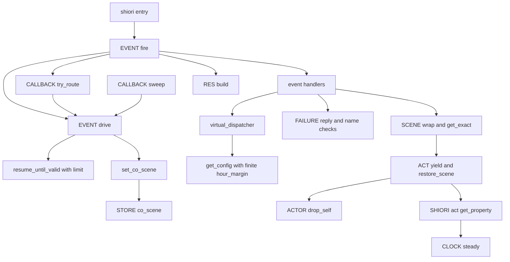
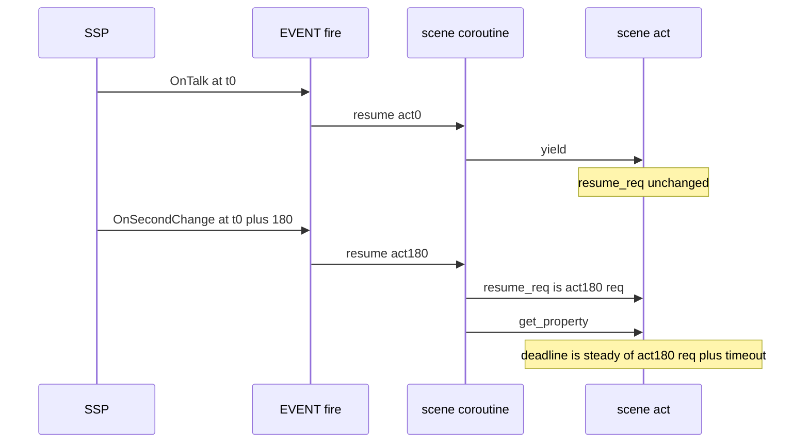

# Design Document: ponytail-lua-scripts

## Overview

**Purpose**: pasta の Lua ランタイム（`crates/pasta_lua/pasta_scripts/**`）に残る監査の指摘 1〜21 を、残らず直す。作者に見える不具合 8 件（指摘 1・2・7・11・12・13・14・15）は決めた振る舞いに直し、残り 13 件は振る舞いを 1 バイトも変えずに、写し・死んだ分岐・素通しの包み・使い手の無い部品を消す。

**Users**: ゴーストの作者は、設定や値の書き間違いで毎秒のエラー・割れた応答・固まるベースウェア・`table: 0x…` を見なくなる。ランタイムを読む開発者は、シーンの包み・続きの決め直し・関数呼び出しの文脈の戻しを、それぞれ 1 か所で読める。

**Impact**: 新しいファイルを作らない。消すファイルは 4 つ（`pasta/buf.lua`・`pasta/lua_version.lua` と、それぞれのテスト）。足す公開の名前は `SCENE.wrap`・`SCENE.get_exact`・`ACTOR.drop_self` と、`FAILURE` の 5 つの部品だけで、どれも今ある写しを置き換える。act のメソッドの集まり（`pasta_check` が照らす名前の一覧）は変えない。

### Goals

- 要件 1〜7 の受け入れ条件を、すべて満たす。
- 挙動を変える直しは、直す前に落ちて直した後に通るテストで固める。整理は、前も後も通るテストで固める。
- 1 つの直しを 1 つのコミットにし、`cargo test -p pasta_lua` と luacheck を通してから入れる（要件 7）。

### Non-Goals

- 正時の手前で見送ったランダムトークの時刻を決め直すこと（決定 1）。
- 続きの中の日時の変数・`act.req` を再開した要求のものにすること（決定 2）。`GLOBAL.resume_auto_talk(self)` が古い `act.req` で時計を決め直すことも、この spec では扱わない。
- 見出しの名前の中の改行（A3）。
- Rust 側（`crates/pasta_lua/src/**`）・`scriptlibs/`・`sakura_builder.lua` の書記素の扱い・空の `pasta.areka`。
- ACT の段とプロキシの段の `call_expr` の写しをまとめること（要件 4.12 は `fn_succeeded` の写しだけを挙げる。警告の文言が違うので、まとめると引数が増えるだけになる）。

## Boundary Commitments

### This Spec Owns

- `crates/pasta_lua/pasta_scripts/**` のうち、下の File Structure Plan に挙げたファイルの振る舞いと形。
- 応答の組み立て（`RES`）の見出しの値の改行の置き換えと、渡された見出しの表を書き換えない決まり。
- シーンのコルーチンの包み方（`SCENE.wrap`）と、完全一致の引き当て（`SCENE.get_exact`）。
- 続きの決め直し（`set_co_scene`・`EVENT.drive`）の、旗を使わない形と、何も出さない区切りの上限。
- 関数を呼んだ後に戻す実行中のシーンの文脈（`ACT_IMPL.restore_scene` の新しい形）と、関数の戻り値の正規化（`ACTOR.drop_self`）。
- 続きの中の `get_property` の期限の数え始め（区切りから再開されたときに act が控える、再開した要求）。
- この領域を確かめるテスト（`tests/lua_specs/**` と、下に挙げた Rust のテスト）と、下に挙げたマニュアルの節。
- `novel-checkpoint-rollback/brief.md` の `STORE.co_callback` の 1 行の直し（要件の In scope。実装のとき）。

### Out of Boundary

- `crates/pasta_lua/src/**`（`apply_shiori_defaults` が型を見ないことを含む）。
- `pasta_check`（`crates/pasta_check/**`）。act のメソッドの名前の集まりを変えないことで、触らずに済ませる。
- `book/src/debug/validate.md` の組み込みの飛び先の一覧（同じ理由で変わらない）。
- `EVENT.fire` の「`SHIORI/` で始まる文字列は応答全体」の決まり（公開の決まりのまま。指摘 14 は受け手の側で直す）。
- README・`steering/tech.md` の断り書き、`scriptlibs/`、`pasta/areka/init.lua`。
- 正時の手前で見送ったトークの決まり（決定 1）・続きの中の日時の変数（決定 2）。

### Allowed Dependencies

- Lua の依存の向き（左から右へだけ読み込む。読み込み時の `require` で逆向きにしない）:
  `pasta.store` → `pasta.failure` → `pasta.word` → `pasta.actor` → `pasta.scene` → `pasta.act` → `pasta.shiori.res`・`pasta.shiori.clock`・`pasta.shiori.stop` → `pasta.shiori.event.callback` → `pasta.shiori.act` → `pasta.shiori.event.*`（ハンドラ）→ `pasta.shiori.event`（init）→ `pasta.shiori.entry`
- `pasta.failure` は読み込み時に何も `require` しない（今と同じ）。足す部品は act を引数で受け、メソッド（`act:build()`）だけを呼ぶ。
- `pasta.actor` は `pasta.act` を `require` しない（今と同じ）。プロキシは `self.act` のメソッドを呼ぶ。
- イベントのハンドラのモジュールは `pasta.shiori.event`（init）を `require` しない（今と同じ）。`pasta.scene` は関数の中で遅延して読む今の書き方を保つ。
- LuaJIT 2.1 の `string.buffer`（`tests/string_buffer_availability_test.rs` が在ることを守る）。

### Revalidation Triggers

- `ACT_IMPL.restore_scene` の引数の形が変わる（`(scene, ...)` → `(fn, ...)`）。Lua から呼ぶ作者のコードは無い見込みだが、内部の頁の記述と、プロキシを試す Rust のテストの見せかけの act が追従する。
- `STORE.co_callback` が無くなる。`novel-checkpoint-rollback`・`shiori4-v4-lua-api` の brief がこれを前提にしている。
- `SCENE.wrap`・`SCENE.get_exact` が増える。0.5.0 の `scene-attribute-store`・`scene-condition-attributes` は、この後の `scene.lua` の上に乗る。
- `RES.ok`・`RES.err`・`RES.warn` が渡された表を書き換えなくなる（マニュアルの RES の表の記述が変わる）。
- 何も出さない区切りが上限を超えるとエラーになる。

## Architecture

### Existing Architecture Analysis

- 要求は Rust から `SHIORI.request(req)` → `EVENT.fire(req)` の 1 本で入る。シーンのコルーチンを再開するのは `EVENT.drive`（呼び手は `EVENT.fire`・`CALLBACK.try_route`・`CALLBACK.sweep` の 3 つ）だけで、その中の `resume_until_valid` が `coroutine.resume` を回す。
- 続きの置き場は `STORE.co_scene` 1 つで、書くのは `set_co_scene`（と `STORE.reset`）だけ。コールバック待ちのコルーチンは `CALLBACK.pending` が持つ。今は「待ちに入ったか」を `CALLBACK.consume_staged` が `STORE.co_callback` に書き、`set_co_scene` が読む。
- `chain-talk-interrupt` が決めた手順（種類を決める → 印を整える → 再開 → 欄を外す → 予約の消費 → 台詞の印 → 続きの決め直し）と、`set_co_scene(co, keep)` の `keep`・`_interrupted` の枝は保つ。手順の順は `chain_talk_interrupt_test.lua` が守る。
- 確かめた事実（コードを読んで確かめた。research.md の「設計フェーズの調査」に根拠の行）:
  - `_interrupted` の枝の `set_co_scene(nil, false)` は `STORE.co_callback` を消さない。同じ再開が台詞の組み立て（`act:build()` を区切らずに呼ぶ）とコールバック待ちの両方をしたとき、旗が残り、後でそのシーンをコールバックで再開してチェイントークで区切ると、`set_co_scene(co, false)` が旗と一致して続きを `nil` にする（取りこぼし）。
  - Rust の `talk_to_script` は台詞の生の CR・LF を落とさない（`src/sakura_script/mod.rs` の `talk_to_script_impl` は分かち書きとウェイトだけ。`line_breaker.rs` は `\r\n` を幅 0 の塊として通す）。よって要件 2.4 は `RES.build` の 1 か所で直る。
  - `get_property` の組み立ては `raw_script` だけで、`BUILDER.speaks` は台詞に数えない。
  - チェイントークの区切りは、DSL の `＞チェイントーク`・`＞yield` も Lua の `act:yield()` も、すべて `ACT_IMPL.yield` を通る（`GLOBAL.yield` → `act:yield()`）。続きを再開するのは `EVENT.fire` の `EVENT.drive(result, act, act)` で、再開の値は新しい act である。

### Architecture Pattern & Boundary Map



**Architecture Integration**:
- 採る形: 今のファイルの中で直す（ギャップ分析の案 A）。写しは、いちばん自然な持ち主へ寄せる。包む関数は `pasta.scene`、失敗の表記の部品と「報告済み」の印の後始末は `pasta.failure`、戻り値の正規化はプロキシの型を知る `pasta.actor`。
- 新しい部品の理由: どれも写しの置き換えか、作者に見える不具合の直しに要る最小の口である（下の Components）。
- 保つ形: `MODULE`／`MODULE_IMPL` の分け方、`STORE` を通した状態の持ち方、イベントのハンドラが init を読まない決まり、`pasta.actor` が `pasta.act` を読まない決まり、act のメソッドの名前の集まり。

### Technology Stack

| Layer | Choice / Version | Role in Feature | Notes |
|-------|------------------|-----------------|-------|
| Runtime | LuaJIT 2.1（mlua 0.12・vendored） | すべての変更の実行環境 | `coroutine.close` が無い前提で死んだ分岐を消す。`string.buffer` は必ずある |
| Lint | luacheck v1.2.0（`scriptlibs/`） | 消した局所の変数・使い手の無い引数の検出 | 手元では luarocks の lfs・argparse を `LUA_PATH`・`LUA_CPATH` に足して走らせる |
| Test | `lua_test`（`tests/lua_specs/`）と cargo の結合テスト | 振る舞いの固定 | 1 つの VM で全 spec が走る。モジュールの状態の持ち越しに気を配る |
| Docs | mdBook（`book/src/`）と `book/tools/gen-skill-refs.mjs` | マニュアルとスキルの references | 挙動を変えるコミットで同時に直す |

新しい依存は無い。

## File Structure Plan

### Modified Files（ランタイム）

- `crates/pasta_lua/pasta_scripts/main.lua` — 使用例を、在る `WORD.create_actor(名前, キー):entry(...)` に書き換える（指摘 16）。
- `crates/pasta_lua/pasta_scripts/pasta/store.lua` — `co_callback` の欄の説明と注記を消す。`STORE.reset` の `coroutine.close` の分岐を消し、`STORE.co_scene = nil` だけにする（指摘 4）。
- `crates/pasta_lua/pasta_scripts/pasta/failure.lua` — `FAILURE.reply`・`FAILURE.is_name`・`FAILURE.quoted`・`FAILURE.bad_reference0`・`FAILURE.fn_succeeded` を足す（指摘 10・18 の写しの持ち主）。
- `crates/pasta_lua/pasta_scripts/pasta/word.lua` — `get_global_words`・`get_local_words`・`get_actor_words` を消す（指摘 21）。`get_all_words` は Rust が呼ぶので残す。
- `crates/pasta_lua/pasta_scripts/pasta/actor.lua` — `ACTOR_WORD_BUILDER_IMPL` を消し、`create_word` は `WORD.create_actor` のビルダーをそのまま返す（指摘 6）。局所の `drop_self`・`fn_succeeded` を消し、`ACTOR.drop_self` を足す（指摘 13・18）。プロキシの `call_expr`・`word` は `restore_scene` の新しい形を使う（指摘 12）。
- `crates/pasta_lua/pasta_scripts/pasta/scene.lua` — `SCENE.wrap`（今の局所の `wrap_scene`）と `SCENE.get_exact` を出す。`co_exec` の 2 重の検査を 1 つにする。`register`・`create_scene` は `create_global_table` を使う。`get_global_name` を消す（指摘 3・9・10・18・21）。
- `crates/pasta_lua/pasta_scripts/pasta/act.lua` — `restore_scene` を「関数を呼び、戻った後に 4 つの欄を戻す」形にし、`call_restore`・`word`・`call_expr`・`global_fn` が使う。`scene_names` の欄を消す。ACT の段の関数の戻り値を `ACTOR.drop_self` で正規化する。`find_handler` を `find_act_handler` と同じ関数にする。`yield` の遅延 `require` をやめ、再開の要求を `_resume_req` に控える（指摘 7・9・12・13・18）。
- `crates/pasta_lua/pasta_scripts/pasta/shiori/res.lua` — 見出しの値の CR・LF を空白にする局所の `header`、渡された表を写す局所の `with` を足し、`build`・`ok`・`err`・`warn` が使う（指摘 2・15）。
- `crates/pasta_lua/pasta_scripts/pasta/shiori/act.lua` — `get_property` の期限の数え始めを `self._resume_req or self.req` にし、自分の区切りから再開されたときに受け取る 3 つ目の値（再開した要求）を `_resume_req` に控える。`_resume_req` の欄の説明を足す（指摘 7）。
- `crates/pasta_lua/pasta_scripts/pasta/shiori/entry.lua` — `SHIORI.load` は `return true`、`SHIORI.unload` は空の関数にする（指摘 5）。`error_handler` は `request` が使うので残す。
- `crates/pasta_lua/pasta_scripts/pasta/shiori/sakura_builder.lua` — `require("pasta.buf")` を `require("string.buffer")` にし、テスト専用の `config.buffer_factory` を消す（指摘 19）。書記素の扱いには触れない。
- `crates/pasta_lua/pasta_scripts/pasta/shiori/event/init.lua` — `set_co_scene` から旗と `close` の分岐を消す。`EVENT.drive` が `consume_staged` の真偽で `co` を外す。失敗の枝は `set_co_scene(nil, false)`。`resume_until_valid` に何も出さない区切りの上限を足す（指摘 4・11）。
- `crates/pasta_lua/pasta_scripts/pasta/shiori/event/callback.lua` — `STORE.co_callback` を書く 2 行と、使わなくなる `pasta.store` の `require` を消す（指摘 4）。`try_route` は再開に `(refs, nil, req)` を、`sweep(now, req)` は時間切れの再開に `(nil, reason, req)` を渡す（指摘 7）。
- `crates/pasta_lua/pasta_scripts/pasta/shiori/event/second_change.lua` — `CALLBACK.sweep(…, act.req)` と、要求を 2 つ目の引数で渡す（指摘 7）。
- `crates/pasta_lua/pasta_scripts/pasta/shiori/event/virtual_dispatcher.lua` — `hour_margin` を局所の `finite_or` で解決する。`check_talk` の `get_config` をトーク時刻に届いた後へ動かす。キックの説明の古いコメントを直す（指摘 1・8）。
- `crates/pasta_lua/pasta_scripts/pasta/shiori/event/choice_select.lua` — `create_scene_coroutine` を消し、`SCENE.wrap(result.func)` を返す（指摘 3）。
- `crates/pasta_lua/pasta_scripts/pasta/shiori/event/kick.lua` — `wrap_local_func`・`wrap_reload_func` を消す。シーンは `SCENE.co_exec_registered`、再読み込みは `SCENE.wrap` で作り、印は局所の `preempt` で付ける（指摘 3）。
- `crates/pasta_lua/pasta_scripts/pasta/shiori/event/external_control.lua` — 包みを `SCENE.wrap` に、`fail`・`quoted`・`is_name`・`bad_reference0` を `FAILURE` の部品に替える（指摘 3・10）。
- `crates/pasta_lua/pasta_scripts/pasta/shiori/event/scene_play.lua` — `fail`・`quoted`・`is_name`・`bad_reference0` を `FAILURE` の部品に替える（指摘 10）。
- `crates/pasta_lua/pasta_scripts/pasta/shiori/event/recommend.lua` — `run_menu` の引き当てを `SCENE.get_exact` に、`OnRecommendsiteChoice` の失敗を `FAILURE.reply` に替える。受け手の値が `SHIORI/` で始まるときだけ `RES.ok` で包む局所の `as_value` を足す（指摘 10・14）。

### Deleted Files

- `crates/pasta_lua/pasta_scripts/pasta/buf.lua`（指摘 19）
- `crates/pasta_lua/pasta_scripts/pasta/lua_version.lua`（指摘 20）
- `crates/pasta_lua/tests/lua_specs/buf_test.lua`
- `crates/pasta_lua/tests/lua_specs/lua_version_test.lua`

### Modified Files（テスト）

- `crates/pasta_lua/tests/lua_specs/init.lua` — `buf_test`・`lua_version_test` の 2 行を消す。
- `crates/pasta_lua/tests/lua_specs/virtual_dispatcher_spec.lua` — 数でない `hour_margin` で `check_talk` が投げずにトークを出す確かめ（1.1〜1.3）。
- `crates/pasta_lua/tests/lua_specs/res_ok_test.lua` — CR・LF の置き換え、渡した表を書き換えない確かめ（2.1〜2.3・2.6）。
- `crates/pasta_lua/tests/lua_specs/get_property_test.lua` — 後の要求で再開した続きの期限（3.1〜3.4）。
- `crates/pasta_lua/tests/lua_specs/chain_talk_interrupt_test.lua` — `STORE.co_callback` の確かめを消し、中断の台詞とコールバック待ちが同じ再開で起きた後に続きを取りこぼさない確かめを足す（4.4・4.5）。
- `crates/pasta_lua/tests/lua_specs/callback_module_test.lua`・`shiori_entry_test.lua` — `STORE.co_callback` の確かめを、`consume_staged` の戻り値と `CALLBACK.pending`・`STORE.co_scene` の確かめに替える。
- `crates/pasta_lua/tests/lua_specs/event_coroutine_test.lua` — 何も出さない区切りの上限（5.1・5.2）。
- `crates/pasta_lua/tests/lua_specs/act_call_restore_test.lua` — `restore_scene` の新しい形と、関数を呼んだ後にローカル名と行の対応が戻る確かめ（5.3・決定 5）。`scene_names` の確かめを消す。
- `crates/pasta_lua/tests/lua_specs/act_choice_test.lua` — `act:restore_scene(caller)` の使い方を新しい形に直す。
- `crates/pasta_lua/tests/lua_specs/act_word_expr_test.lua` — ACT の段の関数が ACT・プロキシを返すときと、それ以外の値・複数の値を返すとき（5.4・5.5）。
- `crates/pasta_lua/tests/lua_specs/recommend_menu_test.lua` — 値が `SHIORI/` で始まるとき（2.5）。
- `crates/pasta_lua/tests/lua_specs/actor_word_test.lua` — 消す取り出し口の確かめを消す。`actor_module_test.lua` — `ActorWordBuilder` の見出しを直す。
- `crates/pasta_lua/tests/lua_specs/sakura_builder_test.lua` — 「既定のバッファと代わりのバッファの出力が一致する」確かめを消す（代わりのバッファが無くなるため）。
- `crates/pasta_lua/tests/shiori/virtual_event_dispatch_test.rs` — `test_ontalk_hour_margin_skip` を消す（指摘 17）。
- `crates/pasta_lua/tests/shiori/virtual_event_config_resolution_test.rs` — 文字列・真偽値・NaN・無限大・有限の小数の `hour_margin` を `_get_config` で確かめる（1.1・1.4・1.5）。
- `crates/pasta_lua/tests/shiori/res_test.rs` — 改行を含む値の応答が割れない確かめ（2.1・2.4）。
- `crates/pasta_lua/tests/loader/config_defaults_test.rs` — `hour_margin` の既定のリテラルの照らしを `finite_or(ghost.hour_margin, 30)` の形に直す（1 行）。
- `crates/pasta_lua/tests/string_buffer_availability_test.rs` — `pasta.buf`・`pasta.lua_version` を使わず、`string.buffer` の在ることと `put`・`tostring` を直接確かめる。
- `crates/pasta_lua/tests/transpiler/fallback_search_integration_test.rs` — プロキシに渡す見せかけの act の `restore_scene` を `function act:restore_scene(fn, ...) return fn(...) end` に直す（2 か所）。

### Modified Files（マニュアル・スキル・他の spec）

- `book/src/lua/shiori-events.md` — 設定の表の `hour_margin`（数で有限でなければ 30）、RES の表（見出しの値の CR・LF は空白・渡した表は書き換えない）。
- `book/src/reference/pasta-toml.md` — `hour_margin` の行。
- `book/src/lua/script-api.md` — `get_property` の期限（続きでは再開した時点から）、`word`・`expr_fn`・`global_fn` の戻り値の正規化。
- `book/src/grammar/call-jump.md` — チェイントークの節に、何も出さない区切りの上限。
- `book/src/internals/shiori.md` — 設定の読み（505 行あたり）、時計の節の期限（549 行あたり）、既定ハンドラの表の `REG.OnSecondChange` の `sweep` の呼び方（449 行あたり）、コールバックの節の `co_callback` の言及と再開の値（458〜471 行あたり）。`ponytail-shiori` とは別の節。
- `book/src/internals/execution-model.md` — コールバック待ちとの関係（旗の記述を消す）、`set_co_scene` の手順、`EVENT.drive` の手順 6 の説明、再開のループの上限、シーンコルーチンの作り方の表、`pasta.lua_version` の言及。
- `book/src/internals/internal-modules.md` — `co_callback`・`co_preempt` の欄、シーン文脈の復元、`scene_names`、`call_expr`・`drop_self`、`ACTOR_WORD_BUILDER_IMPL`、`get_global_name`、単語の取り出し口、`pasta.buf`・`pasta.lua_version` の節。
- `book/src/internals/talk-output.md`・`book/src/internals/index.md`・`book/src/internals/registry-search.md`・`book/src/internals/debug.md`（34 行の `wrap_local_func`。`ponytail-lua-debug` と別の節） — 消した部品の名前を今の名前に直す。
- `.claude/skills/*/references/*.md` — `node book/tools/gen-skill-refs.mjs` で作り直す（手で書かない）。
- `.kiro/specs/novel-checkpoint-rollback/brief.md` — 24 行の `STORE.co_callback` を「待ちのコルーチンは `CALLBACK.pending` だけが持つ」に直す（実装のとき・要件 6.5）。

## System Flows

### 再開と続きの決め直し（EVENT.drive）

```mermaid
sequenceDiagram
    participant Caller as fire or try_route or sweep
    participant Drive as EVENT drive
    participant Loop as resume_until_valid
    participant CB as CALLBACK
    participant Set as set_co_scene
    Caller->>Drive: co act args
    Drive->>Drive: kind and marks
    Drive->>Loop: resume
    Loop-->>Drive: ok value
    alt not ok or limit exceeded
        Drive->>CB: discard_staged
        Drive->>Set: nil false
    else ok
        Drive->>CB: consume_staged co act
        CB-->>Drive: waiting
        Drive->>Drive: if waiting then co is nil
        alt interrupted
            Drive->>Set: nil false
        else
            Drive->>Set: co keep
        end
    end
```

- 旗を介さない受け渡し: `consume_staged` が真なら、その `co` は `CALLBACK.pending` が持つので `co = nil` にしてから `set_co_scene` へ渡す。`keep` の値と `_interrupted` の枝は今のまま。下の表のとおり、すべての場合で今と同じ `STORE.co_scene` になる（旗が残る場合を除く。そこが直る）。

| 場合 | 今（旗あり） | 新しい形 |
| ---- | ------------ | -------- |
| 待ちに入った・`keep` 真 | 旗を消して戻る（`co_scene` は触らない） | `set_co_scene(nil, true)` → 触らない |
| 待ちに入った・`keep` 偽 | `co_scene = nil`・旗を消す | `set_co_scene(nil, false)` → `co_scene = nil` |
| 待ちに入った・`_interrupted` | `co_scene = nil`・**旗が残る** | `co_scene = nil`（旗が無い） |
| 待ちに入らない・`keep` 真 | 触らない | 触らない |
| 待ちに入らない・`keep` 偽 | `co_scene = co`（suspended のとき。dead なら nil） | 同じ |
| エラー・上限超え | `co` は dead → `co_scene = nil` | `set_co_scene(nil, false)` → `co_scene = nil`（上限超えの `co` は suspended のまま捨てる） |
| 旗が残った後に、そのシーンを再開して区切る | 旗と一致 → `co_scene = nil`（取りこぼし） | `co_scene = co` |

### 何も出さない区切りの上限

- `resume_until_valid` は、出力が `nil` で suspended のまま区切った回を数える。数が `NIL_YIELD_LIMIT`（10,000）を超えたら、再開をやめて `false, "何も出さない区切りが 10000 回続いた"` を返す。数は `resume_until_valid` を呼ぶたびに 0 から数える（1 回の再開の手順の中だけ）。
- `EVENT.drive` は、ほかのエラーと同じ失敗の枝で受ける（`STOP.hold` → `discard_staged` → `set_co_scene(nil, false)`）。`EVENT.fire` が `error` で投げ、`SHIORI.request` の `STOP.response` が、止まった act の書いた名前（`STOP.subject`）を対象にした `【スクリプトのエラー：＊シーン名（何も出さない区切りが 10000 回続いた）】` の表記を出す。表記を出さない設定・`On` で始まらない ID では、今の 500 になる。

### 続きの get_property の期限



- シーンが区切った所から再開する道は 3 つで、どれも再開した要求を act に控える（`act.req` は替えない。決定 2）。
  - チェイントークの続き（`EVENT.fire` → `EVENT.drive(co, act, act)`）: `ACT_IMPL.yield` が受け取る再開の値（新しい act）の `req`。
  - コールバックの応答（`CALLBACK.try_route(req)`）: `get_property` の区切りが受け取る 3 つ目の値 `req`。
  - 時間切れ（`CALLBACK.sweep(now, req)`。静かな時間切れの後にシーンが続く場合）: 同じく 3 つ目の値 `req`。
- `get_property` は `self._resume_req or self.req` の時刻（`CLOCK.steady`）から期限を数える。最初の区切りでは `_resume_req` が無いので、今と同じ期限になる（3.2）。

## Requirements Traceability

| Requirement | Summary | Components | Interfaces | Flows |
|-------------|---------|------------|------------|-------|
| 1.1 | 数でない `hour_margin` は 30 | GhostTimingConfig | `finite_or` | — |
| 1.2 | 毎秒のエラーを出さない | GhostTimingConfig | `check_talk` | — |
| 1.3 | ランダムトークを出し続ける | GhostTimingConfig | `check_talk` | — |
| 1.4 | NaN・無限大も 30 | GhostTimingConfig | `finite_or` | — |
| 1.5 | 有限の数はそのまま | GhostTimingConfig | `finite_or` | — |
| 1.6 | 書かれていなければ 30 | GhostTimingConfig | `finite_or` | — |
| 2.1 | CR・LF を 1 文字ずつ空白 | ResponseBuilder | `header` | — |
| 2.2 | すべての応答に効く | ResponseBuilder | `RES.build` | — |
| 2.3 | 改行の無い値は不変 | ResponseBuilder | `header` | — |
| 2.4 | 変数・単語の改行で `\e` を失わない | ResponseBuilder | `RES.build` | — |
| 2.5 | `SHIORI/` で始まる値は Value | MenuReceivers | `as_value` | — |
| 2.6 | 渡された表を書き換えない | ResponseBuilder | `with` | — |
| 2.7 | 見出しの名前と並びは今と同じ | ResponseBuilder | `RES.build` | — |
| 3.1 | 続きの期限は呼んだ時点から | ResumeDeadline | `ACT_IMPL.yield`・`get_property` | 続きの get_property の期限 |
| 3.2 | 最初の区切りは今と同じ | ResumeDeadline | `get_property` | 同上 |
| 3.3 | 期限内の応答で再開 | ResumeDeadline | `CALLBACK.try_route` | 同上 |
| 3.4 | 期限切れは今と同じ扱い | ResumeDeadline | `CALLBACK.sweep` | 同上 |
| 3.5 | なめらかな時計で数える | ResumeDeadline | `CLOCK.steady` | 同上 |
| 3.6 | 期限のほかは変えない | ResumeDeadline | `_resume_req` | 同上 |
| 4.1 | 包む手順を 1 か所に | SceneWrap・WrapCallers | `SCENE.wrap` | — |
| 4.2 | `coroutine.close` の分岐を持たない | SceneDriver・Store | `set_co_scene`・`STORE.reset` | 再開と続きの決め直し |
| 4.3 | 旗を介さずに渡す | SceneDriver・CallbackRegistry | `EVENT.drive` | 同上 |
| 4.4 | 続きの決まりを保つ | SceneDriver | `EVENT.drive` | 同上 |
| 4.5 | 中断の回の待ちの後も取りこぼさない | SceneDriver | `EVENT.drive` | 同上 |
| 4.6 | load・unload を包まない | Entry | `SHIORI.load`・`SHIORI.unload` | — |
| 4.7 | アクターの単語を素通しの包みなしで | ActorWords | `ACTOR_IMPL.create_word` | — |
| 4.8 | トークを出さない秒は設定を読まない | GhostTimingConfig | `check_talk` | — |
| 4.9 | 古いコメントを持たない | GhostTimingConfig・SceneDriver | — | — |
| 4.10 | `find_handler` の別名・`register` の共有 | CallContext・SceneWrap | `ACT_IMPL.find_handler`・`SCENE.register` | — |
| 4.11 | 引き当てと失敗の表記を 1 組に | EventFailureParts・SceneWrap | `FAILURE.*`・`SCENE.get_exact` | — |
| 4.12 | 指摘 18 の写しと重なりを持たない | CallContext・SceneWrap・EventFailureParts | `FAILURE.fn_succeeded`・`SCENE.co_exec` | — |
| 4.13 | 使い手の無い部品と記述を消す | Removals・DocsAndExamples | — | — |
| 4.14 | 何も確かめないテストを持たない | TestSuite | — | — |
| 4.15 | 整理で見える振る舞いを変えない | 全コンポーネント | — | — |
| 5.1 | 上限を超えたらエラーの表記 | SceneDriver | `resume_until_valid` | 何も出さない区切りの上限 |
| 5.2 | 上限より少なければ今と同じ | SceneDriver | `resume_until_valid` | 同上 |
| 5.3 | 関数の後もローカル名と行を出す | CallContext | `ACT_IMPL.restore_scene` | — |
| 5.4 | ACT の段で ACT・プロキシを返したら空 | CallContext | `ACTOR.drop_self` | — |
| 5.5 | それ以外の値は今と同じ | CallContext | `ACTOR.drop_self` | — |
| 6.1 | 挙動の直しと同じ変更でマニュアル | DocsAndExamples | — | — |
| 6.2 | `gen-skill-refs` で references | DocsAndExamples | — | — |
| 6.3 | 内部の頁から消した部品を消す | DocsAndExamples | — | — |
| 6.4 | `main.lua` の使用例 | DocsAndExamples | — | — |
| 6.5 | `novel-checkpoint-rollback` の brief | DocsAndExamples | — | — |
| 7.1 | 直す前にテスト | TestSuite | — | — |
| 7.2 | 1 直し 1 コミット・test と luacheck | TestSuite | — | — |
| 7.3 | 指定の場合を確かめる | TestSuite | — | — |
| 7.4 | `sample.generated.lua` の改行差分を戻す | TestSuite | — | — |

## Components and Interfaces

| Component | Domain/Layer | Intent | Req Coverage | Key Dependencies | Contracts |
|-----------|--------------|--------|--------------|------------------|-----------|
| GhostTimingConfig | shiori/event | `hour_margin` の解決と毎秒の読み直しの削減 | 1.1–1.6, 4.8, 4.9 | `@pasta_config`（P0）, `pasta.save`（P1） | Service |
| ResponseBuilder | shiori | 割れない応答・表を書き換えない部品 | 2.1–2.4, 2.6, 2.7 | なし | Service |
| MenuReceivers | shiori/event | メニューの値の取り違えを防ぐ | 2.5, 4.11 | ResponseBuilder（P0）, SceneWrap（P1） | Service |
| ResumeDeadline | act・shiori/act・shiori/event | 続きの期限を再開した要求から数える | 3.1–3.6 | `pasta.shiori.clock`（P0）, CallbackRegistry（P0） | Service, State |
| SceneDriver | shiori/event | 旗の無い続きの決め直しと区切りの上限 | 4.2–4.5, 4.9, 5.1, 5.2 | CallbackRegistry（P0）, Store（P0）, `pasta.shiori.stop`（P1） | Service, State |
| CallbackRegistry | shiori/event | 待ちの登録の真偽を返すだけにする | 4.3 | なし | Service |
| Store | core | 旗の欄と `close` の分岐を消す | 4.2, 4.3 | なし | State |
| SceneWrap | core | シーンの包みと完全一致の引き当ての唯一の持ち主 | 4.1, 4.10–4.13 | `@pasta_search`（P0）, Store（P0） | Service |
| WrapCallers | shiori/event | 選択肢・キック・外からの呼び出しが SceneWrap を使う | 4.1 | SceneWrap（P0）, Store（P1） | Service |
| EventFailureParts | core | イベントの名前の検査と失敗の表記の部品 | 4.11, 4.12 | なし（act を引数で受ける） | Service |
| CallContext | core | 関数を呼んだ後の文脈の戻しと戻り値の正規化 | 4.10, 4.12, 5.3–5.5 | `pasta.actor`（P0）, EventFailureParts（P1） | Service |
| ActorWords | core | アクターの単語のビルダーを素通しなしで返す | 4.7 | `pasta.word`（P0） | Service |
| Entry | shiori | load・unload の空の包みを消す | 4.6 | なし | Service |
| Removals | core・shiori | 使い手の無い部品を消す | 4.13 | なし | — |
| DocsAndExamples | docs | マニュアル・スキル・使用例・他の spec の記述をそろえる | 4.13, 6.1–6.5 | `gen-skill-refs`（P0） | — |
| TestSuite | tests | 振る舞いを固め、1 直しずつ確かめる | 4.14, 4.15, 7.1–7.4 | cargo・luacheck（P0） | Batch |

### shiori/event

#### GhostTimingConfig（`pasta/shiori/event/virtual_dispatcher.lua`）

| Field | Detail |
|-------|--------|
| Intent | 数で有限なときだけ `hour_margin` を使い、トークを出す秒だけ設定を読む |
| Requirements | 1.1, 1.2, 1.3, 1.4, 1.5, 1.6, 4.8, 4.9 |

**Responsibilities & Constraints**
- `get_config()` の `hour_margin` は `finite_or(ghost.hour_margin, 30)` で決める。`finite_or` は、型が number で、NaN でも ±無限大でもなければその値を、それ以外は既定を返す。切り捨てや下限の補正はしない（1.5）。`talk_interval_*` の `resolve` には手を入れない。
- `check_talk` は、`current_unix < next_talk_time` の早い戻りの後で `get_config()` を呼ぶ。初回（`next_talk_time == 0`）は `calculate_next_talk_time` の中で今と同じく 1 回読む。トークを出す秒は、今と同じく 2 回読む（`hour_margin` 用と次の時刻用）。
- キックの説明のコメント（今の 248〜256 行）は、「`STORE.co_preempt` の印で、`EVENT.drive` が待っている続きを捨てる」と書き直す（4.9）。

**Contracts**: Service [x]

```lua
---@param v any
---@param default number
---@return number  -- v が有限の数なら v、それ以外は default
local function finite_or(v, default) end
```

**Implementation Notes**
- Integration: `tests/loader/config_defaults_test.rs` は既定のリテラルを文字列で照らしている。照らす文字列を `finite_or(ghost.hour_margin, {})` に直す。
- Validation: `virtual_event_config_resolution_test.rs` に `"30"`・`true`・`{}`・`0/0`・`math.huge`・`-math.huge`・`12.5` の場合を足す。`virtual_dispatcher_spec.lua` で、`hour_margin = "30"` のまま正時の手前でも `check_talk` が投げず、間隔どおりにトークを返すことを確かめる。
- Risks: なし（数の設定の振る舞いは変わらない）。

#### MenuReceivers（`pasta/shiori/event/recommend.lua`）

| Field | Detail |
|-------|--------|
| Intent | 受け手の値を、`SHIORI/` で始まっても Value として返す |
| Requirements | 2.5, 4.11 |

**Responsibilities & Constraints**
- 局所の `as_value(v)` は、`v` が `SHIORI/` で始まる文字列なら `RES.ok(v)` を、それ以外は `v` をそのまま返す。メニューの受け手（`encode(items)`）とボタンの名前の受け手（見つかった単語）が、返す前に通す。`SHIORI/` で始まらない値は今と同じ戻り値なので、受け手を直接呼ぶ既存のテストはそのまま通る。
- `run_menu` は `SCENE.get_exact(id)` で関数を引く（今の `search_scene_exact` と `SCENE.get` と型の確かめの写しを消す）。
- `OnRecommendsiteChoice` の見つからない失敗は `FAILURE.reply(act, record)` を返す。

**Contracts**: Service [x]

```lua
---@param v string|nil
---@return string|nil  -- SHIORI/ で始まる文字列は RES.ok(v) の応答全体、それ以外は v
local function as_value(v) end
```

**Implementation Notes**
- Integration: `EVENT.fire` の「`SHIORI/` で始まる文字列は応答全体」の決まりは変えない（公開の決まり）。受け手が応答全体を作って返すので、`fire` はそれを素通しする。
- Validation: 項目名が `SHIORI/x` のメニューと、キャプションの単語が `SHIORI/x` のとき、`EVENT.fire` の応答が `200 OK` で `Value` に値が入ることを確かめる。
- Risks: 決めごとの代案は Open Questions の 3。

#### CallbackRegistry（`pasta/shiori/event/callback.lua`）

| Field | Detail |
|-------|--------|
| Intent | 予約を待ちとして登録し、登録したかを真偽で返すだけにする |
| Requirements | 4.3 |

**Contracts**: Service [x]
- `CALLBACK.consume_staged(co, act) -> boolean`: 今と同じ。`STORE.co_callback` を書かない。
- `CALLBACK.reset()`: `_next_id`・`_staged`・`pending` を戻す。`STORE` に触れない。
- `CALLBACK.try_route(req)`: 再開を `EVENT.drive(entry.co, entry.act, refs, nil, req)` にする（3 つ目の値は ResumeDeadline が読む）。
- `CALLBACK.sweep(now, req)`: `req` は省略できる（今の 1 引数の呼び方はそのまま動く）。時間切れの再開を `EVENT.drive(entry.co, entry.act, nil, reason, req)` にする。
- `pasta.store` の `require` を消す（ほかに使い手が無い）。

#### Store（`pasta/store.lua`）

- `co_callback` の欄の説明（`@field`）と 90〜92 行の注記を消す。`STORE.reset` の先頭は `STORE.co_scene = nil` だけにする（LuaJIT 2.1 に `coroutine.close` は無いので、今も参照を外すだけ）。summary-only（4.2・4.3）。

#### SceneDriver（`pasta/shiori/event/init.lua`）

| Field | Detail |
|-------|--------|
| Intent | 続きの決め直しを旗なしで行い、何も出さない区切りに上限を置く |
| Requirements | 4.2, 4.3, 4.4, 4.5, 4.9, 5.1, 5.2 |

**Responsibilities & Constraints**
- `set_co_scene(co, keep)`: `co` が suspended でなければ `nil` にする。`keep` が真なら何もしない。偽なら `STORE.co_scene = co`。旗・`close` の分岐・同一の確かめを持たない（同一なら代入しても同じなので消す）。
- `EVENT.drive(co, act, ...)`: 手順の順は今と同じ。手順 5（失敗）は `set_co_scene(nil, false)`。手順 6 は `if CALLBACK.consume_staged(co, act) then co = nil end`（待ちのコルーチンは `CALLBACK.pending` だけが持つ）。手順 6〜8 の間に処理を挟まない決まりは保つ。
- `resume_until_valid(co, ...)`: 出力が `nil` で suspended の区切りを数え、`NIL_YIELD_LIMIT` を超えたら `false, NIL_YIELD_MESSAGE` を返す。数えるのは 1 回の呼び出しの中だけ。上限より少なければ今と同じく引数なしで再開を続ける（5.2）。`run_interrupt_scene` も同じ関数を使うので、中断のシーンにも同じ上限が掛かる。
- 冒頭と `set_co_scene` の説明から `coroutine.close` の記述を消す。

**Contracts**: Service [x] / State [x]

```lua
local NIL_YIELD_LIMIT = 10000
local NIL_YIELD_MESSAGE = "何も出さない区切りが 10000 回続いた"

---@param co thread|nil
---@param keep boolean
local function set_co_scene(co, keep) end

---@param co thread
---@return boolean ok
---@return any value  -- ok=false のときエラーの値（上限超えは NIL_YIELD_MESSAGE）
local function resume_until_valid(co, ...) end
```

- Preconditions: `co` は suspended（`CALLBACK.pending` から外した後か、新しく作ったもの）。
- Postconditions: `EVENT.drive` を抜けた時点で、`co` は `STORE.co_scene`・`CALLBACK.pending` のどちらか一方にだけあるか、どこにも無い。
- Invariants: `STORE.co_scene` を書くのは `set_co_scene` と `STORE.reset` だけ。

**Implementation Notes**
- Integration: `chain-talk-interrupt` の `drive_kind`・`_spoke`・`_on_speech`・`_interrupted` には触れない。
- Validation: `chain_talk_interrupt_test.lua` の既存の確かめがすべて通ること（4.4）。新しい確かめ（4.5）: 続きが待っている間の割り込みのシーンが、`act.さくら:talk(…)` の後に `act:build()` を区切らずに呼び（中断の台詞が出る）、続けて `act:get_property(…)` で区切る。次の `OnPastaCallBack1` で再開したシーンが台詞を出して `act:yield()` で区切ると、`STORE.co_scene` がそのコルーチンになる。今のコードではこの確かめが落ちる（旗が残るため）。
- Validation: 上限（5.1・5.2）は `EVENT._resume_until_valid` と `EVENT.fire` の両方で確かめる。`while true do act:yield() end` のシーンで、`EVENT.fire` が固まらずに返り、`SHIORI.request` の応答がシーン名を含む表記になる。10 回だけ何も出さずに区切ってから台詞を出すシーンは、今と同じ出力になる。
- Risks: 上限を、ふつうのシーンが届かない大きさにしている（A6）。Lua で「次の秒まで待つ」つもりの空の `act:yield()` のループは、今は固まり、直した後はエラーの表記になる（決定 4 のとおり）。

### shiori

#### ResponseBuilder（`pasta/shiori/res.lua`）

| Field | Detail |
|-------|--------|
| Intent | 見出しの値の CR・LF で応答が割れず、渡された表を書き換えない |
| Requirements | 2.1, 2.2, 2.3, 2.4, 2.6, 2.7 |

**Responsibilities & Constraints**
- 局所の `header(k, v)` は、`v` が文字列なら `v:gsub("[\r\n]", " ")` の最初の戻り値にしてから `k .. ": " .. v .. "\r\n"` を返す。文字列でない値は今と同じく連結に任せる（数はそのまま、表などは今と同じくエラー）。
- `RES.build` は、ステータス行の後の標準の 3 つ（Charset・Sender・SecurityLevel）と、`dic` の `pairs` の順の追加の見出しを、どれも `header` で書く。並びの規則は今と同じ（2.7）。
- 局所の `with(dic, k, v)` は、`dic`（`nil` なら空）を浅く写した新しい表に `k = v` を足して返す。`RES.ok` は `with(dic, "Value", value)`、`RES.err` は `with(dic, "X-Error-Reason", reason)`、`RES.warn` は `with(dic, "X-Warn-Reason", reason)` を使う。`RES.ok` が 204 に回すとき（値が `nil`・空）は、今と同じく `dic` をそのまま `no_content` に渡す。
- 改行の置き換えは `RES.build` の 1 か所で行うので、`STOP.response`（`RES.build` を直接呼ぶ）・204・作者が見出しの表を渡す応答にも等しく効く（2.2）。台詞の値は Rust の `talk_to_script` が生の CR・LF を残すので、この 1 か所で `Value` が 1 行になり、末尾の `\e` が残る（2.4）。

**Contracts**: Service [x]

```lua
---@param code string
---@param dic table<string, string|number>|nil  -- 書き換えない
---@return string
function RES.build(code, dic) end

---@param value string|nil
---@param dic table<string, string|number>|nil  -- 書き換えない
---@return string
function RES.ok(value, dic) end
-- RES.err(reason, dic) / RES.warn(reason, dic) も同じく dic を書き換えない
```

**Implementation Notes**
- Validation: `res_ok_test.lua` と `res_test.rs` で、`"上\n下"`・`"上\r\n下"`・`"a\rb"` の値が `上 下`・`上  下`・`a b` になり、応答の行の数が増えないこと。改行の無い値は今と同じ文字列。`local H = { Reference0 = "x" }` を `RES.ok("v", H)` に渡した後、`H.Value` が `nil` のまま、`RES.no_content(H)` に `Value` が出ないこと。
- Risks: 作者が渡した表の追加の見出しの並びは、今も `pairs` の順で決まっていない。写した表の `pairs` の順が元の表と違う場合がありうる（Assumption D1）。ランタイムが作る応答（`dic` が `nil` か、`STOP.response` の 2 つの見出し）は今とバイト一致する。

#### ResumeDeadline（`pasta/act.lua` の `ACT_IMPL.yield`・`pasta/shiori/act.lua` の `get_property`・`callback.lua`・`second_change.lua`）

| Field | Detail |
|-------|--------|
| Intent | 続きの中の `get_property` の期限を、そのシーンを最後に再開した要求の時刻（＝呼んだ時点の時刻）から数える |
| Requirements | 3.1, 3.2, 3.3, 3.4, 3.5, 3.6 |

**Responsibilities & Constraints**
- `ACT_IMPL.yield(self)`: 自動トークを止めている間の警告と再開（今と同じ）→ `local resumed = coroutine.yield(self:build())` → `resumed` が表なら `self._resume_req = resumed.req`（`req` が無ければ `nil` になり、期限は `self.req` に戻る）→ `return self`。引数なしの再開（何も出さない区切りを飛ばす再開）では控えを変えない。
- `SHIORI_ACT_IMPL.get_property`: `local req = self._resume_req or self.req`、`local now = (req and CLOCK.steady(req)) or os.time()`。区切りは `local refs, reason, by = coroutine.yield(self:build())` とし、`by` があれば `self._resume_req = by`（コールバックや静かな時間切れから戻った後に続けて呼ぶ `get_property` も、その時点から数える）。ほかは今と同じ。
- `CALLBACK.try_route`・`CALLBACK.sweep` が 3 つ目の値に要求を渡す（CallbackRegistry）。`REG.OnSecondChange` の既定ハンドラは `CALLBACK.sweep(CLOCK.steady(act.req) or os.time(), act.req)` と呼ぶ。作者が上書きしたハンドラが今の 1 引数で `sweep` を呼んでも動く（その場合、静かな時間切れの後の期限だけは前の要求から数える）。
- `act.req`・日時の変数（`transfer_date_to_var` が `CLOCK.date(self.req)` を読む）は替えない（3.6・決定 2）。
- 遅延 `require` をやめる: `require("pasta.store")`・`require("pasta.global")` は先頭で読み込み済みの `STORE`・`GLOBAL` を使う。`require("@pasta_log")` はテストが差し替えるので呼んだ時点で引く（指摘 18）。

**Contracts**: State [x]
- State model: ACT の欄 `_resume_req: ShioriRequest|nil`。書くのは `ACT_IMPL.yield` と `get_property` の区切りの後だけ、読むのは `get_property` だけ。
- Persistence: 保存しない（ACT と同じ寿命）。

**Implementation Notes**
- Integration: 3 つ目の値を受け取らない今のテスト（`try_route`・`sweep` を通さずに手で再開するもの）では `by` が `nil` で、控えは変わらない。
- Validation: `get_property_test.lua` に、`t0` の OnTalk で区切ったシーンを `t0 + 180` の OnSecondChange で再開し、そこで `get_property("x", 5)` を呼ぶ確かめを足す。`t0 + 181` の掃引では時間切れにならず、`OnPastaCallBack1` が届けば値で再開する（3.3）。`t0 + 186` の掃引で時間切れの文で再開する（3.4）。コールバックで戻った `t0 + 183` に続けて呼ぶ `get_property` の期限が `t0 + 188` になる確かめも足す。最初の区切りの期限は既存の確かめ（Group G など）が守る（3.2・3.5）。
- Risks: なし。

#### Entry（`pasta/shiori/entry.lua`）

- `SHIORI.load(hinst, load_dir)` は `return true`、`SHIORI.unload()` は何もしない関数にする（4.6）。`shiori_entry_test.lua` の 107・111 行が戻り値を守る。summary-only。

### core

#### SceneWrap（`pasta/scene.lua`）

| Field | Detail |
|-------|--------|
| Intent | シーンの関数をコルーチンに包む手順と、完全一致の引き当てを 1 か所に置く |
| Requirements | 4.1, 4.10, 4.11, 4.12, 4.13 |

**Contracts**: Service [x]

```lua
--- 最初の resume で受けた act と残りの引数で fn を呼び、最後に act:build() の結果を返すコルーチン
---@param fn fun(act: Act, ...): any
---@return thread
function SCENE.wrap(fn) end

--- 完全一致でシーンの関数を引く（実行しない）。local_name が nil なら大域だけを探す
---@param name string
---@param local_name string|nil
---@return function|nil fn
---@return "global"|"local"|nil miss  -- fn が nil のとき見つからなかった側（今の co_exec_exact と同じ値）
function SCENE.get_exact(name, local_name) end

function SCENE.co_exec_exact(name, local_name) end      -- get_exact → wrap。戻り値は今と同じ
function SCENE.co_exec_registered(global_name, local_name) end -- get → 関数なら wrap。今と同じ
function SCENE.co_exec(act, name, global_scene_name, attrs) end -- 型の確かめは 1 回
function SCENE.register(global_name, local_name, scene_func) end -- create_global_table(global_name)[local_name] = scene_func
function SCENE.create_scene(base_name, local_name, scene_func) end -- 最後は create_global_table(global_name) を返す
```

- `SCENE.wrap` の本体は `fn(act, ...)` の後に `return act:build()`。今の `if result ~= nil then return result end` と、`coroutine.resume` の受け手から見て同じ（`value` はどちらも `nil`）。
- `SCENE.get_global_name` を消す（使い手はテストと内部の頁だけ）。
- おすすめメニューの、組み立てを呼ばない動かし方（`recommend.lua` の `coroutine.create(fn)`）は写しではないので残す（4.1 の但し書き）。

#### WrapCallers（`choice_select.lua`・`kick.lua`・`external_control.lua`）

| Field | Detail |
|-------|--------|
| Intent | 包む手順の写しを消し、`SCENE.wrap`・`SCENE.co_exec_registered` を呼ぶ |
| Requirements | 4.1 |

- `choice_select.lua`: `return SCENE.wrap(result.func)`。
- `kick.lua`: 局所の `preempt(co)` が `STORE.co_preempt[co] = true` を付けて `co` を返す。再読み込みは `preempt(SCENE.wrap(function(a) a:raw_script("\\![reload,shiori]") end))`。シーンは `SCENE.co_exec_registered(parent or scene_name, local_name or "__start__")`（合成名 `:親:ローカル` の分け方は今の `string.match` のまま。合わなければ両方 `nil` で、大域の `__start__` を引く）が返れば `preempt` する。キックの印は呼ぶ側に残す（4.1 の但し書き）。`pasta.scene` は今と同じく `try_dispatch` の中で読む。解決できないときの警告は今と同じ。
- `external_control.lua`: `return SCENE.wrap(function(a) handler(a, table.unpack(args, 1, n)) end)`。`pasta.scene` は関数の中で読む。

#### EventFailureParts（`pasta/failure.lua`）

| Field | Detail |
|-------|--------|
| Intent | イベントの名前の検査と失敗の表記、「報告済み」の印の後始末を 1 組にする |
| Requirements | 4.11, 4.12 |

**Contracts**: Service [x]

```lua
--- 失敗を報告し（FAILURE.report と同じ）、act:build() の結果を返す
---@param act table
---@param record FailureRecord
---@return string|nil
function FAILURE.reply(act, record) end

---@param v any
---@return boolean  -- 空でない文字列か
function FAILURE.is_name(v) end

---@param v any
---@return string  -- nil は "nil"、それ以外は "'" .. tostring(v) .. "'"
function FAILURE.quoted(v) end

--- Reference0 が名前にならないときの失敗（今の scene_play.lua・external_control.lua の bad_reference0 と同じ記録）
---@param act table
---@param event string
---@param value any
---@return string|nil
function FAILURE.bad_reference0(act, event, value) end

--- 関数が戻った後に「報告済み」の印を偽にし、残りの引数をそのまま返す（今の act.lua・actor.lua の fn_succeeded）
---@param act table
---@return any ...
function FAILURE.fn_succeeded(act, ...) end
```

- 使い手: `scene_play.lua`・`external_control.lua`（`reply`・`is_name`・`quoted`・`bad_reference0`）、`recommend.lua`（`reply`）、`act.lua`・`actor.lua`（`fn_succeeded`）。記録の中身（種類・対象・説明・警告の文言）は 1 文字も変えない。
- `pasta.failure` は読み込み時に何も `require` しない今の形を保つ（act はメソッドだけを呼ぶ）。
- Risks: `pasta.failure` に SHIORI のイベントの言い回し（`Reference0`）が入る（Assumption D4・Open Questions の 4）。

#### CallContext（`pasta/act.lua`・`pasta/actor.lua`）

| Field | Detail |
|-------|--------|
| Intent | 関数を呼んだ後に、実行中のシーンの 4 つの欄を呼ぶ前の値に戻し、ACT の段の戻り値もプロキシの段と同じ規則で正規化する |
| Requirements | 4.10, 4.12, 5.3, 5.4, 5.5 |

**Responsibilities & Constraints**
- `ACT_IMPL.restore_scene(self, fn, ...)`: `current_scene`・`scene_name`・`local_scene_name`・`line_map` を控え、`fn(...)` を呼び、戻った後に 4 つを戻して `fn` の戻り値をすべて返す。`fn` がエラーで抜けたときは戻さない（今と同じ。コルーチンが止まり、`STOP` が止まった場所の欄を読む）。`STORE.last_global_scene` は戻さない（今と同じ）。
- `ACT_IMPL.call_restore(self, g, key, attrs, ...)`: `return self:restore_scene(self.call, self, g, key, attrs, ...)`。振る舞いは今と同じ（5.3 の但し書き）。
- `word`（関数が見つかったとき）: `return ACTOR.drop_self(self, self:restore_scene(handler, self))`。
- `call_expr`（`expr_fn`・`expr_fn_var`）・`global_fn`: `return FAILURE.fn_succeeded(self, ACTOR.drop_self(self, self:restore_scene(handler, self, ...)))`。
- プロキシの `call_expr`: `FAILURE.fn_succeeded(self.act, ACTOR.drop_self(self.act, self.act:restore_scene(handler, self.act, ...)))`。プロキシの `word`: `ACTOR.drop_self(self.act, self.act:restore_scene(handler, receiver))`。
- `ACTOR.drop_self(act, r, ...)`: `r == act` か、`r` がプロキシ（メタテーブルが `PROXY_IMPL`）なら `nil`。それ以外は `r, ...` をそのまま返す（5.5）。
- `scene_names` の欄（`ACT.new`・`init_scene` の書き込み）を消す。読み手は今の `restore_scene` だけで、新しい形は書いた名前を直接控える。
- `ACT_IMPL.find_handler = ACT_IMPL.find_act_handler`（同じ関数。インスタンスに `find_handler` を置いた上書きは、呼ぶ側が `self:find_handler` で引くので今と同じく効く）。
- act のメソッドの名前の集まりは変えない（`restore_scene`・`find_handler` は名前のまま残る）。

**Contracts**: Service [x]

```lua
---@param self Act
---@param fn fun(...): any
---@return any ...  -- fn の戻り値すべて
function ACT_IMPL.restore_scene(self, fn, ...) end

---@param act Act
---@param r any
---@return any ...  -- r が act かプロキシなら nil、それ以外は r, ...
function ACTOR.drop_self(act, r, ...) end
```

**Implementation Notes**
- Integration: `tests/transpiler/fallback_search_integration_test.rs` の見せかけの act（T1・T12）は `restore_scene(fn, ...)` を `return fn(...)` にする。
- Validation（5.3）: `act_call_restore_test.lua` の 661〜686 行の確かめを、「`＊天気・雨の日` の中で単語の関数（中で `init_scene` する関数と、しない関数の両方）を呼んだ後、`scene_name`・`local_scene_name`・`line_map` が呼ぶ前の値」に書き換える（決定 5）。`STOP.response` が `＊天気・雨の日` と `dic\…pasta:N` を出す結合の確かめも足す（`＠関数（）`・`＠＊関数（）`・単語の関数・アクターの行の 4 つの道）。
- Validation（5.4・5.5）: `function GLOBAL.挨拶(act) return act:talk(nil, "やあ") end` を `＠＊挨拶（）` で呼ぶと台詞に `table:` が出ない。`act.さくら` を返す関数も同じ。`return "a", "b"` は 2 つとも返る。
- Risks: プロキシの段の正規化が、同じプロキシだけでなくすべてのプロキシに広がる（Assumption D3）。広がった分は、今は `table: 0x…` を出していた場合だけである。

#### ActorWords（`pasta/actor.lua`）

- `ACTOR_IMPL.create_word(self, key)` は `return WORD.create_actor(self.name, key)`。`WordBuilder.entry` は値が 1 つ以上のときだけ登録して自身を返すので、作者から見た振る舞いは同じ（4.7）。summary-only。

#### Removals

- `pasta/buf.lua` を消し、`sakura_builder.lua` は `local buf = require("string.buffer")`、`BUILDER.build` は `buf.new()` を直接使う。`config.buffer_factory` は代わりのバッファを差し込むためのテストの口なので消す（指摘 19）。
- `pasta/lua_version.lua` を消す（指摘 20）。
- `WORD.get_global_words`・`get_local_words`・`get_actor_words`、`SCENE.get_global_name` を消す（指摘 21）。

#### DocsAndExamples

- 挙動を変える直し（要件 1・2・3・5）のコミットは、同じコミットで該当するマニュアルの節を直し、`node book/tools/gen-skill-refs.mjs` を走らせて `--check` が通ることを確かめる（6.1・6.2）。
- 整理のコミットは、消した部品の内部の頁の記述を同じコミットで消す（6.3）。
- `main.lua` の使用例: `WORD.create_actor("俺", "一人称"):entry("俺", "おれ", "オレ")` と `WORD.create_actor("俺", "二人称"):entry("お前", "君")` にする（6.4）。
- `STORE.co_callback` を消すコミットで、`novel-checkpoint-rollback/brief.md` の 24 行を直す（6.5）。

#### TestSuite

- Batch contract: 1 つの直しごとに「固めるテストを先に書く → 直す → `cargo test -p pasta_lua` → luacheck → 1 コミット」。`NoDefaultCurrentDirectoryInExePath` を外してから cargo を走らせる。`sample.generated.lua` の改行だけの差分は `git checkout --` で戻す（7.4）。
- `test_ontalk_hour_margin_skip` を消す。同じ振る舞いは `virtual_dispatcher_spec.lua` の「hour_margin は仮想の正時までの残りで見る」が守る（4.14）。

## Data Models

### Domain Model（実行時の状態の変化だけ）

| 状態 | 変化 | 書き手 | 読み手 |
| ---- | ---- | ------ | ------ |
| `STORE.co_callback` | 消す | — | — |
| `STORE.co_scene` | 変えない | `set_co_scene`・`STORE.reset` | `drive_kind`・`check_talk` |
| `CALLBACK.pending[id].co` | 変えない（待ちのコルーチンの唯一の置き場になる） | `consume_staged` | `try_route`・`sweep` |
| `act.scene_names` | 消す | — | — |
| `act._resume_req` | 足す（ACT の寿命） | `ACT_IMPL.yield`・`get_property` の区切りの後 | `get_property` |

- 不変条件: 1 つのコルーチンは、`STORE.co_scene` と `CALLBACK.pending` の両方には置かれない（今も同じ。旗を消しても崩れない）。

## Error Handling

### Error Strategy
- 数でない `hour_margin`: 既定へ黙って戻す（`talk_interval_*` と同じ。警告は出さない。今の 2 つのキーと同じ扱い）。
- 何も出さない区切りの上限: ほかの Lua のエラーと同じ「止まるエラー」の道に乗せる（`STOP.hold` → 表記の応答、または 500）。続きは捨てる（エラーは続きを捨てる、の今の決まり）。
- 改行を含む見出しの値: エラーにせず空白に置き換える（2026-10-19 開発者の決定を引いた要件 2.1）。
- 期限: 期限切れの判定・時間切れの文での再開は今の `CALLBACK.sweep` のまま。変わるのは期限の数え始めだけ。

### Monitoring
- 上限を超えたとき、`SHIORI.request` の `STOP.response` が警告を 1 行出す（`warning = true`。今の止まるエラーと同じ）。新しいログは足さない。

## Testing Strategy

### Unit Tests（Lua の spec）
1. `finite_or` を通した `hour_margin`: `"30"`・`true`・`{}`・NaN・±無限大は 30、`12.5`・`0`・`-5` はそのまま、未設定は 30（1.1・1.4〜1.6）。
2. `RES.build`・`RES.ok`・`RES.err`・`RES.warn`: CR・LF・CR LF の置き換えと行の数、改行の無い値のバイト一致、渡した表の不変（2.1〜2.3・2.6・2.7）。
3. `resume_until_valid`: 10 回の空の区切りの後の出力は今と同じ、10,001 回目で `false` と決まった文（5.1・5.2）。
4. `restore_scene`: 4 つの欄が呼ぶ前に戻る（関数が `init_scene` する・しない）、戻り値（`nil` を含む）がそのまま、エラーでは戻さない（5.3）。
5. `ACTOR.drop_self`: ACT・プロキシ・そのほかの値・複数の値（5.4・5.5）。

### Integration Tests（`EVENT.fire`・`SHIORI.request` を通す）
1. 数でない `hour_margin` で、正時の手前の OnSecondChange が表記の応答を出さず、間隔どおりに OnTalk のシーンが出る（1.2・1.3）。
2. `act.var.x = "上\n下"` を `＄x` で出すシーンの応答が 1 行の `Value` で `\e` で終わる（2.4）。おすすめメニューとキャプションの `SHIORI/` で始まる値（2.5）。
3. 続きを 180 秒後に再開して呼ぶ `get_property` の期限・応答・時間切れ（3.1〜3.4）。
4. 中断の台詞とコールバック待ちが同じ再開で起きた後、コールバックで再開して区切ったシーンが続きになる（4.5）。`chain_talk_interrupt_test.lua`・`callback_module_test.lua`・`shiori_entry_test.lua`・`kick_*_test.lua`・`choice_select_test.lua`・`external_control_event_test.lua`・`scene_play_event_test.lua`・`recommend_menu_test.lua` の既存の確かめがすべて通る（4.4・4.15）。
5. 何も出さずに区切り続けるシーンで、`SHIORI.request` が返り、応答の表記にシーン名が出る（5.1）。関数を呼んだ後の行の実行時のエラーの表記に `＊天気・雨の日` と `dic\…pasta:N` が出る（5.3）。

### Regression（整理の関門）
- 整理の各コミットの前後で、Lua の spec 全体と `cargo test -p pasta_lua` が同じく通る（4.15）。`pasta_check` の一致テスト（`validate_parity_test.rs`）は act のメソッドの名前の集まりを照らすので、`cargo test -p pasta_check` も 1 回走らせて名前が変わっていないことを確かめる。

## Migration Strategy（コミットの順）

挙動を変える直しと整理を混ぜない。上から順に 1 つずつ入れる（どれも 1 つ戻せば済む）。

1. 何も確かめない Rust のテストを消す（17）。
2. `hour_margin` を `finite_or` で解決する（1）。マニュアルの設定の表・`pasta-toml.md`・`internals/shiori.md` の設定の行。
3. `check_talk` の `get_config` を動かし、古いコメントを直す（8）。
4. `RES` の改行の置き換えと表の写し（2・15）。マニュアルの RES の表。
5. おすすめメニューの `SHIORI/` の値（14）。
6. 続きの `get_property` の期限（7。`act.lua`・`shiori/act.lua`・`callback.lua`・`second_change.lua`）。`script-api.md`・`internals/shiori.md` の時計とコールバックの節・`execution-model.md` の掃引の節。
7. 旗と `close` の分岐を消す（4）。内部の頁・`novel-checkpoint-rollback` の brief。
8. 何も出さない区切りの上限（11）。`call-jump.md`・`execution-model.md`。
9. `SCENE.wrap`・`get_exact` と呼び手、`co_exec`・`register`・`create_scene`（3・9 の後半・10 の引き当て・18 の 2 重の検査）。
10. `FAILURE` の部品と呼び手（10 の表記・18 の `fn_succeeded`）。
11. `restore_scene` の新しい形と `scene_names` の削除（12）。内部の頁。
12. ACT の段の戻り値の正規化（13）。`script-api.md`・`internal-modules.md`。
13. `find_handler` の別名・`yield` の遅延 `require`・`ActorWordBuilder`・`SHIORI.load`／`unload`（9 の前半・18・6・5）。
14. 代わりのバッファ・`pasta.lua_version`・使い手の無い取り出し口を消す（19・20・21）。
15. `main.lua` の使用例（16）。

## Assumptions

- **D1（見出しの並び）**: 作者が渡した表を写すと、追加の見出しの `pairs` の順が元の表と違うことがありうる。今も順は決まっていない（`pairs`）ので、「並びの規則は今と同じ」と読む。ランタイムが作る応答はバイト一致する。
- **D2（期限の時計の持ち方）**: 「今」をモジュールの状態（`CLOCK` が直近に見た時刻など）に持たず、シーンの act が自分を再開した要求を控える。Lua の spec は 1 つの VM で走るので、モジュールの状態はテストの間で持ち越されるため（research.md）。作者が上書きした OnSecondChange のハンドラが `sweep` に要求を渡さないときだけ、静かな時間切れの後の期限は前の要求から数える。
- **D3（プロキシの段の正規化）**: `ACTOR.drop_self` は、その act か、どのプロキシでも `nil` にする。プロキシの段で、別のアクターのプロキシを返した場合も空になる（今はそこで `table: 0x…` が出ていた）。
- **D4（部品の置き場）**: イベントの名前の検査と失敗の表記の部品は `pasta.failure` に置く（新しいファイルを作らない）。
- **D5（上限の数と文）**: 上限は 10,000 回、文は `何も出さない区切りが 10000 回続いた`。
- **D6（`SHIORI/` の値）**: 受け手は `SHIORI/` で始まる値だけを `RES.ok` で包む。ほかの値は今の戻り値のまま。

## Open Questions / Risks

- `shiori4-v4-lua-api/brief.md`（20・43 行）も `STORE.co_callback` を前提にしている。要件 6.5 は `novel-checkpoint-rollback` だけを挙げる。実装のとき、同じコミットで直すかを決める（推奨: 直す）。
- `gen-skill-refs` は `.claude/skills/*/references/` を書く。この環境では `.claude/skills` の書き込みを分類器が拒むことがある。拒まれたら、入った分と残りを示して開発者に許可を求める。
- `tests/transpiler/fallback_search_integration_test.rs` は、同じウェーブの `ponytail-lua-transpiler` も触るかもしれない。見せかけの act の 2 行だけなので、後から入る側が rebase で合わせる。
