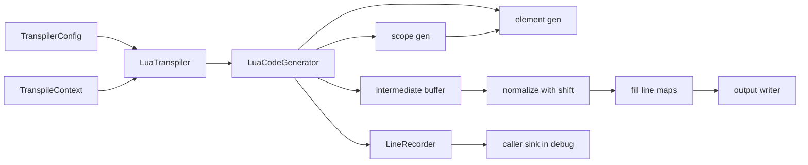
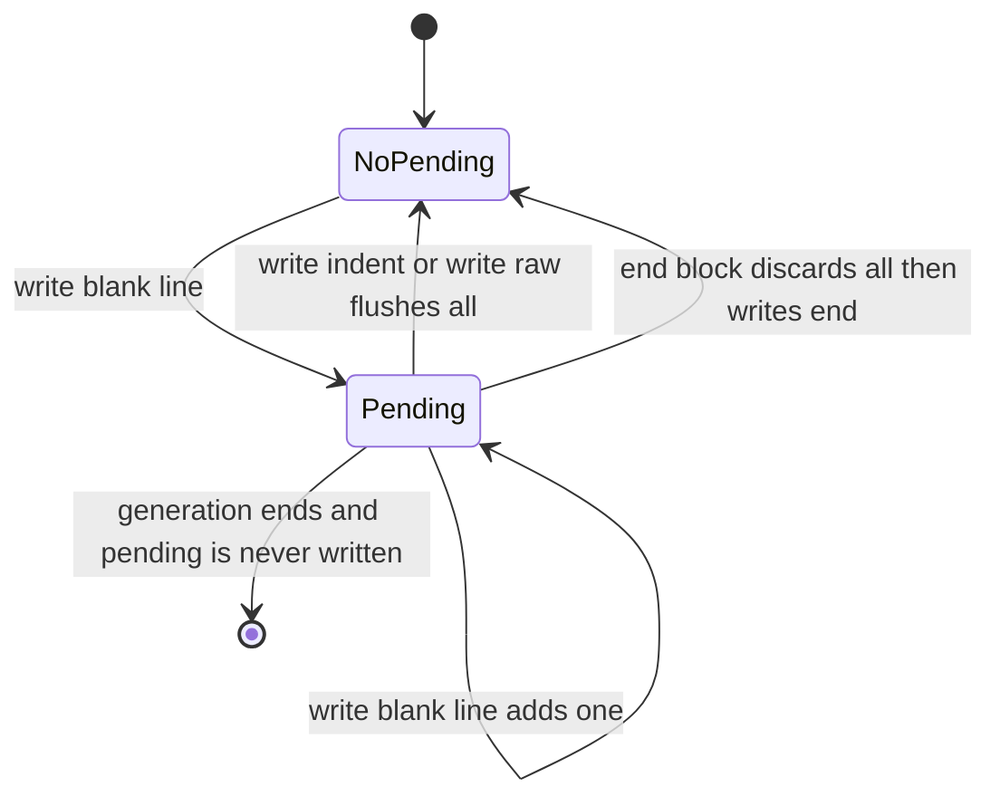
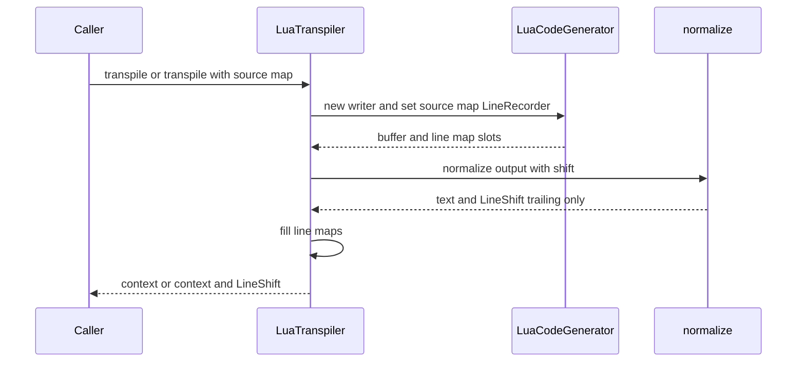

# Design Document: ponytail-lua-transpiler

## Overview

**Purpose**: ゴーストの作者が辞書に書いた Lua ブロックを、1 文字も変えずに生成コードへ出す。あわせて、`pasta_lua` のトランスパイラ（`code_gen/`・`normalize.rs`・`config.rs`・`context.rs`・`transpiler.rs`）から、効かない設定・死んだ状態・素通しの入口・重なった規則を消し、アクター辞書の単語定義の行をデバッグのソースマップに載せる。

**Users**: ゴーストの作者（Lua ブロックの長い文字列・空行がそのまま残る）、デバッガを使う開発者（アクター辞書の単語定義にもブレークポイントが結べる）、pasta の開発者（変換の道が 1 本に見える）。

**Impact**: 生成器が「`end` の直前の空行」を自分で作らなくなり、`normalize` の「`end` の前の空行を消す」規則が要らなくなる。Lua ブロックを含まない辞書の変換結果はバイト単位で今と同じ（試作で確かめた。下の「検証の結果」）。Lua ブロックを含む辞書は、ブロックの内容の行の字下げと、消さなくなった空行の 2 種類だけが変わる。

### Goals

- Lua ブロックの内容の各行を、字下げを足さず・空行を消さずに出す（1.1〜1.4）。
- Lua ブロックを含まない辞書の出力をバイト単位で保ち、行の対応を最終の `.lua` の行で記録する（2.1〜2.5）。
- 効かない設定・死んだ状態・素通しを消す（3・4）。ファイルの属性の欄と関数は残す（4.6）。
- アクター辞書の単語定義を共有の規則に寄せ、ソースマップに載せる（5・6.2）。
- 変数の経路・行の記録の規則を 1 か所にし、説明を今の道に合わせる（6.1・6.3・6.4）。
- 振る舞いを先に固め、1 直し 1 コミットで進める（7）。マニュアルを直す（8.1）。
- 追加の指摘 2 件（シーン引数の番号のあふれ・`!select` の大きな秒数。OPEN QUESTION 2・3）も同じ領域の直しとして扱う。

### Non-Goals

- `string_literalizer.rs` の規則（要件 5.3 で呼び方だけ揃える）。
- Lua ブロックの内容の検査（2.6）。
- `LineShift` と `normalize_output_with_shift` の形の変更・撤去（このウェーブの後の棚卸で測る）。
- ローダのキャッシュの仕組み、`debug/`・`loader/`・`runtime/` の本番コード（8.5）。
- README・`tech.md` の断り書き（8.3）。
- 実行時（`sakura_builder.lua`）の秒数の書式（OPEN QUESTION 3 の注）。

## Boundary Commitments

### This Spec Owns

- `crates/pasta_lua/src/code_gen/`（`mod.rs`・`element_gen.rs`・`scope_gen.rs`・`source_map.rs` の説明と、`*_tests.rs`）の出力の規則：空行の出し方、Lua ブロックの出し方、単語定義の生成、行の記録の規則。
- `crates/pasta_lua/src/normalize.rs` の後処理の規則（末尾の整えだけにする）。`LineShift`・`normalize_output_with_shift` の形は保つ。
- `crates/pasta_lua/src/config.rs`・`context.rs`・`transpiler.rs`・`transpiler_tests.rs` と、`lib.rs` の `config` の再輸出の 1 行。
- `crates/pasta_lua/tests/transpiler/`・`tests/property_scope_codegen_test.rs` の呼び出しの付け替えと、3 つのスナップショットの作り直し。
- 新しいテスト（Lua ブロックの素通し・実行・行の対応、アクターの単語定義の対応、ブロックを含まない辞書の特性化）。
- `book/src/internals/transpiler.md` の該当の節。
- 例外 1 件（8.5 の分け方。OPEN QUESTION 1）：`crates/pasta_lua/src/debug/source_map_builder_tests.rs` の 1 本のテストの入力だけ。

### Out of Boundary

- `TranspileContext` のファイルの属性（`accumulate_file_attr`・`file_attrs`・`merge_attrs`）と `generate_global_scene` の `_file_attrs` 引数（4.6。`scene-attribute-store` が使う）。
- `debug/` の本番コードと説明（`debug/source_map/mod.rs` 25 行の 1 語は `ponytail-lua-debug` が直す）、`loader/`・`runtime/`（ローダとランタイムが `TranspileContext` をファイルごとに捨てる作りは変えない）。
- `pasta_core`（8.4 の条件の場合の `SceneRegistry::merge_from`・`WordDefRegistry::merge_from` の削除を除く）。
- `pasta_dsl` の AST と span（値は変わらない）。
- `string_literalizer.rs`、`book/src/grammar/block-structure.md`（8.2。書き換えない）。

### Allowed Dependencies

- `pasta_dsl::parser`（AST・`Span`）を読むだけ。
- `pasta_core::registry`（`SceneRegistry`・`WordDefRegistry`・`SceneAliasTable`）を今のとおり使う。
- `crate::string_literalizer::StringLiteralizer`（`literalize`・`literalize_with_span`）。
- 依存の向きは `config` → `context` → `code_gen`（`mod` ← `element_gen`・`scope_gen`・`expr_gen`）→ `normalize` → `transpiler` → `lib`。`code_gen` は `debug` に依存しない（今のまま）。テストは `insta`・`mlua`（既存の dev 依存）だけを使う。新しい依存は足さない。

### Revalidation Triggers

- `LuaCodeGenerator::out_line()` の意味が変わる（保留中の空行を数えない。下の「状態」）。`code_gen` を直接呼ぶ外の使い手（今はテストだけ）は見直す。
- `normalize_output_with_shift` が消す行は末尾の空白の行だけになり、実際の生成コードでは `LineShift` が恒等になる。`debug/source_map`（`MapBuilderSink::finish`）・`loader/source_map_build.rs` は形のまま動くが、`ponytail-lua-debug` は「ズレ得る」という説明を見直す。
- pub API の削除（`LineEnding`・`TranspilerConfig::new`・`without_comments`・`with_line_ending`・`comment_mode`・`line_ending`、`LuaTranspiler::with_defaults`・`transpile_with_sink`・`config`、`normalize_output`、`TranspileContext` の `current_module`・`set_current_module`・`get_current_module`・`register_global_scene`・`merge_from`、`LuaCodeGenerator::with_line_ending`）。`pasta_shiori`・`pasta_check`・`benches` に使い手は無い（grep で確かめた）。
- デバッグのソースマップの記録が増える（アクター辞書の単語定義の行）。`ponytail-lua-debug` のブレークポイント解決の期待値が増える。
- Lua ブロックを含む辞書の生成コードが変わる。キャッシュは `pasta_lua` の版が上がると丸ごと作り直される（`.cache_version`）。

## Architecture

### Existing Architecture Analysis

- 変換は `LuaTranspiler::transpile_with_source_map` の 1 本の道で、`LuaCodeGenerator` が中間バッファに書き、`normalize_output_with_shift` が整え、`fill_line_maps` が `init_scene` の行に行の対応を埋める。`LineRecorder` は常に付く（本番でシンクの無い道は無い）。
- 生成器の出力の要は `writeln`・`write_blank_line`・`write_raw`・`write_line_terminator`・`write_indent` の 5 つで、`out_line` を数える。空行は `write_blank_line` の呼び所 6 つ（`write_header`・`end_block`・`generate_actor` の Lua ブロックの前・`generate_global_scene` の見出しの後と単語の後・`generate_local_scene` の頭の後）から出る。
- 問題の根：`end_block` は `end` の後にいつも空行を書く。入れ子の閉じ・項目の無いシーン・最後のローカルシーンの後では、その空行の次が外側の `end` になる。`normalize` はそれを「次の空白でない行が `end` の空行を消す」規則で消していたが、この規則は Lua ブロックの中の空行も消す。加えて `generate_code_block` が `writeln` で字下げ 1 段を足す。

### Architecture Pattern & Boundary Map



**Architecture Integration**:
- 採る形：今の部品を直す（research.md の案 A）。新しい部品・ファイルは無い。
- 空行は「保留して、次に何かを書くときに出す。`end` を書く前には捨てる」（保留の空行）。これで「区切りの空行は次の兄弟の前にだけ出る」が、6 つの呼び所を変えずに成り立つ。
- 保つ形：`out_line` で数えて記録する仕組み、`LineMapSlot`、`LineShift`、`fill_line_maps`、`LineRecorder`、シーンの突合キー。
- steering との整合：pub API を消してよい（2026-10-19 の開発者の決定）。品質の関門は `cargo fmt --check`・clippy（警告 0）・`cargo test -p pasta_lua`。

### Technology Stack

| Layer | Choice / Version | Role in Feature | Notes |
|-------|------------------|-----------------|-------|
| Backend | Rust 2024（workspace の版） | トランスパイラの直し | 新しい依存なし |
| Test | insta 1.47.2（既存） | スナップショット | 作り直すのは 3 本だけ |
| Test | mlua（LuaJIT 2.1・luajit52、既存） | 生成コードを実行して長い文字列の値を確かめる（7.2） | 既存の `tests/common/e2e_helpers.rs` の `transpile`・`create_runtime_with_finalize` を使う |

### 検証の結果（research.md「Research Needed」1 を試作で確かめた）

ワークツリーで次の 3 つだけを入れた試作を `cargo test -p pasta_lua` で回し、終わった後に `git checkout -- crates/` で戻した（`crates/` に差分は無い）。

1. `write_blank_line` を保留にし、`write_indent`・`write_raw` の頭で保留を書き出し、`end_block` が `end` の前に保留を捨てる。
2. `generate_code_block` を `write_raw(line)`＋`write_line_terminator()` にする。
3. `normalize_output_with_shift` の「`end` の前の空行を消す」繰り返しを消す。

結果：

- スナップショット 29 本のうち、Lua ブロックを含まない 26 本はバイト単位で同じ。変わったのは Lua ブロックを含む 3 本（`r7_1_off_path__kind_code_block`・`r7_1_off_path__fixture_zero_cost_all_syntax`・`zero_cost_off_path_all_syntax`）で、差分はブロックの内容の行の字下げだけ。
- `tests/fixtures/sample.generated.lua` は、改行コードを除いて同じ（`git diff --ignore-cr-at-eol` が空）。`sample.expected.lua` との一致のテストも通った。
- デバッグの e2e（`debug_break_coalesce.pasta` ほか）は通った。見本のブロックに空行が無いので、行の番号は変わらない。
- 落ちたのは、直した振る舞いを固めていた単体テストだけ（下の「Testing Strategy」の表）。その 1 本が `debug/` にある（OPEN QUESTION 1）。

→ 案 A でバイト単位の一致は保てる。案 B へは退かない。

## File Structure Plan

### Modified Files

- `crates/pasta_lua/src/code_gen/mod.rs` — 保留の空行（`pending_blank_lines`）、作り方を `new` 1 つに（`line_ending` の欄と `with_line_ending` を消す）、行の記録の小さな関数（`record_span_since`）、説明の直し（6.4）。
- `crates/pasta_lua/src/code_gen/element_gen.rs` — `generate_code_block` を字下げなしに、`generate_word_definition` を `pub(super)` にして値を `literalize_with_span` で、`generate_var_set` の経路を `resolve_var_path` に、記録を `record_span_since` に、`resolve_var_path` の番号のあふれ（OPEN QUESTION 2）。
- `crates/pasta_lua/src/code_gen/scope_gen.rs` — `generate_actor` の単語定義を共有の関数へ、`generate_global_scene` の `_context` 引数を消す、記録を `record_span_since` に、`!select` の秒数の書式（OPEN QUESTION 3）。
- `crates/pasta_lua/src/code_gen/source_map.rs` — 説明だけ（「本番ではシンクを付けない」を消す。6.4）。
- `crates/pasta_lua/src/code_gen/{mod.rs の tests, element_gen_tests.rs, scope_gen_tests.rs, expr_gen_tests.rs}` — 作り方の付け替え、保留の空行に合わせた期待、新しいテスト。
- `crates/pasta_lua/src/normalize.rs` — 末尾の整えだけにする。`normalize_output` を消す。説明とテストを直す。
- `crates/pasta_lua/src/config.rs` — `TranspilerConfig { scene_aliases }` と `Default`・`with_scene_aliases` だけにする。
- `crates/pasta_lua/src/context.rs` — `current_module` とその 2 つの関数、`register_global_scene`、`merge_from` とそのテストを消す。
- `crates/pasta_lua/src/transpiler.rs` — `with_defaults`・`transpile_with_sink`・`config` を消す、`transpile` を `transpile_with_source_map` の上に置く、生成器の作り方と `generate_global_scene` の呼び方、説明。
- `crates/pasta_lua/src/transpiler_tests.rs` — 消した入口と設定のテストを消し、残る入口で確かめる。
- `crates/pasta_lua/src/lib.rs` — `pub use config::TranspilerConfig;`（`LineEnding` を外す）。
- `crates/pasta_lua/tests/transpiler/*.rs`（`record_wiring_element_test`・`record_wiring_scope_test`・`source_map_seam_test`・`transpile_sink_port_test`・`final_regression_test`・`scene_alias_declared_name_test`・`basic_test`・`dynamic_word_ref_test`・`code_generator_test`）と `tests/property_scope_codegen_test.rs` — 呼び出しの付け替え（`transpile_with_sink` 約 28 か所、`with_line_ending` 約 15 か所、`TranspilerConfig::new`・`without_comments`）。
- `crates/pasta_lua/tests/transpiler/` に新しいテスト関数を足す（新しいファイルは作らず、既存の `final_regression_test.rs`・`runtime_safety_test.rs`・`record_wiring_scope_test.rs` に足す）。
- `crates/pasta_lua/tests/transpiler/snapshots/` — 上の 3 本を作り直す。特性化の新しいスナップショット 1 本を足す。
- `crates/pasta_lua/src/debug/source_map_builder_tests.rs` — 1 本のテストの入力だけ（OPEN QUESTION 1）。
- `book/src/internals/transpiler.md` — 8.1 の各所。
- 条件つき（8.4）：`crates/pasta_core/src/registry/scene_registry.rs`・`word_registry.rs` の `merge_from` とそのテスト、`book/src/internals/registry-search.md` 36 行の 1 文。

## System Flows

### 保留の空行



- 書き出しは `write_indent`（`writeln` と式の文はここを通る）と `write_raw`（Lua ブロックの行・式の断片）の頭で行う。`generate_expr` が `self.writer` に直接書く所は、いつも `write_indent` の後なので保留は残らない。
- `end_block` は `dedent` の後に保留を 0 にしてから `end` を書き、`end` の後の区切りの空行を保留にする。
- 生成の最後の保留は書かない。今は末尾の空行を `normalize` が消しているので、出力は同じ。
- Lua ブロックの内容の空行は `write_raw("")`＋`write_line_terminator()` で直に書くので保留にならず、`end` の前でも残る（1.3）。

### 変換の道（直した後）



- `transpile` は `transpile_with_source_map(file, writer, None)` の文脈だけを返す（`transpile_with_sink` を経由しない）。

## Requirements Traceability

| Requirement | Summary | Components | Interfaces | Flows |
|-------------|---------|------------|------------|-------|
| 1.1 | ブロックの行を書いたとおりに | element_gen | `generate_code_block` | 保留の空行 |
| 1.2 | 長い文字列の値が同じ | element_gen・normalize | `generate_code_block`・`normalize_output_with_shift` | 保留の空行 |
| 1.3 | ブロックの中の空行を消さない | normalize・LuaCodeGenerator | 規則の撤去・`write_raw` は保留にしない | 保留の空行 |
| 1.4 | 行の数と順番を保つ | element_gen | `content.lines()` を 1 行ずつ | — |
| 1.5 | アクターの非 lua ブロックは出さない | scope_gen | `generate_actor`（今のまま） | — |
| 1.6 | 出す位置は今のまま | scope_gen | `generate_actor`・`generate_global_scene`（今のまま） | — |
| 2.1 | ブロックの無い辞書はバイト同一 | LuaCodeGenerator・normalize | 保留の空行・`end_block` | 保留の空行（試作で 26 本＋見本が同一） |
| 2.2 | ブロックの外の行の並びは同じ | LuaCodeGenerator | 同上 | 試作で 3 本が字下げだけ変わる |
| 2.3 | ブロックの行を `.pasta` の行に対応 | element_gen・transpiler | `record_block_line`・`fill_line_maps`（今のまま） | 変換の道 |
| 2.4 | 対応は最終の行番号で | LuaCodeGenerator・normalize・transpiler | `out_line` は書いた行だけ数える・`LineShift` | 変換の道 |
| 2.5 | LF だけ・末尾の改行 1 つ | LuaCodeGenerator・normalize | `"\n"` だけを書く・末尾の整え | — |
| 2.6 | 中身は検査しない | element_gen | 今のまま | — |
| 3.1 | 設定は別名表だけ | TranspilerConfig | `TranspilerConfig` | — |
| 3.2 | 生成器の作り方を 1 つに | LuaCodeGenerator | `LuaCodeGenerator::new` | — |
| 3.3 | `LineEnding` を公開しない | lib | 再輸出の 1 行 | — |
| 3.4 | 出力のバイト列は変えない | LuaCodeGenerator | `"\n"` 固定 | — |
| 4.1 | 文脈の死んだ状態を消す | TranspileContext | 削除 | — |
| 4.2 | `_context` 引数を消す | scope_gen・transpiler | `generate_global_scene` | — |
| 4.3 | 重なった入口を消す | LuaTranspiler | `transpile`・`transpile_with_source_map` | 変換の道 |
| 4.4 | `normalize_output` を消す | normalize | `normalize_output_with_shift` | — |
| 4.5 | `TranspilerConfig::new` を消す | TranspilerConfig | `Default` | — |
| 4.6 | ファイルの属性は残す | TranspileContext・scope_gen | `accumulate_file_attr`・`file_attrs`・`merge_attrs`・`_file_attrs` | — |
| 4.7 | 消してもバイト列と対応は同じ | 全部 | 呼び出しの付け替え | — |
| 5.1 | アクターの単語定義を対応づける | scope_gen・element_gen | `generate_word_definition(word, "ACTOR", ":")` | — |
| 5.2 | アクターの単語定義のバイト列は同じ | element_gen | 同上（名前は `"…"`・値は同じリテラル化） | — |
| 5.3 | 3 種類とも位置つきのエラー | element_gen | `literalize_with_span(w, &word.span)` | — |
| 6.1 | 変数の経路の規則を 1 か所に | element_gen | `resolve_var_path` | — |
| 6.2 | 単語定義の規則を 1 つに | element_gen・scope_gen | `generate_word_definition` | — |
| 6.3 | 行の対応づけを同じ規則で | LuaCodeGenerator | `record_span_since` | — |
| 6.4 | 説明を今の道に合わせる | mod.rs・source_map.rs・transpiler.rs・normalize.rs | 説明 | — |
| 7.1 | ブロックの素通しのテスト | tests/transpiler | Integration Tests の 7.1 | — |
| 7.2 | 長い文字列の実行のテスト | tests/transpiler（runtime_safety_test） | Integration Tests の 7.2 | — |
| 7.3 | ブロックの行の対応のテスト | tests/transpiler（record_wiring_scope_test） | Integration Tests の 7.3 | 変換の道 |
| 7.4 | アクターの単語定義の対応のテスト | tests/transpiler（record_wiring_scope_test） | Integration Tests の 7.4 | — |
| 7.5 | 先に固める | tests | 特性化スナップショット | 実装の順 |
| 7.6 | 作り直しの差分は 2 種類だけ | tests | 3 本の作り直しの確かめ | 実装の順 |
| 7.7 | 1 直し 1 コミット・関門 | 全部 | 実装の順 | 実装の順 |
| 8.1 | マニュアルを直す | book | `transpiler.md` | — |
| 8.2 | `block-structure.md` は保つ | book | 触らない | — |
| 8.3 | 断り書きを足さない | — | 触らない | — |
| 8.4 | `pasta_core` の `merge_from` は入る順で | pasta_core（条件つき） | 削除 | 実装の順 |
| 8.5 | ほかの持ち場に触らない | 境界 | 例外 1 件（OPEN QUESTION 1） | — |

追加の指摘（要件の番号は要件ディスカッションで振る。ここでは番号を作らない）：

| 追加の指摘 | Summary | Components | Interfaces |
|------------|---------|------------|------------|
| OPEN QUESTION 2 | `＄２５５` の番号のあふれ | element_gen | `resolve_var_path` |
| OPEN QUESTION 3 | `!select` の大きな秒数の飽和 | scope_gen | `generate_choice_timeout` |

## Components and Interfaces

| Component | Domain/Layer | Intent | Req Coverage | Key Dependencies (P0/P1) | Contracts |
|-----------|--------------|--------|--------------|--------------------------|-----------|
| LuaCodeGenerator（書き出しの層） | code_gen/mod.rs | 行の書き出し・空行の保留・行の数え・記録 | 1.3, 2.1, 2.2, 2.4, 2.5, 3.2, 3.4, 6.3, 6.4 | SourceMapSink (P0) | Service, State |
| 要素の生成 | code_gen/element_gen.rs | Lua ブロック・単語定義・変数代入 | 1.1〜1.4, 2.3, 2.6, 5.1〜5.3, 6.1〜6.3 | StringLiteralizer (P0) | Service |
| スコープの生成 | code_gen/scope_gen.rs | アクター・シーン | 1.5, 1.6, 4.2, 4.6, 5.1, 6.2, 6.3 | 要素の生成 (P0) | Service |
| normalize | normalize.rs | 末尾の整えと `LineShift` | 1.2, 1.3, 2.4, 2.5, 4.4 | なし | Service |
| TranspilerConfig | config.rs | 別名表だけの設定 | 3.1, 3.3, 4.5 | SceneAliasTable (P0) | State |
| TranspileContext | context.rs | 登録とファイルの属性 | 4.1, 4.6 | SceneRegistry・WordDefRegistry (P0) | State |
| LuaTranspiler | transpiler.rs | 2 つの入口 | 2.3, 2.4, 4.3, 4.7 | 上の全部 (P0) | Service |

### code_gen

#### LuaCodeGenerator（書き出しの層）

| Field | Detail |
|-------|--------|
| Intent | 中間バッファに行を書き、出した行を数え、位置を持つ要素の行を記録する |
| Requirements | 1.3, 2.1, 2.2, 2.4, 2.5, 3.2, 3.4, 6.3, 6.4 |

**Responsibilities & Constraints**
- 改行はいつも `"\n"`（`LineEnding` を持たない）。
- 区切りの空行は保留にし、次の書き出しの前に出す。`end_block` は `end` の前の保留を捨てる。これで生成器は「`end` の直前の空行」を作らない（2.1）。
- `out_line` は実際に書いた行の数（保留中の空行は数えない）。記録はいつも、書いた行の番号で行う。
- 位置を持つ要素の記録は `record_span_since(before, span)` 1 つで行う：`before` より後に行を書いていれば、最後に書いた行を `span.start_line` に対応づける。何も書いていなければ記録しない（6.3）。

**Dependencies**
- Inbound: element_gen・scope_gen・expr_gen — 書き出し（P0）
- Outbound: `SourceMapSink`（`LineRecorder` 経由で呼び手のシンク）— 記録（P0）

**Contracts**: Service [x] / State [x]

##### Service Interface

```rust
pub struct LuaCodeGenerator<'a, W: Write> {
    writer: &'a mut W,
    indent_level: usize,
    out_line: u32,
    source_map: Option<&'a mut dyn SourceMapSink>,
    line_map_slots: Vec<LineMapSlot>,
    /// 保留中の区切りの空行の数（次の書き出しで出す。`end` の前では捨てる）
    pending_blank_lines: u32,
}

impl<'a, W: Write> LuaCodeGenerator<'a, W> {
    pub fn new(writer: &'a mut W) -> Self;                       // 作り方は 1 つ（3.2）
    pub fn set_source_map(&mut self, sink: &'a mut dyn SourceMapSink);
    pub fn take_line_map_slots(&mut self) -> Vec<LineMapSlot>;
    pub fn out_line(&self) -> u32;                               // 書いた行の数
    pub fn write_header(&mut self) -> Result<(), TranspileError>;

    fn flush_blank_lines(&mut self) -> Result<(), TranspileError>; // 保留を書いて out_line を進める
    fn write_indent(&mut self) -> Result<(), TranspileError>;      // 頭で flush_blank_lines
    fn writeln(&mut self, s: &str) -> Result<(), TranspileError>;  // write_indent → s → "\n"
    fn write_blank_line(&mut self) -> Result<(), TranspileError>;  // 保留を 1 つ足すだけ
    fn write_raw(&mut self, s: &str) -> Result<(), TranspileError>; // 頭で flush_blank_lines
    fn write_line_terminator(&mut self) -> Result<(), TranspileError>;
    fn end_block(&mut self) -> Result<(), TranspileError>;         // dedent → 保留を 0 → "end" → 保留 1
    fn record_span_since(&mut self, before: u32, span: Span);      // 6.3 の 1 つの規則
    fn record_scene_span(&mut self, scene_join_key: &str, span: Span); // 今のまま
    fn record_block_line(&mut self, pasta_line: u32);              // 今のまま
}
```

- Preconditions: なし。
- Postconditions: 書いたバイトの `'\n'` の数は、いつも `out_line` と等しい。`end_block` が書いた `end` の直前の行は空行ではない（生成器の空行に限る。Lua ブロックの内容は除く）。
- Invariants: 書き出しの前に保留は必ず出る。生成の最後に残った保留は書かれない。

##### State Management
- State model: `pending_blank_lines: u32`。増えるのは `write_blank_line` だけ、0 に戻るのは書き出しと `end_block`。
- Concurrency: 単一スレッド（今のまま）。

**Implementation Notes**
- Integration: `record_span` はなくし、11 か所の「`let before = out_line(); …; if out_line() > before { record_span(span) }`」を `record_span_since(before, span)` 1 行にする。`record_span` を残すなら非公開の 1 つの呼び所だけになるので、`record_span_since` に吸収する。シンクへは今と同じく `SourceMapSink::record(out_line, span)` を呼ぶ（`record_line` に替えない。`debug` の実装が span を受け取る約束を保つ）。`Span::is_valid()` の判定も今のまま。
- Validation: `mod.rs` の単体テストを新しい約束に合わせる（下の表）。
- Risks: `out_line()` は pub。外の使い手はテストだけ（Revalidation Triggers）。

#### 要素の生成（element_gen.rs）

| Field | Detail |
|-------|--------|
| Intent | Lua ブロック・単語定義・変数代入などの 1 要素を出す |
| Requirements | 1.1〜1.4, 2.3, 2.6, 5.1〜5.3, 6.1〜6.3 |

**Responsibilities & Constraints**
- `generate_code_block`：内容の各行を `write_raw(line)`＋`write_line_terminator()` で出す（字下げしない・空行も直に書く）。行ごとに `record_block_line(content_start_line + offset)`（今のまま）。説明の「without transformation」は事実になる。
- `generate_word_definition(word, receiver, separator)` を `pub(super)` にし、グローバル（`"PASTA", "."`）・シーン（`"SCENE", ":"`）・アクター（`"ACTOR", ":"`）の 3 つが使う。値は `StringLiteralizer::literalize_with_span(w, &word.span)`（5.3）。名前は `literalize(name)`（文法の `id` は `"` も `\` も含まないので `"名前"` になり、アクターの今の `"{}"` とバイト単位で同じ。5.2）。行ごとに `record_span_since`（5.1）。
- `generate_var_set`：`Local`・`Global` の経路は `resolve_var_path`（6.1）。`Property` と `Args` の枝は今のまま先に分ける。
- `resolve_var_path`：`VarScope::Args(index)` は `format!("args[{}]", u32::from(*index) + 1)`（OPEN QUESTION 2）。

```rust
pub(super) fn generate_word_definition(
    &mut self,
    word: &KeyWords,
    receiver: &str,   // "PASTA" | "SCENE" | "ACTOR"
    separator: &str,  // "." | ":"
) -> Result<(), TranspileError>; // Err は TranspileError::StringLiteralError（word.span つき）
pub fn generate_code_block(&mut self, block: &CodeBlock) -> Result<(), TranspileError>;
pub(super) fn resolve_var_path(name: &str, scope: &VarScope) -> Result<String, TranspileError>;
```

#### スコープの生成（scope_gen.rs）

| Field | Detail |
|-------|--------|
| Intent | アクター・グローバルシーン・ローカルシーンの `do … end` と関数を出す |
| Requirements | 1.5, 1.6, 4.2, 4.6, 5.1, 6.2, 6.3 |

**Responsibilities & Constraints**
- `generate_actor`：単語定義の繰り返し（50〜72 行）を `for word_def in &actor.words { self.generate_word_definition(word_def, "ACTOR", ":")?; }` にする。空の単語定義を飛ばす規則は共有の関数にすでにある。Lua ブロックの扱い（言語識別子が `lua` のものだけ・前に区切りの空行）は今のまま（1.5・1.6）。
- `generate_global_scene(scene, declared_name, scene_counter, _file_attrs)`：`_context: &TranspileContext` を消す。`_file_attrs` は残す（4.6）。`#[allow(unused_variables)]` は `_` で始まる引数には要らないので外す。
- `generate_choice_timeout`：`Float` は小数部の判定をやめて 1 つの書式にする（OPEN QUESTION 3）。
- 見出し・選択肢・タイムアウトの記録は `record_span_since`。

```rust
pub fn generate_global_scene(
    &mut self,
    scene: &GlobalSceneScope,
    declared_name: &str,
    scene_counter: usize,
    _file_attrs: &HashMap<String, AttrValue>,
) -> Result<(), TranspileError>;
```

#### source_map.rs（説明だけ）

- 「Inert when no sink is attached（本番の既定）」を、「トランスパイラはいつも `LineRecorder` を付ける。呼び手のシンクは任意」の 1 文に直す（6.4）。トレイトの形は変えない。

### normalize

| Field | Detail |
|-------|--------|
| Intent | 末尾の空白と改行を整え、消した行を `LineShift` に記録する |
| Requirements | 1.2, 1.3, 2.4, 2.5, 4.4 |

**Contracts**: Service [x]

```rust
pub struct LineShift { deleted: Vec<u32> }           // 形は今のまま
impl LineShift { pub fn map(&self, pre_line: u32) -> Option<u32>; }
pub fn normalize_output_with_shift(input: &str) -> (String, LineShift);
// normalize_output は消す
```

- 手順：CRLF を LF にする → 行に分ける → 末尾の空白だけの行を消し（`deleted` に記録）、最後の行の行末の空白を落とす → 改行 1 つを付ける。
- 「次の空白でない行が `end` の空行を消す」規則は持たない（1.3）。行の途中の空行は、どこにあっても残る。
- Postconditions: 返す文字列は改行 1 つで終わり、LF だけを含む（2.5）。`deleted` は末尾の行だけで昇順。
- 生成器が保留の空行を最後に書かないので、実際の生成コードでは `deleted` は空になり、`map` は恒等になる。形は保つ（Non-Goals）。

### 設定と文脈

#### TranspilerConfig（config.rs）

```rust
#[derive(Debug, Clone, Default)]
pub struct TranspilerConfig {
    /// グローバルシーン名の別名表（既定は空の表で、宣言名を置き換えない）。
    pub scene_aliases: SceneAliasTable,
}
impl TranspilerConfig {
    pub fn with_scene_aliases(self, aliases: SceneAliasTable) -> Self;
}
```

- `SceneAliasTable` は `Default` を derive している（`pasta_core/src/registry/scene_alias.rs` 25 行）。`SceneAliasTable::empty()` と同じ空の表であることを、既存の `test_default_scene_aliases_is_empty` が守る。
- `LineEnding`（enum・`as_str`・`native`・`Default`）、`comment_mode`・`line_ending` の欄、`new`・`without_comments`・`with_line_ending` を消す（3.1・4.5）。`lib.rs` は `pub use config::TranspilerConfig;`（3.3）。

#### TranspileContext（context.rs）

- 残す：`scene_registry`・`word_registry`・`file_attrs`（非公開）、`new`・`register_global_scene_named`・`register_local_scene`・`accumulate_file_attr`・`file_attrs`・`merge_attrs`、自由関数 `local_scene_counters`。
- 消す：`current_module` の欄・`set_current_module`・`get_current_module`、`register_global_scene`、`merge_from`（説明の「Used by PastaLoader…」もいっしょに消える）。テスト `test_context_set_module`・`test_get_current_module_none_by_default`・`test_merge_from_*` 2 本を消し、`test_register_global_scene`・`test_register_local_scene` は `register_global_scene_named(&scene.name, &scene.attrs)` で同じことを確かめる（4.1・4.7）。

### LuaTranspiler（transpiler.rs）

```rust
impl LuaTranspiler {
    pub fn new(config: TranspilerConfig) -> Self;
    pub fn transpile<W: Write>(&self, file: &PastaFile, writer: &mut W)
        -> Result<TranspileContext, TranspileError>;  // = transpile_with_source_map(.., None) の .0
    pub fn transpile_with_source_map<W: Write>(&self, file: &PastaFile, writer: &mut W,
        sink: Option<&mut dyn SourceMapSink>)
        -> Result<(TranspileContext, LineShift), TranspileError>;
}
impl Default for LuaTranspiler { /* new(TranspilerConfig::default()) */ }
```

- `with_defaults`・`transpile_with_sink`・`config` を消す（4.3）。`transpile_with_sink(f, w, s)` を使っていたテストは `transpile_with_source_map(f, w, s).map(|(ctx, _)| ctx)` か `transpile`（シンクが `None` のとき）にする。
- 生成器は `LuaCodeGenerator::new(&mut intermediate_buffer)`。`generate_global_scene(scene, declared_name, counter, &merged_attrs)`。
- 説明：`transpile` の「sink-less wrapper」「inert」、`transpile_with_source_map` の「legacy path」「`normalize_output` と byte-identical」を、今の道（いつも `LineRecorder` を付ける・正規化は末尾だけ）の説明にする（6.4）。

## Data Models

- `LineMapSlot { init_line, ranges }` は今のまま。範囲の端は `out_line` で持つ。保留の空行は数えないので、端が空行 1 つ分ずれることがあるが、範囲は記録の表（`BTreeMap<u32, u32>`）を引くだけで、空行には記録が無いので、埋める対応は変わらない（試作のスナップショットの `init_scene` の 4 つ目の引数が 26 本で同一）。
- 行の対応の文字列（`"<.pasta>|<lua>:<pasta>,…"`）の形は変えない。

## Error Handling

- 単語の値を Lua の文字列にできない（`=` を 10 個まで試しても衝突する）とき、アクター・グローバル・シーンのどの単語定義でも `TranspileError::StringLiteralError` を `word.span` つきで返す（5.3）。今はグローバルとシーンが位置なしだった。
- 書き出しの I/O の失敗は今のまま `TranspileError` に包む。
- Lua ブロックの中身は検査しない（2.6）。

## Testing Strategy

### 実装の順（7.5・7.7。1 直し 1 コミット）

1. **特性化（直す前）**：Lua ブロックを含まない辞書を 1 本の insta スナップショットに固める（項目の無いローカルシーン・入れ子の閉じが続く所・アクター辞書だけの区切り・ファイルの最後のシーン・シーン単語だけのシーン・グローバル単語）。今の出力をそのまま期待値にする（2.1・7.5）。
2. **Lua ブロックの直し**：保留の空行・`generate_code_block`・`normalize` の規則の撤去を 1 コミットにする（3 つは片方だけでは 1.1〜1.3 が満たせない）。同じコミットで、新しいテスト（7.1〜7.3）、3 本のスナップショットの作り直し（7.6）、直した振る舞いを固めていた単体テストの直し（下の表）、`debug/source_map_builder_tests.rs` の入力（OPEN QUESTION 1）。
3. 設定の撤去（3）。4. 文脈の撤去（4.1・4.2）。5. 入口と包みの撤去（4.3〜4.5）。6. アクターの単語定義（5・6.2、7.4 のテスト）。7. 変数の経路と記録の規則（6.1・6.3）。8. 説明（6.4）とマニュアル（8.1）。9. 追加の指摘 2 件（OPEN QUESTION 2・3、それぞれ 1 コミット）。10. 条件つきの `pasta_core` の `merge_from`（8.4）。
- 各コミットで `cargo fmt --check`・`cargo clippy -p pasta_lua --all-targets`（警告 0）・`cargo test -p pasta_lua`。cargo の前に `NoDefaultCurrentDirectoryInExePath` を外す。`sample.generated.lua` の改行だけの差分は戻す（7.7）。

### Unit Tests

- `code_gen/mod.rs`：保留の空行の約束（`write_blank_line` だけでは `out_line` が進まない・次の `writeln` で出る・`end_block` の前では捨てる・書いたバイトの改行の数 = `out_line`）。`write_header` は 2 行を書き、空行は保留。`end_block` は `"do\n    body\nend\n"`。
- `element_gen_tests.rs`：`generate_code_block` が字下げ 1 段の中でも内容を字下げせずに出す・空行を `""` で出す。`generate_word_definition` の `"ACTOR", ":"` の形。
- `normalize.rs`：`end` の前の空行が残る（`"a\n\nend\n"` → そのまま）。末尾の空行だけが消え、`LineShift` に載る。CRLF は LF。
- `resolve_var_path`：`Args(255)` → `"args[256]"`（OPEN QUESTION 2）。
- `generate_choice_timeout`：`Float(10.0)` → `10`、`Float(2.5)` → `2.5`、`Float(1e19)` → `10000000000000000000`、`Float(-0.0)` → OPEN QUESTION 3 の決定どおり。

### Integration Tests（tests/transpiler）

- **7.1**：`＊会話` のローカルシーンの中の ```` ```lua ```` と、`％さくら` の中の ```` ```lua ```` に、要件 1.2 の 5 行（`local MSG = [[`・`こんにちは`・空行・`end`・`]]`）を置いた辞書を `transpile` し、生成コードにブロックの内容が続いた行としてそのまま現れることを確かめる。
- **7.2**：同じ形の辞書（ブロックの 6 行目に `LT_MSG = MSG` を足す）を `runtime_safety_test.rs` の既存の道（`common::e2e_helpers::transpile` と実行の補助）で実行し、`LT_MSG == "こんにちは\n\nend\n"` を確かめる。
- **7.3**：7.1 の辞書を `transpile_with_source_map` で記録付きで変換し、ブロックの各行の `.lua` の行が `.pasta` のその行を指すこと（シンクの記録と、`init_scene` の 4 つ目の引数の両方）。空行より後の行も最終の行番号で合うこと（2.4）。
- **7.4**：`％さくら` の `　＠通常：\s[0]` を変換し、`ACTOR:create_word("通常")` の行が `.pasta` のその行に記録されること。
- **7.5**：上の特性化スナップショットが直した後も同じ。既存の 26 本と `sample.generated.lua` も同じ。
- **7.6**：作り直す 3 本の差分が、ブロックの内容の行の字下げ（と、ある場合は消さなくなった空行）だけであることを、作り直す前の `.snap.new` との差分で確かめてから正にする（試作では字下げだけ）。

### 直した振る舞いを固めていたテスト（試作で落ちたもの）

| テスト | 直し方 |
|--------|--------|
| `code_gen::tests::end_block_dedents_then_writes_end_and_blank_line` | 期待を `"do\n    body\nend\n"` にし、名前を直す |
| `code_gen::tests::out_line_advances_per_choke_point_and_matches_bytes` | 空行が保留になる約束に書き直す |
| `code_gen::tests::write_header_emits_exact_require_lines` | 2 行（空行は保留） |
| `code_gen::tests::with_line_ending_crlf_emits_crlf_terminators` | 消す（3.2） |
| `scope_gen::tests::actor_skips_empty_words_and_non_lua_code_blocks` | 末尾を `end\n` に |
| `normalize::tests` の `end` の前の空行の 5 本と `test_shift_*` の 3 本・doctest | 「残る」テスト 1 本と末尾のテストに置き換え、ほかは消す。`test_with_shift_byte_identical_to_legacy` は消す（包みが無い） |
| `source_map_seam_test::test_out_line_counter_matches_emitted_line_count` | ヘッダの後は 2、アクションの後は 4（書いたバイトと一致） |
| `debug::source_map::source_map_builder_tests::map_builder_sink_finish_rebases_to_final_lua_lines` | 入力を末尾の空行の形にする（OPEN QUESTION 1） |
| `final_regression_test::r7_1_off_path_matches_committed_snapshots`・`zero_cost_regression_test::test_zero_cost_off_path_all_syntax_byte_invariant` | 3 本のスナップショットを作り直す（7.6） |

## Migration Strategy

- キャッシュ：直した版を出すと `pasta_lua` の版が上がり、`.cache_version` が違うのでキャッシュは丸ごと作り直される（今の仕組み。この spec は変えない）。字下げの入った古い変換結果は使われない。
- 申し送り（コミットと同時に相手の brief へ書く）：`ponytail-lua-debug` の brief に、(a) `source_map_builder_tests.rs` の 1 本の入力をこの spec が直したこと（OPEN QUESTION 1）、(b) 生成コードでは `LineShift` が恒等になり、`debug/source_map/mod.rs` 25 行あたりの「ズレ得る」の説明が古くなること。

## Open Questions / Risks

OPEN QUESTION の詳しい形（仮定・推奨・例）は research.md の「設計ディスカッションへの持ち越し」に置く。要点：

1. `debug/` のテスト 1 本が、消す規則（`end` の前の空行の削除）を固めている。仮定：この spec がそのテストの入力だけを直す（8.5 の分け方）。
2. `resolve_var_path` の `Args(u8)` のあふれ（`＄２５５`）。仮定：入れる。`u32::from(*index) + 1`。
3. `!select` の整数値の浮動小数の飽和。仮定：入れる。小数部の判定をやめる。`-0.0` は今と同じく `0` を出す。
4. `out_line()` の意味の変更（保留の空行を数えない）。仮定：受け入れる（pub API を変えてよい決定の範囲）。

- Risk：保留の空行の書き出しを通らない書き込みを、後から誰かが足すと、空行の位置がずれる。軽減：`self.writer` に直接書くのは `write_indent`・`write_raw`・`writeln`・`flush_blank_lines`・`write_line_terminator`・`generate_expr`（いつも `write_indent` の後）だけ、と `mod.rs` の説明に書き、`mod.rs` の単体テストで「改行の数 = `out_line`」を守る。
- Risk：同じウェーブの `element_gen.rs` はこの spec だけ（brief の決まり）。`lib.rs`・`transpiler.md` の別の行は後から入る側が合わせる。
