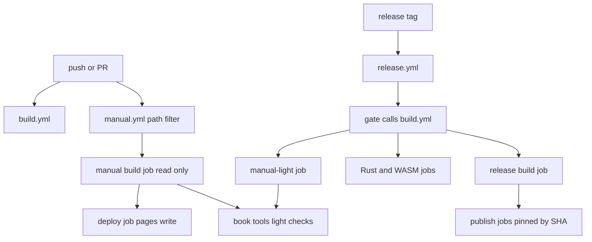
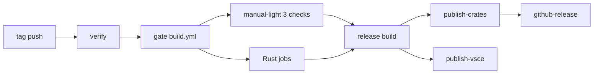

# 設計: ponytail-manual-ci

## Overview

**目的**: マニュアルの CI とリリースの CI の監査の指摘（台帳の B1〜B11・N1〜N17）を、残らず直す。新しい仕組みは足さない。今あるファイルを小さく直し、消す行を足す行より多くする。

**使う人**: 開発者 1 人。PR と main への push のたびに CI が走る。リリースはタグの push で月に数回ある。

**変わること**:

- マニュアルの軽い検査 3 つが、`build.yml` の小さな job で毎回走る。関門（gate）でも走る。
- Pages の権限は deploy の job だけが持つ。
- 公開の資格を持つ job と、配布物を作る job の第三者の action を、commit の SHA で固定する。ビルドの道具 2 つは SHA-256 で確かめる。
- 重複した検査（`pasta_check` の再ビルド・bigram の PoC・写し）を消す。
- 空回りする検査（着色 0 件・フェンスの取り違え・ブラウザと違う検索の設定）を直す。
- Node は 22、mdBook は 0.5.4、Node 20 で動く action は Node 24 の major にそろえる。

### Goals

- 台帳の 28 件を、すべて「直した」にする（外す指摘は無い）。
- 今ある検査の守りを減らさない。リリースの保つ行を 1 行も変えない。
- 直した後の CI を、次の監査の出発点にできる。

### Non-Goals

- マニュアルの本文（`book/src` の章）を書き直すこと。
- Rust のクレート、`editors/vscode` の文法を変えること。
- Pages の最初の有効化、CI の通知、CI でマージを止める仕組み。
- `build.yml` の第三者の action を SHA で固定すること（決定 D）。
- `actions/*` を SHA で固定すること（決定 D）。major はタグのまま上げる。
- mdBook の取得を SHA-256 で確かめること（決定 D の範囲の外。今の `peaceiris/actions-mdbook` も確かめていない）。

## Boundary Commitments

### This Spec Owns

- `.github/workflows/` の 4 つのワークフローの、起動の条件・権限・action の版・Node と mdBook の版・軽い検査の置き場所。
- `.github/scripts/release/` の `publish-crate.ps1` の引数 1 つと、`release-scripts-test.ps1` の項目 12。
- `book/tools/` の検査ツールと自己テスト（写し・重複・空回り・章の数）。
- `book/theme/head.hbs` の分かち書きの 1 行と注記、`book/theme/claudia.js`（読むだけ。目次の条件の比べ方の相手）。
- `.kiro/steering/tech.md` の CI とマニュアルの行（202〜207・209・210・213・223・226 行）。
- 配るスキル `pasta-check` の、`crates/` を引く 6 行。

### Out of Boundary

- `book/src` の章の中身。
- Rust のクレート（`crates/**`）。`pasta_check` の hello-pasta の検査は `validate_cli_test.rs` が持つ。
- `editors/vscode` の文法とコード（`ponytail-editor-tooling` が持つ）。
- `tech.md` のほかの行（`ponytail-editor-tooling` が触る行を含む）と、`roadmap.md`（`kiro-complete` が書く）。
- `github-release.ps1`・`release-notes.ps1`・`verify-tag.ps1`・`publish-vsix.ps1` の中身（読むだけ。変えない）。
- `release.yml` の verify・gate・report の job、「Verify release assets」の段、upload の段、公開の job の公開の手順（status・reason・summary の作り方）。
- 旧版の固定コミット `CLASSIC_REF` の中身（旧版のツールは旧版のまま使う）。

### Allowed Dependencies

- GitHub Actions のランナー（`ubuntu-latest`・`windows-latest`）と、GitHub 自身の action（`actions/*`）。
- 第三者の action は、今使っているものだけ（`dtolnay/rust-toolchain`・`Swatinem/rust-cache`・`rust-lang/crates-io-auth-action`・`Azure/login`・`EmbarkStudios/cargo-deny-action`）。新しい第三者の action は足さない。`peaceiris/actions-mdbook` は外す。
- mdBook 0.5.4 の公式の配布物（`rust-lang/mdBook` の release）。
- `book/tools` の中の import は、今の向き（下の「依存の向き」）を守る。npm の新しい依存は足さない。

### Revalidation Triggers

- `release.yml` の SHA や道具の hash を変えたとき: 次のリリースタグで、公開の job の status・reason・summary が今と同じかを見る。
- action の major を上げ直したとき: `actionlint` と、ブランチの上の `build.yml`・`manual.yml` の実行。
- `book/tools/link-check.mjs` の export（`summaryChapters`・`CHECKED_SKILLS`・`REPO_PATH_PREFIXES`）を変えたとき: それを import する自己テストと検査を全部走らせる。
- 検索の設定（索引の `search_options`）を mdBook が変えたとき: `verify-search`・`build-index-test` の包含の検査を見直す。
- `vsce-4-upgrade` は、この spec が `release.yml`・`release-setup-check.yml` を Node 22 にした後に始める。
- `ponytail-editor-tooling` が `tech.md` を触るとき、この spec の行（209・223 など）と重ならないことを確かめる。

## Architecture

### Existing Architecture Analysis

- `build.yml` は、全部の push・PR と `workflow_call`（`release.yml` の gate）で走る。path filter は無い。Node の段は無い。
- `manual.yml` は path filter 付き。build の job が検査と生成と Pages の artifact の upload をし、deploy の job が公開する。権限はワークフロー全体に付いている。
- `release.yml` は verify → gate（`build.yml`）→ build → 公開の job → github-release → report の順。build の job が配布物 5 つを作る。
- `book/tools` は依存の無い ESM の小さなスクリプトの集まり。`link-check.mjs` が共有の部品（`maskFences`・`listMarkdownFiles`・`REPO_ROOT`）を持ち、ほかが import する。

### Architecture Pattern & Boundary Map



**決めたこと**:

- 軽い検査の置き場所は案 B（`build.yml` に cargo の要らない小さな job を足す）。`manual.yml` の 3 つの段は、公開の前の関門として残す（各 1 秒）。
- 写しの比べる検査は、`book/**` の自己テストに置く。写し（`head.hbs`）も正準（`neutralizer.mjs`・`tokenize.mjs`・`claudia.js`）も `book/` の下にあるので、どちらを変えても `manual.yml` が起動する。軽い job に置く得は無い。
- 検索の補助関数は `build-index.mjs` に 1 つだけ置く。索引を作るモジュールが、索引の形を一番よく知っている。
- `SUMMARY.md` の章の並びは `link-check.mjs` に 1 つだけ置く。共有の部品のモジュールである。

### 依存の向き（book/tools）

```
link-check.mjs（共有の部品）
  ← talk/talk.mjs（台詞部品）
  ← gen-skill-refs.mjs（スキルの生成器）
  ← verify-content.mjs・verify-static.mjs・verify-search.mjs・各 *-test.mjs
bigram-index/tokenize.mjs ← bigram-index/build-index.mjs ← verify-search.mjs・build-index-test.mjs
```

- 左のモジュールは右のモジュールを import しない。
- 例外は 1 つ。`talk/talk.mjs` の `--stats` の CLI の枝だけが、`gen-skill-refs.mjs` を動的 import する（`await import()`）。静的な循環を作らないためである。モジュールの本体は `gen-skill-refs.mjs` を知らない。

### Technology Stack

| 層 | 選択・版 | 役目 | 注記 |
|----|----------|------|------|
| CI | GitHub Actions（`ubuntu-latest`・`windows-latest`） | 4 つのワークフロー | 変えない |
| Node | 22（`actions/setup-node@v7`） | 軽い検査・マニュアル・VSIX・vsce | `release.yml`・`release-setup-check.yml` を 20 → 22 |
| mdBook | 0.5.4（公式の release の tar.gz を取る） | マニュアルと旧版 | 0.5.3 → 0.5.4。`peaceiris/actions-mdbook` を外す |
| action の版 | `upload-artifact@v7`・`download-artifact@v8`・`upload-pages-artifact@v5`・`deploy-pages@v5`・`setup-node@v7` | Node 24 で動く major | 今の major は Node 20 で動く |
| 固定 | commit の SHA と行末のコメント | 公開と配布物の job | 下の「固定する SHA」 |
| 道具の検証 | `Get-FileHash -Algorithm SHA256` | `wasm-pack`・`cargo-about` | PowerShell の標準の機能 |
| 検査の確認 | `actionlint` 1.7.12（開発機にある） | ワークフローの構文と式 | 今の 4 つは 0 件 |

## File Structure Plan

### 消すファイル

- `book/tools/bigram-index/poc-test.mjs` — PoC のテスト（B8）。tokenizer の単体の検査は先に `build-index-test.mjs` へ移す。
- `book/tools/bigram-index/poc/`（`.gitignore`・`book.toml`・`src/SUMMARY.md`・`src/other.md`・`src/structure.md`）— PoC の fixture（B8）。

### 変えるファイル

ワークフロー（LightCheckJob・ManualWorkflow・ReleaseWorkflow・ReleaseSetupCheck）:

- `.github/workflows/build.yml` — job `manual-light` を足す（B1）。`upload-artifact` を v7 に上げる（決定 4）。
- `.github/workflows/manual.yml` — 起動の条件・権限・段の整理・mdBook・action の版（B2・B4・B5・B11・N17・決定 4）。
- `.github/workflows/release.yml` — SHA の固定・道具の hash・Node 22・照合の段を消す・action の版（B3・B10・N7・N8・決定 B・決定 4）。
- `.github/workflows/release-setup-check.yml` — `Azure/login` の固定・Node 22・`setup-node` の版（B3・B10・決定 4）。

リリースの補助スクリプト（ReleaseScripts）:

- `.github/scripts/release/publish-crate.ps1` — `-ApiBase` を消す（N9・決定 E）。
- `.github/scripts/release/release-scripts-test.ps1` — 項目 12（偽の vsce で skipped）を足す（N9・決定 E）。

`book/tools`（共有の部品。LinkCheckModule）:

- `book/tools/link-check.mjs` — `summaryChapters` を足す。`CHECKED_SKILLS` に `pasta-check`。`REPO_PATH_PREFIXES` に `editors/`。章のリンクをフェンスの外だけにする。`MANUAL_URL` の注記（B1・N5・N10・N14・N16・N17）。
- `book/tools/link-check-test.mjs` — `CHECKED_SKILLS` の期待を 3 つに。フェンスの中のリンクの項目と、`summaryChapters` の項目を足す。

`book/tools`（本文・生成器・台詞部品。ContentVerify・SkillRefsAndTalk）:

- `book/tools/verify-content.mjs` — フェンスの判定を `maskFences` にする。`listMarkdown` を消す。`SUMMARY.md` の読みを共有にする。`REPO_ROOT` の export を外す（N1・N13・N15・N16）。
- `book/tools/gen-skill-refs.mjs` — `MANUAL_BASE_URL` を `MANUAL_URL` から取る。使われない export 2 つを外す。写しの注記を消す（B9・N13・N14）。
- `book/tools/talk/talk.mjs` — `--stats` の区切りの写しを消し、`chapterRegions` を使う（B9）。

`book/tools`（検索。SearchTools）:

- `book/tools/bigram-index/build-index.mjs` — 検索の補助を 3 つ export する。CLI の引数を必須にする（N2・N3・N6）。
- `book/tools/bigram-index/build-index-test.mjs` — 一時のフォルダに書く。RED を消す。tokenizer の単体の検査を受け取る。包含の検査を直す（B8・N2・N3・N6）。
- `book/tools/bigram-index/tokenize.mjs` — 通らない分岐の 1 行を消す（N11）。
- `book/tools/verify-search.mjs` — 共有の補助を使う。`--no-build` で索引を作り直さない。包含の検査を直す。作ったページの neutralizer の印を確かめる（N2・N3・N4・N6・N16）。
- `book/tools/verify-static.mjs` — `SUMMARY.md` の読みを共有にする（N16）。

`book/tools`（着色と写し。HighlightCli・MirrorChecks）:

- `book/tools/highlight/highlight-html.mjs` — 着色 0 件で終了コード 1（B7）。
- `book/tools/highlight/highlight-html-test.mjs` — 0 件の CLI の項目を足す。注記を 0.5.4 に（B7・B11）。
- `book/tools/highlight/neutralizer-test.mjs` — `head.hbs` の写しと正準を比べる項目を足す（B6）。
- `book/tools/theme-sidebar-early-test.mjs` — 目次の条件を 2 か所で比べる項目を足す（N12）。

`book/tools`（章の数。ChapterCountTests）:

- `book/tools/gen-skill-refs-test.mjs` — K-10 を `SUMMARY.md` との突き合わせにする（N16）。
- `book/tools/talk/talk-test.mjs` — J-9 の 64 を `SUMMARY.md` の数にする（N16）。
- `book/tools/verify-scripts-test.mjs` — T 系の 64 を `SUMMARY.md` の数と章の集合にする（N16）。

テーマ（SearchTools・MirrorChecks）:

- `book/theme/head.hbs` — 分かち書きの写しから通らない分岐の 1 行を消す。注記の 0.5.3 を 0.5.4 に（N11・B11）。
- `book/theme/claudia.js` — 変えない（N12 の比べる相手）。

steering とスキル（SteeringTech・SkillPastaCheck）:

- `.kiro/steering/tech.md` — CI とマニュアルの行（B1・B2・B11・N17・決定 B）。
- `.claude/skills/pasta-check/SKILL.md` — 3 行（3・160・180 行）（N17・決定 C）。
- `.claude/skills/pasta-check/references/nar-spec.md` — 1 行（68 行）。
- `.claude/skills/pasta-check/references/updates-txt-spec.md` — 2 行（154・155 行）。

### 変えないが守るファイル

- `.github/scripts/release/github-release.ps1`（添付の名前 6 つ）・`publish-vsix.ps1`（`-VsceCommand` を項目 12 が使う）。
- `crates/pasta_check/tests/validate_cli_test.rs`（hello-pasta の検査を受け持つ）。

## System Flows



- release の build の job は `needs: [verify, gate]` のまま。gate の中の `manual-light` が落ちれば、build は走らない（1.2）。
- `manual-light` は Rust の job を待たない。`needs` を持たない（1.5）。

## Requirements Traceability

| 要件 | 要約 | 部品 | 直す場所 |
|------|------|------|----------|
| 1.1 | push・PR で軽い検査 3 つ | LightCheckJob | `build.yml` の `manual-light` |
| 1.2 | リリースの関門で 3 つ | LightCheckJob | gate が `build.yml` を呼ぶ。build は gate を待つ |
| 1.3 | 失敗で実行を失敗・名前と理由 | LightCheckJob | 段を検査ごとに分け、段の名前を検査の名前にする。理由はスクリプトの出力 |
| 1.4 | `editors/` のパスも検査 | LinkCheckModule | `REPO_PATH_PREFIXES` に `'editors/'` |
| 1.5 | Rust のビルドを待たない | LightCheckJob | `needs` を持たない別の job |
| 1.6 | 鮮度の照合は関門だけ | ReleaseWorkflow | `release.yml` の「Check generated skill references」の段を消す |
| 2.1 | 文法の変更で Manual が起動 | ManualWorkflow | path filter に `editors/vscode/syntaxes/**` |
| 2.2 | main で作り直して公開 | ManualWorkflow | push の path filter にも同じ行 |
| 2.3 | `pasta-check` の変更で起動 | ManualWorkflow | path filter に `.claude/skills/pasta-check/**` |
| 2.4 | 起動の条件のコメントと `tech.md` | ManualWorkflow・SteeringTech | `manual.yml` 3〜8 行の注記、`tech.md` 209 行 |
| 2.5 | `pasta-check` を同じ検査に | LinkCheckModule | `CHECKED_SKILLS` に `'pasta-check'` |
| 2.6 | `crates/` の 6 行 | SkillPastaCheck | 下の「pasta-check の書き換え」 |
| 3.1 | 全体は読むだけ | ManualWorkflow | `permissions: contents: read` だけ |
| 3.2 | deploy だけに pages・id-token | ManualWorkflow | deploy の job に `permissions` |
| 3.3 | build の job に書く権限なし | ManualWorkflow | 3.1 の帰結 |
| 3.4 | 使われない step・効かない設定なし | ManualWorkflow | Setup Pages を消す。upload・deploy の条件を `github.ref == 'refs/heads/main'` に |
| 3.5 | 同じ URL・同じ中身 | ManualWorkflow | `upload-pages-artifact@v5` に `include-hidden-files: true`。path は `./book/book` のまま |
| 3.6 | `tech.md` の権限の行 | SteeringTech | 210 行 |
| 4.1 | 公開の job の第三者 action を SHA | ReleaseWorkflow | publish-crates・publish-vsce |
| 4.2 | setup check の Azure/login を SHA | ReleaseSetupCheck | 43 行 |
| 4.3 | 元のタグを行末のコメントに | ReleaseWorkflow・ReleaseSetupCheck | `@<sha> # <tag>` |
| 4.4 | build の job の第三者 action を SHA | ReleaseWorkflow | 73・78 行 |
| 4.5 | 道具の SHA-256 が違えば止める | ReleaseWorkflow | 道具の段に hash の照合 |
| 4.6 | 公開の結果が今と同じ | ReleaseWorkflow | 固定する SHA は今のタグが指す commit と同じ |
| 4.7 | `build.yml` と `actions/*` はタグ | すべてのワークフロー | 固定しない。major はタグで上げる |
| 5.1 | `pasta_check` の再ビルドをしない | ManualWorkflow | Rust の用意・cache・validate の 3 段を消す |
| 5.2 | PoC のテストと fixture を消す | SearchTools | `poc-test.mjs`・`poc/` |
| 5.3 | tokenizer の単体の検査を続ける | SearchTools | `build-index-test.mjs` へ移す |
| 5.4 | 意味の無い検査を持たない | SearchTools | `build-index-test.mjs` の RED を消す |
| 5.5 | 区切りの規則を 1 つに | SkillRefsAndTalk | `talk.mjs --stats` が `chapterRegions` を使う |
| 5.6 | 検索の設定は索引から | SearchTools | `searchIndex` が `indexObj.search_options` を使う |
| 5.7 | 補助関数を 1 か所に | SearchTools | `build-index.mjs` から export |
| 6.1 | neutralizer の写しの食い違いで失敗 | MirrorChecks | `neutralizer-test.mjs` に比べる項目 |
| 6.2 | 作ったページに neutralizer が無ければ失敗 | SearchTools | `verify-search.mjs` が印を確かめる |
| 6.3 | 目次の条件の 2 か所 | MirrorChecks | `theme-sidebar-early-test.mjs` に比べる項目 |
| 6.4 | tokenizer の写しを比べ続ける | SearchTools | `verify-search.mjs` の今の比べ方を残す |
| 7.1 | 着色 0 件で止める | HighlightCli | `highlight-html.mjs` の CLI |
| 7.2 | 4 つのバッククォートのフェンス | ContentVerify | `maskFences` を使う |
| 7.3 | 章のフェンスの中のリンクを見ない | LinkCheckModule | `extractLinks(maskFences(text))` |
| 7.4 | 公開の出力を書き換えない | SearchTools | `verify-search` の `--no-build`・`build-index-test` の一時のフォルダ |
| 7.5 | 通らない分岐を両方から消す | SearchTools・MirrorChecks | `tokenize.mjs`・`head.hbs` の 1 行ずつ |
| 8.1 | Release は Node 22 | ReleaseWorkflow | `NODE_VERSION: '22'` |
| 8.2 | setup check は Node 22 | ReleaseSetupCheck | `node-version: '22'` |
| 8.3 | mdBook 0.5.4 で新版と旧版 | ManualWorkflow | Setup mdBook の段 |
| 8.4 | `tech.md` の mdBook の行 | SteeringTech | 223 行 |
| 8.5 | 同じ配布物・同じマニュアル | ReleaseWorkflow・ManualWorkflow | 検査の段を変えない。旧版は 0.5.4 で作れることを確かめた |
| 8.6 | Node 20 の action を上げる | すべてのワークフロー | 下の「action の版」 |
| 9.1 | 章を足しても書き直さない | ChapterCountTests | 数を `summaryChapters()` から取る |
| 9.2 | 目次とファイルの食い違い | ChapterCountTests | `gen-skill-refs-test.mjs` K-10 |
| 9.3 | 検査のフォルダの外の章 | ChapterCountTests | `verify-scripts-test.mjs` の T 系の章の集合 |
| 9.4 | 総数を決め打ちしない | ChapterCountTests | 3 つのテストから 64 を消す |
| 10.1 | 台帳を全部「直した」に | 全部 | 下の「台帳と直す場所」。完了のときに research.md の台帳に書く |
| 10.2 | 全部の自己テストが通る | 全部 | Testing Strategy |
| 10.3 | 配布物 5 つの検査と upload を保つ | ReleaseWorkflow | 135〜235 行を変えない |
| 10.4 | 添付の名前 6 つを保つ | ReleaseScripts | `github-release.ps1` を変えない |
| 10.5 | 項目 10・11 を保ち全部 ok | ReleaseScripts | 項目 12 は末尾に足す |
| 10.6 | 使われない引数を持たない | ReleaseScripts | `-ApiBase` を消す |
| 10.7 | ブランチの上で Build と Manual が成功 | ManualWorkflow・LightCheckJob | `gh workflow run --ref <branch>` |
| 10.8 | 使われない export・同じ値と処理の 2 か所 | LinkCheckModule・ContentVerify・SkillRefsAndTalk | N13・N14・N15 |
| 10.9 | 偽の vsce で skipped | ReleaseScripts | 項目 12 |

## 台帳と直す場所

| 指摘 | 要件 | 部品 | 直し（ファイル: 何を変えるか） |
|------|------|------|-------------------------------|
| B1 軽い検査が走らない | 1.1-1.3・1.5 | LightCheckJob | `build.yml`: job `manual-light` を足す |
| B2 Pages の権限 | 3.1-3.4・3.6 | ManualWorkflow・SteeringTech | `manual.yml`: 全体を `contents: read`、deploy に `pages`・`id-token`。Setup Pages を消す。`tech.md` 210 行 |
| B3 資格を持つ job のタグ | 4.1-4.3・4.6 | ReleaseWorkflow・ReleaseSetupCheck | `release.yml` 279・282・288・298・308・318・328・430 行、`release-setup-check.yml` 43 行を SHA に |
| B4 `pasta_check` の再ビルド | 5.1 | ManualWorkflow | `manual.yml` 129〜144 行（3 段）を消す |
| B5 文法の変更で起動しない | 2.1・2.2 | ManualWorkflow | `manual.yml` の path filter 2 か所に 1 行 |
| B6 neutralizer の写し | 6.1 | MirrorChecks | `neutralizer-test.mjs`: 写しと正準を比べる |
| B7 着色 0 件で exit 0 | 7.1 | HighlightCli | `highlight-html.mjs`: 0 件で `exitCode = 1`。テストに 1 項目 |
| B8 PoC と RED | 5.2-5.4 | SearchTools | `poc-test.mjs`・`poc/` を消す。単体の検査を移す。RED を消す |
| B9 `chapterRegions` の写し | 5.5 | SkillRefsAndTalk | `talk.mjs`: 写しを消し動的 import。`gen-skill-refs.mjs` の注記を消す |
| B10 Node 20 | 8.1・8.2 | ReleaseWorkflow・ReleaseSetupCheck | `release.yml` 25 行・`release-setup-check.yml` 35 行を 22 |
| B11 mdBook 0.5.3 | 8.3・8.4 | ManualWorkflow・SteeringTech | `manual.yml` の Setup mdBook、`tech.md` 223 行、`head.hbs` 11・13 行と `highlight-html-test.mjs` 84 行の注記 |
| N1 フェンスの取り違え | 7.2 | ContentVerify | `verify-content.mjs`: `stripCodeFences`・`extractCodeFences` を `maskFences` の上に作り直す |
| N2 検索の設定 | 5.6 | SearchTools | `build-index.mjs` の `searchIndex` が索引の `search_options` を使う。包含の検査を OR に合わせて直す |
| N3 補助関数の写し | 5.7 | SearchTools | `build-index.mjs` に `searchIndex`・`corpusOf`・`urlsContaining` |
| N4 作ったページの neutralizer | 6.2 | SearchTools | `verify-search.mjs`: neutralizer の BEGIN・END の印を確かめる |
| N5 `editors/` | 1.4 | LinkCheckModule | `link-check.mjs` 392 行に `'editors/'` |
| N6 公開物を書き換える | 7.4 | SearchTools | `verify-search.mjs` の `--no-build`、`build-index-test.mjs` の一時のフォルダ、`build-index.mjs` の CLI の引数を必須に |
| N7 build の job のタグ | 4.4 | ReleaseWorkflow | `release.yml` 73・78 行を SHA に |
| N8 道具の中身 | 4.5 | ReleaseWorkflow | `release.yml` の道具の段に SHA-256 の照合 |
| N9 使われない口・判定のテスト | 10.6・10.9 | ReleaseScripts | `publish-crate.ps1` の `-ApiBase` を消す。`release-scripts-test.ps1` に項目 12 |
| N10 フェンスの中のリンク | 7.3 | LinkCheckModule | `link-check.mjs` 156 行 |
| N11 通らない分岐 | 7.5 | SearchTools・MirrorChecks | `tokenize.mjs` 37 行・`head.hbs` 78 行を消す |
| N12 目次の条件の写し | 6.3 | MirrorChecks | `theme-sidebar-early-test.mjs`: 2 か所の条件を比べる |
| N13 使われない export | 10.8 | ContentVerify・SkillRefsAndTalk | `gen-skill-refs.mjs` の `GENERATED_MARK`・`FIX_COMMAND`、`verify-content.mjs` の `REPO_ROOT` の `export` を外す |
| N14 URL の 2 か所 | 10.8 | SkillRefsAndTalk・LinkCheckModule | `gen-skill-refs.mjs`: `MANUAL_BASE_URL = MANUAL_URL` |
| N15 ファイルの一覧の写し | 10.8 | ContentVerify | `verify-content.mjs` の `listMarkdown` を消し `listMarkdownFiles` を使う |
| N16 章の数の決め打ち | 9.1-9.4 | ChapterCountTests・LinkCheckModule | `summaryChapters` を足し、3 つのテストを突き合わせに |
| N17 `pasta-check` が検査の外 | 2.3・2.5・2.6 | LinkCheckModule・ManualWorkflow・SkillPastaCheck | `CHECKED_SKILLS`・path filter・スキルの 6 行 |

外す指摘は無い。

## Components and Interfaces

| 部品 | 層 | 役目 | 要件 | 主な依存 | 契約 |
|------|----|------|------|----------|------|
| LightCheckJob | CI | 軽い検査 3 つを毎回走らせる | 1.1-1.3・1.5・10.7 | setup-node（P1）・LinkCheckModule（P0） | Batch |
| ManualWorkflow | CI | マニュアルの検査・生成・公開 | 2.1-2.4・3.1-3.5・5.1・8.3・8.5・8.6・10.7 | mdBook 0.5.4（P0）・Pages の action（P0） | Batch |
| ReleaseWorkflow | CI | 配布物を作り公開する | 1.6・4.1・4.3-4.7・8.1・8.5・8.6・10.3 | 固定した action（P0）・道具 2 つ（P0） | Batch |
| ReleaseSetupCheck | CI | セットアップの確認 | 4.2・4.3・8.2・8.6 | Azure/login（P0） | Batch |
| ReleaseScripts | リリースの補助 | 公開の判定とその試験 | 10.4-10.6・10.9 | `publish-vsix.ps1`（P0） | Service |
| LinkCheckModule | book/tools 共有 | リンク・パス・スキル・章の並び | 1.4・2.5・7.3・9.1・10.8 | なし | Service |
| ContentVerify | book/tools | 本文の受入の検査 | 7.2・10.8 | LinkCheckModule（P0） | Batch |
| SkillRefsAndTalk | book/tools | スキルの生成器と台詞部品 | 5.5・10.8 | LinkCheckModule（P0） | Service |
| SearchTools | book/tools | 索引と検索の検査 | 5.2-5.4・5.6・5.7・6.2・6.4・7.4・7.5 | mdBook の elasticlunr（P0） | Service |
| HighlightCli | book/tools | 着色 | 7.1 | vscode-textmate（P0） | Batch |
| MirrorChecks | book/tools 自己テスト | 写しを比べる | 6.1・6.3・7.5 | jsdom（P1） | Batch |
| ChapterCountTests | book/tools 自己テスト | 章の数を目次と突き合わせる | 9.1-9.4 | LinkCheckModule（P0） | Batch |
| SkillPastaCheck | 配るスキル | 自己完結にする | 2.6 | なし | — |
| SteeringTech | steering | CI の行を実際に合わせる | 2.4・3.6・8.4 | なし | — |

### CI

#### LightCheckJob（`build.yml` の job `manual-light`）

| 項目 | 中身 |
|------|------|
| 役目 | 軽い検査 3 つを、変えたファイルによらず走らせる |
| 要件 | 1.1・1.2・1.3・1.5・10.7 |

**形**（足す行の全部。約 15 行）:

```yaml
  # マニュアルの軽い検査（npm の依存なし・各 1 秒）。Rust を待たず、関門（gate）でも走る（ponytail-manual-ci 要件 1）。
  manual-light:
    name: manual-light-checks
    runs-on: ubuntu-latest
    steps:
      - name: Checkout repository
        uses: actions/checkout@v6
      - name: Setup Node
        uses: actions/setup-node@v7
        with:
          node-version: '22'
      - name: Skill references freshness
        run: node book/tools/gen-skill-refs.mjs --check
      - name: Link check
        run: node book/tools/link-check.mjs
      - name: Tutorial artifact match check
        run: node book/tools/tutorial-check.mjs
```

**契約（Batch）**:

- 起動: `build.yml` の全部の起動（push・PR・手動・`workflow_call`）。
- 入力: チェックアウトした木だけ。`book/node_modules` も `book/book` も使わない。
- 出力: 3 つとも 0 で成功。どれかが 1 なら job が失敗し、段の名前が検査の名前になる。理由はスクリプトが出す（今の出力のまま）。
- `needs` を持たない。

**Implementation Notes**

- 段の名前は `manual.yml` の同じ段と同じにする。ログで探しやすい。
- `build.yml` のほかの job は変えない。`build` の job の `upload-artifact` だけ v7 に上げる（下の「action の版」）。
- 危険: 無い。job が 1 つ増えるだけで、ほかの job と状態を共有しない。

#### ManualWorkflow（`manual.yml`）

| 項目 | 中身 |
|------|------|
| 役目 | マニュアルの検査・生成・公開。権限は deploy だけ |
| 要件 | 2.1-2.4・3.1-3.5・5.1・8.3・8.5・8.6・10.7 |

**変えること**:

1. path filter（push と pull_request の 2 か所）に 2 行を足す。
   - `'editors/vscode/syntaxes/**'`（2.1・2.2）
   - `'.claude/skills/pasta-check/**'`（2.3）
2. 冒頭の注記（3〜22 行）を直す。起動の条件に上の 2 つを足す。パイプラインから「構文検証（cargo test）」を消す。権限の行を足す（2.4・3.4）。
3. ワークフロー全体の `permissions` を `contents: read` だけにする（3.1・3.3）。
4. deploy の job に `permissions: { pages: write, id-token: write }` を足す（3.2）。
5. Setup mdBook の段を、公式の配布物を取る段にする（8.3・8.6）。

   ```yaml
      - name: Setup mdBook
        run: |
          mkdir -p "$RUNNER_TEMP/mdbook"
          curl -sSfL "https://github.com/rust-lang/mdBook/releases/download/v0.5.4/mdbook-v0.5.4-x86_64-unknown-linux-gnu.tar.gz" | tar -xz -C "$RUNNER_TEMP/mdbook"
          echo "$RUNNER_TEMP/mdbook" >> "$GITHUB_PATH"
   ```

   版は env `MDBOOK_VERSION: '0.5.4'` に置き、URL で使う。旧版の段も同じ `mdbook` を使う。
6. 「Setup Rust toolchain」「Cache cargo build」「Tutorial syntax validation」の 3 段を消す（5.1）。hello-pasta の検査は `build.yml` の `cargo test` の `test_validate_hello_pasta_clean` が受け持つ。
7. 「Setup Pages」の段を消す（3.4）。出力は誰も使わず、`enablement: true` は GITHUB_TOKEN では効かない。
8. upload と deploy の条件を `github.event_name != 'pull_request'` から `github.ref == 'refs/heads/main'` にする（3.4・10.7）。
   - 理由: `github-pages` の environment は main だけに公開を許す（2026-11-02 に API で確かめた）。今の条件では、ブランチで `workflow_dispatch` すると deploy の job が environment に止められて赤になる。新しい条件なら、ブランチでは検査だけが走り、緑で終わる。main への push と、main での手動実行は今のとおり公開する。
9. `actions/setup-node@v4` → `@v7`、`actions/upload-pages-artifact@v3` → `@v5`（`include-hidden-files: true` を足す）、`actions/deploy-pages@v4` → `@v5`（8.6・3.5）。
   - `upload-pages-artifact` は v4 から、`.` で始まるファイルを既定で入れない。mdBook の出力には `.nojekyll` がある（新版と旧版の両方）。今と同じ中身にするため、`include-hidden-files: true` を付ける（3.5）。

**変えないこと**: `CLASSIC_REF`、旧版の段の中身、concurrency、新版の検査の段の並び（軽い検査 3 つを含む）、upload の `path`、deploy の `environment`。

**Implementation Notes**

- 旧版（`CLASSIC_REF`）は mdBook 0.5.4 で作れる。開発機で `git archive` で取り出した `book/` に、印刷を切って `mdbook build` し、旧版の `build-index.mjs` で索引を作り直せた（2026-11-02）。旧版の着色（`vscode-textmate` が要る）は、ブランチの上の実行で確かめる。
- 危険: 旧版の着色が 0.5.4 の出力で崩れると公開が止まる。ブランチの上の `gh workflow run manual.yml --ref <branch>` で、公開の前に分かる。

#### ReleaseWorkflow（`release.yml`）

| 項目 | 中身 |
|------|------|
| 役目 | 配布物を作り公開する。公開と配布物の job の第三者の action を固定する |
| 要件 | 1.6・4.1・4.3-4.7・8.1・8.5・8.6・10.3 |

**変えること**:

1. ワークフローの `env` を直す。
   - `NODE_VERSION: '20'` → `'22'`（8.1）。
   - `WASM_PACK_SHA256` と `CARGO_ABOUT_SHA256` を足す（4.5。値は下の「道具の hash」）。
2. build の job。
   - `dtolnay/rust-toolchain@stable` → `@<sha> # stable`（4.4）。
   - `Swatinem/rust-cache@v2` → `@<sha> # v2`（4.4）。
   - 道具の段の表に `Sha256 = $env:WASM_PACK_SHA256` などを足し、取った直後に比べる（4.5）。

     ```powershell
     $hash = (Get-FileHash -Algorithm SHA256 -LiteralPath $archive).Hash
     if ($hash -ne $t.Sha256) { throw "$($t.Name) の SHA-256 が決めた値と違う: $hash" }
     ```

     展開の前に比べる。違えば `throw` で段が失敗し、job が止まる。`-ne` は大文字と小文字を区別しない（`Get-FileHash` は大文字を返す）。
   - 「Check generated skill references」の段と、その注記の 1 行を消す（1.6・決定 B）。「Setup Node」の段は VSIX のために残す。
   - `actions/setup-node@v4` → `@v7`、`actions/upload-artifact@v4` → `@v7`（8.6）。
3. publish-crates の job。
   - `dtolnay/rust-toolchain@stable`・`Swatinem/rust-cache@v2` を SHA に（4.1）。
   - `rust-lang/crates-io-auth-action@v1` の 5 か所を SHA に（4.1）。
4. publish-vsce の job。
   - `Azure/login@v3` を SHA に（4.1）。
   - `actions/download-artifact@v4` → `@v8`、`actions/setup-node@v4` → `@v7`（8.6）。
5. github-release の job。
   - `actions/download-artifact@v4` → `@v8`（8.6）。

**固定する SHA**（2026-11-02 に `gh api` で、今のタグが指す commit を確かめた。4.6 のため、今と同じコードに固定する）:

| action | 今の参照 | 固定する SHA | 行末のコメント |
|--------|----------|--------------|----------------|
| `dtolnay/rust-toolchain` | `@stable`（ブランチ） | `b725eda525362e7cf34af9a7243cac1e3f01a7ec` | `# stable` |
| `Swatinem/rust-cache` | `@v2`（= v2.9.3） | `d1527c8f67ef9af357290475d4af4b0fab8f12e0` | `# v2` |
| `rust-lang/crates-io-auth-action` | `@v1`（ブランチ。= v1.0.6） | `3268eb413133e2960fa4ae0e963ca76380c54cd9` | `# v1` |
| `Azure/login` | `@v3`（= v3.1.0） | `a641126d1b8aa4d1fa005f4f92df94a3a4c4c906` | `# v3` |

- `dtolnay/rust-toolchain` は、この SHA の `action.yml` で `toolchain` の既定が `stable` である。SHA で指しても `with: toolchain: stable` は要らない。`targets` の入力は今のまま渡す。
- `Swatinem/rust-cache`・`crates-io-auth-action`・`Azure/login` は、もう Node 24 で動く（8.6 の対象外）。

**道具の hash**:

| 道具 | ファイル | SHA-256 | 確かめ方 |
|------|----------|---------|----------|
| `wasm-pack` 0.15.0 | `wasm-pack-v0.15.0-x86_64-pc-windows-msvc.tar.gz` | `518dc51180c7bc864699c9279b3bc99025bc109123e0249a34ba34d130a509bf` | GitHub の release の asset の digest と、取って測った値が一致 |
| `cargo-about` 0.9.2 | `cargo-about-0.9.2-x86_64-pc-windows-msvc.tar.gz` | `1c03e5890238562497c2d89a3b75b02560af349c1fc3e713d3284f532a5cd748` | asset の digest と、公開の `.sha256` のファイルが一致 |

**保つ行（10.3）**: build の job の「Build pasta.dll.zip…」「Build VSIX」「Verify release assets」（135〜216 行）、「Check Cargo.lock is unchanged」、「Upload release-assets」の `path` と設定（222〜235 行）。公開の job の `run:` と集約の段。report の job。どれも 1 文字も変えない。

**Implementation Notes**

- 確かめ方（リリースタグの前に試せないため）:
  - `actionlint .github/workflows/*.yml` が 0 件（開発機に 1.7.12 がある）。
  - `git diff origin/main -- .github/workflows/release.yml` の hunk が、上の「変えること」の行だけであること。135〜235 行と公開の job の `run:` に hunk が無いこと。
  - `uses:` の行を `grep` し、第三者の action が SHA か `./` だけであること、`actions/*` がタグであること。
  - 本当の確認は、次のリリースタグ（Revalidation Triggers）。
- 危険: SHA の打ち間違いは `actionlint` では見つからない（解決は実行時）。上の表の値をそのまま写し、`gh api repos/<owner>/<repo>/commits/<sha>` で 1 つずつ在ることを確かめる。

#### ReleaseSetupCheck（`release-setup-check.yml`）

| 項目 | 中身 |
|------|------|
| 役目 | セットアップの確認。OIDC で Azure に入る |
| 要件 | 4.2・4.3・8.2・8.6 |

- `actions/setup-node@v4` → `@v7`、`node-version: '20'` → `'22'`。
- `Azure/login@v3` → `@a641126d1b8aa4d1fa005f4f92df94a3a4c4c906 # v3`。
- 確かめ方: `actionlint`。environment `release-setup-check` は main に限るので、マージの後に main で `gh workflow run release-setup-check.yml` を 1 回走らせると確かめられる（公開はしない）。

### リリースの補助

#### ReleaseScripts（`publish-crate.ps1`・`release-scripts-test.ps1`）

| 項目 | 中身 |
|------|------|
| 役目 | 使われない口を消し、「公開済みなら skipped」を試験する |
| 要件 | 10.4・10.5・10.6・10.9 |

**`publish-crate.ps1`**（10.6）:

- `param` の `-ApiBase` と、その注記の 1 行を消す。
- 88 行の `$($ApiBase.TrimEnd('/'))` を、`$UserAgent` などと同じ所に置く定数 `$ApiBase = 'https://crates.io'` で受ける（スクリプトの中の定数にする）。

**`release-scripts-test.ps1` の項目 12**（10.9）:

- 一時のフォルダ（`$tmp`）に、偽の vsce `fake-vsce.ps1` を書く。中身は 2 行。

  ```powershell
  if ($args[0] -eq 'show') { '{"versions":[{"version":"0.0.2"}]}'; exit 0 }
  Write-Error "想定外の呼び出し: $args"; exit 1
  ```

- `Invoke-Script publish-vsix.ps1 @('-VsixPath', 'no-such/*.vsix', '-Version', '0.0.2', '-Extension', 'test.ext', '-VsceCommand', $fake)` を呼ぶ。
- 期待: 終了コード 0、出力に `status=skipped` がある。`publish` を呼べば偽の vsce が 1 で終わるので、公開に進めば分かる。
- ネットワークを使わない。`publish-vsix.ps1` の `Push-Location` 先（`editors/vscode`）は、チェックアウトにある。
- 項目 1〜11 は変えない（10.5）。末尾の `Test-Item` の並びに 1 つ足す。冒頭の `.SYNOPSIS` に `publish-vsix.ps1` を足す。
- 2026-11-02 に開発機で、この呼び方で `status=skipped`・終了コード 0 になることを確かめた。

**Implementation Notes**

- shortcut: `-VsceCommand` は空白で区切るので、偽の vsce のパスに空白があると動かない。一時のフォルダ（`[IO.Path]::GetTempPath()`）に空白がある機械では、項目 12 だけが NG になる。そうなったら `-VsceCommand` を配列の引数に変える。
- `github-release.ps1` は変えない（10.4）。

### book/tools（共有の部品）

#### LinkCheckModule（`link-check.mjs`）

| 項目 | 中身 |
|------|------|
| 役目 | リンク・パス・スキルの自己完結・章の並びの共有の部品 |
| 要件 | 1.4・2.5・7.3・9.1・10.8 |

**Service Interface**（足すもの・変えるもの）:

```typescript
// SUMMARY.md の章のパス（book/src から見た相対・重複なし・目次の順）。`./` と `#…` は外す。
export function summaryChapters(repoRoot?: string): string[];

export const CHECKED_SKILLS: readonly ['pasta-ghost-authoring', 'pasta-lua-coding', 'pasta-check'];
export const REPO_PATH_PREFIXES: readonly ['crates/', 'editors/', 'book/', '.github/', '.cargo/', '.kiro/', '.claude/'];
export const MANUAL_URL: 'https://ekicyou.github.io/pasta/';
```

- `summaryChapters` の読み方は、今の `verify-content.mjs` 163 行の正規表現（`/\]\(([^)\s#]+\.md)(?:#[^)]*)?\)/g`・先頭の `./` を外す）にそろえる。3 つあった読み方の中で、アンカーと `./` を扱える一番広いもの。
- 事前条件: `book/src/SUMMARY.md` が在る。無ければ `fs` の例外のまま投げる（自己テストが落ちる）。
- `detectBrokenLinks` の 156 行を `extractLinks(maskFences(text))` にする（7.3）。今は隠しても隠さなくても 1,457 件で同じ。
- `MANUAL_URL` の注記の「gen-skill-refs の MANUAL_BASE_URL と同値（import しない）」を消す（N14）。
- 足した `editors/` で落ちる行は、今は 0 件（2026-11-02 に写しで確かめた）。足した `pasta-check` で落ちるのは、`crates/` を引く 6 行だけ（同じく確かめた）。

**`link-check-test.mjs`**:

- 441〜442 行の期待を 3 つのスキルにする。815 行の注記を「3 スキル」にする。
- 足す項目（各 2〜4 行）: 章のフェンスの中の壊れたリンクを報告しない（7.3）。`summaryChapters` が `./` とアンカーを外し、重複を消す。

### book/tools（本文・生成器・台詞部品）

#### ContentVerify（`verify-content.mjs`）

| 項目 | 中身 |
|------|------|
| 役目 | 本文の受入の検査。フェンスを正しく判定する |
| 要件 | 7.2・10.8 |

- `stripCodeFences(md)` を `maskFences(md)` にする（フェンスの行を空にし、行の数を保つ）。今の 4 か所の呼び出しは、行の配列か文字列として使うだけなので、そのまま動く。
- `extractCodeFences(md)` を、`maskFences` の結果と元の行を並べて作り直す。`maskFences` が空にした行の連続を 1 つのフェンスとし、開きと閉じの行を除いた中身を返す。返す形（中身の文字列の配列）は今と同じ。
- 自己確認を 1 つ足す（`assert('N-fence', …)`）。4 つのバッククォートの外側のフェンスの中に 3 つのバッククォートを書いた見本で、外側の後ろの見出しがフェンスの外に残り、中身が 1 つのフェンスになることを確かめる。
- `listMarkdown` を消し、`listMarkdownFiles`（`link-check.mjs`）を使う。`REPO_ROOT` から見た相対パスに直して使う（N15）。
- A-summary の `SUMMARY.md` の読みを `summaryChapters()` にする（N16）。
- `REPO_ROOT` の `export` を外す（N13）。
- 冒頭の注記の「全 64 章」を「全章」にする（9.4）。
- 2026-11-02 に、上の直しをした写しを開発機で走らせ、今の章で全部 PASS（401 件）になることを確かめた。

#### SkillRefsAndTalk（`gen-skill-refs.mjs`・`talk/talk.mjs`）

| 項目 | 中身 |
|------|------|
| 役目 | 区切りの規則と URL を 1 か所にする |
| 要件 | 5.5・10.8 |

- `gen-skill-refs.mjs`:
  - `import` に `MANUAL_URL` を足し、`export const MANUAL_BASE_URL = MANUAL_URL;` にする（N14）。自己テストの A-10 はそのまま通る。
  - `GENERATED_MARK`・`FIX_COMMAND` の `export` を外す（N13）。外から import するものは無い。
  - `chapterRegions` の注記の「talk/talk.mjs の --stats にある複製も合わせる」を消す（B9）。
- `talk/talk.mjs` の `--stats` の枝（265〜274 行）:
  - 写しを消し、`const { chapterRegions } = await import('../gen-skill-refs.mjs');` で取る。モジュールの頭で静的に import すると循環になるため、CLI の枝の中だけで動的に取る。
  - 章ごとに `try { const { intro, outro } = chapterRegions(text, chapter); regionsByChapter.set(chapter, { intro, outro }); } catch { /* 構造の無い章は導入・締めを数えない */ }`。今の写しが「区切りが 2 本未満なら数えない」のと同じ扱いにする。
  - `chapterRegions` は H1 も見る。H1 の無い章は今も verify-content の T-intro で落ちるので、統計の違いは実害が無い。

### book/tools（検索）

#### SearchTools（`build-index.mjs`・`build-index-test.mjs`・`tokenize.mjs`・`verify-search.mjs`・`verify-static.mjs`）

| 項目 | 中身 |
|------|------|
| 役目 | 索引を作り、ブラウザと同じ設定で検索を確かめる。公開の出力を書き換えない |
| 要件 | 5.2-5.4・5.6・5.7・6.2・6.4・7.4・7.5 |

**Service Interface**（`build-index.mjs` に足す export）:

```typescript
interface SearchIndexObj {
  doc_urls: string[];
  index: { documentStore: { docs: Record<string, { title?: string; body?: string; breadcrumbs?: string }> } };
  results_options: unknown;
  search_options: unknown; // mdBook が索引に書く値。ブラウザの searcher はこれで検索する
}
interface SearchHit { urls: string[]; refs: number[]; raw: unknown[] }

// 索引の search_options で検索する（ブラウザと同じ設定）。トークナイザは呼ぶ側が elasticlunr.tokenizer に入れる。
export function searchIndex(elasticlunr: unknown, indexObj: SearchIndexObj, query: string): SearchHit;
// 全ドキュメントの題・本文・パンくずを空白でつないだもの。
export function corpusOf(indexObj: SearchIndexObj): string;
// 題・本文・パンくずのどれかに word を含むドキュメントの URL。
export function urlsContaining(indexObj: SearchIndexObj, word: string): string[];
```

- 事前条件: `indexObj` は `readSearchIndex` か `rebuildBigramIndex` の戻り値。
- 不変条件: `searchIndex` は検索の設定を書き写して持たない。

**直すこと**:

1. 包含の検査を、ブラウザの設定（`bool: 'OR'`）に合わせて直す（N2）。
   - 今の「語中片のヒットが、親語のヒットを包含する」は AND でだけ成り立つ。OR では親語の片（例「レン」）だけを含む節も親語のヒットに入るので、正しい索引でも落ちる。2026-11-02 に写しで確かめた（`verify-search` で 8 件、`build-index-test` で 2 件が落ちる）。
   - 直した後の検査: 「親語を題・本文・パンくずに含む節（`urlsContaining`）は、すべて語中片のヒットに入る」。これは検索の設定によらず、bigram の索引が正しければ成り立つ。写しで、両方とも全部 PASS になることを確かめた。
2. `verify-search.mjs`:
   - `SEARCH_OPTIONS`・`searchResults`・`corpusOf` を消し、`build-index.mjs` の 3 つを使う（N2・N3）。
   - 自己テストの見本の索引（`fake`）に `search_options` を入れる（本物の索引の値をそのまま渡す）。
   - `ensureBuiltAndIndexed` で、索引の作り直しを「ビルドしたとき」の枝の中へ入れる。`--no-build` で出力が在るときは作り直さない（N6）。 手元で素の `mdbook build` の出力に `--no-build` をかけると、bigram でない索引を見て落ちる。手元では `--no-build` を付けずに走らせる（今の使い方の注記を冒頭に 1 行足す）。
   - 印の検査に、neutralizer の BEGIN・END の印が作ったページにあることを足す（N4・6.2）。tokenizer の写しの比べ方（350〜407 行）は残す（6.4）。
   - 259 行の `SUMMARY.md` の読みを `summaryChapters()` にする（N16）。
3. `build-index-test.mjs`:
   - 頭で、`book/book` の `elasticlunr-*.min.js` と `searchindex-*.js` の 2 つを、`fs.mkdtempSync` の一時のフォルダへ写す。書く検査（ROUND-TRIP・DRY-RUN・CLI）は、その一時のフォルダに対して行う。終わりに一時のフォルダを消す（N6）。
   - RED の段（220〜233 行）を消す。CI の時点の索引はもう bigram なので、正しい理由で失敗しない（5.4）。
   - `SEARCH_OPTIONS`・`searchUrls`・`corpusOf` を消し、`build-index.mjs` の 3 つを使う。
   - `poc-test.mjs` の tokenizer の単体の検査（146〜179 行の約 25 件）を、頭の「tokenize unit」の段に移す（5.3）。拡張 B の特性の検査（「𠀋𠀋」は 1 語）は、注記を「拡張 B の範囲の判定は無い（UTF-16 の 1 単位で回すため）」に直して残す。
   - CLI の「引数なしで既定のパスに exit 0」を、「引数なしで exit 1 と使い方を出す」に変える。
4. `build-index.mjs` の CLI: 引数を必須にする。無ければ `usage: node build-index.mjs <book-out-dir>` を出して終了コード 1（N6）。既定のパスを消すので、テストが `book/book` に書く道が無くなる。呼ぶ側（`manual.yml`・`verify-search.mjs`）は、もう引数を渡している。
5. `tokenize.mjs` 37 行と `head.hbs` 78 行の `(cp >= 0x20000 && cp <= 0x2ffff)` を消し、前の行の `||` を外す（N11・7.5）。動きは変わらない。2 か所は同じコミットで直す（`verify-search` の tokenizer の比べる検査が守る）。関数の頭の注記の「CJK 拡張」を「CJK 拡張 A」にする。
6. `poc-test.mjs` と `poc/` を消す（5.2）。3 の移しの後に消す。
7. `verify-static.mjs` 163 行の `SUMMARY.md` の読みを、`summaryChapters()` から HTML のパスへ写す形にする（N16）。

**Implementation Notes**

- 危険: 検索の結果の数が増える（OR）。数を決め打ちした検査は無い（`> 0` と包含だけ）。
- `verify-search` と `build-index-test` は npm の依存が無い。mdBook の出力（`book/book`）が要る。ワークツリーでは `mdbook build book -d <一時のフォルダ>` に出し、写したテストを向けて確かめられる（研究で使った方法）。

### book/tools（着色と写し）

#### HighlightCli（`highlight/highlight-html.mjs`）

| 項目 | 中身 |
|------|------|
| 役目 | 着色 0 件で止める |
| 要件 | 7.1 |

- CLI の枝で、`blocksColored === 0` なら `highlight-html: language-pasta のブロックを 1 つも着色しなかった` を stderr に出し、`process.exitCode = 1`。今の `exitCode` の方式（libuv の既知の事象を避ける）に合わせる。
- `highlight-html-test.mjs` に 1 項目: `language-pasta` の無い HTML を 1 つ置いた一時のフォルダに CLI をかけ、終了コードが 0 でないこと。304〜317 行の項目と同じ形。
- 旧版は旧版の `highlight-html.mjs` を使うので、この変更を受けない。
- 84 行の注記を「mdBook v0.5.4」にする（B11）。

#### MirrorChecks（`neutralizer-test.mjs`・`theme-sidebar-early-test.mjs`）

| 項目 | 中身 |
|------|------|
| 役目 | ページに埋め込んだ写しと正準を比べる |
| 要件 | 6.1・6.3・7.5 |

- `neutralizer-test.mjs` に 1 項目（約 8 行）（6.1）:
  - 写し: `head.hbs` の `// --- BEGIN canonical hljs neutralizer` と `// --- END canonical hljs neutralizer ---` の間で、最初の `if (!win) {` から END の前まで。
  - 正準: `neutralizer.mjs` の `installHljsNeutralizer` の中で、最初の `if (!win) {` から、関数を閉じる最後の `}` の前まで。
  - 比べ方: 行ごとに前後の空白を除き、空行を除いた行の並びが等しいこと。違えば、最初に違う行の番号と両方の行を示して失敗する。印が無いときも失敗する。
  - 2026-11-02 に、今の 2 つが一致すること（77 行）を確かめた。
- `theme-sidebar-early-test.mjs` に 1 項目（約 6 行）（6.3）:
  - `head.hbs` と `claudia.js` から、`/width < (\d+) \|\| width >= (\d+)/` と `stored !== 'visible'` を取り出す。
  - 各ファイルに 1 回ずつあり、数の組が等しいこと。違えば両方の値を示して失敗する。
  - 1 か所にまとめる案（`head.hbs` が値を `window` に置き、`claudia.js` が読む）は採らない。`claudia.js` が `head.hbs` に依存し、変える行が増える。
- `head.hbs` の分かち書きの写しの 1 行（7.5）は SearchTools と同じコミットで直す。

### book/tools（章の数）

#### ChapterCountTests（`gen-skill-refs-test.mjs`・`talk/talk-test.mjs`・`verify-scripts-test.mjs`）

| 項目 | 中身 |
|------|------|
| 役目 | 章の数を目次と突き合わせ、決め打ちをやめる |
| 要件 | 9.1-9.4 |

- `gen-skill-refs-test.mjs` K-10（9.2）:
  - `book/src` のファイルの集合（`SUMMARY.md` を除く）と、`summaryChapters()` の集合を比べる。
  - 目次に無いファイルと、ファイルの無い目次の章を、名前で並べて失敗する。
  - 続く章ごとの検査は今のまま。
- `talk/talk-test.mjs` J-9（9.1・9.4）: `chapterRows.length === summaryChapters().length` にする。`debug/` を含む検査は残す。
- `verify-scripts-test.mjs`（9.1・9.3・9.4）:
  - T-syntax・T-intro・T-outro の期待の 64 を、`summaryChapters().length` にする。
  - T-syntax の行から章の名前を集め、`summaryChapters()` との差を名前で示す項目を足す。`VOICE_DIRS` と `debug` の外のフォルダに章を足すと、ここで落ちる（今の 64 ≠ 65 の守りを保つ）。
  - 注記の「全 64 章」を「全章」にする。
- 章を足しても変わらない数（I-structure の 10・C-sections の 13・talk-test A-15 の 16・gen-skill-refs-test の 24 など）は変えない（research の N16 のとおり）。
- 注意: `book.toml` は `create-missing` を決めていない（既定は作る）。CI の自己テストは `mdbook build` の後に走るので、目次にだけある章は空のファイルとして作られ、K-10 では見つからない。その場合は、ビルドの前に走る `link-check`（`SUMMARY.md` の壊れたリンク）が、軽い job と `manual.yml` の両方で先に落とす。K-10 が受け持つのは「目次に無いファイル」の向きである。

### 配るスキルと steering

#### SkillPastaCheck（`.claude/skills/pasta-check/**` の 6 行）

| 項目 | 中身 |
|------|------|
| 役目 | 配るスキルを自己完結にする |
| 要件 | 2.6 |

**書き換え**（公開の URL は `crates/` を含むので使えない。禁止の語の検査は URL の中も見る）。`-` が今の行、`+` が直した後の行である。

```diff
# SKILL.md 3 行（description の末尾）
- … crates.ioパブリッシュ（リリース CI。crates/pasta_sample_ghost/RELEASE.md を参照）.'
+ … crates.ioパブリッシュ（リリース CI。pasta リポジトリのサンプルゴーストの RELEASE.md を参照）.'
# SKILL.md 160 行（ディレクトリ構成の図。フェンスの中）
- └── crates/pasta_sample_ghost/
+ └── pasta_sample_ghost/                  # hello-pasta のプロジェクト（pasta リポジトリのクレート）
# SKILL.md 180 行
- - 手元で `gh release create` を実行しない。手順と失敗したときの回復は `crates/pasta_sample_ghost/RELEASE.md` を参照。
+ - 手元で `gh release create` を実行しない。手順と失敗したときの回復は、pasta リポジトリのサンプルゴースト（`pasta_sample_ghost`）の `RELEASE.md` を参照。
# references/nar-spec.md 68 行
- - ソース: `crates/pasta_check/src/nar.rs`
+ - ソース: `pasta_check` クレートの `src/nar.rs`
# references/updates-txt-spec.md 154・155 行
- - 生成: `crates/pasta_check/src/update_files.rs`
- - 同梱バルーンの判定: `crates/pasta_check/src/balloon.rs`
+ - 生成: `pasta_check` クレートの `src/update_files.rs`
+ - 同梱バルーンの判定: `pasta_check` クレートの `src/balloon.rs`
```

- 消すより、場所の情報を残す書き方を採る。`crates/` の語を含まないので、自己完結の検査に通る。
- `.claude/skills` の編集は分類器が止める（決定 C）。実装のときに、開発者に上の 6 行を示して許可を求める。回避策は探さない。
- `pasta-skills.zip` の中身の検査（`release.yml` 165〜178 行）はファイルの集合だけを見るので、行の書き換えの影響を受けない。

#### SteeringTech（`.kiro/steering/tech.md`）

| 行 | 直すこと | 要件 |
|----|----------|------|
| 202〜207（build.yml） | 「マニュアルの軽い検査（`manual-light`）: `gen-skill-refs --check`・`link-check`・`tutorial-check` を Rust を待たずに走らせる。関門でも走る」の 1 行を足す | 1.1 |
| 209（manual.yml の起動と流れ） | 起動の条件に `editors/vscode/syntaxes/**`・`.claude/skills/pasta-check/**` を足す。流れから「cargo test 構文ガード」を消す。公開は main だけ | 2.4 |
| 210（権限） | 「権限: ワークフロー全体は `contents: read`。deploy の job だけ `pages: write`・`id-token: write`」 | 3.6 |
| 213（release の成果物） | 「作る前に `gen-skill-refs.mjs --check` で…照合し」を「生成ファイルの鮮度は関門（`build.yml` の `manual-light`）が照合し」にする | 1.6 |
| 223（mdBook） | `mdBook v0.5.3` → `mdBook v0.5.4`（CI は公式の配布物を取る） | 8.4 |
| 226（リンク検証） | 「2 スキル」を「3 スキル（`pasta-check` を含む）」に。内部設計の章のパスに `editors/` も見ることを足す | 2.5・1.4 |

- ほかの行は触らない。`ponytail-editor-tooling` は別の行を触る。

### action の版（8.6）

2026-11-02 に、各 action の `action.yml` の `runs.using` を `gh api` で読んだ。

| action | 今 | 今の実行環境 | 上げる先 | 上げる先の実行環境 | 使うワークフロー |
|--------|----|--------------|----------|--------------------|------------------|
| `actions/checkout` | v6 | node24 | そのまま | — | 全部 |
| `actions/setup-node` | v4 | node20 | v7 | node24 | manual・release・setup check・build（新） |
| `actions/upload-artifact` | v4 | node20 | v7 | node24 | build・release |
| `actions/download-artifact` | v4 | node20 | v8 | node24 | release |
| `actions/configure-pages` | v5 | node20 | 消す | — | manual |
| `actions/upload-pages-artifact` | v3 | composite（中で upload-artifact@v4） | v5 | composite（中で upload-artifact@v7） | manual |
| `actions/deploy-pages` | v4 | node20 | v5 | node24 | manual |
| `peaceiris/actions-mdbook` | v2 | node20 | 外す（公式の配布物を取る） | — | manual |
| `dtolnay/rust-toolchain` | stable | composite | SHA（release）・そのまま（build） | — | build・release |
| `Swatinem/rust-cache` | v2 | node24 | SHA（release）・そのまま（build） | — | build・release |
| `rust-lang/crates-io-auth-action` | v1 | node24 | SHA | — | release |
| `Azure/login` | v3 | node24 | SHA | — | release・setup check |
| `EmbarkStudios/cargo-deny-action` | v2 | docker | そのまま | — | build |

- 上げる先の破壊的な変更と、この CI への影響:
  - `setup-node` v5 は `package.json` に `packageManager` があると自動で cache する。`book/package.json`・`editors/vscode/package.json` には無いので、動きは変わらない。v6・v7 に、使っている入力（`node-version`・`cache`・`cache-dependency-path`）の変更は無い。
  - `upload-artifact` v7 は `archive` の入力を足しただけ。使っている入力（`name`・`path`・`retention-days`・`if-no-files-found`・`overwrite`）は同じ。
  - `download-artifact` v5 は「ID で取るとき」の置き場所を変えた。ここは名前で取るので影響しない。v8 は hash の不一致を既定でエラーにする。安全な側の変更である。
  - `upload-pages-artifact` v4 は `.` で始まるファイルを外す。`include-hidden-files: true` で今と同じにする（ManualWorkflow の 9）。
  - `upload-artifact` と `download-artifact` は、同じ run の中で v7 と v8 を組み合わせる（release の build → 公開の job）。前提: v4 以降の artifact の形は major をまたいで読める（GitHub の README の互換の表による。この設計では試していない）。ブランチの上では試せないので、次のリリースで確かめる（Revalidation Triggers・research の OPEN QUESTIONS 6）。

## Error Handling

- 軽い検査・自己テスト: 今のとおり、失敗した検査の名前と理由を出して終了コード 1。新しい項目も同じ形（`check(name, cond, detail)`）にする。
- 道具の hash: 違えば `throw` で段が失敗する。公開の job は `needs: build` なので走らない。
- 着色 0 件: stderr に理由を出し、終了コード 1。`manual.yml` の段が落ち、deploy は走らない。
- 偽の vsce の項目: 期待と違えば `NG 12 …` と理由。

## Testing Strategy

### 自己テスト（`book/tools`。CI は `manual.yml` の「Book tools self-tests」）

- `link-check-test.mjs`: `CHECKED_SKILLS` が 3 つ。章のフェンスの中の壊れたリンクを報告しない（7.3）。`summaryChapters` が `./`・アンカーを外し重複を消す（9.1）。
- `build-index-test.mjs`: tokenizer の単体の約 25 件が通る（5.3）。テストの後で `book/book` の索引のバイトが変わらない（7.4。頭と終わりで比べる 1 項目を足す）。包含の検査が OR の設定で通る（5.6）。CLI の引数なしで exit 1。
- `neutralizer-test.mjs`: 写しと正準が一致する（6.1）。わざと 1 行変えた文字列で、比べる関数が失敗を返す（比べる関数を同じファイルの中で 2 回呼ぶ）。
- `theme-sidebar-early-test.mjs`: 2 か所の条件が等しい（6.3）。
- `highlight-html-test.mjs`: 着色 0 件の CLI が 0 以外で終わる（7.1）。
- `gen-skill-refs-test.mjs`・`talk-test.mjs`・`verify-scripts-test.mjs`: 章の数を目次から取って通る（9.1・9.4）。目次とファイルの差を名前で示す（9.2）。T 系の章の集合が目次と等しい（9.3）。

### 検査のスクリプト

- `verify-content.mjs`: N-fence の自己確認が通る。C-sections 13・I-sections 8 の件数が変わらない（7.2）。
- `verify-search.mjs --no-build --self-test`: 包含の検査が OR で通る。neutralizer の印がある（6.2）。tokenizer の写しの比べる検査が通る（6.4）。`book/book` の索引を作り直さない（7.4）。
- `link-check.mjs`: `pasta-check` の 6 行を直した後に 0 件（2.5・2.6）。直す前は 6 件（2026-11-02 に写しで確かめた）。

### リリースの補助

- `release-scripts-test.ps1`: 項目 1〜12 が ok（10.5・10.9）。開発機（pwsh 7.6）と CI（`build.yml` の `release-scripts`）の両方。

### ワークフロー

- `actionlint .github/workflows/*.yml` が 0 件。
- `git diff origin/main -- .github/workflows/release.yml` に、保つ行（135〜235 行・公開の job の `run:`）の hunk が無い（10.3）。
- `grep -n 'uses:' .github/workflows/*.yml` で、`release.yml` と `release-setup-check.yml` の第三者の action が全部 SHA と行末のタグのコメントであること（4.1-4.4）。`actions/*` と `build.yml` がタグであること（4.7）。Node 20 の major が残っていないこと（8.6）。
- ブランチを push した後に `gh workflow run build.yml --ref <branch>` と `gh workflow run manual.yml --ref <branch>`（10.7）。
  - `build.yml`: `manual-light-checks` を含む全部の job が緑。
  - `manual.yml`: build の job が緑（旧版の 0.5.4 での生成と着色を含む）。upload と deploy は main でないので飛ぶ。
- マージの後: main への push で `manual.yml` が公開する。`https://ekicyou.github.io/pasta/` と `/classic/` が開けることを見る（3.5）。`gh workflow run release-setup-check.yml` を main で 1 回（4.2・8.2。公開はしない）。
- 次のリリースタグ: 公開の job の status・reason・summary が今と同じ（4.6・8.5）。

### 手元で走らせる順（ワークツリーに `book/node_modules` が無いとき）

- 依存なし: `gen-skill-refs --check`・`link-check`・`tutorial-check`・`gen-skill-refs-test`・`talk-test`・`verify-scripts-test`・`tutorial-check-test`・`link-check-test`（mdBook の出力を見る項目を除く）・`verify-content`・`release-scripts-test.ps1`。
- mdBook の出力が要る: `verify-search`・`build-index-test`。`mdbook build book -d <一時のフォルダ>` に出して確かめるか、CI で確かめる。
- jsdom・vscode-textmate が要る: `neutralizer-test`・`theme-*`・`highlight-*`。CI（ブランチの上の `manual.yml`）で確かめる（10.2）。

## Security Considerations

- Pages の書く権限と OIDC のトークンは、npm の依存を入れて第三者のコードを走らせる build の job から外れる（3.3）。
- 公開の資格を持つ job（crates.io の OIDC・Azure の OIDC）と、配布物を作る job の第三者の action は、タグの付け替えで変わらない（4.1・4.4）。
- 配布物に入る WASM とライセンスの表を作る道具は、決めた hash でしか動かない（4.5）。
- 固定した SHA を上げるときは、タグが指す commit を `gh api` で確かめてから写す（research の手順）。

## Migration Strategy

- 実装の順（1 つの直し＝1 つの検証）:
  1. `book/tools` の共有の部品（`summaryChapters`・`CHECKED_SKILLS` 以外）と、それを使う自己テスト。
  2. 検索（補助関数・包含の検査・一時のフォルダ・tokenizer の移し → PoC を消す・通らない分岐）。
  3. 写しの検査・着色 0 件・フェンス。
  4. `pasta-check` の 6 行（開発者の許可）→ `CHECKED_SKILLS` に足す。順を逆にすると `link-check` が赤になる。
  5. ワークフロー（`build.yml` → `manual.yml` → `release-setup-check.yml` → `release.yml`）と `tech.md`。
  6. ブランチの上で `build.yml`・`manual.yml` を回す。
- `release.yml` の変更は、リリースの実行中に main へ入れない。`pasta-dll-multiarch`・`vsce-4-upgrade`・`pest-2-9-4-upgrade` と同じウェーブに置かない。
- 戻し方: どの直しも 1 つのコミットで戻せる。`release.yml` の SHA と hash は、元のタグに戻すだけで戻る。

## Open Questions / Risks

- 旧版の着色が mdBook 0.5.4 の出力で動くかは、ブランチの上の実行で初めて分かる（mdBook の生成と索引は開発機で確かめた）。
- `upload-artifact@v7` と `download-artifact@v8` の組み合わせは、次のリリースで初めて本番の道を通る。
- 決めることの残りは research.md の OPEN QUESTIONS（推奨案つき）にまとめた。
