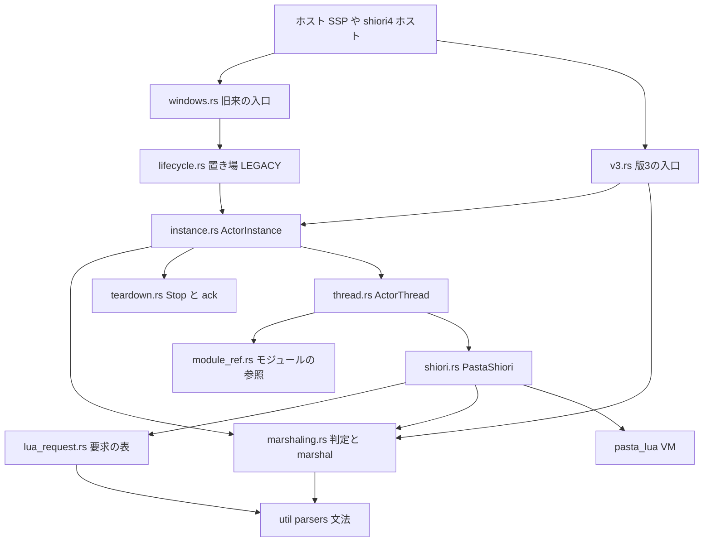
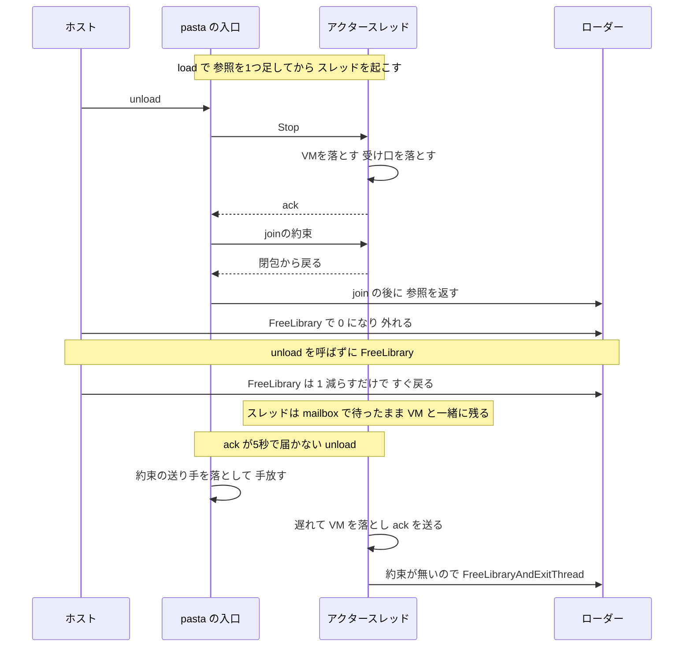
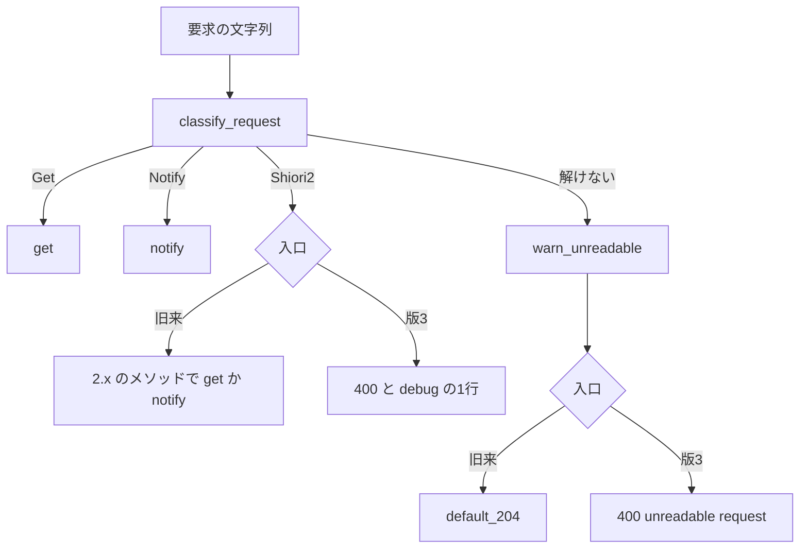
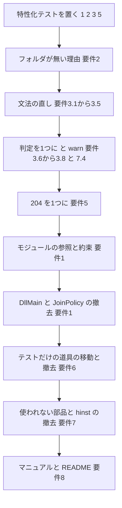

# 設計書: ponytail-shiori

## Overview

**Purpose**: この設計は、`crates/pasta_shiori` について、2026-10-19 の監査の指摘と、ギャップ分析で増えた同じ領域の指摘（research.md の N1〜N11）を、今のファイルの中で残らず直す。挙動を変える直しは 4 つ（`unload` を呼ばずに外されたとき・フォルダが無いときの 500 の理由・`Key:` の行と解けない要求の警告・自前の 204）で、ほかはホストへ返すバイト列を変えない撤去である。

**Users**: ゴーストの利用者（ホストがどの順で pasta.dll を外しても SSP が止まらず落ちない）、ゴーストの作者（500 の理由と警告のログで原因を辿れる・値の空いた見出しの事象が Lua に届く）、pasta の開発者（本番の道とテストの足場を取り違えない・読む量が減る）。

**Impact**: アクタースレッドごとに pasta.dll のモジュールの参照を 1 つ持たせ、`DllMain` は何もしなくなる。要求のメソッドの判定は 1 つになり、解けない要求は両方の入口で warn を 1 行残す。テストだけの道具は `tests/` へ移るか消える。約 4,100 行と、通常の依存の機能 1 つ（`Win32_System_Threading`）が減り、通常の依存の機能 1 つ（`Win32_System_LibraryLoader`。`pasta_lua` が既に有効にしている）が増える。新しいファイルは `src/actor/module_ref.rs` と、`FreeLibrary` の統合テスト 1 本とそのフィクスチャだけ。

### Goals

- 要件 1・2・3・5 の挙動の直しを、直す前の振る舞いを固めるテストを先に置いてから入れる（9.4）。
- 要件 6・7 の撤去を、ホストへ返す応答のバイト列を変えずに入れる（7.6）。
- `shiori4-v3-portable` で閉じた指摘の振る舞いを保つ（4.1〜4.4・1.1・1.8）。
- 1 つ直すごとに関門（9.1〜9.3）を通し、1 つのコミットにする（brief の Constraints）。

### Non-Goals

- `panic = "abort"` と静的な CRT リンク（確定済み）。
- `pasta_lua` の中（VM の片付けの中身・Lua の C モジュールの読み込み・debug のスレッド）。
- 版 3 の契約（フォルダが無いときの NULL・読めない要求の 400）。
- Linux・macOS で `dlclose` されたときの扱い（モジュールの参照は Windows だけで持ち、ほかの OS では何もしない）。
- `tests/`・`src/*_tests.rs`・`res/make_icon.py` をパッケージから外すこと（6.10）。
- SSP での実機の再現（任意。できれば `ssp-ghost-test-launch` の手順で確かめる）。

## Boundary Commitments

### This Spec Owns

- **アクタースレッドとモジュールの寿命**：スレッドがモジュールの参照を持つこと・参照を返す人の決め方・`DllMain` の振る舞い（`src/actor/module_ref.rs`・`src/actor/thread.rs`・`src/actor/instance.rs`・`src/actor/lifecycle.rs`・`src/windows.rs`）。
- **旧来の入口の読み込みの失敗の理由**：フォルダが無いときの `last_load_error`（`src/shiori.rs`）。
- **要求の文法と判定**：`_tag` の規則・使われない規則・`classify_request` の 1 つの判定・解けない要求の警告（`src/util/parsers/req_parser.pest`・`req_parser.rs`・`req.rs`・`src/actor/marshaling.rs`・`src/actor/instance.rs`・`src/v3.rs`・`src/lua_request.rs`）。
- **自前の 204**：`marshaling::default_204` 1 つに寄せること（`src/shiori.rs`・`src/actor/marshaling.rs`）。
- **撤去**：テストだけの道具・写し・作り手・観測の getter・コードページの層・`Shiori` トレイト・`Reply`・`MyError::Poison`・`hinst`・`unsafe impl Send/Sync`・起きない分岐・食い違うコメント（`src/` の各所）。
- **パッケージと依存**：`exclude = ["doc/"]`・`logfile.txt` の削除・`windows-sys` の機能（`crates/pasta_shiori/Cargo.toml`）。
- **テストの置き場所と道**：移したり外したりした道具の使い手のテストの書き換え（`crates/pasta_shiori/tests/`・`src/*_tests.rs`）。
- **文書**：`book/src/internals/shiori.md` のこの spec が変える節と、`crates/pasta_shiori/README.md`。

### Out of Boundary

- `pasta_lua` の全部（`PastaLuaRuntime` の片付け・`DllPins`・`debug/` のスレッド・`LoadDirGuard`・`GlobalLoggerRegistry` の札）。呼び方だけを変えずに使う。
- `shiori4_abi`（版 3 の表と検査）。
- `book/src/internals/shiori.md` の Lua 側の節（「Lua 側の SHIORI エントリとイベント配送」より後。`ponytail-lua-scripts` が触る）。
- ルートの `README.md`・`.kiro/steering/tech.md` の pub API の断り書き（書き済み。8.4）。`tech.md` 58 行の「`Win32_System_Threading` 含む」の書き換えは、完了のときの steering の同期で行う（この spec の実装では触らない）。
- 版 3 のインスタンスを、ホストが手放した後に取り返す仕組み（作らない。Open Questions の 3）。

### Allowed Dependencies

- `windows-sys` 0.61：通常の依存は `Win32_Foundation`・`Win32_System_Memory`・`Win32_Globalization`（ワークスペースの既定）と `Win32_System_LibraryLoader`（`GetModuleHandleExW`・`FreeLibraryAndExitThread`）。dev-dependencies は `Win32_System_Diagnostics_ToolHelp`（今のまま）と `Win32_System_Threading`（リーク検査の数え上げ）。
- `pest` 2.8.6 の `pest::error::{Error, ErrorVariant, LineColLocation}`、`flume`、`arc-swap`、`pasta_lua` の公開の型（今と同じ）。
- 依存の向き（左が下の層。右から左だけを読む）：
  `error`・`util` → `actor::mailbox` → `actor::marshaling`・`actor::teardown` → `lua_request`・`shiori` → `actor::module_ref`・`actor::thread` → `actor::instance` → `actor::lifecycle` → `windows`・`v3`。
  `shiori` が `actor::marshaling::default_204` を読むのは、この向きに合う（`marshaling` は `shiori`・`thread` を読まない）。

### Revalidation Triggers

- `pasta_shiori` の公開 API の削除（`Shiori` トレイト・`JoinPolicy`・`teardown_actor_detached`・`kick_sink`・`ActorInstance::kick`・`ActorMsg` の作り手・`spawn_actor_thread`・`ActorThread` の getter・`Reply`・`MyError::Poison`・`ReloadProbe` 一式・`teardown::teardown_actor`・`TeardownReport::is_clean`・`determine_method`・`marshaling::marshal_request`・各関数の `hinst` の引数）。外のクレートの使い手は 0 であることを確かめた。
- `ActorMsg::Stop` の形は変えない（約束のチャネルはスレッドを起こすときに作る）。
- 要求の文法の変更（`shiori4-v4-host` が `req_parser.pest` を触る。同じウェーブに置かない）。
- `windows.rs` の `DllMain` の変更（`pasta-dll-multiarch` が `windows.rs` を触る。同じウェーブに置かない）。
- 解けない要求の warn の欄（`seam = "request.unreadable"`・`line`・`col`・`first_line`）。ログを読むテストとマニュアルが名前を書く。

## Architecture

### Existing Architecture Analysis

- 入口は 2 つ（旧来の HGLOBAL の `windows.rs`、版 3 の `v3.rs`）で、どちらも芯の型 `ActorInstance` に渡す。`ActorInstance` は mailbox の送信端と `ActorThread` を持ち、`ActorThread` の上の `PastaShiori` が `pasta_lua` の VM を持つ。旧来の入口だけは置き場 `static LEGACY: ArcSwapOption<ActorInstance>` を使う。
- 今の後始末：`Stop{done}` を送り、ack を 5 秒まで待つ。ack が届いて `JoinPolicy::JoinAfterAck` なら join、`Detach`（`DllMain` の道）なら手放し、届かなければ手放して警告する。アクターは ack の前に VM を落とす。
- 今の `DllMain` の道の穴（監査 1）：ローダーのロックの中で ack を待つ間に、VM の片付けの `FreeLibrary`（C モジュール）がロックを待って 5 秒止まる。打ち切って戻ると DLL が外れ、生きたアクターが外れたコードへ戻る。C モジュールが無くても、ack の後のスレッドの終わり（std の後始末）が外れる時と競る。版 3 のインスタンスは片付けられないまま、外れた DLL の下に残る。
- std の制約（research.md「std の join とスレッドの終わり」）：閉包から戻らずに終わったスレッドを `JoinHandle::join` すると panic する。DLL の中の Rust のスレッドローカルの後始末は、DLL が外れるときに std が `FlsFree` で済ませる前提で、そのとき、ほかのスレッドが DLL の Rust のコードを走らせていてはならない。

### Architecture Pattern & Boundary Map



**Architecture Integration**:

- Selected pattern：今のアクターの形（インスタンス 1 つ＝スレッド 1 本・mailbox・ack の後に join）をそのまま使い、`ActorThread` にモジュールの参照と「join の約束」を足すだけにする（research.md の D1-c）。
- Domain boundaries：モジュールの寿命は `module_ref.rs`（OS の API）と `thread.rs`（参照を返す人の決まり）だけが持つ。判定は `marshaling.rs` だけが持ち、入口ごとの違い（2.x を Lua へ届けるか 400 か）は呼び出し側の 1 か所にある。
- Existing patterns preserved：ack の前に VM と mailbox の受け口を落とす順・`TEARDOWN_TIMEOUT`（5 秒）・`GET_TIMEOUT`（5 秒）・冪等の後始末・`ClaimMode`・`LoadDirGuard` を張ってからログを出す形（`v3.rs` の `reject`）・`catch_unwind` の封じ込め・単一の同期 `recv()` のループ。
- New components rationale：`ModuleRef` だけ。`GetModuleHandleExW`／`FreeLibrary`／`FreeLibraryAndExitThread` の `unsafe` を 1 か所に閉じ込め、非 Windows では何もしない形を 1 つの型で表す。
- Steering compliance：層を足さない（ponytail）。pub API は消してよい（`tech.md` 178 行）。依存は増やさない（機能の付け替えだけ）。

### Technology Stack

| Layer | Choice / Version | Role in Feature | Notes |
| ----- | ---------------- | --------------- | ----- |
| OS の API | windows-sys 0.61 `Win32_System_LibraryLoader` | モジュールの参照を足す・返す・返してスレッドを終える | 通常の依存に足す。`pasta_lua` が既に有効にしているので、出荷物の中身は変わらない |
| OS の API | windows-sys 0.61 `Win32_System_Threading` | リーク検査の数え上げ（`GetProcessHandleCount`・`GetGuiResources`） | 通常の依存から dev-dependencies へ移す（6.8） |
| チャネル | flume（ワークスペースの版） | 「join の約束」（`bounded(1)`） | 新しい依存ではない |
| 解析 | pest 2.8.6 | `_tag` の規則・誤りの位置（`line_col`） | 版は変えない |

## File Structure Plan

### Directory Structure

```
crates/pasta_shiori/
├── Cargo.toml                       # exclude と windows-sys の機能
├── doc/shiori-sample.log            # 残す（パッケージから外す）
├── src/
│   ├── lib.rs                       # Shiori の再輸出を外す
│   ├── error.rs                     # Poison を外す
│   ├── lua_request.rs               # 2.x の版の数の起きない分岐を外す
│   ├── shiori.rs                    # PastaShiori（トレイトを外し、固有のメソッドにする）
│   ├── v3.rs                        # 版 3 の入口（新しい判定と警告）
│   ├── windows.rs                   # 旧来の入口（DllMain は何もしない）
│   ├── windows_tests.rs             # DllMain の単体テストを改める
│   ├── shiori_lifecycle_tests.rs    # hinst の確かめを改める
│   ├── shiori_request_tests.rs      # 204 の特性化テストを足す
│   ├── actor/
│   │   ├── mod.rs                   # module_ref を足し、説明を直す
│   │   ├── module_ref.rs            # 新規：モジュールの参照（Windows だけ働く）
│   │   ├── thread.rs                # ActorThread（参照と約束・getter を外す）
│   │   ├── instance.rs              # ActorInstance（JoinPolicy・kick を外す・警告）
│   │   ├── lifecycle.rs             # LEGACY（detached・kick の窓口を外す）
│   │   ├── marshaling.rs            # classify_request 1 つ・写しを外す
│   │   ├── mailbox.rs               # Reply と作り手を外す
│   │   └── teardown.rs              # Stop と ack だけを残す
│   └── util/
│       ├── hglobal/
│       │   ├── mod.rs               # to_ansi_str を直に呼ぶ・unsafe impl を外す
│       │   ├── enc.rs               # 削除
│       │   └── windows_api.rs       # multi_byte_to_wide_char だけを残す
│       └── parsers/
│           ├── req_parser.pest      # _tag の直しと使われない規則の削除
│           ├── req_parser.rs        # _GRAMMAR を外す・テストを足す
│           ├── req.rs               # テストの写しを外す
│           └── test_data/logfile.txt  # 削除
├── tests/
│   ├── free_library_test.rs         # 新規：LoadLibrary した pasta.dll を unload なしで外す
│   └── fixtures/free_library/       # 新規：ffi.load するゴースト
└── README.md                        # 公開 API の節を直す
book/src/internals/shiori.md         # 該当の節を直す
```

### Modified Files

本番のコード：

- `src/actor/module_ref.rs`（新規）— `ModuleRef` の取得・返却・返却とスレッドの終わり。`#[cfg(windows)]` と `#[cfg(not(windows))]` の 2 つの形。
- `src/actor/thread.rs` — `spawn_actor_thread_with` が参照を取り、約束のチャネルを作る。閉包の最後で約束を待つ。`ActorThread::join`・`detach` が約束を扱う。`actor_thread_id`・`debug_local_addr`・`spawn_actor_thread`・`hinst` を外し、ready のチャネルは `bool` だけにする。
- `src/actor/instance.rs` — `JoinPolicy`・`ActorInstance::kick`・`hinst` を外す。`request` を `classify_request` に替え、`warn_unreadable` を足す。`kick_sink_for` を `pub` にする。
- `src/actor/lifecycle.rs` — `teardown_actor_detached`・`kick_sink`・`kick_into`・`hinst` を外す。`teardown_slot` から `JoinPolicy` を外す。
- `src/actor/marshaling.rs` — `determine_method`・`marshal_request`（写し）を外し、`classify_request` を `Result<RequestKind, Box<ParseError>>` にする。`ShioriMethod`・`RequestKind` を `pub(crate)` にする。
- `src/actor/mailbox.rs` — `Reply` を外して応答のチャネルを `String` にする。`ActorMsg::get`・`notify`・`kick` と `#[non_exhaustive]`（と、それを semver で説明するコメント）を外す。`ActorMsg::stop` は残す（`teardown_via_sender` が使う）。
- `src/actor/teardown.rs` — `teardown_actor`・`TeardownReport::is_clean`・`ReloadReport`・`LeakMetric`・`ReloadProbe`・`ResourceSample`・`sample_resources`・`user_objects_from` を外す。
- `src/actor/mod.rs` — `pub(crate) mod module_ref;` を足し、各モジュールの説明から消えた部品の名前を外す。
- `src/windows.rs` — `DllMain` はどの通知でも 1 を返す。`teardown` の関数ポインタの共通の後始末を `unload` の中に戻す。`spawn_actor(dir)` を呼ぶ。
- `src/v3.rs` — 新しい `classify_request` と `warn_unreadable` を使う。
- `src/shiori.rs` — `Shiori` トレイトを外して固有のメソッドにする。`hinst` の欄と引数を外す。フォルダが無いときに `last_load_error` を立てる。`default_204_response` を `marshaling::default_204` に替える。`call_lua_request` はランタイムを引数で受け、`call_lua_unload` の `_runtime` を外す。
- `src/lib.rs` — `pub use shiori::{PastaShiori, Shiori}` を `pub use shiori::PastaShiori` にする。
- `src/error.rs` — `MyError::Poison`・`From<PoisonError>`・`use std::sync::PoisonError` を外す。
- `src/lua_request.rs` — `shiori2_ver` の `nums < 0`・`nums > 9` の分岐を外して `nums + 20` にする（数の読み取りの誤りの扱いは残す）。
- `src/util/parsers/req_parser.pest` — `_tag = _{ ":" ~ " "? }`。`sp`・`eol`・`key_sep` を消す。
- `src/util/parsers/req_parser.rs` — `_GRAMMAR` を消す。`Key:`・`Key:value` のテストを足す。
- `src/util/parsers/req.rs` — テストのモジュール（`ShioriRequest` の写しと `req_1`〜`req_3`）を消す。再輸出と `ParseError` だけが残る。
- `src/util/parsers/test_data/logfile.txt` — 削除。
- `src/util/hglobal/enc.rs` — 削除。
- `src/util/hglobal/windows_api.rs` — `EncoderCodePage`・`string_to_multibyte`・`wide_char_to_multi_byte`・`WC_*` を消す。`multi_byte_to_wide_char` の `set_len` を `vec![0u16; len as usize]` にする。
- `src/util/hglobal/mod.rs` — `to_ansi_str` が `multi_byte_to_wide_char(CP_ACP, MB_ERR_INVALID_CHARS, bytes)` を直に呼ぶ。`unsafe impl Send/Sync` を消す。semver のコメントを直す。SJIS の往復のテストは CP932 のバイト列を定数で持つ。
- `Cargo.toml` — `exclude = ["doc/"]`、通常の依存の `windows-sys` を `Win32_System_LibraryLoader` に替え、dev-dependencies に `Win32_System_Threading` を足す。

テスト（使い手の書き換え。各行の中身は Components の Implementation Notes を参照）：

- `tests/free_library_test.rs`・`tests/fixtures/free_library/`（新規）。
- `tests/actor_reload_leak_test.rs` — `ReloadProbe` 一式をこのファイルへ移す（`user_objects_from` の単体テストも）。
- `tests/actor_teardown_test.rs`・`actor_tracing_seams_test.rs`・`ffi_actor_lifecycle_test.rs`・`load_failure_visibility_test.rs`・`path_robustness_e2e_test.rs`・`test_path_helpers_test.rs` — `is_clean()` を `acked && anomaly.is_none()` に、`teardown::teardown_actor` を `teardown_via_sender` と `detach` に。
- `tests/scene_kick_e2e_test.rs`・`scene_kick_gate_e2e_test.rs`・`scene_kick_multibeat_e2e_test.rs`・`scene_kick_preempt_e2e_test.rs` — 自分の mailbox と `kick_sink_for(&tx)` の送り先、`spawn_actor_thread_with(dir, rx, Some(sink), None)`、`marshal_get` で回す。
- `tests/actor_marshaling_test.rs` — `marshaling::marshal_request` を `marshal_get`・`marshal_notify` に。
- `tests/actor_kick_test.rs`・`actor_log_context_test.rs`・`actor_test_harness.rs`・`actor_thread_vm_test.rs`・`debug_preservation_test.rs`・`ffi_logging_test.rs`・`runtime_error_balloon_e2e_test.rs` — `spawn_actor_thread`・`ActorMsg` の作り手・`Reply::Value`・`actor_thread_id`・`debug_local_addr` を使わない形に。
- `tests/common/mod.rs` — `multi_instance_test.rs` の `wait_log_contains`・`listening_port` をここへ移し、`debug_preservation_test.rs` と共有する。
- `tests/actor_instance_test.rs`・`multi_instance_test.rs`・`shiori4_v3_entry_test.rs`・`lua_request_parse_test.rs`・`shiori_lifecycle_test.rs` と `hinst`・`Shiori` を使う全テスト — `JoinPolicy`・`hinst`・`use pasta::Shiori` を外す。新しいテストを足す（Testing Strategy）。
- `src/actor/instance.rs`・`lifecycle.rs`・`marshaling.rs`・`teardown.rs` の `#[cfg(test)]` — 消した部品を使わない形に。

文書：

- `book/src/internals/shiori.md` — 要件 8.1 の節（Components の DocSync を参照）。
- `crates/pasta_shiori/README.md` — 公開 API の節と使用例。

## System Flows

### 後始末の 3 つの道とモジュールの参照



- 参照を返すのは、join を終えた親（約束を送った道）か、約束を受け取れなかったスレッド自身のどちらか一方だけで、型ではなく約束のチャネルで決まる。
- `FreeLibrary` による `DLL_PROCESS_DETACH` は、参照を持つ `ActorThread` が 1 つも無いときにしか来ないので、`DllMain` は何もしない。見捨てたスレッドが最後の参照を返すときは、その `DllMain`（何もしない）と std の `atexit` の後始末がそのスレッドの上で走ってから DLL が外れ、スレッドは DLL のコードへ戻らずに終わる。
- `unload` を呼ばずに外された後に同じ pasta.dll が読み直されると（`DLL_PROCESS_ATTACH` は走らない）、次の `loadu` の `teardown_slot` が前のインスタンスを普段どおりに片付ける（`SHIORI.unload` と保存が、その時に走る）。

### 要求の判定



- 版 3 の `notify` に来た GET と 2.x は、今と同じく debug を 1 行出して 400（3.7）。

## Requirements Traceability

| Requirement | Summary | Components | Interfaces | Flows |
| ----------- | ------- | ---------- | ---------- | ----- |
| 1.1 | unload は join まで待つ・5 秒で手放す | ActorInstance・ActorThread | `ActorInstance::shutdown`・`ActorThread::join` | 後始末の 3 つの道 |
| 1.2 | unload なしの FreeLibrary で落とさない・残ってよい | ModuleRef・ActorThread | `ModuleRef::acquire` | 後始末の 3 つの道 |
| 1.3 | その FreeLibrary を 5 秒を超えて止めない（C モジュールでも） | ModuleRef・WindowsEntry | `DllMain` | 後始末の 3 つの道 |
| 1.4 | その道では SHIORI.unload と保存を約束しない | ModuleRef・LegacySlot | — | 後始末の 3 つの道 |
| 1.5 | 旧来と版 3 の両方 | ActorThread（両方の入口が通る） | `spawn_actor_thread_with` | — |
| 1.6 | プロセスの終了では何もしない | WindowsEntry | `DllMain` | — |
| 1.7 | DllMain でスレッドを起こさない | WindowsEntry | `DllMain` | — |
| 1.8 | unload を呼ぶホストでは今と同じ | ActorInstance・ActorThread・ModuleRef | `ActorThread::join` | 後始末の 3 つの道 |
| 2.1 | フォルダが無ければ FALSE | PastaShiori | `PastaShiori::load` | — |
| 2.2 | GET の 500 の理由にフォルダとパス | PastaShiori | `last_load_error` | — |
| 2.3 | NOTIFY は 204 | ActorInstance | `notify` | — |
| 2.4 | ANSI で表せない文字は置き換わった形を出す | PastaShiori・HGlobal | `to_ansi_str` | — |
| 2.5 | 版 3 の NULL は変えない | V3Entry | `PastaV3::load` | — |
| 2.6 | フォルダがある失敗の理由は変えない | PastaShiori | — | — |
| 3.1 | `Key:` を `""` で受ける | Grammar | `_tag` | — |
| 3.2 | `Key: value` は今と同じ | Grammar | `_tag` | — |
| 3.3 | `Key:value` は `value` | Grammar | `_tag` | — |
| 3.4 | SSP の記録の 3 要求が Lua に届く | Grammar・RequestClassifier | `classify_request` | 要求の判定 |
| 3.5 | 旧来と版 3 で同じ受け付け | Grammar・RequestClassifier | `classify_request` | 要求の判定 |
| 3.6 | 旧来は 204 と warn 1 行 | ActorInstance | `warn_unreadable` | 要求の判定 |
| 3.7 | 版 3 は 400 と同じ warn・2.x と GET の弾きは debug | V3Entry・ActorInstance | `warn_unreadable`・`reject` | 要求の判定 |
| 3.8 | 位置と 1 行目だけ・全文は出さない | ActorInstance | `warn_unreadable` | — |
| 4.1 | BOOL と long を保つ | WindowsEntry | `load`・`loadu`・`unload`・`request` | — |
| 4.2 | 返す長さと中身の一致を保つ | WindowsEntry | `request` | — |
| 4.3 | 並列のテストで状態を取り合わない | テスト（`FFI_GLOBAL_STATE`・`serial`） | — | — |
| 4.4 | プロセスに 1 つの状態のテストは 1 つの錠 | テスト | — | — |
| 5.1 | 自前の 204 を 1 つのバイト列に | RequestClassifier・PastaShiori | `default_204` | — |
| 5.2 | SHIORI.request 未定義も同じ 204 | PastaShiori | `call_lua_request` | — |
| 5.3 | RES.no_content と同じ | RequestClassifier | `default_204` | — |
| 6.1 | リーク検査と teardown_actor・is_clean を出荷から外す | Teardown | — | — |
| 6.2 | 写し・kick の窓口・作り手・spawn_actor_thread を外す | RequestClassifier・LegacySlot・ActorInstance・Mailbox・ActorThread | — | — |
| 6.3 | ANSI のデコードは 1 つの変換だけ | HGlobal | `to_ansi_str` | — |
| 6.4 | set_len を使わない | HGlobal | `multi_byte_to_wide_char` | — |
| 6.5 | デコードの結果を変えない | HGlobal | `to_ansi_str` | — |
| 6.6 | doc と logfile.txt をパッケージに入れない | PackageManifest | `exclude` | — |
| 6.7 | テストの中にパーサの写しを持たない | Grammar | — | — |
| 6.8 | 通常の依存で Threading を有効にしない | PackageManifest | features | — |
| 6.9 | 移した道具のテストが同じ性質を確かめ続ける・kick は本番の道 | テスト | `kick_sink_for` | — |
| 6.10 | テストのファイルと短い上限の口を残す | — | `marshal_get_with_timeout`・`shutdown_with_timeout`・`spawn_actor_with_teardown_timeout` | — |
| 7.1 | Reply・_GRAMMAR・規則・unsafe impl・Poison・トレイトを外す | Mailbox・Grammar・HGlobal・Error・PastaShiori | — | — |
| 7.2 | トレイトを消しても同じ形で呼べる | PastaShiori | `load`・`request` | — |
| 7.3 | hinst をアクターの道に通さない・Lua には 0 | PastaShiori・ActorThread・ActorInstance・LegacySlot | `spawn_actor`・`PastaShiori::load` | — |
| 7.4 | 判定を 1 つに・2.x の扱いを保つ | RequestClassifier | `classify_request` | 要求の判定 |
| 7.5 | 2.x の版の数の起きない分岐を外す | LuaRequest | `parse1` | — |
| 7.6 | 応答のバイト列を変えない | 全部 | — | — |
| 7.7 | 公開 API を消してよい・README から外す | DocSync | — | — |
| 7.8 | 食い違うコメントと 2 度の確認を残さない | PastaShiori・HGlobal・Mailbox | — | — |
| 8.1 | 内部設計の章を直す | DocSync | — | — |
| 8.2 | ほかの節を書き換えない | DocSync | — | — |
| 8.3 | README のトレイトの節と使用例を直す | DocSync | — | — |
| 8.4 | 新しい断り書きを足さない | DocSync | — | — |
| 9.1 | fmt と clippy | 関門 | — | — |
| 9.2 | cargo test | 関門 | — | — |
| 9.3 | i686 のビルド | 関門 | — | — |
| 9.4 | 特性化テストを先に | Testing Strategy | — | — |

## Components and Interfaces

| Component | Domain/Layer | Intent | Req Coverage | Key Dependencies | Contracts |
| --------- | ------------ | ------ | ------------ | ---------------- | --------- |
| ModuleRef | actor | pasta.dll の参照 1 つを足す・返す | 1.2〜1.5・1.8 | windows-sys LibraryLoader (P0) | Service |
| ActorThread | actor | スレッド・参照・約束を持ち、参照を返す人を決める | 1.1〜1.5・1.8・6.2・7.3 | ModuleRef (P0)・PastaShiori (P0)・flume (P0) | Service・State |
| ActorInstance | actor | 後始末の決まり・旧来の意味の要求・解けない要求の警告 | 1.1・2.3・3.6〜3.8・6.2・6.9・7.3・7.4 | ActorThread (P0)・RequestClassifier (P0)・Teardown (P0) | Service |
| LegacySlot | actor | 旧来の入口の置き場と窓口 | 1.4・6.2・7.3 | ActorInstance (P0) | Service・State |
| RequestClassifier | actor | 判定 1 つ・204 1 つ・marshal | 3.4・3.5・5.1・5.3・6.2・7.4 | Grammar (P0)・Mailbox (P0) | Service |
| Mailbox | actor | メッセージの型 | 6.2・7.1・7.8 | flume (P0) | Event |
| Teardown | actor | Stop と ack と結果 | 1.1・6.1 | Mailbox (P0) | Service |
| WindowsEntry | 入口 | HGLOBAL の入口と DllMain | 1.3・1.6・1.7・4.1・4.2 | LegacySlot (P0)・HGlobal (P0) | Service |
| V3Entry | 入口 | 版 3 の入口 | 2.5・3.5・3.7 | ActorInstance (P0)・RequestClassifier (P0) | Service |
| PastaShiori | SHIORI | VM の構築・要求・204・失敗の理由 | 2.1〜2.6・5.2・7.1〜7.3・7.8 | pasta_lua (P0)・LuaRequest (P0) | Service・State |
| Grammar | util | SHIORI の要求の文法 | 3.1〜3.5・6.7・7.1 | pest (P0) | — |
| LuaRequest | SHIORI | 要求を Lua の表へ | 3.1・7.5 | Grammar (P0) | Service |
| HGlobal | util | HGLOBAL と ANSI のデコード | 2.4・6.3〜6.5・7.1・7.8 | windows-sys Globalization (P0) | Service |
| Error | 共通 | `MyError` | 7.1・7.8 | — | — |
| PackageManifest | 構成 | パッケージと機能 | 6.6・6.8 | — | — |
| DocSync | 文書 | マニュアルと README | 7.7・8.1〜8.4 | — | — |

### actor

#### ModuleRef

| Field | Detail |
| ----- | ------ |
| Intent | アクタースレッドが走っている間、pasta.dll が外れないように参照を 1 つ持つ |
| Requirements | 1.2・1.3・1.4・1.5・1.8 |

**Responsibilities & Constraints**

- `acquire` は `GetModuleHandleExW(GET_MODULE_HANDLE_EX_FLAG_FROM_ADDRESS, この関数の番地)` で、この関数を含むモジュール（出荷では pasta.dll、テストの rlib ではテストの実行ファイル）の参照を 1 つ足す。
- `release` は `FreeLibrary`。呼ぶのは join を終えた親だけ（スレッドがもう DLL のコードを走らせていない）。
- `release_and_exit_thread` は `FreeLibraryAndExitThread(h, 0)`。Windows では戻らない。呼ぶのは見捨てられたアクタースレッドの閉包の最後だけ。
- `Drop` を持たない。返し忘れた参照は、プロセスの終わりまで DLL を外さない（安全な側）。
- ハンドルは `usize` で持つ（`HMODULE` は `*mut c_void` で `Send` でない。`unsafe impl Send` を足さない）。値は `Copy` で、参照を返す人は型ではなく ActorThread の約束で決まる。
- 非 Windows では欄を持たず、3 つとも何もしない（`release_and_exit_thread` は戻る）。

**Contracts**: Service [x]

##### Service Interface

```rust
#[derive(Clone, Copy)]
pub(crate) struct ModuleRef { /* Windows: handle: usize */ }

impl ModuleRef {
    /// 参照を 1 つ足す。失敗は OS の誤り（GetLastError）。
    pub(crate) fn acquire() -> std::io::Result<ModuleRef>;
    /// 参照を返す（join を終えた親だけ）。
    pub(crate) fn release(self);
    /// 参照を返してスレッドを終える（見捨てられたアクタースレッドだけ）。
    #[cfg(windows)]
    pub(crate) fn release_and_exit_thread(self) -> !;
    #[cfg(not(windows))]
    pub(crate) fn release_and_exit_thread(self);
}
```

- Preconditions：`release`・`release_and_exit_thread` は、同じ `acquire` の結果について、どちらか一方を 1 回だけ呼ぶ。
- Postconditions：`acquire` の後、`release` か `release_and_exit_thread` が呼ばれるまで、pasta.dll は外れない。
- Invariants：`unsafe` はこのファイルの 3 か所だけ（各 `SAFETY` のコメントつき）。

**Implementation Notes**

- Integration：`Cargo.toml` の通常の依存の `windows-sys` に `Win32_System_LibraryLoader` を足す。
- Validation：`tests/free_library_test.rs`（1.2・1.3・1.8）、`multi_instance_test.rs` の見捨てたスレッドが終わるテスト。
- Risks：`acquire` の失敗は実際には起きない。起きたら起動の失敗（`SpawnError::Thread`）にする（参照の無いスレッドを作らない）。

#### ActorThread

| Field | Detail |
| ----- | ------ |
| Intent | アクタースレッドを起こし、参照と「join の約束」を持って、参照を返す人を決める |
| Requirements | 1.1・1.2・1.3・1.4・1.5・1.8・6.2・7.3 |

**Responsibilities & Constraints**

- `spawn_actor_thread_with` は、スレッドを起こす前に `ModuleRef::acquire` し、約束のチャネル `flume::bounded::<()>(1)` を作る。送り手は `ActorThread`、受け手と参照の写しは閉包が持つ。
- 閉包は今の順（ログの文脈 → VM の構築と `load` → ready → `recv()` のループ → VM を落とす → 受け口を落とす → ack）を変えない。その後、閉包が持つ値（ログの文脈 `LoadDirGuard`・`load_dir`・ready と ack の送り手）を明示して落とし、約束を待つ：
  - 約束が届いた（`Ok`）：閉包から普通に戻る。参照は親が返す。
  - 送り手が落ちた（`Err`）：`module.release_and_exit_thread()`。非 Windows では戻って終わる。
- `ActorThread::join(self)`：約束を送ってから std の join をし、`module.release()` する（スレッドが panic で終わっていても返す）。
- `ActorThread::detach(self)`：約束の送り手と `JoinHandle` を落とすだけ。参照はスレッドが返す。`ActorThread` を join も detach もせずに落としても同じ（欄の Drop が送り手を落とす）。
- ready の前にスレッドが終わった（unwind のビルドの panic）ときは、閉包は約束に届かないので、std の join は成り立つ。join の後に `release` してから `io::ErrorKind::Other` を返す。`thread::Builder::spawn` が失敗したら、その場で `release` する。
- ready のチャネルはロードの成否（`bool`）だけを運ぶ。`actor_thread_id`・`debug_local_addr` は持たない。
- `hinst` を受けない。`PastaShiori::load(load_dir)` を呼ぶ。

**Contracts**: Service [x] / State [x]

##### Service Interface

```rust
pub struct ActorThread {
    handle: Option<std::thread::JoinHandle<()>>,
    loaded: bool,
    keep: flume::Sender<()>,   // join の約束の送り手。落とすと「見捨てた」
    module: ModuleRef,
}

impl ActorThread {
    pub fn loaded(&self) -> bool;
    /// 約束を送り、join してから参照を返す。Stop の ack の後に呼ぶ（でなければ recv() で待ち続ける）。
    pub fn join(self) -> std::thread::Result<()>;
    /// 約束を捨てて手放す。参照は、スレッドが閉包の最後で返す。
    pub fn detach(self);
}

pub fn spawn_actor_thread_with(
    load_dir: std::path::PathBuf,
    rx: flume::Receiver<ActorMsg>,
    kick_sink: Option<pasta_lua::debug::KickSink>,
    claim: Option<pasta_lua::ClaimToken>,
) -> std::io::Result<ActorThread>;
```

##### State Management

- 状態：「ループの中」→「片付けと ack を済ませて約束を待つ」→「普通に戻った（親が参照を返す）」か「参照を返して終わった」。
- 約束を待つ間、スレッドは flume の `recv()` で止まっているだけで、DLL のコードは走らない。`unload` を呼ばずに外されたときは、Stop が来ないので「ループの中」のまま残る。
- 並び：親の `join` は「約束を送る → join → release」の順。約束を送る前に join すると止まるので、この順は `ActorThread::join` の中に閉じる。

**Implementation Notes**

- Integration：`ActorInstance::spawn_with`（本番）と、mailbox を直に回すテスト（`spawn_actor_thread_with(…).expect(…)`）が使い手。
- Validation：今の join・ack・冪等のテスト（`actor_instance_test.rs`・`actor_teardown_test.rs`・`actor_thread_vm_test.rs`）が通り続けること。`tests/free_library_test.rs`。
- Risks：見捨てた道では、std の `Packet` と `Thread` の `Arc`（200 バイトほど）が漏れる。見捨てたスレッドが永遠に戻らなければ、DLL はプロセスの終わりまで残る。

#### ActorInstance

| Field | Detail |
| ----- | ------ |
| Intent | インスタンス 1 つ＝アクター 1 つの後始末・旧来の意味の要求・解けない要求の警告 |
| Requirements | 1.1・2.3・3.6・3.7・3.8・6.2・6.9・7.3・7.4 |

**Responsibilities & Constraints**

- `shutdown`・`shutdown_with_timeout`・`Drop`：ack が届けば `ActorThread::join`（`joined = true`）、届かなければ `detach` して `seam = "instance.abandon"` の警告（今の文言のまま）。`JoinPolicy` は消す。
- `already_done`（受け口が既に閉じている）のときも join する。受け口を閉じたスレッドは、片付けを終えて約束を待つだけか、panic で閉包を抜けたかのどちらかで、join は止まらない（今は手放している。`request_stop` の後の `Drop` がこの道を通る）。見捨てる道（スレッドが参照を返して終わる道）を、ack が来ないときだけに絞る。
- `request(&self, req)`（旧来の意味）：`classify_request` の結果で、`Get`・`Shiori2(Get)` は `get`、`Notify`・`Shiori2(Notify)` は `notify`、解けなければ `warn_unreadable("legacy", …)` の後に `default_204()`。
- `warn_unreadable`：`LoadDirGuard::new(load_dir)` を張ってから、`tracing::warn!(seam = "request.unreadable", entry, line, col, first_line, "request could not be parsed")` を 1 行出す。`first_line` は `req.lines().next()`（無ければ空）。全文は載せない。
- `kick_sink_for(tx)` を `pub` にする（kick の e2e が本番の送り先を使う）。`ActorInstance::kick` は消す。
- `spawn(load_dir)`・`spawn_with(load_dir, mode)`：`hinst` を受けない。

**Contracts**: Service [x]

##### Service Interface

```rust
impl ActorInstance {
    pub fn spawn(load_dir: PathBuf) -> Result<Self, SpawnError>;
    pub fn spawn_with(load_dir: PathBuf, mode: ClaimMode) -> Result<Self, SpawnError>;
    pub fn loaded(&self) -> bool;
    pub fn load_dir(&self) -> &Path;
    pub fn request(&self, req: &str) -> String;
    pub fn get(&self, req: &str) -> String;
    pub fn notify(&self, req: &str) -> String;
    pub fn request_stop(&self) -> TeardownReport;
    pub fn shutdown(self) -> TeardownReport;
    pub fn shutdown_with_timeout(self, timeout: Duration) -> TeardownReport;
    pub(crate) fn warn_unreadable(&self, entry: &'static str, req: &str, err: &ParseError);
}

/// 送信端の弱い参照を閉じ込めた kick の送り先（本番の VM が持つもの）。
pub fn kick_sink_for(tx: &flume::Sender<ActorMsg>) -> pasta_lua::debug::KickSink;
```

- Postconditions（`warn_unreadable`）：ゴーストのログのファイルに warn が 1 行増える。`line`・`col` は pest の誤りの始めの位置（1 始まり）。

**Implementation Notes**

- Validation：3.6〜3.8 のテスト（Testing Strategy）。`actor_instance_test.rs` の `shutdown_detach_is_acked_and_not_joined` は消し、ほかは `shutdown()` に直す。`request_stop` の後の `shutdown` は `already_done && joined` になる（単体テスト `instance_kick_true_while_running_false_after_stop` は kick を使わない形に書き直し、この期待に改める）。
- Risks：解けない要求が毎秒来るホストでは、warn が毎秒出る。文法を直した後の SSP の要求は解けるので、間引きはしない。

#### LegacySlot

| Field | Detail |
| ----- | ------ |
| Intent | 旧来の入口の置き場 `LEGACY` と窓口の自由関数 |
| Requirements | 1.4・6.2・7.3 |

**Responsibilities & Constraints**

- `spawn_actor(load_dir)`・`spawn_actor_with_teardown_timeout(load_dir, timeout)`（`#[doc(hidden)]`・6.10 で残す）・`marshal_request(req)`・`teardown_actor()` を残す。`hinst` を受けない。
- `teardown_actor_detached`・`kick_sink`・`kick_into` を消す。`teardown_slot(slot, timeout)` は `JoinPolicy` を受けない。
- `unload` を呼ばずに外された後に同じ DLL へ `loadu` が来たときは、`spawn_actor` の `teardown_slot` が前のインスタンスを普段どおりに片付ける（今のコードのまま。1.4 の「次の load まで」）。

**Contracts**: Service [x] / State [x]

##### Service Interface

```rust
pub fn spawn_actor(load_dir: PathBuf) -> bool;
#[doc(hidden)]
pub fn spawn_actor_with_teardown_timeout(load_dir: PathBuf, teardown_timeout: Duration) -> bool;
pub fn marshal_request(request: &str) -> String;
pub fn teardown_actor() -> TeardownReport;
```

**Implementation Notes**

- Validation：`lifecycle.rs` の単体テストのうち kick を使う 3 本（`kick_on_empty_slot_is_noop`・`kick_reaches_real_instance_until_teardown`・`teardown_with_shared_reference_only_requests_stop`）を、`kick_sink_for` と送信端の `try_send` で書き直すか消す（置き場の窓口が無くなるので `kick_on_empty_slot_is_noop` は消す）。

#### RequestClassifier（marshaling.rs）

| Field | Detail |
| ----- | ------ |
| Intent | 要求の判定 1 つ・自前の 204 1 つ・GET と NOTIFY の marshal |
| Requirements | 3.4・3.5・5.1・5.3・6.2・7.4 |

**Responsibilities & Constraints**

- `classify_request`：`Parser::parse(Rule::req, req)` を 1 回なめる。`get`／`notify` でメソッドを覚え、`header2` なら `Shiori2(メソッド)`、`header3` ならメソッドの種類を返す。解けなければ pest の誤りを `Box` に入れて返す。解けたのにメソッドが無い（文法上起きない）ときは `ErrorVariant::CustomError` の誤りを作って返し、panic しない。
- `determine_method` と `marshal_request`（写し）は消す。
- `default_204` は今のバイト列のまま（`Charset: UTF-8`・`Sender: Pasta`・`SecurityLevel: local`）。
- 本番のコードに `unwrap(`・`expect(`・`panic!(`・`unreachable!(`・`[0]` を書かない（今の静的な検査のテストを保つ）。

**Contracts**: Service [x]

##### Service Interface

```rust
pub const GET_TIMEOUT: Duration;
pub fn default_204() -> String;

#[derive(Debug, Clone, Copy, PartialEq, Eq)]
pub(crate) enum ShioriMethod { Get, Notify }

#[derive(Debug, Clone, Copy, PartialEq, Eq)]
pub(crate) enum RequestKind {
    Get,                     // GET SHIORI/3.0
    Notify,                  // NOTIFY SHIORI/3.0
    Shiori2(ShioriMethod),   // SHIORI/2.x（旧来は Lua へ、版 3 は 400）
}

pub(crate) fn classify_request(request: &str) -> Result<RequestKind, Box<ParseError>>;

pub fn marshal_get(tx: &Sender<ActorMsg>, req: MailboxRequest) -> String;
pub fn marshal_get_with_timeout(tx: &Sender<ActorMsg>, req: MailboxRequest, timeout: Duration) -> String;
pub fn marshal_notify(tx: &Sender<ActorMsg>, req: MailboxRequest) -> String;
```

**Implementation Notes**

- Validation：`classify_request_splits_seven_cases` を新しい型で直す（2.x は `Shiori2(Get)`・`Shiori2(Notify)`、読めないものは `Err`）。`Reference0:` と `Reference0:abc` を含む要求が解けるケースを足す。

#### Mailbox・Teardown

- **Mailbox**（6.2・7.1・7.8）：`Reply` を消し、`ActorMsg::Get { req, reply: Sender<String> }` にする。`ActorMsg::get`・`notify`・`kick` を消し、`stop()` は残す。`#[non_exhaustive]` とそれを semver で説明するコメントを消す（pub API は消してよい・2026-10-19 の決定）。`MailboxRequest`・`mailbox()` は残す。
- **Teardown**（1.1・6.1）：`TeardownReport { acked, already_done, anomaly, joined }` と `teardown_via_sender(tx, timeout)` だけを残す。`teardown_via_sender` は `ActorThread` に触らないので、約束にも触らない。

### 入口

#### WindowsEntry（windows.rs）

| Field | Detail |
| ----- | ------ |
| Intent | 旧来の HGLOBAL の入口と DllMain |
| Requirements | 1.3・1.6・1.7・4.1・4.2 |

**Responsibilities & Constraints**

- `DllMain`：どの通知でも何もせず 1 を返す。1 行の理由のコメント（「`FreeLibrary` で外れるのは参照を持つアクターが 1 つも無いときだけ。プロセスの終了ではほかのスレッドが止まっている」）。
- `unload`：`LOADU_INITIALIZED` を下ろし、`catch_unwind` の中で `lifecycle::teardown_actor()`、異常は warn、いつも 1（今と同じ）。`teardown(entry, fn)` の共通の関数は消す。
- `load`・`loadu`・`request`・型・長さ・HGLOBAL の所有は変えない（4.1・4.2）。`load_impl` は `lifecycle::spawn_actor(dir)` を呼ぶ。

##### Service Interface

```rust
#[unsafe(no_mangle)]
extern "system" fn DllMain(_hinst: isize, _call_reason: u32, _reserved: *mut c_void) -> i32; // いつも 1
#[unsafe(no_mangle)] pub extern "C" fn loadu(hdir: HGLOBAL, len: c_long) -> i32;
#[unsafe(no_mangle)] pub extern "C" fn load(hdir: HGLOBAL, len: c_long) -> i32;
#[unsafe(no_mangle)] pub extern "C" fn unload() -> i32;
#[unsafe(no_mangle)] pub extern "C" fn request(req: HGLOBAL, len: *mut c_long) -> HGLOBAL;
```

**Implementation Notes**

- Validation：`windows_tests.rs` の DllMain のテストは「どの通知でも 1・置き場に触れない」（`FreeLibrary` の detach を模した呼び出しの後も `LEGACY` が埋まったまま）に改める。
- Risks：`load`（ANSI）だけを呼ぶホストが、`unload` なしの `FreeLibrary` の後に読み直すと、前の回の `LOADU_INITIALIZED` が残って `load` が何もしない（Open Questions の 4）。

#### V3Entry（v3.rs）

- **Requirements**：2.5・3.5・3.7。
- `request`：`Ok(Get)` → `get`、`Ok(Notify)` → `notify`、`Ok(Shiori2(_))` → `reject("SHIORI/2.x is not supported")`（debug）と 400、`Err(e)` → `instance.warn_unreadable("v3", req, &e)` と 400（理由 `unreadable request`）。
- `notify`：`Ok(Notify)` → `notify` と 204、`Ok(Get)` → `reject("GET is not accepted by notify")`（debug）と 400、`Ok(Shiori2(_))` → 2.x の `reject` と 400、`Err(e)` → `warn_unreadable` と 400。
- 400 の本文（`bad_request(reason)`）と `X-ERROR-REASON` の 3 つの文言は変えない。`reject` は `RequestKind` を受けず理由の文字列だけを受ける。`load` は `ActorInstance::spawn(load_dir)`。

### SHIORI

#### PastaShiori（shiori.rs）

| Field | Detail |
| ----- | ------ |
| Intent | アクタースレッドの上で VM を作り、要求を Lua へ渡す |
| Requirements | 2.1〜2.6・5.2・7.1・7.2・7.3・7.8 |

**Responsibilities & Constraints**

- `Shiori` トレイトを消し、`load`・`request` を固有のメソッドにする（呼び方は同じ。`use pasta::Shiori` が要らなくなるだけ）。
- `load(load_dir)`：フォルダが無ければ `last_load_error = Some(format!("load directory not found: {}", load_dir_path.display()))` を立てて `Ok(false)`（2.1・2.2）。以後の GET は `Load error: load directory not found: <パス>` の 500 になる。パスは入口がデコードした形のまま（ANSI で表せない文字は `?` に置き換わった形・2.4）。フォルダがあるときの失敗の理由は変えない（2.6）。
- `hinst` の欄と引数を消し、`call_lua_load` は `SHIORI.load` に定数の 0 を渡す（7.3）。
- `call_lua_request(&self, runtime: &PastaLuaRuntime, request: &str)`：`request` が確かめたランタイムを受け、もう一度は確かめない（7.8）。`SHIORI.request` が無ければ `marshaling::default_204()`（5.1・5.2）。
- `call_lua_unload`：`unload_fn` だけを見る（キャッシュはランタイムと一緒に消えるので、`_runtime` の確認は要らない・7.8）。

**Contracts**: Service [x] / State [x]

##### Service Interface

```rust
impl PastaShiori {
    pub fn with_kick_sink(kick_sink: Option<KickSink>) -> Self;
    pub fn set_claim(&mut self, claim: Option<ClaimToken>);
    pub fn load<S: AsRef<OsStr>>(&mut self, load_dir: S) -> MyResult<bool>;
    pub fn request<S: AsRef<str>>(&mut self, request: S) -> MyResult<String>;
    pub fn runtime(&self) -> Option<&PastaLuaRuntime>;
    pub fn kick(&self, scene: &str);
}
```

- 応答の例（フォルダが無いときの GET）：
  ```text
  SHIORI/3.0 500 Internal Server Error\r\n
  Charset: UTF-8\r\n
  X-ERROR-REASON: Load error: load directory not found: C:\ghosts\a?b\ghost\master\r\n
  \r\n
  ```

**Implementation Notes**

- Validation：`load_failure_visibility_test.rs` と `shiori_request_tests.rs`（Testing Strategy）。`shiori_lifecycle_tests.rs` の `shiori.hinst` の確かめを消し、`tests/shiori_lifecycle_test.rs` の `loaded_hinst` は 0 を確かめる。
- Risks：フォルダが無いときの `error!` のログは、ロガーが無いので今と同じく捨てられる（理由は 500 で見える）。

#### LuaRequest（lua_request.rs）

- **Requirements**：3.1・7.5。`shiori2_ver` は `nums + 20` だけにする（文法は 1 桁なので 0〜9 だけが来る）。数の読み取りの誤り（`MyError::Script`）の扱いは残す。値の空いた見出しは、`value` の組が空の文字列で来るので、`req.reference[n]` と `req.dic[key]` に `""` が入る（今の `parse_key_value` のまま）。

#### Grammar（util/parsers）

- **Requirements**：3.1〜3.5・6.7・7.1。
- `_tag = _{ ":" ~ " "? }`。`Key: value`（3.2）は今と同じ値、`Key:`（3.1）は `""`、`Key:value`（3.3）は `value`、`Key:  two` は今と同じ ` two`。旧来と版 3 は同じ文法を通るので受け付けは同じ（3.5）。
- `sp`・`eol`・`key_sep` を消す（`_sp`・`_eol`・`_key_sep` は残す）。`_GRAMMAR` の `include_str!` を消す（pest_derive が文法の変化を見ている）。
- `req.rs` のテストの写し（`ShioriRequest`・`req_1`〜`req_3`）を消す。同じ 3 つの要求（`test_data/shiori3-1.txt`・`shiori3-2.txt`・`shiori2-1.txt`）は、`req_parser.rs` の `req_1`〜`req_3`（構文の組）と、`tests/lua_request_parse_test.rs`（出荷のパーサ `parse_request` の値：版・メソッド・id・charset・sender・security_level・reference・dic）で確かめる。後者で足りない項目だけ足す（6.7）。

#### HGlobal（util/hglobal）

- **Requirements**：2.4・6.3・6.4・6.5・7.1・7.8。
- `to_ansi_str`：`windows_api::multi_byte_to_wide_char(CP_ACP, MB_ERR_INVALID_CHARS, bytes).map_err(|_| MyError::EncodeAnsi)` を `OsString` にする。コードページ・フラグ・誤りの写しは今と同じ（6.5）。
- `multi_byte_to_wide_char` の 2 回目の呼び出しの前の領域は `vec![0u16; len as usize]`（6.4）。`buffer_len_to_i32` とそのテストは残す。
- `enc.rs` を消す。`windows_api.rs` から `EncoderCodePage`・`string_to_multibyte`・`wide_char_to_multi_byte`・`WC_*` を消す（6.3）。
- `ShioriString` の `unsafe impl Send/Sync` を消す（スレッドを越えない・7.1）。`alloc_global` とテストの「`MyError` に variant を足すと semver-major」のコメントを、「既存の `Script` に載せる」の事実だけにする（7.8）。
- `shiori_string_test` の SJIS の往復は、CP932 の「適当なShioriString」の 18 バイトを定数で持ち、`to_ansi_str` だけを通す（ACP が 932 のときだけ。今と同じ条件）。

### 構成と文書

#### PackageManifest（Cargo.toml）

- **Requirements**：6.6・6.8。

```toml
[package]
exclude = ["doc/"]

[target.'cfg(windows)'.dependencies]
# アクタースレッドが pasta.dll の参照を持つ（GetModuleHandleExW・FreeLibraryAndExitThread）。
windows-sys = { workspace = true, features = ["Win32_System_LibraryLoader"] }

[target.'cfg(windows)'.dev-dependencies]
# ToolHelp はアクタースレッドを数える。Threading はリーク検査（GetProcessHandleCount・GetGuiResources）。
windows-sys = { workspace = true, features = ["Win32_System_Diagnostics_ToolHelp", "Win32_System_Threading"] }
```

- `cargo package --list -p pasta_shiori` に `doc/` と `logfile.txt` が無いことを確かめる。

#### DocSync（book と README）

- **Requirements**：7.7・8.1〜8.4。
- `book/src/internals/shiori.md`（この spec の節だけ・8.2）：
  - 「スレッドとデータの経路」の図：`determine_method` → `classify_request`、`DllMain` の `teardown_actor_detached` の行を消す。
  - 「Rust 側」の表：`windows.rs`（`teardown` の共通の関数を外す）・`lifecycle.rs`（`teardown_actor_detached` を外す）・`marshaling.rs`（判定 1 つ）・`teardown.rs`（`ReloadProbe` の行を消す）、`actor/module_ref.rs` の行を足す。
  - 「load とアクターの起動」：`hinst` の行（Lua には 0）、`spawn_actor(load_dir)` などの引数、`LOADU_INITIALIZED` を下ろすのは `unload` だけ、フォルダが無いときの 500 の理由。
  - 「request と GET・NOTIFY の振り分け」：判定 1 つ、`Key:` の行、解けない要求の warn（欄の名前）。
  - 「unload・DllMain と teardown」と「FFI 入口と終了処理のログ」：モジュールの参照と約束、`DllMain` は何もしない、`unload` を呼ばずに外されたとき（落とさない・止めない・`SHIORI.unload` と保存は走らない・次の `loadu` で前の後始末が走る）、見捨てたスレッドが参照を返して終わること。
  - 「応答文字列の出どころ」の表：`PastaShiori::default_204_response` の行を消し、`default_204` の行に「`SHIORI.request` が定義されていない」を足す。
  - 「不変条件と制約」：`DllMain` と join の行、`ReloadProbe` を含むテストの所在の行。
- `crates/pasta_shiori/README.md`：`use pasta::{PastaShiori, Shiori};` → `use pasta::PastaShiori;`。表の `load(hinst, load_dir)` → `load(load_dir)`、「（`Shiori` トレイト）」を外す。「Shiori トレイト」の節を消す。使用例の `shiori.load(0, …)` → `shiori.load(…)`。新しい断り書きは足さない（8.4）。

## Error Handling

### Error Strategy

- ホストを落とさない・止めない（1.2・1.3）を最優先にする。参照の取り違えは、返さない側（DLL が残る）に倒す。2 度返すこと（早く外れる）は、約束のチャネルで構造的に起きない。
- 読み込みの失敗は値で残し、500 の理由に出す（2.2）。要求が解けないときは、応答はホストの期待どおり（旧来 204・版 3 400）にし、原因はログに出す（3.6〜3.8）。

### Error Categories and Responses

| 場面 | 応答 | ログ |
| ---- | ---- | ---- |
| 旧来の入口でフォルダが無い | `load` は FALSE、GET は 500 `Load error: load directory not found: <パス>`、NOTIFY は 204 | ロガーが無いので出ない（今と同じ） |
| 旧来の入口で要求が解けない | `default_204` | warn 1 行（`seam = "request.unreadable"`・`entry = "legacy"`・`line`・`col`・`first_line`） |
| 版 3 の入口で要求が解けない | 400 `unreadable request` | warn 1 行（`entry = "v3"`） |
| 版 3 の 2.x・`notify` に来た GET | 400（今の理由） | debug 1 行（今と同じ） |
| `ModuleRef::acquire` の失敗 | 起動の失敗（`SpawnError::Thread`）。旧来は FALSE、版 3 は NULL | `seam = "instance.spawn"` の error（今の形） |
| unload の ack が 5 秒で届かない | `unload` は 1 | `seam = "instance.abandon"` の warn（今と同じ）。スレッドは後で参照を返して終わる |

### Monitoring

- 新しいログは `request.unreadable` の warn だけ。マニュアルの「FFI 入口と終了処理のログ」と「request と GET・NOTIFY の振り分け」に欄を書く。

## Testing Strategy

挙動を変える直し（要件 1・2・3・5）は、直す前の振る舞いを固めるテストを先に置いてコミットし、直すコミットでそのテストを直した後の振る舞いに改める（9.4）。撤去は既存のテストが守る（7.6）。

### 特性化テスト（直す前を固め、直した後に改める）

1. **unload なしの FreeLibrary**（1.2・1.3・1.5・1.8）`tests/free_library_test.rs`（`#[cfg(windows)]`）：
   - 親の `#[test]` が、同じテストの実行ファイルを子のプロセスとして起こす（`current_exe()`・`--exact <子のテストの名前>`・環境変数で子の役を指示・`PASTA_DEBUG` などを `env_remove`）。子の `#[test]` は、環境変数が無ければ何もせずに通る。
   - 子は `current_exe()` の隣の `pasta.dll` を `LoadLibraryW` し、`GetProcAddress` で入口を引く。ゴーストは `tests/fixtures/free_library/`（`[loader] ffi = true`、`SHIORI.load` で `ffi.load` にシステムの DLL を読ませる）。
   - 場合 A（旧来・C モジュールあり）：`loadu` → GET 1 回 → `unload` を呼ばずに `FreeLibrary` → かかった時間と `GetModuleHandleW(パス)` を標準出力に 1 行出す。直す前：4 秒以上（子が落ちることは許す）。直した後：1 秒未満、モジュールは外れていない、子は 0 で終わる。
   - 場合 B（版 3）：`shiori_get_api` → `load_v3` → インスタンスを手放したまま `FreeLibrary`。直す前：モジュールが外れる（`GetModuleHandleW` が null）。直した後：外れない、1 秒未満、子は 0 で終わる。
   - 場合 C（釣り合い）：`loadu` → `unload` → `FreeLibrary` → モジュールが外れる。直す前も後も同じ（参照を返し忘れて DLL を残すピン留めにならないことの確かめ・1.8）。
2. **フォルダが無いときの 500**（2.1〜2.4）`tests/load_failure_visibility_test.rs`：旧来の入口でフォルダが無いパスを渡す → `load` は FALSE、GET は 500。直す前：理由は `Not initialized error`。直した後：`Load error: load directory not found: ` とパス。NOTIFY は 204（前後とも）。ANSI で表せない文字のパス（`path_robustness_e2e_test.rs` と同じ作り。ACP が 65001 なら飛ばす）では、理由のパスに `?` が入る。
3. **`Key:` の行**（3.1〜3.5）：
   - `tests/lua_request_parse_test.rs`：`Reference0:` → `reference[0]` と `dic["Reference0"]` が `""`、`Reference0:abc` → `"abc"`、`Reference0: abc` → `"abc"`。直す前：解けない誤り。
   - 入口の段：`tests/fixtures/v3_probe`（`OnProbeCount` が届いた要求の数を返す）に、SSP の記録の 3 つの要求（47 行の OnInitialize・720 行の OnNotifyUserInfo・1236 行の GET OnTranslate）をテストの文字列として持って送る（720 行の利用者の名前は仮の値に替える）。旧来の意味（`ActorInstance::request`）と版 3（`shiori_get_api`）の両方で、`OnProbeCount` が 3 つ分増える。直す前：増えない（旧来 204・版 3 400）。
4. **自前の 204**（5.1〜5.3）`src/shiori_request_tests.rs`：`SHIORI.request` の無いゴーストの GET。直す前：`Charset`・`Sender` の 2 つ。直した後：`default_204()` と同じバイト列。`byte_invariant_test.rs` の `GOLDEN_NOTIFY_204` と同じであること（5.3）。
5. **DllMain**（1.6・1.7）`src/windows_tests.rs`：置き場を埋めてから `DllMain(DLL_PROCESS_DETACH, null)` を呼ぶ。直す前：置き場が空になる。直した後：埋まったまま（`unload` で片付ける）。プロセスの終了の通知と attach は前後とも 1 を返すだけ。

### 新しいテスト

- **解けない要求の警告**（3.6〜3.8）：`v3_probe` のゴーストに、2 行目のコロンが抜けた要求（後ろの行に目印の文字列）を送る。旧来の意味は 204、版 3 は 400。ログのファイルに `request could not be parsed` の warn が 1 行あり、`line=2`、列、`first_line` を含み、目印の文字列を含まない。2.x の要求は debug のまま（warn の行が増えない）。
- **見捨てたスレッドが終わる**（1.1・1.2）`tests/multi_instance_test.rs`（`actor_thread_ids` がここにある。`#[cfg(any(windows, target_os = "linux"))]`）：`v3_probe` の `OnProbeSpin`（1 秒回る）を送った直後に `shutdown_with_timeout(100ms)` → `acked` が偽・`joined` が偽、その後 3 秒以内にそのアクタースレッドが数え上げから消える。
- **判定**（7.4）`marshaling.rs` の単体テスト：7 通り＋`Key:` を含む要求。旧来の意味の 2.x GET が Lua に届くことは既存の `shiori_lifecycle_test`・`lua_request_parse_test` の 2.x のケースが守る。

### 撤去を守る既存のテスト（変えない性質）

- 応答のバイト列：`byte_invariant_test.rs`・`kick_unused_byte_invariant_test.rs`・`shiori4_v3_entry_test.rs`（7.6）。
- 後始末：`actor_instance_test.rs`（`joined`・`instance.abandon`・占有の引き継ぎ）・`multi_instance_test.rs`（`v3_unload_leaves_no_actor_thread`）・`ffi_extern_session_e2e_test.rs`（1.1・1.8）。
- 再読み込みのリーク：`actor_reload_leak_test.rs`（移した `ReloadProbe` で、OS のハンドルが増えない・6.9）。
- kick：`scene_kick_*_e2e_test.rs` 4 本が `kick_sink_for` の送り先と `ActorMsg::Kick` のアクターの道を通る。DAP からインスタンスの送り先までは `multi_instance_test.rs` の `dap_kick_reaches_only_its_own_instance`（6.9）。
- debug：`debug_preservation_test.rs` は DAP のポートをゴーストのログの `debug backend listening addr=` の行から読む（`tests/common` の `listening_port`）。
- FFI の型と長さ：`ffi_*`・`windows_tests.rs`（4.1・4.2）。錠：`windows_tests.rs` の `FFI_GLOBAL_STATE`・`multi_instance_test.rs` の `serial`（4.3・4.4）。kick の e2e 4 本は置き場を使わなくなるので、置き場を取り合うテストは減る。
- デコード：`hglobal/mod.rs` の `shiori_string_test`・`path_robustness_e2e_test.rs`（6.5）。
- 静的な検査：`actor_marshaling_has_no_unwrap_on_normal_path`。

### 関門（9.1〜9.3）

- `cargo fmt --check`、`cargo clippy -p pasta_shiori --all-targets`（警告 0）、`cargo test -p pasta_shiori`（`env -u NoDefaultCurrentDirectoryInExePath` をつける）、`cargo build -p pasta_shiori --release --target i686-pc-windows-msvc`、`cargo package --list -p pasta_shiori`（6.6）。
- 任意：SSP の実機で、ゴーストの切り替えと SSP の終了が今と同じに見えること（`ssp-ghost-test-launch`）。

## Migration Strategy

1 つ直すごとに確かめて 1 コミットにする（戻せる小さな段）。順は、挙動の直しを先に、機械的な撤去を後にする（撤去で動くテストの名前が先に変わると、特性化テストが読みにくくなるため）。



- 各段の後に関門（9.1〜9.3）を通す。S6 と S7 は分ける（S6 だけを戻しても `DllMain` の今の道が残り、S7 だけを戻すと `DllMain` が何もしない形が残らない）。
- S8・S9 の中は、部品ごと（`ReloadProbe`・kick の窓口・写し・作り手・`spawn_actor_thread`・getter・コードページの層・パーサの写し・`Reply`・トレイト・`Poison`・`hinst`・…）に分けてコミットする。

## Open Questions / Risks

設計のディスカッションで決める。各項目は、書いた仮定と推奨を持つ。

1. **D1 の形**：約束のチャネルで参照を返す人を決める形（D1-c）にした。代わりは、`unload` の道で生のスレッドのハンドルを `WaitForSingleObject` で待ち、スレッドはいつも `FreeLibraryAndExitThread` で終わる形（D1-b）。D1-b は要件 6.8 の「通常の依存で `Win32_System_Threading` を有効にしない」と食い違い、普段の道でも std の後始末を飛ばす。**推奨：D1-c。**
2. **DllMain と JoinPolicy の撤去**：D1-c の下では `FreeLibrary` による detach に片付けるものが無いので、`DllMain` は何もせず、`teardown_actor_detached` と `JoinPolicy` を消すと仮定した。代わりは、守りとして今の `DllMain` の分岐を残す形（ローダーのロックの中で Rust の後始末を走らせる道が残る）。**推奨：撤去。**
3. **版 3 で unload を呼ばずに外したホストの読み直し**：手放されたインスタンスが占有を持ち続けるので、同じディレクトリの版 3 の `load` は NULL になる（プロセスを再起動するまで）。生きた別のインスタンスと区別できない。議題 1 の「次の `load` まで」は旧来の入口では満たすが、版 3 では満たさない。**推奨：残りの危険として受け入れ、マニュアルに書く**（版 3 のホストの契約は `unload` を呼ぶこと。今は落ちうる）。
4. **`load`（ANSI）だけを呼ぶホストの読み直し**：前の回の `LOADU_INITIALIZED` が残り、`load` が何もせずに TRUE を返して前のインスタンスが残る（`DLL_PROCESS_ATTACH` が走らないので印を下ろせない）。SSP は `loadu` を呼ぶので当たらない。**推奨：受け入れてマニュアルに書く。**
5. **hinst**：`PastaShiori::load` の引数からも消し、Lua へは定数の 0 を渡すと仮定した（テストの 42・999 の確かめは 0 に直す）。代わりは引数を残し、アクターの道だけ 0 を渡す形（テストの差分が小さい）。**推奨：引数も消す。**
6. **kick の e2e の道**：`kick_sink_for` を `pub` にし、自分の mailbox の送り先でアクターの道を通すと仮定した。DAP（`pasta/playSceneAt`）から通す形はより本番に近いが、4 本のテストに debug の有効化・ポートの読み取り・シーンの行の指定が要る。DAP からインスタンスの送り先までは `multi_instance_test` が既に確かめている。**推奨：`kick_sink_for` の形。**
7. **観測の getter**：`actor_thread_id`・`debug_local_addr` を消し、ready のチャネルを `bool` にすると仮定した。スレッドが違うことは VM の型（`!Send`）が保証し、DAP のポートはログから読める（`multi_instance_test` の前例）。前提として、`debug_preservation` のフィクスチャの既定のロガーが info の `debug backend listening` をファイルへ書くこと（タスクで確かめる）。**推奨：消す。**
8. **FreeLibrary の統合テストの前提**：`cargo test` が `target/<profile>/deps/pasta.dll` をテストの実行ファイルの隣に作ること（このワークツリーで確かめた）と、`ffi.load` でシステムの DLL（例 `version`）を読めること（`ffi_load` の `load_system_dll`）を前提にした。前提が崩れたときは、C モジュールの場合 A を外し、場合 B・C だけで 1.2 を確かめ、1.3 の C モジュールは SSP の実機で確かめる。**推奨：この形で進める。**

残りの危険（設計で受け入れるもの）：

- 見捨てたスレッドの道で、std の `Packet` と `Thread` の `Arc`（200 バイトほど）が漏れる。
- `pasta_lua` の debug のスレッド（`[debug] enabled` のときだけ）は、アクターの参照では守られない。VM の片付けで join される前提で、この spec の外。
- D1-c は、std の DLL の後始末（FLS と `atexit` の `FlsFree`）とローダーの振る舞いに頼る。特性化テスト 1 と、任意の SSP の実機で確かめる。
- テストのファイルの書き換えが約 25 本ある。`shiori4-v4-host`・`pasta-dll-multiarch` とは同じウェーブに置かない（要件の Adjacent）。
