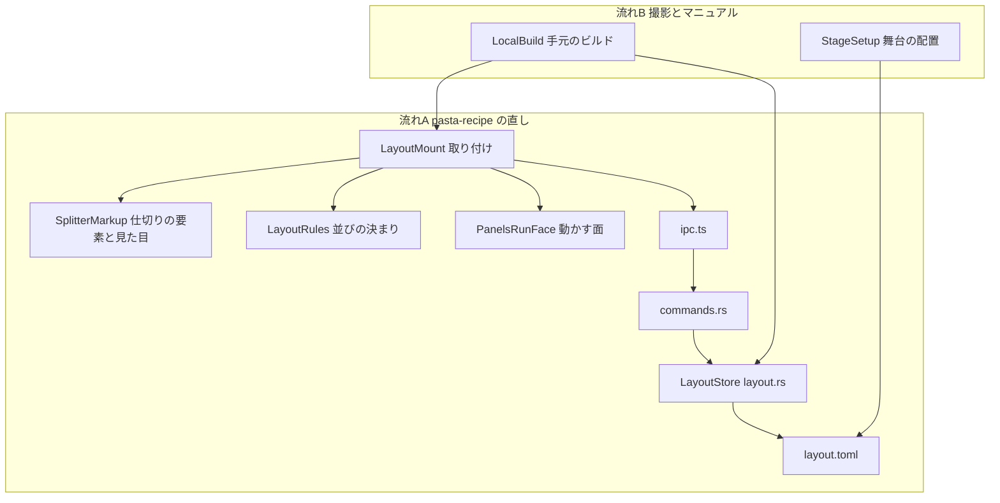
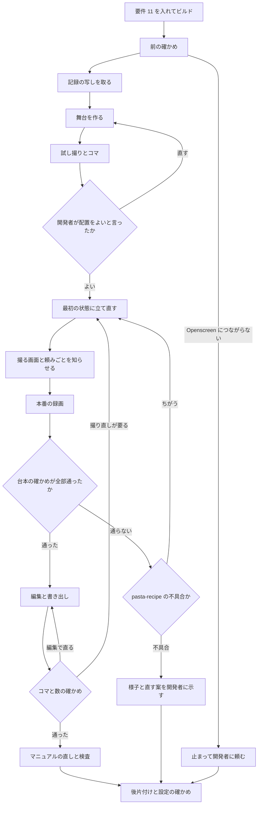

# Design Document: recipe-demo-video

## Overview

**Purpose**: pasta-recipe の「書いて・鳴らして・直す」流れを見せる説明動画を、マニュアルの pasta-recipe の章に載せる。あわせて、撮影で見つけた困りごと（画面の右下に立つゴーストが保存変数の欄を隠す）を解くために、pasta-recipe の窓の中の並びを作者が変えられるようにする。

**Users**: pasta-recipe でゴーストを書くマニュアルの読者は、操作の場所と結果の出方を動画で見る。pasta-recipe の作者は、仕切りと左右の入れ替えで、ゴーストと並べて書ける並びを作る。撮影する開発者（AI エージェントを含む）は、この文書の手順で撮り、後片付けまで終える。

**Impact**: この spec は 2 つの流れを持つ。順番は固定である。

| 流れ | 中身 | 性質 | 順 |
| -- | -- | -- | -- |
| A | pasta-recipe の並びを変えられる直し（要件 11） | 製品のコードの変更（`editors/recipe/`）と試験と章の追記 | 先 |
| B | 説明動画の撮影と、マニュアルの差し替え（要件 1〜10） | 手順（製品のコードではない）と、マニュアルの 3 つの文書と動画 1 本 | 後。A を入れた手元のビルドで撮る（前提 A1） |

今の pasta-recipe は、ツリーの幅 260 px・下の欄の面の高さ 180 px・出力と保存変数は半分ずつで、どれも動かせない。流れ A はここに仕切り 3 本と入れ替えのボタンと、並びの記録（`layout.toml`）を足す。既定の見た目は今と同じに保つ。

### Goals

- 仕切り 3 本（ツリー｜エディタ・エディタ｜下の欄・出力｜保存変数）をドラッグと矢印のキーで動かせ、出力と保存変数の左右を入れ替えられ、閉じて開き直しても並びが残る（11.1〜11.8）。
- 新しい依存を足さない。Rust は今ある `toml`・`serde`、画面は今ある部品だけで作る。
- 60〜90 秒・5 MB 以下・音声なしの mp4 を `book/src/debug/media/recipe-dev-actions-demo.mp4` に置き、`recipe.md` に載せ、`dev-actions.md` の古い動画を外す（要件 1〜6）。
- 撮影は Openscreen と CDP で行い、開発者のマウスとキーボードを使わず、終わったら環境を元に戻す（要件 7）。
- マニュアルの検査を CI と同じ順で通す（要件 9）。撮り直せる記録を `book/SCREENSHOTS.md` に残す（要件 10）。

### Non-Goals

- 欄を別の場所へ移すこと（窓の上下左右への付け替え・別の窓）。書く面（診断｜検査）の境を動かすこと。窓の位置と大きさを覚えること。仕切りのダブルクリックでの初期化。
- 動画への音声・ナレーション・文で流す字幕・矢印・題名。
- 撮影の自動化（CI で撮る・撮影のスクリプトをリポジトリに置く）。
- リポジトリの hello-pasta・VSCode 拡張・pasta.dll の変更。公開のサイトの旧版（`classic/`）に残る古い動画の扱い。

## Boundary Commitments

### This Spec Owns

- pasta-recipe の窓の中の並び: 仕切り 3 本・入れ替えのボタン・最小の大きさ・窓の最小の大きさ・並びの記録 `%APPDATA%\io.github.ekicyou.pasta-recipe\layout.toml` の形と読み書き。
- `recipe.md` の並びの説明（11.9）と、節「ゴーストを動かす」の中の動画の小節。`dev-actions.md` の節「デモ：書いて、鳴らして、直す」の本文。
- 動画のファイル `recipe-dev-actions-demo.mp4` の置き場所と、`dev-actions-demo.mp4` の削除。
- 撮影の手順（写しの用意・舞台の配置・CDP の台本・Openscreen の編集・確かめ・後片付け）と、その記録（`book/SCREENSHOTS.md` の動画の節）。

### Out of Boundary

- 開発の操作そのもの（▶ シーンを実行・値を入れて実行…・SHIORI をリロード・保存変数の表）の振る舞い。`editors/shared/` は触らない。
- マニュアルの検査の道具（`verify-static.mjs`・`link-check.mjs` など）。今の振る舞いをそのまま使う（9.2）。
- 開発者が自分で変えた OS の設定（前提 A11）。撮影の作業は変えも戻しもしない（7.11）。
- 開発者が普段使っている SSP。足さない・閉じない・送らない（7.3）。
- Openscreen に残るプロジェクト（前提 A10。消さない）。

### Allowed Dependencies

- 流れ A: `tauri`（`app_data_dir`・コマンド）・`toml`・`serde`（どれも今の `Cargo.toml` に在る）。画面は DOM の標準の機能（Pointer Events・`ResizeObserver`・CSS のカスタムプロパティ）。**新しい crate・npm の包みは足さない**。
- 流れ B: Openscreen の MCP（録画・切り抜き・編集・書き出し・コマ）。WebView2 のリモートデバッグ（CDP）。試験用の SSP とその MCP。ShareX 同梱の ffmpeg（5 MB を超えたときの詰め直しと、音声のトラックの除去に限る。7.12）。Win32 の窓の位置の指定（PowerShell）。
- 依存の向き: 流れ B は流れ A の成果物（ビルドした exe と `layout.toml` の形）に依る。流れ A は流れ B を知らない。

### Revalidation Triggers

- `layout.toml` のキーの名前・意味・置き場所を変えたとき（撮影の「舞台の配置」と `SCREENSHOTS.md` の記録を確かめ直す）。
- pasta-recipe の画面の作り（ツールバー・ツリー・下の欄・ダイアログの位置）や、開発の操作のボタン・メニューの名前を変えたとき（動画の撮り直し。`SCREENSHOTS.md` の「撮り直す決まり」）。
- `recipe.md` の小節の見出し「デモ：書いて、鳴らして、直す」を変えたとき（`dev-actions.md` のリンクの先）。
- hello-pasta の `10-save.pasta`・シェル・吹き出しの位置を変えたとき（写しと舞台の数字）。

## Architecture

### Existing Architecture Analysis

- **画面の骨組み**（`index.html`・`style.css`）: `body` は縦の flex。`#toolbar` → `#workspace`（横の flex: `#tree` 260 px ＋ `#editor-area`）→ `#panels`（帯 `.panels-bar` ＋ 面 `.panels-face` 180 px）。面は 2 つ（書く面＝診断｜検査、動かす面＝出力｜保存変数）で、`panels.ts` の `Panels` が作り、片方だけを出す。面の中の 2 つの `.panel` は `flex: 1` で半分ずつ。
- **エディタ**: Monaco は `automaticLayout: true` なので、入れ物の大きさが変われば自分で描き直す。仕切りの側から呼ぶものは無い。
- **記録の型**（`src-tauri/src/recent.rs`）: ファイルが正本。毎回読み、変えたら書く。`parse`（壊れていれば空）・`render`（頭にコメントの 1 行）・`load(dir)`・`save(dir, …)`（フォルダが無ければ作る）と、同じファイルの中の `#[cfg(test)]`。置き場所は `app.path().app_data_dir()`。記録の失敗では操作を止めない。画面との受け渡しの型（`RecentEntry`）とファイルの型（`RecentFile`）を分けている。
- **試験の型**: 画面は、純粋な判断を関数に出して `node --test` で試す（`mapping.ts`・`tabs.ts`・`devPanels.ts` の書き出した関数）。DOM を持つ試験は無い。Rust は各ファイルの `#[cfg(test)]`。CI の job `recipe` は `tsc --noEmit` → `npm test` → `npm run build` → `cargo test --locked` → clippy（`-D warnings`）を回す。
- **起動**: `main.ts` は最上位の `await` で組み立てる。開始の画面の間は、CSS が `body` の直下の部品（ツールバー・`#workspace`・`#panels`）を `display: none` にする。
- **撮影に効く事実**（`direction.md` 13 節の実測）: シェルと吹き出しは「常に手前」の窓。readonly の試験用の SSP は位置を覚えない。pasta-recipe は起動の引数のパスを開く。1 つ目の起動が動いていると、2 つ目はパスを渡して終わる（単一起動）。

### Architecture Pattern & Boundary Map



流れ B の中の順は、System Flows の「撮影の流れと関門」に描く。

**Architecture Integration**:

- 選んだ型: 流れ A は今の層（Rust の記録 → コマンド → `ipc.ts` → 純粋な決まり → DOM の糊）にそのまま足す。流れ B は関門つきの手順である。
- 境: 並びの数の決まり（最小・窓への収め方・入れ替え）は `LayoutRules` だけが持つ。DOM に当てるのは `LayoutMount`、ファイルは `LayoutStore`。動かす面の 2 つの欄の順と割合は、面を作っている `Panels` が当てる。
- 守る型: 記録は `recent.rs` と同じ作り。純粋な判断と DOM を分ける。既定の見た目を変えない。
- 依存の向き（流れ A）: `layout.rs` → `commands.rs` → `ipc.ts` → `main.ts`。`layout.ts` は何も読み込まない（`ipc.ts` が `LayoutPrefs` の型だけを借りる）。`layout.ts`・`panels.ts`・`ipc.ts` を結ぶのは `main.ts` だけである。
- 流れ B が流れ A に触れる所は 1 つだけ: 撮影の並びを `layout.toml` に書いてから pasta-recipe を起動する（仕切りを CDP で引きずらない）。

### Technology Stack

| Layer | Choice / Version | Role in Feature | Notes |
| -- | -- | -- | -- |
| 画面（流れ A） | TypeScript 7・DOM（Pointer Events・`ResizeObserver`）・CSS のカスタムプロパティ | 仕切り・入れ替え・窓への収め方 | 新しい包みなし |
| Rust の殻（流れ A） | tauri ~2.12・toml 1・serde 1 | `layout.toml` の読み書きとコマンド 2 つ | 新しい crate なし。`Cargo.lock` は変わらない |
| 記録（流れ A） | TOML（`%APPDATA%\io.github.ekicyou.pasta-recipe\layout.toml`） | 並びを覚える | `recent.toml` の隣 |
| 録画と編集（流れ B） | Openscreen の MCP | 録画・切り抜き・ポインタ・寄り・見出し・書き出し・コマ | つながらなければ止まる（7.2） |
| 画面の操作（流れ B） | WebView2 の CDP（`--remote-debugging-port=9333`）・Node の台本 | pasta-recipe の操作と、操作の記録 | 開発者のマウスとキーボードを使わない（7.5） |
| ゴースト（流れ B） | 試験用の SSP（`--option readonly`）とその MCP | 写しを動かす・位置を合わせる・閉じる | 普段の SSP には送らない（7.3） |
| 詰め直し（流れ B） | ShareX 同梱の ffmpeg | 5 MB を超えた・音声のトラックがあるときだけ | 7.12 |

## File Structure Plan

### Directory Structure

```text
editors/recipe/
├── index.html                     # 仕切りの要素 2 つを足す（ツリー｜エディタ・エディタ｜下の欄）
├── src/
│   ├── layout.ts                  # 新規。並びの決まり（純粋）と、仕切りの取り付け（DOM）
│   ├── layout.test.ts             # 新規。並びの決まりの試験（node --test）
│   ├── panels.ts                  # 動かす面に仕切りと入れ替えのボタンを足す。順と割合を当てる
│   ├── ipc.ts                     # layoutLoad・layoutSave を足す
│   ├── main.ts                    # 並びを読み、取り付ける
│   └── style.css                  # 仕切りの見た目。幅と高さを CSS の変数に替える（既定は今の値）
└── src-tauri/
    ├── tauri.conf.json            # 窓の最小の大きさ（minWidth・minHeight）
    └── src/
        ├── layout.rs              # 新規。layout.toml の読み書きと試験
        ├── commands.rs            # layout_load・layout_save を足し、表に登録する
        └── lib.rs                 # pub mod layout

book/
├── SCREENSHOTS.md                 # 動画の節を足す（要件 10）
└── src/debug/
    ├── recipe.md                  # 並びの説明（11.9）・記録の置き場の文・動画の小節（要件 5）
    ├── dev-actions.md             # デモの節の本文をリンクの 1 行にする（要件 6）
    └── media/
        ├── recipe-dev-actions-demo.mp4   # 新規（要件 4.1）
        └── dev-actions-demo.mp4          # 削除（要件 4.4）
```

リポジトリの外に置く物（流れ B。どれも後片付けで消すか戻す）:

```text
C:\pasta-demo\
├── hello-pasta\                   # DemoGhostCopy: 写しのゴースト（前提 A2）
├── backup\                        # Cleanup: recent.toml・layout.toml の撮影の前の写し（無かったことの印を含む）
└── work\                          # StageSetup・ShootScript・ExportCheck の作業ファイル
    ├── stage.ps1                  #   起動・窓の位置の指定・閉じる
    ├── shoot.mjs                  #   CDP の台本
    ├── actions.json               #   操作の記録（setPointerTrack と編集の元）
    └── recipe-dev-actions-demo.mp4 #  書き出し（確かめてからリポジトリへ写す）
%APPDATA%\io.github.ekicyou.pasta-recipe\
├── recent.toml                    # 撮影の前に写しを取り、後で戻す（7.7・7.8）
└── layout.toml                    # 同じ（流れ A で新しくできる記録。撮影の並びを書く）
editors/recipe/src-tauri/target/release/pasta-recipe.exe          # LocalBuild の生成物（git の外）
crates/pasta_sample_ghost/ghosts/hello-pasta/ghost/master/pasta.dll・scripts/  # 同じ（release.ps1）
Openscreen のプロジェクト（題名 recipe-dev-actions-demo）            # TakeEdit。消さない（前提 A10）
```

部品とファイルの対応（Components and Interfaces の名前）:

| 部品 | ファイル |
| -- | -- |
| LayoutStore | `editors/recipe/src-tauri/src/layout.rs`・`commands.rs`・`lib.rs` |
| LayoutRules・LayoutMount | `editors/recipe/src/layout.ts`・`layout.test.ts`・`ipc.ts`・`main.ts` |
| PanelsRunFace | `editors/recipe/src/panels.ts` |
| SplitterMarkup | `editors/recipe/index.html`・`src/style.css` |
| WindowMinimum | `editors/recipe/src-tauri/tauri.conf.json` |
| RecipeManualNote・ManualVideoEdits | `book/src/debug/recipe.md`・`dev-actions.md`・`media/` |
| RetakeRecord | `book/SCREENSHOTS.md` |
| LocalBuild | `editors/recipe/src-tauri/target/release/pasta-recipe.exe`・`crates/pasta_sample_ghost/release.ps1` の生成物 |
| DemoGhostCopy | `C:\pasta-demo\hello-pasta\` |
| Preflight・StageSetup | `C:\pasta-demo\work\stage.ps1`・`%APPDATA%\io.github.ekicyou.pasta-recipe\layout.toml` |
| ShootScript | `C:\pasta-demo\work\shoot.mjs`・`actions.json` |
| TakeEdit・ExportCheck | Openscreen のプロジェクト・`C:\pasta-demo\work\recipe-dev-actions-demo.mp4` |
| ManualChecks | 今ある `book/tools/` の道具と `.github/workflows/manual.yml` の順（ファイルは足さない） |
| Cleanup | `C:\pasta-demo\backup\`・`%APPDATA%\io.github.ekicyou.pasta-recipe\recent.toml`・`layout.toml` |

作業ファイルを `C:\pasta-demo\` に集める理由: 後片付けが「`C:\pasta-demo` ごと消す」（7.8）の 1 回で済む。スクラッチパッドは再起動で消えうるので、記録の写しを置かない。

### Modified Files

- 変えるファイルと新しいファイルは、上の木と対応の表のとおり。変更の中身は Components and Interfaces の各部品に書く。
- 完了のとき（`/kiro-complete` の文書の同期）: `.kiro/steering/tech.md`・`structure.md` の pasta-recipe の記述に `layout.toml`・`layout.rs`・`layout.ts` を足す。

## System Flows

### 仕切りを動かしてから覚えるまで

作者の操作（ドラッグか矢印のキー）→ 仕切り → `LayoutMount` → `LayoutRules`（最小を守った並びを返す）→ 画面の部品に当てる → 操作の終わりに `layout_save` で `layout.toml` に書く、の順で進む。

- 書くのは操作の終わり（`pointerup`・矢印のキーの `keyup`・入れ替えのボタン）の 1 回だけ。動かしている間は書かない。
- 窓の大きさが変わったとき（と、開始の画面からゴーストを開いて部品が出たとき）は、覚えた並びを `fitLayout` で窓に収めて当て直す。**覚えた値は書き換えない**。窓を広げ直せば、覚えた並びに戻る（11.8）。

### 撮影の流れと関門



- 開発者の答えを待つ関門は 3 つ: 配置の承認（7.13・7.14）、撮り始めの知らせ（7.15）、設定を戻したかの確かめ（7.10）。不具合を見つけたときは 4 つ目が入る（要件 8）。
- 後片付けは、どの枝で止まっても通る（7.8「途中で止めたときも含む」）。
- 撮影のタスクは開発者の立ち会いが要るので、実装のときは主のコンテキストで順に進める（サブエージェントに任せきりにしない）。

## Requirements Traceability

| Requirement | Summary | Components | Interfaces | Flows |
| -- | -- | -- | -- | -- |
| 1.1 | 窓とゴーストを同じコマに | StageSetup・TakeEdit | 画面の録画＋切り抜き | 撮影 |
| 1.2 | ▶ シーンを実行と結果 | ShootScript | 台本の操作 1 | 撮影 |
| 1.3 | 書き換えてもう一度 ▶ | ShootScript | 台本の操作 2 | 撮影 |
| 1.4 | 値を入れて実行… | ShootScript・DemoGhostCopy | 台本の操作 3・`＊天気` | 撮影 |
| 1.5 | SHIORI をリロード | ShootScript | 台本の操作 4 | 撮影 |
| 1.6 | 保存変数の書き換え | ShootScript | 台本の操作 5 | 撮影 |
| 1.7 | 名前が recipe.md と食い違わない | ShootScript・ExportCheck | 見出しの表・コマの確かめ | 撮影 |
| 1.8 | 結果が出なかった録画は使わない | ShootScript | 台本の確かめ（失敗で止まる） | 撮影 |
| 1.9 | 締めの ▶（100 回目） | ShootScript | 台本の操作 6 | 撮影 |
| 1.10 | 頼んでいない台詞を映さない | DemoGhostCopy・StageSetup | `talk_interval`・起動の台詞の待ち・時報の時刻 | 撮影 |
| 2.1 | ポインタ | ShootScript・TakeEdit | `actions.json` → `setPointerTrack` | 撮影 |
| 2.2 | 押す所が入る拡大 | TakeEdit | 画の表・`addZoom` | 撮影 |
| 2.3 | 始めと終わりは引き | TakeEdit | 画の表（引き） | 撮影 |
| 2.4 | 60〜90 秒 | TakeEdit・ExportCheck | `addTrim`・`addSpeed`・長さの確かめ | 撮影 |
| 2.5 | 2 秒以上止まる | ShootScript・TakeEdit | 台本の待ち・切らない区間 | 撮影 |
| 2.6 | 文字の大きさ | TakeEdit・ExportCheck | 寄りの倍率 1.35・式 | 撮影 |
| 2.7 | 音声なし | TakeEdit・ExportCheck | 録音しない・トラックの確かめ | 撮影 |
| 2.8 | 操作の名前の見出し | TakeEdit | 見出しの表・`addAnnotation` | 撮影 |
| 2.9 | 見出しのほかの字を持たない | TakeEdit | 見出しの表だけ | 撮影 |
| 2.10 | 結果を同じ画か続いた画に | TakeEdit | 画の表 | 撮影 |
| 2.11 | 台詞は等倍 | TakeEdit | 速める区間の決まり | 撮影 |
| 2.12 | ゴーストを手前・右下に重ねる | StageSetup | 舞台の目標の矩形 | 撮影 |
| 2.13 | 立ち絵と吹き出しで隠さない | StageSetup・ShootScript・ExportCheck | 撮影の並び・吹き出しが閉じる待ち・コマの確かめ | 撮影 |
| 3.1 | 窓とゴーストと無地の背景だけ | StageSetup・TakeEdit・ExportCheck | 切り抜き・飾りを切る | 撮影 |
| 3.2 | ユーザー名の入ったパスを映さない | DemoGhostCopy・StageSetup | `C:\pasta-demo`・開始の画面を出さない | 撮影 |
| 3.3 | 各場面と始めと終わりのコマを見る | ExportCheck | `getFrames` | 撮影 |
| 3.4 | 反するものはリポジトリに置かない | ExportCheck | 確かめの後で写す | 撮影 |
| 4.1 | 置き場所と追跡 | ManualVideoEdits | `media/recipe-dev-actions-demo.mp4` | — |
| 4.2 | mp4・主なブラウザで再生 | TakeEdit・ExportCheck | H.264 の書き出し・再生の確かめ | — |
| 4.3 | 5 MB 以下 | ExportCheck | 大きさの確かめ・ffmpeg | — |
| 4.4 | 古い動画を消す | ManualVideoEdits | `git rm` | — |
| 4.5 | 古い動画への参照を残さない | ManualVideoEdits・ManualChecks | `verify-static` | — |
| 5.1 | 節「ゴーストを動かす」に載せる | ManualVideoEdits | 小節の位置（前提 A8） | — |
| 5.2 | 動画の前の説明 | ManualVideoEdits | 見出しの表と同じ番号 | — |
| 5.3 | 直接開くリンク | ManualVideoEdits | `<video>` の中の `<a>` | — |
| 5.4 | 公開とオフラインで再生 | ManualVideoEdits・ManualChecks | 相対の参照・`verify-static` | — |
| 6.1 | dev-actions.md に動画を載せない | ManualVideoEdits | `<video>` を消す | — |
| 6.2 | 本文をリンクの 1 行に | ManualVideoEdits | 1 行の文 | — |
| 6.3 | pasta-recipe の画面と書く | ManualVideoEdits | 1 行の文 | — |
| 6.4 | 見出しへ直接つなぐ | ManualVideoEdits・ManualChecks | `recipe.md#…`・`link-check` | — |
| 7.1 | Openscreen を使う | TakeEdit | MCP の道具 | 撮影 |
| 7.2 | つながらなければ止まる | Preflight | `listSources` の失敗 | 撮影 |
| 7.3 | 普段の SSP に手を出さない | Preflight・StageSetup | 送る前の確かめ | 撮影 |
| 7.4 | 試験用の SSP | StageSetup | `--option readonly --ghost` | 撮影 |
| 7.5 | マウスとキーボードを使わない | ShootScript・StageSetup | CDP・Win32 の位置の指定 | 撮影 |
| 7.6 | リポジトリの hello-pasta を変えない | DemoGhostCopy | 写しだけを書き換える | 撮影 |
| 7.7 | recent.toml の写し | Cleanup | `C:\pasta-demo\backup\` | 撮影 |
| 7.8 | 戻す・閉じる・消す | Cleanup | 後片付けの順 | 撮影 |
| 7.9 | 戻せないものを知らせる | Cleanup | 後片付けの確かめ | 撮影 |
| 7.10 | 開発者の設定を 1 つずつ尋ねる | Cleanup | 設定の一覧 | 撮影 |
| 7.11 | OS の設定を変えない | Cleanup・StageSetup | 手順に OS の設定の操作を入れない | 撮影 |
| 7.12 | ffmpeg は詰め直しと音声の除去だけ | ExportCheck | ffmpeg の 2 つの用 | 撮影 |
| 7.13 | 配置を見せて尋ねる | StageSetup | 試し撮りのコマ | 撮影 |
| 7.14 | よいと言われるまで撮らない | StageSetup | 承認の関門 | 撮影 |
| 7.15 | 撮る画面と頼みごとを知らせる | StageSetup | 知らせの文 | 撮影 |
| 8.1 | 不具合を避けて撮らない | ShootScript | 不具合の扱い | 撮影 |
| 8.2 | 小さな直しはこの spec で | ShootScript | 不具合の扱い | 撮影 |
| 8.3 | 大きな直しは開発者に諮る | ShootScript | 不具合の扱い | 撮影 |
| 9.1 | CI と同じ順の検査を通す | ManualChecks | `manual.yml` の順 | — |
| 9.2 | 無い動画への参照で落ちる | ManualChecks | `verify-static` の今の振る舞い（道具は変えない） | — |
| 10.1 | SCREENSHOTS.md の動画の節 | RetakeRecord | 節の中身の表 | — |
| 10.2 | 見出しと番号を同じ形で | RetakeRecord | 見出しの表 | — |
| 11.1 | ツリー｜エディタの仕切り | SplitterMarkup・LayoutMount・LayoutRules | `dragLayout("tree")` | 仕切り |
| 11.2 | エディタ｜下の欄の仕切り | SplitterMarkup・LayoutMount・LayoutRules | `dragLayout("panels")` | 仕切り |
| 11.3 | 出力｜保存変数の仕切り | PanelsRunFace・LayoutMount・LayoutRules | `dragLayout("run")`・`setRunLayout` | 仕切り |
| 11.4 | 左右の入れ替え | PanelsRunFace・LayoutRules | `swapLayout`・`onSwap` | 仕切り |
| 11.5 | キーボード | LayoutMount・LayoutRules | `nudgeLayout`・`role="separator"` | 仕切り |
| 11.6 | 最小の幅と高さ | LayoutRules・WindowMinimum | `LAYOUT_MIN`・`minWidth`・`minHeight` | 仕切り |
| 11.7 | 開き直しても残る | LayoutStore・LayoutMount | `layout_load`・`layout_save`・`layout.toml` | 仕切り |
| 11.8 | 窓の大きさを変えても保つ | LayoutRules・LayoutMount | `fitLayout`・`ResizeObserver` | 仕切り |
| 11.9 | recipe.md に書く | RecipeManualNote | 「画面と操作」の追記 | — |
| 11.10 | 既存の試験が通る | 流れ A の全部 | Testing Strategy | — |

## Components and Interfaces

| Component | Domain/Layer | Intent | Req Coverage | Key Dependencies (P0/P1) | Contracts |
| -- | -- | -- | -- | -- | -- |
| LayoutStore | A・Rust | `layout.toml` を読み書きする | 11.7 | toml・serde（P0） | Service・State |
| LayoutRules | A・画面（純粋） | 並びの数を決める（最小・収め方・入れ替え） | 11.1〜11.6・11.8 | なし | Service |
| LayoutMount | A・画面（DOM） | 仕切りの操作を受け、当てて、覚えさせる | 11.1〜11.5・11.7・11.8 | LayoutRules（P0）・PanelsRunFace（P0）・ipc（P1） | Service |
| PanelsRunFace | A・画面（DOM） | 動かす面の仕切りと入れ替えのボタンを持ち、順と割合を当てる | 11.3・11.4 | 今の `Panels`（P0） | Service |
| SplitterMarkup | A・画面（HTML・CSS） | 仕切り 2 本の要素と、3 本に共通の見た目 | 11.1・11.2・11.5 | なし | — |
| WindowMinimum | A・設定 | 窓をこれより小さくさせない | 11.6・11.8 | tauri（P0） | — |
| RecipeManualNote | A・文書 | 並びを変えられることを章に書く | 11.9 | なし | — |
| LocalBuild | B・準備 | 撮る exe と pasta.dll を手元で作る | 前提 A1 | 流れ A（P0） | Batch |
| DemoGhostCopy | B・準備 | 写しのゴーストを作る | 1.4・1.10・3.2・7.6 | LocalBuild（P0） | Batch |
| Preflight | B・準備 | 撮れる状態かを確かめる | 7.2・7.3 | Openscreen・SSP の MCP（P0） | Batch |
| StageSetup | B・撮影 | 舞台を作り、開発者の承認を取る | 1.1・1.10・2.12・2.13・3.1・3.2・7.3・7.4・7.11・7.13〜7.15 | DemoGhostCopy・LayoutStore の形（P0） | Batch・State |
| ShootScript | B・撮影 | CDP で流れを操作し、記録と確かめを残す | 1.2〜1.9・2.1・2.5・2.13・7.5・8.1〜8.3 | StageSetup（P0） | Batch |
| TakeEdit | B・編集 | 録画・切り抜き・ポインタ・寄り・見出し・書き出し | 1.1・2.1〜2.11・3.1・4.2・7.1 | Openscreen の MCP（P0） | Batch |
| ExportCheck | B・確かめ | 書き出しを数とコマで確かめる | 1.7・2.4・2.6・2.7・2.13・3.1・3.3・3.4・4.2・4.3・7.12 | TakeEdit（P0）・ffmpeg（P1） | Batch |
| ManualVideoEdits | B・文書 | 動画の差し替えと 2 つの章の直し | 4.1・4.4・4.5・5.1〜5.4・6.1〜6.4 | ExportCheck（P0） | — |
| ManualChecks | B・検査 | CI と同じ順の検査 | 4.5・5.4・6.4・9.1・9.2 | 今の道具（P0） | Batch |
| RetakeRecord | B・文書 | 撮り直しの記録 | 10.1・10.2 | なし | — |
| Cleanup | B・後片付け | 記録を戻し、閉じ、消し、尋ねる | 7.7〜7.11 | StageSetup（P0） | Batch |

### 流れ A: pasta-recipe の並び

#### LayoutStore（`src-tauri/src/layout.rs`・`commands.rs`）

| Field | Detail |
| -- | -- |
| Intent | 並びの記録 `layout.toml` を読み書きする。ファイルが正本 |
| Requirements | 11.7 |

**Responsibilities & Constraints**

- `recent.rs` と同じ作りにする: `parse`・`render`・`load(dir)`・`save(dir, …)`。置き場所は `app_data_dir`（`recent.toml` の隣）。
- 読めない・壊れている・無いときは既定の並びを返す（誤りにしない）。書けないときは理由を返すが、コマンドは握りつぶす（記録の失敗で操作を止めない）。
- ファイルは人が書き換えうるので、値を確かめる: キーが欠けていればそのキーだけ既定。TOML として読めない・型が合わないときは全部既定。`output_share` が 0〜1 の外か有限でないときは、そのキーだけ既定。
- 窓の大きさに合わせた丸め（最小・最大）はここでは行わない（`LayoutRules` の持ち分）。

**Contracts**: Service [x] / State [x]

##### Service Interface

```rust
/// 画面との受け渡し（serde は camelCase: treeWidth・panelsHeight・outputShare・swapped）
pub struct Layout {
    pub tree_width: u32,     // ツリーの幅（CSS px）
    pub panels_height: u32,  // 下の欄の面の高さ（帯を除く。CSS px）
    pub output_share: f64,   // 動かす面の幅のうち出力が占める割合（0.0〜1.0）
    pub swapped: bool,       // true で保存変数が左・出力が右
}
impl Default for Layout { /* 260・180・0.5・false（今の見た目） */ }

pub fn parse(text: &str) -> Layout;
pub fn render(layout: &Layout) -> String;
pub fn load(dir: &Path) -> Layout;
pub fn save(dir: &Path, layout: &Layout) -> Result<(), String>;

// commands.rs
#[tauri::command] pub async fn layout_load(app: AppHandle) -> layout::Layout;
#[tauri::command] pub async fn layout_save(app: AppHandle, layout: layout::Layout);
```

- Preconditions: なし（`app_data_dir` が取れなければ `layout_load` は既定を返し、`layout_save` は何もしない）。
- Postconditions: `save` の後の `load` は同じ値を返す。`render` の出力は頭にコメントの 1 行を持つ。
- Invariants: 返す `output_share` はいつも 0.0〜1.0 の有限の数。

##### State Management

- 形は Data Models の `layout.toml`。書くのは `layout_save` だけで、丸ごと書き直す。単一起動なので書き手は 1 つ。

**Implementation Notes**

- Integration: `commands::handler()` の表に 2 つを足す。許可（`capabilities/default.json`）は変えない（アプリのコマンドは今も表だけで通っている）。
- Validation: `layout.rs` の `#[cfg(test)]`（Testing Strategy）。
- Risks: ファイルの型（snake_case）と受け渡しの型（camelCase）を取り違える。`recent.rs` と同じく 2 つの型に分ける。

#### LayoutRules（`src/layout.ts` の純粋な関数）

| Field | Detail |
| -- | -- |
| Intent | 覚えた並びと窓の大きさから、当てる数を決める |
| Requirements | 11.1, 11.2, 11.3, 11.4, 11.5, 11.6, 11.8 |

**Responsibilities & Constraints**

- DOM・Tauri を読み込まない（`node --test` で試す）。
- 最小の数を 1 か所に持つ。どの関数も、返す並びが最小を下回らないことを守る。
- 覚えた値を窓に収めるとき、覚えた値そのものは書き換えない（`fitLayout` は新しい値を返すだけ）。

**Contracts**: Service [x]

##### Service Interface

```typescript
/** 覚える並び（layout.toml と 1 対 1。layout.ts に置き、ipc.ts は型だけを借りる） */
export interface LayoutPrefs {
  /** ツリーの幅（CSS px・整数） */
  treeWidth: number;
  /** 下の欄の面の高さ（帯を除く。CSS px・整数） */
  panelsHeight: number;
  /** 動かす面の幅のうち出力の欄が占める割合（0〜1） */
  outputShare: number;
  /** true で保存変数が左・出力が右 */
  swapped: boolean;
}

/** 大きさを変えられる範囲の今の大きさ（CSS px） */
export interface LayoutSpace {
  /** #workspace の幅（下の欄の幅と同じ） */
  width: number;
  /** #workspace の高さ＋下の欄の面の高さ（仕切りを動かしても変わらない和） */
  height: number;
}

export type SplitterId = "tree" | "panels" | "run";

export const DEFAULT_LAYOUT: LayoutPrefs; // 260・180・0.5・false
export const LAYOUT_MIN: {
  readonly tree: 120;
  readonly editorWidth: 240;
  readonly editorHeight: 120; // タブの列を含むエディタの側の高さ
  readonly panels: 60;
  readonly panel: 160; // 出力・保存変数のそれぞれの幅
};
export const KEY_STEP = 16; // 矢印のキー 1 回の px

/** 窓に収めた並び（最小を守る）。prefs は書き換えない。数でない値は既定に替える */
export function fitLayout(prefs: LayoutPrefs, space: LayoutSpace): LayoutPrefs;
/** ドラッグ: 仕切りを offset へ動かした並び。tree＝範囲の左の端から、panels＝範囲の下の端から、run＝動かす面の左の端からの px */
export function dragLayout(prefs: LayoutPrefs, id: SplitterId, offset: number, space: LayoutSpace): LayoutPrefs;
/** 矢印: 見た目の向きへ KEY_STEP だけ動かした並び。-1＝左か上、1＝右か下 */
export function nudgeLayout(prefs: LayoutPrefs, id: SplitterId, direction: -1 | 1, space: LayoutSpace): LayoutPrefs;
/** 左右を入れ替える。出力の割合は欄に付いていく */
export function swapLayout(prefs: LayoutPrefs): LayoutPrefs;
/** 読み上げに渡す今の値と範囲（tree・panels は px、run は左の欄の %） */
export function separatorValue(prefs: LayoutPrefs, id: SplitterId, space: LayoutSpace): { now: number; min: number; max: number };
```

- Preconditions: `space` の数は 0 以上（部品が隠れていて 0 のときも落ちない）。
- Postconditions（`space` が窓の最小の大きさ以上のとき）: `tree ≤ treeWidth ≤ width − editorWidth`、`panels ≤ panelsHeight ≤ height − editorHeight`、出力と保存変数の幅はどちらも `panel` 以上。
- 窓の最小より小さい `space`（起こらない見込み）では、ツリー・下の欄・2 つの欄の最小を先に守り、エディタが残りを取る。
- `dragLayout`・`nudgeLayout` は、今の窓に収めた値（`fitLayout` の結果）から動かす。入れ替えているときの `run` は、左の欄が保存変数なので `outputShare = 1 − 左の欄の割合` になる。

**Implementation Notes**

- Validation: `layout.test.ts`（Testing Strategy）。
- Risks: 最小の数は机の上で決めた。実物で狭すぎる・広すぎると分かったら、この表の数だけを変える（未決の論点 5）。

#### LayoutMount（`src/layout.ts` の `mountLayout`）

| Field | Detail |
| -- | -- |
| Intent | 仕切り 3 本の操作を受け、並びを当て、操作の終わりに覚えさせる |
| Requirements | 11.1, 11.2, 11.3, 11.4, 11.5, 11.7, 11.8 |

**Responsibilities & Constraints**

- 今の並び（`LayoutPrefs`）を 1 つ持つ。動かすたびに `LayoutRules` で決め直し、当てる。
- 当て方: ツリーの幅と下の欄の高さは、`root` の CSS の変数 `--tree-width`・`--panels-height`。出力と保存変数は `RunFace.setRunLayout`。
- ドラッグは Pointer Events とポインタの捕まえ（`setPointerCapture`）で受ける。動かしている間は文字の選択を止める。
- キーボード: 仕切りに焦点があるとき、縦の仕切り（ツリー・出力｜保存変数）は ←・→、横の仕切り（下の欄）は ↑・↓ で `KEY_STEP` ずつ動かす。ほかのキーは触らない。
- 読み上げ: 動かすたびに `aria-valuenow`・`aria-valuemin`・`aria-valuemax` を `separatorValue` で更新する。
- 覚えさせるのは操作の終わりだけ（`pointerup`・矢印のキーの `keyup`・入れ替え）。値が変わっていなければ書かない。
- `#workspace` を `ResizeObserver` で見張り、大きさが変わったら `fitLayout` で当て直す（覚えた値は変えない・書かない）。

**Dependencies**

- Outbound: LayoutRules（P0）・RunFace（P0）・`save`（`ipc.layoutSave`。失敗は握りつぶす。P1）

**Contracts**: Service [x]

##### Service Interface

```typescript
/** Panels のうち並びが使う所（panels.ts を読み込まず、形で受ける） */
export interface RunFace {
  /** 出力と保存変数の間の仕切り（role="separator"） */
  readonly runSplitter: HTMLElement;
  /** 動かす面（幅と左の端を測る） */
  readonly runFace: HTMLElement;
  /** 2 つの欄の順と幅の割合を当てる */
  setRunLayout(outputShare: number, swapped: boolean): void;
  /** 入れ替えのボタンが押されたときに呼ばれる */
  onSwap: () => void;
}

export interface LayoutTargets {
  /** CSS の変数を当てる要素（document.documentElement） */
  root: HTMLElement;
  /** #workspace（範囲を測る・見張る） */
  workspace: HTMLElement;
  treeSplitter: HTMLElement;
  panelsSplitter: HTMLElement;
  run: RunFace;
  /** 操作の終わりに呼ぶ。失敗しても投げない */
  save(prefs: LayoutPrefs): void;
}

export function mountLayout(targets: LayoutTargets, initial: LayoutPrefs): void;
```

- Preconditions: `initial` は `layout_load` の値（失敗したら `DEFAULT_LAYOUT`）。
- Postconditions: 呼んだ直後に、`initial` を窓に収めた並びが当たっている。

**Implementation Notes**

- Integration: `main.ts` は `Panels` を作る前に `layoutLoad()` を待つ（読めるまで既定の並びが一瞬見えるのを避ける）。`mountLayout` は `Panels` を作った後に 1 回呼ぶ。
- Validation: DOM の試験は置かない（このアプリの型）。手元のビルドで CDP から確かめる（Testing Strategy）。
- Risks: 開始の画面の間は部品が隠れていて大きさが 0 になる。`ResizeObserver` が、ゴーストを開いて部品が出たときに当て直す。

#### PanelsRunFace（`src/panels.ts` の `Panels` の拡張）

| Field | Detail |
| -- | -- |
| Intent | 動かす面に仕切りと入れ替えのボタンを持ち、2 つの欄の順と割合を当てる |
| Requirements | 11.3, 11.4 |

**Responsibilities & Constraints**

- 動かす面の中の並びを「左の欄・仕切り・右の欄」にする。`setRunLayout(outputShare, swapped)` は、**DOM の順を見た目の順に合わせる**（Tab の順と読み上げの順が見た目と同じになる）。順が変わらないときは DOM を触らない。並べ替えの前後で、2 つの欄のスクロールの位置を保つ。
- 幅の割合は 2 つの欄の `flex-grow` で当てる（出力＝`outputShare`、保存変数＝`1 − outputShare`）。
- 入れ替えのボタンは帯（`.panels-bar`）の右の端に置く。文は「左右を入れ替える」、読み上げの名前は「出力と保存変数の左右を入れ替える」。動かす面を出している間だけ出す（`show` が切り替える）。押した後、焦点はボタンに残る。
- 書く面（診断｜検査）は今のまま（半分ずつ・仕切りなし）。
- `RunFace` の形（上の Service Interface）を満たす。`output`・`variables`（`devPanels.ts` が中身を満たす口）は変えない。

**Implementation Notes**

- Integration: `devPanels.ts`・`devActions.ts` は変えない。
- Risks: 帯が狭い窓で溢れる。帯は溢れた分を隠し、ボタンの文を短くしてある。

#### SplitterMarkup（`index.html`・`src/style.css`）

- 仕切りの要素: `role="separator"`・`tabindex="0"`・`aria-orientation`（ツリーと出力｜保存変数は `vertical`、下の欄は `horizontal`）・`aria-label`（「ツリーとエディタの境」「エディタと下の欄の境」「出力と保存変数の境」）。
- 見た目: **今の 1 px の境の線のまま**。仕切りは境の線に重なる幅（高さ）5 px の透明な帯で、場所を取らない。ポインタを乗せたとき・焦点が当たったとき・動かしている間だけ強調色（`--accent`）になる。カーソルは `col-resize`・`row-resize`。`touch-action: none`。
- 既定の値（`260px`・`180px`・半分ずつ）は CSS の側に残す。`layout.toml` が無い人の見た目は今と変わらない。
- 開始の画面の間は、今の CSS の決まり（`body` の直下を隠す）で仕切りも隠れる。

#### WindowMinimum（`src-tauri/tauri.conf.json`）

- `app.windows[0]` に `minWidth: 400`・`minHeight: 320` を足す。`LAYOUT_MIN` の和（幅は 120＋240 と 160×2 の大きいほう、高さはツールバー 40＋120＋帯 27＋60）に余りを足した数である。これで、窓をどう縮めても 11.6 の最小が守れる（11.8）。

#### RecipeManualNote（`book/src/debug/recipe.md`）

- 節「画面と操作」の頭の段落の後に、短い段落を 1 つ足す: 3 つの境（ツリーとエディタ・エディタと下の欄・出力と保存変数）をドラッグで動かせること。境に焦点を当てて矢印のキーでも動かせること。下の欄の頭の「左右を入れ替える」で出力と保存変数を入れ替えられること。並びは次に開いたときも残ること。欄には最小の幅と高さがあること。
- 節「入手と置き方」の、書く場所を挙げている文に、並びの記録（`layout.toml`。`recent.toml` と同じフォルダ）を足す。

### 流れ B: 撮影とマニュアル

#### LocalBuild・DemoGhostCopy

| Field | Detail |
| -- | -- |
| Intent | 撮る exe と pasta.dll を作り、写しのゴーストを用意する |
| Requirements | 1.4, 1.10, 3.2, 7.6 |

##### Batch / Job Contract

- Trigger: 流れ A の実装と試験が終わった後。
- 作る物: `editors/recipe` で `npx tauri build --no-bundle`（約 8 分）。`crates/pasta_sample_ghost/release.ps1`（先に環境変数 `NoDefaultCurrentDirectoryInExePath` を外す）。
- 版の確かめ（前提 A1）: `git diff --stat v0.6.1..HEAD -- editors crates` を見る。流れ A のファイルのほかに変更があれば、撮る前に開発者に示す。
- 写し: `crates/pasta_sample_ghost/ghosts/hello-pasta/` を `C:\pasta-demo\hello-pasta\` へ写す（`profile/` は持ってこない）。写しにだけ次の 3 つを入れる（前提 A2）。リポジトリの側は書き換えない。

  | ファイル | 変更 |
  | -- | -- |
  | `ghost/master/descript.txt` | `name` を `hello-pasta-demo` にする |
  | `ghost/master/pasta.toml` | `[debug] enabled = true` を足す。`talk_interval_min`・`talk_interval_max` を 3600 にする |
  | `ghost/master/dic/10-save.pasta` | 頭のコメントを 1 行にし、`＊天気`（`女の子：今日の天気は＄天気　だって。`）を足す（`direction.md` 8.1 節の 9 行） |

- Idempotency & recovery: `C:\pasta-demo\hello-pasta` が在れば消して作り直す（2026-11-15 に用意した写しが残っていても、同じ手順で作り直せる）。撮り直しのたびに `profile/` を消して「保存変数が無い状態」に戻す。

#### Preflight

| Field | Detail |
| -- | -- |
| Intent | 撮り始めてよい状態かを確かめる |
| Requirements | 7.2, 7.3 |

確かめること（1 つでも外れたら、舞台を作らずに止まる）:

| 確かめ | 外れたとき |
| -- | -- |
| Openscreen の `listSources` が返る（画面が 2 枚） | 止まって、開発者に Openscreen の起動か `/mcp` の再接続を頼む。ほかの録画の道具に替えない（7.2） |
| areka が動いていない（送る相手が 2 つになり、選ぶ窓が映る） | 止まって開発者に知らせる |
| 開発者の pasta-recipe が動いていない（単一起動なので、撮影用の起動がそちらへ渡って終わる） | 止まって開発者に知らせる（閉じるのは開発者） |
| 正時の前後 5 分でない（時報。1.10） | 待つ |

#### StageSetup

| Field | Detail |
| -- | -- |
| Intent | 舞台（窓・ゴースト・並び）を作り、開発者の承認を取ってから本番へ渡す |
| Requirements | 1.1, 1.10, 2.12, 2.13, 3.1, 3.2, 7.3, 7.4, 7.11, 7.13, 7.14, 7.15 |

**舞台の目標**（`direction.md` 13 節。開発者が手で決めた並びを基準にする。画面の px・2880×1800・拡大率 100%）:

| 物 | 目標の矩形 | 合わせ方 |
| -- | -- | -- |
| 切り抜く範囲 | (1600,1000) から 1280×800。`cropRegion` は x・y が 5/9（0.555556）、幅・高さが 4/9（0.444444） | 編集で指定 |
| pasta-recipe の窓 | (1629,1045)-(2885,1805)（見えない縁 7 px を含む。内側 約 1240×728） | Win32 の窓の位置の指定（`stage.ps1`） |
| 女の子（scope 0） | (2589,1300)-(2922,1800) | `\![move]` |
| 男の子（scope 1） | (2448,1300)-(2781,1800) | `\![move]` |
| 女の子の吹き出し | (2498,1198)-(2833,1367) | `\![set,balloonoffset,x,y]`（見込みの値 244,-102）か開発者のドラッグ |
| 男の子の吹き出し | (2210,1442)-(2545,1538)（短い台詞のとき 335×96） | 同じ（見込みの値 97,142） |

**撮影の並び**（`layout.toml`。仮の値。7.13 で確かめて決める）:

```toml
tree_width = 260
panels_height = 240
output_share = 0.42
swapped = false
```

- `output_share = 0.42`: 出力と保存変数の境が切り抜きの x 約 557 に来る。保存変数の表（幅 約 276 px）は 約 565〜841 に収まり、男の子の腕（x 約 950）にかからない（2.13）。既定の 0.5 では余りが 10 px しか無い。
- `panels_height = 240`: 表の行が上がり、押す ▶・吹き出し・表が 1 つの寄りの画（高さ 593 px）に入る（締めの場面で `99` の表と「100 回目だよ！」が並ぶ）。13 節の実測は 180 のときなので、男の子の吹き出しと帯の間が詰まる。コマで見て、開発者と決め直す。
- 入れ替えは使わない（出力を右にすると、結果の行がゴーストに隠れる）。

**手順**

1. 記録の写しを取る（Cleanup の 1）。その後で、撮影の並びを `layout.toml` に書く。
2. 試験用の SSP を立てる: `ssp.exe --option readonly --ghost "C:\pasta-demo\hello-pasta"`（7.4）。起動の台詞（`OnFirstBoot`）が終わって吹き出しが消えるのを待つ（1.10）。
3. **送る前の確かめ**: SSP へ何かを送る前に、毎回、その送り口の `get_active_ghost_list` が `hello-pasta-demo` だけを返すことを確かめる。違えば送らない（7.3）。普段の SSP が動いていないときは、`mcp__ssp__*` の道具が試験用の SSP に届く（2026-11-15 に確かめた）。動いているときの送り口は、未決の論点 8 の仮定による。
4. ゴーストと吹き出しを目標へ動かす。送った後、`get_property` で `currentghost.scope(0).rect`・`scope(1).rect` を読み、目標と ±2 px で合うまで直す。吹き出しは、▶ で 1 回鳴らして出ている間に `currentghost.balloon.scope(n).rect` を読んで合わせる。合わせきれないときは、開発者にドラッグを頼む。
5. pasta-recipe を起動する: 環境変数 `WEBVIEW2_ADDITIONAL_BROWSER_ARGUMENTS=--remote-debugging-port=9333` をその起動だけに付け、引数に `C:\pasta-demo\hello-pasta\ghost\master\dic\10-save.pasta` を渡す（開始の画面と「最近開いたもの」を映さない。3.2）。窓を目標の矩形へ動かす。前面にはしない（開発者の作業の焦点を奪わない。7.5）。
6. `＊会話` を 1 回鳴らし、「保存変数を表示」を押して、吹き出しと表を出す。
7. Openscreen で 2〜3 秒の試し撮りをし、切り抜きと 4 つの画（TakeEdit の表）を置いて、`getFrames` でコマを取る。ダイアログを開いたコマも 1 枚取る。**コマと数字（上の 2 つの表）を開発者に見せ、この配置でよいかを尋ねる（7.13）**。
8. 直すよう言われたら、直して 6〜7 をやり直す。**よいと言われるまで本番を撮らない（7.14）**。
9. よいと言われたら、録画なしで台本を 1 回通す（通し稽古。待ちの秒を測り、読み取り専用の SSP でも書き換えた保存変数が読み込み直しの後に残って「100 回目」になることを確かめる）。その後、最初の状態に立て直す: pasta-recipe と試験用の SSP を閉じ、写しの `profile/` を消し、写しの `10-save.pasta` を撮る前の中身に戻し、2〜5 をやり直す。位置は、承認された数字と合うことを 4 の読み取りで確かめる（readonly の SSP は位置を覚えない）。
10. **撮る画面（ノート PC の画面）と、撮影の間（約 3 分）その画面に窓とマウスを入れず、どこも押さないでほしいことを、開発者に知らせる（7.15）**。

- 試し撮りで一緒に確かめること: `listSources` のどちらの画面が主画面か。録画のバーとカウントダウンの映り込み。切り抜いた後の寄りの中心が切り抜いた画に対する割合か。ポインタが ▶ の上に乗るか（`actions.json` の割合の式）。吹き出しに送り主の表示（`from MCP (local)`）が出ていないこと（▶ で鳴らした台詞には出ない）。壁紙の白の上で窓と吹き出しの縁が見えること。隠れたタスクバーの線が下の辺に無いこと。
- 撮影の作業は OS の設定（タスクバー・アイコン・通知・拡大率・壁紙）を変えない（7.11）。

#### ShootScript（`C:\pasta-demo\work\shoot.mjs`）

| Field | Detail |
| -- | -- |
| Intent | CDP で 6 つの操作を順に行い、操作の記録を残し、結果を確かめる |
| Requirements | 1.2, 1.3, 1.4, 1.5, 1.6, 1.7, 1.8, 1.9, 2.1, 2.5, 2.13, 7.5, 8.1, 8.2, 8.3 |

**見出しと番号（正本）**。動画の見出し（2.8）・`recipe.md` の動画の前の説明（5.2）・`SCREENSHOTS.md`（10.2）は、この表の番号と文を同じ形で使う。

| # | 見出しの文 | 要件 | 押す所 | 画面に出る結果 |
| -- | -- | -- | -- | -- |
| 1 | 1　▶ シーンを実行 | 1.2 | `＊会話` の見出しの上の「▶ シーンを実行」 | 「この話をするのは 1 回目だよ！」「……ずっと数えてたの？」。出力の欄に頭の行と返った台本 |
| 2 | 2　書き換えて ▶ シーンを実行 | 1.3 | エディタの男の子の行を「……数えなくていいよ。」に書き換え → 同じ ▶ | 「2 回目だよ！」「……数えなくていいよ。」 |
| 3 | 3　値を入れて実行… | 1.4 | `＊天気` の見出しの上の「値を入れて実行…」→「組を足す」→ 名前 `天気`・型「文字列」・値 `雨` →「鳴らす」 | 「今日の天気は雨だって。」 |
| 4 | 4　SHIORI をリロード | 1.5 | ツールバーの「SHIORI をリロード」 | 出力の欄に読み込み直しの要約 |
| 5 | 5　保存変数を表示・書き換え… | 1.6 | 「保存変数を表示」→ `回数` の行の「書き換え…」→ `99` →「書き換える」 | 表の値が `2` → `99` |
| 6 | 6　▶ シーンを実行 | 1.9 | `＊会話` の「▶ シーンを実行」 | 「この話をするのは 100 回目だよ！」 |

**Responsibilities & Constraints**

- 操作は CDP の `Input.dispatchMouseEvent`（動かす・押す）と文字の入力で行う。開発者のマウスとキーボードは使わない（7.5）。▶ はいつもエディタの見出しの上から押す（押す所が毎回同じ）。
- 押す前に、押す要素の四角を `Runtime.evaluate` で読み、その真ん中を押す。同じ点を `actions.json` に記録する。
- 待ち: 結果は条件で待つ（出力の欄に行が増えた・ダイアログが開いた・表の値が変わった）。台詞と結果が出そろった後は 2.5 秒以上そのまま待つ（2.5）。ダイアログは、男の子の吹き出しが閉じるのを待ってから開く（吹き出しがダイアログの場所に重なる。2.13）。待ちは編集で切る。
- **確かめ（1.8）**: 操作ごとに、出力の欄に `誤り:`・`警告:` の行が無いことと、台本が返っていることを確かめる。保存変数の表の値は、操作 5 の書き換えの前が `2`、後が `99`、録画を止めた後にもう一度「保存変数を表示」を押して `100` であることを確かめる。1 つでも外れたら、台本は止まり、その録画は使わない。台詞の文面（「1 回目」「雨」「100 回目」など）は、書き出しのコマで見る（ExportCheck）。
- 個人の情報: ファイルを選ぶ窓・「最近開いたもの」・SSP のメニューを開かない（3.2）。

##### Batch / Job Contract

- Trigger: StageSetup の 10 の後、`startRecording` が返ってから。
- Input: CDP の口（`127.0.0.1:9333`）。窓の位置（割合の計算に使う）。
- Output: `actions.json`。1 件は次の形。

  ```typescript
  interface ShootAction {
    /** Date.now()。録画の recordingStartedAt と同じ時計 */
    at: number;
    /** 撮った画面（2880×1800）に対する割合。0〜1 */
    x: number;
    y: number;
    /** 押したとき true。動かしただけなら無い */
    click?: boolean;
    /** 編集の目印: 操作の番号（1〜6）と、場面の種類 */
    step: 1 | 2 | 3 | 4 | 5 | 6;
    mark: "move" | "press" | "typing-start" | "typing-end" | "result-shown" | "hold-end" | "wait-start" | "wait-end";
  }
  ```

  割合の式（ページの中で測る）: `border = (outerWidth − innerWidth) / 2`、`x = (screenX + border + clientX) / 2880`、`y = (screenY + outerHeight − innerHeight − border + clientY) / 1800`。
- Idempotency & recovery: 失敗したら、StageSetup の 9（立て直し）からやり直す。

**不具合の扱い（要件 8）**

- 流れが撮れない原因が pasta-recipe の不具合のときは、別の操作に替えて撮らない（8.1）。様子（何を押して、何が出たか）と直す案を開発者に示す。
- 直す案が、その不具合と根の同じ小さな直しなら、この spec の中で直す案を推奨にする（8.2）。振る舞いを変える大きな直しなら、直す前に開発者の判断を求める（8.3）。どちらも、直す前に示す（前提 A9）。
- 直した後は、流れ A と同じ試験とビルドを通してから撮り直す。

#### TakeEdit（Openscreen の MCP）

| Field | Detail |
| -- | -- |
| Intent | 画面を録り、切り抜き・ポインタ・寄り・見出し・詰めを付けて、mp4 に書き出す |
| Requirements | 1.1, 2.1, 2.2, 2.3, 2.4, 2.5, 2.6, 2.7, 2.8, 2.9, 2.10, 2.11, 3.1, 4.2, 7.1 |

**画（カメラ）**。切り抜いた画（1280×800）の上の px。寄りはどれも同じ倍率 1.35（見える範囲 948×593）。数字は 13 節の実測と撮影の並びから出した仮の値で、試し撮りで合わせ直す。

| 名前 | 映す範囲（左・上〜右・下） | 入るもの | 使う所 |
| -- | -- | -- | -- |
| 引き | 0・0〜1280・800 | 窓の全部とゴースト | 始め（最初のコマ）・終わり・3 と 4 の間（2.3） |
| 主の画 | 332・120〜1280・713 | 見出しの上の ▶・エディタの行・吹き出し 2 つ・立ち絵・ダイアログ・保存変数の欄と表の行 | 操作 1・2・3・5・6 |
| 左下の画 | 36・207〜984・800 | 出力の欄の全部 | 出力の欄を読ませるとき（操作 1 と 4 の結果） |
| 左上の画 | 36・45〜984・638 | 題名・ツールバー・タブ・エディタ | 「SHIORI をリロード」を押すとき（操作 4） |

- 倍率 1.35 の理由（2.6）: 本文の幅 750 px で再生したときの文字の高さは `画面の上の高さ × 750 ÷ (1280 ÷ 倍率)`。1.35 倍で、出力の欄と表（13 px）が 10.3 px、エディタ（14 px）が 11.1 px、吹き出し（12 px と見込む）が 9.5 px になる。13 節の見込み（1.25〜1.3 倍）では、13 px の文字が 10 px に届かない。
- 押す所と結果は、同じ画か、続けて滑らせた画に入れる（2.10）。鳴らす場面（操作 1・2・3・6）は主の画のまま動かさない。
- 回転・背景の動き・動きのぼかしは使わない。

**編集の順**

| 順 | 道具 | 中身 |
| -- | -- | -- |
| 1 | `startRecording`（画面の番号）→ 台本 → `stopRecording` | マイク・システムの音は取らない（2.7）。ポインタは記録として持つ（既定） |
| 2 | `setEditorSettings` | 余白 0・枠なし・角丸 0・影 0・動きのぼかし 0・背景 `#ffffff`・形 16:10。ポインタは矢印・大きめ・押したときの弾みと波紋（3.1・2.1） |
| 3 | `setClipRange` | `cropRegion`（舞台の目標の表）だけを指定する。クリップの出入りの点は動かさない（定規の秒をずらさない） |
| 4 | `setPointerTrack` | `actions.json` の `at`・`x`・`y`・`click`。自動で付いた寄りは外す（押すたびに画が動くため） |
| 5 | `addTrim` | 頭（録画のバーとカウントダウン）と尻、`wait-start`〜`wait-end`（読み込み直しの待ち・吹き出しが閉じる待ち）。寄りの出入りの最中は切らない（2.4） |
| 6 | `addSpeed` | `typing-start`〜`typing-end` を 1.5〜2 倍。**台詞が出ている間（`press` の後〜`hold-end`）には掛けない**（2.11・2.5） |
| 7 | `addZoom`（`customScale` 1.35・`focus`） | 画の表のとおり。続く寄りは 1.5 秒以内に置いて滑らせる。最初の寄りは 3 秒より後に始める（最初のコマは引き） |
| 8 | `addAnnotation`（text） | 見出しの表の 6 つ。操作を映している間だけ出す。場所は画の右上の 1 か所。濃い板に白い字・現れ方は fade。引きの間は出さない（2.8・2.9） |
| 9 | `exportVideo` | `C:\pasta-demo\work\recipe-dev-actions-demo.mp4`。H.264・高さ 720（16:10 で 1152×720 の見込み）・30 fps（4.2） |

- 時刻の扱い: クリップは 1 本で頭から始まるので、定規の秒は「`at` − `recordingStartedAt`」である。切り（`addTrim`）は元の時刻、寄り・速さ・見出しは定規の秒で指定する。
- 目安の長さは約 80 秒（`direction.md` 6 節の絵コンテの秒割りを、見出し 6 つに合わせて使う）。90 秒を超えそうなら、3 と 4 の間の引きを省き、打ち込みを 2 倍にする。60 秒より短くはしない。
- 寄りのコマで字がにじむときは、書き出しを高さ 1080 に上げ、大きさ（5 MB）を確かめ直す。

#### ExportCheck

| Field | Detail |
| -- | -- |
| Intent | 書き出した動画を、数とコマで確かめてからリポジトリへ写す |
| Requirements | 1.7, 2.4, 2.6, 2.7, 2.13, 3.1, 3.3, 3.4, 4.2, 4.3, 7.12 |

| 確かめ | 物差し | 外れたとき |
| -- | -- | -- |
| 長さ | 60〜90 秒（2.4） | 編集し直す |
| 大きさ | 5 MB 以下（4.3） | ShareX 同梱の ffmpeg で詰め直す（7.12） |
| 音声 | 音声のトラックが無い（2.7） | ffmpeg でトラックを除く（7.12） |
| 形式 | mp4・H.264・1152×720（か 1728×1080）（4.2） | 編集し直す。直らなければ開発者に示す |
| コマ | `getFrames` で、操作 1〜6 の「押した直後」と「結果が出た後」・始めのコマ・終わりのコマを見る（3.3） | 下の表 |
| 再生 | 検査の後の出力の `debug/recipe.html` を手元のファイルとして開き、動画が再生できる（4.2・5.4） | 編集し直す |

コマで見ること:

| 見ること | 要件 |
| -- | -- |
| 映っているのは pasta-recipe の窓・ゴースト・白い地だけ（タスクバー・アイコン・ほかの窓・通知・録画のバーが無い） | 3.1 |
| `maz` を含むパスがどこにも無い（題名・ツリー・出力の欄の頭の行・保存変数の行・ダイアログ） | 3.2 |
| ゴーストが窓の手前にあり、押す所・ダイアログ・台詞の行・出力の結果の行・表の行を、立ち絵と吹き出しが隠していない | 2.12・2.13 |
| 見出しの文とボタン・メニュー・窓の題名が、`recipe.md` の名前と同じ | 1.7 |
| 寄りの画の文字が、式で 10 px（吹き出しは 9 px）以上 | 2.6 |
| 頼んでいない台詞・送り主の表示が無い | 1.10 |

- 1 つでも 3.1・3.2 に反するコマがあれば、その動画をリポジトリに置かない（3.4）。編集で直らないものは撮り直す。
- ffmpeg を使うのは、5 MB を超えたときの詰め直しと、音声のトラックの除去だけである（その前の、トラックの有無と大きさの読み取りを含む）。切り抜きや寄りには使わない。

#### ManualVideoEdits（`book/src/debug/`）

| Field | Detail |
| -- | -- |
| Intent | 動画を差し替え、2 つの章を直す |
| Requirements | 4.1, 4.4, 4.5, 5.1, 5.2, 5.3, 5.4, 6.1, 6.2, 6.3, 6.4 |

- 動画: `C:\pasta-demo\work\recipe-dev-actions-demo.mp4` を `book/src/debug/media/` へ写して追跡する（4.1）。`dev-actions-demo.mp4` を `git rm` する（4.4）。
- `recipe.md`: 節「ゴーストを動かす」の頭の説明（操作の表・デバッグの有効化・一度に 1 つずつ）の後、小節「送る相手の探し方」の前に、小節 `### デモ：書いて、鳴らして、直す` を足す（5.1・前提 A8）。中身は次の順。
  1. 動画の前の説明（5.2）: 見出しの表の 6 つを、同じ番号の付いた短い並びで書く。画面のどこを見るか（窓の右下の手前がゴースト・下の欄の左が出力・その右が保存変数）、音声が無いこと、長さ（約 80 秒。待ちは切ってある）、撮ったゴーストは hello-pasta の写しで `＊天気` は撮影のために足したシーンであること。仕組みは書かない（すぐ下の小節が書いている）。
  2. 動画（5.3・5.4）。今の `dev-actions.md` と同じ形で、参照は章からの相対にする。

     ```html
     <video controls width="100%" preload="metadata" src="media/recipe-dev-actions-demo.mp4">
       お使いの環境では動画を再生できません。<a href="media/recipe-dev-actions-demo.mp4">recipe-dev-actions-demo.mp4</a> を直接開いてご覧ください。
     </video>
     ```
- `dev-actions.md`: 見出し `## デモ：書いて、鳴らして、直す` は残す。段落と `<video>` を消し（6.1）、本文を次の 1 行にする（6.2〜6.4。前提 A7）。

  ```markdown
  同じ流れを pasta-recipe の画面で撮った動画が、[pasta-recipe の章のデモ](./recipe.md#デモ書いて鳴らして直す) にある（VSCode 拡張でも、同じ名前のコマンドで同じ流れになる）。
  ```

  アンカーの綴り（`デモ書いて鳴らして直す`）は見込みである。`link-check.mjs` で確かめ、違えば出力の id に合わせる。

#### ManualChecks

| Field | Detail |
| -- | -- |
| Intent | マニュアルの CI と同じ順で出力を作り、検査を通す |
| Requirements | 4.5, 5.4, 6.4, 9.1, 9.2 |

- 順（`manual.yml` と同じ。mdBook の版も `manual.yml` の `MDBOOK_VERSION` に合わせる）: `gen-skill-refs.mjs --check` → `book` の `npm ci` → `mdbook build book` → 着色（`highlight-html.mjs`）→ 台詞部品（`talk-html.mjs`）→ bigram の索引 → `link-check.mjs` → `tutorial-check.mjs` → `verify-static.mjs --no-build --self-test` → `verify-search.mjs --no-build --self-test` → `verify-content.mjs` → 道具の自己テスト。
- この spec は検査の道具を変えない。無いファイルを指す動画の参照で `verify-static.mjs` が落ち、その参照を示す今の振る舞い（9.2）は、同じ道具の `--self-test` が確かめている。
- 消した `dev-actions-demo.mp4` を指す参照が章に残っていないことは、`verify-static.mjs` が通ることと、`book/src/` の中の文字の検索で確かめる（4.5）。

#### RetakeRecord（`book/SCREENSHOTS.md`）

| Field | Detail |
| -- | -- |
| Intent | 次に撮り直す人が、同じ見え方の動画を撮れる記録を残す |
| Requirements | 10.1, 10.2 |

- 頭の「この文書の役目」に、動画の節があることを 1 行足す。末尾に節 `## 説明動画（pasta-recipe）` を足し、次を短く書く（10.1）。

  | 小見出し | 中身 |
  | -- | -- |
  | 撮る環境 | 撮った日・版・画面（2880×1800・100%）・切り抜く範囲・書き出しの大きさと fps と長さと大きさ |
  | 窓とゴーストの置き方 | 舞台の目標の表（承認された数字）・撮影の並び（`layout.toml` の 4 つの値） |
  | 写しの用意 | DemoGhostCopy の 3 つの変更と置き場所 |
  | 操作の台本 | 見出しと番号の表（10.2）・待ちと確かめの決まり |
  | Openscreen の設定 | 編集の順の表・画の表（承認された数字） |
  | 後片付け | Cleanup の表 |
  | 撮り直す決まり | Revalidation Triggers の 2 つ目 |

- 見出しの文と番号は、ShootScript の「見出しと番号（正本）」と同じ形で書く（10.2）。
- 台本のスクリプト（`shoot.mjs`・`stage.ps1`）はリポジトリに置かない（今の `SCREENSHOTS.md` の決まり「撮影のスクリプトも置かない」に合わせる）。

#### Cleanup

| Field | Detail |
| -- | -- |
| Intent | 撮影の前の状態に戻し、戻せないものと、開発者の設定を知らせる |
| Requirements | 7.7, 7.8, 7.9, 7.10, 7.11 |

| 順 | すること | 要件 |
| -- | -- | -- |
| 1（撮影の前） | `%APPDATA%\io.github.ekicyou.pasta-recipe\` の `recent.toml` と `layout.toml` を `C:\pasta-demo\backup\` へ写す。無いファイルは「無かった」と印を残す | 7.7 |
| 2 | pasta-recipe を閉じる（窓へ WM_CLOSE）。先に閉じる（閉じた後に記録を書き直させない） | 7.8 |
| 3 | 試験用の SSP を閉じる（送る前の確かめの後で `\-\e`）。普段の SSP には触れない | 7.8・7.3 |
| 4 | `recent.toml`・`layout.toml` を写しから戻す。「無かった」ものは消す。戻した後の中身が写しと同じことを確かめる | 7.8 |
| 5 | `C:\pasta-demo` ごと消す（写し・記録の写し・作業ファイル） | 7.8 |
| 6 | 残ったものを確かめる: pasta-recipe と試験用の SSP の動きが残っていない・`C:\pasta-demo` が無い・普段の SSP が動いていたなら動いたまま。戻せないものがあれば、物と場所を開発者に知らせる | 7.9 |
| 7 | 開発者が自分で変えた設定を 1 つずつ挙げ、元に戻したかを尋ねる: タスクバーの自動で隠す・デスクトップのアイコン・通知・拡大率（100% → 元は 200%）と、撮影の途中で開発者が足したもの。撮影の作業は自分では戻さない | 7.10・7.11 |

- 途中で止めたときも 2〜7 を通る。写しを取る前に止まったときは 4 を飛ばす。
- Openscreen のプロジェクトは消さない（前提 A10）。

## Data Models

### `layout.toml`（流れ A）

置き場所: `%APPDATA%\io.github.ekicyou.pasta-recipe\layout.toml`。

```toml
# pasta-recipe の窓の中の並び（仕切りの位置と、出力と保存変数の左右）
tree_width = 260
panels_height = 180
output_share = 0.5
swapped = false
```

| キー | 型 | 既定 | 意味 | 読むときの扱い |
| -- | -- | -- | -- | -- |
| `tree_width` | 整数（0 以上） | 260 | ツリーの幅（CSS px） | 欠けていれば既定 |
| `panels_height` | 整数（0 以上） | 180 | 下の欄の面の高さ（帯を除く。CSS px） | 欠けていれば既定 |
| `output_share` | 小数（0.0〜1.0） | 0.5 | 動かす面の幅のうち出力が占める割合 | 欠けている・範囲の外・有限でないなら既定 |
| `swapped` | 真偽 | false | true で保存変数が左・出力が右 | 欠けていれば既定 |

- 知らないキーは読み飛ばす。型が合わない・TOML として読めないときは全部既定。
- 入れ替えても `output_share` は変えない（割合は欄に付いていく）。
- 画面との受け渡しは同じ 4 つを camelCase で渡す（`LayoutPrefs`）。画面は px を整数に丸めてから渡す。

### `actions.json`（流れ B）

ShootScript の `ShootAction` の並び。`setPointerTrack` へは `at`・`x`・`y`・`click` を渡し、`step`・`mark` は切り・速さ・寄り・見出しの秒を出すのに使う。リポジトリには置かない。

## Error Handling

### Error Strategy

- 流れ A: 並びは飾りであり、失敗しても書く作業を止めない。読めなければ既定、書けなければ黙って続ける（`recent.toml` と同じ）。
- 流れ B: 外れを見つけたら止まり、ごまかさない。止まった後は必ず Cleanup を通る。

### Error Categories and Responses

| 起きること | 応じ方 |
| -- | -- |
| `layout.toml` が無い・壊れている・値が範囲の外 | 既定の並びで開く（Data Models の表） |
| `layout.toml` が書けない | 知らせずに続ける。その回の並びは窓を閉じるまで効く |
| 覚えた並びが今の窓に収まらない | `fitLayout` で最小を守って収める。覚えた値は残す |
| Openscreen につながらない | 止まって開発者に頼む。ほかの道具に替えない（7.2） |
| 送る前の確かめで `hello-pasta-demo` 以外が返る | 送らない。相手を確かめ直す（7.3） |
| 台本の確かめが外れる（台詞が出ない・誤りの行） | その録画は使わない。原因を確かめる。pasta-recipe の不具合なら「不具合の扱い」（1.8・要件 8） |
| コマに映してはいけないものがある | リポジトリに置かない。編集し直すか撮り直す（3.4） |
| 5 MB を超える・音声のトラックがある | ffmpeg で詰め直す・除く（7.12） |
| 後片付けで戻せないものが残る | 物と場所を開発者に知らせる（7.9） |

## Testing Strategy

### Unit Tests（流れ A）

- `src/layout.test.ts`（`node --test`）:
  - `fitLayout` が、狭い窓でツリー・下の欄・2 つの欄の最小を守る。覚えた値は書き換えず、広い窓では覚えた値をそのまま返す（11.6・11.8）。
  - `dragLayout` が 3 本それぞれで、最小より狭く・最大より広くならない（11.1〜11.3・11.6）。
  - 入れ替えているときの `dragLayout("run")` が、左の欄＝保存変数として `outputShare` を出す（11.3・11.4）。
  - `nudgeLayout` が見た目の向きへ `KEY_STEP` だけ動かす（下の欄は −1 で高くなる）（11.5）。
  - `swapLayout` が `swapped` だけを替え、割合を保つ。2 回で元に戻る（11.4）。
  - 数でない値（`NaN`・負の数）と、大きさ 0 の範囲で落ちずに既定か最小を返す。
- `src-tauri/src/layout.rs`（`cargo test`）:
  - ファイルが無い・壊れた TOML・型の合わない値で既定を返す（11.7）。
  - キーが欠けたファイルで、欠けたキーだけ既定になる。`output_share` が範囲の外なら既定になる。
  - `render` → `parse` が元に戻る。頭にコメントの 1 行がある。
  - `save` がフォルダを作り、`load` が同じ値を返す。

### Integration Tests（流れ A）

- 既存の試験が全部通る（11.10）: `editors/recipe` で `npx tsc --noEmit`・`npm test`・`npm run build`、`src-tauri` で `cargo test --locked`・`cargo clippy -- -D warnings`・`cargo fmt --check`（CI の job `recipe` と同じ）。`Cargo.lock`・`package-lock.json` が変わっていないこと。

### E2E/UI Tests（流れ A。手元のビルドを CDP で確かめる）

- 3 本の仕切りをドラッグして、ツリーの幅・下の欄の高さ・出力と保存変数の割合が変わる。最小で止まる（11.1〜11.3・11.6）。
- 仕切りに焦点を当てて矢印のキーで動く。`aria-valuenow` が変わる（11.5）。
- 「左右を入れ替える」で左右が替わり、Tab の順が見た目の順になる（11.4）。
- 閉じて開き直すと、4 つとも閉じる前のまま出る。`layout.toml` に同じ値がある（11.7）。
- 窓を縮めると最小を守って収まり、広げ直すと覚えた並びに戻る。窓は最小の大きさより小さくならない（11.8）。
- `layout.toml` が無い状態で開くと、今の見た目（260・180・半分ずつ）と同じである。

### 流れ B の確かめ（撮影とマニュアル）

- 台本の確かめ（ShootScript。1.2〜1.6・1.8・1.9）と、書き出しの確かめ（ExportCheck の 2 つの表）。
- マニュアルの検査（ManualChecks。9.1）。`dev-actions.md` のリンクが `recipe.md` の小節へ届くこと（`link-check.mjs`。6.4）。
- 後片付けの確かめ（Cleanup の 6）。`git status` で、リポジトリの hello-pasta に差分が無いこと（7.6）。

## Security Considerations

- 流れ A で足すコマンドは、数 3 つと真偽 1 つだけを受ける。パスを受けないので、範囲の門（`paths`）に触れない。`layout.toml` は人が書き換えうるので、読むときに値を確かめる（LayoutStore）。CSP と許可は変えない。
- リモートデバッグのポート（9333）は、撮影用の起動にだけ環境変数で付ける。製品には入れない。
- 動画に個人の情報を映さないための手当ては、写しの置き場所（`C:\pasta-demo`）・切り抜き・コマの確かめの 3 つである（要件 3）。

## Migration Strategy

- 実行の順: (1) 流れ A の実装と試験 → (2) `recipe.md` の並びの説明（11.9）→ (3) 手元のビルド → (4) 流れ A の画面の確かめ（CDP）→ (5) 撮影（Preflight → StageSetup → ShootScript → TakeEdit → ExportCheck）→ (6) マニュアルの直しと検査 → (7) `SCREENSHOTS.md` → (8) 後片付け。
- 並びの記録は新しいファイルなので、移行は無い。`layout.toml` が無い人は今の見た目のまま開く。
- 動画は main から公開される。仕切りと入れ替えは次のリリースで届くので、動画が先に公開される（前提 A1 で認めている）。

## 未決の論点（設計ディスカッションへ）

入力から決めきれないものを、仮定を置いて設計した。番号は報告の OPEN QUESTIONS と同じである。

| # | 論点 | この設計の仮定 |
| -- | -- | -- |
| 1 | 並びの保存先 | `recent.toml` の隣の `layout.toml`（Rust 経由）。WebView の `localStorage` は採らない（閉じ際の書き込みが確かでない・撮影の前後で写して戻しにくい） |
| 2 | 要件 7.7・7.8 は `recent.toml` だけを挙げる | `layout.toml` も写して戻す（撮影が並びを書き換えるため）。要件の文に足すかは要相談 |
| 3 | 入れ替えの操作の置き場所と名前 | 下の欄の帯の右の端のボタン「左右を入れ替える」。動かす面のときだけ出す。割合は欄に付いていく |
| 4 | 書く面（診断｜検査）の境 | 動かせないまま（11.3 は出力と保存変数だけ）。下の欄の高さは 2 つの面で共通 |
| 5 | 最小の数と窓の最小の大きさ | ツリー 120・エディタ 240×120・下の欄 60・欄 160。窓は `minWidth` 400・`minHeight` 320 を足す（窓の振る舞いが変わる） |
| 6 | 見出しの数 | 6 つ（2.8 が 2〜6 と 9 の各操作に名前を求める）。`direction.md` 7.1 節は 5 つ（5 が締めを含む） |
| 7 | 見出しの場所・寄りの倍率・撮影の並び | 右上・1.35 倍・`output_share` 0.42・`panels_height` 240。どれも試し撮りのコマを見て 7.13 で決め直す。`direction.md` の推奨は左上、13 節の見込みは 1.25〜1.3 倍・高さ 180 |
| 8 | 普段の SSP が動いているときの送り口 | 試験用の SSP を別の候補のポートで立て、その MCP へ直接送る（未確認）。確かめられるまでは、ゴーストの位置合わせを開発者のドラッグに頼む |
| 9 | 台本のスクリプトをリポジトリに置くか | 置かない。`SCREENSHOTS.md` に台本の表と数字だけを残す |
| 10 | 書き出しの大きさ | 1152×720・30 fps。字がにじめば 1080 に上げる |
| 11 | 前面でない窓の見え方 | pasta-recipe を前面にしない。題名の帯の薄い色は受け入れ、カーソルは CDP の焦点のまねで出す（試し撮りで確かめる） |
| 12 | 吹き出しの位置の合わせ方 | `\![set,balloonoffset]` を試し、読み込み直しの後も残るかを舞台で確かめる。残らなければ開発者のドラッグ |
