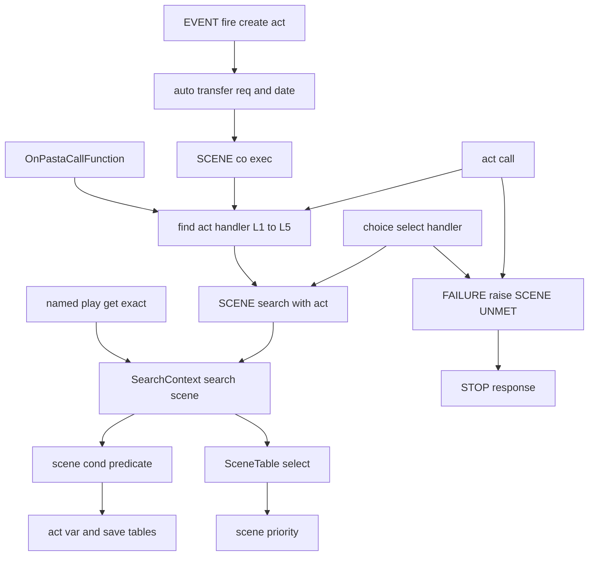
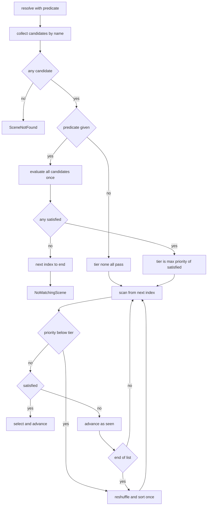
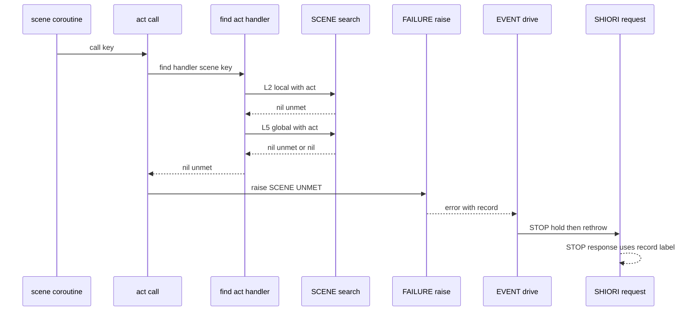

# Design Document: scene-condition-attributes

## Overview

**Purpose**: シーンの宣言行に書いた条件（`＆＄＊経験値≧500`）とフラグ（`＆＄＊初回待ち`）を、名前で候補を選ぶたびにそのときの変数の値で評価し、満たさない場面を候補から外す。`＆優先` で「満たした中のいちばん高い段だけ」から選ぶ。Lua も if も使わずに、段階的な開示・一度だけの話・イベントの振り分けが書ける。

**Users**: ゴーストの作者（窓際のぱすたさん・emo2、0.6.0 のノベル）。ランダムトーク（`＊会話` → `＞雑談_`）、イベント（`＊OnUpdateComplete　＆＄ｒ０＝「changed」`）、Call・選択肢の分岐で使う。

**Impact**: `scene-attribute-store` が倉に入れたまま評価されていない条件を、Rust のシーン表の抽選の芯で評価する。候補の並びは今の「シャッフル＋順次消費」の形（並び＋次の位置）のまま、取り出すときにだけ条件を効かせる。条件漏れを Lua まで区別して返し、Call と選択肢は新しい種類の止まるエラー、イベントは 204 にする。イベントの act を作るときに Reference と日時を自動で転記する。

### Goals

- 条件・フラグの評価規則（Requirement 1）を 1 か所（`pasta_lua` の `search/scene_cond.rs`）に置く。
- 名前で候補を選ぶ所（Call の 2 段目・5 段目、イベント、選択肢、`OnPastaCallFunction`）すべてが同じ口を通る。
- 条件も `＆優先` も無い辞書では、選び方・乱数の消費・応答・ログが今と同じ（10.2・4.1）。
- 辞書の読み込みから `@pasta_search` の絞り込みまでを端から端で確かめるテストを足す（10.3）。

### Non-Goals

- 条件の文法・構文木・倉・受け継ぎ（`scene-attribute-store` が済ませた）。`grammar.pest`・パーサ・`pasta_lsp`・VSCode の文法定義は触らない。
- `＆重み`・`＆順番`（`scene-pick-modes`）。呼ぶ側の条件 `＞シーン＆k＝v`。右辺の変数。単語・選択肢の行の表示への条件。
- 名指しの再生（`OnPastaScene`・撫で・つつきの近道・`チェイントーク中断`・おすすめの項目のシーン）への条件の適用。
- 会えた日数の数え方。「今出せる数」の関数（`シーン数` は条件を見ない）。

## Boundary Commitments

### This Spec Owns

- 条件・フラグの評価規則（数・文字列・真偽値・値の無い変数の扱い、6 種の演算子、数として読む文字列の形）と、その trace・warn のログ。
- シーン表の抽選の規則: 名前の全候補の並び（シャッフル → `＆優先` の降順の安定な並べ替え）、次の位置、今の段、巡の始め直し（1 回の選択で 1 回まで）、条件漏れの判定。
- `＆優先`／`priority` の意味・値の検査（読み込みエラー）。
- `@pasta_search` の `search_scene`・`search_scene_exact` の変数表の引数と、条件漏れの 2 つ目の戻り値 `"unmet"`。
- 条件漏れの失敗表記（13 種目のラベル `SCENE_UNMET`）と、それを止まるエラーとして運ぶ仕組み（`FAILURE.raise`・`STOP.response` の見分け）。
- イベントの act を作るときの Reference・日時の自動転記。
- `pasta_check validate` の `cond-var-unassigned`・`scene-shadowed-by-priority`（注意）と `transpile-invalid-priority`（誤り）。
- マニュアル・入門 7 段目・段階辞書・生成スキルの `references/` の追従。

### Out of Boundary

- 倉の形（`SceneAttr`・`SCENE.attrs`）と受け継ぎの規則（`merge_attrs`）。読むだけで変えない。
- `＆重み`・`＆順番`。この spec は「並び」と「今の段」の形を決め、`scene-pick-modes` が並びの作り方（札の枚数・順番）を足す。
- 単語の検索（`search_word`）、`count_scene`（条件を見ない。9.6 の一言だけ書く）。
- L1（実行中のシーンテーブルの完全一致）・L3（act のメソッド）・L4（`GLOBAL`）の段。名前で候補を選ぶ所ではないので条件を通さない。

### Allowed Dependencies

- `pasta_core` → 標準ライブラリ・`rand`（今のまま）。`tracing`・`mlua` を足さない。条件は呼ぶ側の述語（クロージャ）として受け取る。
- `pasta_lua::search` → `pasta_core` のシーン表・`mlua`・`tracing`。
- Lua: `pasta.act` → `pasta.scene` → `@pasta_search`。`pasta.failure` は今のまま他の Lua モジュールに依存しない。`pasta.shiori.stop` → `pasta.failure`。
- `pasta_check` → `pasta_dsl`・`pasta_core`（`pasta_lua` に依存しない。一致テストだけ dev-dependency）。

### Revalidation Triggers

- `SceneTable::resolve_*` の引数（`filters` を消して述語に替える）と `SceneTableError::NoMatchingScene` の形の変更 → `scene-pick-modes`・`scene-exact-match`・`shell-element-click` が読み直す。
- 並びの形（シャッフル → 優先の安定な並べ替え → 次の位置、段の下で巡を始め直す） → `scene-pick-modes` の重み・順番の入れ方。
- `@pasta_search` の `search_scene(name, gsn, var, save)` と戻り値 `nil, "unmet"` → Lua から直接呼ぶゴースト・`scene-exact-match`。
- `FAILURE.LABEL` の 13 種目と止まるエラーの記録の形 → 失敗表記を数えるテスト・`runtime-failures.md`。
- イベントの act の `var` に最初から Reference・日時が入ること → イベントのハンドラを Lua で書くゴースト、`novel-variable-scope`。

## Architecture

### Existing Architecture Analysis

- 変数（`act.var`・`save`）は Lua に、候補の並び（`CachedSelection { candidates, next_index }`）は Rust の `SceneTable` にある。検索の口 `SEARCH:search_scene(name, gsn)` は文字列だけを受ける。
- 名前で選ぶ所は 4 つの道に集まる: `act:find_act_handler` の L2・L5（Call・イベント・`OnPastaCallFunction`）、`choice_select.lua` の `SCENE.search` の直の呼び出し、名指しの `SCENE.get_exact`（条件を通さない側）。イベントのシーンは全部 `SCENE.co_exec` → `act:find_scene` → `find_handler` を通る（`EVENT.no_entry`・`boot.lua`・`mouse.lua` の 9 段目・`recommend.lua` の項目なし・`virtual_dispatcher.lua` の OnTalk・時報）。
- 「名前が無い」と「全部落ちた」は Rust でも Lua でも `nil` に潰れている。
- `filter_by_attributes` は宣言の文字列一致で、本番ではいつも空の `filters` で呼ばれる（使われていない）。
- Call の失敗（`SCENE_NOT_FOUND`）は止まらずに次の行へ進む。止まるエラーは `EVENT.drive` の失敗の枝 → `STOP.hold` → `SHIORI.request` の `STOP.response` で表記になる（今は「スクリプトのエラー」「時間切れ」の 2 種）。
- チェイントークの続きは、自分の act（自分の `var`）のまま再開される。新しいイベントの act の `var` は続きから見えない（調べた結果。research.md）。

### Architecture Pattern & Boundary Map

選んだ形: **評価は Rust（pasta_lua）、抽選は pasta_core、Lua は act を運ぶだけ**（gap 分析の選択肢 A を、`pasta_core` を言語非依存に保つために「述語を渡す」形にしたもの）。



**Architecture Integration**:
- 依存の向き: `scene_types`（型・優先の読み方）→ `scene_table`（抽選）→ `pasta_lua::search::scene_cond`（評価）→ `pasta_lua::search::context`（Lua の口）→ Lua `pasta.scene` → `pasta.act`・`shiori/event/*`。逆向きの import は誤り。
- 今の形を保つ: 並びの状態は「並び＋次の位置」の 2 つだけ。巡の始め直しは並びのシャッフルのやり直し（候補を集め直さない）。キャッシュの鍵に変数の値を入れない（4.2）。
- 新しい部品は 2 つだけ: `scene_cond.rs`（評価）と `pasta_check` の `conditions.rs`（検査）。ほかは既存のファイルの変更。

### Technology Stack

| Layer | Choice / Version | Role in Feature | Notes |
|-------|------------------|-----------------|-------|
| Registry | pasta_core（Rust 2024・rand 0.10） | 並び・今の段・巡の始め直し・優先の読み方 | 新しい依存なし |
| Runtime binding | pasta_lua（mlua 0.12・LuaJIT 2.1・tracing 0.1） | 変数表を読み条件を評価、trace・warn | 新しい依存なし |
| Lua scripts | pasta_scripts | act の運搬・条件漏れの扱い・自動転記・止まるエラー | 新しい Lua ファイルなし |
| Checker | pasta_check | 3 つの報告の種類 | 新しい依存なし |
| Docs | mdBook・`book/tools/gen-skill-refs.mjs` | マニュアルと生成スキル | 既存の道具 |

## File Structure Plan

### New Files

```
crates/pasta_lua/src/search/
├── scene_cond.rs            # 条件・フラグの評価（Lua の値の読み方・数の判定・比較）と、述語の組み立て・trace/warn
└── scene_cond_tests.rs      # scene_cond の単体テスト（#[path] で読む。context.rs にテストを足さない）
crates/pasta_lua/tests/
├── search/scene_cond_search_test.rs   # SearchContext の条件つき検索（並び・段・巡・unmet）。main.rs に mod を 1 行
└── scene_condition_e2e_test.rs        # 辞書の読み込み → 辞書確定 → @pasta_search → Lua の Call・イベント・選択肢の端から端
crates/pasta_lua/tests/lua_specs/
└── scene_condition_test.lua           # act:call の条件漏れの止まるエラー・find_handler の "unmet"・自動転記の Lua 単体
crates/pasta_check/src/validate/
└── conditions.rs            # cond-var-unassigned・scene-shadowed-by-priority
crates/pasta_check/tests/
└── validate_conditions_test.rs        # 2 つの注意と優先の誤りの報告
```

### Modified Files

- `crates/pasta_core/src/registry/scene_types.rs` — `PRIORITY_KEYS`（`優先`・`priority`）、`priority_value(&SceneAttrValue) -> Option<i64>`、`scene_priority(&[SceneAttr]) -> i64`、`has_conditions(&[SceneAttr]) -> bool` を足す。
- `crates/pasta_core/src/registry/scene_table.rs` — `filters` と `filter_by_attributes` を消し、`resolve_scene_id_unified`・`resolve_scene_id_exact`・`resolve_global_owning_local_exact` が述語 `Option<CondFn>` を受ける。`select_from_cache` を新しい抽選にする。`SceneCacheKey.filters` を消す。
- `crates/pasta_core/src/error.rs` — `NoMatchingScene { scene }`（`filters` を消す。意味は「名前に合うシーンはあるが条件を満たす候補が無い」）。
- `crates/pasta_core/src/registry/scene_table_resolve_filter_tests.rs` — 宣言の一致のテストを、条件・優先の抽選のテストに書き直す（ファイル名は今のまま）。
- `crates/pasta_core/src/registry/scene_table_candidate_tests.rs` — 引数の機械的な置き換え（`&HashMap::new()` → `None`）。
- `crates/pasta_core/README.md` — 絞り込みの記述を直す。
- `crates/pasta_lua/src/search/context.rs` — `search_scene_by` が述語を受ける。`SceneLookup { Found, NotFound, Unmet }` を足す。Lua の口 `search_scene`・`search_scene_exact` が `var`・`save` を受け、`nil, "unmet"` を返す。条件漏れの trace。
- `crates/pasta_lua/src/search/mod.rs` — `mod scene_cond;`。
- `crates/pasta_lua/src/code_gen/scope_gen.rs` — `append_set_scene_attrs` で `優先`・`priority` の値を検査する。
- `crates/pasta_lua/src/error.rs` — `TranspileError::invalid_priority(span, value)`。
- `crates/pasta_lua/pasta_scripts/pasta/scene.lua` — `SCENE.search(name, global_scene_name, act)` が `act.var`・`act.save` を渡し、見つからなければ `nil, miss` を返す。
- `crates/pasta_lua/pasta_scripts/pasta/act.lua` — `search_dictionary` に act を渡す。`find_act_handler` が条件漏れを覚えて `nil, "unmet"` を返す。`act:call` が条件漏れで `FAILURE.raise` する（足すのは 15 行ほど。812 → 830 行以内）。
- `crates/pasta_lua/pasta_scripts/pasta/failure.lua` — `LABEL.SCENE_UNMET`、`FAILURE.raise(record)`、`FAILURE.is_raised(v)`。
- `crates/pasta_lua/pasta_scripts/pasta/shiori/stop.lua` — `STOP.response` が `FAILURE.is_raised` の記録をそのラベルで表記にする。
- `crates/pasta_lua/pasta_scripts/pasta/shiori/entry.lua` — `error_handler` が記録をそのまま通し、500 の理由は記録の中身の文にする。
- `crates/pasta_lua/pasta_scripts/pasta/shiori/event/init.lua` — `create_act` で `transfer_req_to_var`・`transfer_date_to_var` を呼ぶ。
- `crates/pasta_lua/pasta_scripts/pasta/shiori/event/choice_select.lua` — `SCENE.search` に act を渡し、条件漏れで `FAILURE.raise`。
- `crates/pasta_lua/pasta_scripts/pasta/shiori/event/external_control.lua` — 条件漏れを `SCENE_UNMET` の `FAILURE.reply` にする。
- `crates/pasta_lua/tests/search/main.rs` — `mod scene_cond_search_test;`。
- `crates/pasta_lua/tests/lua_specs/failure_test.lua` — ラベルの数 12 → 13。
- `crates/pasta_check/src/validate/report.rs` — `TranspileInvalidPriority`・`CondVarUnassigned`・`SceneShadowedByPriority` と `msg` の文。
- `crates/pasta_check/src/validate/transpile_rules.rs` — 優先の値の検査（scope_gen と同じ条件）。
- `crates/pasta_check/src/validate/mod.rs` — `conditions::check` を飛び先の検査と同じ関門（`skip_reasons` が空のとき）で呼ぶ。
- `crates/pasta_check/tests/validate_parity_test.rs` — `＆優先：高い` が pasta.dll でも pasta_check でも失敗する一致の例を 1 つ足す。
- `crates/pasta_sample_ghost/ghosts/hello-pasta/ghost/master/dic/07-greeting.pasta`・`crates/pasta_sample_ghost/STAGES.md`・`crates/pasta_sample_ghost/tests/tutorial_stages_test.rs` — `＞transfer_req_to_var` の行を消す（9.7）。
- マニュアル: `book/src/grammar/block-structure.md`・`grammar/call-jump.md`・`grammar/variables.md`・`lua/script-api.md`・`lua/modules/pasta-search.md`・`lua/shiori-events.md`・`internals/registry-search.md`・`internals/internal-modules.md`・`debug/validate.md`・`reference/runtime-failures.md`・`getting-started/07-greeting.md`。
- 生成スキル: `.claude/skills/pasta-ghost-authoring/references/`（`node book/tools/gen-skill-refs.mjs` で作り直す。手で書かない）。

## System Flows

### 1 回の選択（SceneTable の抽選）



- 巡の始め直しは 1 回の選択で 1 回まで（4.6・5.7）。今の段に満たす候補が必ずあり、並べ替えで段の候補は段より低い候補より前に来るので、始め直した巡で必ず選べる。2 回目に届いたら（起きない）`NoMatchingScene` を返す（無限に回さない）。
- 述語が無い（名指し）・候補のどれにも条件も優先も無いときは、今の `select_from_cache` と同じ動き・同じ乱数の消費になる（4.1・10.2）。並べ替えは優先が全部同じなら何も動かさない安定な並べ替え。

### Call の条件漏れ（止まるエラー）



- L2 で条件漏れでも L3・L4・L5 へ進む（3.5）。どこかで関数が見つかればそれを呼ぶ。どこにも無く、どこかの段が条件漏れだったときだけ止まる。どの段も「名前が無い」なら今の `SCENE_NOT_FOUND`（3.4）。
- イベント（`SCENE.co_exec`）は `nil` の 2 つ目の値を見ないので、条件漏れでも名前が無くても 204（3.3）。時報は `nil` で次の名前へ進む今のループのまま（3.6）。

## Requirements Traceability

| Requirement | Summary | Components | Interfaces | Flows |
|-------------|---------|------------|------------|-------|
| 1.1 | 選ぶたびにその時点の値で評価 | SceneCond, SearchContext | `cond_predicate` | 1 回の選択 |
| 1.2 | 複数の条件はかつ | SceneCond | `scene_satisfies` | — |
| 1.3 | `＄＊` は save、`＄` は var | SceneCond, LuaSceneSearch | `cond_predicate(var, save)` | — |
| 1.4 | フラグの立ち方 | SceneCond | `flag_set` | — |
| 1.5 | 真偽値は 1・0 | SceneCond | `Operand::from_lua` | — |
| 1.6 | 数は値で比べる | SceneCond | `compare` | — |
| 1.7 | 数でなければ `＝`・`≠` は文字列 | SceneCond | `compare` | — |
| 1.8 | 数でない大小は満たさない＋warn | SceneCond | `CondOutcome::NotNumber` | — |
| 1.9 | 値の無い変数は 0・空文字列 | SceneCond | `Operand::Nil` | — |
| 1.10 | 半角十進の文字列は数 | SceneCond | `parse_decimal` | — |
| 1.11 | 打ち消しを足さない | SceneCond（記号を増やさない） | — | — |
| 2.1, 2.2 | Call の前方一致（グローバル・ローカル） | ActLookup, LuaSceneSearch, SceneTable | `SCENE.search(name, gsn, act)` | Call の条件漏れ |
| 2.3 | `＊会話` → `＞雑談_` | ActLookup（今の別名のまま） | — | e2e テスト |
| 2.4 | 呼び出し元のローカル変数 | ActLookup（呼ばれた側と同じ `act.var`） | — | e2e テスト |
| 2.5 | イベントで絞る | EventAutoTransfer, ActLookup | `SCENE.co_exec` | — |
| 2.6 | 選択肢の飛び先で絞る | ChoiceSelect | `SCENE.search(…, act)` | — |
| 2.7 | 完全一致の道 | SearchContext, SceneTable | `search_scene_exact(name, gsn, var, save)` | — |
| 2.8 | `OnPastaCallFunction` | ExternalControl, ActLookup | `find_handler` | — |
| 2.9 | 名指しは評価しない | LuaSceneSearch（`get_exact` は表を渡さない） | `search_scene_exact(name, nil)` | — |
| 2.10 | 選択肢の行・単語に効かせない | ActLookup（word モードは `search_word` のまま） | — | — |
| 2.11 | チェイントークの続き | 変更なし（`check_talk` は続きを返す） | — | — |
| 3.1 | Call の条件漏れは止まる | ActLookup, FailureStop | `FAILURE.raise` | Call の条件漏れ |
| 3.2 | 選択肢の条件漏れは止まる | ChoiceSelect, FailureStop | `FAILURE.raise` | — |
| 3.3 | イベントは 204 | 変更なし（`co_exec` は nil） | — | — |
| 3.4 | 見つからないは今のまま・別表記 | ActLookup | `SCENE_NOT_FOUND` / `SCENE_UNMET` | — |
| 3.5 | 段の通り抜け | ActLookup | `find_act_handler` | Call の条件漏れ |
| 3.6 | 時報の名前の通り抜け | 変更なし（`check_hour` のループ） | — | — |
| 3.7 | 13 種目のラベル | FailureStop | `FAILURE.LABEL.SCENE_UNMET` | — |
| 4.1 | 条件の無い名前は今と同じ | SceneTable | `select` | 1 回の選択 |
| 4.2 | 並びは全候補・値で分けない | SceneTable | `SceneCacheKey` | — |
| 4.3, 4.4 | 並びの順に見て、見たものは使った | SceneTable | `select` | 1 回の選択 |
| 4.5, 4.6 | 見終えたら始め直し・1 回まで | SceneTable | `select` | 1 回の選択 |
| 4.7 | マニュアルに 1 巡待つことを書く | Docs | `call-jump.md` | — |
| 5.1, 5.2 | 満たした中の最高の段・既定 0 | SceneTable, SceneTypes | `scene_priority` | 1 回の選択 |
| 5.3 | 宣言として倉の規則で読む | SceneTypes | `scene_priority` | — |
| 5.4 | 別名 `priority` | SceneTypes | `PRIORITY_KEYS` | — |
| 5.5, 5.6 | 整数・負・1.0 可、整数でなければ読み込みエラー | PriorityCheck | `TranspileError::invalid_priority` | — |
| 5.7 | 段が使い切れても下りない | SceneTable | `select` | 1 回の選択 |
| 5.8, 5.9 | 段の上下はその次の選択から | SceneTable（段を毎回求める） | `select` | 1 回の選択 |
| 5.10 | マニュアルに独占の意味 | Docs | `block-structure.md` | — |
| 6.1, 6.2 | 選ぶ前に毎回同じ組を転記 | EventAutoTransfer | `create_act` | — |
| 6.3 | 2 つの関数は今のまま | 変更なし | — | — |
| 6.4 | 本文の代入が勝つ | EventAutoTransfer（選ぶ前の 1 回だけ） | — | — |
| 6.5 | 続きを上書きしない | EventAutoTransfer（新しい act にだけ入れる） | — | — |
| 6.6, 6.7 | マニュアルの注意・転記の関数の扱い | Docs | `variables.md`・`07-greeting.md` | — |
| 7.1 | 外れた候補の trace | SceneCond | `tracing::trace!` | — |
| 7.2 | 条件漏れの trace | SearchContext | `tracing::trace!` | — |
| 7.3 | 数でない大小の warn | SceneCond | `tracing::warn!` | — |
| 8.1–8.4 | `cond-var-unassigned` | CheckConditions | `conditions::check` | — |
| 8.5 | `scene-shadowed-by-priority` | CheckConditions | `conditions::check` | — |
| 8.6 | 報告の表 | Docs | `debug/validate.md` | — |
| 9.1–9.8 | マニュアル・入門・生成スキル | Docs | `gen-skill-refs.mjs` | — |
| 10.1, 10.2 | 宣言の意味・条件の無い辞書は今と同じ | SceneTable, SceneTypes | — | — |
| 10.3, 10.4 | 端から端のテスト | Tests | `scene_condition_e2e_test.rs` | — |
| 10.5 | x86・x64 | Tests（両方で流す。cfg で分けない） | — | — |

## Components and Interfaces

| Component | Domain/Layer | Intent | Req Coverage | Key Dependencies | Contracts |
|-----------|--------------|--------|--------------|------------------|-----------|
| SceneTypes | pasta_core registry | 優先の読み方・値の検査・条件の有無 | 5.2–5.6, 10.1 | — | Service |
| SceneTable | pasta_core registry | 並び・今の段・巡・条件漏れ | 4.1–4.6, 5.1, 5.7–5.9 | SceneTypes (P0) | Service, State |
| SceneCond | pasta_lua search | 条件・フラグの評価とログ | 1.1–1.11, 7.1, 7.3 | mlua (P0) | Service |
| SearchContext | pasta_lua search | Lua の口・述語の受け渡し・unmet | 2.1, 2.2, 2.7, 2.9, 7.2 | SceneTable (P0), SceneCond (P0) | API |
| PriorityCheck | pasta_lua code_gen | 優先の値の読み込みエラー | 5.6 | SceneTypes (P0) | Service |
| LuaSceneSearch | Lua `pasta.scene` | act を運び miss を返す | 2.1, 2.2, 2.9 | `@pasta_search` (P0) | Service |
| ActLookup | Lua `pasta.act` | 段の通り抜け・条件漏れの判定 | 2.1–2.4, 3.1, 3.4, 3.5 | LuaSceneSearch (P0), FailureStop (P0) | Service |
| FailureStop | Lua `pasta.failure`・`shiori/stop`・`entry` | 13 種目のラベルと止まるエラー | 3.1, 3.2, 3.7 | — | Service |
| EventAutoTransfer | Lua `shiori/event/init` | 選ぶ前の転記 | 6.1–6.5 | `pasta.shiori.act` (P0) | Service |
| ChoiceSelect / ExternalControl | Lua `shiori/event/*` | 選択肢・外からの呼び出しの条件漏れ | 2.6, 2.8, 3.2 | LuaSceneSearch, ActLookup (P0) | Service |
| CheckConditions | pasta_check validate | 2 つの注意・優先の誤り | 5.6, 8.1–8.5 | pasta_dsl AST (P0), SceneTypes (P1) | Batch |
| Docs | book・生成スキル | マニュアルの追従 | 4.7, 5.10, 6.6, 6.7, 8.6, 9.x | gen-skill-refs (P1) | — |

### pasta_core registry

#### SceneTypes（`scene_types.rs` に足す）

| Field | Detail |
|-------|--------|
| Intent | `＆優先` の値の読み方を 1 か所に置き、ランタイム・トランスパイラ・検査が共有する |
| Requirements | 5.2, 5.3, 5.4, 5.5, 5.6, 10.1 |

##### Service Interface

```rust
/// `＆優先` の名前（日本語・英語の別名）
pub const PRIORITY_KEYS: [&str; 2] = ["優先", "priority"];

/// 優先として受け付ける値。Integer はそのまま。Float・String は None（整数の値になる小数は倉で Integer になっている）
pub fn priority_value(value: &SceneAttrValue) -> Option<i64>;

/// シーンの優先。宣言のうち PRIORITY_KEYS の最後のもの（書いた順の後勝ち）。無ければ 0。
/// 不正な値（倉の外から入ったもの）は 0 とみなす。
pub fn scene_priority(attrs: &[SceneAttr]) -> i64;

/// 条件かフラグを 1 つでも持つか
pub fn has_conditions(attrs: &[SceneAttr]) -> bool;
```

- `scene_priority` が 0 を返す不正な値は、辞書（`.pasta`）からは入らない（トランスパイル時に止まる）。Lua で `SCENE.set_attrs` を直に呼んだときだけ起きる。`shortcut: Lua から入れた不正な優先は黙って 0、要望が出たら辞書確定で警告する` のコメントを付ける。

#### SceneTable

| Field | Detail |
|-------|--------|
| Intent | 名前の全候補の並びから、述語と優先の段で 1 つ選ぶ |
| Requirements | 4.1–4.6, 5.1, 5.7–5.9, 2.7, 2.9 |

##### Service Interface

```rust
/// 候補 1 つの条件を評価する述語。真なら満たす
pub type CondFn<'a> = &'a mut dyn FnMut(&SceneInfo) -> bool;

impl SceneTable {
    pub fn resolve_scene_id_unified(&mut self, module_name: &str, search_key: &str,
        cond: Option<CondFn<'_>>) -> Result<SceneId, SceneTableError>;
    pub fn resolve_scene_id_exact(&mut self, module_name: &str, name: &str,
        cond: Option<CondFn<'_>>) -> Result<SceneId, SceneTableError>;
    pub fn resolve_global_owning_local_exact(&mut self, name: &str, local: &str,
        cond: Option<CondFn<'_>>) -> Result<Option<SceneId>, SceneTableError>;
}

pub enum SceneTableError {
    SceneNotFound { scene: String },
    /// 名前に合うシーンはあるが、条件を満たす候補が 1 つも無い
    NoMatchingScene { scene: String },
    InvalidScene { scene: String },
}
```

- Preconditions: `cond` が `None` なら条件も優先の段も見ない（名指しの引き・今の挙動）。
- Postconditions: `Ok(id)` の `id` は名前に合う候補で、`cond` があればそれを満たし、優先は「満たす候補の最高の優先」に等しい。`Err(NoMatchingScene)` のときは、その鍵の並びの次の位置を末尾にする（この巡は見終えた）。
- Invariants: 並びは名前の全候補の置換（要素は増減しない）。鍵は（module_name, search_key, exact, owning_local）で、変数の値を含まない。

##### State Management

- State model: `CachedSelection { candidates: Vec<SceneId>, next_index: usize }`（今と同じ形）。`candidates` は「シャッフル → `scene_priority` の降順の安定な並べ替え」の順。`next_index` より前は今の巡で見た（使った）候補。
- 抽選（1 回）:
  1. `cond` があれば全候補を 1 回だけ評価し、満たす候補の集合 `ok` と今の段 `tier = max(scene_priority(ok))` を求める。`ok` が空なら `next_index = len`（鍵の並びがまだ無ければ作らない）にして `NoMatchingScene`。
  2. 並びが無ければ作る（シャッフル 1 回・並べ替え）。
  3. `next_index` から見る。`tier` より低い優先の候補に来たら、この巡をやめる。満たす候補（`cond` が無ければどれでも）に来たら、それを返して次の位置を進める。満たさない候補は見ただけで次の位置を進める。
  4. 末尾か低い段に来たら、並びをシャッフルし直して並べ替え、`next_index = 0` で 3 をもう 1 回だけ行う。
- 乱数: シャッフルは今と同じ「候補の並びの順の配列を `shuffle_usize` に渡す」1 回で、作るときと始め直すときだけ（4.1）。
- 選んだ形の理由（`＆優先` の段の持ち方）: 1 本の並びを優先で並べ替える形（開発者の示唆の 1 つ目）にした。状態が今と同じ「並び＋次の位置」のまま、足すのは並べ替え 1 行と段の判定だけで済む。代わりの「段ごとに別の並び」は、上書きの前後で下の段の巡を保てるが、状態の形が変わり `scene-pick-modes` も段ごとに札を入れることになる。1 本の形の弱みは「上の段を出すたびに巡が始め直しになる（境目で直前の話が続けて出うる）」ことで、今の巡の境目の性質と同じ種類の弱みにとどまる（OPEN QUESTION 2）。

##### Implementation Notes

- 借用: `labels` を読む・`cache` と `random_selector` を書くので、関数の中でフィールドを分けて借りる（`let SceneTable { labels, cache, random_selector, .. } = self;`）。述語は `SceneTable` を借りない。
- `filter_by_attributes` と `filters` を消す（本番では空でしか呼ばれておらず、受け手の `call-attribute-filter` は閉じた。宣言の意味は変わらない＝10.1）。
- 単体テストは `scene_table_resolve_filter_tests.rs` を書き直す: 条件の無い名前で今の順（固定の `MockRandomSelector`）、満たさない候補を見て使ったものにする、巡の始め直しが 1 回、段の独占・段の上がり下がり、`NoMatchingScene` の後の次の巡。

### pasta_lua search

#### SceneCond（新しい `search/scene_cond.rs`）

| Field | Detail |
|-------|--------|
| Intent | 条件とフラグを Lua の変数表の値で評価し、外れた理由をログに出す |
| Requirements | 1.1–1.11, 7.1, 7.3 |

##### Service Interface

```rust
/// 比べる値。Lua の値と右辺の値を同じ形に揃える
enum Operand { Nil, Number(f64), Text(String), Other }

/// 1 つの条件の結果
enum CondOutcome { Pass, Fail, NotNumber }

/// 変数表から述語を作る。`name` はログに出す探した名前
pub(crate) fn cond_predicate<'a>(name: &'a str, var: Option<mlua::Table>, save: Option<mlua::Table>)
    -> impl FnMut(&SceneInfo) -> bool + 'a;

/// 1 つの条件・フラグの評価（純粋な関数。テストの芯）
fn evaluate(attr: &SceneAttr, value: &Operand) -> CondOutcome;

/// 半角の十進の数の形（`-?[0-9]+(\.[0-9]+)?`）だけを数として読む
fn parse_decimal(s: &str) -> Option<f64>;
```

- 変数の引き方: `key` が `＄＊` で始まれば `save`、`＄` で始まれば `var` から、印の後ろの名前で `raw_get`（どちらも素の表。メタメソッドを呼ばない）。表が `None` なら値なし。
- Lua の値 → `Operand`: `nil` → `Nil`、`true`/`false` → `Number(1.0)`/`Number(0.0)`、整数・数 → `Number`、文字列 → `parse_decimal` で読めれば `Number`、読めなければ `Text`（UTF-8 でない並びは置き換え文字で読む）、表・関数など → `Other`。
- 右辺 → `Operand`: `Integer`・`Float` → `Number`、`String` → `parse_decimal` で `Number` か `Text`。
- 比べ方: 両辺 `Number`（左が `Nil` で右が `Number` のときは左を 0）なら数で比べる（f64。`1.0 == 1`）。それ以外で `＝`・`≠` なら文字列で比べる（`Nil` は空文字列、`Number` は Lua の `tostring` と同じ表記＝`SceneAttrValue::Float` の Display、`Other` はどの文字列とも等しくない）。それ以外で大小なら `NotNumber`。
- フラグ: `Nil` → 立っていない、`Number(n)` → `n != 0`、`Text(s)` → 空でなければ立つ、`Other` → 立つ。
- 1 つのシーンの条件は書いた順に見て、最初に満たさなかったところで止める（かつ）。
- ログ（target は `pasta_lua::search`）:
  - `Fail`: `trace!(name, scene = %fn_name, cond = %"＄＊経験値 >= 500", value = %値の表記, "Scene candidate excluded by condition")`（7.1）。
  - `NotNumber`: `warn!(name, scene, cond, value, "Condition compares a non-number with an ordering operator; treated as unmet")`（7.3）。
- 条件もフラグも無いシーンは、Lua の表を読まずに真を返す（条件の無い辞書の速さを変えない）。

#### SearchContext（`search/context.rs` の変更）

| Field | Detail |
|-------|--------|
| Intent | Lua の口で変数表を受け、述語を作り、3 つの結果を返す |
| Requirements | 2.1, 2.2, 2.7, 2.9, 7.2 |

##### API Contract（`@pasta_search` の Lua メソッド）

| Method | Request | Response | Errors |
|--------|---------|----------|--------|
| `search_scene` | `(name, gsn?, var?, save?)` | `global, local` ／ `nil`（名前が無い）／ `nil, "unmet"`（条件漏れ） | 空の名前などは今のまま Lua のエラー |
| `search_scene_exact` | 同上 | 同上 | 同上 |
| `search_local_scene_exact` | 変更なし（名指し。条件を見ない） | 変更なし | — |
| `count_scene`・`count_scene_exact` | 変更なし（条件を見ない） | 変更なし | — |

- `var` と `save` の両方が `nil` なら述語を渡さない（条件も優先の段も見ない＝名指しの引き。2.9）。どちらかが表なら述語を渡す（渡されない方は空の表として扱う）。
- Rust の公開 API: 今の `search_scene(name, gsn)`・`search_scene_exact(name, gsn)` は条件なしのまま残し（既存のテストを変えない）、条件つきの `search_scene_where(name, gsn, exact, cond: CondFn) -> Result<SceneLookup, SearchError>` を足す。

```rust
pub enum SceneLookup {
    Found { global_name: String, local_name: String },
    NotFound,
    /// 名前に合うシーンはあるが条件を満たす候補が無い
    Unmet,
}
```

- 条件漏れのとき `trace!(name, "No scene candidate meets the conditions")`（7.2）。別名を当てて見つからないときの warn は、`NotFound` のときだけ今のまま出す。

#### PriorityCheck（`code_gen/scope_gen.rs`・`error.rs`）

- `append_set_scene_attrs` の中で、宣言の `key` が `PRIORITY_KEYS` に入り、値が整数でない（`Integer`、または整数の値になる `Float` 以外）なら `TranspileError::invalid_priority(&a.span, &value)` を返す。文は「`＆優先` の値は整数で書く: `高い`」の形で、位置（ファイル・行）は今のトランスパイルエラーと同じ出方（5.6）。
- 引用した `「1」` は文字列なので誤り（数として読むのは条件の比べ方だけ）。全角の `１` は倉の規則で整数なので通る。

### Lua runtime

#### LuaSceneSearch（`pasta/scene.lua`）

```lua
--- @param name string
--- @param global_scene_name string|nil
--- @param act Act|nil  渡せば act.var・act.save で条件を評価する。nil なら条件を見ない
--- @return SceneSearchResult|nil result
--- @return "unmet"|nil miss  result が nil で、名前に合うシーンはあるが条件を満たす候補が無いとき "unmet"
function SCENE.search(name, global_scene_name, act) end
```

- 3 つ目の引数は今の「将来拡張用・未使用の `attrs`」を置き換える（呼ぶ側はどこも渡していない）。`SCENE.co_exec(act, name, gsn, attrs)` は今のまま（`act:find_scene` が act を持つ）。`SCENE.get_exact`・`co_exec_exact`・`co_exec_registered` は変えない（2.9）。

#### ActLookup（`pasta/act.lua`）

- `search_dictionary(SEARCH, mode, key, scene_name, act)`: scene・expr モードで `SCENE.search(key, scene_name, act)` を呼び、見つからなければ `nil, miss` を返す。word モードは今のまま。
- `find_act_handler(self, mode, key, skip_methods)` の戻り値: `handler` ／ `nil` ／ `nil, "unmet"`。L2 と L5 のどちらかが `"unmet"` で、どの段にも見つからなかったときだけ `"unmet"`（3.5）。`PROXY_IMPL.find_handler` は末尾の呼び出しなので 2 つ目の値もそのまま返る。
- `act:call`: `local handler, miss = self:find_handler("scene", key)`。関数なら今のまま呼ぶ。`miss == "unmet"` なら `FAILURE.raise({ label = FAILURE.LABEL.SCENE_UNMET, subject = "＞" .. tostring(key) })`。それ以外は今の `SCENE_NOT_FOUND`。
- expr モード（`＠名前（）` がシーンに当たる道）も同じ `SCENE.search` を通るので条件で絞られる。条件漏れのときは今の「関数が見つからない」のまま（新しい扱いを足さない。OPEN QUESTION 5）。

#### FailureStop（`pasta/failure.lua`・`shiori/stop.lua`・`shiori/entry.lua`）

```lua
FAILURE.LABEL.SCENE_UNMET = "条件に合うシーンが無い"   -- 13 種目（名前は OPEN QUESTION 3）

--- 止まるエラーとして投げる（戻らない）。値は記録の表（メタ表で見分け、tostring は FAILURE.body）
--- @param record { label: string, subject: string|nil }
function FAILURE.raise(record) end

--- FAILURE.raise が投げた値か
--- @return boolean
function FAILURE.is_raised(v) end
```

- `STOP.response`: エラーの値が `FAILURE.is_raised` なら、種類を記録のラベル、対象を記録の対象、説明を止まった場所（`STOP.subject(act)`。分からなければ無し）にする。表記の例: `【条件に合うシーンが無い：＞告白（＊放課後）】`。警告は今の止まるエラーと同じく表記の中身を 1 行出す。表記を出さない設定・`On` で始まらない要求では今の 500 になり、`X-Error-Reason` は表記の中身の文。
- `entry.lua` の `error_handler`: 記録の表はそのまま返す（文字列にしない）。`RES.err` に渡す理由は `tostring(記録)`。
- 止まるので、チェイントークの続き・待ち合わせは今の止まるエラーと同じく捨てられる（`EVENT.drive` の失敗の枝）。選択肢のハンドラ（コルーチンの外）で投げたときは `SHIORI.request` の `xpcall` が受け、`STOP.take_handler()` の act で表記を作る。

#### EventAutoTransfer（`shiori/event/init.lua`）

```lua
local function create_act(req)
    local act = SHIORI_ACT.new(STORE.actors, req)
    act:transfer_req_to_var()
    act:transfer_date_to_var()
    return act
end
```

- `EVENT.fire` が鎖のハンドラごと・底のハンドラに作る act の全部に入る（6.1・6.2）。転記は選ぶ前の 1 回だけで、本文の代入が後から勝つ（6.4）。
- チェイントークの続きは自分の act のまま再開するので、新しい act の転記は続きに届かない（6.5。research.md の調べ）。`virtual_dispatcher.lua` の時報の前の `transfer_date_to_var` は同じ値をもう一度入れるだけなので残す（消すとテストの作りに触る）。
- `CLOCK.observe` の後に作るので、仮想時刻のずれも今の時報と同じく反映される。

#### ChoiceSelect / ExternalControl

- `choice_select.lua`: `SCENE.search(choice_id, scope, act)`、無ければ `SCENE.search(choice_id, nil, act)`。どちらも無く、どちらかが `"unmet"` なら `FAILURE.raise({ label = SCENE_UNMET, subject = "OnChoiceSelectEx ＞" .. choice_id })`（3.2）。どちらも名前が無ければ今の 204。先頭の `＊OnChoiceSelectEx` の明示シーンはイベントとして扱い、条件漏れなら次の振り分けへ進む（今の「無ければ次へ」と同じ）。
- `external_control.lua`（`OnPastaCallFunction`）: `act:find_handler("scene", name)` が `nil, "unmet"` なら、今の「見つからない」と同じ形で `FAILURE.reply(act, { label = SCENE_UNMET, subject = event .. " ＞" .. name, warning = … })`（場面の続きを変えない今の決まりに合わせる。OPEN QUESTION 4）。

### pasta_check validate

#### CheckConditions（新しい `validate/conditions.rs`）と優先の誤り

| Field | Detail |
|-------|--------|
| Intent | 条件の保存変数の書き間違いと、優先で塞がれた場面を注意する。優先の値の誤りは pasta.dll と同じく誤りにする |
| Requirements | 5.6, 8.1–8.5 |

##### Batch / Job Contract

- Trigger: `validate_ghost` の中。`conditions::check` は `skip_reasons` が空のときだけ走る（8.4。飛び先の検査と同じ関門）。`transpile_rules::check` の優先の誤りは今のトランスパイルの検査と同じく常に走る。
- Input: 構文木（`parsed`）。属性の位置は構文木の `Attr.span`、受け継ぎは `PastaFile::global_scene_attrs()`（倉と同じ規則）。
- Output:
  - `transpile-invalid-priority`（誤り）: `優先`・`priority` の宣言で値が整数でない。位置は属性の位置。
  - `cond-var-unassigned`（注意）: 条件・フラグの `＄＊名前` について、全辞書の `＄＊名前＝…`（ローカルシーンの項目の `VarSet` で `VarScope::Global`、アクター定義の `var_sets` を含む）に同じ名前が無い。位置は条件を書いた所（ファイル属性に書いたものはファイル属性の行に 1 回）。`＄名前` は見ない（8.3）。
  - `scene-shadowed-by-priority`（注意）: 同じ照合用の名前（グローバルはグローバルどうし、ローカルは同じ親の中）の候補に、条件もフラグも無い（受け継いだものも無い）優先 P の場面があり、P より低い優先の場面があるとき、低い方の各場面の位置に出す。文に塞いでいる場面の位置と優先を書く。
- Idempotency: 構文木を読むだけ。終了の状態は注意では変わらない（8.2）。

### Docs

- `block-structure.md#属性`: 「まだ評価されず」を、条件・フラグ・比べ方・`＆優先`（独占の意味を最初に。使い所と `＆重み` との違い）の説明と例に書き換える（5.10・9.1）。
- `call-jump.md`: 「候補の選択」に並び・巡・最大 1 巡待つこと・`＆優先` で急がせること（4.7）。「Call が失敗したとき」に条件漏れの止まるエラーとイベントの 204 と「見つからない」の違い（9.2）。段の表の 2 段目・5 段目に条件漏れの通り抜け（3.5）。「シーン数」に「条件も見ない」の一言（9.6）。
- `variables.md`: エンジンが入れる変数に自動転記、自分で同じ名前に入れているゴーストへの注意、2 つの転記の関数は「取り直し」用（6.6・6.7・9.3）。
- `script-api.md`・`lua/modules/pasta-search.md`・`lua/shiori-events.md`: `SCENE.search` の 3 つ目の引数、`search_scene` の `var`・`save`・`"unmet"`、イベントの act に最初から入る変数、選択肢・`OnPastaCallFunction` の条件漏れ（9.4）。
- `internals/registry-search.md`・`internals/internal-modules.md`: 絞り込みの記述を述語と並びの形に直す（9.5）。
- `reference/runtime-failures.md`: 種類の表に「条件に合うシーンが無い」（止まるエラーの 3 種目）。
- `debug/validate.md`: 報告の表に 3 つ（8.6）。
- `getting-started/07-greeting.md`・段階辞書・`STAGES.md`・`tutorial_stages_test.rs`: `＞transfer_req_to_var` の行と説明を消し、「イベントのシーンでは Reference が最初から入っている」に直す（9.7）。
- 最後に `node book/tools/gen-skill-refs.mjs` で `references/` を作り直し、`--check` で一致を確かめる（9.8）。

## Data Models

### Domain Model

- **候補の並び**（鍵ごと）: 名前に合う全候補の置換。巡ごとにシャッフルし、優先の降順に安定に並べる。次の位置より前は今の巡で使った。
- **今の段**: 1 回の選択のたびに、条件を満たす候補の最高の優先として求め直す値（状態に持たない）。
- **条件漏れ**: 名前に合う候補はあるが、満たす候補が 1 つも無いこと。Rust では `NoMatchingScene`、Lua では 2 つ目の値 `"unmet"`、失敗表記では `SCENE_UNMET`。
- 不変条件: 条件の無い名前では、並び・乱数の消費・選ばれる順が今と同じ。

## Error Handling

### Error Strategy

| 場面 | 名前が無い | 条件漏れ |
|------|-----------|----------|
| Call `＞名前` | 今の `【シーンが見つからない：＞名前】`（止まらずに次の行） | 止まるエラー `【条件に合うシーンが無い：＞名前（＊止まったシーン）】` |
| 選択肢の飛び先 | 今の 204 | 止まるエラー（対象 `OnChoiceSelectEx ＞ID`） |
| イベント・OnTalk・時報 | 204（時報は次の名前へ） | 204（時報は次の名前へ）、trace だけ |
| `OnPastaCallFunction` | 今の表記の応答 | `SCENE_UNMET` の表記の応答（止まらない） |
| 名指しの再生 | 今のまま | 起きない（条件を見ない） |

- 数でない値の大小: 満たさないものとし warn（失敗表記は出さない）。値の無い変数・真偽値: 何も出さない（1.5・1.9）。
- 優先の値の誤り: トランスパイルエラーで辞書の読み込みが止まる（5.6）。pasta_check も誤り。

### Monitoring

- trace（`pasta_lua::search`）: 外れた候補ごとの名前・シーン・条件・値、条件漏れの名前。しきい値の調整では `[logging] filter = "info,pasta_lua::search=trace"` で絞れることをマニュアルに書く。
- warn: 数でない大小、止まるエラーの表記の中身（今の止まるエラーと同じ 1 行）。

## Testing Strategy

### Unit Tests

- `scene_cond_tests.rs`: 6 種の演算子 × 数・文字列（`1.0 = 1`、`「500」` と `500`、全角の `「３」` は文字列、`"0"` のフラグは立たない、真偽値は 1・0、値の無い変数は 0・空文字列、数でない大小は `NotNumber`）、かつで最初の外れで止まる（1.1–1.11）。
- `scene_table_resolve_filter_tests.rs`（書き直し）: 述語なし・条件の無い候補で今の順（固定の乱数）、見て外れた候補は使ったもの、巡の始め直しは 1 回、満たす候補が無ければ `NoMatchingScene` で次は新しい巡、優先の独占・上がったら次の選択でその段・下がったら低い段（4.1–4.6・5.1・5.7–5.9）。
- `scene_types.rs`: `scene_priority` の既定 0・負・別名・後勝ち、`priority_value`（5.2–5.5）。
- `lua_specs/scene_condition_test.lua`: `find_act_handler` の `"unmet"` と段の通り抜け、`act:call` の `FAILURE.raise`、`STOP.response` のラベル、`create_act` の転記（3.1・3.4・3.5・6.1）。`failure_test.lua` のラベル 13 種。

### Integration Tests

- `tests/search/scene_cond_search_test.rs`: `@pasta_search` の `search_scene(name, gsn, var, save)` の 3 つの結果、表を渡さないと条件を見ない（2.7・2.9）。
- `tests/scene_condition_e2e_test.rs`（辞書の読み込み → 辞書確定 → 実行。10.3・10.4）:
  - 窓際のぱすたさんの経路 `＊会話` → `＞雑談_`（2.3）。
  - `＄気分＝「高」` の後の `＞告白`（2.4）。
  - Call の条件漏れは止まる表記・名前が無いときは今の表記・イベントは 204（3.1–3.4）、時報の名前の通り抜け（3.6）。
  - 並び: 外れた候補を見て使い、巡の始め直しの後に出る（4.3–4.6）。
  - `＊OnUpdateComplete　＆優先：1　＆＄ｒ０＝「changed」` が転記なしで選ばれる（6.1）、続きの var が上書きされない（6.5）。
  - 選択肢の飛び先の条件漏れ（3.2）・`OnPastaCallFunction` の条件漏れ（2.8）。
- `validate_conditions_test.rs`・`validate_parity_test.rs`: 2 つの注意・関門で省かれる・終了の状態、`＆優先：高い` の一致（5.6・8.1–8.5）。
- `tutorial_stages_test.rs`: 7 段目の辞書が転記の行なしで OnGhostChanged に `＄ｒ０` を出す（9.7）。

### Platform

- 全テストを x64 と x86 の両方で流す（10.5）。数の比べ方は f64 で行い、`mlua::Integer` の幅（x86 は i32）に依らない読み方にする（`i64::from`）。

### Performance

- 条件の無いシーンは Lua の表を読まない。条件のある名前は 1 回の選択で候補ごとに 1 回だけ評価する（候補数に比例。数百でも OnTalk の間隔に対して無視できる）。

## Open Questions / Risks

- 未決の点は research.md の「設計ディスカッションへの申し送り」に、仮定・代わりの案・例とともに並べた（止まるエラーの意味・段の持ち方・ラベルの名前・`OnPastaCallFunction` の扱い・expr モード・名指しの優先）。
- `gen-skill-refs.mjs` は `.claude/skills/` の下へ書く。この下の書き換えは分類器が止めることがある（ユーザーの記録）。止まったら入った分を示して許可を求める。
- `filters` を消すのは `pasta_core` の公開 API の破壊的な変更（0.x の次の版で許される）。`README.md` と CHANGELOG の書き方は既存の版の運びに合わせる。
