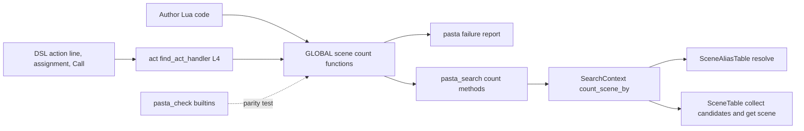
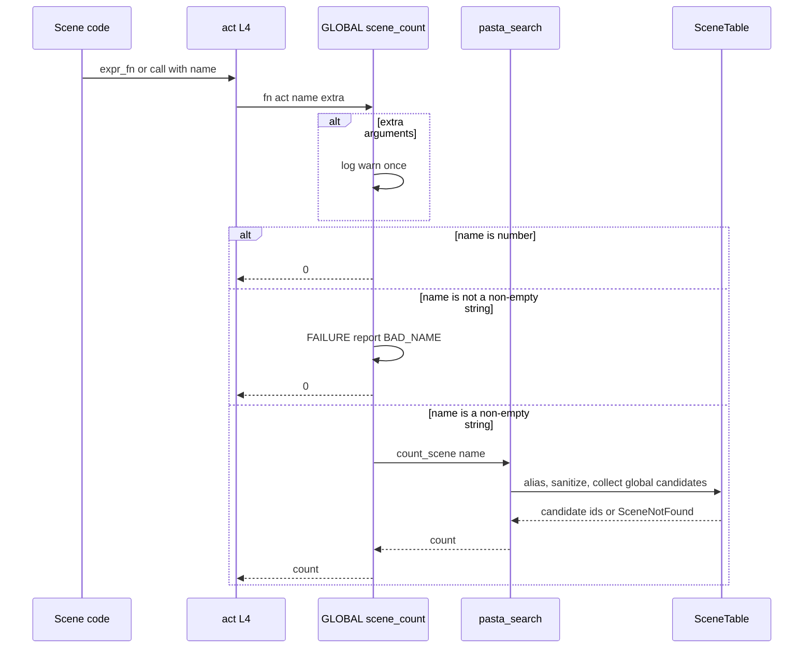

# 設計: scene-count

## Overview

**Purpose**: ゴースト作者が、シーン名にぶら下がるシーンの数を、`＞名前` と同じ前方一致（`＠シーン数（名前）`／`scene_count`）と完全一致（`＠シーン数完全一致（名前）`／`scene_count_exact`）の 2 通りで、辞書と Lua から読めるようにする。

**Users**: 同じ名前のシーンを何本も書いて `＞名前` でランダムに選ばせている辞書の作者。台詞に「話題は 5 個あるよ」と出したり、Lua の関数で数を比べたりする。

**Impact**: `@pasta_search` に数を返すメソッドを 2 つ、`GLOBAL` に組み込みの関数を 4 つの名前で足す。検索の規則・候補の巡回の状態・シーン表（`scene_table.rs`）は変えない。

### Goals
- `＠シーン数（「雑談」）` が `＞雑談` の候補の数を、`＠シーン数完全一致（「雑談」）` が完全一致の検索の候補の数を返す（Introduction の例で 5 と 3）。
- 数え方は今の検索と同じ部品を通り、グローバルシーンだけ・別名を当ててから照合用の名前に揃える・0 件は `0`。
- 引数の誤りは、ほかの失敗と同じ表記とログで報告し、`0` を返す。
- 数えても `＞名前` の次の選びが変わらない。

### Non-Goals
- 単語の数（`＠単語数`）、ローカルシーンの数。
- 条件の属性で絞った「今出せる数」（`scene-condition-attributes`）、残っている話題の数・数で分岐する書き方（要件ディスカッションの決定 5）。
- `＞＞` の文法と `[scene] match = "exact"`（`scene-exact-match`）、同じ名前のシーンの選び方（`scene-pick-modes`）。
- 検索の規則（前方一致・別名・照合用の名前）の変更、別名と揃えの処理を共通の関数にまとめる整理。
- 里々のような専用の構文、`＠名前（…）` の関数名の検査。

## Boundary Commitments

### This Spec Owns
- `SearchContext` の数のメソッド（`count_scene`・`count_scene_exact`）と、その Lua の口（`@pasta_search` の `count_scene(name)`・`count_scene_exact(name)`）。数え方の定義（どの候補を数えるか）はここが持つ。
- `GLOBAL` の 4 つの名前（`scene_count`・`シーン数`・`scene_count_exact`・`シーン数完全一致`）の関数。引数の確かめ（誤り・数値・余分な引数）と、その報告はここが持つ。
- `pasta_check validate` の組み込みの名前の一覧への 4 つの名前の追加。
- 自動テスト（新しい統合試験 1 本と、検査の試験の追記）、マニュアル 4 章の追記、references の作り直し。

### Out of Boundary
- `SceneTable`（`crates/pasta_core/src/registry/scene_table.rs`）の関数・索引・巡回の控え。読むだけで、変えない。
- `search_scene_by`・`search_local_scene_exact` の中身（別名と揃えの 2 行は写して使い、元を書き換えない）。
- `act.lua` の 5 段の検索・`code_gen/element_gen.rs` の生成コード（Call がシーンの引数を後ろに足す動きを含む）。
- `FAILURE` の表記の形・種類の名前の表・`[logging] balloon_warning` の扱い。
- `shiori/entry.lua`（`debug-mcp-runtime` の持ち場）。
- 作者が `main.lua` で 4 つの名前に代入したときの扱い（今の `yield` と同じで、何も足さない。要件ディスカッションの決定 6）。

### Allowed Dependencies
- `pasta_core::registry`: `SceneTable::collect_scene_candidates`・`SceneTable::get_scene`・`SceneRegistry::sanitize_name`・`SceneRegistry::split_registered_name`・`SceneAliasTable::resolve`（すべて今の公開の関数。`&self` の読み取りだけ）。
- `search/context.rs` の中の `SearchContext::parse_fn_name`（同じ型の非公開の関数）。
- Lua: `pasta.failure`（`FAILURE.report`・`is_name`・`kind_of`・`quoted`・`LABEL.BAD_NAME`）、`@pasta_log`、`@pasta_search`。
- 依存の向き: `pasta_core::registry` → `pasta_lua::search::SearchContext` → `@pasta_search`（Lua の口）→ `pasta.global` の関数 → `act.lua` の 4 段目が呼ぶ。`global.lua` は `act.lua` を require しない（`act.lua` が `global.lua` を require するため）。
- 新しい crate・Lua の依存は足さない。

### Revalidation Triggers
- `collect_scene_candidates` の範囲（`:` で始まるキーを外す規則）や、0 件・空の名前の返し方が変わるとき。
- 登録名・`fn_name` の形（`名前_通し番号::__start__`）や `fn_name_to_search_key` の作り方が変わるとき（完全一致の数の絞り方が依存する）。
- `search_scene_by` のグローバルの枝の規則（別名を当ててから揃える順）が変わるとき。`scene-exact-match` の `[scene] match = "exact"` で `＞` が完全一致になるとき（`シーン数` も合わせるかはあちらが決める。brief に申し送り済み）。
- `scene-condition-attributes` が検索に条件を入れるとき（数は条件で絞らない約束。「今出せる数」を足すならあちらが決める）。
- `FAILURE.report` の約束（ログ 1 行・act が `nil` ならログだけ）が変わるとき。

## Architecture

### Existing Architecture Analysis
- `＞名前`・`＠名前（…）` は `act.lua` の `find_act_handler` の 5 段の検索で解決され、4 段目が `GLOBAL[key]` の完全一致である。`GLOBAL` に関数を置けば、アクション行・変数代入の右辺・式・Call・Lua のどこからでも `(act, 引数…)` で呼ばれる。
- `＞名前` のグローバル検索は `SCENE.search` → `@pasta_search:search_scene(name, nil)` → `search_scene_by` のグローバルの枝（別名 → 揃え → `resolve_scene_id_unified("", key)` → `collect_scene_candidates("", key)`）である。完全一致は `resolve_scene_id_exact` が索引を `get(key)` で引く。
- 実行時のシーン表は読み込みの最後（finalize）に `register_global_raw` で作られ、グローバルシーンの `fn_name` は `雑談_1::__start__` の形である。索引のキーは `fn_name` の前半から通し番号を外したもの（`雑談`）である。
- 失敗は `FAILURE.report(act, record)` が唯一の出口で、ログ 1 行と（設定が真なら）表記の `raw_script` を積む。

### Architecture Pattern & Boundary Map



**Architecture Integration**:
- Selected pattern: 今の部品を伸ばす（research.md の案 A）。数え方は Rust の `SearchContext` に、作者向けの口と引数の確かめは Lua の `GLOBAL` に置く。`search_scene`（Rust）と `SCENE.search`／組み込みの関数（Lua）の分け方と同じ。
- Domain boundaries: 数え方（どの候補か）は `SearchContext` だけが持ち、`GLOBAL` の関数は名前を渡して数を受けるだけ。引数の誤りの報告は `GLOBAL` の関数だけが持つ。
- Existing patterns preserved: `search_scene`／`search_scene_exact`／非公開の本体の 3 つ組、`GLOBAL` の英語名と日本語名の対（非 ASCII はブラケット記法）、`FAILURE.report` による報告、余分な引数の `log.warn`（`recommend_item`）、`@pasta_search` を呼んだ時点で `require` する書き方（`SCENE.search`）。
- New components rationale: 数のメソッド（数だけを返す口が無い）、数の関数（DSL の口が無い）。
- Steering compliance: 1 ファイル 600 行の目安（`context.rs` は既に超えているので、試験は外のファイル）、統合試験は `crates/<crate>/tests/<feature>_test.rs`、x86・x64 の両方で同じ試験が走る（ポインタ幅に依る期待は無い）。

### Technology Stack

| Layer | Choice / Version | Role in Feature | Notes |
|-------|------------------|-----------------|-------|
| Runtime (Rust) | pasta_lua・pasta_core（ワークスペースの今の版）、mlua 0.12（LuaJIT） | 数のメソッドと Lua の口 | 新しい依存なし |
| Runtime (Lua) | `pasta_scripts/pasta/global.lua` | 4 つの名前の関数 | luacheck を通す（非 ASCII はブラケット記法） |
| CLI | pasta_check | 組み込みの名前の一覧 | 一致テストあり |
| Docs | mdBook（`book/`）、`book/tools/gen-skill-refs.mjs` | マニュアルと references | 生成は `--check` で確かめる |

## File Structure Plan

### New Files
- `crates/pasta_lua/tests/scene_count_test.rs`（SceneCountTests）— 実物の読み込み（`PastaLoader::load`、一時ゴースト）で、数え方・別名・揃え・ローカルを数えない・0 件・次の選びを変えない・DSL の 4 通りの呼び方・引数の誤り・数値・余分な引数・`balloon_warning = false`・act 無しの Lua からの呼び出し・`＊シーン数` を書いた辞書を確かめる。`mod common;` で `PASTA_DEBUG` 中和ガードを効かせる。

### Modified Files
- `crates/pasta_lua/src/search/context.rs`（SceneCountSearch）— `SearchContext` に `count_scene`・`count_scene_exact`（公開）と非公開の本体 `count_scene_by` を足し、`add_methods` に Lua のメソッド `count_scene`・`count_scene_exact` を足す。中の試験には足さない。
- `crates/pasta_lua/pasta_scripts/pasta/global.lua`（SceneCountGlobals）— 4 つの名前の関数を足す（関数を作る `local` の小さな関数 1 つと代入 4 行）。`pasta.failure` を require する。
- `crates/pasta_check/src/validate/builtins.rs`（BuiltinNames）— `GLOBAL_NAMES` に 4 つの名前を足し（12 → 16）、上の説明に `global.lua` のシーン数の関数を書く。
- `crates/pasta_check/tests/validate_scenes_test.rs`（SceneCountTests）— `builtin_names_are_listed` の期待に 4 つを足し、4 つの名前への Call が見つかる試験と、`＊シーン数` に `scene-shadowed-by-builtin` が出る試験を足す。
- `book/src/grammar/call-jump.md`（ManualAndRefs。以下のマニュアルと references も同じ）— 「特殊な呼び出し」の表に 2 行（日英の名前）、アクション行での書き方の段落に `＠シーン数（…）` を足し、数え方の節（`シーン数・シーン数完全一致`）を 1 つ足す。
- `book/src/debug/validate.md` — 組み込みの飛び先の一覧（`GLOBAL` の関数）に 4 つの名前。
- `book/src/lua/script-api.md` — `GLOBAL` の表に 4 行（呼び方 `(act, 名前)`）。表の下の注記（`entry.lua` が登録する名前）の対象には入れない。
- `book/src/lua/modules/pasta-search.md` — 「メソッド」の節に `count_scene(name)`・`count_scene_exact(name)` を 1 節で足す。
- `.claude/skills/pasta-ghost-authoring/references/call-jump.md`・`.claude/skills/pasta-lua-coding/references/script-api.md`・`.claude/skills/pasta-lua-coding/references/pasta-search.md` — `node book/tools/gen-skill-refs.mjs` で作り直す（手で書かない）。

## System Flows



- 確かめの順は「余分な引数の警告 → 数値 → 名前にならない値 → 数える」。余分な引数の警告は、ほかの判定にかかわらず 1 行出る。
- Call の形（`＞シーン数（…）`）は、生成コードが呼んだシーンの引数（`table.unpack(args)`）を後ろに足すので、引数付きで呼ばれたシーンの中ではその引数も「余分な引数」として警告される（`＞おすすめ項目` と同じ。OPEN QUESTION 2）。
- 数えるのは `&self` の読み取りだけで、巡回の控え（`select_from_cache` の状態）に触らない。

## Requirements Traceability

| Requirement | Summary | Components | Interfaces | Flows |
|-------------|---------|------------|------------|-------|
| 1.1 | 前方一致の数を返す | SceneCountSearch | `count_scene` | 数える枝 |
| 1.2 | `＞名前` の候補と等しい | SceneCountSearch | `collect_scene_candidates("", key)` を共有 | 数える枝 |
| 1.3 | グローバルだけ | SceneCountSearch | `module_name = ""`・act の場所を使わない | 数える枝 |
| 1.4 | 別名を当てる | SceneCountSearch | `SceneAliasTable::resolve` | 数える枝 |
| 1.5 | 照合用の名前に揃える | SceneCountSearch | `SceneRegistry::sanitize_name` | 数える枝 |
| 1.6 | 無ければ 0・警告なし | SceneCountSearch | `SceneNotFound` → `0` | 数える枝 |
| 2.1 | 完全一致の数 | SceneCountSearch | `count_scene_exact` | 数える枝 |
| 2.2 | 完全一致の検索の候補と等しい | SceneCountSearch | `fn_name` の前半の通し番号を外した名前で絞る | 数える枝 |
| 2.3 | 1.3〜1.6 と同じ規則 | SceneCountSearch | `count_scene_by` の共通の道 | 数える枝 |
| 3.1 | 4 つの名前・対は同じ動作 | SceneCountGlobals | `scene_counter(fn_name, method)` | — |
| 3.2 | 何も書かずに使える | SceneCountGlobals | `pasta.global` の読み込み時に登録 | — |
| 3.3 | アクション行で台詞の文字 | SceneCountGlobals | 数値を返す（`talk` が `tostring`） | 数える枝 |
| 3.4 | 代入・式で数値 | SceneCountGlobals | Lua の数値を返す | 数える枝 |
| 3.5 | Call では何も出さない | SceneCountGlobals | トークンを積まない（戻り値は `SCENE.wrap` が捨てる） | 数える枝 |
| 3.6 | Lua から同じ数 | SceneCountGlobals | `GLOBAL.scene_count(act, 名前)` | 数える枝 |
| 3.7 | 読み込みの後いつでも | SceneCountGlobals, SceneCountSearch | 呼んだ時点で `require("@pasta_search")`・その時のシーン表を数える | — |
| 4.1 | 誤りを報告 | SceneCountGlobals | `FAILURE.report`（`BAD_NAME`・`kind_of`） | 名前にならない値の枝 |
| 4.2 | 誤りでも 0 | SceneCountGlobals | 報告の後に `0` | 名前にならない値の枝 |
| 4.3 | 数値は 0・報告なし | SceneCountGlobals | `type(name) == "number"` → `0` | 数値の枝 |
| 4.4 | 余分な引数は警告 1 行 | SceneCountGlobals | `select("#", ...)` → `log.warn` | 余分な引数の枝 |
| 4.5 | `balloon_warning = false` | SceneCountGlobals | `FAILURE.report` が従う | 名前にならない値の枝 |
| 4.6 | act 無しはログだけ | SceneCountGlobals | `FAILURE.report(nil, …)` | 名前にならない値の枝 |
| 5.1 | 次の選びを変えない | SceneCountSearch | `&self` のみ・巡回の控えに触らない | — |
| 5.2 | 登録・別名・規則を変えない | SceneCountSearch | 読み取りだけ | — |
| 5.3 | 属性で数を変えない | SceneCountSearch | `filter_by_attributes` を通さない | — |
| 5.4 | 5 段の順を変えない | SceneCountGlobals | 4 段目に置くだけ | — |
| 6.1 | Call を組み込みとして扱う | BuiltinNames | `GLOBAL_NAMES` | — |
| 6.2 | `scene-shadowed-by-builtin` | BuiltinNames | `is_builtin` | — |
| 6.3 | 実行時と一致 | BuiltinNames | `validate_parity_test.rs` の一致テスト | — |
| 7.1 | Call の章 | ManualAndRefs | `call-jump.md` | — |
| 7.2 | 検査の章 | ManualAndRefs | `validate.md` | — |
| 7.3 | Lua の章の `GLOBAL` の表 | ManualAndRefs | `script-api.md` | — |
| 7.4 | `@pasta_search` の章 | ManualAndRefs | `pasta-search.md` | — |
| 7.5 | references の作り直し | ManualAndRefs | `gen-skill-refs.mjs`・`--check` | — |
| 8.1 | 数え方の試験 | SceneCountTests | `scene_count_test.rs` | — |
| 8.2 | 呼び方と誤りの試験 | SceneCountTests | `scene_count_test.rs` | — |
| 8.3 | 検査の試験 | SceneCountTests | `validate_scenes_test.rs`・一致テスト | — |

## Components and Interfaces

| Component | Domain/Layer | Intent | Req Coverage | Key Dependencies (P0/P1) | Contracts |
|-----------|--------------|--------|--------------|--------------------------|-----------|
| SceneCountSearch | Rust `pasta_lua::search` | 書いた名前から、グローバルシーンの候補の数を返す | 1.1〜1.6, 2.1〜2.3, 3.7, 5.1〜5.3 | SceneTable (P0), SceneAliasTable (P0), SceneRegistry (P0) | Service |
| SceneCountGlobals | Lua `pasta.global` | DSL・Lua の口。引数を確かめ、誤りを報告し、数を返す | 3.1〜3.7, 4.1〜4.6, 5.4 | `@pasta_search` (P0), `pasta.failure` (P0), `@pasta_log` (P1) | Service |
| BuiltinNames | Rust `pasta_check::validate` | 検査が知る組み込みの名前 | 6.1〜6.3 | 一致テスト (P1) | State |
| ManualAndRefs | Docs | 2 つの関数・メソッドの説明と references | 7.1〜7.5 | `gen-skill-refs.mjs` (P1) | — |
| SceneCountTests | Tests | 数え方・呼び方・誤り・検査を確かめる | 8.1〜8.3 | `PastaLoader`、`tracing_test` (P1) | — |

### Rust 検索層

#### SceneCountSearch

| Field | Detail |
|-------|--------|
| Intent | 書いた名前に当てはまるグローバルシーンの数を、前方一致・完全一致で返す |
| Requirements | 1.1, 1.2, 1.3, 1.4, 1.5, 1.6, 2.1, 2.2, 2.3, 3.7, 5.1, 5.2, 5.3 |

**Responsibilities & Constraints**
- 書いた名前に、別名（完全一致 1 段）を当ててから `sanitize_name` で揃えたキーを作る（`search_scene_by` のグローバルの枝と同じ 2 行・同じ順）。
- `collect_scene_candidates("", key)` の候補を数える。`exact` のときは、候補のうち `split_registered_name(parse_fn_name(fn_name).0).0 == key` のものだけを数える。
- `SceneNotFound` は `0`。空の名前（`InvalidScene`）は `search_scene` と同じくエラーで返す。そのほかの `SceneTableError` もエラーで返す。
- 別名を当てて 0 件でも警告を出さない（`search_scene_by` の警告は出さない）。
- `&self` で読むだけ。巡回の控え・属性の絞り込み（`filter_by_attributes`）・シーン表の中身に触らない。

**Dependencies**
- Inbound: SceneCountGlobals — `@pasta_search` のメソッドとして呼ぶ (P0)
- Outbound: `SceneTable::collect_scene_candidates`・`get_scene` (P0)、`SceneAliasTable::resolve` (P0)、`SceneRegistry::sanitize_name`・`split_registered_name` (P0)

**Contracts**: Service [x]

##### Service Interface
```rust
impl SearchContext {
    /// `＞名前` のグローバル検索が選べる候補の数（前方一致）。
    pub fn count_scene(&self, name: &str) -> Result<usize, SearchError>;
    /// グローバルの完全一致の検索が選べる候補の数。
    pub fn count_scene_exact(&self, name: &str) -> Result<usize, SearchError>;
    /// 共通の本体（非公開）。
    fn count_scene_by(&self, name: &str, exact: bool) -> Result<usize, SearchError>;
}
```
Lua の口（`add_methods`、`add_method` で `&self`）:

| メソッド | 引数 | 戻り値 | エラー |
|----------|------|--------|--------|
| `SEARCH:count_scene(name)` | `name: string` | 整数（0 以上） | 空の名前・文字列にできない値は Lua のエラー |
| `SEARCH:count_scene_exact(name)` | `name: string` | 整数（0 以上） | 同上 |

- Preconditions: 読み込みの最後（finalize）で `@pasta_search` が登録済み。
- Postconditions: 戻り値は、同じ時点で `search_scene(name, None)`（前方一致）・`search_scene_exact(name, None)`（完全一致）が選べる候補の数に等しい。シーン表の状態は呼ぶ前と同じ。
- Invariants: 同じ名前なら、いつ呼んでも同じ数（読み込みの後にシーン表は変わらない）。

**Implementation Notes**
- Integration: 別名と揃えの 2 行は `search_local_scene_exact` と同じく写す（元の関数を書き換えない）。
- Validation: `scene_count_test.rs` で `＞名前` の候補と数が等しいことを確かめる。
- Risks: 別名・揃えの規則が 3 か所になる（Revalidation Triggers に挙げた）。

### Lua 組み込み層

#### SceneCountGlobals

| Field | Detail |
|-------|--------|
| Intent | `シーン数`・`scene_count`・`シーン数完全一致`・`scene_count_exact` の 4 つの関数 |
| Requirements | 3.1, 3.2, 3.3, 3.4, 3.5, 3.6, 3.7, 4.1, 4.2, 4.3, 4.4, 4.5, 4.6, 5.4 |

**Responsibilities & Constraints**
- `global.lua` の中の `local` の小さな関数 `scene_counter(fn_name, method)` が、名前（表記とログに出す）と `@pasta_search` のメソッド名（`"count_scene"`／`"count_scene_exact"`）から関数を作る。4 つの名前それぞれに作って代入する。対の名前は同じ動作で、表記とログに出る名前だけが違う（**仮定 A**: 4.1 の「呼んだ関数の名前」を満たすため、同じ関数を 2 つの名前に当てる今の書き方を採らない。OPEN QUESTION 1）。
- 作った関数 `fn(act, name, ...)` の手順:
  1. `select("#", ...) > 0` なら `@pasta_log` に `"<fn_name>: <n> extra argument(s) ignored"` を 1 行出す（`recommend_item` と同じ文言の形）。
  2. `type(name) == "number"` なら `0` を返す（報告なし）。
  3. `FAILURE.is_name(name)` でなければ、`FAILURE.report(act, { label = FAILURE.LABEL.BAD_NAME, subject = fn_name, detail = FAILURE.kind_of(name), warning = fn_name .. ": bad argument: name=" .. FAILURE.quoted(name) })` で報告し、`0` を返す。表記は `【名前にならない値：シーン数（値なし）】` の形（**仮定 B**: 対象には `＠`・`＞` を付けない関数の名前を出す。Call と関数呼び出しのどちらで書いたかを関数は知らないため。OPEN QUESTION 1）。
  4. `require("@pasta_search")` を呼んだ時点で引き、`SEARCH:<method>(name)` の数を返す。
- 台詞のトークンを積まない（積むのは失敗表記だけ）。アクション行では戻り値の数を `talk` が文字にする。引数の誤りのときは、表記の後に `0` が出る（要件ディスカッションの決定 1 の帰結）。
- 読み込みの前（`@pasta_search` が無いとき）に呼んだときは `require` のエラーになる（**仮定 C**: 要件は読み込みの後だけを約束する。`SCENE.search` と同じ。OPEN QUESTION 3）。

**Dependencies**
- Inbound: `act.lua` の 4 段目（`GLOBAL[key]`）、作者の Lua (P0)
- Outbound: `@pasta_search` の数のメソッド (P0)、`pasta.failure` (P0)、`@pasta_log` (P1)

**Contracts**: Service [x]

##### Service Interface
```lua
---@param act table|nil   ACT（Lua から act 無しで呼んでもよい）
---@param name any        数える名前（空でない文字列。数値は 0）
---@param ... any         使わない（あればログに警告 1 行）
---@return integer        数（誤りのときも 0）
GLOBAL.scene_count = scene_counter("scene_count", "count_scene")
GLOBAL["シーン数"] = scene_counter("シーン数", "count_scene")
GLOBAL.scene_count_exact = scene_counter("scene_count_exact", "count_scene_exact")
GLOBAL["シーン数完全一致"] = scene_counter("シーン数完全一致", "count_scene_exact")
```
- Preconditions: 名前を数えるときは `@pasta_search` が登録済み。
- Postconditions: 戻り値はいつも 0 以上の整数。報告するのは名前にならない値のときだけ（ログ 1 行と、設定が真なら表記）。
- Invariants: `pasta.global` は `pasta.act` を require しない（循環させない）。`pasta.failure` は読み込み時に何も require しないので、`global.lua` の先頭で require してよい。

**Implementation Notes**
- Integration: 非 ASCII の名前はブラケット記法（luacheck のため、今の `チェイントーク` と同じ）。
- Validation: `scene_count_test.rs` の DSL の 4 通りの呼び方・誤り・数値・余分な引数・`balloon_warning = false`・act 無しの呼び出し。
- Risks: Call の形では呼んだシーンの引数も渡るので、引数付きで呼ばれたシーンの中では余分な引数の警告が出る（OPEN QUESTION 2）。

### 検査層

#### BuiltinNames（summary）
- `GLOBAL_NAMES: [&str; 16]` に `scene_count`・`シーン数`・`scene_count_exact`・`シーン数完全一致` を足す（並びは、登録するファイルの順の今の並びに合わせて `チェイントーク` の後）。上の説明の行に「シーン数の関数は `pasta/global.lua`」を足す。
- `is_builtin` を通る `references.rs`（Call）と `scenes.rs`（名前の重なり）は変えない。一致テスト `validate_parity_test.rs` の `builtin_names_match_runtime` が、実行時の `GLOBAL` の関数の名前と照らす（6.3。試験の追記は要らない）。

### ドキュメント層

#### ManualAndRefs（summary）
- `call-jump.md`: 「特殊な呼び出し」の表に `＞シーン数（名前）` / `＞scene_count（名前）` と `＞シーン数完全一致（名前）` / `＞scene_count_exact（名前）` の 2 行。数え方の節（Introduction の例・`＞名前` と同じ前方一致と完全一致・グローバルだけ・別名を当ててから照合用の名前に揃える・無ければ 0・数は定義されている全部の数で属性で変わらない・引数の誤りは表記と警告で 0・数値は 0・余分な引数は警告・Call では台詞を出さない）。アクション行での書き方の段落に `＠シーン数（「雑談」）` が数を文字として出すことを足す。
- `validate.md`: 一覧に 4 つの名前。
- `script-api.md`: `GLOBAL` の表に 4 行（`scene_count(act, name)` など。日本語の名前は「同じ動作の関数」）。
- `pasta-search.md`: `### count_scene(name) / count_scene_exact(name)`（引数・戻り値・前方一致と完全一致・別名と揃え・グローバルだけ・0 件は 0・空の名前はエラー・巡回の状態を変えない・属性で絞らない）。
- references: `node book/tools/gen-skill-refs.mjs` で書き出し、`--check` で一致を確かめる。`.claude/skills/` への書き込みを分類器が拒んだときは、回避せずに入った分と残りを開発者に示す。

## Error Handling

### Error Strategy
- 作者の書き間違い（引数）は `GLOBAL` の関数で受け、`FAILURE.report` で報告して `0` を返す。トークは止めない。
- 0 件は誤りでない（報告しない）。数値の引数も誤りでない（報告しない）。
- `@pasta_search` のメソッドを Lua から直に誤って呼んだとき（空の名前・文字列にできない値）は、ほかのメソッドと同じく Lua のエラーにする。DSL の口はここに空の名前を渡さない。

### Error Categories and Responses
| 状況 | 返す値 | ログ | 表記 |
|------|--------|------|------|
| 引数なし・値の無い変数 | 0 | `<名前>: bad argument: name=nil` | `【名前にならない値：<名前>（値なし）】` |
| 空の文字列 | 0 | `… name=''` | `【…（空文字列）】` |
| 真偽値・表・関数 | 0 | `… name='true'` など | `【…（真偽値）】`・`（表）`・`（関数）` |
| 数値 | 0 | なし | なし |
| 余分な引数 | 1 つ目で数える | `<名前>: <n> extra argument(s) ignored` | なし |
| 一致なし（別名の後も） | 0 | なし | なし |
| `balloon_warning = false` | 同上 | 同上 | 出さない |
| act が `nil`（Lua から） | 同上 | 同上 | 出さない（積む先が無い） |

### Monitoring
- ログは `@pasta_log` の warn だけ。新しいログの種類は足さない。

## Testing Strategy

### Integration Tests（`crates/pasta_lua/tests/scene_count_test.rs`、実物の読み込み）
1. 数え方（8.1・1.1〜1.6・2.1〜2.3）: Introduction の辞書（`＊雑談` 3・`＊雑談_朝` 2）で、`@pasta_search` の `count_scene("雑談")` が 5、`count_scene_exact("雑談")` が 3、`count_scene("雑談_朝")` が 2。ローカルシーン `・雑談` を持つシーンがあっても数に入らない。`＊会話`・`＊OnTalk朝`・`＊会話_朝` の辞書で、`count_scene("会話")` が `OnTalk` の前方一致（`＊会話_朝` を入れない）、`count_scene_exact("会話")` が `＊OnTalk朝` を入れない。`count_scene("会話・朝")` が `＊会話・朝` を数える。無い名前は 0 で、警告が出ない（`tracing_test`）。`main.lua` で Lua から登録したグローバルシーンも数える。
2. `＞名前` の候補と等しい（1.2・2.2）: 同じ名前で `search_scene` を候補の数だけ回し、出た登録名の種類の数が `count_scene` と等しい（巡回は重ならないため）。
3. 次の選びを変えない（5.1）: 2 つのランタイムに同じ `set_scene_selector` の並びを与え、片方だけ `＞雑談` の間に `count_scene`・`count_scene_exact` を挟んで、選ばれた登録名の並びが同じ。
4. DSL の 4 通りの呼び方（3.3〜3.6・8.2）: アクション行 `話題は＠シーン数（「雑談」）個` が「話題は5個」、`＄n＝＠シーン数（「雑談」）` の後 `＄n＋1` が 6 で `act.var.n` が数値、`＞シーン数（「雑談」）` が台詞を出さない、Lua の `GLOBAL.scene_count(act, "雑談")`・`GLOBAL["シーン数完全一致"](act, "雑談")` が 5・3。英語名と日本語名で同じ数。
5. 引数の誤り（4.1〜4.6・8.2）: 値なし（`＄x` 未定義）・空文字列・真偽値で、応答に `【名前にならない値：シーン数（値なし）】` などが出てログに 1 行、戻り値 0。数値 `＠シーン数（5）` は 0 で報告なし。2 つ目の引数で 1 つ目で数えログ 1 行。`[logging] balloon_warning = false` で表記なし・ログあり。Lua から `GLOBAL.scene_count(nil, true)` がエラーにならずログだけ。`＊シーン数` を書いた辞書で `＞シーン数（「雑談」）` がそのシーンを呼ばない（5.4）。

### 検査の試験（`crates/pasta_check/tests/validate_scenes_test.rs`）
1. `builtin_names_are_listed` の期待に 4 つの名前（6.1・8.3）。
2. `＞シーン数（「a」）`・`＞scene_count（「a」）`・`＞シーン数完全一致（「a」）`・`＞scene_count_exact（「a」）` に `call-target-missing` が出ない（6.1）。
3. `＊シーン数` に `scene-shadowed-by-builtin` が出る（6.2）。
4. 一致テスト `validate_parity_test.rs` が変更なしで通る（6.3）。

### ドキュメントの確かめ
- `node book/tools/gen-skill-refs.mjs --check` が一致（7.5）。マニュアルの CI の検査（リンク・内容）が通る。

## Open Questions / Risks
- OPEN QUESTION 1〜4 は、設計ディスカッションで決める（仮定 A〜C は、決まるまでこの設計の前提とする）。
  1. 失敗表記とログに出す名前: 名前ごとに関数を作り呼んだ名前を出す（仮定 A・B、推奨）か、今の書き方どおり同じ関数を当てて日本語の名前に固定するか。対象に `＠`・`＞` を付けるか。
  2. Call の形で呼んだシーンの引数が後ろに足され、余分な引数の警告が出ること: `＞おすすめ項目` と同じとして受け、マニュアルに一言書く（推奨）か、扱いを変えるか（生成コードは境界の外）。
  3. 読み込みの前に呼んだとき: `require` のエラーのまま（仮定 C、推奨）か、0 にするか。
  4. `SEARCH:count_scene("")` を Lua から直に呼んだとき: `search_scene` と同じエラー（推奨）か、0 にするか。
- `.claude/skills/pasta-ghost-authoring/SKILL.md` の手書きの「特殊 Call」の行に `＞シーン数` を足すかは要件に無い。分類器が書き込みを拒むことがあるため、この設計では触らない（議論で足すと決めたら開発者の許可を得て足す）。
