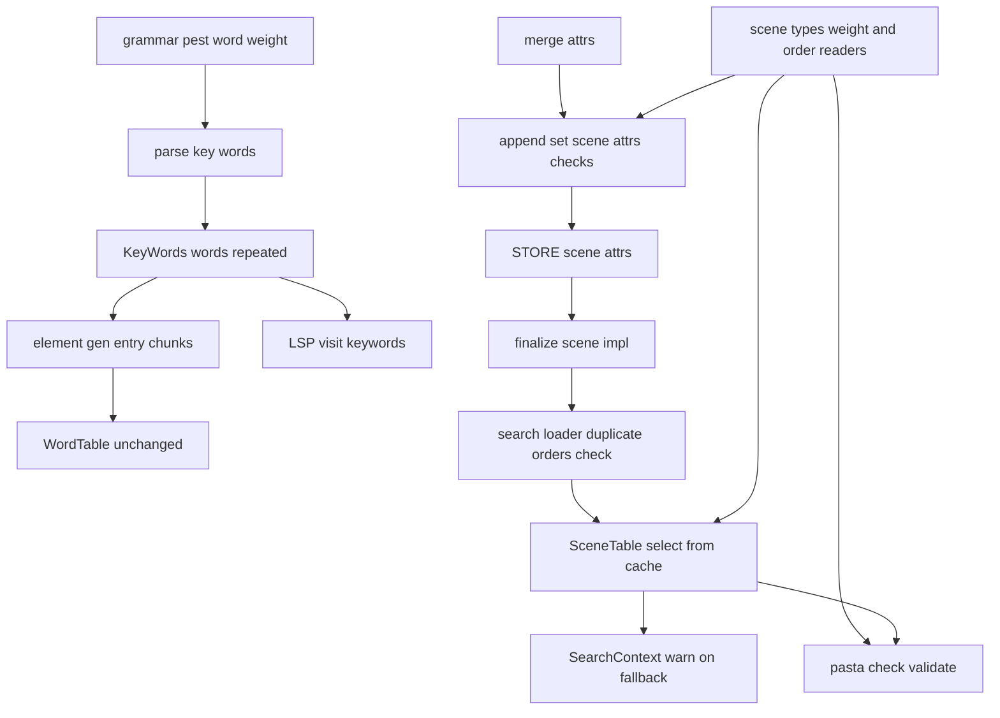
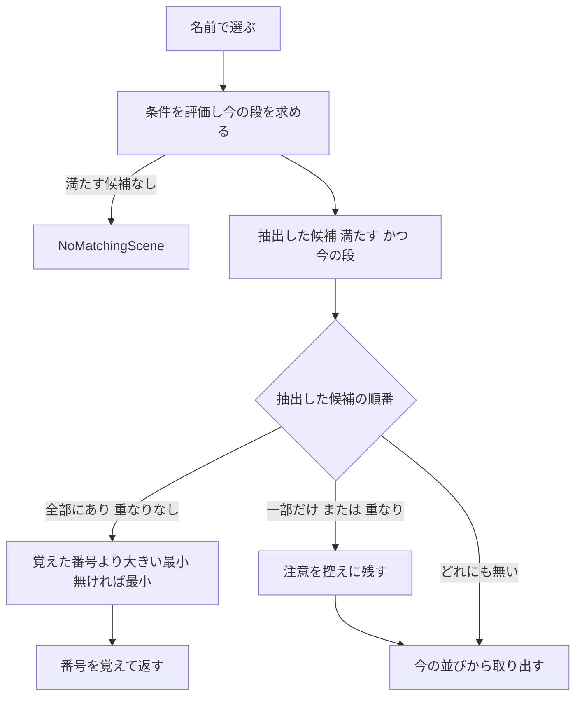

# Design Document: scene-pick-modes

## Overview

**Purpose**: 名前で抽出した候補からの選び方に、重み（`＆重み：数`・`weight`）と順番（`＆順番：番号`・`index`）を足す。重みは抽選テーブルにそのシーンを N 回乗せるだけ、順番はシャッフルの代わりに番号の順に 1 本ずつ出すだけである。単語の値にも `＠整数` で重みを付ける。シーンや値の複写と Lua を書かずに、比率と決まった順の巡回が書ける。

**Users**: ゴーストの作者（emo2・窓際のぱすたさん）。ランダムトークの比率（`＊OnTalk　＆重み：5`）、決まった順の巡回（`＊ボール巡回　＆順番：１０`）、単語・表情の候補の比率（`＠表情：\s[10]＠２、\s[11]`）に使う。

**Impact**: 選ぶ段は 2 つある。(a) 名前・条件・`＆優先` で候補を抽出する段は `scene-condition-attributes` のまま触らない。(b) 抽出した候補から 1 つを取る段だけを変える。シーンは `pasta_core` の `SceneTable::select_from_cache` の中で、並びを作るときに ID を重みの数だけ並べ、抽出した候補が全部 `＆順番` を持つときだけ番号で取る。単語はパーサが値を重みの数だけ並べるので、単語表と Lua は触らない。

### Goals

- シーンの重み・順番を 1 か所（`select_from_cache`）で決め、名前で選ぶ所すべてに同じく効かせる（1.4・2.10）。
- 最後に選んだ番号は、シャッフルの続きと同じくシーン表のメモリの中だけに持つ（2.4）。保存ファイル・予約の名前・保存の表の受け渡しは足さない。
- 値の誤りは `＆優先` の先例（`InvalidPriority`・`priority_errors`）と同じ形で読み込みエラーにし、`pasta_check validate` も同じ判定で知らせる。
- 重みも順番も書かない辞書では、選び方・乱数の消費・応答・ログが今と同じ（9.1〜9.3）。

### Non-Goals

- 候補の抽出（名前・別名・条件・`＆優先`・今の段・巡の始め直し）。`scene-condition-attributes` のまま。
- 属性の構文・倉・受け継ぎ・値の型の解釈（`scene-attribute-store`）。`merge_attrs` は読むだけ。
- 毎回の確率のくじ、重みの上限、順番の「最後で止める」書き方、順番の続きの保存。
- Lua の `WORD.create_*` で作る単語の重み（5.9）。

## Boundary Commitments

### This Spec Owns

- `＆重み`・`weight` と `＆順番`・`index` の意味（重み＝並びに乗せる回数、順番＝番号の順の巡回と最初への戻り）と、値の範囲（重みは 1 以上の整数、順番は整数）。
- 抽出した候補に順番の有る・無いが混ざる・番号が重なるときの注意（warn）とシャッフルへの戻り。
- 最後に選んだ番号の控え（`SceneTable` の中。シャッフルの控え `CachedSelection` と同じ鍵 `SceneCacheKey`・同じ寿命）。
- 読み込みエラー: 重み・順番の値の誤り、同じシーンに重みと順番、同じ名前の中の番号の重なり。
- 単語の値の重み `＠整数` の文法（3 つの値の形）と、`＠０`・値が空の読み込みエラー。
- `pasta_check validate` の 5 つの検査の種類、LSP と VSCode の重みの着色、マニュアルとスキルの `references/` の追従。

### Out of Boundary

- 候補の集め方（`collect_scene_candidates`）、条件の評価（`search/scene_cond.rs`）、今の段の求め方、`NoMatchingScene` の意味。
- `count_scene`・`count_scene_exact`（重みで数を変えない。今のまま触らない。1.5）。
- 名指しの道の選び方の規則（同じ `select_from_cache` を通るので、そこに候補が複数あれば同じく重み・順番が効く。道そのものは変えない）。
- 単語の検索（`WordTable`）と Lua の単語の登録（`word.lua`）。
- 保存ファイル（`pasta/save.lua`・`persistence.rs`）・予約の変数名。

### Allowed Dependencies

- `pasta_core` → 標準ライブラリ・`rand`（今のまま）。`tracing`・`mlua` を足さない（`scene-condition-attributes` の取り決め）。注意は控えに残し、呼ぶ側が出す。
- `pasta_dsl` → `pest`（今のまま）。`pasta_core` に依存しない。
- `pasta_lua` → `pasta_dsl`・`pasta_core`・`mlua`・`tracing`。
- `pasta_check` → `pasta_dsl`・`pasta_core`（`pasta_lua` に依存しない）。`pasta_lsp` → `pasta_dsl`・`pasta_check`。
- 依存の向き: `pasta_dsl`・`pasta_core`（並列）→ `pasta_lua`・`pasta_check` → `pasta_lsp` → VSCode 拡張。逆向きの参照は誤りとする。

### Revalidation Triggers

- `select_from_cache` の並びの作り方（ID を重みの数だけ並べる）と順番の分かれ → `scene-exact-match`（`＞＞` の候補にも同じく効く前提）。
- `KeyWords` に `weight_spans` が増えること → `KeyWords` を作る・読むコード（LSP・テスト）、`novel-variable-scope`（`grammar.pest` を触る）。
- 囲まない単語の値の最後の `＠数` を重みとして読むこと → 今の辞書の出力が変わる（動きが変わる点。8.6）。
- `SceneTableError::DuplicateOrder` と `@pasta_search` の読み込みの失敗 → 読み込みの失敗を見るテスト・止まるエラーの表示。
- `pasta_check` の `FindingKind` の 5 つの追加 → `validate_report_test.rs` の種類の表、VSCode の診断、`debug/validate.md`。

## Architecture

### Existing Architecture Analysis

- シーンの抽選の芯は `SceneTable::select_from_cache`（`crates/pasta_core/src/registry/scene_table.rs` 272〜342 行）。並びは `new_round` が作る（シャッフル 1 回 → `＆優先` の降順に安定に並べ替え）。条件を満たす候補は ID の集合 `ok`、今の段は `tier`。控えは `cache: HashMap<SceneCacheKey, CachedSelection>` で、辞書の再読み込みでシーン表ごと作り直され、`replace_selector`（`set_scene_selector`）で消える。
- 名前で選ぶ道（Call の L2・L5、イベント、選択肢、`OnPastaCallFunction`、名指しの `search_local_scene_exact`）は、どれも `resolve_scene_id_unified`・`resolve_scene_id_exact`・`resolve_global_owning_local_exact` を通り、最後に `select_from_cache` に集まる。
- 属性の読み方は `scene_types.rs` の `PRIORITY_KEYS`・`priority_value`・`scene_priority`（書いた順の後勝ち、倉の外から来た不正な値は既定値）。倉に入る属性は受け継ぎと畳みの後のもの（`merge_attrs`）。
- 値の誤りはトランスパイルの `append_set_scene_attrs`（`scope_gen.rs` 413 行）が `TranspileError::InvalidPriority` にする。受け取る属性は受け継ぎと畳みの後のもの。`pasta_check` は `transpile_rules.rs` の `priority_errors` が同じ判定を写している。
- 単語の値は `KeyWords.words: Vec<String>`。同じ値を重ねて書けば重みになる（`words.md` の「2 回書くと 2 回」）。コード生成は `create_word(k):entry(v1, v2, …)` の 1 行（`element_gen.rs` 498 行）。`entry` は自身を返すので続けて呼べる（`word.lua` 29 行）。
- `pasta_check` は自前の `SceneRegistry` から実物の `SceneTable` を作る（`scenes.rs`）。登録の順は SceneId の順と同じ。

### Architecture Pattern & Boundary Map

選んだ形: **抽出の後の取り出しだけを `select_from_cache` の中で分ける**（gap 分析の案 A。順番の分かれは 20 行ほどで済むので、案 B の独立した部品にはしない）。単語はパーサで値を並べる。



**Architecture Integration**:
- 守る形: 並び＋次の位置の控え、今の段、`NoMatchingScene`、`＆優先` の読み方。重み 1 の候補だけの並びは今と同じ配列になり、乱数の消費も変わらない。
- 足すもの: 重み・順番の読み手（`scene_types.rs`）、最後の番号の控えと注意の控え（`SceneTable`）、番号の重なりの検査（`SceneTable::duplicate_orders`。実行時と `pasta_check` が同じ関数を使う）。
- ステアリング: 文法の権威はマニュアル（`grammar.md`）、ファイルは 600 行の目安（`structure.md`）、`pasta_core` は言語非依存（`tech.md`）。

### Technology Stack

| Layer | Choice / Version | Role in Feature | Notes |
|-------|------------------|-----------------|-------|
| パーサ | pest（今の版） | 単語の値の後ろの `＠数` | 依存の追加なし |
| シーン表 | pasta_core（Rust） | 重みの並び・順番の取り出し・番号の重なり | `tracing` を足さない |
| ランタイム | pasta_lua（mlua・LuaJIT 2.1） | 値の誤りの検査・読み込みの失敗・注意のログ | Lua のスクリプトは触らない |
| 検査 | pasta_check（WASM 共有の核） | 5 つの検査の種類 | VSCode の診断も同じ核 |
| 着色 | pasta_lsp・TextMate 文法 | 重みの `＠数` を数として塗る | |

## File Structure Plan

### Modified Files

**pasta_core**
- `crates/pasta_core/src/registry/scene_types.rs` — `WEIGHT_KEYS`・`ORDER_KEYS`・`weight_value`・`scene_weight`・`scene_order` を `scene_priority` と並べて足す。「最後の宣言を引く」部分は 3 つで共有する（非公開の小さな関数）。
- `crates/pasta_core/src/registry/scene_table.rs` — `new_round` で ID を重みの数だけ並べる。`select_from_cache` に順番の分かれを足す。欄 `last_orders`・`pick_warning`、`take_pick_warning`・`duplicate_orders`、`PickWarning`・`OrderDuplicate` を足す。`replace_selector` は `last_orders` も消す。438 行から 520 行ほどになる見込み。
- `crates/pasta_core/src/registry/mod.rs`・`crates/pasta_core/src/lib.rs` — 新しい公開の名前を書き出す。
- `crates/pasta_core/src/error.rs` — `SceneTableError::DuplicateOrder` を足す。

**pasta_dsl**
- `crates/pasta_dsl/src/parser/grammar.pest` — `word_weight`・値の終わりの先読み・`word_nofenced` の末尾の `＠数` の除外・`＠数` だけの値。
- `crates/pasta_dsl/src/parser/parse_elements.rs` — `parse_key_words` で値を重みの数だけ並べ、`＠０`・空の値・大きすぎる重みを構文エラーにし、`weight_spans` を埋める。
- `crates/pasta_dsl/src/parser/ast/action.rs` — `KeyWords.weight_spans: Vec<Span>` を足す。
- `crates/pasta_dsl/src/partial.rs` — `shift_keywords` で `weight_spans` もずらす。
- `KeyWords { … }` を直に書いているテストと `crates/pasta_lua/src/context.rs`（全 23 か所）— 欄 `weight_spans: vec![]` を足すだけ。

**pasta_lua**
- `crates/pasta_lua/src/code_gen/scope_gen.rs` — `append_set_scene_attrs` に重み・順番の値の検査と、重みと順番の両方の検査を足す。
- `crates/pasta_lua/src/error.rs` — `TranspileError::InvalidWeight`・`InvalidOrder`・`WeightWithOrder` と作り手の関数。
- `crates/pasta_lua/src/code_gen/element_gen.rs` — `generate_word_definition` で値を 200 個ずつの `:entry(…)` に分けて同じ行に続ける（未決 1。前提として採る）。
- `crates/pasta_lua/src/search/mod.rs` — `loader` で `SearchContext` を作った後に番号の重なりを検査し、あれば `LuaError` で読み込みを止める。
- `crates/pasta_lua/src/search/context.rs` — `check_scene_orders`、`resolve_*` の後に `take_pick_warning` を読んで warn を出す小さな関数（`search_scene_by`・`search_local_scene_exact` の 2 か所から呼ぶ）。テストは足さない（1,117 行。テストは別のファイル）。

**pasta_check**
- `crates/pasta_check/src/validate/report.rs` — `FindingKind` の 5 つと `msg` の文。
- `crates/pasta_check/src/validate/transpile_rules.rs` — `priority_errors` を、優先・重み・順番の値と、重みと順番の両方を見る関数に広げる（`append_set_scene_attrs` の写し）。
- `crates/pasta_check/src/validate/scenes.rs` — `SceneModel.positions`（SceneId の順の（パス, 位置））を足し、`table.duplicate_orders()` から `scene-order-duplicate` を出す。
- `crates/pasta_check/src/validate/references.rs` — 名前が決まった Call の候補を引く関数を、有無の判定と混ざりの検査（`call-order-mixed`）で共有する。

**pasta_lsp・VSCode**
- `crates/pasta_lsp/src/analysis/visit_scope.rs` — `visit_keywords` で、重みの位置を `NUMBER`、その間を `WORD` に分けて出す。
- `editors/vscode/syntaxes/pasta.tmLanguage.json` — `word` の値の各形に重みの後置を許し、値の捕捉の中で重みの `＠数` を `constant.numeric.pasta` で塗る。

**マニュアル・スキル**
- `book/src/grammar/block-structure.md`（属性の節。482 行の「まだ選び方を変えない」を改める）・`book/src/grammar/call-jump.md`（候補の選択）・`book/src/grammar/words.md`・`book/src/lua/modules/pasta-search.md`（候補の選び方・`set_scene_selector`）・`book/src/debug/validate.md`（報告の表）。
- `.claude/skills/*/references/` — `node book/tools/gen-skill-refs.mjs` で再生成する（手で直さない）。

### New Files

- `crates/pasta_core/src/registry/scene_table_pick_tests.rs` — 重みの並び・順番の巡回と戻り・飛ばし・混ざりと重なりの注意・`duplicate_orders`・`replace_selector` で番号が消えること（`scene_table.rs` から `#[path]` で読む。控えの欄を直に見るため）。
- `crates/pasta_dsl/tests/word_weight_parse_test.rs` — 3 つの値の形・全角と半角・値の途中の `＠`・誤り。
- `crates/pasta_lua/tests/scene_pick_modes_e2e_test.rs` — 辞書の読み込みから選ばれ方まで（重み・順番・再読み込み・条件の飛ばし・単語の重み 3 種）と、各読み込みエラー。
- `crates/pasta_lua/tests/search/scene_pick_search_test.rs` — `SearchContext` の注意のログ（混ざり・前方一致の番号の重なり）とシャッフルへの戻り。`tests/search/main.rs` に `mod` を 1 行足す。
- `crates/pasta_lsp/tests/word_weight_token_test.rs` — 重みの位置の着色と、値の途中の `＠` が値の色のままであること。

## System Flows

1 回の選択（`select_from_cache`）。1・2 は今のまま。



- 抽出した候補は、述語があれば「`ok` に入り、優先が今の段と同じもの」、述語が無ければ候補の全部（今の挙動で述語が無いときは段を見ないのと同じ）。
- 順番で取るときは並び（`CachedSelection`）に触らない。並びがまだ無くても作らないので、乱数を使わない（8.4）。
- 並びは重み N の ID を N 個含む。シャッフル・優先の並べ替え・「見て漏れた札も使った」・巡の始め直しは今のまま効く（`ok` は集合なので重なりに強い）。

## Requirements Traceability

| Requirement | Summary | Components | Interfaces | Flows |
|-------------|---------|------------|------------|-------|
| 1.1 | 重み N を N 回乗せる | SceneTable | `new_round`・`scene_weight` | 1 回の選択 |
| 1.2 | 無ければ 1 回 | SceneTypes | `scene_weight` | |
| 1.3 | `重み`・`weight` | SceneTypes | `WEIGHT_KEYS` | |
| 1.4 | 名前で選ぶ所すべて | SceneTable | `select_from_cache`（3 つの `resolve_*` が通る） | 1 回の選択 |
| 1.5 | シーン数は変えない | （変更なし） | `count_scene_by` | |
| 2.1 | 全部に順番があれば番号で | SceneTable | 順番の分かれ | 1 回の選択 |
| 2.2 | 大きい番号が無ければ最小 | SceneTable | 順番の分かれ | 1 回の選択 |
| 2.3 | 覚えた番号が無ければ最小 | SceneTable | `last_orders` | 1 回の選択 |
| 2.4 | メモリの中だけ・名前ごと | SceneTable | `last_orders: HashMap<SceneCacheKey, i64>` | |
| 2.5 | `順番`・`index` | SceneTypes | `ORDER_KEYS` | |
| 2.6 | 番号は飛んでよい | SceneTable | 「より大きい最小」 | |
| 2.7 | 番号だけで決める | SceneTable | 番号で比べる（ID の順を使わない） | |
| 2.8 | 外れた番号は飛ばす・無ければ今のまま | SceneTable | 抽出した候補だけを見る | 1 回の選択 |
| 2.9 | 最後で止めない | SceneTable | 戻りだけ | |
| 2.10 | 名前で選ぶ所すべて | SceneTable | 1.4 と同じ | |
| 3.1 | 混ざり・重なりは注意してシャッフル | SceneTable, SearchContext | `PickWarning`・`take_pick_warning`・warn | 1 回の選択 |
| 3.2 | 重みと順番の両方は読み込みエラー | ScopeGen, TranspileRules | `WeightWithOrder` | |
| 3.3 | 同じ名前の番号の重なりは読み込みエラー | SceneTable, SearchLoader, ScenesCheck | `duplicate_orders`・`DuplicateOrder` | |
| 4.1 | 重みは 1 以上の整数 | SceneTypes | `weight_value` | |
| 4.2 | 重みの誤りは読み込みエラー | ScopeGen | `InvalidWeight` | |
| 4.3 | 順番は整数（0・負も可） | SceneTypes | `priority_value` を使う | |
| 4.4 | 順番の誤りは読み込みエラー | ScopeGen | `InvalidOrder` | |
| 4.5 | 2 回書いたら後の値 | SceneTypes | 最後の宣言を引く（倉の畳みの後） | |
| 4.6 | 重みに上限なし | SceneTypes | `scene_weight` は上限を設けない | |
| 5.1 | 値を重みの回数だけ乗せる | ParseKeyWords | 値を並べる | |
| 5.2 | `＠`・`@`、全角・半角の数字 | Grammar | `at`・`digit` | |
| 5.3 | 3 つの値の形 | Grammar | `word ~ word_weight?` | |
| 5.4 | 囲まない値の末尾だけ | Grammar | `word_nofenced` の除外 | |
| 5.5 | 3 種の単語 | ParseKeyWords | `KeyWords` は 3 種で共通 | |
| 5.6 | 無ければ 1・重ねは足す | ParseKeyWords | 並べるだけ | |
| 5.7 | 前方一致で集めても同じ | （変更なし） | `WordTable` は並んだ値を集める | |
| 5.8 | `＠０`・空の値は読み込みエラー | ParseKeyWords | 構文エラー | |
| 5.9 | `WORD.create_*` は範囲の外 | （変更なし） | | |
| 6.1 | 読み込みエラーと同じ誤りを validate | TranspileRules, ScenesCheck | 4 種の `FindingKind`・`Syntax` | |
| 6.2 | Call の候補の混ざりを validate | ReferencesCheck | `CallOrderMixed` | |
| 6.3 | 報告の表に載せる | Manual | `debug/validate.md` | |
| 6.4 | VSCode の診断も同じ | （核の共有） | `ghostValidator.ts` は同じ核 | |
| 7.1 | 重みを別の色で | LspTokens, TmGrammar | `NUMBER`・`constant.numeric.pasta` | |
| 7.2 | 途中の `＠` は値の色 | LspTokens, TmGrammar | `weight_spans` に入らない | |
| 7.3 | 属性の塗り方は変えない | （変更なし） | | |
| 8.1 | 属性の節 | Manual | `block-structure.md` | |
| 8.2 | 候補の選択・選び方 | Manual | `call-jump.md`・`pasta-search.md` | |
| 8.3 | 単語の重み | Manual | `words.md` | |
| 8.4 | `set_scene_selector` と順番 | Manual, SceneTable | 順番は並びを作らない | |
| 8.5 | references の再生成 | SkillRefs | `gen-skill-refs.mjs` | |
| 8.6 | 動きが変わる点を squash の題に | Migration | `!` の題 | |
| 9.1 | 書かない辞書は今と同じ | SceneTable | 重み 1 の並びは今と同じ | |
| 9.2 | 単語も今と同じ | Grammar | `＠数` が無ければ同じ構文木 | |
| 9.3 | 条件・優先の挙動を変えない | SceneTable | 抽出の段を触らない | |
| 9.4 | 端から端のテスト | Tests | `scene_pick_modes_e2e_test.rs` | |
| 9.5 | 実行時と validate の一致 | Tests | `validate_parity_test.rs` | |
| 9.6 | x86・x64 | Tests | 重みは `usize` へ飽和で写す | |

## Components and Interfaces

| Component | Domain/Layer | Intent | Req Coverage | Key Dependencies | Contracts |
|-----------|--------------|--------|--------------|------------------|-----------|
| SceneTypes | pasta_core | 重み・順番の読み手と値の範囲 | 1.2, 1.3, 2.5, 4.1, 4.3, 4.5, 4.6 | なし | Service |
| SceneTable | pasta_core | 重みの並び・順番の取り出し・番号の重なり | 1.1, 1.4, 2.1〜2.10, 3.1, 3.3, 8.4, 9.1, 9.3 | SceneTypes (P0) | Service, State |
| Grammar・ParseKeyWords | pasta_dsl | 単語の値の重みの文法と展開 | 5.1〜5.8, 9.2 | pest (P0) | Service |
| ScopeGen | pasta_lua | 重み・順番の値の誤りと両方書きの読み込みエラー | 3.2, 4.2, 4.4 | SceneTypes (P0), merge_attrs (P0) | Service |
| WordGen | pasta_lua | 値の多い単語の `:entry` の分割 | 5.1 | なし | Service |
| SearchLoader・SearchContext | pasta_lua | 番号の重なりで読み込みを止める・注意のログ | 3.1, 3.3 | SceneTable (P0), tracing (P1) | Service |
| ValidateChecks | pasta_check | 5 つの検査の種類 | 6.1〜6.4 | SceneTypes (P0), SceneTable (P0) | Service |
| LspTokens・TmGrammar | pasta_lsp・VSCode | 重みの着色 | 7.1〜7.3 | KeyWords (P0) | — |
| Manual・SkillRefs | book | 書き方の権威と生成スキル | 6.3, 8.1〜8.5 | gen-skill-refs (P1) | — |

### pasta_core

#### SceneTypes

| Field | Detail |
|-------|--------|
| Intent | 宣言の属性から重み・順番を読む。読み込みの検査と実行時の両方の規則の元 |
| Requirements | 1.2, 1.3, 2.5, 4.1, 4.3, 4.5, 4.6 |

**Responsibilities & Constraints**
- 宣言のうち、名前が鍵の組に入る最後のもの（書いた順の後勝ち。倉の畳みの後なのでファイル属性はシーン側に負けている）を引く。`重み` と `weight` が両方あれば後に書いた方。
- 倉の外（Lua から直接入れた属性）の不正な値は、優先の先例と同じく既定値にする（重み 1・順番なし）。`shortcut:` の注記を付ける。

**Contracts**: Service [x]

```rust
pub const WEIGHT_KEYS: [&str; 2] = ["重み", "weight"];
pub const ORDER_KEYS: [&str; 2] = ["順番", "index"];

/// 重みとして受け付ける値。1 以上の Integer だけ
pub fn weight_value(value: &SceneAttrValue) -> Option<i64>;
/// シーンの重み。無い・不正なら 1。i64 から usize へは飽和で写す（x86 は 32 ビット）
pub fn scene_weight(attrs: &[SceneAttr]) -> usize;
/// シーンの順番。値の判定は priority_value と同じ（整数なら受け付ける）。無い・不正なら None
pub fn scene_order(attrs: &[SceneAttr]) -> Option<i64>;
```

#### SceneTable

| Field | Detail |
|-------|--------|
| Intent | 抽出した候補から 1 つを取る。重みの並び、順番の取り出し、最後の番号の控え |
| Requirements | 1.1, 1.4, 2.1〜2.10, 3.1, 3.3, 8.4, 9.1, 9.3 |

**Responsibilities & Constraints**
- `new_round`: 候補の ID を `scene_weight` の数だけ並べてからシャッフルし、優先の降順に安定に並べ替える。重みが全部 1 なら今と同じ配列・同じ乱数の消費。
- 順番の分かれ（述語の評価と今の段の後、並びを作る前）:
  - 抽出した候補の全部に `scene_order` があり、番号が重ならなければ、`last_orders[鍵]` より大きい番号のうち最小のもの、無ければ（または覚えた番号が無ければ）最小のものを返し、その番号を覚える。並びには触らない。
  - 一部だけにある、または番号が重なれば、`pick_warning` に理由を残して今の取り出しへ進む。
  - どれにも無ければ、黙って今の取り出しへ進む。
- `pick_warning` は `select_from_cache` の入り口で空にする（前の選択の注意を持ち越さない）。
- `replace_selector` は `cache` と一緒に `last_orders` も消す（シャッフルの続きが消えるときは番号も消える。2.4）。辞書の再読み込みはシーン表を作り直すので消える。
- `duplicate_orders`: `prefix_index` のキーごと（グローバルは別名を置き換えた後の照合用の名前、ローカルは `:親の登録名:名前`。どちらも「同じ名前」の単位）に、同じ番号を持つシーンの組を返す。順は `prefix_index`（`BTreeMap`）の順、組の中は SceneId の順で決まる。

**Dependencies**
- Inbound: SearchContext・SearchLoader（P0）、pasta_check の scenes・references（P0）
- Outbound: SceneTypes（P0）、RandomSelector（今のまま）

**Contracts**: Service [x] / State [x]

```rust
/// 順番で選べず、シャッフルへ戻った理由
#[derive(Debug, Clone, PartialEq, Eq)]
pub enum PickWarning {
    /// 抽出した候補に `＆順番` の有るものと無いものが混ざっている
    OrderMixed,
    /// 抽出した候補に同じ番号が 2 つ以上ある（前方一致で別の名前から集まったとき）
    OrderDuplicate { order: i64 },
}

/// 同じ名前の中で同じ番号を持つシーンの組
#[derive(Debug, Clone, PartialEq, Eq)]
pub struct OrderDuplicate {
    /// prefix_index のキー（グローバルは照合用の名前、ローカルは `:親の登録名:名前`）
    pub key: String,
    pub order: i64,
    /// 2 つ以上。SceneId の順
    pub scenes: Vec<SceneId>,
}

impl SceneTable {
    /// 直前の選択でシャッフルへ戻った理由。読むと空になる
    pub fn take_pick_warning(&mut self) -> Option<PickWarning>;
    /// 同じ名前の中の番号の重なり（無ければ空）
    pub fn duplicate_orders(&self) -> Vec<OrderDuplicate>;
}
```

##### State Management
- 足す欄: `last_orders: HashMap<SceneCacheKey, i64>`（最後に選んだ番号）、`pick_warning: Option<PickWarning>`。
- 鍵は並びの控えと同じ `SceneCacheKey`（グローバル名・探した名前・完全一致か・持ち主のローカル）。探した名前ごと・前方一致と完全一致で別に覚える。
- 永続化しない。シーン表の寿命（辞書の読み込みからゴーストの終了・再読み込みまで）と同じ。

```rust
// pasta_core/src/error.rs
pub enum SceneTableError {
    // 今の 3 つに足す
    /// 同じ名前のシーンに同じ `＆順番` の番号が 2 つ以上ある（読み込みエラー）
    #[error("`＆順番` の番号 {order} が同じ名前のシーン `{scene}` に 2 つ以上ある: {fn_names:?}")]
    DuplicateOrder { scene: String, order: i64, fn_names: Vec<String> },
}
```

**Implementation Notes**
- Validation: 重みの数だけ並べるのは、今の「同じシーンを複写したとき」と同じ動き（1.1）。テストでは `MockRandomSelector` の位置の列が重なった ID にも効くことを確かめる。
- Risks: 重みに上限が無いので、極端な値（数億）は並びのメモリが尽きる。実用の重み（数百まで）は問題ない（Performance の節）。

### pasta_dsl

#### Grammar・ParseKeyWords

| Field | Detail |
|-------|--------|
| Intent | 単語の値のすぐ後ろの `＠整数` を重みとして読み、値を重みの数だけ並べる |
| Requirements | 5.1〜5.8, 9.2 |

**Responsibilities & Constraints**
- 文法（`grammar.pest`）:
  - `words` の各項目を「値 ＋ 重み（任意）」にする。重み `word_weight` は `at ~ digit+`（`＠`・`@`、全角・半角の数字）。
  - 値の終わり `word_end` は「空白の後に読点・改行・入力の終わり」。
  - 囲まない値 `word_nofenced` は「`word_weight ~ word_end` が続く位置」の手前で止まる。値の途中の `＠３`（後ろに文字が続くもの）は今までどおり値の文字。
  - 値の無い `＠数`（`＠挨拶：＠３`）も 1 項目として読み、パースで誤りにする（汎用の構文エラーにせず、単語と値を示すため）。後ろに文字が続く `＠３abc` は今までどおり囲まない値として読む（先読みで区別する）。
- `parse_key_words`:
  - 重みがあれば直前の値を重みの数だけ `words` に積む。無ければ 1 つ。同じ値の重ね（`A＠２、A`）は積んだ結果として足し合わされる（5.6）。
  - 重みが 0（`＠０`・`＠００`）、重みを除いた値が空（`＠３` だけ・`「」＠３`・`""＠３`）、`usize` に収まらない重みは構文エラー（`syntax_error`。ファイル・行・列と、単語の名前と書いた値を文に入れる）。
  - 重みの `＠数` の位置を `weight_spans` に書いた順で積む（着色のため）。
- `KeyWords` はグローバル・ローカル・アクター辞書の単語で共通なので、3 種に同じく効く（5.5）。コード生成・Lua・`WordTable` は値の並びを見るだけなので変わらない（5.7）。

**Contracts**: Service [x]

```rust
pub struct KeyWords {
    pub names: Vec<String>,
    /// 値の並び。重み N の値は N 個並ぶ
    pub words: Vec<String>,
    /// 重みの `＠数` の位置（書いた順。着色だけが読む）
    pub weight_spans: Vec<Span>,
    pub span: Span,
}
```

- Invariants: `＠数` を書かない行の `words` は今と同じ。`weight_spans` は `span` の中にある。

### pasta_lua

#### ScopeGen（値の誤り）

| Field | Detail |
|-------|--------|
| Intent | 受け継ぎと畳みの後の属性で、重み・順番の値と両方書きを読み込みエラーにする |
| Requirements | 3.2, 4.2, 4.4 |

**Responsibilities & Constraints**
- `append_set_scene_attrs` の今の優先の検査に並べる。宣言の名前が `WEIGHT_KEYS` で `weight_value` が `None` なら `InvalidWeight`、`ORDER_KEYS` で `priority_value` が `None` なら `InvalidOrder`（位置は属性の位置）。
- 値の検査の後、重みの宣言と順番の宣言が両方あれば `WeightWithOrder`（位置は順番の属性の位置）。ファイル属性から受け継いだ重みとシーンの順番の組も、この時点の並びに両方あるので同じく誤り（決定事項）。
- 同じ名前の中の番号の重なりはファイルをまたぐので、ここでは見ない（SearchLoader）。

**Contracts**: Service [x]

```rust
pub enum TranspileError {
    // 今の InvalidPriority の後に足す
    #[error("`＆重み` の値は 1 以上の整数で書く: `{value}` at {span}")]
    InvalidWeight { value: String, span: SpanDisplay },
    #[error("`＆順番` の値は整数で書く: `{value}` at {span}")]
    InvalidOrder { value: String, span: SpanDisplay },
    #[error("`＆重み` と `＆順番` は同じシーンに書けない at {span}")]
    WeightWithOrder { span: SpanDisplay },
}
```

#### WordGen（`:entry` の分割）

| Field | Detail |
|-------|--------|
| Intent | 値の多い単語でも Lua の 1 回の呼び出しの引数の上限に当たらないようにする |
| Requirements | 5.1 |

**Responsibilities & Constraints**
- 重みで値が増えると、`create_word(k):entry(v1, …, vN)` の N が Lua の 1 回の呼び出しの上限（約 250。PUC Lua 5.4 で 250 は通り 260 は「too many registers」で失敗することを確かめた。LuaJIT も同じ程度）を超えやすい。
- 値を 200 個ずつに分け、`:entry(…):entry(…)` と同じ行に続ける（`entry` は自身を返す）。出力の行の数とソースマップの対応は変わらない。200 個以下の単語の出力は今と同じ。
- **前提（未決 1）**: 開発者の方針は「パーサで並べて、コード生成・Lua・単語表は触らない」だったが、コード生成のこの 1 か所だけは触る必要がある。

#### SearchLoader・SearchContext

| Field | Detail |
|-------|--------|
| Intent | 番号の重なりで読み込みを止め、シャッフルへ戻ったときに注意を出す |
| Requirements | 3.1, 3.3 |

**Responsibilities & Constraints**
- `search::loader` は `SearchContext` を作った直後に `check_scene_orders` を呼び、`duplicate_orders` の最初の組を `SceneTableError::DuplicateOrder`（シーンの名前・番号・各シーンの関数名）にして `LuaError::external` で返す。`finalize_scene` が失敗し、起動のモジュール `pasta.scene_dic` の読み込みの失敗として止まる（今の読み込みの失敗と同じ道）。
- `search_scene_by` と `search_local_scene_exact` は `resolve_*` の後に `take_pick_warning` を読み、あれば `tracing::warn!(target: "pasta_lua::search", name, reason, …)` を出す。理由は「順番の有るものと無いものが混ざっている」「同じ番号 N が 2 つ以上ある」。

**Contracts**: Service [x]

```rust
impl SearchContext {
    /// 同じ名前の中の番号の重なりがあれば DuplicateOrder
    pub fn check_scene_orders(&self) -> Result<(), SearchError>;
}
```

### pasta_check

#### ValidateChecks

| Field | Detail |
|-------|--------|
| Intent | 読み込みエラーになる重み・順番の誤りと、名前が決まった Call の混ざりを知らせる |
| Requirements | 6.1〜6.4 |

**Responsibilities & Constraints**
- 足す `FindingKind`（すべて Error）:

| 種類 | code | 読み込みを止めるか | 出す所 |
|------|------|--------------------|--------|
| `TranspileInvalidWeight` | `transpile-invalid-weight` | 止める | `transpile_rules.rs` |
| `TranspileInvalidOrder` | `transpile-invalid-order` | 止める | `transpile_rules.rs` |
| `TranspileWeightWithOrder` | `transpile-weight-with-order` | 止める | `transpile_rules.rs` |
| `SceneOrderDuplicate` | `scene-order-duplicate` | 止める | `scenes.rs` |
| `CallOrderMixed` | `call-order-mixed` | 止めない（実行時は注意してシャッフル） | `references.rs` |

- 単語の重みの誤り（5.8）はパーサの構文エラーなので、今の `Syntax` として同じ文で出る。新しい種類は要らない。
- `transpile_rules.rs`: `priority_errors` を、優先・重み・順番の値と両方書きを見る関数に広げる。受け継いだファイル属性の誤りは位置ごとに 1 回（今の `reported` のまま）。
- `scenes.rs`: 登録と同じループで、SceneId の順に（パス, 位置）を `SceneModel.positions` に積む。`table.duplicate_orders()` の各組で、2 つ目以降のシーンに「最初のシーンの位置」を示す誤りを付ける（`collisions` と同じ示し方）。実行時と同じ関数なので、判定は一致する。
- `references.rs`: Call の候補を引く関数（ローカル → 組み込み → グローバル。今の `found_local`・`found_global` と同じ順）を有無の判定と共有し、候補を `scene_priority` で組に分け、同じ組に `scene_order` の有るものと無いものがあれば、Call の位置に、順番の無い候補の位置を文に並べて出す。条件は見ない。
- VSCode の診断は同じ核（WASM）を使うので、追加の作業は無い（6.4）。

### pasta_lsp・VSCode（着色）

- `visit_keywords`: `weight_spans` が空なら今と同じ 1 つの `WORD`。あれば、`span` を重みの位置で区切り、重みを `NUMBER`、その間を `WORD` として出す（7.1）。値の途中の `＠` は `weight_spans` に入らないので値の色のまま（7.2）。
- `pasta.tmLanguage.json` の `word`: 値の各形（囲み・さくらスクリプト・囲まない値）に重みの後置を許し、囲まない値の形は値の終わりの直前の `＠数` を含めない。値の捕捉の中で重みを `constant.numeric.pasta` で塗る。属性の規則は触らない（7.3）。

## Data Models

- 増える状態は `SceneTable` の `last_orders`・`pick_warning` の 2 つだけ。保存ファイル・倉（`STORE.scene_attrs`）・Lua の表の形は変わらない。
- 構文木は `KeyWords.weight_spans` が増えるだけ。`words` の形は変わらない（値が重みの数だけ並ぶ）。

## Error Handling

### Error Strategy

| 誤り | いつ | 形 | 示すもの |
|------|------|----|----------|
| 重みが 1 以上の整数でない | トランスパイル | `TranspileError::InvalidWeight` | 位置・書いた値 |
| 順番が整数でない | トランスパイル | `TranspileError::InvalidOrder` | 位置・書いた値 |
| 同じシーンに重みと順番 | トランスパイル | `TranspileError::WeightWithOrder` | 順番の属性の位置 |
| 同じ名前の番号の重なり | `finalize_scene`（全ファイルが揃った後） | `SceneTableError::DuplicateOrder` → `LuaError` | 名前・番号・関数名 |
| 単語の重み 0・値が空・大きすぎる | パース | `ParseError`（構文エラー） | 位置・単語・値 |
| 抽出した候補の混ざり・前方一致の番号の重なり | 選ぶとき | warn のログ（止めない） | 探した名前・理由 |

- 読み込みエラーはどれも今の読み込みの失敗の道に乗る（トランスパイルの失敗・起動のモジュールの失敗）。止まるエラーのバルーン（`runtime-error-balloon`）の扱いは今のまま。
- Lua から直接入れた不正な重み・順番は既定値にして黙る（`＆優先` の先例と同じ shortcut）。

### Monitoring

- 注意は `target: "pasta_lua::search"`（条件の注意と同じ）。名前・理由を欄で出す。

## Testing Strategy

### Unit Tests

- `scene_table_pick_tests.rs`: 重み 3・2・1 の候補で 1 巡に 3・2・1 回出る（1.1・1.2）。順番 10・20・30 が 10 → 20 → 30 → 10 と巡る（2.1・2.2・2.3）、15 を足すと間に入る（2.6）、登録の順を入れ替えても順が同じ（2.7）。条件で 20 を外すと 10 → 30（2.8）。混ざり・前方一致の重なりで `take_pick_warning` が理由を返し、シャッフルで選ぶ（3.1）。順番で取るとき乱数を使わない（`MockRandomSelector` の列を消費しない。8.4）。`replace_selector` で最初からに戻る（2.4）。重み・順番の無い候補で今のテストの期待が変わらない（9.1）。`duplicate_orders` がグローバル（別名の後）とローカルの組を返す（3.3）。
- `scene_types.rs` の内部テスト: `scene_weight`・`scene_order` の後勝ち・別名・既定値・不正な値（4.1・4.3・4.5）、`i64::MAX` の重みが x86 でも飽和する（9.6）。
- `word_weight_parse_test.rs`: 3 つの値の形と全角・半角（5.2・5.3）、末尾だけを読む（`a＠3b`・`a＠３ ＃メモ` は値のまま。5.4）、重ねの足し合わせ（5.6）、`＠０`・`＠３` だけ・`「」＠３` の構文エラーの文（5.8）、`＠数` の無い行の構文木が今と同じ（9.2）、`weight_spans` の位置。

### Integration Tests

- `scene_pick_modes_e2e_test.rs`（読み込みから選ばれ方まで。9.4）: 5:2:1 の重みの 1 巡の回数、順番の巡回と戻り、辞書の再読み込みで最初からに戻る（2.4）、条件で外れた番号の飛ばし、`＞＞` が入るまでは完全一致の検索 `search_scene_exact` で重みが効く（1.4）、`＠シーン数` が重みで変わらない（1.5）、単語の重み（3 つの値の形 × グローバル・ローカル・アクター辞書。5.3・5.5）、前方一致で集めた単語の重み（5.7）、値 300 個の単語が読み込める（WordGen）。各読み込みエラー（3.2・3.3・4.2・4.4・5.8）の文に位置・値が入る。
- `tests/search/scene_pick_search_test.rs`: 混ざり・重なりの warn に名前と理由が入る（3.1。`tracing-test`）。
- `pasta_check`: `validate_rules_test.rs` に 5 種の検出と位置、`validate_report_test.rs` の種類と記号の表に 5 行、`validate_parity_test.rs` の `stops_loading` に 4 種を足し、同じ辞書で実行時の読み込みの失敗と一致すること（9.5）。`CallOrderMixed` だけの辞書は読み込める。
- `word_weight_token_test.rs`（LSP）と `tmGrammar.test.ts`（VSCode）: 重みの位置が数の色、途中の `＠` が値の色（7.1・7.2）。

### x86・x64

- 上のテストは x86 と x64 の両方で走らせる（9.6）。重みの `usize` への写しは飽和にし、`cfg(target_pointer_width)` で期待を分ける必要があるのは `i64::MAX` の重みのテストだけ。

## Performance & Scalability

- 重み N のシーンは並びに N 個入る（メモリは ID 1 つで 8 バイト）。順番の分かれは選ぶたびに抽出した候補を 1 回見るだけ（候補の数に比例）。
- 単語の重み N は、生成する Lua の値の並びと単語表の中で N 個になる。重みに上限は無いので、極端な値（数百万以上）はファイルの大きさとメモリが比例して増える。実用の値（数百まで）は問題ない。

## Migration Strategy

- 動きが変わる点: 囲まない単語の値の最後の `＠数` が、文字でなく重みとして読まれる。最後が `＠０` の囲まない値は読み込みエラーになる。リポジトリの `.pasta` には当てはまる値が無い（gap 分析で確かめた）。
- 統合の squash の題に `!` を付け（例: `feat(scene-pick-modes)!: …`）、0.5.0 のリリースノートの「動きが変わる変更」に載せる（8.6）。マニュアルの `words.md` に「最後に `＠３` という文字を出すときは「」で囲む」を書く（8.3）。
- 保存ファイルの形は変わらないので、移行の作業は無い。
