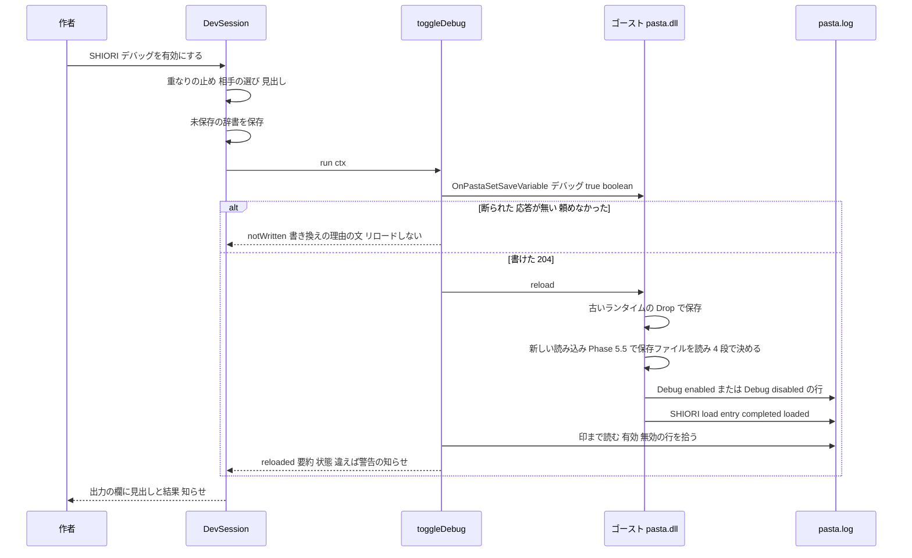
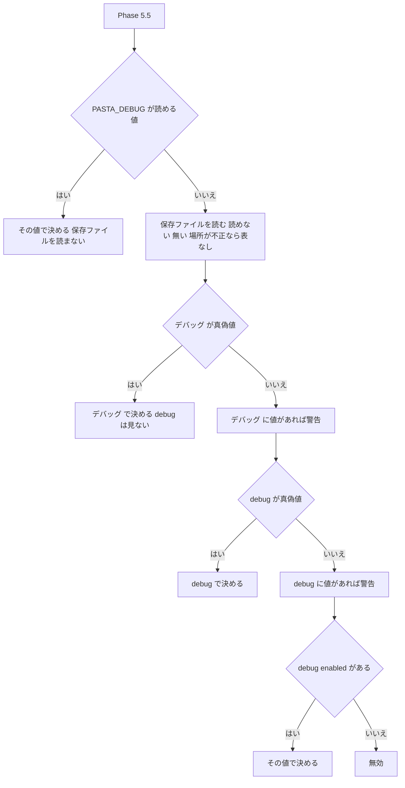
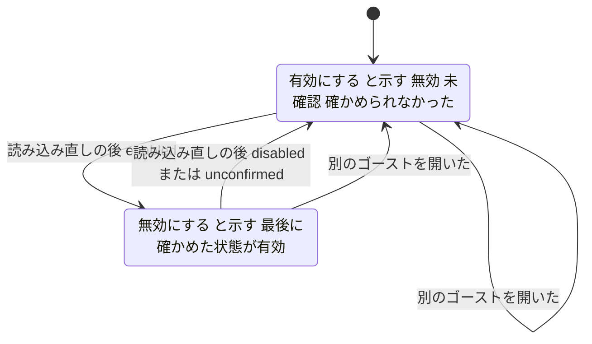

# 設計: shiori-debug-toggle

## Overview

**Purpose**: ゴーストの作者が、配る `pasta.toml` に触れずに、手元でデバッグを入れたり切ったりできるようにする。保存変数 `＄＊デバッグ`（英語名 `＄＊debug`）の真偽値を、SHIORI の読み込みのときに 1 回だけ読み、有効・無効を決める。

**Users**: VSCode 拡張か pasta-recipe でゴーストを書き、▶ や保存変数の表示を使う作者（英語圏の作者を含む）。

**Impact**: 有効の判断を `PASTA_DEBUG` ＞ `[debug] enabled` ＞ 無効 の 3 段から、`PASTA_DEBUG` ＞ `＄＊デバッグ`／`＄＊debug` ＞ `[debug] enabled` ＞ 無効 の 4 段に広げる。判断の場所と時期（ローダの Phase 5.5、Lua が起きる前）は変えない。道具には「保存変数を書く → リロード → 有効・無効を出す」のトグルを足し、無効なときの案内をトグルへ向ける。

### Goals

- 読み込みのときに、前に下ろしたときに保存された `デバッグ`・`debug` の真偽値で有効・無効を決める（1.1〜1.9）。
- 道具は、ログの設定に左右されずに読み込みの後の有効・無効を読み、結果に出す（5.4・5.5）。
- VSCode 拡張と pasta-recipe が同じ流れと同じ文を使う（5.11・8.2）。
- マニュアルとスキルの `references/` を同じ変更で直す（9.1〜9.9）。

### Non-Goals

- `PASTA_DEBUG` と `[debug] enabled` の読み方の変更。
- 読み込みをせずに有効・無効を切り替えること。
- 保存変数の名前を `pasta.toml` で変える口、DSL の真偽値の書き方。
- グローバル変数の保存の仕組み（書式・場所・gzip・退避・保存の時期）の変更。
- `pasta.toml` の設定へ戻す 3 つ目の操作（5.12）。

## Boundary Commitments

### This Spec Owns

- 有効の判断の 4 段と、保存変数の段の決め方（`デバッグ` → `debug` の順・真偽値だけ・見た名前の警告）。
- 読み込みのときの有効・無効の 1 行（有効は今の文、無効は新しい文）と、その行の target。
- 道具の共通のトグルの流れ（`editors/shared/debugToggle.ts`）と、その結果の文・知らせの文。
- 保存ファイルの場所を決める関数 `save_file_path`（`persistence::register` の中の確かめを切り出すだけ。保存の振る舞いは変えない）。
- `ReloadOutcome` の有効・無効の欄と、そこから状態を決める関数 `debugStateOf`。
- VSCode 拡張の 2 つのコマンド、pasta-recipe のトグルのボタンとその向き。
- `DEBUG_HINT`・`NO_SCRIPT_GUIDE` の文。
- マニュアルの該当の章と、スキルの `references/` の作り直し。

### Out of Boundary

- グローバル変数の保存と読み込み（`pasta/save.lua`・`persistence::load_impl`・`read_or_quarantine`・`save_table`・`SaveGate`）。この spec は保存ファイルを**読むだけ**で、書かない・退避しない・印を置かない。
- `OnPastaSetSaveVariable`（`external_control.lua`）の振る舞い（4.2）。
- 開発用のイベント（`OnPastaScene`・`OnPastaSceneAt`・`OnPastaDumpVariables`）の中身と、その門（`scene_play.lua`・`@pasta_debug`）。
- シーンマップの作り方と渡し方（`build_source_map`・`factory.rs`・`module_registry.rs`）。
- `pasta_shiori` の読み込みの入口と印の行（`windows.rs`・`v3.rs`）。
- 巻き戻し（`novel-checkpoint-rollback`）の対象の名前の決まり。

### Allowed Dependencies

- Rust: `loader/mod.rs` → `debug::resolve_enabled`（純粋）・`runtime::persistence::{load_from_file, save_file_path}`・`logging::LOAD_ENTRY_TARGET`。`debug/config.rs` は `toml` と `tracing` だけを使い、ファイルも Lua も触らない。
- 道具: `debugToggle.ts` → `dumpVariables.ts`（`setSaveVariable`・`formatSet`）・`reloadShiori.ts`（`reloadAndWait`・`formatReload`）・`devSession.ts`（`Report` の型）。`vscode/src/devCommands.ts`・`recipe/src/devActions.ts` → `debugToggle.ts`。共有のモジュールは vscode・Tauri に触らない。
- 依存の向き（左が下）: `ghostFiles` → `reloadShiori` → `dumpVariables` → `debugToggle` → `devCommands`（VSCode）／`devActions` → `main.ts`（recipe）。逆向きの import は違反とする。

### Revalidation Triggers

- 有効・無効の 2 つの行の文か target を変える（道具の `debugDecision` が読めなくなる）。
- `LOAD_ENTRY_TARGET` がログの設定に左右されるようになる。
- 保存ファイルの場所の決まり（`[persistence]`・`effective_file_path`・`save_file_path`）か書式を変える。
- グローバル変数の保存の時期（ランタイムの Drop）か、リロードで古いランタイムを先に落とす順を変える（「書く → リロード → 読む」が崩れる）。
- `ReloadOutcome` の形を変える（▶・リロード・トグル・recipe のボタンが使う）。
- 予約グローバル変数の決まり（`grammar/variables.md`）を変える。

## Architecture

### Existing Architecture Analysis

- 判断は `crates/pasta_lua/src/debug/config.rs` の `resolve_enabled(file)`（中は純粋な `pick(env, file)`）1 か所で、ローダの Phase 5.5 が 1 回だけ呼ぶ。真のときだけ `build_source_map` を呼び、`Some(SourceMap)` をランタイムへ渡す。`runtime.debug_enabled()` は `source_map.is_some()`。
- グローバル変数は Lua の `pasta/save.lua` が最初の `require` で `@pasta_persistence.load()` から読む（Phase 5.5 より後）。保存はランタイムの Drop。リロードは古いランタイムを先に落として（保存してから）新しく読み込む。
- 道具の読み込み直しは `reloadAndWait` が pasta.log を印 `SHIORI load entry completed … loaded=…` まで読み、ERROR・WARN を集める。info の行は捨てている。
- 印の target `pasta::load_entry` は、`build_filter_from` が最後に足す指示によって、`[logging]` の `level`・`filter`・`PASTA_LOG` のどれでも info が通る。

### Architecture Pattern & Boundary Map

```mermaid
graph TB
    subgraph pasta_lua
        Loader[loader mod Phase 5.5]
        Resolve[debug config resolve_enabled]
        Persist[runtime persistence load_from_file save_file_path]
        Log[pasta log LOAD_ENTRY_TARGET]
    end
    subgraph editors_shared
        GhostFiles[ghostFiles debugDecision DEBUG_HINT]
        Reload[reloadShiori reloadAndWait]
        SetVar[dumpVariables setSaveVariable]
        Toggle[debugToggle toggleDebug debugStateOf]
        RunScene[runSceneAtCursor NO_SCRIPT_GUIDE]
    end
    subgraph editors_ui
        VSCode[vscode devCommands]
        Recipe[recipe devActions main]
    end
    Loader --> Persist
    Loader --> Resolve
    Loader --> Log
    Log -.pasta.log.-> Reload
    Reload --> GhostFiles
    Toggle --> SetVar
    Toggle --> Reload
    VSCode --> Toggle
    Recipe --> Toggle
    Recipe --> RunScene
```

- **Selected pattern**: 今の部品の延長。判断は純粋な関数（入力: 環境変数の値・保存ファイルの表を返す閉包・`[debug] enabled`）、ファイルの読みはローダ、道具の流れは `editors/shared/` の純粋なモジュール。
- **Existing patterns preserved**: 読み込みに 1 回の判断・無効ならシーンマップを作らない門・`#[ctor]` の環境の中和・`DevSession` の重なりの止めと見出しと保存・`Report` の `lines`／`notice`／`failure`。
- **New components rationale**: `debugToggle.ts` は 2 つの道具で同じ流れと文を持つため（5.11）。ほかは今のファイルに関数か欄を足すだけ。
- **Steering compliance**: `debug/` は SHIORI に依存しないまま。マニュアルが権威で、挙動と同じ変更で直す。コードのコメントに spec・要件の番号を書かない。

### Technology Stack

| Layer | Choice / Version | Role in Feature | Notes |
|-------|------------------|-----------------|-------|
| Runtime（Rust） | pasta_lua（今の `toml`・`tracing`・`flate2`） | 保存ファイルを読み、4 段で決め、有効・無効の行を出す | 依存の追加なし |
| 道具（TypeScript strict） | `editors/shared/`・VSCode 拡張・pasta-recipe（Vite＋Tauri 2） | トグルの流れ・コマンド・ボタン | 依存の追加なし。試験は `node --test` |
| マニュアル | mdBook（`book/`）・`book/tools/gen-skill-refs.mjs` | 章の書き換えとスキルの `references/` の作り直し | 今の CI（`manual.yml`）の鮮度照合が守る |

## File Structure Plan

### New Files

```
crates/pasta_lua/tests/
└── debug_save_switch_test.rs   # 保存ファイルの デバッグ・debug で有効・無効が決まる結合テスト（toml と gzip の .dat、警告の行、有効・無効の行）
editors/shared/
├── debugToggle.ts              # トグルの流れ: 書く → リロード → 状態。結果の文・知らせの文・debugStateOf・2 つの題
└── debugToggle.test.ts         # トグルの 6 つの筋書きと debugStateOf の表（偽の入出力）
```

### Modified Files

Rust:
- `crates/pasta_lua/src/debug/config.rs` — `resolve_enabled` に保存ファイルの表を返す閉包を足す。純粋な `decide(env, save, file)` と `save_switch(doc)`（`デバッグ` → `debug`・真偽値だけ・見た名前の警告）。表の単体テスト。
- `crates/pasta_lua/src/debug/mod.rs` — 入口の doc comment を 4 段に直す。
- `crates/pasta_lua/src/loader/mod.rs` — Phase 5.5 で保存ファイルを読む閉包を渡す。有効・無効の 1 行を `LOAD_ENTRY_TARGET` で出す（無効の文を足す）。Phase 5.5 のコメントの task 番号・要件番号を消す。
- `crates/pasta_lua/src/runtime/persistence.rs` — `register` の中の場所の確かめを `pub(crate) fn save_file_path(config, base_dir)` に出し、`register` とローダの両方が使う。振る舞いは変えない。
- `crates/pasta_lua/src/loader/config/sections.rs` — `DebugFileConfig` の doc comment の優先の順を 4 段に直す。

道具:
- `editors/shared/ghostFiles.ts` — `DEBUG_HINT` の文。有効・無効の行を読む `debugDecision(line)` と 2 つの文の定数。
- `editors/shared/reloadShiori.ts` — `ReloadOutcome` の `done` に `debug: boolean | undefined` を足し、印より前の有効・無効の行から決める。
- `editors/shared/runSceneAtCursor.ts` — `NO_SCRIPT_GUIDE` の文。
- `editors/shared/flows.test.ts` — 読み込み直しの `debug` の欄の試験。案内の文の試験（定数の参照のまま）。
- `editors/vscode/package.json` — 2 つのコマンド（分類 `Pasta`）。`editor/context` には足さない。
- `editors/vscode/src/devCommands.ts` — `COMMANDS` に 2 つ。「拡張は書き換えを送らない」のコメントを、`＄＊デバッグ` だけは書くと直す。
- `editors/vscode/src/test/devCommands.e2e.test.ts` — 登録の数（`subscriptions.length` を 6 に）と、トグルの 1 本の筋書き。
- `editors/vscode/src/test/contributions.test.ts` — 2 つのコマンドが分類 `Pasta` で登録され、`editor/context` に無いこと。
- `editors/vscode/src/test/reloadShiori.test.ts` — `debug` の欄が足されても今の試験が通ることを確かめる（要れば期待を足す）。
- `editors/vscode/README.md` — 開発支援コマンドの数と名前。
- `editors/recipe/src/devActions.ts` — 最後に確かめた状態 `#debugOn`、`toggleDebug()`、リロード・▶・「値を入れて実行」の後に状態を改める `#observe`、`setGhost` で戻す、状態を知らせる `onDebugState`。
- `editors/recipe/src/main.ts` — 「SHIORI をリロード」の隣にトグルのボタンを置き、`onDebugState` で文を替える。
- `editors/recipe/src/devActions.test.ts` — ボタンの向きの移り変わりの試験。

マニュアル（`book/src/`）とスキル:
- `debug/index.md`・`debug/dev-actions.md`・`debug/recipe.md`・`debug/vscode-setup.md`・`debug/troubleshooting.md`・`reference/pasta-toml.md`・`lua/shiori-events.md`・`internals/debug.md`・`internals/loader.md`・`internals/logging-encoding.md`・`getting-started/01-boot.md`・`getting-started/14-nar.md`・`grammar/variables.md` — 「マニュアルの変更」の表のとおり。
- `.claude/skills/pasta-ghost-authoring/references/`・`.claude/skills/pasta-lua-coding/references/` — `node book/tools/gen-skill-refs.mjs` で作り直す（手で書かない）。

## System Flows

### トグルの流れ（VSCode 拡張と pasta-recipe で同じ）



- 書き込みが `set` のときだけリロードする（5.7）。`noResponse` も「頼めなかった」に入れる（**仮定**。OPEN QUESTION 2）。
- 状態は `debugStateOf(reload)` で決める。頼んだ状態と違えば警告の知らせ（5.6）。

### 読み込みのときの判断（Phase 5.5）



### recipe のボタンの向き



- 「読み込み直しの後」は、トグル（書けてリロードを頼んだとき）・「SHIORI をリロード」・▶・「値を入れて実行」の 4 つ（7.4）。リロードを頼めなかったときも `debugStateOf` が `unconfirmed` を返すので「有効にする」へ戻る（**仮定**。OPEN QUESTION 4）。
- 操作の間に別のゴーストを開いていたら、前のゴーストの結果で向きを改めない（今の `#readTable` と同じ守り）。
- 開いたときに前の pasta.log から状態を読まない（7.3）。

## Requirements Traceability

| Requirement | Summary | Components | Interfaces | Flows |
|-------------|---------|------------|------------|-------|
| 1.1〜1.6 | 4 段の各段の決まり | DebugResolve・LoaderPhase55 | `resolve_enabled`・`decide`・`save_switch` | 読み込みのときの判断 |
| 1.7 | 4 段の順 | DebugResolve | `decide` | 同上 |
| 1.8 | `デバッグ`・`debug` だけを見る | DebugResolve | `save_switch` | 同上 |
| 1.9 | 前に下ろしたときの値を使う | LoaderPhase55・PersistencePath | `load_from_file`・`save_file_path` | 同上 |
| 2.1・2.2 | 見た名前の真偽値でない値は警告 1 行 | DebugResolve | `save_switch` の `warn!` | 同上 |
| 2.3 | 無い値は警告しない | DebugResolve | `save_switch` | 同上 |
| 2.4 | 読み込みを失敗にしない | DebugResolve・LoaderPhase55 | 戻り値は `bool` だけ | 同上 |
| 2.5 | 似た値を読み替えない | DebugResolve | `toml::Value::Boolean` だけ | 同上 |
| 3.1・3.2 | 読み込みに 1 回・途中の書き換えは効かない | LoaderPhase55 | Phase 5.5 で Lua の前に読む | 同上 |
| 3.3 | 有効の 1 行は今の文 | LoaderPhase55 | `ENABLED_LINE` | トグルの流れ |
| 3.4 | 無効ならシーンマップを作らず `.lua` も変えない | LoaderPhase55 | 今の門のまま | — |
| 3.5 | 値を書き換えない | LoaderPhase55・DebugResolve | 読むだけ | — |
| 4.1 | 同じ働きだけ・新しい口を開かない | LoaderPhase55 | 門は `source_map.is_some()` のまま | — |
| 4.2 | `OnPastaSetSaveVariable` を変えない | （触らない） | — | — |
| 5.1・5.2 | 有効・無効にする流れ | DebugToggleFlow | `toggleDebug`・`formatToggle` | トグルの流れ |
| 5.3 | 書くのは `デバッグ` だけ | DebugToggleFlow | `DEBUG_SAVE_NAME` | 同上 |
| 5.4 | ログの設定に左右されずに読む | LoaderPhase55・ReloadDebugField | `LOAD_ENTRY_TARGET`・`debugDecision` | 同上 |
| 5.5 | 読めなければ「確かめられなかった」 | DebugToggleFlow | `debugStateOf` | 同上 |
| 5.6 | 頼んだ状態と違えば警告・`PASTA_DEBUG` を名指し | DebugToggleFlow | `mismatchNotice` | 同上 |
| 5.7 | 書き込みを断られたらリロードしない | DebugToggleFlow | `ToggleOutcome.notWritten`・`formatSet` | 同上 |
| 5.8 | リロードできない・失敗の要約と未確認 | DebugToggleFlow | `formatReload`・`debugStateOf` | 同上 |
| 5.9 | 読み込みの要約（警告を含む） | DebugToggleFlow | `formatReload` | 同上 |
| 5.10 | リロードの前に未保存の辞書を保存 | VSCodeCommands・RecipeToggle | `DevCommand.saves = true` | 同上 |
| 5.11 | 2 つの道具で同じ流れと文 | DebugToggleFlow | `editors/shared/debugToggle.ts` | 同上 |
| 5.12 | 操作は 2 つだけ | DebugToggleFlow・VSCodeCommands・RecipeToggle | `toggleDebug(ctx, enable)` | — |
| 6.1 | パレットの `Pasta` に 2 つ・右クリックに足さない | VSCodeCommands | `package.json` | — |
| 6.2 | 同じ出力の欄と見出し | VSCodeCommands | `DevSession.execute` | トグルの流れ |
| 6.3 | 操作中は断る | VSCodeCommands | `DevSession` の `BUSY` | 同上 |
| 7.1 | リロードの隣にボタン 1 つ | RecipeToggle | `main.ts` のツールバー | — |
| 7.2・7.3 | 最後に確かめた状態で向きを決める | RecipeToggle | `#debugOn`・`toggleDebug()` | ボタンの向き |
| 7.4 | 読み込み直す操作の後に向きを改める | RecipeToggle | `#observe` | 同上 |
| 7.5 | 別のゴーストで「まだ確かめていない」 | RecipeToggle | `setGhost` | 同上 |
| 7.6 | 同じ出力の欄 | RecipeToggle | `DevSession.execute` | トグルの流れ |
| 8.1・8.2 | 無効なときの案内をトグルへ | HintTexts | `DEBUG_HINT`・`NO_SCRIPT_GUIDE` | — |
| 9.1・9.2 | 保存変数とトグルの使い方 | ManualUpdate | `debug/index.md` | — |
| 9.3・9.4・9.5 | 4 段の順・`debug` の名前・保存先と戻し方 | ManualUpdate | `debug/index.md` | — |
| 9.6・9.7・9.8 | 触れる章・入門・予約グローバル変数 | ManualUpdate | 「マニュアルの変更」の表 | — |
| 9.9 | スキルの `references/` の作り直し | ManualUpdate | `gen-skill-refs.mjs` | — |
| 10.1・10.2 | 表の試験・環境と場所に左右されない | DebugResolve の単体テスト・`debug_save_switch_test.rs` | `decide`・`save_switch` | — |
| 10.3 | 道具の流れとボタンの試験 | `debugToggle.test.ts`・`devActions.test.ts`・VSCode の試験 | — | — |

## Components and Interfaces

| Component | Domain/Layer | Intent | Req Coverage | Key Dependencies | Contracts |
|-----------|--------------|--------|--------------|------------------|-----------|
| DebugResolve | pasta_lua `debug/config.rs` | 4 段で有効・無効を決める純粋な判断 | 1.1〜1.8, 2.1〜2.5, 3.5, 10.1 | `toml`（P0）・`tracing`（P1） | Service |
| LoaderPhase55 | pasta_lua `loader/mod.rs` | 保存ファイルを読んで判断を呼び、有効・無効の行を出す | 1.9, 3.1〜3.5, 4.1, 5.4 | DebugResolve（P0）・PersistencePath（P0） | Service |
| PersistencePath | pasta_lua `runtime/persistence.rs` | 保存ファイルの場所の確かめを 1 か所に | 1.9 | `PersistenceConfig`（P0） | Service |
| ReloadDebugField | `editors/shared/ghostFiles.ts`・`reloadShiori.ts` | 印より前の有効・無効の行を `ReloadOutcome` に載せる | 5.4 | pasta.log の 2 つの行（P0） | State |
| DebugToggleFlow | `editors/shared/debugToggle.ts` | 書く → リロード → 状態の流れと文 | 5.1〜5.9, 5.11, 5.12 | `setSaveVariable`（P0）・`reloadAndWait`（P0） | Service |
| HintTexts | `editors/shared/ghostFiles.ts`・`runSceneAtCursor.ts` | 無効なときの案内の 2 つの文 | 8.1, 8.2 | — | — |
| VSCodeCommands | `editors/vscode/` | パレットの 2 つのコマンド | 5.10, 6.1〜6.3 | DebugToggleFlow（P0）・DevSession（P0） | — |
| RecipeToggle | `editors/recipe/src/devActions.ts`・`main.ts` | ボタン 1 つと最後に確かめた状態 | 5.10, 7.1〜7.6 | DebugToggleFlow（P0）・DevSession（P0） | State |
| ManualUpdate | `book/src/`・スキルの `references/` | 章の書き換えと作り直し | 9.1〜9.9 | `gen-skill-refs.mjs`（P0） | — |

### pasta_lua

#### DebugResolve

| Field | Detail |
|-------|--------|
| Intent | `PASTA_DEBUG` ＞ 保存変数 ＞ `[debug] enabled` ＞ 無効 の 4 段で決める |
| Requirements | 1.1, 1.2, 1.3, 1.4, 1.5, 1.6, 1.7, 1.8, 2.1, 2.2, 2.3, 2.4, 2.5, 3.5, 10.1 |

**Responsibilities & Constraints**
- 読む環境変数は `PASTA_DEBUG` だけ（`parse_env_bool` は今のまま）。
- 保存変数の表は閉包で受け取り、`PASTA_DEBUG` が読める値のときは閉包を呼ばない（ファイルも読まず、警告も出さない。2.1 の「判断に使う順で見た」）。
- 根のキー `デバッグ` → `debug` の順に見て、最初の `toml::Value::Boolean` を採る。`デバッグ` が真偽値なら `debug` を見ない。
- 見た名前に真偽値でない値があれば、その名前を出して `warn!` を 1 行出す。無いキーは警告しない（2.3）。
- 判断の結果は `bool` だけ。表もファイルも書き換えない（3.5）。読み込みを失敗にしない（2.4）。

**Contracts**: Service [x]

##### Service Interface

```rust
/// `PASTA_DEBUG`（読める値なら）＞ 保存変数 `デバッグ`／`debug` ＞ `[debug] enabled` ＞ false。
/// `save` は `PASTA_DEBUG` で決まらないときだけ呼ぶ。読めない保存ファイルは `None`。
pub fn resolve_enabled(
    file: Option<&DebugFileConfig>,
    save: impl FnOnce() -> Option<toml::Table>,
) -> bool;

fn decide(env: Option<bool>, save: impl FnOnce() -> Option<bool>, file: Option<bool>) -> bool;
// env.or_else(save).or(file).unwrap_or(false)

/// `デバッグ` → `debug` の順に見て、最初の真偽値。見た名前の真偽値でない値は警告する。
pub(super) fn save_switch(doc: &toml::Table) -> Option<bool>;

pub(super) const SAVE_SWITCH_NAMES: [&str; 2] = ["デバッグ", "debug"];
```

- Preconditions: なし（どの表でも動く）。
- Postconditions: `save_switch` が `Some(b)` を返すのは、見た順で最初の真偽値のキーがあるときだけ。
- 警告の文（**仮定**。OPEN QUESTION 5）: `warn!(name = "＄＊デバッグ", value_type = "string", "save variable is not a boolean; ignored when deciding debug")` の形で、名前に `＄＊` を付けて出す。`value_type` は `toml::Value::type_str()`。

**Implementation Notes**
- 単体テスト（10.1・10.2）: `decide` の表（`env` が `Some(true)`・`Some(false)`・`None` × 保存の段 `Some(true)`・`Some(false)`・`None` × `file` の 3 つ）と、`save_switch` の表（`デバッグ`・`debug` のそれぞれが `true`・`false`・無い・真偽値でない（`"true"`・`1`）の 16 通り）。`decide` に渡す閉包が `env` が `Some` のときに呼ばれないことも確かめる。環境変数を読まないので開発機の `PASTA_DEBUG` に左右されない。
- 今の `pick` は `decide` に置き換える。

#### LoaderPhase55

| Field | Detail |
|-------|--------|
| Intent | Phase 5.5 で保存ファイルを読む閉包を渡し、判断の結果で今の門を通し、有効・無効の 1 行を出す |
| Requirements | 1.9, 3.1, 3.2, 3.3, 3.4, 3.5, 4.1, 5.4 |

**Responsibilities & Constraints**
- 閉包の中身: `config.persistence().unwrap_or_default()` と `loader_context.base_dir` から `save_file_path` で場所を決め、`load_from_file` で読む。場所が不正・無い・読めない・TOML でないは、どれも `None`（何も出さない。退避と警告は後で Lua の `load` が今までどおり行う）。
- 読む時期は今の Phase 5.5（Lua のランタイムを作る前）。`main.lua` やシーンが読み込みの途中で `SAVE.デバッグ` を書いても、その読み込みの判断には効かない（1.9・3.2）。
- 真のときだけ `build_source_map` を呼ぶ今の門は変えない（3.4・4.1）。
- ランタイムを作った後、`LOAD_ENTRY_TARGET` で次のどちらか 1 行を出す（5.4）。

| 状態 | 行の文 | 備考 |
|------|--------|------|
| 有効 | `Debug enabled: development events are allowed` | 今の文のまま（3.3）。target は `pasta_lua::loader` から `pasta::load_entry` に変わる |
| 無効 | `Debug disabled: development events are refused` | 新しい行（**仮定**。OPEN QUESTION 1） |

- この行はアクターのスレッドの `LoadDirGuard` の中で出るので、FFI の入口が出す印の行より前に pasta.log に並ぶ。

**Contracts**: Service [x]

**Implementation Notes**
- 結合テスト `crates/pasta_lua/tests/debug_save_switch_test.rs`（10.2。`mod common;` で `#[ctor]` の中和を使い、一時フォルダに置く）:
  - `pasta.toml` に `[debug] enabled = false`、`profile/pasta/save/save.toml` に `デバッグ = true` → 有効、pasta.log に有効の行。
  - `[debug] enabled = true`、`デバッグ = false` → 無効、シーンマップなし、pasta.log に無効の行。
  - `デバッグ = "true"`、`debug = true` → 有効、`＄＊デバッグ` の警告が 1 行。`デバッグ = true`、`debug = "x"` → `debug` の警告が出ない。
  - `[persistence] obfuscate = true` で `persistence::save_to_file(.., obfuscate = true)` が書いた `.dat` から読める。
  - `[logging] level = "warn"` でも有効・無効の行が pasta.log に出る。
  - 保存ファイルが無い・壊れている → `[debug] enabled` で決まり、読み込みは成功する。
- 今の試験の `scene_play_event_test.rs` の「無効なゴーストに有効の行が無い」はそのまま通る（文が違う）。`multi_instance_test.rs` のコメント「warn だと有効の info の行まで絞られ」は古くなるので直す。
- `pasta_shiori` の `ffi_loadu_test.rs`・`v3_load_entry_log_test.rs` は、ログを絞ったゴーストで「読み込みの終わりの行のほかの info は出ない」を `Startup sequence completed` が無いことで確かめている。有効・無効の行は意図して通す例外なので、この 2 本は変えずに通る。決まりの言い方（「印の行と有効・無効の行のほかは絞られる」）は、マニュアルの `[logging]` と `internals/logging-encoding.md` で直す。

#### PersistencePath

| Field | Detail |
|-------|--------|
| Intent | 保存ファイルの場所（`base_dir` ＋ `effective_file_path`）と、その確かめ（絶対パス・`..`・根・接頭辞を断る）を 1 か所にする |
| Requirements | 1.9 |

**Contracts**: Service [x]

```rust
/// 保存ファイルの絶対の場所。断る形のときは `Err(effective_path)`。
pub(crate) fn save_file_path(config: &PersistenceConfig, base_dir: &Path) -> Result<PathBuf, String>;
```

- `register` はこれを呼び、`Err` を今と同じ文の `RuntimeError` にする（振る舞いは変えない）。ローダは `Err` を `None` として扱う。

### editors/shared

#### ReloadDebugField

| Field | Detail |
|-------|--------|
| Intent | 印より前に読んだ有効・無効の行を `ReloadOutcome` に載せる |
| Requirements | 5.4 |

**Contracts**: State [x]

```typescript
// ghostFiles.ts
export const DEBUG_ENABLED_LINE = 'Debug enabled: development events are allowed';
export const DEBUG_DISABLED_LINE = 'Debug disabled: development events are refused';
/** 有効・無効の行なら true・false、ほかは undefined */
export function debugDecision(line: string): boolean | undefined;

// reloadShiori.ts（done の欄を 1 つ足す）
export type ReloadOutcome =
  | { kind: 'refused'; result: CallResult }
  | {
      kind: 'done';
      finished: boolean;
      loaded: boolean | undefined;
      debug: boolean | undefined;   // 印より前の有効・無効の行。無ければ undefined（最後に見たものを採る）
      errors: readonly LoadIssue[];
      warnings: readonly LoadIssue[];
      pastaLogReadable: boolean;
      pastaLog: PastaLogLocation;
    };
```

- `reloadAndWait` の読みの輪で、印の行を見る前に `debugDecision(line)` を見る。印より後の行は今までどおり数えない。
- `formatReload` は `debug` を出さない（「SHIORI をリロード」の結果の文は変えない）。

#### DebugToggleFlow

| Field | Detail |
|-------|--------|
| Intent | `＄＊デバッグ` を書き、リロードし、読み込みの後の状態と要約を返す。2 つの道具が同じ文を使う |
| Requirements | 5.1, 5.2, 5.3, 5.4, 5.5, 5.6, 5.7, 5.8, 5.9, 5.11, 5.12 |

**Dependencies**
- Outbound: `setSaveVariable`・`formatSet`（`dumpVariables.ts`）— 書き込み（P0）
- Outbound: `reloadAndWait`・`formatReload`（`reloadShiori.ts`）— リロードと要約（P0）
- Inbound: VSCodeCommands・RecipeToggle（P0）

**Contracts**: Service [x]

```typescript
export const DEBUG_SAVE_NAME = 'デバッグ';
export const ENABLE_DEBUG = 'SHIORI デバッグを有効にする';
export const DISABLE_DEBUG = 'SHIORI デバッグを無効にする';

export type DebugState = 'enabled' | 'disabled' | 'unconfirmed';

/** refused・時間切れ・loaded が true でない・行が無い は unconfirmed */
export function debugStateOf(outcome: ReloadOutcome): DebugState;

export type ToggleOutcome =
  | { kind: 'notWritten'; set: Exclude<SetOutcome, { kind: 'set' }> }   // 断られた・応答が無い・頼めなかった
  | { kind: 'reloaded'; reload: ReloadOutcome; state: DebugState };

/** ＄＊デバッグ に boolean の 'true'／'false' を書き、set のときだけリロードする。＄＊debug は触らない */
export async function toggleDebug(ctx: FlowContext, enable: boolean): Promise<ToggleOutcome>;

export function formatToggle(enable: boolean, outcome: ToggleOutcome): Report;
```

- Preconditions: 保存とゴーストの決定と重なりの止めは `DevSession` が済ませている。
- Postconditions: `notWritten` のときは reload を頼んでいない。`reloaded` の `state` は `debugStateOf(reload)` と同じ。
- Invariants: 書く名前は `DEBUG_SAVE_NAME` だけ。型は `boolean`。消す（`delete`）ことはしない。

**結果の文（`formatToggle`）**

| 場合 | lines | notice | failure |
|------|-------|--------|---------|
| `notWritten` | `formatSet(DEBUG_SAVE_NAME, change, set)` の行 | `formatSet` の知らせ | `set.kind === 'failed'` なら `set.result` |
| `reloaded`・頼んだ状態 | `formatSet` の成功の行 ＋ `formatReload` の行 ＋ 状態の行 | `formatReload` の知らせ（誤りがあれば） | — |
| `reloaded`・頼んだ状態と違う | 同上 ＋ 違いの文 | 違いの文（読み込みの誤りの知らせより先。**仮定**。OPEN QUESTION 3） | — |
| `reloaded`・`unconfirmed` | 同上 ＋ 未確認の行 | `formatReload` の知らせ、無ければ未確認の文 | `reload.kind === 'refused'` なら `reload.result` |

状態の行と知らせの文（**仮定**。OPEN QUESTION 6）:

| 名前 | 文 |
|------|----|
| 有効 | `デバッグは有効です` |
| 無効 | `デバッグは無効です` |
| 未確認 | `デバッグの有効・無効を確かめられませんでした` |
| 未確認（読み込みは終わったが行が無い） | `デバッグの有効・無効を確かめられませんでした（pasta.log に有効・無効の行がありませんでした）` |
| 有効にできない | `デバッグを有効にできませんでした。環境変数 PASTA_DEBUG が設定されていると、保存変数より先に効きます。ほかの理由はマニュアルの「うまく動かないとき」を見てください` |
| 無効にできない | `デバッグを無効にできませんでした。環境変数 PASTA_DEBUG が設定されていると、保存変数より先に効きます。ほかの理由はマニュアルの「うまく動かないとき」を見てください` |

- `notice` があれば `DevSession.stop` が警告として知らせる（`failure` が `ERROR_KINDS` なら誤り）。違いの文は警告（5.6）。
- 読み込みの要約（Requirement 2 の警告を含む）は `formatReload` の行で出る（5.9）。

#### HintTexts

| Field | Detail |
|-------|--------|
| Intent | 無効なときの案内を `pasta.toml` の書き換えからトグルへ向ける |
| Requirements | 8.1, 8.2 |

新しい文（**仮定**。OPEN QUESTION 6）:

| 定数 | 新しい文 |
|------|----------|
| `DEBUG_HINT` | `「SHIORI デバッグを有効にする」でデバッグを有効にしてください` |
| `NO_SCRIPT_GUIDE` | `ゴーストはスクリプトを返しませんでした（204）。デバッグが無効なら、「SHIORI デバッグを有効にする」を選んでください。` |

- 204 のときは、今までどおり pasta.log の `OnPastaSceneAt:` の警告の行を理由として添える（デバッグ以外の理由を確かめる道。8.1）。
- 文は `editors/shared/` の定数 1 つずつで、2 つの道具が同じものを使う（8.2）。

### 道具の UI

#### VSCodeCommands

| Field | Detail |
|-------|--------|
| Intent | パレットの「Pasta」の分類に 2 つのコマンド |
| Requirements | 5.10, 6.1, 6.2, 6.3 |

- `package.json` の `contributes.commands` に `pasta.enableShioriDebug`（`ENABLE_DEBUG`）と `pasta.disableShioriDebug`（`DISABLE_DEBUG`）を、`category: "Pasta"` で足す。`menus.editor/context` には足さない（6.1）。
- `COMMANDS` に 2 つ足す。`accepts: isGhostSource`（開いている `.pasta`・`.lua`・`pasta.toml` からゴーストを決める。「SHIORI をリロード」と同じ）、`saves: true`（5.10）、`run: async (ctx) => formatToggle(enable, await toggleDebug(ctx, enable))`。
- 見出し・出力の欄・重なりの止めは `DevSession` のまま（6.2・6.3）。

#### RecipeToggle

| Field | Detail |
|-------|--------|
| Intent | リロードの隣のボタン 1 つで、最後に確かめた状態の逆を頼む |
| Requirements | 5.10, 7.1, 7.2, 7.3, 7.4, 7.5, 7.6 |

**Contracts**: State [x]

```typescript
export interface DevActionsDeps {
  // 今の欄に足す
  /** 最後に確かめた状態が有効か（ボタンの文を替える） */
  readonly onDebugState?: (enabled: boolean) => void;
}

class DevActions {
  #debugOn: boolean;                  // 初めは false（まだ確かめていない）
  toggleDebug(): Promise<void>;       // #debugOn なら無効にする、でなければ有効にする（saves: true）
  // reload()・#play() の run の中で、読み込み直しの結果を #observe へ渡す
  // #observe(ctx, reload): 操作のゴーストが今のゴーストのときだけ #debugOn = debugStateOf(reload) === 'enabled'
  // setGhost(info): master が替わったら #debugOn = false
}
```

- State model: 1 つの真偽値。保存しない（アプリを開き直せば「まだ確かめていない」）。開いたときに前の pasta.log を読まない（7.3）。
- `RELOAD` は今の定数の `DevCommand` から、`#observe` を呼べるようにクラスの中で作る形にする。
- `main.ts`: `reloadButton` の後に `debugButton` を作り、文は `ENABLE_DEBUG`、押すと `devActions.toggleDebug()`。`onDebugState` で `ENABLE_DEBUG`／`DISABLE_DEBUG` に替える。ツールバーは開始の画面で今の CSS が隠す（ボタンも同じに隠れる）。

## Data Models

### 保存ファイルの読み方（変えない書式の上で読むだけ）

| 名前（TOML の根のキー） | シーン | Lua | 数える値 | 数えない値 |
|-------------------------|--------|-----|----------|------------|
| `デバッグ` | `＄＊デバッグ` | `SAVE.デバッグ` | `true`・`false`（`toml::Value::Boolean`） | 文字列・数・日時・配列・表（警告 1 行） |
| `debug` | `＄＊debug` | `SAVE.debug` | 同上 | 同上（`デバッグ` で決まったときは見ない） |

- 場所は `[persistence]` の `effective_file_path()`（既定 `profile/pasta/save/save.toml`、`obfuscate = true` なら `.dat`）。gzip はマジックで判別（`load_from_file`）。

## Error Handling

| 失敗 | どこで | 振る舞い |
|------|--------|----------|
| 保存ファイルが無い・読めない・TOML でない・場所が不正 | LoaderPhase55 | 保存の段を「書いていない」にし、何も出さない。後で Lua の `load` が今までどおり警告・退避する |
| 真偽値でない値 | DebugResolve | 見た名前だけ `warn!` 1 行。読み込みは続ける（2.1〜2.4） |
| 書き込みを断られた・応答が無い・頼めなかった | DebugToggleFlow | リロードしない。`formatSet` の文と知らせ（5.7） |
| リロードを頼めない・時間切れ・`loaded=false` | DebugToggleFlow | `formatReload` の要約と未確認の行（5.8） |
| 読み込みは終わったが有効・無効の行が無い（古い pasta.dll など） | DebugToggleFlow | 未確認の行と知らせ。「無効になった」とは言わない（5.5） |
| 頼んだ状態と違う | DebugToggleFlow | 違いの文を行と警告の知らせに。`PASTA_DEBUG` を名指しし、ほかは「うまく動かないとき」へ（5.6） |

「うまく動かないとき」には、違いのほかの理由（保存できない状態のランタイム、ゴーストが `OnPastaSetSaveVariable` を差し替えている、ゴーストの Lua・シーンが下ろすまでに `SAVE.デバッグ` を書き戻す、`[persistence] file_path` の場所）を載せる。

## Testing Strategy

### Unit Tests（Rust）

- `decide` の表: `env` 3 × 保存の段 3 × `file` 3 の 27 通りで、4 段の順を確かめる（1.6・1.7・10.1）。`env` が `Some` のときに保存の閉包が呼ばれない。
- `save_switch` の表: `デバッグ`・`debug` のそれぞれ `true`・`false`・無い・真偽値でない の 16 通り（1.1〜1.5・1.8・10.1）。`Debug`・`DEBUG`・`dbg` は見ない。
- `save_switch` は `"true"`・`1` を読み替えない（2.5）。
- `save_file_path` は今の `register` と同じ形（絶対パス・`..`）を断る。

### Integration Tests（Rust）

- `debug_save_switch_test.rs` の 6 つ（LoaderPhase55 の注のとおり）。`#[ctor]` の中和と一時フォルダで、開発機の `PASTA_DEBUG` と置いた場所に左右されない（10.2）。
- 無効のときシーンマップが無いこと（`runtime.debug_enabled() == false`）と、`.lua` のキャッシュが有効・無効で同じであること（3.4）。

### 道具の試験（`node --test`）

- `debugToggle.test.ts`（偽の入出力。10.3）:
  - 有効にする: `OnPastaSetSaveVariable` の引数が `["デバッグ", "true", "boolean"]`、続けて reload、印の前の有効の行で「デバッグは有効です」、知らせなし（5.1・5.3）。
  - 無効にする: `["デバッグ", "false", "boolean"]`、無効の行で「デバッグは無効です」（5.2）。
  - 書き込みを断られた（スクリプトが返る）・応答が無い・頼めない: reload を送らない、`formatSet` の文（5.7）。
  - リロードできない・時間切れ・`loaded=false`: 要約と未確認の行（5.8）。
  - 有効・無効の行が無い: 未確認の行で、「無効」と言わない（5.5）。
  - 頼んだ状態と違う: 違いの文が行と知らせにあり、`PASTA_DEBUG` を含む（5.6）。
  - 読み込みの警告の行が要約に出る（5.9）。
  - `debugStateOf` の表。
- `flows.test.ts`: `reloadAndWait` の `debug` が、印の前の行で決まり、印の後の行で変わらない。案内の 2 つの文が `pasta.toml` を含まない。
- `devActions.test.ts`（10.3）: 初めは「有効にする」の向き／有効の読み込み直しで「無効にする」へ／▶ の後の無効で「有効にする」へ／リロードを頼めないと「有効にする」へ／別のゴーストを開くと戻る／操作の間にゴーストが替わったら前の結果で改めない／押すと向きに合う値を書く。
- VSCode: `contributions.test.ts` で 2 つのコマンドが分類 `Pasta` で登録され `editor/context` に無い（6.1）。`devCommands.e2e.test.ts` で登録の数と、偽の MCP の窓口でのトグルの 1 本（6.2）。

### Manual / 実機

- 開発機の `PASTA_DEBUG` を外して SSP で立て、VSCode と pasta-recipe からトグルで入れ切りし、▶ が効く・断られるを確かめる。`[logging] level = "warn"` でも結果が出ることを確かめる。

## Security Considerations

- 有効にして開くのは、今までと同じ開発用のイベントだけ。待ち受けなどの新しい口は無い（4.1）。
- `OnPastaSetSaveVariable` は前からいつでも効き（`SecurityLevel` が external なら断る）、この spec は振る舞いを変えない（4.2）。外から `デバッグ` を書けることで開く口は増えない。
- 保存ファイルの場所は今の確かめ（`save_file_path`）を通したものだけを読む。

## Performance & Scalability

- `PASTA_DEBUG` で決まらないとき、読み込みのたびに保存ファイルを 1 回多く読む（gzip なら展開も）。保存ファイルは小さく、読み込みに 1 回だけなので、ほかの対策はしない。

## マニュアルの変更

| 章（`book/src/`） | 直すこと | Req |
|-------------------|----------|-----|
| `debug/index.md` | 「デバッグの有効化」に「保存変数による有効化」（`＄＊デバッグ`・`＄＊debug`、真偽値だけ、次の読み込みから、入れる口 3 つ）と「道具のトグル」の節。優先の順を 4 段に。「`debug` という名前は pasta のものとして読む」の 1 行。保存先は既定では `profile/` で配布物に入らないこと・消すまで効き続けること・戻すには変数の表などで消すこと。章の表の操作の数 | 9.1, 9.2, 9.3, 9.4, 9.5, 9.6 |
| `debug/dev-actions.md` | 操作の表に 2 つ。案内の文の引用を新しい文に | 9.6 |
| `debug/recipe.md` | 「3 手で最初の ▶」を `pasta.toml` の書き足しからボタンへ。ツールバーの表にボタン | 9.6 |
| `debug/vscode-setup.md` | `pasta.toml` に 2 行の手順をコマンドへ。「3 つのコマンドの出る場所」の数と、2 つはパレットだけであること | 9.6 |
| `debug/troubleshooting.md` | 案内の文の表と引用を新しい文に。トグルが効かないときの理由（`PASTA_DEBUG`・保存できない状態・差し替え・書き戻し・場所）。優先の順 | 9.6 |
| `reference/pasta-toml.md` | `[debug]` の優先の 1 文を 4 段に。pasta.log の例の行の target を `pasta::load_entry` に。`[logging]` の「絞っても出る行」に有効・無効の行を足す | 9.6 |
| `lua/shiori-events.md` | 開発用のイベントの共通の決まり（有効にする口に保存変数を足す）。外の道具の `reload` の待ち方の節に、印の前に有効・無効の行が出ること | 9.6 |
| `internals/logging-encoding.md` | `pasta::load_entry` の target で出る行に、ローダの有効・無効の行を足す | 9.6（ローダの章に付く内部の説明） |
| `internals/debug.md` | 有効化の判定の 4 段・`decide`・`save_switch`・Phase 5.5 で保存ファイルを読むこと・2 つの行の target。テストの環境 | 9.6 |
| `internals/loader.md` | 5.5 の要否の判定に保存変数を足す | 9.6 |
| `getting-started/01-boot.md` | 「うまくいかないときは」に、▶ が断られたときのトグルの案内 | 9.6・9.7 |
| `getting-started/14-nar.md` | 「デバッグを切る」の `enabled = false` の手順は残し、「続きを書くときは `true` に戻す」を「`pasta.toml` は `false` のまま『SHIORI デバッグを有効にする』を選ぶ（保存変数は配る物に入らない）」に | 9.6・9.7 |
| `grammar/variables.md` | 「予約グローバル変数」の節を「`pasta_` で始まる名前と、`デバッグ`・`debug`」に広げ、表に 2 行 | 9.8 |

- マニュアルを直したら、同じ変更で `node book/tools/gen-skill-refs.mjs` を走らせ、スキルの `references/` を作り直す（9.9。CI の `--check` が鮮度を照合する）。
- `editors/vscode/README.md` の開発支援コマンドの数と名前も直す（マニュアルの外だが、同じ文の取り残しを作らない）。

## OPEN QUESTIONS（設計のディスカッションで決める）

1. **有効・無効の読み方**: ローダが有効の今の文と、無効の新しい文 `Debug disabled: development events are refused` を、`pasta::load_entry` の target で出す（仮定）。別の案は、印の行 `SHIORI load entry completed` に `debug=true|false` の欄を足すこと（`pasta_shiori` の入口へアクターから値を運ぶ口が要る）。仮定の案では、無効のゴーストの pasta.log にも読み込みごとに 1 行増え、表示の target が変わる。
2. **`noResponse` の扱い**: 書き換えの頼みに応答が無いときは「頼めなかった」に入れ、リロードしない（仮定）。
3. **知らせの先後**: 頼んだ状態と違うときの知らせを、読み込みの誤りの知らせより先に採る（仮定）。誤りの数は行に出る。
4. **recipe のボタンとリロードの失敗**: 読み込み直しを頼んだ操作の後は、頼めなかったときも含めて改める（頼めなければ「有効にする」の向き）。トグルで書き込みを断られたときは改めない（仮定）。
5. **警告の文**: `save variable is not a boolean; ignored when deciding debug` に `name`（`＄＊デバッグ`・`＄＊debug`）と `value_type` の欄を付ける（仮定）。pasta.log の今の文に合わせて英語。
6. **道具の文**: 状態の行・違いの文・`DEBUG_HINT`・`NO_SCRIPT_GUIDE` の新しい文（DebugToggleFlow・HintTexts の表の文。仮定）。
7. **場所の確かめの切り出し**: `persistence::register` の中の場所の確かめを `save_file_path` に出して、ローダと共有する（仮定）。保存の仕組みの振る舞いは変えないが、`persistence.rs` に手が入る。
