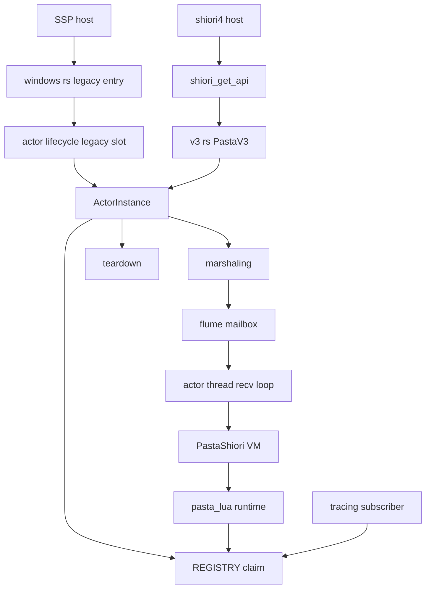
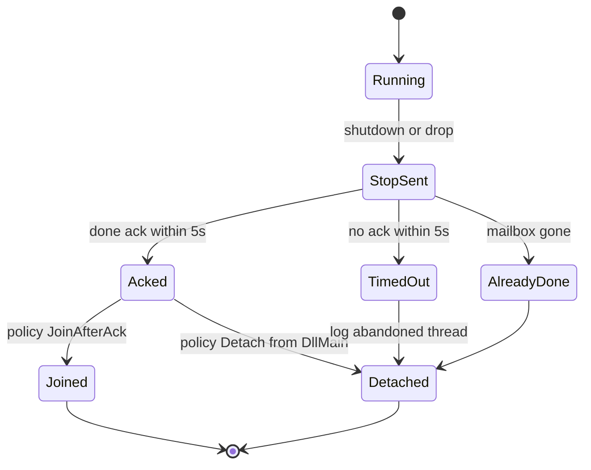
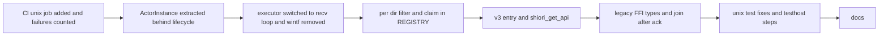

# 設計: shiori4-v3-portable

## Overview

**目的**: pasta を、shiori4 0.1.0 の版 3（SHIORI3 互換モード）で読める SHIORI にし、同じソースから Linux・macOS の共有ライブラリを作ってテストを通す。SSP から見た `pasta.dll` の動きは変えない。

**利用者**: shiori4 を知るベースウェア（areka など）は `shiori_get_api(3)` で pasta を読む。SSP は今どおり `loadu`→`request`→`unload` で読む。pasta の開発者は Windows・Linux・macOS の CI で 1 つのソースを守る。

**変えること**: アクター 1 つを持つ芯の型 `ActorInstance` を作り、旧来の HGLOBAL の入口と版 3 の入口の両方をそこへつなぐ。アクタースレッドの実行器は `wintf-winmsg-executor` の `block_on` から flume の同期 `recv()` のループに替える（全部の OS で同じ形）。ログの量の設定は、ゴーストのディレクトリごとのロガーの登録（`REGISTRY`）の中へ移し、インスタンスごとに効かせる。

### Goals

- `shiori_get_api` を書き出し、版 3 だけを返す（版 4 とそれ以外は NULL）。
- 版 3 の `load`・`request`・`notify`・`unload` が、旧来の入口と同じアクターの処理を通り、同じバイト列の応答を返す。
- エンジンの状態（Lua VM・アクター・mailbox・kick の送り先・ログの出し先と量）をインスタンスごとに持つ。プロセスに 1 つ残すものは Requirement 5.7 の一覧だけにする。
- `unload` が返るとき、アクタースレッドがライブラリのコードを出ている（`DllMain` の中の片付けを除く）。
- Linux（x64）・macOS でワークスペースのビルドとテストが通り、CI がそれを毎回確かめる。

### Non-Goals

- 版 4（ホストへの問い合わせ・post・OnHostComplete・Lua の API）。`shiori4-v4-host`・`shiori4-v4-lua-api` が持つ。
- 旧来の入口で複数のインスタンスを扱うこと。
- SHIORI/3.0 の要求の解析と、Lua に渡す `req` の形の変更。
- Windows 以外の配布物（リリース CI の配布物は今の 5 つのまま）。
- `pasta_check`・nar の Windows 以外での働き（テストが通ることだけを扱う）。
- `DllMain` の中で、アクタースレッドの終わりを待つこと。
- リリースのビルドの `panic = "abort"` の変更。

## Boundary Commitments

### This Spec Owns

- `pasta_shiori` の公開シンボル `shiori_get_api` と、版 3 の `shiori4_abi::Shiori` の実装（`PastaV3`）。
- 芯の型 `ActorInstance`（アクタースレッド 1 本・mailbox の送信端・kick の送り先・ディレクトリの占有）と、その後始末の決まり（ack を待ち、届いたら join する。`DllMain` の道だけ join しない）。
- 旧来の入口の置き場（プロセスに 1 つの `ActorInstance`）と、旧来の FFI の型（`BOOL` を i32 の 1／0、長さを `c_long`）。
- アクタースレッドの実行器（同期 `recv()` のループ）。
- 版 3 だけの判定（SHIORI/2.x・`notify` への GET・メソッドを読めない要求を 400、開始行からの戻り値の読み取り、読めないときは 500）。
- `pasta_lua` のログの量の設定を、`REGISTRY` の項目ごとに持つ作り（tracing の購読者はプロセスに 1 つのまま）と、`REGISTRY` によるディレクトリの占有（同じディレクトリの 2 つ目を断る）。
- `build.yml` の Linux・macOS のジョブと、`shiori4-testhost` による版 3 の 1 往復の段。
- Linux・macOS でワークスペースのテストを通すための直し（Windows だけの働きのテストは理由を書いて囲う）。
- 文書: `book/src/internals/shiori.md`・`crates/pasta_shiori/README.md`・`.kiro/steering/tech.md`（と `structure.md` の 1 行）。

### Out of Boundary

- SHIORI/3.0 の要求の文法（`req_parser.pest`）と `lua_request` の表の形。版 3 の判定は今の文法の読み取り結果を使うだけで、文法は変えない。
- `pasta_lua` の Lua の振る舞い・`PastaLoader` の読み込みの手順（ログの量の設定の置き場を除く）。
- 旧来の入口の HGLOBAL の受け渡し・`loadu`／`load` の使い分け・ANSI のデコード（型の直しを除き、変えない）。
- `shiori4_abi` の ABI 検査（`copy_from_slice` の有無・UTF-8 の検査・`catch_unwind`）。pasta は自分で書かない。
- リリース CI（`release.yml`）と配布物。
- `ponytail-shiori` の残りの番号（1 番と 4 番はこの spec で閉じる）。

### Allowed Dependencies

- `shiori4_abi = "0.1"`（通常の依存。依存 0・MIT）。試験でも `shiori4_abi` の `ShioriApi::load_v3`・`ShioriInstance` を使い、`shiori4_host` は依存に入れない。
- 既存: `flume 0.12`（`Sender::downgrade` を使う）・`arc-swap 1.9`・`tracing`・`tracing-subscriber 0.3`（`env-filter`）・`windows-sys`（`cfg(windows)`）。
- CI の外部ツール: `shiori4-testhost`（`cargo install shiori4_host --version 0.1.0 --example shiori4-testhost`）。
- 依存の向き: `windows.rs`・`v3.rs`（入口）→ `actor::lifecycle`（旧来の置き場）→ `actor::instance` → `actor::{thread, marshaling, mailbox, teardown}` → `shiori.rs`（`PastaShiori`）→ `pasta_lua`。逆向きの参照は誤りとして扱う。`actor::instance` は `lifecycle`・入口を参照しない。`pasta_lua` は `pasta_shiori` を参照しない。
- 外すもの: `wintf-winmsg-executor`（ルートと `pasta_shiori` の `Cargo.toml` から）。

### Revalidation Triggers

- `ActorInstance` の公開の形（`spawn`・`request`・`get`・`notify`・`kick`・`shutdown`・`JoinPolicy`）が変わるとき → `shiori4-v4-host`（版 4 をこの型の上に足す）が確かめ直す。
- `shiori_get_api` が版 4 にもテーブルを返すようになるとき（`shiori4-v4-host` が行う）→ CI の 1 往復の段と、版 4 が NULL であることの試験を直す。
- `GlobalLoggerRegistry` の項目の形（ロガー＋量の設定・占有）や `init_tracing_with_reload`・`update_tracing_filter` の意味が変わるとき → `pasta_check`・`pasta_lua` の試験と、ログの振り分けの章を確かめ直す。
- 旧来の FFI の型（`BOOL`・`c_long`）→ `pasta-dll-multiarch`（x64 の配布）と shiori4 の `shiori3-legacy-host` が前提にする。
- `build.yml` のジョブ名・関門の形 → `release.yml` の gate（`workflow_call`）。

## Architecture

### Existing Architecture Analysis

- 入口は `windows.rs`（`cfg(windows)`）の `DllMain`・`loadu`・`load`・`request`・`unload` だけで、`actor::lifecycle` の自由関数を呼ぶ。
- `actor::lifecycle` が `static MAILBOX: ArcSwapOption<Sender<ActorMsg>>`・`static ACTOR_HANDLE: Mutex<Option<ActorThread>>`・`static REQUEST_SEQ` を持ち、`kick_sink()` は `MAILBOX` を読む。2 つ目の `spawn_actor` は 1 つ目を片付ける。
- アクタースレッド（`actor::thread`）は `wintf_winmsg_executor::block_on` の中で `rx.recv_async().await` を 1 か所だけ待つ。`PastaShiori`（`!Send` の VM）はこのスレッドで作られ、出ない。
- 後始末は `Stop{done}` を送り ack を 5 秒まで待ち、スレッドは join せずに detach する。
- ログ: `REGISTRY`（ディレクトリ→`PastaLogger`）と、スレッドごとの `CURRENT_LOAD_DIR` で振り分ける。量の設定は `FILTER_HANDLE`（`reload::Handle<EnvFilter>`）が 1 つで、後から読んだゴーストの `[logging]` が全体に効く。
- 守る約束: GET は応答を待つ（5 秒の安全網で 204）・NOTIFY は即 204・届いた順に 1 つずつ・コルーチンは要求をまたいで続く・停止は先の要求を処理し終えてから・送信の道にロックを置かない（`ArcSwapOption`）。

### Architecture Pattern & Boundary Map



**Architecture Integration**:
- 採る形: 研究の選択肢 C（芯の型＋旧来の入口の置き場を薄い窓口として残す）と E1（同期 `recv()` のループ）。芯を新しく作り、既存の自由関数 `actor::lifecycle::{spawn_actor, marshal_request, teardown_actor, kick_sink}` は「旧来の入口の置き場」への窓口として名前と形を残す。既存の試験（`lifecycle` を呼ぶ 12 ファイル）を、期待を変えずに全部の OS で走らせたまま芯へ移せる（リファクタリングは安全かつ可逆に、の決まり）。
- 境界: 入口の層（HGLOBAL・ABI のテーブル・FFI の型）／芯（`ActorInstance`。インスタンス 1 つ＝アクター 1 つ）／アクターの中（実行器・VM）／ログ（`pasta_lua` の `REGISTRY`）。旧来の入口だけがプロセスに 1 つの置き場を持ち、芯とアクターと Lua の側はグローバルな状態を持たない。
- 残す作り: flume の mailbox・`ActorMsg`・`marshal_get`／`marshal_notify`・`teardown_via_sender`・`ArcSwapOption` の送信の道・`LoadDirGuard` の振り分け・`MyError` の 500 応答。
- 新しく作るもの: `ActorInstance`（インスタンスごとの状態の持ち主）、`PastaV3`（版 3 の口）、`REGISTRY` の量の設定と占有、CI の段。
- steering との合い方: 静的 CRT・デバッグの待受は 127.0.0.1 固定・`panic = "abort"`・Windows の出荷物 1 種は変えない。

### Technology Stack

| Layer | Choice / Version | Role in Feature | Notes |
|-------|------------------|-----------------|-------|
| ABI | `shiori4_abi` 0.1（新規） | `Shiori` トレイト・`ShioriApi::new`・試験用の `ShioriApi::load_v3` | `export_shiori!` は版 4 にもテーブルを返すので使わない |
| 実行器 | `flume` 0.12（既存） | 同期 `recv()` のループ・`WeakSender` | `wintf-winmsg-executor` を外す |
| 置き場 | `arc-swap` 1.9（既存） | 旧来の入口の `ArcSwapOption<ActorInstance>` | 送信の道にロックを置かない |
| ログ | `tracing-subscriber` 0.3（既存） | ディレクトリごとの `EnvFilter` を選ぶ層のフィルタ | `FILTER_HANDLE` を消す |
| Windows API | `windows-sys` 0.61（既存・`cfg(windows)`） | 漏れの測り（`GetGuiResources` の 0 の読み分けに `GetLastError`） | 新しい feature は要らない（`Win32_Foundation` は既にある） |
| CI | GitHub Actions `ubuntu-latest`・`macos-latest`・`windows-latest` | ビルド・テスト・clippy・`shiori4-testhost` | `shiori4-testhost` は `cargo install` してキャッシュ |

## File Structure Plan

### Directory Structure

```
crates/pasta_shiori/
├── src/
│   ├── lib.rs                  # mod v3 を足し shiori_get_api を再エクスポート（全 OS）
│   ├── v3.rs                   # 新規: PastaV3（shiori4_abi::Shiori の実装）・shiori_get_api・開始行の読み取り・400 の応答
│   ├── windows.rs              # 旧来の入口（BOOL・c_long へ。DllMain の道は join しない）
│   ├── shiori.rs               # PastaShiori（kick の送り先をインスタンスから受ける・load_dir を先に持つ）
│   └── actor/
│       ├── mod.rs              # instance を足す・文言（wintf）の直し
│       ├── instance.rs         # 新規: ActorInstance（芯）・JoinPolicy・SpawnError
│       ├── lifecycle.rs        # 旧来の入口の置き場（ArcSwapOption<ActorInstance>）と窓口の自由関数
│       ├── thread.rs           # 同期 recv() のループ・spawn_actor_thread_with（kick の送り先・起動の失敗を返す）
│       ├── marshaling.rs       # classify_request（メソッド＋SHIORI/2.x の見分け）を足す
│       ├── teardown.rs         # GetGuiResources の 0 の読み分け・文言の直し
│       └── mailbox.rs          # 文言（recv_async）の直しだけ
└── tests/
    ├── shiori4_v3_entry_test.rs     # 新規: 版 3 の入口（R1〜R4・R6.1〜6.2）を shiori4_abi の load_v3 で試す
    ├── multi_instance_test.rs       # 新規: 2 つのインスタンスの隔たり（R5.2〜5.6・R6.3〜6.4）
    ├── actor_instance_test.rs       # 新規: 芯の後始末の決まり（join・手放し。R4.2・4.4・7.6）
    └── fixtures/v3_probe/           # 新規: 呼ばれた回数を返す・壊れた開始行を返す・1 秒回り続ける ID を持つ試験用のゴースト

crates/pasta_lua/
├── src/logging/
│   ├── registry.rs             # 項目を「ロガー＋量の設定」にし、try_claim（占有）と量の設定の解決を足す
│   └── tracing_init.rs         # FILTER_HANDLE を消し、REGISTRY の項目の量の設定で選ぶ層のフィルタを入れる
└── tests/
    └── logging_per_dir_filter_test.rs  # 新規: 2 つのディレクトリで量の設定が分かれること
```

### Modified Files

- `Cargo.toml`（ルート）— `shiori4_abi = "0.1"` を足し、`wintf-winmsg-executor` を消す。`Cargo.lock` も更新する。
- `crates/pasta_shiori/Cargo.toml` — `shiori4_abi` を足し、`wintf-winmsg-executor` を消す。コメントの直し。
- `crates/pasta_shiori/src/windows_tests.rs`・`tests/ffi_actor_lifecycle_test.rs`・`tests/ffi_extern_session_e2e_test.rs`・`tests/ffi_loadu_test.rs`・`tests/ffi_logging_test.rs` — 呼び出しの型だけを `c_long`・i32 に合わせる（期待は変えない。`true` は `1`、`false` は `0` として比べる）。
- `.github/workflows/build.yml` — `build-unix` のジョブ（Linux・macOS）と、Windows x64 の 1 往復の段を足す。
- Linux・macOS で落ちるテスト（数は実装の最初の CI で数える。研究の Research Needed 1）— 移植できる形に直すか、Windows だけの働きなら `#[cfg(windows)]` と理由のコメントで囲う。
- `book/src/internals/shiori.md`・`crates/pasta_shiori/README.md`・`.kiro/steering/tech.md`・`.kiro/steering/structure.md`（350 行の「static MAILBOX 所有」）— 文書の更新。

## System Flows

### 版 3 の 1 往復

```mermaid
sequenceDiagram
    participant Host as shiori4 host
    participant Abi as shiori4_abi table
    participant V3 as PastaV3
    participant Inst as ActorInstance
    participant Reg as REGISTRY
    participant Actor as actor thread
    Host->>Abi: shiori_get_api 3
    Host->>Abi: load dir
    Abi->>V3: Shiori load V3 dir
    V3->>V3: absolute and is_dir check
    V3->>Inst: spawn
    Inst->>Reg: try_claim dir
    Inst->>Actor: spawn thread with kick sink
    Actor->>Actor: PastaShiori load and SHIORI load
    Actor-->>Inst: ready loaded
    Inst-->>V3: instance
    Host->>Abi: request GET full text
    Abi->>V3: request
    V3->>Inst: get
    Inst->>Actor: ActorMsg Get
    Actor-->>Inst: reply value
    V3-->>Abi: status from start line and body
    Host->>Abi: unload
    Abi->>V3: drop
    V3->>Inst: drop JoinAfterAck
    Inst->>Actor: Stop done
    Actor->>Reg: unregister dir on VM drop
    Actor-->>Inst: done ack
    Inst->>Actor: join
```

- 版 3 の `load` が NULL になるのは、ディレクトリが絶対パスでない・無い（ログを置けないのでログなし）、同じディレクトリを生きているインスタンスが占有している（占有している側のログに理由を出す）、アクタースレッドを起こせない（その場でロガーを作って理由を出す）ときだけ。辞書・Lua・`SHIORI.load` の失敗はインスタンスを返す。
- 版 3 の `request` は、`classify_request` で判定してから、GET は `get`、NOTIFY は `notify` に渡す。判定で弾いた要求はアクターに渡らない。

### 後始末の決まり



- join するのは ack が届いたときだけ。ack の後にアクタースレッドがすることは、受け口を閉じた後の ack の送信と、スレッドの局所の値（ログの振り分けの印）の片付けだけで、待つ所が無い。よって join は上限なしでも止まらない。
- ack が来なかったときはスレッドを手放し、その旨を警告のログに出す。手放したスレッドの VM が持つディレクトリの占有は、そのスレッドが VM を片付けるまで残る（同じディレクトリをすぐ読み直しても断られる。ファイルの取り合いを避けるため）。
- `DllMain` の FreeLibrary の detach からの片付けは `JoinPolicy::Detach`（loader lock の中では待てない）。プロセスの終了の detach は今どおり何もしない。

## Requirements Traceability

| Requirement | Summary | Components | Interfaces | Flows |
|-------------|---------|------------|------------|-------|
| 1.1 | `shiori_get_api` の書き出し | V3Entry | `shiori_get_api` | 版 3 の 1 往復 |
| 1.2 | 3 で版 3 のテーブル | V3Entry | `API_V3` | 版 3 の 1 往復 |
| 1.3 | 3 以外は NULL | V3Entry | `shiori_get_api` | — |
| 1.4 | 同じ static を返す | V3Entry | `API_V3`（static） | — |
| 1.5 | 全部の口を許すホストで版 3 に決まる | V3Entry・CI | `shiori4-testhost`（`--entry` なし） | CI |
| 2.1 | 版 3 の load で旧来と同じ手順 | V3Entry・ActorInstance | `PastaV3::load`・`ActorInstance::spawn` | 版 3 の 1 往復 |
| 2.2 | カレントディレクトリに頼らない | V3Entry | 絶対パスの検査 | — |
| 2.3 | 返った時点で要求を受けられる | ActorInstance・ActorThread | ready の待ち | 版 3 の 1 往復 |
| 2.4 | 立ち上がれない失敗は NULL・資源を残さない | V3Entry・ActorInstance | `SpawnError` | — |
| 2.5 | NULL の理由をログに出す | V3Entry・ActorInstance | 失敗のログ | — |
| 2.6 | `copy_from_slice` が無いと NULL | shiori4_abi（上流） | `shiori_load` | — |
| 2.7 | 辞書・Lua の失敗はインスタンスを返し 500 | V3Entry・PastaShiori | `loaded=false` でも `Ok` | — |
| 3.1 | GET は旧来と同じバイト列・戻り値は開始行 | V3Entry・Marshaling | `ActorInstance::get`・`status_of` | 版 3 の 1 往復 |
| 3.2 | request の NOTIFY は即 204 の全文 | V3Entry | `ActorInstance::notify` | — |
| 3.3 | notify の NOTIFY は即 204 | V3Entry | `PastaV3::notify` | — |
| 3.4 | notify の GET は 400・Lua に渡さない | V3Entry・Marshaling | `classify_request` | — |
| 3.5 | SHIORI/2.x は 400 | V3Entry・Marshaling | `classify_request` | — |
| 3.6 | メソッドを読めない要求は 400 | V3Entry・Marshaling | `classify_request` | — |
| 3.7 | 開始行が読めない応答は 500・本文そのまま | V3Entry | `status_of` | — |
| 3.8 | 5 秒を超えた GET は 204 | Marshaling | `marshal_get`（`GET_TIMEOUT`） | — |
| 3.9 | Lua への渡し方が同じ | ActorThread・PastaShiori | `PastaShiori::request` | — |
| 3.10 | UTF-8 で返す | V3Entry・shiori4_abi | `shiori_str_arg`・`String` | — |
| 4.1 | 版 3 の unload で同じ後始末 | V3Entry・ActorInstance・Teardown | `Drop for ActorInstance` | 後始末の決まり |
| 4.2 | ack が来なければ 5 秒で手放しログ | ActorInstance・Teardown | `teardown_via_sender`・警告のログ | 後始末の決まり |
| 4.3 | ほかのインスタンスを止めない | ActorInstance | インスタンスごとの mailbox・占有 | — |
| 4.4 | ack が届けば join してから返る | ActorInstance | `JoinPolicy::JoinAfterAck` | 後始末の決まり |
| 5.1 | VM・スレッド・mailbox・ログの出し先をインスタンスごとに | ActorInstance・PastaShiori・Registry | `ActorInstance` のフィールド | — |
| 5.2 | 要求はそのインスタンスの VM だけで | ActorInstance | インスタンスごとの `Sender` | — |
| 5.3 | ログはそのゴーストのファイルだけ | Registry | `LoadDirGuard`・振り分け | — |
| 5.4 | `[logging]` の量はそのインスタンスだけ | Registry・TracingInit | 項目ごとの `EnvFilter` | — |
| 5.5 | DAP の kick はつながっているインスタンスだけ | ActorInstance・PastaShiori | `WeakSender` を閉じ込めた `KickSink` | — |
| 5.6 | 同じデバッグのポートは後の方がデバッグなし | pasta_lua debug（既存） | `debug::enable` | — |
| 5.7 | プロセスに 1 つの状態を一覧に限る | LegacySlot・Registry・TracingInit | `LEGACY`・`REGISTRY`・購読者 | — |
| 6.1 | 別のディレクトリの 2 つ目は受ける | V3Entry・ActorInstance | `ActorInstance::spawn` | — |
| 6.2 | 同じディレクトリの 2 つ目は NULL＋ログ | ActorInstance・Registry | `GlobalLoggerRegistry::try_claim` | — |
| 6.3 | 別スレッドから呼ばれても正しく | ActorInstance | インスタンスごとの状態 | — |
| 6.4 | 旧来の入口のインスタンスと共存 | LegacySlot・ActorInstance | 置き場は別 | — |
| 7.1 | 旧来の 4 つの口の今の振る舞い | LegacyEntry・LegacySlot | 窓口の自由関数 | — |
| 7.2 | 旧来の入口はインスタンス 1 つ | LegacySlot | `spawn_actor` の先の片付け | — |
| 7.3 | `BOOL`（i32）と `c_long` | LegacyEntry | `loadu`・`load`・`unload`・`request` の型 | — |
| 7.4 | 旧来の試験を期待を変えずに通す | LegacySlot・Testing | 窓口の名前と形を残す | — |
| 7.5 | 出荷物 1 種・増えるのは `shiori_get_api` だけ | V3Entry・Build | 書き出しの一覧 | — |
| 7.6 | 旧来の unload も ack の後 join | LegacySlot・ActorInstance | `teardown_actor`（`JoinAfterAck`） | 後始末の決まり |
| 8.1 | OS の仕組みを使わずに待つ | ActorThread | `rx.recv()` | — |
| 8.2 | Windows でウィンドウを作らない | ActorThread・Build | wintf の削除 | — |
| 8.3 | 受け渡しの約束を保つ | ActorThread・Marshaling | `ActorMsg` の FIFO | — |
| 8.4 | 繰り返しで漏らさない | Teardown | `ReloadProbe`・`sample_resources` | — |
| 9.1 | Linux で `libpasta.so` | Build | `[lib] name = "pasta"`・cdylib | CI |
| 9.2 | macOS で `libpasta.dylib` | Build | 同上 | CI |
| 9.3 | Windows だけの依存を閉じ込める | Build | `cfg(windows)` の依存・wintf の削除 | — |
| 9.4 | Linux・macOS で全テストが通る | Testing | 移植の直し・理由つきの囲い | CI |
| 9.5 | Linux の clippy が警告 0 | CI | `cargo clippy -D warnings` | CI |
| 9.6 | 3 OS で境界をまたぐ 1 往復 | CI | `shiori4-testhost --entry v3` | CI |
| 9.7 | panic の扱いを変えず文書に書く | Docs | `internals/shiori.md` | — |
| 10.1 | Linux のビルド・テスト・clippy | CI | `build-unix`（ubuntu） | CI |
| 10.2 | macOS のビルドとテスト | CI | `build-unix`（macos） | CI |
| 10.3 | 3 OS で testhost の 1 往復（x86 は除く） | CI | 1 往復の段 | CI |
| 10.4 | 失敗で `build.yml` 全体を失敗 | CI | ジョブの失敗（`continue-on-error` なし） | CI |
| 10.5 | Windows 以外の成果物を配布しない | CI | upload は Windows だけ・`release.yml` 不変 | — |
| 11.1 | 内部の章の更新 | Docs | `internals/shiori.md` | — |
| 11.2 | README の更新 | Docs | `crates/pasta_shiori/README.md` | — |
| 11.3 | `tech.md` の更新 | Docs | `.kiro/steering/tech.md` | — |
| 11.4 | 利用者向けの章に書き足さない | Docs | 変更しないことの確認 | — |

## Components and Interfaces

| Component | Domain/Layer | Intent | Req Coverage | Key Dependencies (P0/P1) | Contracts |
|-----------|--------------|--------|--------------|--------------------------|-----------|
| V3Entry（`v3.rs`） | 入口 | 版 3 の口と `shiori_get_api` | 1.1–1.5, 2.1–2.7, 3.1–3.7, 3.10, 4.1, 6.1, 7.5 | ActorInstance (P0), shiori4_abi (P0) | Service, API |
| LegacyEntry（`windows.rs`） | 入口 | HGLOBAL の口・FFI の型 | 7.1, 7.3, 7.6 | LegacySlot (P0) | API |
| LegacySlot（`actor/lifecycle.rs`） | 入口の置き場 | 旧来の入口の 1 つのインスタンス | 5.7, 6.4, 7.1, 7.2, 7.4, 7.6 | ActorInstance (P0), arc-swap (P1) | Service, State |
| ActorInstance（`actor/instance.rs`） | 芯 | インスタンス 1 つ＝アクター 1 つ | 2.3, 2.4, 4.1–4.4, 5.1, 5.2, 5.5, 6.1–6.3 | ActorThread (P0), Marshaling (P0), Teardown (P0), Registry (P0) | Service, State |
| ActorThread（`actor/thread.rs`） | アクター | 同期 `recv()` のループで VM を回す | 2.3, 3.9, 8.1–8.3 | PastaShiori (P0), flume (P0) | Service |
| Marshaling（`actor/marshaling.rs`） | アクター | GET／NOTIFY の受け渡しと版 3 の判定 | 3.1–3.6, 3.8 | pest の文法 (P0) | Service |
| Teardown（`actor/teardown.rs`） | アクター | Stop と ack・漏れの測り | 4.1, 4.2, 8.4 | windows-sys (P1) | Service |
| PastaShiori（`shiori.rs`） | VM の持ち主 | 1 つの VM の load・request・unload | 2.7, 3.9, 5.5 | pasta_lua (P0) | Service |
| Registry（`pasta_lua/src/logging/registry.rs`） | ログ | ディレクトリごとのロガー・量の設定・占有 | 5.3, 5.4, 5.7, 6.2 | tracing-subscriber (P0) | Service, State |
| TracingInit（`pasta_lua/src/logging/tracing_init.rs`） | ログ | 購読者 1 つと、項目ごとの量の設定で選ぶフィルタ | 5.4, 5.7 | Registry (P0) | Service |
| CI（`build.yml`） | ビルド | Linux・macOS・1 往復の段 | 1.5, 9.1, 9.2, 9.5, 9.6, 10.1–10.5 | shiori4-testhost (P0) | Batch |
| Docs | 文書 | 内部の章・README・steering | 9.7, 11.1–11.4 | — | — |

### 入口の層

#### V3Entry（`crates/pasta_shiori/src/v3.rs`）

| Field | Detail |
|-------|--------|
| Intent | `shiori_get_api` を書き出し、版 3 の要求を `ActorInstance` へつなぐ |
| Requirements | 1.1, 1.2, 1.3, 1.4, 1.5, 2.1, 2.2, 2.4, 2.5, 2.6, 2.7, 3.1, 3.2, 3.3, 3.4, 3.5, 3.6, 3.7, 3.10, 4.1, 6.1, 7.5 |

**Responsibilities & Constraints**
- `shiori_get_api` は全部の OS でコンパイルし、`lib.rs` から `pub use` する（rlib の試験からも到達させる。`windows.rs` の書き出しと同じ理由）。
- `PastaV3` は `ActorInstance` を 1 つだけ持つ。ほかの状態を持たない。
- ABI の検査（`copy_from_slice`・UTF-8・`catch_unwind`・応答の写し）は `shiori4_abi` に任せ、自分で書かない（2.6・3.10）。
- パニックを起こす道を持たない（正常の道で `unwrap`／`expect` を使わない）。

**Dependencies**
- Outbound: ActorInstance — インスタンスの起動・要求・後始末（P0）
- Outbound: Marshaling — `classify_request`（P0）
- External: `shiori4_abi` 0.1 — `Shiori`・`ShioriApi::new`・`ShioriLoadMode`・`ShioriResponse`・定数（P0）

**Contracts**: Service [x] / API [x]

##### API Contract（C ABI）

```rust
#[unsafe(no_mangle)]
pub extern "C" fn shiori_get_api(requested: u32) -> *const shiori4_abi::ShioriApi;
// requested == SHIORI_ABI_VERSION_3 → &API_V3（プロセスの間ずっと同じ static）
// それ以外（4 を含む）→ null
static API_V3: ShioriApi = ShioriApi::new::<PastaV3, { SHIORI_ABI_VERSION_3 }>();
```

##### Service Interface

```rust
pub struct PastaV3 { instance: ActorInstance }

impl shiori4_abi::Shiori for PastaV3 {
    const SUPPORTS_V3: bool = true;
    fn load(mode: ShioriLoadMode, dir: &str) -> Result<Self, ShioriStatus>;
    fn request(&mut self, req: &str) -> ShioriResponse;
    fn notify(&mut self, req: &str) -> ShioriStatus;
}
// unload は Drop（ActorInstance の Drop に任せる）

fn status_of(response: &str) -> ShioriStatus;          // 開始行 "SHIORI/3.0 NNN" の NNN。読めなければ 500
fn bad_request(reason: &str) -> String;                // "SHIORI/3.0 400 Bad Request\r\nCharset: UTF-8\r\nX-ERROR-REASON: …\r\n\r\n"
```

- `load` の手順:
  1. `mode` が `V4(_)` なら `Err(SHIORI_E_UNSUPPORTED)`（版 4 のテーブルは出さないので来ない。守りだけ）。
  2. `PathBuf::from(dir)` が絶対パスでない、またはディレクトリでない → `Err(SHIORI_E_INVALID_ARG)`。ログは出さない（2.2・2.4・2.5）。
  3. `ActorInstance::spawn(0, dir)` → `Err(SpawnError)` なら `Err(SHIORI_500_INTERNAL_SERVER_ERROR)`（理由のログは `spawn` が出す）。
  4. `Ok(instance)` は `loaded` の真偽にかかわらず `Ok(PastaV3)`（2.7）。入口の記録として `LoadDirGuard` の中で `info!(entry = "v3", loaded, …)` を 1 行出す（`windows.rs` と同じ）。
- `request` の手順（`classify_request` の結果ごと）:
  - `Get` → `body = instance.get(req)`、`status = status_of(&body)`（3.1・3.7・3.8）。
  - `Notify` → `body = instance.notify(req)`（`default_204`）、`status = 204`（3.2）。
  - `Shiori2` → 400、`bad_request("SHIORI/2.x is not supported")`（3.5）。
  - `Unreadable` → 400、`bad_request("unreadable request")`（3.6）。
  - 返すのは `ShioriResponse { status, body: body.into() }`（`ShioriBytes: From<String>`）。
- `notify` の手順: `Notify` → `instance.notify(req)` を捨てて 204（3.3）。`Get` → 400（3.4）。`Shiori2`・`Unreadable` → 400（3.5）。弾いた要求はアクターへ送らない。
- `status_of`: 応答の最初の行が `SHIORI/3.0 ` で始まり、続く 3 文字が数字で、その後が空白か行の終わりなら、その数。そうでなければ 500。本文は変えない（3.7）。
- Preconditions: `shiori4_abi` が `dir`・`req` の UTF-8 を確かめ済み。呼び出しはインスタンスごとに 1 スレッド。
- Postconditions: `request` の `status` と `body` の開始行のコードは一致する（読めた場合）。
- Invariants: 版 4 のテーブルを返さない。

**Implementation Notes**
- Integration: `shiori4-v4-host` は、この型に版 4 を足し、`shiori_get_api` を `export_shiori!` に替えてよい（Revalidation Triggers）。
- Validation: `tests/shiori4_v3_entry_test.rs`（`ShioriApi::load_v3` と `ShioriInstance` で ABI のテーブルを通す）と CI の 1 往復。
- Risks: 2.6 は pasta のコードを通らない（`shiori4_abi` の `shiori_load` が先に弾く）。pasta の試験からは、`copy_from_slice` の無いホストのテーブルを作れない（`ShioriApi` の欄が非公開）。上流の試験とコードの読み合わせで守る。

#### LegacyEntry（`crates/pasta_shiori/src/windows.rs`）

| Field | Detail |
|-------|--------|
| Intent | HGLOBAL の受け渡しとパスのデコード。FFI の型を C に合わせる |
| Requirements | 7.1, 7.3, 7.6 |

**Contracts**: API [x]

##### API Contract（C ABI・Windows だけ）

| 書き出し | 今 | この spec の後 |
|---|---|---|
| `DllMain` | `extern "system" fn(isize, u32, *mut c_void) -> bool` | 戻り値を `i32`（`BOOL`。1） |
| `loadu` | `extern "C" fn(HGLOBAL, usize) -> bool` | `extern "C" fn(HGLOBAL, c_long) -> i32` |
| `load` | `extern "C" fn(HGLOBAL, usize) -> bool` | `extern "C" fn(HGLOBAL, c_long) -> i32` |
| `request` | `extern "C" fn(HGLOBAL, &mut usize) -> HGLOBAL` | `extern "C" fn(HGLOBAL, *mut c_long) -> HGLOBAL` |
| `unload` | `extern "C" fn() -> bool` | `extern "C" fn() -> i32`（常に 1） |

- `c_long` は Windows では x86・x64 とも 32 ビット。x86 では `usize` と同じ幅なので、SSP（x86）から見た振る舞いは変わらない（7.3）。
- 長さが負なら 0 と同じに扱い（`load` は今の「長さ 0」の道で FALSE、`request` は空の要求として今の道）、応答の長さが `c_long` に収まらなければ null と長さ 0 を返す（今の確保の失敗と同じ道）。`request` の `len` が null なら null を返す。
- `DllMain` の FreeLibrary の detach は `lifecycle::teardown_actor_detached()` を呼ぶ（join しない）。`unload` は `lifecycle::teardown_actor()`（ack の後 join する。7.6）。
- `DllMain` の戻り値の型の直しは、7.3 に名前の無い口だが、同じ欠陥（`bool` の上位の不定）なのでここで一緒に直す（前提。OPEN QUESTION 6）。

### 入口の置き場

#### LegacySlot（`crates/pasta_shiori/src/actor/lifecycle.rs`）

| Field | Detail |
|-------|--------|
| Intent | 旧来の入口（ハンドルの無い ABI）のための、プロセスに 1 つの `ActorInstance` の置き場と窓口 |
| Requirements | 5.7, 6.4, 7.1, 7.2, 7.4, 7.6 |

**Responsibilities & Constraints**
- プロセスに 1 つの状態は `static LEGACY: ArcSwapOption<ActorInstance>` だけ。`MAILBOX`・`ACTOR_HANDLE`・`REQUEST_SEQ` は消す。
- 全部の OS でコンパイルする（`lifecycle` を直に呼ぶ試験を Linux・macOS でも期待を変えずに走らせるため）。呼ぶのは `windows.rs` と試験だけで、芯（`ActorInstance`）と版 3 の口は参照しない。
- モジュールの説明に「旧来の入口の置き場であり、プロセスに 1 つ残す理由（ハンドルの無い ABI）」を書く（5.7）。

**Contracts**: Service [x] / State [x]

##### Service Interface（名前と形は今のまま。`teardown_actor_detached` だけ新規）

```rust
pub fn spawn_actor(hinst: isize, load_dir: PathBuf) -> bool;   // 先に teardown_actor() → ActorInstance::spawn → LEGACY へ。戻り値は loaded。SpawnError は false（置き場は空）
pub fn marshal_request(request: &str) -> String;               // LEGACY.load_full() → instance.request(request)。空なら default_204()
pub fn teardown_actor() -> TeardownReport;                     // JoinPolicy::JoinAfterAck
pub fn teardown_actor_detached() -> TeardownReport;            // JoinPolicy::Detach（DllMain だけ）
pub fn kick_sink() -> KickSink;                                // LEGACY の instance.kick(..) へ。空なら kick.drop の診断ログ
```

##### State Management
- 片付けは `LEGACY.swap(None)` で取り出し、`Arc::try_unwrap` で持ち主になってから `shutdown(policy)` を呼ぶ。
- `try_unwrap` が失敗するのは、片付けと同時に別のスレッドで要求が走っているときだけ（SHIORI の単一スレッドの規約に反する呼び方）。そのときは `instance.request_stop()`（Stop と ack の待ちだけ）を呼び、最後の `Arc` の Drop でスレッドを手放す（join は保証しない。前提。OPEN QUESTION 10）。
- 送信の道（`marshal_request`・`kick_sink`）は `load_full()` だけで、ロックを取らない（今の決まりを保つ）。

### 芯

#### ActorInstance（`crates/pasta_shiori/src/actor/instance.rs`）

| Field | Detail |
|-------|--------|
| Intent | インスタンス 1 つ＝アクター 1 つ。インスタンスごとの状態の持ち主 |
| Requirements | 2.3, 2.4, 2.5, 4.1, 4.2, 4.3, 4.4, 5.1, 5.2, 5.5, 6.1, 6.2, 6.3 |

**Responsibilities & Constraints**
- 持つもの: mailbox の送信端（`Sender<ActorMsg>`）・アクタースレッドのハンドル（`Option<ActorThread>`）・ディレクトリ（`PathBuf`）・要求の連番（`AtomicU64`）。グローバルな状態を参照しない（ログの `REGISTRY` を除く）。
- `Send + Sync`（`Sender` と `JoinHandle` だけを持つ。VM はアクタースレッドから出ない）。
- 起動の前に `REGISTRY` でディレクトリを占有する（6.2）。占有はアクタースレッドの `PastaShiori` が VM を片付けるときに外れる（`release_runtime` の `unregister`）。`ActorInstance` が自分で外すのは、アクタースレッドを起こせなかったときだけ。
- kick の送り先は、自分の送信端の `WeakSender` を閉じ込めたクロージャにし、VM を作る前に `PastaShiori` へ渡す（5.5）。`WeakSender` なので、kick の送り先が受け口を生かし続けない。

**Dependencies**
- Outbound: ActorThread — `spawn_actor_thread_with`（P0）
- Outbound: Marshaling — `marshal_get`・`marshal_notify`・`determine_method`（P0）
- Outbound: Teardown — `teardown_via_sender`（P0）
- Outbound: Registry — `try_claim`・`unregister`・`register`（P0）

**Contracts**: Service [x] / State [x]

##### Service Interface

```rust
pub struct ActorInstance { /* tx, thread: Option<ActorThread>, load_dir, seq: AtomicU64 */ }

#[derive(Debug, Clone, Copy, PartialEq, Eq)]
pub enum JoinPolicy { JoinAfterAck, Detach }

#[derive(Debug)]
pub enum SpawnError {
    DirInUse,                  // 同じディレクトリを生きているインスタンスが占有している
    Thread(std::io::Error),    // OS がスレッドを起こせない
    NotReady,                  // アクタースレッドが ready を返す前に終わった（unwind のビルドでのパニック）
}

impl ActorInstance {
    pub fn spawn(hinst: isize, load_dir: PathBuf) -> Result<Self, SpawnError>;
    pub fn loaded(&self) -> bool;
    pub fn load_dir(&self) -> &Path;
    pub fn request(&self, req: &str) -> String;   // 旧来の意味: determine_method → GET/NOTIFY、読めなければ default_204()
    pub fn get(&self, req: &str) -> String;       // marshal_get（GET_TIMEOUT 5 秒・失敗は 204）
    pub fn notify(&self, req: &str) -> String;    // marshal_notify（即 default_204()）
    pub fn kick(&self, scene: String) -> bool;    // try_send(ActorMsg::Kick)。送れなければ false
    pub fn request_stop(&self) -> TeardownReport; // Stop と ack の待ちだけ（スレッドには触れない）
    pub fn shutdown(self, policy: JoinPolicy) -> TeardownReport;
}
impl Drop for ActorInstance { /* まだ片付けていなければ shutdown(JoinAfterAck) と同じ */ }
```

- `spawn` の手順:
  1. `GlobalLoggerRegistry::instance().try_claim(load_dir.clone())` が偽 → `LoadDirGuard(load_dir)` の中で `warn!` を出し（占有している側のログのファイルに入る）、`Err(DirInUse)`（6.2・2.5）。
  2. `mailbox()` を作り、`tx.downgrade()` を閉じ込めた `KickSink` を作る。
  3. `spawn_actor_thread_with(hinst, load_dir, rx, Some(sink))` が `Err` → 理由を出すため、そのディレクトリに既定の `PastaLogger` を登録してから `error!` を出し、`unregister` して `Err(Thread | NotReady)`（2.4・2.5）。`NotReady` のときは終わったスレッドを join してから返す（資源を残さない）。
  4. `Ok(ActorInstance)`。この時点で VM の構築と `SHIORI.load` の呼び出しは終わっている（2.3）。
- `shutdown` の手順: `teardown_via_sender(&tx, TEARDOWN_TIMEOUT)` → `acked` かつ `JoinAfterAck` なら `ActorThread::join`、それ以外は `detach`。ack が来なかったときは「アクタースレッドを手放した」を警告で出す（4.2）。`TeardownReport` を返す。二度目の呼び出しは `already_done`（冪等）。
- `TeardownReport` に `pub joined: bool`（join を終えたときだけ真）を足す。構築は `teardown.rs`・`lifecycle.rs` の中だけなので、既存の試験に当たらない。4.4・7.6 を試験で確かめる観測点。
- 上限の時間は、試験から短い値を注入できる `shutdown_with_timeout(self, policy, timeout)` を内部の口として持ち、`shutdown` は `TEARDOWN_TIMEOUT` でそれを呼ぶ（`marshal_get_with_timeout` と同じ作り）。
- Preconditions: なし（どのスレッドからでも呼べる）。
- Postconditions: `shutdown(JoinAfterAck)` が `acked` で返ったとき、アクタースレッドは終わっている（4.4・7.6）。
- Invariants: 生きている `ActorInstance` どうしは、同じディレクトリを持たない（占有による）。1 つの `shutdown` は、ほかのインスタンスの mailbox・占有・量の設定に触れない（4.3）。

##### State Management
- 状態: Running → StopSent → Acked／TimedOut／AlreadyDone → Joined／Detached（System Flows の図）。
- 占有の持ち主は VM（`PastaShiori`）。ack が来ずに手放したときは、占有もそのスレッドとともに残る。

**Implementation Notes**
- Integration: `TEARDOWN_TIMEOUT`（5 秒）は `lifecycle.rs` からこのファイルへ移す（4.2 の上限は今のまま）。
- Validation: `tests/multi_instance_test.rs`（2 つのインスタンス）・`tests/shiori4_v3_entry_test.rs`（unload の後にスレッドが残らないこと）。
- Risks: 同じディレクトリの見分けは `Path` の比較（成分ごと）による。末尾の区切りと、Windows の `/` と `\` の違いは同じに扱うが、大文字小文字の違い・シンボリックリンク・8.3 の短い名前は別のディレクトリと見る（`fs::canonicalize` は 8.3 のパスで不具合の前例があるので使わない。OPEN QUESTION 7）。

### アクター

#### ActorThread（`crates/pasta_shiori/src/actor/thread.rs`）

| Field | Detail |
|-------|--------|
| Intent | VM を 1 本のスレッドに置き、同期 `recv()` のループで mailbox を処理する |
| Requirements | 2.3, 3.9, 8.1, 8.2, 8.3 |

**Contracts**: Service [x]

```rust
pub fn spawn_actor_thread_with(
    hinst: isize,
    load_dir: PathBuf,
    rx: Receiver<ActorMsg>,
    kick_sink: Option<KickSink>,
) -> std::io::Result<ActorThread>;   // thread::Builder::spawn の失敗は Err。ready を受けられなければ Err(io::ErrorKind::Other)

pub fn spawn_actor_thread(hinst: isize, load_dir: PathBuf, rx: Receiver<ActorMsg>) -> ActorThread;
// 今の形のまま残す（既存の試験が使う）。spawn_actor_thread_with(.., None) を呼び、失敗は今どおり panic
```

- ループは `while let Ok(msg) = rx.recv() { … }`。中の処理（Get・Notify・Kick・Stop の各腕、Stop の後の VM の片付け→受け口を閉じる→ack）は今のまま（8.3）。`block_on` と `async` を外すだけ。
- `PastaShiori` は `PastaShiori::with_kick_sink(kick_sink)` で作る。
- ready の受け取りに失敗したら（スレッドが ready の前に終わった）、`Err` を返す（`ActorInstance` が `NotReady` にする）。

#### Marshaling（`crates/pasta_shiori/src/actor/marshaling.rs`）

| Field | Detail |
|-------|--------|
| Intent | GET／NOTIFY の受け渡し（今のまま）と、版 3 の口の判定 |
| Requirements | 3.1, 3.2, 3.3, 3.4, 3.5, 3.6, 3.8 |

**Contracts**: Service [x]

```rust
#[derive(Debug, Clone, Copy, PartialEq, Eq)]
pub enum RequestKind { Get, Notify, Shiori2, Unreadable }

pub fn classify_request(request: &str) -> RequestKind;
// 今の pest の文法（Rule::req）で読む。読めなければ Unreadable。
// 読めて Rule::header2 があれば Shiori2（GET でも NOTIFY でも）。そうでなければ Rule::get → Get、Rule::notify → Notify。
```

- `determine_method` は今のまま残す（旧来の入口が使う。読めない要求の 204 は変えない）。
- 正常の道でパニックを起こさない（今の `actor_marshaling_has_no_unwrap_on_normal_path` の検査の対象に入る）。

#### Teardown（`crates/pasta_shiori/src/actor/teardown.rs`）

| Field | Detail |
|-------|--------|
| Intent | Stop と ack（今のまま）と、漏れの測り |
| Requirements | 4.1, 4.2, 8.4 |

- `teardown_via_sender`・`TeardownReport`・`ReloadProbe` は今のまま。
- `sample_resources`（Windows）: wintf を外すと、試験のプロセスの USER オブジェクトが 0 になりうる。今は `GetGuiResources` の 0 を「測れない」として `None` にするので、`actor_reload_leak_test` の `leak_metric.expect(..)` が落ちる。呼ぶ前に `SetLastError(0)` し、0 が返ったときは `GetLastError()` が 0 なら `Some(0)`、0 でなければ `None` とする（測りの直しであり、試験の期待は変えない。8.4）。
- 文言（メッセージ専用ウィンドウ・wintf・`recv_async`）を直す。

#### PastaShiori（`crates/pasta_shiori/src/shiori.rs`）

| Field | Detail |
|-------|--------|
| Intent | VM 1 つの load・request・kick・unload（今のまま） |
| Requirements | 2.7, 3.9, 5.5 |

- 足すもの: `kick_sink: Option<KickSink>` のフィールドと `pub fn with_kick_sink(sink: Option<KickSink>) -> Self`。`load` は `RuntimeConfig::new().with_kick_sink(self.kick_sink.clone())` を使う（`lifecycle::kick_sink()` を呼ばない）。`Default` の `kick_sink` は `None`（kick の道は働かない。`pasta_lua` の既定と同じ）。
- `load` で `self.load_dir = Some(..)` をディレクトリの有無の確かめより前に置く。ディレクトリが無いときも、VM の片付け（`release_runtime`）で `unregister` が走り、占有が外れる。
- ローカルの `Shiori` トレイト（`pasta::Shiori`）は残す（試験が使う）。`shiori4_abi::Shiori` とは、`v3.rs` の中で完全な名前で書き分ける。

### ログ

#### Registry（`crates/pasta_lua/src/logging/registry.rs`）

| Field | Detail |
|-------|--------|
| Intent | ディレクトリごとのロガー・量の設定・占有を 1 つの表で持つ（プロセスに 1 つ。5.7 の例外） |
| Requirements | 5.3, 5.4, 5.7, 6.2 |

**Contracts**: Service [x] / State [x]

```rust
impl GlobalLoggerRegistry {
    pub fn instance() -> &'static Self;                                   // 今のまま
    pub fn register(&self, load_dir: PathBuf, logger: Arc<PastaLogger>);  // 項目のロガーを入れ替える。量の設定は残す（無ければ既定）
    pub fn unregister(&self, load_dir: &Path);                            // 項目ごと消す（ロガー・量の設定・占有）
    pub fn get(&self, load_dir: &Path) -> Option<Arc<PastaLogger>>;       // 今のまま
    pub fn try_claim(&self, load_dir: PathBuf) -> bool;                   // 新規: 項目が無ければ「ロガー無し・既定の量」の項目を足して true。あれば false
    pub(crate) fn set_filter(&self, load_dir: &Path, filter: EnvFilter);  // 新規: 項目の量の設定を替える（項目が無ければ作る）
    pub(crate) fn event_enabled<S>(&self, meta: &Metadata<'_>, cx: &Context<'_, S>) -> bool; // 新規: 下の決まりで選んだ項目の EnvFilter で判定
    pub(crate) fn max_level_hint(&self) -> Option<LevelFilter>;           // 新規: 全部の項目の量の最大（項目が無ければ OFF）
}
```

- 項目の選び方（ロガーと量の設定で同じ決まり）: スレッドの `CURRENT_LOAD_DIR` があればその項目。無ければ、ロガーを持つ項目がちょうど 1 つならそれ。ほかは選ばない。選んだ項目の量の設定で判定し、選べなければ出さない（どちらにしても書き先が無い）。ほかのゴーストの設定へ逃げない（「共有」の逃げ道は置かない。5.4）。
- 表を変えたら（`register`・`unregister`・`try_claim`・`set_filter`）、ロックを外した後で `tracing_core::callsite::rebuild_interest_cache()` を呼ぶ（ロックを持ったまま呼ぶと、フィルタの `max_level_hint` が同じロックを取って止まる）。
- 鍵は `PathBuf`（今のまま）。

#### TracingInit（`crates/pasta_lua/src/logging/tracing_init.rs`）

| Field | Detail |
|-------|--------|
| Intent | tracing の購読者をプロセスに 1 つ入れ、量の判定を `REGISTRY` の項目に任せる |
| Requirements | 5.4, 5.7 |

```rust
pub fn init_tracing_with_reload(config: &LoggingConfig);  // 形は今のまま。購読者を 1 度だけ入れる。config は使わない（前提。OPEN QUESTION 3）
pub fn update_tracing_filter(config: &LoggingConfig);     // 形は今のまま。今のスレッドの CURRENT_LOAD_DIR の項目の量の設定を build_filter(config) にする。文脈が無ければ何もしない
```

- 購読者: `registry().with(fmt::layer().with_writer(GlobalLoggerRegistry).with_filter(RegistryFilter))`。`RegistryFilter` は `tracing_subscriber::layer::Filter` を実装し、`callsite_enabled` は `Interest::sometimes()`、`enabled` は `GlobalLoggerRegistry::event_enabled`、`max_level_hint` は `GlobalLoggerRegistry::max_level_hint`。
- `FILTER_HANDLE` と `reload::Layer` を消す（プロセスに 1 つの量の設定が無くなる）。
- 量の設定の作り方（`build_filter`。`PASTA_LOG` → `config.filter` → `config.level`）は今のまま。
- `PastaLoader` は Stage 1.5 で、`LoadDirGuard(base_dir)` の中から `update_tracing_filter` を呼んでいる（`loader/mod.rs` 111 行・274 行）。呼び方は変えない。
- 制約: 1 つの `EnvFilter` を項目ごとに `Filter::enabled` で呼ぶだけなので、スパンの中身で絞る書き方（`[span{field=…}]` のような動的な指定）は効かない。ターゲットと量の指定（`warn,pasta_lua=debug` など）は今どおり効く（前提。OPEN QUESTION 4）。

### ビルドと CI

#### CI（`.github/workflows/build.yml`）

| Field | Detail |
|-------|--------|
| Intent | Linux・macOS のビルドとテストと、3 OS での版 3 の 1 往復を毎回確かめる |
| Requirements | 1.5, 9.1, 9.2, 9.5, 9.6, 10.1, 10.2, 10.3, 10.4, 10.5 |

**Contracts**: Batch [x]

- Trigger: 今の `build.yml` と同じ（push・PR・手動・`workflow_call`）。
- 足すジョブ `build-unix`（`matrix.os: [ubuntu-latest, macos-latest]`・`fail-fast: false`）:
  1. checkout・`dtolnay/rust-toolchain@stable`・`Swatinem/rust-cache@v2`（`key: ${{ matrix.os }}`。`~/.cargo/bin` も保たれる）
  2. `cargo build --release -p pasta_shiori`（`libpasta.so`・`libpasta.dylib`。9.1・9.2）
  3. `cargo test --workspace`（9.4・10.1・10.2）
  4. Linux だけ: `cargo clippy --all-targets --workspace -- -D warnings`（9.5・10.1）
  5. `cargo install shiori4_host --version 0.1.0 --example shiori4-testhost`（キャッシュに在れば飛ばされる）
  6. 1 往復（`shell: bash`）: `shiori4-testhost --entry v3 "$GITHUB_WORKSPACE/target/release/libpasta.$ext" "$GITHUB_WORKSPACE/crates/pasta_sample_ghost/ghosts/hello-pasta/ghost/master/"`（ID を省くと `OnBoot`）。終了の状態が 0 でなければ失敗（9.6・10.3）。
- Windows の `build` ジョブに、`if: matrix.arch == 'x64'` の段を足す:
  1. `cargo install shiori4_host --version 0.1.0 --example shiori4-testhost`
  2. 1 往復（`shell: bash`。パスは shiori4 の `textbook` ジョブと同じく `cygpath -w` で作り、末尾に `\` を付ける。PowerShell で `"…\"` と書くと、末尾の `\"` がネイティブのプログラムの引数で引用符の逃がしに読まれるため）。`--entry v3` の 1 回と、`--entry` を付けない 1 回（全部の口を許すホストでも版 3 に決まること。1.5）。DLL は既にビルドした `target/x86_64-pc-windows-msvc/release/pasta.dll`。
- x86 の行は 1 往復の対象にしない（x64 のホストは x86 の DLL を読めない。旧来の入口の今のテストで守る。10.3）。
- 失敗の扱い: どの段にも `continue-on-error` を付けない。`build-unix` の失敗は `build.yml` 全体を失敗にし、`workflow_call` で呼ぶリリースの関門も止まる（10.4）。
- 成果物: `build-unix` は upload しない。`release.yml` は変えない（10.5）。
- 1 往復のゴーストは、チェックアウトの中の hello-pasta の `ghost/master/` をそのまま使う（読み込みでキャッシュとログが書かれるが、ランナーは使い捨て）。

### ビルドの囲い（9.3）

- まだ囲っていない Windows だけの依存は `wintf-winmsg-executor` だけで、この spec で消す。ほかの Windows だけのもの（`windows-sys`・`mod windows`・`util/hglobal`・`pasta_lua` の `encoding/windows.rs`・`runtime/ffi_load`・`.cargo/config.toml` の crt-static（MSVC の target だけ）・`build.rs` の `embed-resource`（Windows 以外では何もしない））は、すでに `cfg(windows)` か target の指定で閉じている。Linux・macOS のビルドが通ることを `build-unix` で確かめる。
- `v3.rs` と `actor::lifecycle` は全部の OS でコンパイルする。Linux・macOS の共有ライブラリが書き出すのは `shiori_get_api` だけ（旧来の入口は含めない。9.1）。

### Linux・macOS でのテストの扱い（9.4）

- 方針:
  - 移植できる働きのテストが、パスの書き方（`"C:\\…"`・`\` の区切り）・改行（`LineEnding::native()`・CRLF のフィクスチャ）・実行ファイルの名前（`.exe`）に頼って落ちるなら、テストを直す（`tempfile`・`Path::join`・`MAIN_SEPARATOR`・改行をそろえて比べる・`env!("CARGO_BIN_EXE_…")`）。
  - Windows だけの働き（HGLOBAL・ANSI のコードページ・DLL の読み込みの置き換え・Windows の資源の測り・ドライブ文字のパスの解釈そのもの）を試すテストだけを `#[cfg(windows)]`（ファイルなら `#![cfg(windows)]`）で囲い、すぐ上に `// Windows だけ: <理由>` を書く。
  - 32 ビットの target は足さないので、`target_pointer_width` で期待を分けた試験はそのまま全部の Windows の行で走る（x86 の試験は省かない決まり）。
- 手順: 実装の最初に `build-unix` のジョブを足したブランチで `gh workflow run build.yml --ref <branch>` を回し、Linux・macOS で落ちるテストとビルドの失敗を全部数えて `research.md` に書く（Research Needed 1・2）。数えた一覧を、直すものと囲うものに分けてから直す。
- 分割の目安: 直しが `pasta_shiori` の外の 10 ファイルを大きく超えるなら、brief の分割の案（`pasta-portable-build`）を使う（要件のディスカッションの決定）。

### 文書

#### Docs

| Field | Detail |
|-------|--------|
| Intent | 2 つの入口・芯・実行器・プロセスに 1 つ残す状態を、後に続く spec の前提として書く |
| Requirements | 9.7, 11.1, 11.2, 11.3, 11.4 |

- `book/src/internals/shiori.md`: 「スレッドとデータの経路」「load とアクターの起動」「アクタースレッドのメッセージループ」「unload・DllMain と teardown」「DLL のビルド構成」「不変条件と制約」の各節を、2 つの入口と `ActorInstance`・同期 `recv()` のループ・後始末の決まり（ack の後 join・`DllMain` は join しない）に書き換える。プロセスに 1 つ残す状態（`LEGACY`・`LOADU_INITIALIZED`・tracing の購読者・`REGISTRY`・`UNIQUE_COUNTER`）とそれぞれの理由、ログの量の判定の決まりとスパンの指定が効かないこと、版 3 がパニックを `SHIORI_E_PANIC` で返せるのは unwind のビルドだけでリリースではプロセスが終わること（9.7）を書く（11.1）。
- `crates/pasta_shiori/README.md`: 依存の表から `wintf-winmsg-executor` の行を消し、`shiori4_abi` を足す。Linux・macOS でのビルドの仕方（`cargo build --release -p pasta_shiori` で `libpasta.so`・`libpasta.dylib`）を書く（11.2）。
- `.kiro/steering/tech.md`: `pasta_shiori` の依存（wintf を消し `shiori4_abi` を足す・`arc-swap` の役目を旧来の入口の置き場に）・エンジン駆動モデル（インスタンスごと・同期 `recv()`）・CI（Linux・macOS のジョブと 1 往復の段）を直す（11.3）。`structure.md` の `pasta_shiori` の 1 行（`static MAILBOX 所有`）も直す。
- 利用者向けの章（`book/src/` の internals 以外）には書き足さない（11.4）。

## Data Models

### Domain Model

- **インスタンス**（`ActorInstance`）: 集約の根。アクタースレッド 1 本・mailbox・VM（スレッドの中）・ディレクトリの占有を 1 組で持つ。生まれる口は 2 つ（旧来の置き場・版 3 の `PastaV3`）。
- **ディレクトリの項目**（`REGISTRY` の 1 項目）: 鍵はゴーストのディレクトリ。ロガー（無いこともある）と量の設定を持つ。項目が在ること＝占有されていること。
- 決まり:
  - 生きているインスタンスどうしは、同じ鍵の項目を持たない。
  - 項目を消すのは、その項目を占有したインスタンスの VM の片付け（または起動の失敗）だけ。
  - ログのイベントは、選んだ 1 つの項目の量の設定で判定し、その項目のロガーにだけ書く。

## Error Handling

### Error Strategy

| 場面 | 振る舞い | ログ |
|---|---|---|
| 版 3 の `load`: 絶対パスでない・ディレクトリが無い | NULL（`Err(SHIORI_E_INVALID_ARG)`） | 出さない（置き場が無い。2.5） |
| 版 3 の `load`: 同じディレクトリが占有中 | NULL | 占有している側のログのファイルに `warn`（6.2） |
| 版 3 の `load`: スレッドを起こせない／ready の前に終わった | NULL。占有を外し、終わったスレッドは join | その場で既定のロガーを登録して `error`、その後に外す（2.4・2.5） |
| 版 3 の `load`: 辞書・Lua・`SHIORI.load` の失敗 | インスタンスを返す。以後の GET は 500＋`X-ERROR-REASON` | 今どおり（2.7） |
| 版 3 の `request`／`notify`: 2.x・読めない・`notify` への GET | 400 の全文（`request`）／400（`notify`）。アクターに渡さない | `debug` 1 行 |
| 応答の開始行が読めない | 戻り値 500・本文はそのまま | `warn` 1 行（3.7） |
| GET が 5 秒を超える／アクターがいない | 204 の全文（今の `marshal_get`） | 今どおり |
| `unload`: ack が 5 秒で来ない | スレッドを手放して返る | `warn`（手放したこと。4.2） |
| パニック（unwind のビルドだけ） | 版 3 は `shiori4_abi` が `SHIORI_E_PANIC`。旧来は今どおり `catch_unwind` | 今どおり。リリース（`panic = "abort"`）ではプロセスが終わる（9.7） |
| 旧来の `load`: 版 3 のインスタンスが同じディレクトリを占有中 | FALSE。アクターは起こさない（以後の GET は 204） | 占有している側のログに `warn`（前提。OPEN QUESTION 2） |

### Monitoring

- 既存の観測ログ点（`seam = "actor.*"`・`kick.drop`）は残す。足すのは `seam = "instance.claim"`（占有の失敗）・`instance.abandon`（ack の待ちの打ち切り）・`v3.status`（開始行が読めない）の 3 つ。

## Testing Strategy

### Unit Tests

- `v3::status_of`: `"SHIORI/3.0 200 OK\r\n…"`→200、`"SHIORI/3.0 204 No Content"`→204、`"SHIORI/3.0 500 …"`→500、`"garbage"`・`"SHIORI/3.0 2x0"`・`"SHIORI/2.6 200 OK"`・空文字→500（3.1・3.7）。
- `marshaling::classify_request`: GET 3.0→`Get`、NOTIFY 3.0→`Notify`、`GET Sentence SHIORI/2.6`→`Shiori2`、`NOTIFY OwnerGhostName SHIORI/2.0`→`Shiori2`、`PUT SHIORI/3.0`・空・壊れたヘッダ→`Unreadable`（3.4〜3.6）。
- `GlobalLoggerRegistry::try_claim`: 空なら true・2 回目は false・`unregister` の後は true。末尾の区切りの違う同じパスは同じ鍵（6.2）。
- `GlobalLoggerRegistry` の選び方: 文脈ありはその項目、文脈なしでロガー 1 つならそれ、2 つなら選ばない（5.3・5.4）。
- `teardown::sample_resources`（Windows）: USER オブジェクトが 0 のプロセスで `Some(0)` を返す（8.4）。

### Integration Tests（`pasta_shiori`・in-process で ABI のテーブルを通す）

`tests/shiori4_v3_entry_test.rs`（`shiori_get_api(3)` の static を `shiori4_abi::ShioriApi::load_v3` と `ShioriInstance` で呼ぶ。ゴーストはテストごとに一時ディレクトリへ写す）:
1. `shiori_get_api(3)` は非 NULL・`abi_version()==3`・2 回呼んで同じポインタ。`4`・`0`・`2`・`5` は NULL（1.2〜1.4）。
2. 同じフィクスチャに、旧来の窓口（`lifecycle::spawn_actor`＋`marshal_request`）と版 3 で同じ GET を送り、応答のバイト列が同じで、戻り値が開始行のコードであること（旧来を片付けてから版 3 を読む。3.1・3.9・3.10）。
3. 版 3 の `request` に NOTIFY → 204 の全文・戻り値 204。`notify` に NOTIFY → 204。`notify` に GET、`request`／`notify` に SHIORI/2.x、`request` に読めない要求 → 400。その後、`v3_probe` の「呼ばれた回数」を GET で読み、弾いた要求が数えられていないこと（3.2〜3.6）。
4. `v3_probe` の「壊れた開始行を返す」ID → 戻り値 500・本文は Lua が返したまま（3.7）。
5. 存在しないディレクトリ・相対パス → `load_v3` が `None`、`REGISTRY` にそのディレクトリの項目が残らないこと（占有の前に弾くので、スレッドは起こらない）。辞書の書き間違いのあるゴースト → インスタンスが返り、GET が 500＋`X-ERROR-REASON`（2.1〜2.5・2.7）。
6. 同じディレクトリで 2 つ目の `load_v3` → `None`、そのゴーストのログに理由の行（6.2）。
7. `ShioriInstance` を drop（unload）した直後に、そのディレクトリの項目が `REGISTRY` から消えていて、同じディレクトリをすぐ `load_v3` し直せること（4.1）。

`tests/actor_instance_test.rs`（芯を直に試す）:
1. `ActorInstance::spawn` → `shutdown(JoinAfterAck)` の `TeardownReport` が `acked && joined`。`shutdown(Detach)` は `acked && !joined`（4.4・7.6）。
2. 応答の遅いアクター（`v3_probe` の「1 秒ほど回り続ける」ID を NOTIFY で積み、上限を 100 ミリ秒に注入）で、上限を過ぎると `!acked && !joined` で返り、手放しの警告が出ること（4.2）。
3. 旧来の窓口の `teardown_actor()` が `joined`、`teardown_actor_detached()` が `!joined`（7.6）。

`tests/multi_instance_test.rs`（2 つのゴーストを別の一時ディレクトリに置く）:
1. 2 つの版 3 のインスタンスを別々のスレッドで読み、変数・チェイントークの続きが混ざらないこと（5.2・6.1・6.3）。
2. `[logging] level` を `debug` と `warn` に分け、それぞれのログのファイルに自分の量のログだけが書かれること（5.3・5.4）。
3. 2 つの `pasta.toml` が同じデバッグのポートを指すとき、後の方が警告を出してデバッグなしで立ち上がること（5.6）。
4. 片方の DAP の kick（`ActorInstance` の kick の送り先）が、もう片方の VM に届かないこと（5.5）。
5. 旧来の窓口のインスタンスと版 3 のインスタンスが並び、片方の unload がもう片方の応答を変えないこと（4.3・6.4）。

`pasta_lua/tests/logging_per_dir_filter_test.rs`（専用のテストバイナリに 1 本だけ）: 2 つのディレクトリを `PastaLoader::load` し、`LoadDirGuard` を替えて `tracing::enabled!` がそれぞれの `[logging]` に従うこと（5.4）。既存の `logging_filter_reload_test.rs` は期待を変えずに通ること。

### 既存の試験（期待を変えない）

- `lifecycle` を呼ぶ 12 ファイル・`actor_*`・`shiori_*`・`byte_invariant_test` は全部の OS で今の期待のまま通る（7.4）。`ffi_*` と `windows_tests.rs` は Windows だけ（呼び出しの型だけ直す）。
- `actor_reload_leak_test`（Windows）: wintf を外した後も、カーネルハンドルと USER オブジェクトの傾きが許容の中（8.2・8.4）。

### E2E（CI）

- Windows x64・Linux・macOS で `shiori4-testhost --entry v3 <ライブラリ> <hello-pasta の master>` が終了の状態 0（1.1・9.6・10.3）。Windows x64 では `--entry` なしも 0（1.5）。

## Security Considerations

- デバッグの待受は 127.0.0.1 固定のまま。2 つのインスタンスが同じポートを指しても、後の方はデバッグなしで立ち上がる（今の振る舞い）。
- `shiori4_abi` の ABI の検査（UTF-8・`copy_from_slice`・長さ）を通った値だけを受ける。版 3 の `load` は絶対パスのディレクトリだけを受け、カレントディレクトリに頼らない。

## Performance & Scalability

- ログの量の判定が、イベントごとに `REGISTRY` のロック 1 回と表の引き 1 回になる（今は購読者のフィルタの判定だけ）。`max_level_hint` を全部の項目の最大にし、表を変えるたびに `rebuild_interest_cache` するので、どのゴーストも求めない量（たとえば既定の info のときの trace）のコールサイトは、今どおり先に弾かれる。
- 版 3 の 1 要求は、旧来の入口と同じく mailbox の往復 1 回。
- unload は ack の待ち（最大 5 秒）＋ ack の後の join（待つ所が無い）。複数のインスタンスの unload は、それぞれのホストのスレッドで重ならずに進む。

## Migration Strategy

リファクタリングは「特性化の試験を先に・1 つの抽出＝1 つの確かめ＝1 つのコミット」で進める。



- S2 の後に、既存の試験（全部の OS）が期待を変えずに通ることを確かめる。S2 だけで戻せる（窓口の名前と形は変えない）。
- S3・S4・S5・S6 はそれぞれ単独で戻せる。S5 は S2・S4 に、S6 は S2 に頼る。
- `Cargo.lock` の席を持つので、`pest-2-9-4-upgrade`・`ponytail-editor-tooling`・`ponytail-core-registry` と同じウェーブに置かない。`ponytail-shiori` はこの spec の後。

## OPEN QUESTIONS（設計のディスカッションで決める）

1. **旧来の入口の置き場の場所**: 案 C（`actor::lifecycle` に置き場と窓口を残し、全部の OS でコンパイル。既存の 12 ファイルの試験はそのまま）で書いた。brief の言い方（置き場を `windows.rs` に閉じ込める）に寄せる案 B は、試験を `ActorInstance` へ書き換える分だけ大きい。
2. **旧来の `load` が、版 3 のインスタンスの占有しているディレクトリを渡されたとき**: 要件に無い。芯の占有の決まりを両方の口に効かせ、FALSE（アクターを起こさない）＋占有している側のログ、で書いた。SSP は版 3 を使わないので、実際には起きない。
3. **`pasta_lua` のログの関数の形**: 公開 API を壊さないため、`init_tracing_with_reload(config)`・`update_tracing_filter(config)` の形を残し、`update_tracing_filter` は今のスレッドの文脈のディレクトリに効かせ、`init_tracing_with_reload` の `config` は使わない、で書いた。形を変えて（ディレクトリを引数に取る）分かりやすくする案もある（`pasta_lua` の利用者に破壊的な変更）。
4. **スパンの中身で絞るログの指定**: 項目ごとの `EnvFilter` を `Filter::enabled` で呼ぶ作りでは、動的な指定（`[span{field=…}]`）が効かなくなる。pasta の文書と見本は使っていないので「効かない」と内部の章に書く、で書いた。
5. **Linux・macOS の 1 往復に使うライブラリ**: リリースのプロファイル（`panic = "abort"`・LTO。出荷に近い）で書いた。CI の時間が延びる（LuaJIT を 2 つのプロファイルでビルドする）。デバッグのビルドを使えば速い。
6. **`DllMain` の戻り値**: 7.3 は `load`・`loadu`・`unload` を挙げる。`DllMain` も同じ `-> bool` の欠陥なので、i32 に一緒に直す、で書いた。
7. **同じディレクトリの見分けの粒度**: `Path` の成分の比較（末尾の区切り・Windows の `/` と `\` は同じに扱う）で書いた。大文字小文字・シンボリックリンク・8.3 の短い名前は別のディレクトリと見る（`canonicalize` は使わない）。
8. **Linux・macOS で落ちるテストの数**（実装の時の調べ）: 実際に回すまで分からない。実装の最初の段で `workflow_dispatch` を回して数え、直しが膨らんだら `pasta-portable-build` に分ける。
9. **macOS の vendored LuaJIT のビルドの条件**（実装の時の調べ）: `macos-latest`（arm64）での `MACOSX_DEPLOYMENT_TARGET` などの要否は、8 と同じ CI の回しで確かめる。要るなら `build-unix` の macOS の行に環境変数を足す。
10. **規約に反する同時の呼び方での unload**: 旧来の入口で、片付けと同時に別のスレッドで要求が走っているときは、join を保証せず手放す、で書いた（SHIORI の単一スレッドの規約に反する呼び方のときだけ）。
