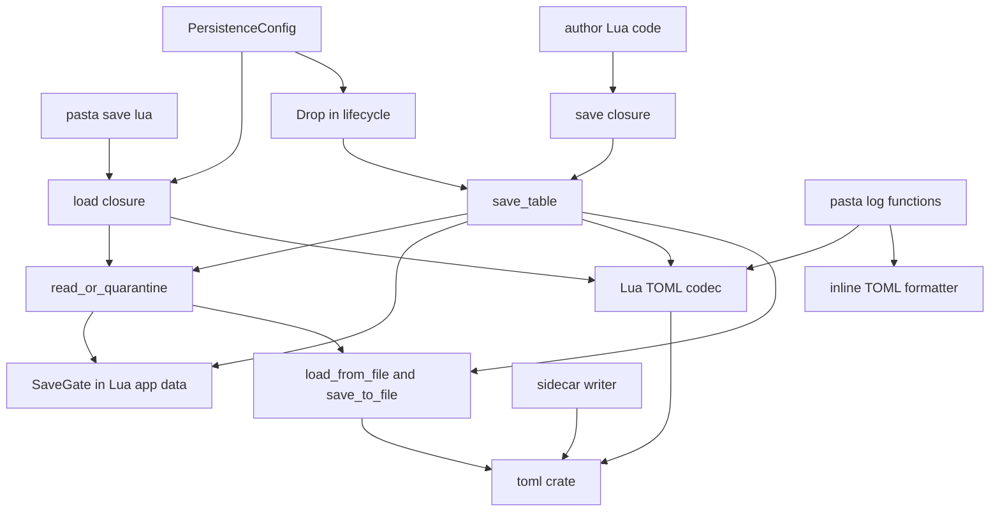
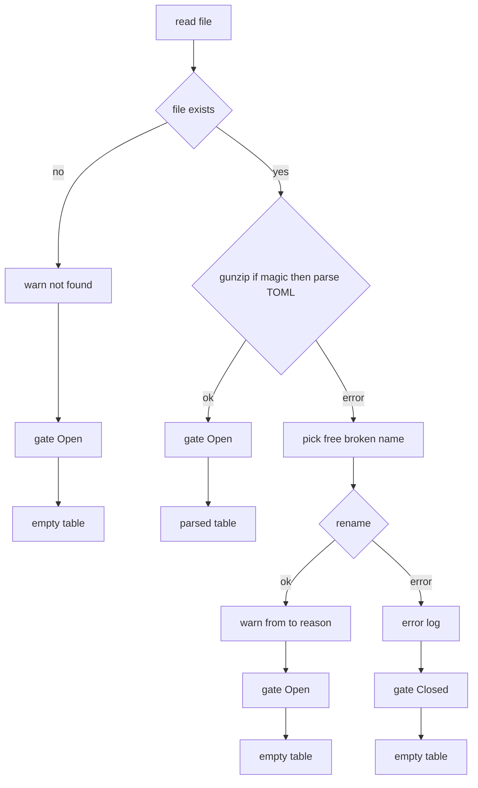
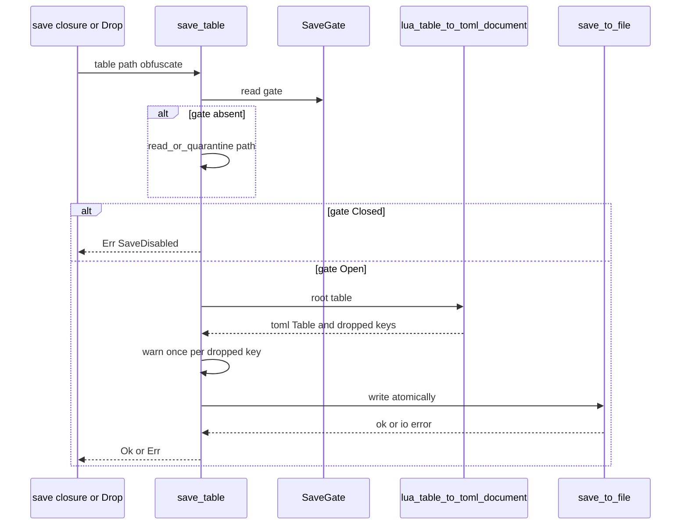

# 設計: toml-serialization

## Overview

**Purpose**: pasta が自分で読み書きするセーブファイル・`@pasta_log` の表の出力・ソースマップのサイドカーから JSON を追い出し、TOML にそろえる。いちばん大事なのはセーブファイルで、`＄＊` のグローバル変数（Lua の `save` テーブル）を TOML（`obfuscate = true` なら gzip した TOML）で書き、次の起動で読み戻す。

**Users**: ゴーストの作者（`＄＊`・`@pasta_persistence` で起動をまたいで値を残す人、`@pasta_log` で表を確かめる人、サイドカーを使う人）と pasta の開発者。

**Impact**: `crates/pasta_lua` の 5 つのソース（`runtime/persistence.rs`・`runtime/lifecycle.rs`・`runtime/log.rs`・`loader/config/sections.rs`・`debug/source_map/sidecar.rs`）を書き換える。既定の保存先が `profile/pasta/save/save.json` から `save.toml` に変わり、古い JSON のセーブは引き継がない（読まない・移さない・消さない）。`save_to_file`・`load_from_file`・`PersistenceError` は crates.io に出している公開の Rust API なので、型が変わる（コミットの件名に `!` を付ける）。

### Goals

- セーブファイルを TOML で書いて読む。同じ表からは同じバイト列ができ、書いた値（外したキーを除く）が同じ形で戻る。
- TOML で書けない値は、いちばん近い文字列のキーの単位で外し、キーの道筋と理由を警告に出す。ほかの値は保存する。
- 読めないセーブは `.broken` へ退避してから空の表で始める。退避もできなければ、そのランタイムの間は書かない。読めないセーブを上書きしない。
- `@pasta_log` の表を TOML の値の書き方で 1 行に出す。サイドカーを TOML にする。
- マニュアル・スキルの references・`tech.md` を新しい動きに合わせる。

### Non-Goals

- `@json`・`OnPastaSetSaveVariable` の値の形式（`mlua-stdlib-removal`）。DAP・LSP の JSON。
- 古いセーブの移し替え。保存の時機や中身の範囲の作り直し（`novel-variable-scope` など）。
- Lua の値を TOML にする口（`@toml`）を Lua に出すこと（`mlua-stdlib-removal` が持つ見込み）。
- リリースノートの本文（`doc/release-notes/v0.4.3.md`）。`release` スキルが書く。本書は文案を渡すだけ。
- 見本のゴーストの `[persistence] data_dir` の整理。

## Boundary Commitments

### This Spec Owns

- セーブファイルの形式（TOML・gzip した TOML）、保存先の既定（`profile/pasta/save/save.toml`）と `obfuscate` のときの名前の決まり。
- Lua の値と TOML の値の変換（セーブとログで共有する 1 つの変換。書ける値・書けない値の線引き、深さの上限、循環の守り、外したキーの一覧）。
- 読めないセーブの退避（`.broken` の名前の決め方）と、そのランタイムの「保存を止める」印（`SaveGate`）。
- 終了時の自動保存が、`save(data)` と同じ変換と印を通ること。
- `@pasta_log` の表の 1 行の書き方。
- サイドカー `<lua_path>.map` の形式（TOML・`version = 1`）。
- 文書: マニュアル 8 頁、スキルの references の作り直し、`tech.md` の依存の説明、`pasta-ghost-authoring/SKILL.md` 175 行、リリースノートの詫びの文案。

### Out of Boundary

- `runtime/module_registry.rs`（`toml_to_lua` を含む）、`runtime/mod.rs`、ルートと各クレートの `Cargo.toml`、`Cargo.lock`。本設計はこれらを 1 行も変えずに成り立つ。
- `@pasta_persistence` の関数の名前・引数・戻り値の形（今のまま）。`pasta.save`（`save.lua`）と Lua 側の偽物（`scriptlibs/lua_test/mocks.lua`・`tests/common/mod.rs`）。
- `[persistence]` のキーの追加。`hello-pasta` の `pasta.toml`。
- DAP（`debug/dap/`・`debug/transport/`・`debug/wiring/`・`debug/enable.rs`）と `pasta_lsp` の `serde_json`。
- `pasta_shiori` のテスト（`shiori_lifecycle_tests.rs`・`ffi_logging_test.rs`）。文言 `"Failed to save persistence data on drop"`・`"Saved persistence data on drop"` を保つことで、手を入れずに通す。

### Allowed Dependencies

- `toml` 1.1.8（既に `pasta_lua` の依存。既定の機能 `parse`・`display`・`serde`。`toml::Table`・`toml::Value`・`toml::to_string`・`toml::from_slice`・`toml::de::Error`・`toml::ser::Error`）。`toml_writer`・`toml_parser` を直接は使わない。
- `mlua` 0.11（`Table::pairs`・`raw_get`・`metatable`・`to_pointer`、`LuaSerdeExt::array_metatable`、`Lua::set_app_data`・`app_data_ref`）。
- `flate2`（今の gzip の読み書き）、`std::fs`、`tracing`。
- 依存の向き: `loader/config/sections.rs` → `runtime/persistence.rs` → `runtime/lifecycle.rs`・`runtime/log.rs`。`log.rs` は `persistence.rs` の `pub(crate)` の変換だけを使う。`persistence.rs` は `log.rs`・`lifecycle.rs` を使わない。`debug/source_map/sidecar.rs` はほかと独立。

### Revalidation Triggers

- セーブファイルの形式・保存先の既定・`.broken` の名前の決まりを変えるとき（`novel-variable-scope`・`novel-checkpoint-rollback`・`novel-save-slots`・`ponytail-lua-loader` が前提にする）。
- 書ける値・書けない値の線引き、または深さの上限（32 段）を変えるとき。
- `save_to_file`・`load_from_file`・`PersistenceError` の型を変えるとき（公開の Rust API）。
- `mlua-stdlib-removal` の `@toml` が本書の変換を使うことにしたとき（その場合、変換の `pub(crate)` の口と線引きを共有の決まりとして見直す）。
- `mlua-0-12-upgrade` で `Value::Integer`・`Value::Number` の分け方や `array_metatable` が変わるとき。
- ワークスペースのどこかが `toml` の `preserve_order` を有効にするとき（`toml::Table` が挿入順になり、1.8 の「毎回同じ」が崩れる。テストが検出する）。

## Architecture

### Existing Architecture Analysis

- `persistence.rs` の `register` が `load`・`save` の 2 つの閉包を `PersistenceState`（保存先・`obfuscate`・`debug_mode`）つきで登録する。`lifecycle.rs` の `Drop` は、設定から保存先を計算し直し、`require("pasta.save")` の表を `serde_json::Value` にして `save_to_file` を直接呼ぶ。2 つの道は状態を共有していない。
- 保存の変換は mlua の serde（`from_value`）に任せている。混ざった表の名前のキーを黙って捨て、1 つでも変換できない値があると全体が失敗し、深さの関門が無い。
- `log.rs` は 1000 要素の関門・深さ 10 段の関門（`table_depth_exceeds`）・serde 変換・`serde_json::to_string` の 4 段で、失敗は `tostring` に戻す。
- Lua の状態ごとの値を `Lua::set_app_data` で持つ型は既にある（`runtime/searcher.rs` の `ChunkTable`、`runtime/ffi_load/mod.rs` の `DllPins`）。本書の `SaveGate` も同じ型にする。
- `save_to_file` の原子的な書き込み（一時ファイル → `sync_all` → `rename`、失敗したら一時ファイルを消す）は、そのまま使う。

### Architecture Pattern & Boundary Map



**Architecture Integration**:
- 採った形: 今のファイルを広げる（ギャップ分析の Option A）。新しいソースは `persistence.rs` から `#[path]` で読むテストのファイル 1 つだけで、`runtime/mod.rs` に `mod` の行を足さない。
- 境界: 変換と保存の決まりは `persistence.rs` が 1 か所で持つ。`lifecycle.rs` は「いつ保存するか」だけ、`log.rs` は「1 行にどう書くか」だけを持つ。
- 保つ形: 原子的な書き込み、gzip の判別、パスの検査、`load()`・`save(data)` の戻り値、`Drop` のログの文言、`app_data` で状態を持つ型。
- 新しい部品の理由: `SaveGate` は、`save(data)` の閉包と `Drop` の 2 つの道が「読めなかったので書かない」を共有するために要る。変換は、mlua の serde ではキーごとに外せない（research.md 2.6）ために要る。
- steering との整合: `structure.md` の src 内テスト配置（`<feature>_tests.rs` を `#[path]` で）と 600 行の目安、`tech.md` の「シリアライズは TOML」（roadmap の方針）。

### Technology Stack

| Layer | Choice / Version | Role in Feature | Notes |
|-------|------------------|-----------------|-------|
| Backend / Services | Rust 2024・mlua 0.11.6（LuaJIT） | Lua の表を歩いて TOML の値にする、TOML の値から Lua の表を作る | `Value::Integer`／`Value::Number` の分け方は mlua に任せる（下の「数」） |
| Data / Storage | toml 1.1.8（spec 1.1.0）・flate2 | セーブファイルとサイドカーの読み書き | 新しい依存なし。`Cargo.toml`・`Cargo.lock` は変えない |
| Infrastructure / Runtime | tracing 0.1 | 外したキー・退避・保存停止のログ | 既存の文言 2 つを保つ |

## File Structure Plan

### Directory Structure

```
crates/pasta_lua/src/
├── runtime/
│   ├── persistence.rs        # セーブ機能の本体（変換・読み書き・退避・SaveGate・モジュール登録）
│   ├── persistence_tests.rs  # 新規。persistence.rs の src 内テスト（#[cfg(test)] #[path] で読む）
│   ├── lifecycle.rs          # 終了時の自動保存（save_table を呼ぶだけ）
│   └── log.rs                # @pasta_log（表を共有の変換＋1 行の書き方で文字列にする）
├── loader/config/sections.rs # [persistence] の既定と effective_file_path
└── debug/source_map/sidecar.rs # サイドカーの TOML の読み書き
```

### Modified Files

- `crates/pasta_lua/src/runtime/persistence.rs` — JSON の道を消し、TOML の読み書き、Lua ↔ TOML の変換、退避、`SaveGate`、`save_table` を置く。`DESCRIPTION` を `"Persistent data storage (TOML/gzip)"` にする。今ある `#[cfg(test)] mod tests { … }`（約 250 行）を `persistence_tests.rs` へ移し、`#[cfg(test)] #[path = "persistence_tests.rs"] mod tests;` の 1 行にする（本体を 600 行の目安の内に保つ）。
- `crates/pasta_lua/src/runtime/persistence_tests.rs` — 新規。移したテストを TOML に直したものと、変換・退避・`SaveGate` の単体テスト。`SaveGate` を直接置く必要があるので src 内に置く。
- `crates/pasta_lua/src/runtime/lifecycle.rs` — `serde_json` への変換と `save_to_file` の直呼びを、`persistence::save_table` の 1 回の呼び出しに替える。ログの文言 2 つは変えない。
- `crates/pasta_lua/src/runtime/log.rs` — `table_depth_exceeds` と serde 変換と `serde_json::to_string` を、`persistence::lua_value_to_toml_strict`（深さ 10）と、この中の 1 行の書き出し `write_inline` に替える。1000 要素の関門は残す。
- `crates/pasta_lua/src/loader/config/sections.rs` — 既定 `"profile/pasta/save/save.toml"`、`effective_file_path` を末尾だけの置き換えにする。doc コメントを直す。
- `crates/pasta_lua/src/debug/source_map/sidecar.rs` — `serde_json::to_vec`・`from_slice` を `toml::to_string`・`toml::from_slice` に替える。doc コメントの「JSON」を直す。`SIDECAR_VERSION = 1` のまま。
- テスト: `crates/pasta_lua/tests/runtime/persistence_integration_test.rs`（材料を `toml::Table` に替え、退避・`.json` の名前・終了時の保存・警告の文言を足す）、`tests/loader/config_test.rs`（325〜391 行の既定値と `effective_file_path`）、`tests/loader/config_sections_test.rs`（`data.bin` → `data.bin.dat` は変わらないことを確かめるだけ）、`tests/log/module_test.rs`（`[1, 2, 3]`・1 行・書けない値で `tostring`）、`src/debug/source_map_sidecar_tests.rs`（`serde_json` を直接使う 4 か所）。
- 文書: `book/src/lua/modules/pasta-persistence.md`・`book/src/reference/pasta-toml.md`・`book/src/grammar/variables.md`・`book/src/lua/modules/pasta-log.md`・`book/src/internals/logging-encoding.md`・`book/src/internals/execution-model.md`・`book/src/internals/debug.md`・`book/src/debug/source-level.md`、`book/tools/gen-skill-refs.mjs` で作り直す references（`.claude/skills/pasta-ghost-authoring/references/{variables,pasta-toml}.md`・`.claude/skills/pasta-lua-coding/references/{pasta-persistence,pasta-log}.md`）、`.claude/skills/pasta-ghost-authoring/SKILL.md` 175 行、`.kiro/steering/tech.md` 37〜38 行。

## System Flows

### 読み込みと退避（`read_or_quarantine`）



- 印は、どの結果でも必ず置く（`Open` か `Closed`）。印が無いことは「このランタイムでまだ読んでいない」を意味する。
- 一度 `Closed` になった印は、そのランタイムの間は `Open` に戻さない（後の `load()` が読めても戻さない。OPEN QUESTION 4）。

### 保存（`save_table`。`save(data)` と終了時の自動保存の共通の道）



- 印が無いときに先に読むのは、作者が `pasta.save` を読む前に `save(data)` を呼んだときに、読めないセーブを確かめずに上書きしないためである（5.3）。
- `Drop` は今と同じく `require("pasta.save")` で表を得るので、まだ読んでいなければその時点で `load()` が走り、印が置かれる。
- `save(data)` の戻り値: `Ok` → `true, nil`（キーを外したときも。4.6）、`Err` → `nil, "Failed to save: …"`。`Drop`: `Err` → `tracing::error!(error = %e, "Failed to save persistence data on drop")`、`Ok` かつ `debug_mode` → `"Saved persistence data on drop"`。

## Requirements Traceability

| Requirement | Summary | Components | Interfaces | Flows |
|-------------|---------|------------|------------|-------|
| 1.1, 1.2 | TOML（gzip した TOML）で書く・JSON で書かない | SaveStore | `save_to_file` | 保存 |
| 1.3, 1.4 | gzip の印で判別して TOML で読む・JSON の道なし | SaveStore | `load_from_file` | 読み込み |
| 1.5, 1.6 | 空のファイルは警告なしで空・無いファイルは警告して空 | SaveStore | `load_from_file`・`read_or_quarantine` | 読み込み |
| 1.7 | 書いた値が同じ形で戻る | SaveCodec | `lua_table_to_toml_document`・`toml_to_lua` | 保存・読み込み |
| 1.8 | 同じ表から同じファイル | SaveCodec・SaveStore | `toml::Table`（キー昇順）・`toml::to_string` | 保存 |
| 1.9 | フォルダを作る・原子的な書き込み | SaveStore | `save_to_file`（今のまま） | 保存 |
| 1.10 | `load()`・`save(data)` の呼び方と戻り値 | SaveStore | `register`・`load_impl`・`save_impl` | 両方 |
| 1.11 | BOM を無視 | SaveStore | `toml::from_slice`（toml_parser が飛ばす） | 読み込み |
| 1.12 | 日時は文字列で読み、文字列で書く | SaveCodec | `toml_to_lua` の `Datetime` 分岐 | 読み込み |
| 2.1, 2.2 | 古い `save.json` を読まず触らない | PersistenceConfig | 既定 `save.toml` | — |
| 2.3 | 保存先と同じ名前の古いセーブは退避 | SaveStore | `read_or_quarantine` | 読み込み |
| 2.4, 2.5 | マニュアルの記述・リリースノートの文案と `!` | Docs | 「移行とリリースノートへの申し送り」 | — |
| 3.1, 3.2, 3.3 | 既定 `save.toml`・`obfuscate` の名前・末尾だけ替える | PersistenceConfig | `effective_file_path` | — |
| 3.4 | `.json` を特別に扱わない | PersistenceConfig | `effective_file_path` | — |
| 3.5, 3.6 | パスの検査とキーを保つ | SaveStore・PersistenceConfig | `register` の検査（今のまま） | — |
| 4.1 | 書ける値 | SaveCodec | 分類の表 | 保存 |
| 4.2 | 書けない値 | SaveCodec | 分類の表 | 保存 |
| 4.3, 4.4 | 近い文字列のキーで外す・配列は丸ごと | SaveCodec | `convert` の外し方 | 保存 |
| 4.5 | 外したキーごとに道筋と理由の警告 | SaveStore | `DroppedKey`・警告の文言 | 保存 |
| 4.6 | 外しても書いて `true, nil` | SaveStore | `save_table`・`save_impl` | 保存 |
| 4.7 | 深さの上限 32 段 | SaveCodec | `SAVE_MAX_DEPTH` | 保存 |
| 4.8 | 異常終了しない | SaveCodec | 深さで止まる再帰・祖先の列 | 保存 |
| 4.9 | 終了時も同じ扱い | DropSave | `save_table` | 保存 |
| 4.10 | 根の文字列でないキーは 1 つずつ外す | SaveCodec | `lua_table_to_toml_document` の根の扱い | 保存 |
| 5.1, 5.2 | 読めないセーブを `.broken` へ移して警告 | SaveStore | `read_or_quarantine`・`quarantine` | 読み込み |
| 5.3 | 読めないセーブを上書きしない | SaveStore | `save_table` の先読み・`SaveGate` | 保存 |
| 5.4 | 既にある `.broken` を上書きしない | SaveStore | `quarantine` の名前の選び方 | 読み込み |
| 5.5 | 退避できなければ書かない | SaveStore・DropSave | `SaveGate::Closed`・`PersistenceError::SaveDisabled` | 両方 |
| 5.6 | 退避の後は保存先に新しく書く | SaveStore | `SaveGate::Open` | 保存 |
| 5.7 | エラーを投げない | SaveStore | `load_impl` は常に表を返す | 読み込み |
| 6.1, 6.2, 6.3 | TOML の値の書き方で 1 行・JSON でない | LogTableFormatter | `write_inline` | — |
| 6.4 | 1000 要素・10 段・循環の扱いを保つ | LogTableFormatter・SaveCodec | `count_table_elements`・`lua_value_to_toml_strict(…, 10)` | — |
| 6.5 | 書けない値があれば表全体を `tostring` | LogTableFormatter | `Err` → `lua_tostring` | — |
| 6.6, 6.7 | ほかの値の扱いと、止めないこと | LogTableFormatter | `value_to_string`（表以外は今のまま） | — |
| 7.1, 7.2, 7.3 | `.map` に TOML・同じ項目・毎回同じ | SidecarCodec | `write_sidecar` | — |
| 7.4 | 読み戻し（0 件も） | SidecarCodec | `read_sidecar` | — |
| 7.5, 7.6 | 失敗は返すだけ・名前と設定を保つ | SidecarCodec | `write_sidecar`・`sidecar_path_for_lua`（今のまま） | — |
| 8.1, 8.2, 8.3, 8.4, 8.5 | マニュアル 8 頁 | Docs | 「文書の直し」 | — |
| 8.6 | references の作り直し | Docs | `node book/tools/gen-skill-refs.mjs`（`--check` で確かめる） | — |
| 8.7 | `tech.md` の依存の説明 | Docs | 「文書の直し」 | — |
| 8.8 | `pasta-ghost-authoring/SKILL.md` の 1 行 | Docs | 「文書の直し」 | — |

## Components and Interfaces

| Component | Domain/Layer | Intent | Req Coverage | Key Dependencies (P0/P1) | Contracts |
|-----------|--------------|--------|--------------|--------------------------|-----------|
| SaveCodec | Runtime（`persistence.rs`） | Lua の値 ↔ TOML の値の変換。線引き・深さ・循環・外したキー | 1.7, 1.8, 1.12, 4.1〜4.4, 4.7, 4.8, 4.10, 6.4, 6.5 | mlua（P0）、toml（P0） | Service |
| SaveStore | Runtime（`persistence.rs`） | ファイルの読み書き、退避、`SaveGate`、`load`・`save` の登録 | 1.1〜1.6, 1.9〜1.11, 2.3, 3.5, 4.5, 4.6, 5.1〜5.7 | SaveCodec（P0）、flate2（P0）、toml（P0） | Service, State |
| DropSave | Runtime（`lifecycle.rs`） | 終了時に `save_table` を呼ぶ | 4.9, 5.5 | SaveStore（P0） | Service |
| PersistenceConfig | Loader（`sections.rs`） | 既定の保存先と `obfuscate` の名前 | 2.1, 2.2, 3.1〜3.4, 3.6 | — | Service |
| LogTableFormatter | Runtime（`log.rs`） | 表を TOML の値の書き方で 1 行に | 6.1〜6.7 | SaveCodec（P0） | Service |
| SidecarCodec | Debug（`sidecar.rs`） | サイドカーを TOML で読み書き | 7.1〜7.6 | toml（P0） | Service |
| Docs | 文書 | マニュアル・references・steering・申し送り | 2.4, 2.5, 8.1〜8.8 | `gen-skill-refs.mjs`（P1） | — |

### Runtime（`persistence.rs`）

#### SaveCodec

| Field | Detail |
|-------|--------|
| Intent | Lua の値と TOML の値を、要件の線引きどおりに相互に変える |
| Requirements | 1.7, 1.8, 1.12, 4.1, 4.2, 4.3, 4.4, 4.7, 4.8, 4.10, 6.4, 6.5 |

**Responsibilities & Constraints**
- 書く向き（Lua → TOML）は 1 つの再帰の変換 `convert` で、2 つのモードを持つ。外すモード（セーブ）では、文字列のキーの値が書けなければそのキーだけを外して一覧に足し、続ける。厳しいモード（ログ）では、どこかが書けなければ全体を `Err` にする。
- 再帰の深さは上限（セーブ 32・ログ 10）で必ず止まり、ホストのスタックを溢れさせない。循環は、いまたどっている祖先の表の列（`Table::to_pointer` の値。長さは上限以下）で見つける。同じ表を別のキーから 2 回指すだけ（循環でない共有）は、2 回書く。
- メタテーブルは、空の表に付いた mlua の配列の印（`array_metatable`）だけを見る。表の中身は生のたどり方（`pairs`・`raw_get`）で読む（`__index`・`__pairs` を呼ばない）。
- 読む向き（TOML → Lua）は、`module_registry.rs` の `toml_to_lua` を呼ばずに、`persistence.rs` の中に小さな写しを持つ（同じウェーブの約束）。

**Dependencies**
- External: mlua 0.11 — 表のたどり方・配列の印（P0）
- External: toml 1.1.8 — `toml::Value`・`toml::Table`（P0）

**Contracts**: Service [x]

##### Service Interface

```rust
/// セーブの入れ子の上限（根の表を 1 段目と数える）。
pub(crate) const SAVE_MAX_DEPTH: usize = 32;

/// 保存しなかったキー 1 件。
pub(crate) struct DroppedKey {
    /// 根からの道筋（例: "flags.secret"・"inventory[1].f"）。
    pub path: String,
    /// 書けない理由（下の「理由の言葉」）。
    pub reason: String,
}

/// セーブの根の表を TOML の文書にする。書けないキーは外して一覧に入れる。失敗しない。
pub(crate) fn lua_table_to_toml_document(lua: &Lua, root: &Table) -> (toml::Table, Vec<DroppedKey>);

/// 値を TOML の値にする。どこか 1 つでも書けなければ Err(理由)。ログが使う。
pub(crate) fn lua_value_to_toml_strict(lua: &Lua, value: &Value, max_depth: usize) -> Result<toml::Value, String>;

/// TOML の値を Lua の値にする（日時は文字列、配列には配列の印）。
fn toml_to_lua(lua: &Lua, value: &toml::Value) -> LuaResult<Value>;
```

- Preconditions: `root` はセーブの根（`pasta.save` の表、または `save(data)` の `data`）。
- Postconditions: `lua_table_to_toml_document` の戻りの `toml::Table` は、`toml::to_string` で必ず書ける。一覧の各件は、戻りの表に入っていないキーである。配列を丸ごと外したときは、その配列の中で一度足した件を一覧から取り除き（一覧の長さを配列に入る前に戻す）、配列のキーの 1 件だけを残す。
- Invariants: 同じ Lua の表からは、同じ `toml::Table` ができる（`toml::Table` はキーの昇順の `BTreeMap`。`preserve_order` はワークスペースで無効）。

##### 分類の表（書く向き）

| Lua の値 | 結果 | 理由の言葉（書けないとき） |
|----------|------|---------------------------|
| 文字列（UTF-8 として正しい） | TOML の文字列 | — |
| 文字列（UTF-8 として正しくない） | 書けない | `string is not valid UTF-8` |
| 真偽値 | TOML の真偽値 | — |
| `Value::Integer(i)` | TOML の整数 | — |
| `Value::Number(f)` | TOML の浮動小数点数（`nan`・`inf`・`-inf`・`-0.0` を含む） | — |
| 祖先と同じ表 | 書けない | `recursive table` |
| 深さが上限を超える表 | 書けない | `nested deeper than {N} levels` |
| キーが無い表で、配列の印が付いている | 空の配列 `[]` | — |
| キーが無い表 | 空の表 `{}` | — |
| キーがすべて文字列の表 | TOML の表（値ごとに再帰。外すモードでは書けない値のキーだけ外す） | — |
| キーがすべて正の整数で、最大のキー＝キーの数（1 から穴なし） | TOML の配列（1 から順に再帰。要素が 1 つでも書けなければ配列ごと書けない） | 要素の理由をそのまま返す |
| キーがすべて正の整数で、キー 1 があり穴がある | 書けない | `hole in array` |
| 文字列のキーと正の整数のキーが混ざる | 書けない | `table mixes array items and named keys` |
| そのほかの文字列でないキーを持つ（`{[5] = "x"}`・`{[true] = 1}`・`{[1.5] = 1}`・表のキーなど） | 書けない | `non-string key ({型の名前})` |
| 関数・コルーチン・ユーザーデータ・ライトユーザーデータ・そのほか | 書けない | `unsupported value type ({型の名前})` |

- 文字列のキーが UTF-8 として正しくないときは、そのキーだけを外す（理由 `key is not valid UTF-8`。道筋は置き換え文字で表す）。親の表は外さない（OPEN QUESTION 5）。厳しいモードでは `Err`。
- 根の扱い（4.10）: `lua_table_to_toml_document` は根を必ずキーのある表として読み、文字列でないキーは 1 つずつ `non-string key at root ({型の名前})` で外す。根を配列として書かない。
- 深さ: 根の表を 1 段目と数え、`N` 段目までは書ける。`N + 1` 段目の表を持つキーを外す。ログの `N = 10` は、今の `table_depth_exceeds`（表そのものを深さ 1 とし、`depth > limit` で止める）と同じ数え方である。
- 数: mlua は LuaJIT の数を `num_traits::cast` で `i64` の範囲を確かめてから `Value::Integer` にする（`2^63` は `Value::Number` のまま。`state/raw.rs` 805〜813 行）。変換は mlua の分け方をそのまま使い、自前で `as i64` をしない。これで research.md 6 章の `2^63` の飽和の落とし穴は起きない。
- 道筋の書き方: 文字列のキーは `.` でつなぎ（根のキーは先頭の `.` なし）、配列の要素は `[i]`（1 から）。キーはそのまま書く（`混ざり`、`flags.secret`、`inventory[1].f`）。

##### 読む向き

| TOML の値 | Lua の値 |
|-----------|----------|
| 文字列・整数・浮動小数点数・真偽値 | 同じ型（整数は `Value::Integer`） |
| 日時（offset・local の 4 種） | `Datetime` の `Display` の文字列（例 `1979-05-27T07:32:00Z`） |
| 配列 | 1 から順の表。mlua の配列の印を付ける（空の配列が空の配列のまま書き戻る。今の JSON の読み込みと同じ） |
| 表 | 文字列のキーの表 |

- 入れ子の深さは、toml の読み込みが 80 段で断る（`toml` 1.1.8 `de/parser/mod.rs` の `LIMIT = 80`。それより深い手書きの文書は読めないセーブになり、退避される）ので、読む向きの再帰も有限で止まる。
- LuaJIT の数は倍精度なので、手で書いた `2^53` を超える整数は丸まる（マニュアルに 1 行書く。OPEN QUESTION 6）。

**Implementation Notes**
- Integration: `convert` の引数は、値・いまの深さ・上限・祖先の列・道筋・外したキーの一覧（`Option<&mut Vec<DroppedKey>>`。`None` が厳しいモード）。
- Validation: 分類の表の各行と、32 段・33 段、循環、根の数のキー、配列の中の外したキーの取り消しを単体テストで確かめる。
- Risks: 表を 2 回たどる（キーの分類と値の変換）。大きな表でも線形で、ログは 1000 要素の関門の後に呼ぶ。

#### SaveStore

| Field | Detail |
|-------|--------|
| Intent | セーブファイルを TOML で読み書きし、読めないファイルを守る |
| Requirements | 1.1, 1.2, 1.3, 1.4, 1.5, 1.6, 1.9, 1.10, 1.11, 2.3, 3.5, 4.5, 4.6, 5.1, 5.2, 5.3, 5.4, 5.5, 5.6, 5.7 |

**Responsibilities & Constraints**
- ファイルの形: 書くときは `toml::to_string(&toml::Table)`（UTF-8）を、`obfuscate` なら gzip して書く。読むときは先頭 `1f 8b` なら展開してから、`toml::from_slice::<toml::Table>` で読む。空のファイルは空の表として正しく読める（特別扱いは要らない。toml 1.1.8 で確かめた）。JSON の道は消す。
- 書き込みの決まり（親のフォルダを作る・`path.with_extension("tmp")` に書いて `sync_all`・`rename`・失敗したら一時ファイルを消す）は今の `save_to_file` のまま。
- 退避: 読み込みの誤りが「ファイルが無い」以外なら、`<保存先>.broken` を選び、既にあれば `<保存先>.broken.1`、`.broken.2`、… と、まだ無い最初の名前を選んで `fs::rename` する（`rename` は Windows でも行き先を置き換えるので、先に有無を確かめる）。同じ瞬間に別のプロセスが同じ名前を作る競合は扱わない（1 つのゴーストが 1 つの保存先を持つ前提）。
- `SaveGate` を Lua の `app_data` に置き、`load` の閉包・`save` の閉包・`Drop` の 3 つから同じ値を見る。ランタイム（Lua の状態）ごとに 1 つで、再読込のたびに新しく始まる。

**Dependencies**
- Inbound: `pasta.save`（`save.lua`）— 最初の `require` で `load()`（P0）
- Inbound: DropSave — `save_table`（P0）
- Outbound: SaveCodec — 変換（P0）
- External: flate2・toml・std::fs（P0）

**Contracts**: Service [x] / State [x]

##### Service Interface

```rust
#[derive(Debug, Error)]
pub enum PersistenceError {
    #[error("IO error: {0}")]
    IoError(#[from] std::io::Error),
    /// JsonError を置き換える（TOML として読めない。UTF-8 でない中身もここ）。
    #[error("TOML parse error: {0}")]
    TomlParseError(#[from] toml::de::Error),
    /// TOML の文書を書けない（理論上起きない）。
    #[error("TOML write error: {0}")]
    TomlWriteError(#[from] toml::ser::Error),
    #[error("Lua conversion error: {0}")]
    LuaConversionError(String),
    #[error("Persistence configuration not found")]
    ConfigNotFound,
    #[error("Lua VM access error: {0}")]
    LuaAccessError(String),
    #[error("Invalid file format: {0}")]
    InvalidFormat(String),
    /// 新規。読めないセーブを退避できず、このランタイムでは保存しない。
    #[error("Saving is disabled for this runtime: {0}")]
    SaveDisabled(String),
}

/// 公開 API（型が変わる）。gzip の印を見て展開し、TOML の文書として読む。
pub fn load_from_file(path: &Path) -> Result<toml::Table, PersistenceError>;

/// 公開 API（型が変わる）。TOML の文書を（obfuscate なら gzip して）原子的に書く。
pub fn save_to_file(data: &toml::Table, path: &Path, obfuscate: bool) -> Result<(), PersistenceError>;

/// save(data) と Drop の共通の道。印を確かめ、変換し、外したキーを警告し、書く。
pub(crate) fn save_table(lua: &Lua, table: &Table, path: &Path, obfuscate: bool) -> Result<(), PersistenceError>;

/// 読む・退避する・印を置く。どの結果でも表を返す（失敗は空の表）。
fn read_or_quarantine(lua: &Lua, path: &Path) -> toml::Table;

/// 空いている .broken の名前を選んで移す。移した先を返す。
fn quarantine(path: &Path) -> std::io::Result<PathBuf>;
```

- `register`・`load_impl`・`save_impl` の形は今のまま。`load_impl` = `toml_to_lua(read_or_quarantine(…))` の表（`debug_mode` の `"Loaded persistence data"` は `load_impl` が今のまま出す）。`save_impl` = `save_table` の結果を `(Some(true), None)` か `(None, Some("Failed to save: {e}"))` にする（今の `"Failed to convert Lua value"` の道は無くなる）。`save_impl` の失敗のログ `"Persistence save error"`（error）は今のまま。
- Preconditions: `path` は `register` の検査（絶対パス・`..`・ルート・ドライブを断る。3.5）を通った保存先。
- Postconditions: `save_table` が `Ok` を返したとき、保存先は新しい内容である。`Err(SaveDisabled)` のとき、保存先にも一時ファイルにも何も書いていない。`read_or_quarantine` の後は、必ず印がある。
- Invariants: 読めないセーブファイルは、`.broken` の名前に移るか、そのまま残る。どちらの場合も上書きされない。

##### State Management

```rust
/// 1 つのランタイムで、セーブファイルを読んだ結果（Lua の app_data）。無い = まだ読んでいない。
enum SaveGate {
    /// 読めた・無かった・退避できた。保存してよい。
    Open,
    /// 退避できなかった。理由を持ち、このランタイムでは保存しない。
    Closed(String),
}
```

- 置く: `read_or_quarantine` だけが置く（`lua.set_app_data`）。`Closed` を `Open` で上書きしない。
- 読む: `save_table` が `lua.app_data_ref::<SaveGate>()` で読む。借りたまま `set_app_data` を呼ばない（mlua は借りている間の書き換えで panic する）。
- 並行性: Lua の状態は 1 つのスレッド（アクタースレッド）に固定されているので、競合は無い。

##### ログの文言

| 場面 | レベル | 文言（メッセージ） | フィールド |
|------|--------|-------------------|-----------|
| キーを外した（1 件ごと） | warn | `key '{path}' was not saved: {reason}` | `key`・`reason` |
| ファイルが無い | warn | `Persistence file not found, using empty table`（今のまま） | `path` |
| 退避した | warn | `Unreadable persistence file moved aside, using empty table` | `from`・`to`・`error` |
| 退避できなかった | error | `Unreadable persistence file could not be moved aside; saving is disabled for this runtime` | `path`・`error`・`rename_error` |
| `save(data)` の失敗 | error | `Persistence save error`（今のまま） | `error`・`path` |
| 終了時の保存の失敗 | error | `Failed to save persistence data on drop`（今のまま） | `error` |
| 終了時の保存の成功（`debug_mode`） | debug | `Saved persistence data on drop`（今のまま） | `path` |

- 外したキーの警告は、保存のたびに出す（間引かない。OPEN QUESTION 1）。

**Implementation Notes**
- Integration: `pasta_shiori` の `shiori_lifecycle_tests.rs` は保存先の親を通常のファイルにして失敗させる。Windows では読みが「無い」になり、書き込みで失敗する。Unix では読みが `NotADirectory` で「読めない」になり、退避も失敗して `Closed` になる。どちらも `Drop` が `"Failed to save persistence data on drop"` を出すので、テストは変えずに通る。
- Validation: `SaveGate::Closed` は src 内テストで直接置いて確かめる（`save()` が `nil, err`、保存先が変わらない）。退避の名前の重なりは `.broken` と `.broken.1` を先に作って確かめる。
- Risks: 読みが一時的なロックで失敗し、退避も同じロックで失敗したときは、そのランタイムの変更が残らない（A6 で開発者が受け入れた）。

### Runtime（`lifecycle.rs`）

#### DropSave

| Field | Detail |
|-------|--------|
| Intent | 終了時に `pasta.save` の表を `save_table` で保存する |
| Requirements | 4.9, 5.5 |

- 保存先の計算（設定から `effective_file_path` を `base_dir` に足す）と `require("pasta.save")` は今のまま。`from_value::<serde_json::Value>` と `save_to_file` の 2 行を `persistence::save_table(&self.lua, &save_table, &file_path, persistence_config.obfuscate)?` の 1 行に替える。`LuaSerdeExt`・`Value` の `use` を消す。
- `impl Drop` は変えない（文言 2 つを保つ）。

### Loader（`sections.rs`）

#### PersistenceConfig

| Field | Detail |
|-------|--------|
| Intent | 既定の保存先と `obfuscate` のときの名前を決める |
| Requirements | 2.1, 2.2, 3.1, 3.2, 3.3, 3.4, 3.6 |

```rust
fn default_persistence_file_path() -> String; // "profile/pasta/save/save.toml"

impl PersistenceConfig {
    /// obfuscate = false → file_path のまま。
    /// obfuscate = true  → 末尾が ".toml" ならその末尾だけ ".dat" に、".dat" ならそのまま、それ以外は末尾に ".dat" を足す。
    pub fn effective_file_path(&self) -> String;
}
```

| `file_path` | `obfuscate = false` | `obfuscate = true` |
|-------------|---------------------|--------------------|
| 既定 `profile/pasta/save/save.toml` | `profile/pasta/save/save.toml` | `profile/pasta/save/save.dat` |
| `my.toml.d/save.toml` | そのまま | `my.toml.d/save.dat`（途中のフォルダは替えない） |
| `save.json` | `save.json`（中身は TOML） | `save.json.dat` |
| `data.bin` | `data.bin` | `data.bin.dat` |
| `save.dat` | `save.dat` | `save.dat` |

- 置き換えは `strip_suffix(".toml")` で末尾だけに効かせる（今の `.replace(".json", ".dat")` の、途中のフォルダ名まで替える不具合が消える）。キーの名前と `serde` の属性は変えない。

### Runtime（`log.rs`）

#### LogTableFormatter

| Field | Detail |
|-------|--------|
| Intent | `@pasta_log` に渡された表を TOML の値の書き方で 1 行にする |
| Requirements | 6.1, 6.2, 6.3, 6.4, 6.5, 6.6, 6.7 |

```rust
/// 表を文字列にする（関門の順は 1000 要素 → 変換 → 1 行の書き出し）。
fn table_to_string(lua: &Lua, table: &Table, original_value: &Value) -> String;

/// TOML の値を 1 行に書く。
fn write_inline(value: &toml::Value, out: &mut String);
```

- 関門: 1000 要素を超える表は今のまま `<table: N elements>`。次に `persistence::lua_value_to_toml_strict(lua, value, MAX_NESTING_DEPTH)`（10 段）を呼び、`Err` なら `lua_tostring`（今の戻し方。`tostring` が失敗したら `"<unconvertible value>"`）。深さ 10 段を超える表と循環も、この変換が `Err` にする。`table_depth_exceeds`・`serde_json`・`LuaSerdeExt` は要らなくなるので消す（変換が深さで止まる再帰なので、スタックの守りは変わらない）。
- 1 行の書き方（`write_inline`）:
  - キーのある表: `{ k1 = v1, k2 = v2 }`（キーの昇順）。空の表は `{}`。空の配列は `[]`。
  - 配列: `[v1, v2]`。
  - キー: `A-Za-z0-9_-` だけでできた空でないキーはそのまま、それ以外は基本文字列（`"会員番号"`）。
  - 文字列: いつも基本文字列 `"…"`。`\` → `\\`、`"` → `\"`、`\b`・`\t`・`\n`・`\f`・`\r`、そのほかの制御文字（U+0000〜U+001F・U+007F）は `\uXXXX`。複数行の文字列（`"""`）を使わない（toml の `Display` は改行を含む文字列を複数行にするため、文字列だけ自前で書く）。
  - 整数・浮動小数点数・真偽値・日時: `toml::Value` の `Display`（`1.0`・`nan`・`inf`・`-inf` を TOML の書き方で出す）。
- 表以外の値（文字列・数・真偽値・`nil`・関数など）の扱いは今のまま（`value_to_string`）。

| 入力 | 出力 |
|------|------|
| `{ player = "ユーザー", score = 100 }` | `{ player = "ユーザー", score = 100 }` |
| `{ 1, 2, 3 }` | `[1, 2, 3]` |
| `{}` | `{}` |
| `{ msg = "a\nb" }` | `{ msg = "a\nb" }`（`\n` は 2 文字のエスケープ） |
| `{ 1, 2, x = 3 }` | `table: 0x…` |

### Debug（`sidecar.rs`）

#### SidecarCodec

| Field | Detail |
|-------|--------|
| Intent | サイドカーを TOML で書いて読む |
| Requirements | 7.1, 7.2, 7.3, 7.4, 7.5, 7.6 |

- `SidecarFile`（`version: u32`・`pasta_file: String`・`pairs: Vec<[u32; 2]>`）と `derive(Serialize, Deserialize)` はそのまま（`[u32; 2]` は serde のタプルとして TOML の配列になる。toml 1.1.8 で、下の例の出力と 0 件を含む往復を確かめた）。`write_sidecar` は `toml::to_string(&sidecar)`、`read_sidecar` は `toml::from_slice::<SidecarFile>(&bytes)`。誤りは今と同じく `io::ErrorKind::InvalidData` に写す。
- `version` は 1 のまま（OPEN QUESTION 2）。ファイル名 `<lua_path>.map`・有効にする設定・失敗の扱いは変えない。
- 出力の例:

```toml
version = 1
pasta_file = "dic/a.pasta"
pairs = [[3, 1], [4, 2]]
```

- `pairs` が 0 件なら `pairs = []`（読み戻せる）。キーの並びは `SidecarFile` の項目の順（`derive` の順）で毎回同じ。

### 文書

#### Docs

| Field | Detail |
|-------|--------|
| Intent | マニュアル・スキル・steering を本書の後の動きに合わせ、リリースノートへ申し送る |
| Requirements | 2.4, 2.5, 8.1, 8.2, 8.3, 8.4, 8.5, 8.6, 8.7, 8.8 |

- `book/src/lua/modules/pasta-persistence.md`: TOML（または gzip した TOML）で保存すること、既定の保存先 `profile/pasta/save/save.toml`、`obfuscate` の名前の表（上の `effective_file_path` の表）、書ける値と書けない値（分類の表を作者の言葉で）、書けない値のキーだけを外して警告すること（警告の例）、入れ子の上限 32 段、`2^53` を超える整数が丸まること、読めないセーブの退避（`.broken`・`.broken.1`…）と、退避できないときにそのランタイムで保存しないこと、0.4.3 から形式が変わり古い `save.json`・`save.dat` を引き継がないこと（古いファイルは残る。`obfuscate = true` の古い `save.dat` は `save.dat.broken` に移る）、`_DESCRIPTION = "Persistent data storage (TOML/gzip)"`。今の 82 行の誤り（数のキーで失敗することが書かれていない）は書き直しで消える。
- `book/src/reference/pasta-toml.md`: 167 行の全体の例と 713〜722 行の `[persistence]` の節を、既定 `save.toml` と新しい名前の決まりに直す。
- `book/src/grammar/variables.md` 318〜320 行: TOML のファイル、既定 `profile/pasta/save/save.toml`。
- `book/src/lua/modules/pasta-log.md` 104・110 行: 表は TOML の値の書き方（上の入出力の表）、TOML で書けない値（関数・混ざった表など）を含む表は `tostring()`。
- `book/src/internals/logging-encoding.md` 196〜201 行: 1000 要素の関門の後、共有の変換（深さ 10・循環を見つける）で TOML の値にし、`write_inline` で 1 行にすること。
- `book/src/internals/execution-model.md` 440・441・458 行: TOML の読み書き、`SaveGate`、`save_table` を `save_impl` と `Drop` が共有すること、表 ↔ `toml::Table`。
- `book/src/internals/debug.md` 349 行と `book/src/debug/source-level.md` 146 行: サイドカーは TOML（`version = 1`）。`debug.md` 449 行の DAP の `serde_json::Value` は残す。
- 「JSON」を残さないことの確かめ: 上の 8 頁を `git grep -n -i json` で見て、残るのが DAP・LSP・`@json`・`OnPastaSetSaveVariable`・外部データの記述だけであること（8.5）。
- references: `node book/tools/gen-skill-refs.mjs` で作り直し、`--check` で確かめる（8.6）。
- `.kiro/steering/tech.md` 37〜38 行: `toml` は「設定ファイル・セーブファイル・ログの表・サイドカーの読み書き」、`serde`／`serde_json` は「DAP の通信（`serde_json`）と、設定・サイドカーの derive（`serde`）」に直す（8.7）。
- `.claude/skills/pasta-ghost-authoring/SKILL.md` 175 行: 「JSON ファイルに保存」を「TOML のファイル（既定 `profile/pasta/save/save.toml`）に保存」に直す。分類器が止めたら、入った分と残りを示して開発者の許可を求める（8.8）。

## Data Models

### Logical Data Model

セーブファイル（`profile/pasta/save/save.toml`）は、根がキーのある表の TOML 1.1 の文書である。

- 根のキー: `save` テーブルの文字列のキー。キーは昇順に並ぶ。
- 値: 文字列・整数（i64）・浮動小数点数・真偽値・配列（要素の型は混ざってよい）・表。日時の値は pasta は書かない（読んだ日時は文字列として書き戻す）。
- 入れ子: 根を 1 段目として 32 段まで。
- 書き方は `toml::to_string`（整形の段下げなし）に任せる。入れ子の表は `[flags]`・`[flags.deep]` の見出し、表の配列は `[[inventory]]`、空の表は `[empty]` の見出し、改行を含む文字列は `"""…"""` になる（toml 1.1.8 で確かめた。どれも読み戻すと同じ値）。

例（要件の Introduction と同じ中身。キーは昇順）:

```toml
last_played = "2026-10-24"
play_count = 42
"会員番号" = "01"

[flags]
tutorial_complete = true

[[inventory]]
count = 1
name = "剣"
```

`obfuscate = true` のときは、同じ文字列を gzip で圧縮したバイト列（`profile/pasta/save/save.dat`）。

## Error Handling

### Error Strategy

- 読み込みは、どの誤りでもエラーを投げず表を返す（5.7）。誤りは「無い」（警告・空・印 `Open`）、「読めない」（退避・警告・空・印 `Open`）、「読めないし退避もできない」（エラーのログ・空・印 `Closed`）の 3 つに分かれる。
- 保存は、値の一部が書けなくても失敗にしない（キーを外して警告。4.6）。失敗になるのは、印が `Closed` のとき（`SaveDisabled`）と、I/O の失敗（フォルダを作れない・書けない・`rename` できない）のときだけ。原子的な書き込みなので、失敗しても元のセーブは壊れない（1.9）。
- 変換は、深さで止まる再帰と祖先の列で、どんな表でも有限の手間で終わる（4.8）。
- ログの表は、どの誤りでも `tostring` の文字列に戻る（6.5・6.7）。

### Monitoring

- 「ログの文言」の表の 7 つ。外したキーの警告に道筋と理由、退避の警告に元と先と理由が入るので、作者がログだけで何が起きたかを知れる。

## Testing Strategy

### Unit Tests（`crates/pasta_lua/src/runtime/persistence_tests.rs`）

- 分類の表の各行: 書ける値が `toml::Value` の正しい型になり、書けない値が決まった理由の言葉で外れる（`{1, nil, 3}` → `hole in array`、`{1, 2, x = 3}` → `table mixes array items and named keys`、`{[5] = "x"}`・`{[true] = 1}` → `non-string key`、関数 → `unsupported value type`、UTF-8 でない文字列・キー）。（4.1・4.2）
- 外す粒度: `flags.secret` だけが外れて `flags.other` は残る。配列の要素の表の中の関数は `inventory[1].f` だけが外れて配列は残る。配列の要素そのものが関数なら配列のキーごと外れ、その配列の中で先に足した件は一覧に残らない。（4.3・4.4・4.5）
- 深さと循環: 32 段の表は書け、33 段目を持つキーが外れる。`t.me = t` は `recursive table` で外れる。10 万段の表でも落ちずに外れる。同じ表を 2 つのキーから指すと 2 回書かれる。（4.7・4.8）
- 根: `save[1] = "x"` と `save[true] = 1` は 1 件ずつ外れ、根は表のまま書かれる。（4.10）
- 往復: 文字列・整数（`i64::MIN`・`i64::MAX`）・浮動小数点数（`1.5`・`-0.0`・`nan`・`inf`・`2^63`）・真偽値・入れ子の表・配列・空の表・読み込んだ空の配列・改行（`\n`・`\r\n`）とタブを含む文字列が、`save_to_file` → `load_from_file` → `toml_to_lua` で同じ値に戻る。日時は文字列で戻り、次の保存で文字列として書かれる。（1.7・1.12）
- 毎回同じ: キーを違う順で入れた 2 つの表から、同じバイト列ができる（`preserve_order` が入ったら落ちる）。（1.8）
- 退避と印: 壊れた TOML が `.broken` に移り空の表が返る。`.broken` と `.broken.1` が既にあれば `.broken.2` に移り、既にある 2 つは中身が変わらない。`SaveGate::Closed` を置いた状態で `save()` が `nil, err` を返し、保存先と一時ファイルが変わらない。印が無い状態で `save()` を呼ぶと、先に読んで壊れたファイルを退避してから書く。（5.1〜5.6）
- 移したテスト（gzip の判別・原子的な書き込み・フォルダの作成・パスの検査・`load()`・`save()` の戻り値）を TOML の材料で通す。空のファイルは警告なしで空の表。BOM の付いたファイルが読める。（1.3・1.5・1.9・1.10・1.11・3.5）

### Integration Tests

- `tests/runtime/persistence_integration_test.rs`: `register` → Lua から `save()` → `load_from_file` の往復（素と gzip）。`obfuscate = true` で素の TOML のファイルも、`false` で gzip のファイルも読める。`file_path = "save.json"` に古い JSON を置くと `save.json.broken` に移り、次の保存で `save.json` に TOML が書かれる。既定の設定で古い `save.json` を置いても読まれず、中身も名前も変わらない。`#[traced_test]` で `key '混ざり' was not saved: table mixes array items and named keys` が出る。（1.1〜1.4・2.1〜2.3・3.4・4.5・4.6・5.1・5.2）
- 同じファイル: `PastaLoader::load` したランタイムを落とすと `profile/pasta/save/save.toml` に TOML が書かれ、書けない値のキーだけが外れる。（4.9）
- `tests/loader/config_test.rs`・`config_sections_test.rs`: 既定 `save.toml`、`effective_file_path` の表の 5 行。（3.1〜3.4・3.6）
- `tests/log/module_test.rs`: `{1, 2, 3}` → `[1, 2, 3]`、キーのある表 → `{ … = … }`、`{}` → `{}`、改行を含む文字列が 1 行、混ざった表・関数を含む表 → `table: 0x`、1000 要素超 → `<table: N elements>`、循環・11 段 → `table: 0x`。（6.1〜6.7）
- `src/debug/source_map_sidecar_tests.rs`・`tests/loader_source_map_build_test.rs`: `.map` が TOML として読め、`version = 1`・`pasta_file`・昇順の `pairs` を持ち、同じマップから同じバイト列、0 件も往復する。（7.1〜7.6）
- 変えずに通すもの: `pasta_shiori` の `shiori_lifecycle_tests.rs`（保存の失敗のログ）と `tests/ffi_logging_test.rs`（保存の成功のログの順番）。

### 文書の確かめ

- `node book/tools/gen-skill-refs.mjs --check` が 0 で終わる。`book/tools/link-check.mjs` が通る。8 頁に、範囲外の記述を除いて「JSON」が残らない。（8.1〜8.6）

## Security Considerations

- 保存先のパスの検査（絶対パス・`..`・ルート・ドライブを断る）は今のまま `register` で行う（3.5）。`.broken` の名前は保存先に文字を足すだけなので、検査を通ったフォルダの外へは出ない。
- 手で書かれたセーブファイルは信頼しない入力として扱う。toml の読み込みが入れ子を 80 段で断り、変換は有限で止まる。読めないファイルは消さずに退避する。

## 移行とリリースノートへの申し送り

- 移し替えはしない（2026-10-24 開発者の決定）。0.4.3 の pasta は `save.toml`（`obfuscate = true` なら `save.dat`）だけを読む。古い `save.json` は読まず、触らない。`obfuscate = true` の古い `save.dat` は、TOML として読めないので `save.dat.broken` に移る（中身は残る）。
- コミット: 件名に `!` を付ける（例 `fix(persistence)!: セーブファイルを TOML にする`）。動きの変更（保存先と形式）と公開の Rust API の変更（`load_from_file`・`save_to_file` の型、`PersistenceError::JsonError` を `TomlParseError`・`TomlWriteError` に替え、`SaveDisabled` を足す）の両方を本文に書く。
- `release` スキルへ渡す詫びの文案（`doc/release-notes/v0.4.3.md` の「動きが変わる変更」向け）:

> **セーブファイルが TOML になりました（セーブは引き継がれません）**
> 0.4.3 から、`＄＊` の値や `@pasta_persistence` のセーブは `profile/pasta/save/save.toml`（`obfuscate = true` なら gzip した `save.dat`）に TOML で保存されます。pasta の決まりは TOML なのに、これまで JSON で書いていました。これまでの `save.json`・`save.dat` は読み込まれず、セーブは引き継がれません。ごめんなさい。古い `save.json` は消さずに残しています。`obfuscate = true` で使っていた古い `save.dat` は、`save.dat.broken` という名前に移して残しています。

## OPEN QUESTIONS

1. **外したキーの警告を間引くか**: 間引かない（保存のたびに 1 キー 1 件）。— 推奨理由: 保存の回数は作者の `save()` の回数と終了時の 1 回で決まり、要件 4.5 の「保存ごとに 1 件」をそのまま満たす。間引くと状態が 1 つ増える。
2. **サイドカーの `version`**: 1 のまま。— 推奨理由: 中身の項目は同じで、読むのはテストだけ（VSCode 拡張・DAP は読まない）。
3. **`.broken` が重なったときの名前**: `<保存先>.broken`、次は `.broken.1`、`.broken.2`、…（まだ無い最初の名前）。— 推奨理由: 最初の名前が要件とマニュアルの `save.toml.broken` のままで、日時を使う案より短く、同じ秒の重なりも起きない。
4. **`Closed` の後に `load()` が読めたとき**: そのランタイムの間は `Closed` のまま（戻さない）。— 推奨理由: 要件 5.5 の「そのランタイムの間は書かない」をそのまま守り、読めた・読めないが入れ替わる状態を作らない。
5. **UTF-8 として正しくない文字列のキー**: そのキーだけを外す（親の表は残す）。— 推奨理由: 前提 A1（いちばん近い単位で外し、失う値を少なくする）に合う。要件 4.2 の「キーを含む」は書けないことだけを決め、粒度は決めていない。
6. **`2^53` を超える整数**: マニュアル（`pasta-persistence.md`）に「LuaJIT の数は倍精度なので、手で書いた 2^53 を超える整数は丸まる」と 1 行書く。— 推奨理由: 往復（1.7）の限界を作者に隠さない。コードは変えない。
