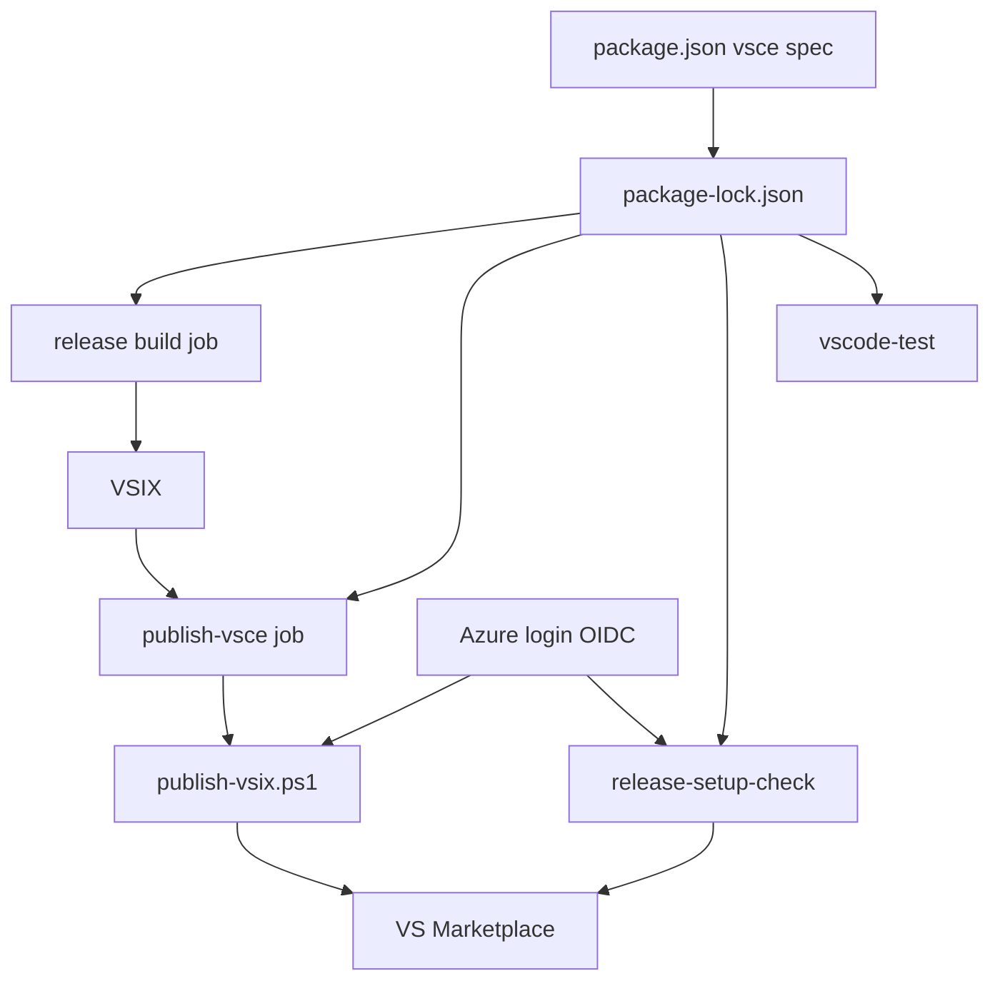
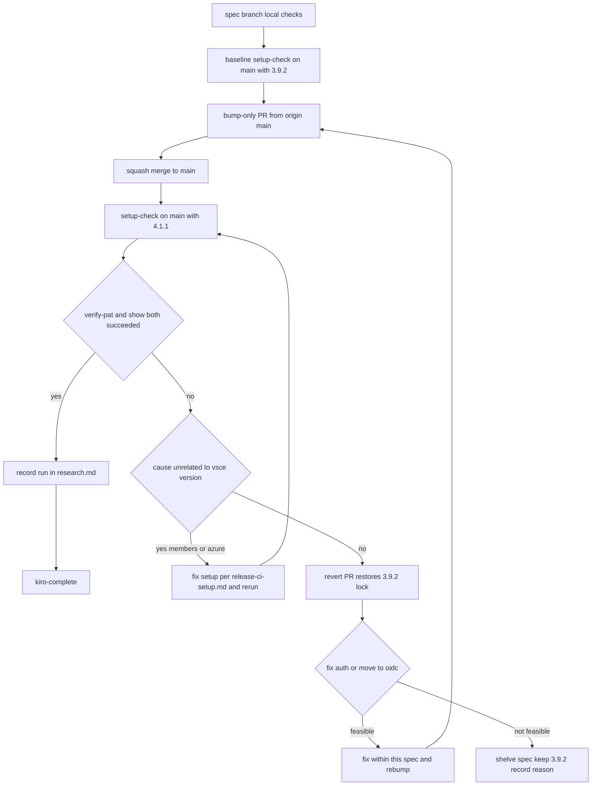

# Design Document: vsce-4-upgrade

## Overview

**Purpose**: VSCode 拡張 `ekicyou.pasta-vscode` のパッケージと公開の道具 `@vscode/vsce` を 3.9.2 から 4.1.1 へ上げる。リリースを回す開発者とリリース CI は、今と同じ VSIX を作り、今と同じ認証（Azure のマネージド ID・`--azure-credential`）と同じ「公開済みなら飛ばす」振る舞いで公開し続ける。

**Users**: リリースを回す開発者（`release` スキル・`/kiro-complete`）と、リリース CI の `build`・`publish-vsce`、確かめのワークフロー `release-setup-check.yml`、`build.yml` の `vscode-test`。

**Impact**: 変わるのは `editors/vscode/package.json` の 1 行と `editors/vscode/package-lock.json` だけ（案 A）。4.1.1 の配布物を読み、手元で測った結果、`publish-vsix.ps1` が頼る CLI の振る舞いは 3.9.2 と同じだった（research.md 6 節）。このため補助スクリプト・試験・ワークフロー・文書は触らない。公開の道は main でしか確かめられないので、版を上げる変更だけを実装の途中で main へ入れ、`release-setup-check.yml` で確かめてから spec を完了する。

### Goals

- lock の vsce を 4.1.1 にし（指定 `^4.1.1`）、`glob` GHSA-3g3m-2fjr-6pw4 を lock から消す
- 3.9.2 と同じファイルの一覧の VSIX を作る（本物の WASM で比べて記録する）
- `publish-vsce` の判定と結果（`published`・`skipped`・`failed`＋`reason`）を変えない
- 次のリリースタグの前に、main で `verify-pat --azure-credential` と `show` が 4.1.1 で通ることを確かめ、記録する

### Non-Goals

- `--oidc`（Marketplace の trusted publishing）への移行（確かめがだめだったときだけ比べる。要件 5.2）
- `engines.vscode`・`@types/vscode`・`@types/node`・`typescript`・拡張のコード
- Node の版（3 つのワークフローとも既に 22）
- `minimatch` GHSA-g3hv-75wg-m249 の解消（4.1.1 では消えない。未決事項 Q1）
- `.vscodeignore` の既存の取りこぼし（`eslint.config.mjs` が VSIX に入る。3.9.2 から同じで、この spec の差ではない）
- 開発機の大域の `vsce`（`release-state.ps1` の `show` 用。既に 4.0.0）

## Boundary Commitments

### This Spec Owns

- `editors/vscode/package.json` の `@vscode/vsce` の版の指定（241 行）と、`editors/vscode/package-lock.json` の vsce の配下の項目
- 3.9.2 と 4.1.1 の VSIX のファイルの一覧の比べと、その記録（`research.md`）
- `publish-vsix.ps1` が頼る vsce の CLI の振る舞いの照合表（下の「vsce の CLI の契約」）と、その測りの記録
- 版を上げる変更を main へ入れる順番（単独の PR → main で確かめ → 記録 → 完了）と、確かめがだめだったときの分岐の手順
- 完了のときのロードマップ（`.kiro/steering/roadmap.md`）の `vsce-4-upgrade` の項の移動

### Out of Boundary

- `publish-vsix.ps1`・`release-scripts-test.ps1`・`release.yml`・`release-setup-check.yml`・`build.yml` の中身（照合表のどれかが 4.1.1 で崩れたときだけ、要件 3.8・5.3 に沿って触る。今の測りでは崩れていない）
- `release` スキル・`.kiro/steering/tech.md`・`.github/release-ci-setup.md`（認証の道が変わったときだけ。要件 6.1）
- vsce 以外の直接の依存の版の指定（要件 1.6）
- Marketplace の Members の設定・Azure の資格情報（画面と Azure の側。要件 5.4 のときは手順書に沿って人が直す）
- crates.io の公開・GitHub Release の添付

### Allowed Dependencies

- `@vscode/vsce` 4.1.1（npm の registry。`engines.node` `>= 22`）と、その推移的な依存（`@napi-rs/keyring`・`marked`・`parse5`・`tinyglobby`・`minimatch` 10 など）
- Node 22（CI）・手元の Node（26 で動くことを確かめた）
- 既存の確かめ: `release-setup-check.yml`（main から `workflow_dispatch`）・`release.yml` の build の VSIX の中身の検査（195〜215 行）・`build.yml` の `vscode-test`・`release-scripts-test.ps1`
- `gh`（PR の作成・`gh pr merge --squash`・`gh workflow run`・`gh run view`）

### Revalidation Triggers

- vsce の版の指定を 4.1.1 から動かす（4.2 以降・5.x）とき — 照合表を測り直す
- `publish-vsix.ps1` の判定（`Get-Versions`・`$AuthPattern`・重複の文言）を変えるとき — 照合表の対応する行を測り直す
- 公開の認証を `--oidc` へ移すとき — `release.yml`・`release-setup-check.yml`・`publish-vsix.ps1`・`release` スキル・`tech.md`・`release-ci-setup.md` を揃えて直す（要件 5.3）。`pasta-dll-multiarch`・`pasta-recipe` と `release.yml` の席を調整する
- `editors/vscode/package.json` の `dependencies`（今は無い）を足すとき — VSIX に `node_modules` が入るようになり、ファイルの一覧の比べの前提が変わる

## Architecture

### Existing Architecture Analysis

vsce は `editors/vscode` の devDependency で、lock の版を 4 つの所が `npm ci` で入れて使う。

| 使う所 | 入れ方 | 呼ぶもの | 4.1.1 で変えるか |
|--------|--------|----------|------------------|
| `release.yml` build（windows・Node 22） | `npm ci` → `npm run package` | `vsce package`（`prepackage` は npm が走らせる） | 変えない |
| `release.yml` `publish-vsce`（ubuntu・Node 22・environment `release`） | `npm ci --ignore-scripts` → Azure/login（SHA 固定） | `publish-vsix.ps1` → `vsce show --json`・`vsce publish --azure-credential --packagePath --skip-duplicate` | 変えない |
| `release-setup-check.yml`（ubuntu・Node 22・main だけ） | `npm ci --ignore-scripts` → Azure/login | `vsce verify-pat ekicyou --azure-credential`（`continue-on-error`）・`vsce show ekicyou.pasta-vscode --json` | 変えない |
| `build.yml` `vscode-test`（ubuntu・Node 22） | `npm ci` → `npm test` | vsce は呼ばない（lock が入ることだけを試す） | 変えない |

### Architecture Pattern & Boundary Map

**Architecture Integration**:
- 選んだ形: 案 A（版の指定と lock だけを変える）。4.1.1 で照合表が崩れていないので、補助スクリプトとワークフローは今のまま lock の新しい vsce を呼ぶ
- 境界: この spec が持つのは図の `PkgJson` と `Lock` だけ。他の箱は今の振る舞いのまま 4.1.1 を受け取る側
- 保つ形: 認証は OIDC（`--azure-credential`）・`VSCE_PAT` を vsce に渡さない・公開済みなら飛ばす冪等な公開・第三者の action の SHA 固定と行末のタグのコメント（`ponytail-manual-ci` の形）
- 新しい部品: 無い
- steering との整合: `tech.md` の「認証は OIDC」「公開先ごとに公開済みなら飛ばす」を変えない。memory の「PR は CI を待たずにマージ」に従い、関門は手元の確かめ。ただし `release-setup-check.yml` だけは spec の完了の前に待つ（要件 4.7）

### Technology Stack

| Layer | Choice / Version | Role in Feature | Notes |
|-------|------------------|-----------------|-------|
| パッケージの道具 | `@vscode/vsce` 3.9.2 → 4.1.1（指定 `^4.1.1`） | VSIX の作成・Marketplace の照会と公開 | 4.0.0 は OIDC のトークン交換が壊れていたので下限で外す（要件 1.1） |
| 推移的な依存（増える） | `@napi-rs/keyring` 1.3.0（＋プラットフォーム別 13）・`marked` 18.2.0・`proper-lockfile` 4.1.2・`retry`・`signal-exit` | 資格情報の保存（使わない道）・README の変換 | install script なし。keyring は遅延読み込みで `--azure-credential` の道では読まない |
| 推移的な依存（消える） | `glob`・`keytar`・`cheerio`・`markdown-it`・`tmp`・`form-data` など 174 項目 | — | `glob` GHSA-3g3m が消える |
| ランタイム | Node 22（CI）・Node 26（手元） | vsce を動かす | 変えない（要件 2.6） |
| CI | GitHub Actions（`release.yml`・`release-setup-check.yml`・`build.yml`） | 作成・公開・確かめ | 変えない |

## File Structure Plan

### Modified Files

- `editors/vscode/package.json` — 241 行 `"@vscode/vsce": "^3.0.0"` → `"^4.1.1"`。他の行は変えない（要件 1.1・1.5・1.6）
- `editors/vscode/package-lock.json` — `npm install --save-dev @vscode/vsce@^4.1.1` で作り直す。差分は vsce の配下だけ（測った結果: 消える 174・増える 17・版が変わる 3 = `@vscode/vsce`・`parse5`・`entities`）（要件 1.1・1.6）
- `.kiro/specs/vsce-4-upgrade/research.md` — VSIX の比べの結果・`npm audit` の結果と残る勧告の理由・手元の `show` の結果・公開の道の確かめの記録（11 節の表）を書く（要件 1.4・2.3・4.3・4.6）
- `.kiro/steering/roadmap.md` — 完了のとき、`vsce-4-upgrade` の項（10・206・210・343・350・352・382 行あたり）を「版の決まっていないもの」「依存の更新」から完了へ移す（要件 6.3）

### 条件つきで触るファイル（今の測りでは触らない）

| 条件 | ファイル | 要件 |
|------|----------|------|
| 4.1.1 で `show`・`publish` の出力や終了コードが変わっていた | `.github/scripts/release/publish-vsix.ps1`・`.github/scripts/release/release-scripts-test.ps1`（項目 12 の偽の vsce の答え） | 3.8 |
| 本物の WASM での VSIX の比べに意図しない差が出た | `editors/vscode/.vscodeignore` | 2.3 |
| 4.1.1 で増えた勧告を互換の範囲で消せる | `editors/vscode/package-lock.json`（`npm audit fix` の互換の範囲） | 1.4 |
| 公開の認証を `--oidc` へ移す | `release.yml` の `publish-vsce`・`release-setup-check.yml`・`publish-vsix.ps1`・`.claude/skills/release/`・`.kiro/steering/tech.md`・`.github/release-ci-setup.md` | 5.2・5.3 |
| 文書やコメントに 3.x に固有の記述が見つかった | 見つかったファイル（今は無い。`publish-vsix.ps1` の「vsce の publish.js の getPAT」は 4.1.1 でも正しい） | 6.2 |

## System Flows

### 統合と確かめの順番

- **手元の確かめ（`Local`）**: 版を上げる PR を作る前に、spec のブランチで行う。lock の差分の確かめ（1.6）・`npx --no-install vsce --version` = 4.1.1（1.2）・`npm audit`（1.3・1.4）・本物の WASM での VSIX の比べ（2.1〜2.4）・`npm test`（2.5 の手元の代わり）・`release-scripts-test.ps1`（3.7）・`vsce show ekicyou.pasta-vscode --json`（4.6）
- **基準（`Baseline`）**: 今の main（3.9.2）で `release-setup-check.yml` を一度回し、`verify-pat` と `show` が通ることを記録する。失敗の原因を vsce の版に帰すかどうか（5.1・5.4）の比べの相手になる（仮置き。未決事項 Q3）
- **版を上げる PR（`BumpPR`）**: `origin/main` から切ったブランチに、`package.json`・`package-lock.json` の 2 つだけを載せる。spec の文書は載せない（4.1）。`build.yml`（`vscode-test` を含む）の結果は待たずにマージしてよい（memory の運用）。ただし main が赤になれば追いかけて直す（2.5）
- **確かめ（`Check`）**: マージの直後に、同じセッションで `gh workflow run release-setup-check.yml --ref main` を回す。マージから確かめまでの間はリリースタグを push しない（4.4）
- **判定（`Judge`）**: run の緑だけでは判定しない（`verify-pat` の step は `continue-on-error`）。job summary の 2 つの行が「成功」であることで判定する（4.2・4.3）
- **戻し（`Revert`）**: squash のコミットを `git revert` した PR を入れ、main をリリースできる状態に戻してから比べる（5.1）

## Requirements Traceability

| Requirement | Summary | Components | Interfaces | Flows |
|-------------|---------|------------|------------|-------|
| 1.1 | 指定 `^4.1.1`・lock 4.1.1 | 依存の定義 | `package.json` 241 行・lock | Local |
| 1.2 | `npm ci` 後に `vsce --version` = 4.1.1 | 依存の定義 | `npx --no-install vsce --version` | Local |
| 1.3 | `glob`・`minimatch` の勧告が出ない | 依存の定義・勧告の照合 | `npm audit` | Local（`minimatch` は Q1） |
| 1.4 | 新しい勧告の一覧と扱い | 勧告の照合 | `npm audit`・research.md | Local |
| 1.5 | `engines.vscode` などを変えない | 依存の定義 | `package.json` の差分 | Local |
| 1.6 | vsce 以外の直接の依存を変えない | 依存の定義 | lock の差分 | Local |
| 2.1 | `pasta-vscode-<版>.vsix` を 1 つ | VSIX の比べ | `vsce package` | Local |
| 2.2 | 3.9.2 と同じファイルの一覧 | VSIX の比べ | zip の項目の一覧 | Local |
| 2.3 | 差の原因と扱い | VSIX の比べ | `.vscodeignore`・research.md | Local |
| 2.4 | 必須の 3 つを含む | VSIX の比べ・既存の build の中身の検査 | `release.yml` 195〜215 行 | Local・次のリリースの build |
| 2.5 | `vscode-test` が通る | 既存の `vscode-test` | `build.yml` | BumpPR・Merge |
| 2.6 | Node 22 以上だけで動かす | 既存のワークフロー | `NODE_VERSION: '22'`・`node-version: '22'` | — |
| 3.1 | `--azure-credential` で認証・PAT なし | vsce の CLI の契約 | `publish-vsix.ps1` の `$publishArgs` | Check |
| 3.2 | `VSCE_PAT` を渡さない | vsce の CLI の契約 | `Remove-Item Env:VSCE_PAT` | — |
| 3.3 | 公開済みなら `skipped`・0 | vsce の CLI の契約 | `Get-Versions` | — |
| 3.4 | `show` が読めなければ `failed`・`transient` | vsce の CLI の契約 | `Get-Versions` の `ConvertFrom-Json` | Local（測った） |
| 3.5 | 重複の文言で `skipped` | vsce の CLI の契約 | `is already published\. Skipping publish` | — |
| 3.6 | 認証の失敗で `failed`・`auth` | vsce の CLI の契約 | `$AuthPattern` | — |
| 3.7 | `release-scripts-test.ps1` が全項目合格 | 既存の試験 | 項目 12 | Local |
| 3.8 | 振る舞いが変われば合わせる | vsce の CLI の契約 | 条件つきで触るファイル | Local |
| 3.9 | SHA 固定の形を保つ | 既存のワークフロー | `release.yml` を触らない | — |
| 4.1 | 単独の PR の後に main で確かめ | 統合の手順 | `gh workflow run` | BumpPR・Merge・Check |
| 4.2 | summary に 2 つの結果 | 公開の道の確かめ | job summary | Check |
| 4.3 | 成功を記録 | 公開の道の確かめ・統合の手順 | research.md 11 節 | Record |
| 4.4 | 確かめの前にリリースタグを push しない | 統合の手順 | 手順（仕組みは足さない。Q2） | Merge・Check |
| 4.5 | 公開せず crates.io の交換もしない | 公開の道の確かめ | `release-setup-check.yml` を触らない | Check |
| 4.6 | PR の前に手元で `show` | vsce の CLI の契約 | `vsce show --json` | Local |
| 4.7 | 確かめの前に完了しない | 統合の手順 | `/kiro-complete` の前の条件 | Record・Complete |
| 5.1 | 4.x だけ失敗 → 先に戻す | 失敗のときの分岐 | revert の PR | Revert |
| 5.2 | `--oidc` でも OIDC のまま | 失敗のときの分岐 | 条件つきで触るファイル | Compare |
| 5.3 | 移すなら 6 つを揃える | 失敗のときの分岐 | 条件つきで触るファイル | Compare |
| 5.4 | 版と関係の無い原因なら設定を直す | 失敗のときの分岐 | `.github/release-ci-setup.md` | FixSetup |
| 5.5 | どちらも無理なら見送る | 失敗のときの分岐 | research.md | Shelve |
| 6.1 | 認証の道が同じなら文書を変えない | 文書 | `release` スキル・`tech.md`・`release-ci-setup.md` を触らない | — |
| 6.2 | 3.x に固有の記述を直す | 文書 | 今は無い | Local |
| 6.3 | ロードマップを完了へ | 文書 | `roadmap.md` | Complete |

## Components and Interfaces

| Component | Domain/Layer | Intent | Req Coverage | Key Dependencies | Contracts |
|-----------|--------------|--------|--------------|------------------|-----------|
| 依存の定義 | 拡張のツールチェーン | vsce の版を 4.1.1 に固定する | 1.1, 1.2, 1.5, 1.6 | npm registry (P0) | State |
| 勧告の照合 | 拡張のツールチェーン | 上げる前後の `npm audit` を比べて記録する | 1.3, 1.4 | `npm audit` (P1) | Batch |
| VSIX の比べ | 拡張のツールチェーン | 3.9.2 と 4.1.1 の VSIX のファイルの一覧を比べる | 2.1, 2.2, 2.3, 2.4 | wasm-pack・cargo-about (P1) | Batch |
| vsce の CLI の契約 | リリース CI | `publish-vsix.ps1` が頼る振る舞いを 4.1.1 で照合する | 3.1〜3.8, 4.6 | `publish-vsix.ps1` (P0) | Service |
| 公開の道の確かめ | リリース CI | main で `release-setup-check.yml` を回し判定する | 4.2, 4.3, 4.5 | Azure/login・Marketplace (P0) | Batch |
| 統合の手順 | 開発の流れ | 単独の PR → 確かめ → 記録 → 完了の順を守る | 2.5, 4.1, 4.4, 4.7, 6.3 | `gh`・main のブランチ保護 (P0) | State |
| 失敗のときの分岐 | 開発の流れ | 確かめがだめなときに戻し・直し・見送りを選ぶ | 5.1〜5.5 | `git revert`・`.github/release-ci-setup.md` (P1) | State |

既存のまま使う部品（`release.yml` の build の中身の検査・`build.yml` の `vscode-test`・`release-scripts-test.ps1`・`release-setup-check.yml`）は 2.4・2.5・2.6・3.7・3.9・4.5 を受け持つ。この spec はそれらを変えない。

### 拡張のツールチェーン

#### 依存の定義

| Field | Detail |
|-------|--------|
| Intent | `editors/vscode` の vsce を 4.1.1 に固定する |
| Requirements | 1.1, 1.2, 1.5, 1.6 |

**Responsibilities & Constraints**
- `package.json` の `devDependencies` の `@vscode/vsce` だけを `^4.1.1` にする。他の行は変えない
- lock は `npm install --save-dev @vscode/vsce@^4.1.1` で作り直す（`editors/vscode` で。`npm audit fix` を同時にしない）
- lock の差分は vsce の配下だけ。ルートの項目（`packages[""]`）の `devDependencies` の差は vsce の 1 行だけ

**Contracts**: State [x]

##### State Management
- 変わる前: `"@vscode/vsce": "^3.0.0"`・lock `node_modules/@vscode/vsce` = 3.9.2
- 変わった後: `"@vscode/vsce": "^4.1.1"`・lock `node_modules/@vscode/vsce` = 4.1.1
- 不変条件: `engines.vscode`・`@types/vscode`・`@types/node`・`typescript`・他の直接の依存の指定が同じ。`packages` の差分のうち vsce の配下でない項目が 0

**Implementation Notes**
- 確かめ: `git diff editors/vscode/package.json` が 1 行。lock の差分を `packages` の単位で数え、vsce の配下でない項目が無いことを見る（research.md 6 節の数え方: 消える 174・増える 17・版が変わる 3）
- 危うさ: 作り直す日によって vsce の配下の推移的な依存の版が新しくなりうる。数は変わってよいが、vsce の配下の外に差が出たら止めて原因を見る

#### 勧告の照合

| Field | Detail |
|-------|--------|
| Intent | 上げる前後の `npm audit` を比べ、消えた勧告・残る勧告・増えた勧告を記録する |
| Requirements | 1.3, 1.4 |

**Contracts**: Batch [x]

##### Batch / Job Contract
- Trigger: lock を作り直した後（手元）
- Input: 3.9.2 の lock と 4.1.1 の lock での `npm audit --json`
- Output: research.md に、勧告ごとに「消えた／残る／増えた」と理由を書く
- 期待（2026-11-14 に測った）: `glob` GHSA-3g3m-2fjr-6pw4 は消える。`minimatch` GHSA-g3hv-75wg-m249 は残る（直った版は 11.0.1 以上だけ。vsce 4.1.1・`eslint` 10.14.0・`typescript-eslint` 8.72.2 が `minimatch ^10` を要る）。増える勧告は無い

**Implementation Notes**
- **仮置き（Q1）**: 要件 1.3 の `minimatch` の半分は満たせない。設計では `overrides` を使わず、残る理由を記録して扱う。要件の文言の直しはディスカッションで決める
- 増えた勧告が出たら（1.4）、互換の範囲（`npm audit fix`・`--force` なし）で消し、消せないものは理由を書く

#### VSIX の比べ

| Field | Detail |
|-------|--------|
| Intent | 同じソースから 3.9.2 と 4.1.1 で VSIX を作り、zip の項目の一覧を比べる |
| Requirements | 2.1, 2.2, 2.3, 2.4 |

**Contracts**: Batch [x]

##### Batch / Job Contract
- Trigger: 版を上げる PR を作る前（手元・Windows。リリースの build と同じ OS）
- Input: worktree の `editors/vscode`。本物の WASM を `pwsh -NoProfile -File scripts/build-wasm.ps1 -Release` で作り、`npm run compile` で `out/extension.js` を作る（`npm run package` は `build:wasm` が非対話で落ちることがあるので、`prepackage` の 2 つを先に手で走らせてから `npx --no-install vsce package` を直接叩く）
- 手順:
  1. 3.9.2 の lock のまま `npm ci` → `npx --no-install vsce package -o <スクラッチパッド>/v3.vsix`
  2. 版の指定と lock を 4.1.1 にして `npm ci` → 同じく `v4.vsix`
  3. 2 つの zip の項目の名前の一覧を並べ替えて比べる。`extension.vsixmanifest` の中身も比べる
- Output: research.md に、項目の数・差（無ければ「無い」）・必須の 3 つの有無・VSIX の名前を書く
- 期待: 2026-11-14 の下見（仮の WASM・`--no-dependencies`）では、項目 18 件と `extension.vsixmanifest` が同じだった

**Implementation Notes**
- 作る場所: worktree のパス（UUID を含まない）で作る。スクラッチパッドのような UUID を含むパスでは、npm 12 が出力の UUID を伏せるため vsce が依存を集める道でファイルを 0 件と見て落ちる（research.md 6 節）。出力の `-o` の先はスクラッチパッドでよい
- 差が出たら（2.3）: 1 つずつ原因を見て、意図しない差は `.vscodeignore` で直し、残す差は理由を書く
- 作った VSIX はコミットしない（`*.vsix` は `.gitignore` 済み）

### リリース CI

#### vsce の CLI の契約

| Field | Detail |
|-------|--------|
| Intent | `publish-vsix.ps1` と `release-setup-check.yml` が頼る vsce の振る舞いを、4.1.1 で 1 行ずつ照合する |
| Requirements | 3.1, 3.2, 3.3, 3.4, 3.5, 3.6, 3.7, 3.8, 4.6 |

**Responsibilities & Constraints**
- 照合表の全行が 4.1.1 で「同じ」である間、`publish-vsix.ps1`・項目 12・ワークフローは変えない
- どれかの行が崩れたら、`publish-vsix.ps1` と項目 12 の偽の vsce の答えを 4.1.1 の実際に合わせる（3.8）

**Contracts**: Service [x]

##### Service Interface（vsce の CLI の照合表）

| # | 頼る振る舞い | 頼る所 | 3.9.2 | 4.1.1 | 確かめ方 |
|---|--------------|--------|-------|-------|----------|
| C1 | `-p, --pat` の既定は `process.env.VSCE_PAT`、`getPAT` で `pat` が `azureCredential` より先 | `Remove-Item Env:VSCE_PAT`（3.2） | そう | 同じ（前に `oidc` が足されただけ） | 配布物の `main.js`・`publish.js` を読んだ |
| C2 | `publish`・`verify-pat` に `--azure-credential` が在る | `$publishArgs`・確かめのワークフロー（3.1） | 在る | 在る | `main.js` を読んだ |
| C3 | `--azure-credential` の失敗の文言 `Can not acquire a Microsoft Entra ID access token` | `$AuthPattern`（3.6） | そう | 同じ（`auth.js` が同じ内容） | `diff` |
| C4 | `verify-pat` の失敗の文言 `The Personal Access Token verification has failed` | `$AuthPattern`（3.6） | そう | 同じ | `store.js` を読んだ |
| C5 | `publish --skip-duplicate` の重複の文言 `Version X is already published. Skipping publish.` と 0 終了 | 重複の判定（3.5） | そう | 同じ | `publish.js` を読んだ |
| C6 | `show <id> --json` は `{ versions: [{ version }] … }` を出して 0 終了 | `Get-Versions`（3.3）・項目 12 | そう | 同じ（`show.js` が同じ内容・手元で 42 件） | 手元で測った |
| C7 | 無い拡張の `show --json` は標準出力 `undefined`・0 終了 | `Get-Versions` の transient（3.4） | そう | 同じ | 手元で測った |
| C8 | `--azure-credential` の道は保存済みの資格情報（keyring）に触れない | `npm ci --ignore-scripts` | keytar を使う道に入らない | keyring を遅延読み込みし、この道では読まない | `store.js`・`publish.js` を読んだ |
| C9 | `package` の名前は `<name>-<version>.vsix` | `release.yml` の build の検査（2.1） | そう | 同じ | 手元で測った |

- 前提: `--oidc` を付けない（`--oidc` と `--azure-credential` は 4.1.1 で同時に使えない）
- 事後: `publish-vsix.ps1` の結果の値（`status=published|skipped|failed`・`reason=auth|publish|transient`）と終了コード（0／1）が 3.9.2 と同じ
- 不変条件: 公開の認証に長期のトークンを使わない

**Implementation Notes**
- 実装で取り直すもの: C6・C7（4.6。`read ECONNRESET` のときは `NODE_OPTIONS=--dns-result-order=ipv4first`）と、`release-scripts-test.ps1` の全項目（3.7）
- main でしか確かめられないもの: C2 の `verify-pat --azure-credential` の成功（公開の道の確かめ）と、C8 の ubuntu での振る舞い

#### 公開の道の確かめ

| Field | Detail |
|-------|--------|
| Intent | main で `release-setup-check.yml` を回し、`verify-pat` と `show` が 4.1.1 で通ったかを判定して記録する |
| Requirements | 4.2, 4.3, 4.5 |

**Contracts**: Batch [x]

##### Batch / Job Contract
- Trigger: `gh workflow run release-setup-check.yml --ref main`（基準のとき 1 回・版を上げた後 1 回）
- Input: main の lock の vsce（基準は 3.9.2・後は 4.1.1）
- 判定の規則:
  - 成功 = job summary の「publisher `ekicyou` のメンバー確認」の行が `成功（Members に追加済み）` で、かつ「拡張 `ekicyou.pasta-vscode` の存在確認」の行が `成功（版 N 件。最新 X）`
  - run の結論（緑）だけでは判定しない（`verify-pat` の step は `continue-on-error: true`）
  - 補助としてログの `The Personal Access Token verification succeeded for the publisher 'ekicyou'.` を見る
  - `npm ci --ignore-scripts` の step の結果で、lock の vsce の版（4.1.1）も読む
- Output: research.md 11 節の表（基準の run の URL・版を上げる PR・確かめの run の URL・走らせた日・vsce の版・2 つの結果・判断）
- 公開しない・crates.io のトークン交換をしない（4.5。ワークフローを変えないので今のまま）

**Implementation Notes**
- `release-setup-check.yml` は environment `release-setup-check` の保護規則で main からしか走らない。ブランチからは確かめられない
- 結果の読み取りは `gh run view <id> --log` と run の画面の summary で行う

### 開発の流れ

#### 統合の手順

| Field | Detail |
|-------|--------|
| Intent | 版を上げる変更を単独で main へ入れ、確かめて記録してから spec を完了する |
| Requirements | 2.5, 4.1, 4.4, 4.7, 6.3 |

**Contracts**: State [x]

##### State Management
- 状態: `branch-local`（spec のブランチで手元の確かめ）→ `baseline-recorded`（3.9.2 の基準）→ `bump-merged`（単独の PR が main に入った）→ `path-verified`（4.1.1 の確かめが成功し記録した）→ `completed`（`/kiro-complete`）
- 遷移の条件:
  - `branch-local` → `bump-merged`: 手元の確かめ（Local）が全部済み、research.md に結果を書いた
  - `bump-merged` → `path-verified`: 公開の道の確かめが「成功」
  - `path-verified` → `completed`: research.md 11 節を埋めて spec のブランチにコミットした
- 禁止: `bump-merged` のままリリースタグを push する（4.4）・`/kiro-complete` を走らせる（4.7）
- 版を上げる PR の作り方: `origin/main` から作業用のブランチを切り、spec のブランチから `editors/vscode/package.json`・`editors/vscode/package-lock.json` の 2 つだけを持ち込んでコミット → `gh pr create` → `gh pr merge --squash --delete-branch`。マージの後、spec のブランチへ `git merge origin/main`
- 完了のとき: ロードマップの `vsce-4-upgrade` の項を完了へ移す（6.3）。spec の文書は `/kiro-complete` の PR で入る

**Implementation Notes**
- `build.yml` の `vscode-test` は版を上げる PR と main で走る。memory の運用（PR は CI を待たずにマージ・main が赤なら追いかけて直す）に従う
- **仮置き（Q2）**: 4.4 を守らせる仕組み（`release.yml` の verify に条件を足す・`release` スキルに 1 行足す）は作らない。マージの直後に同じセッションで確かめを回し、間を数分に縮める

#### 失敗のときの分岐

| Field | Detail |
|-------|--------|
| Intent | 確かめがだめなとき、原因で戻し・設定の直し・認証の直し・見送りを選ぶ |
| Requirements | 5.1, 5.2, 5.3, 5.4, 5.5 |

**Contracts**: State [x]

##### State Management

| 確かめの結果 | 原因の見分け | 次の手 | 要件 |
|--------------|--------------|--------|------|
| `verify-pat` が失敗・基準（3.9.2）は成功 | vsce の版による | squash のコミットを `git revert` した PR を入れて main を 3.9.2 に戻す → この spec の中で認証の直しか `--oidc` を比べる | 5.1 |
| `verify-pat` が失敗・基準も失敗 | Members・Azure の資格情報など版と関係の無いもの | 版を戻さず、`.github/release-ci-setup.md` に沿って設定を直してから確かめ直す | 5.4 |
| `show` が失敗 | 一時的な Marketplace の不調か、4.1.1 の振る舞いの変化 | 再実行。2 回目も失敗し基準が成功していれば 5.1 の扱い | 5.1 |
| 直しも移行もできない | — | 部分的に出さず spec を見送る。vsce を 3.9.2 のままにし、勧告が残る理由を research.md に書く | 5.5 |

- `--oidc` へ移すときは（5.2・5.3）、長期のトークンを置かない OIDC のままにし、`release.yml` の `publish-vsce`・`release-setup-check.yml`・`publish-vsix.ps1`・`release` スキル・`tech.md` のリリースの節・`.github/release-ci-setup.md` を揃える。`verify-pat` に `--oidc` が無いので確かめの形から作り直しになる。この分岐に入ったら設計を見直す（設計の再検討の引き金）

## Error Handling

### Error Strategy

公開の道の失敗は main へ入った後にしか出ない。戻すのは squash のコミットの revert 1 つで、lock を 3.9.2 に戻せば今のリリースの道に戻る（可逆）。

### Error Categories and Responses

| 失敗 | 出る所 | 応じ方 |
|------|--------|--------|
| lock の差分に vsce の配下の外の項目が出る | 手元（Local） | 止めて原因を見る。作り直す。`npm audit fix` を混ぜない |
| VSIX の一覧に差が出る | 手元（Local） | 2.3 に沿って 1 つずつ原因を見て直すか理由を書く |
| `vscode-test` が main で赤 | `build.yml` | 追いかけて直す（memory の運用）。直せなければ revert |
| `verify-pat` が失敗 | `release-setup-check.yml` | 失敗のときの分岐の表 |
| 次のリリースの `publish-vsce` が失敗 | `release.yml` | `publish-vsix.ps1` の `reason` で分ける。`auth` は手順書と照合、`transient` は再実行、`publish` はログを読む。必要なら lock を戻す PR → 再タグはしない（公開済みなら飛ばす判定で続きから回復する） |

### Monitoring

- `release-setup-check.yml` の job summary（2 つの行）とログ
- `release.yml` の build の VSIX の中身の検査（次のリリース）と `publish-vsce` の job summary

## Testing Strategy

### 手元の確かめ（版を上げる PR の前）

- lock の差分: `packages` の単位で数え、vsce の配下の外の差が 0（1.6）。`package.json` の差が 1 行（1.1・1.5）
- `npm ci` の後に `npx --no-install vsce --version` が `4.1.1`（1.2）
- `npm audit --json` を 3.9.2 と 4.1.1 で比べ、`glob` GHSA-3g3m が消え、増えた勧告が無いこと（1.3・1.4。`minimatch` は Q1）
- 本物の WASM で作った 3.9.2 と 4.1.1 の VSIX の zip の項目の一覧が同じで、必須の 3 つを含み、名前が `pasta-vscode-<版>.vsix`（2.1〜2.4）
- `npm test`（`vscode-test` と同じ。lock を入れ直した後の拡張の試験。2.5 の手元の代わり）
- `pwsh -NoProfile -File .github/scripts/release/release-scripts-test.ps1` が項目 12 を含めて全項目合格（3.7）
- `npx --no-install vsce show ekicyou.pasta-vscode --json` が版の一覧を返し、無い拡張で `undefined`・0（4.6・C6・C7）

### CI での確かめ

- 版を上げる PR と main の `build.yml`: `vscode-test` が 4.1.1 の lock で `npm ci` と試験を通す（2.5）
- main の `release-setup-check.yml`（基準と版を上げた後）: 判定の規則で 2 つとも成功（4.2・4.3）

### 次のリリースで分かること（この spec の外の確かめ）

- `release.yml` の build の VSIX の中身の検査（2.4）と、`publish-vsce` の本当の公開（要件 4.3 でここまでは 2 つの確かめで代えると決めた）

## Security Considerations

- 公開の認証は Azure のマネージド ID（`--azure-credential`）のまま。`VSCE_PAT` は `publish-vsix.ps1` が vsce に渡さない（4.1.1 でも `--pat` の既定は `VSCE_PAT` で `--azure-credential` より先なので要る）
- 4.1.1 は Marketplace への要求に `X-Market-CI-Provider` ヘッダ（CI の種類。統計用）を付ける。秘密は含まない
- 資格情報の保存（`@napi-rs/keyring`）は使わない道。CI に資格情報を保存しない
- 手元では `publish`・`verify-pat`・`login` を叩かない（資格情報が要る・公開につながる）
- 残る勧告 `minimatch` GHSA-g3hv-75wg-m249 は、パッケージを作る道具の中の DoS（moderate）で、配る VSIX には入らない

## Migration Strategy

System Flows の「統合と確かめの順番」が移行の段階である。戻す引き金は「`verify-pat` が 4.1.1 だけで失敗」と「`vscode-test` が直せない赤」の 2 つで、戻し方は squash のコミットの revert の PR 1 つ。

## 未決事項（設計のディスカッションへ）

- **Q1（要件 1.3 と測りの食い違い）**: `minimatch` GHSA-g3hv-75wg-m249 は 4.1.1 でも消えない。仮置き: `glob` が消えることを 1.3 の合格とし、`minimatch` は残る理由を記録する。推奨: 要件 1.3 を「`glob` GHSA-3g3m-2fjr-6pw4 を報告しない。`minimatch` GHSA-g3hv-75wg-m249 は vsce 4.1.1・`eslint`・`typescript-eslint` が `minimatch ^10` を要るため残り、理由を記録する」に直す
- **Q2（要件 4.4 を守らせる仕組み）**: 仮置き: 仕組みは足さず、マージの直後に同じセッションで確かめを回す。推奨: そのまま（リリースの席の `release.yml`・`.claude/skills` を触らない）
- **Q3（3.9.2 の基準の確かめ）**: 仮置き: 版を上げる PR のマージの前に、main で一度 `release-setup-check.yml` を回す。推奨: 回す（公開なし・30 秒ほどで、5.1 と 5.4 の見分けがはっきりする）
