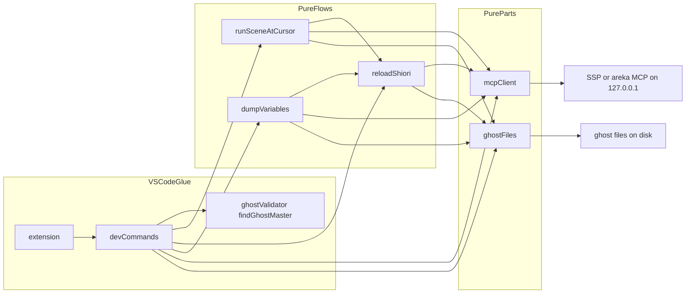
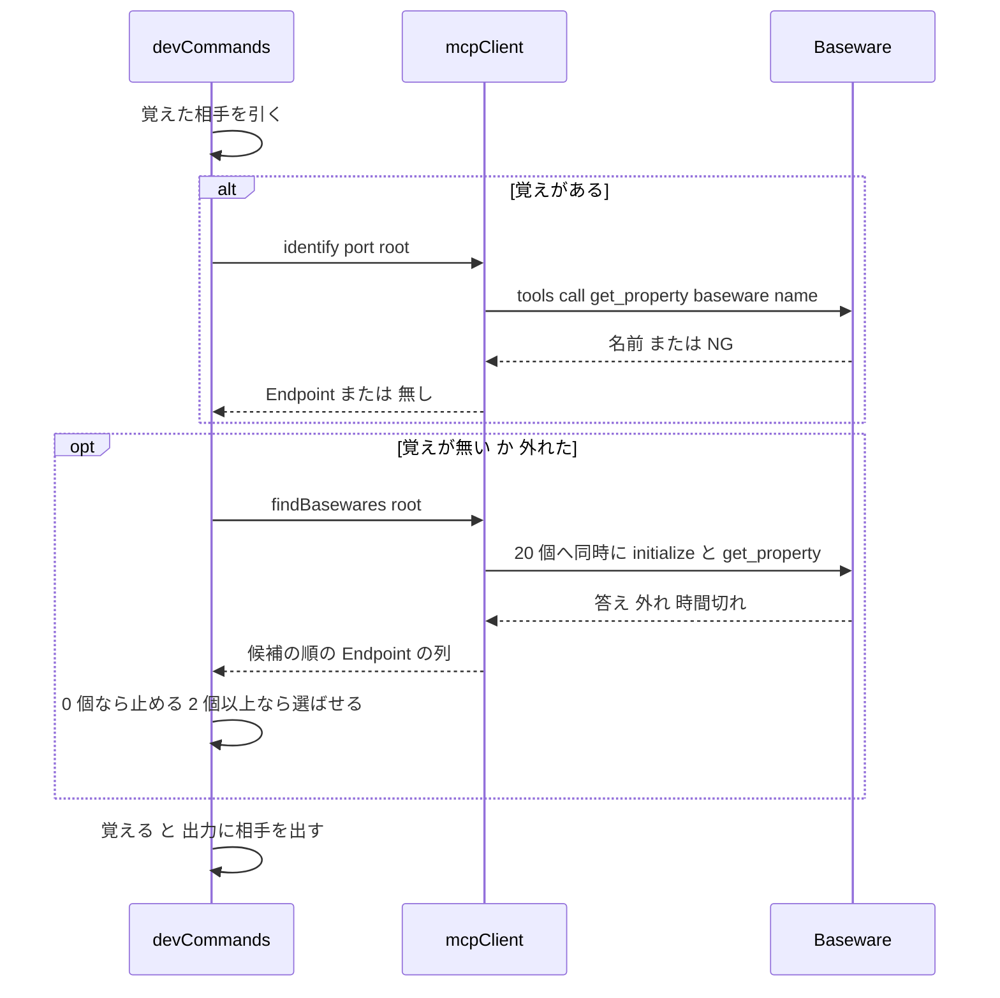
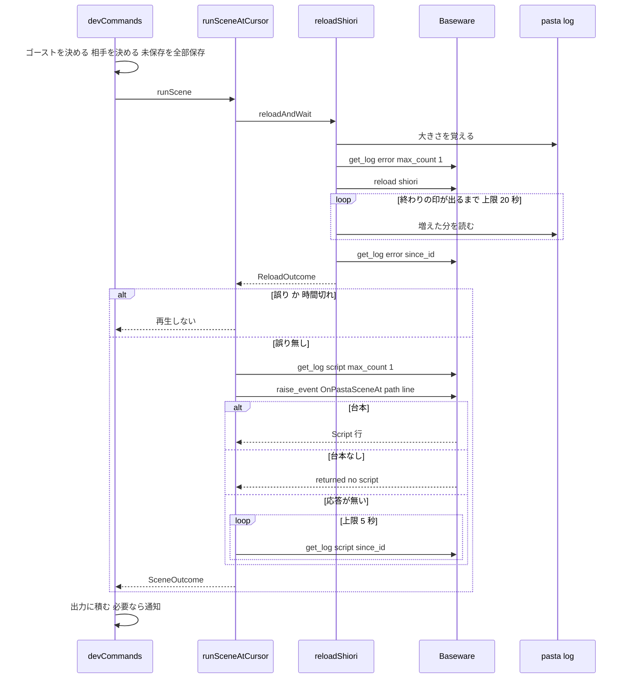

# 設計書: vscode-mcp-client

## Overview

**目的**: VSCode でゴーストを書く作者が、DAP に attach せずに、編集中の `.pasta` のゴーストが動いている SSP か areka へ、MCP で直に「シーンの再生」「SHIORI の読み込み直し」「保存変数の表示」を頼めるようにする。送る先は番号ではなく、ゴーストのルートフォルダの絶対パスと、相手のベースウェアの名前で決める。

**利用者**: ゴーストの作者（拡張の 3 つのコマンドを使う）と、AI エージェントでゴーストを開発する作者（マニュアルとスキルの手順で MCP を直に呼ぶ）。

**変わること**: 拡張から DAP の部品（デバッガーの種類・ブレークポイント・提示モード・attach・`host`）を消す。代わりに、127.0.0.1 の MCP の窓口を探して呼ぶ小さなクライアントと、3 つのコマンドの流れを足す。利用者のマニュアルの章（`book/src/debug/`）を MCP を前提に書き直し、AI エージェントの手順を `lua/shiori-events.md` の「MCP からの呼び方」節に書く。

### Goals

- 拡張の宣言とコードに DAP の部品が残らず、ほかの機能（着色・診断・ゴースト全体の検査・単語参照の装飾）は今のまま働く（要件 1）。
- 編集中のファイルから、ゴーストのルートと表示名を自分で決める（要件 2）。
- そのゴーストが動いている SSP・areka だけへ送り、取り違えない（要件 3）。
- 「▶ シーンを実行」は、保存 → 読み込み直し → 終わりを待つ → 誤りが無ければ `OnPastaSceneAt` → 台本を出す、を 1 回で行う（要件 4）。
- 「SHIORI をリロード」は、増えた誤りと警告を要約する（要件 5）。「保存変数を表示」は、書き出したばかりの `variables.toml` だけを見せる（要件 6）。
- 結果は 1 つの出力のパネルに積む（要件 7）。ベースウェア無しの試験で流れを確かめる（要件 8）。
- マニュアル・スキル・README が今の拡張の働きを書く（要件 9〜11）。

### Non-Goals

- pasta.dll の側（DAP の待ち受けの撤去・門・`OnPastaDumpVariables` の実装。`debug-mcp-runtime`）。
- ブレークポイント・ステップ・変数のツリー・式の評価。
- SSP・areka の MCP そのものの直し。`AREKA_MCP_PORT` で 20 個の外へ動かした areka を追うこと。
- 送り先のホスト・番号・時間の値・「リロードしない」の設定。
- `editors/vscode/CHANGELOG.md` の更新（0.1.5 から使われていない。版の記録は `doc/release-notes/`）。

## Boundary Commitments

### This Spec Owns

- 拡張の宣言（`editors/vscode/package.json`）のうち、コマンド・メニュー・`activationEvents`・DAP の部品の撤去・`test:unit`／`test:e2e` の列。
- 拡張の新しい部品: MCP のクライアント（`mcpClient.ts`）、ゴーストのディスクの上のこと（`ghostFiles.ts`）、3 つの流れ（`reloadShiori.ts`・`runSceneAtCursor.ts`・`dumpVariables.ts`）、vscode の糊（`devCommands.ts`）。
- 拡張と SSP・areka の間の送り方（道・札・道具の引数・答えの読み方）。拡張の側の決まりとして、この設計が正本である。
- 「読み込みが終わった」の見分け方（`pasta.log` の `SHIORI load entry completed` の行）を拡張の側で読むこと。
- 試験: 純粋なモジュールの単体の試験、MCP を真似るサーバーを使う流れの試験、宣言の試験。DAP の試験 6 本の撤去。
- 利用者のマニュアルの章 `book/src/debug/`（`validate.md` を除く）、`SUMMARY.md` のデバッグの行（56〜62 行）、`lua/shiori-events.md` の「MCP からの呼び方」節、`book/tools/verify-content.mjs` の G 節、`editors/vscode/README.md`、ルートの `README.md` の 38・47 行。
- この spec が `debug-mcp-runtime` より先に入るときだけ、消す頁を引く行の最小の直し（要件 9.9）と、スキルの references の作り直し（`gen-skill-refs.mjs`）。

### Out of Boundary

- pasta.dll と Lua の側（`crates/**`）。`OnPastaSceneAt`・`OnPastaDumpVariables`・門の 204・新しい info の行の文言は `debug-mcp-runtime` が決める。
- `book/src/internals/**`・`book/src/reference/**`・`lua/shiori-events.md` の「MCP からの呼び方」節の外（`debug-mcp-runtime`）。先に入るときの最小の直しを除く。
- `.claude/skills/*/SKILL.md`（手で直さない）。references は生成器だけが書く。
- LSP・診断・着色・`ghostValidator.ts` の検査の働き（`ponytail-editor-tooling` の持ち場。`findGhostMaster` を呼ぶだけ）。
- `package-lock.json`・`syntaxes/**`・`vsce` の版（`vsce-4-upgrade`）。
- SSP・areka の受け口と中継。

### Allowed Dependencies

- Node の組み込み: `node:http`（送る側。大域の `fetch` は使わない）・`TextDecoder`・`node:fs/promises`・`node:path`。試験では `node:http`・`node:os`。
- `vscode` の API は `devCommands.ts` と `extension.ts` だけが使う。純粋なモジュールは `vscode` を import しない。
- `ghostValidator.ts` の `findGhostMaster()`（糊から呼ぶ）。
- `debug-mcp-runtime` の約束（Revalidation Triggers の 1〜3）。SSP・areka の MCP の道具 4 つ（`get_property`・`get_log`・`reload`・`raise_event`）。
- 依存の向き（矢印の右が左を import する。左は右を import しない）: `mcpClient`・`ghostFiles` → `reloadShiori` → `runSceneAtCursor`・`dumpVariables` → `devCommands` → `extension`。`mcpClient` と `ghostFiles` は互いを import しない。`dumpVariables` が `reloadShiori` から使うのは型（`Timing`・`FlowContext`）だけ。
- 本番の依存と `devDependencies` は足さない。`package-lock.json` を変えない。

### Revalidation Triggers

1. `OnPastaSceneAt` の引数（Reference0 はパス・Reference1 は 1 以上の半角数字）か、台本・失敗の表記・204 の返し方が変わる。
2. `OnPastaDumpVariables` の書き出す場所（`ghost/master/profile/pasta/debug/variables.toml`）・「204 の前に書き終える」・「書けなければ前のファイルを残す」が変わる。
3. `debug-mcp-runtime` の新しい info の行の文言が決まる・変わる（マニュアル 9.10）。
4. pasta.dll の `SHIORI load entry completed`（`entry`・`loaded`）の行の文・target が変わるか、`[logging] level`・`filter` に関係なく出るという約束（`debug-mcp-runtime` へ申し送り。設計の議論 1）が変わるか、`pasta.log` の場所の決まり（`[logging] file_path`）が変わる。
5. SSP・areka の `raise_event`・`get_property`・`get_log` の答えの文、`ghost_name` のパスの照合、候補の番号の列、`Accept`・`Host`・`Origin` の検査が変わる。
6. `findGhostMaster()` の返す形が変わる。
7. マニュアルのアンカー（「シーン再生（▶ シーンを実行）」・「デバッグの有効化」・「pasta.toml による有効化」・「優先順位」）を変える。

## Architecture

### Existing Architecture Analysis

- `extension.ts`（464 行）は、WASM の起動・意味の色・診断・ゴースト全体の検査を登録し、その間に DAP の糊（約 300 行）を持つ。DAP の糊は 3 つのファイル（`debugAdapterFactory.ts`・`debugAttachTarget.ts`・`sourcePresentationToggle.ts`）と、`customRequest` を組む純粋な 2 ファイル（`runSceneAtCursor.ts`・`reloadShiori.ts`）に頼る。
- 分け方の型: vscode に触らない純粋なモジュールを素の node で試し、vscode に触る糊は `mock/vscode.ts` を alias にして esbuild で束ねて試す。この型を保つ。
- 使える部品: `findGhostMaster()`（祖先の `ghost/master`。大文字・小文字を区別しない）、出力のパネル、`mock/vscode.ts` の偽のファイルシステムと通知の記録。

### Architecture Pattern & Boundary Map



**Architecture Integration**:

- 型: 「純粋なモジュール＋薄い vscode の糊」（今の型のまま）。
- 境: `mcpClient` はベースウェアが言うことだけを知る（道・札・JSON-RPC・道具の答えの文）。`ghostFiles` はゴーストのディスクの上のことだけを知る（ルート・descript・`pasta.toml` の 1 行・`pasta.log`・`variables.toml`）。流れの 3 本はこの 2 つを組み合わせ、結果を型で返す。`devCommands` だけが VSCode の画面（エディタ・保存・選択・進み具合・通知・出力）を扱う。
- 新しい部品の理由: 3 つのコマンドが同じ「相手」と「ディスク」の部品を使うので、それぞれ 1 本にした。`reloadShiori` の待ちは「▶ シーンを実行」でも使う。
- steering: 依存を増やさない・送る先はループバックだけ・設定を足さない。

### Technology Stack

| Layer | Choice / Version | Role in Feature | Notes |
| --- | --- | --- | --- |
| 拡張 | TypeScript 5.5・esbuild 0.28（今のまま） | 3 つのコマンドと MCP のクライアント | 新しい依存なし |
| 実行の場 | VSCode `^1.85.0` の拡張ホスト（Electron 25・Node 18.15 以上） | `node:http`・`TextDecoder('shift_jis')` | `engines.vscode` は上げない |
| 通信 | MCP（JSON-RPC 2.0 over HTTP POST・JSON の単発応答・無状態） | `initialize`・`tools/call` | 道は `/api/mcp/v1`。`Mcp-Session-Id` は使わない |
| 試験 | node の素の実行・`node:http` | MCP を真似るサーバー | 番号は 0 で取る |
| 文書 | mdBook（今のまま）・`book/tools/*.mjs` | 章の検査・スキルの生成 | 生成器は今のまま |

## File Structure Plan

### Directory Structure

```
editors/vscode/
├── package.json                    # 宣言（DAP の部品を消し、コマンドを 3 つに）
├── README.md                       # 機能の一覧
└── src/
    ├── extension.ts                # 起動。registerDevCommands を 1 回呼ぶ
    ├── devCommands.ts              # 新規。vscode の糊（3 コマンド・相手の選択と覚え・保存・進み具合・出力）
    ├── mcpClient.ts                # 新規。候補の番号・JSON-RPC・相手の確かめ・道具の答えの読み方
    ├── ghostFiles.ts               # 新規。ルート・descript の name・pasta.log の場所と増えた分・variables.toml
    ├── reloadShiori.ts             # 書き直し。読み込み直しと終わりの待ち・誤りの要約
    ├── runSceneAtCursor.ts         # 書き直し。OnPastaSceneAt と台本の取り出し（応答が無いときの引き直し）
    ├── dumpVariables.ts            # 新規。OnPastaDumpVariables と新しく書かれたかの確かめ
    ├── debugAdapterFactory.ts      # 消す
    ├── debugAttachTarget.ts        # 消す
    ├── sourcePresentationToggle.ts # 消す
    └── test/
        ├── mcpClient.test.ts         # 新規（素の node・真似るサーバー）
        ├── ghostFiles.test.ts        # 新規（素の node・一時フォルダ）
        ├── reloadShiori.test.ts      # 書き直し（素の node）
        ├── runSceneAtCursor.test.ts  # 書き直し（素の node）
        ├── dumpVariables.test.ts     # 新規（素の node）
        ├── devCommands.e2e.test.ts   # 新規（mock/vscode＋真似るサーバー＋一時のゴースト。3 コマンドの流れ）
        ├── fakeMcpServer.ts          # 新規。試験用の MCP の窓口（node:http）
        ├── contributions.test.ts     # 書き直し（DAP の部品が無いこと・3 コマンドの宣言）
        ├── vscodeModules.test.ts     # 直す（debug の試験を消し、起動で 3 コマンドが登録されること）
        ├── e2e.test.ts               # 直す（宣言の形の試験に DAP の部品が無いことを足す）
        ├── mock/vscode.ts            # 直す（debug の真似を消し、showQuickPick・withProgress・save を足す）
        ├── debugAdapterFactory.test.ts / sourcePresentationToggle.test.ts      # 消す
        └── runSceneAtCursorCommand.test.ts / reloadShioriCommand.test.ts       # 消す
book/
├── src/
│   ├── SUMMARY.md                  # 58・60 行（source-level・constraints）を外す
│   ├── debug/
│   │   ├── index.md                # 書き直し（MCP の全体像・有効化。見出し 3 つを残す）
│   │   ├── vscode-setup.md         # 書き直し（拡張の導入・SSP と areka の窓口・前の版から移るとき）
│   │   ├── dev-actions.md          # 書き直し（3 コマンド・相手の見つけ方。見出し「シーン再生（▶ シーンを実行）」を残す）
│   │   ├── troubleshooting.md      # 書き直し（見つからない・終わらない・204・応答が無い）
│   │   ├── media/dev-actions-demo.mp4 # 撮り直し
│   │   ├── source-level.md         # 消す
│   │   └── constraints.md          # 消す
│   └── lua/shiori-events.md        # 「MCP からの呼び方」節だけ書き直す（AI エージェントの手順の正本）
└── tools/verify-content.mjs        # G 節の頁の一覧と主要事実
README.md                           # 38・47 行
```

### Modified Files

- `editors/vscode/package.json` — `activationEvents` から `onDebug:pasta` を消す。`contributes.commands` を 3 つ（`pasta.runSceneAtCursor`・`pasta.reloadShiori`・`pasta.showSaveVariables`。どれも `category: "Pasta"`）にし、`pasta.debug.toggleSourcePresentation` を消す。`menus` から `commandPalette` の DAP の行と `debug/toolBar` を消し、`editor/context` を 3 行にする（下の表）。`breakpoints`・`debuggers` を消す。`test:unit` の列から DAP の試験 6 本を外し、`mcpClient`・`ghostFiles`・`reloadShiori`・`runSceneAtCursor`・`dumpVariables`（素の node）を足す。`test:e2e` に `devCommands.e2e.test.ts`（`--alias:vscode=./src/test/mock/vscode.ts` で束ねる）を足す。
- `editors/vscode/src/extension.ts` — 13〜30 行の import、54〜86 行の登録、135〜452 行の DAP の糊を消し、`registerDevCommands(context)` の 1 行を置く。`deactivate` は今のまま。
- `editors/vscode/src/test/mock/vscode.ts` — `debug`・`DebugAdapterServer`・`startDebugging` の記録・`launch` の構成を消す。`window.showQuickPick`（決めた選択を返す）・`window.withProgress`・`ProgressLocation`・出力のパネルの `show`・文書の `save()` の記録を足す。
- 文書の各頁は File Structure の注記のとおり。
- 生成物: `.claude/skills/pasta-lua-coding/references/shiori-events.md`（`node book/tools/gen-skill-refs.mjs` で作り直すだけ。手で書かない）。
- 条件付き（`debug-mcp-runtime` より先に入るときだけ。要件 9.9。中身は「Integration & Migration Notes」）: `book/src/reference/pasta-toml.md`（807 行）・`book/src/internals/debug.md`（126・273・392 行）・`DEBUGGING.md`（12〜15 行）と、その生成物 `.claude/skills/pasta-ghost-authoring/references/pasta-toml.md`。

`editor/context` の 3 行:

| command | title | group | when |
| --- | --- | --- | --- |
| `pasta.runSceneAtCursor` | ▶ シーンを実行 | `navigation@1` | `resourceLangId == pasta` |
| `pasta.reloadShiori` | SHIORI をリロード | `navigation@2` | `resourceLangId == pasta \|\| resourceLangId == lua \|\| resourceFilename =~ /^pasta\.toml$/i` |
| `pasta.showSaveVariables` | 保存変数を表示 | `navigation@3` | `pasta.reloadShiori` と同じ |

コマンドパレットには 3 つとも出す（`commandPalette` の `when` を付けない）。`debugType` を使う条件は 1 つも残さない。

## System Flows

### 送る相手を決める（3 つのコマンドで共通）



- 覚えた相手は、毎回 1 回の `get_property` で確かめる。答えない・`NG`・名前が覚えと違う（同じ番号に別のベースウェアが座った）ときは覚えを捨てて探し直す（3.6）。
- 2 つ以上なら `showQuickPick` で選ばせる。項目は `SSP（127.0.0.1:9801）` の形（3.3）。閉じたら何も送らない（3.4）。

### ▶ シーンを実行



- 印は `pasta.log` の増えた分の行のうち、`SHIORI load entry completed` を含む最初の行。`loaded=false` は「読み込みの誤り」（4.5）。印より後の行は数えない。
- 誤りは、`pasta.log` の増えた分の `ERROR` の行と、ベースウェアの誤りの記録のうち警告でないもの。警告だけなら再生する（4.5）。
- 204（`OK:the ghost returned no script.`）のときは、案内（4.10）と、`pasta.log` の増えた分のうち `OnPastaSceneAt:` で始まる警告の行を添える（理由がデバッグ無効か、表記を出さない設定での見つからないかを作者が見分けられる）。

### SHIORI をリロード・保存変数を表示

- リロードは、上の図の `reloadAndWait` までを行い、`ReloadOutcome` を要約して出す。再生はしない（5.9）。時間切れでも、そこまでに増えた分を要約する（5.8）。
- 保存変数は、保存も読み込み直しもしない（6.4）。`variables.toml` の更新時刻を覚えてから `raise_event(OnPastaDumpVariables)` を送り、更新時刻が覚えより新しくなる（無かったファイルができる）まで 5 秒まで見る。新しくなれば中身を出し、ならなければ案内を出す（6.3）。案内には `pasta.log` の増えた分のうち `OnPastaDumpVariables:` の行を添える。

## Requirements Traceability

| Requirement | Summary | Components | Interfaces | Flows |
| --- | --- | --- | --- | --- |
| 1.1 | デバッガーの種類・雛形・属性を持たない | PackageManifest | `contributes.debuggers` を消す | — |
| 1.2 | ブレークポイントの言語を登録しない | PackageManifest | `contributes.breakpoints` を消す | — |
| 1.3 | 提示モードのコマンド・ボタン・ステータスバーを持たない | PackageManifest・ExtensionEntry | `sourcePresentationToggle.ts` を消す | — |
| 1.4 | `onDebug`・`debugType` を使わない | PackageManifest | `activationEvents`・`menus` | — |
| 1.5 | ほかの機能を今のまま | ExtensionEntry | `activate` の残りは触らない | 試験 1.5 |
| 2.1 | 上へ 3 つまでの `ghost/master`＋descript | GhostFiles・DevCommands | `resolveGhost` | 相手を決める |
| 2.2 | 指名はルートの絶対パス | McpClient | `ToolArgs.*.ghost_name` | 全部 |
| 2.3 | 表示名は descript の `name`、無ければフォルダ名 | GhostFiles | `decodeDescriptName` | — |
| 2.4 | ルートが無ければ伝えて止まる | DevCommands | `GhostTargetError` | — |
| 2.5 | 選べないエディタでは止まる | DevCommands | `targetDocument` | — |
| 3.1 | 20 個を順に聞き、動いている相手だけ | McpClient | `CANDIDATE_PORTS`・`findBasewares` | 相手を決める |
| 3.2 | `baseware.name` を聞き、送るたびに出す | McpClient・DevCommands | `identify`・`formatTarget` | 相手を決める |
| 3.3 | 2 つ以上なら選ばせる | DevCommands | `showQuickPick` | 相手を決める |
| 3.4 | 閉じたら止まる | DevCommands | — | 相手を決める |
| 3.5 | ゴーストごとに覚える | DevCommands | `remembered: Map` | 相手を決める |
| 3.6 | 外れたら捨てて聞き直す | DevCommands・McpClient | `identify` | 相手を決める |
| 3.7 | 見つからなければ案内して止まる | DevCommands | `formatNotFound` | — |
| 3.8 | 答えない相手で止まり続けない | McpClient | `SCAN_TIMEOUT_MS`・`req.setTimeout` | 相手を決める |
| 3.9 | 127.0.0.1 だけ・設定なし | McpClient | `HOST` 定数 | — |
| 4.1 | 右クリックの先頭にいつでも | PackageManifest | `editor/context` | — |
| 4.2 | 未保存を確かめずに全部保存 | DevCommands | `saveGhostDocuments` | ▶ シーンを実行 |
| 4.3 | 読み込み直して終わりを待つ | ReloadShiori | `reloadAndWait` | ▶ シーンを実行 |
| 4.4 | 終わらなければ再生しない | ReloadShiori・RunScene | `ReloadOutcome.finished` | ▶ シーンを実行 |
| 4.5 | 誤りが増えたら再生しない | ReloadShiori・RunScene | `hasLoadErrors` | ▶ シーンを実行 |
| 4.6 | `OnPastaSceneAt`（絶対パス・1 からの行） | RunScene | `sceneReferences` | ▶ シーンを実行 |
| 4.7 | 台本（失敗の表記も）を出す | RunScene・DevCommands | `parseRaiseEvent` | ▶ シーンを実行 |
| 4.8 | 応答が無ければ再生の記録から引く | RunScene・McpClient | `noResponse`・`findPlayedScript` | ▶ シーンを実行 |
| 4.9 | 記録にも無ければ伝える | RunScene | `SceneOutcome.unconfirmed` | ▶ シーンを実行 |
| 4.10 | 204 なら `[debug] enabled` の案内 | RunScene・DevCommands | `SceneOutcome.noScript` | ▶ シーンを実行 |
| 4.11 | 読み込み直しを省く設定なし | DevCommands | — | — |
| 5.1 | パレットと 3 種のエディタの右クリック | PackageManifest | `editor/context` | — |
| 5.2 | 未保存を全部保存 | DevCommands | `saveGhostDocuments` | リロード |
| 5.3 | 読み込み直して待つ | ReloadShiori | `reloadAndWait` | リロード |
| 5.4 | 増えた誤りと警告を要約 | ReloadShiori | `formatReload` | リロード |
| 5.5 | 無ければ短く知らせる | ReloadShiori・DevCommands | `formatReload` | リロード |
| 5.6 | `pasta.log` の場所は `[logging] file_path` | GhostFiles | `pastaLogPath` | リロード |
| 5.7 | `pasta.log` が読めなければ添える | ReloadShiori | `ReloadOutcome.pastaLogReadable` | リロード |
| 5.8 | 終わらなければ伝え、増えた分を要約 | ReloadShiori | `ReloadOutcome.finished` | リロード |
| 5.9 | 再生しない | ReloadShiori | — | リロード |
| 6.1 | パレットと 3 種のエディタの右クリック | PackageManifest | `editor/context` | — |
| 6.2 | `OnPastaDumpVariables` を送り中身を出す | DumpVariables・DevCommands | `dumpVariables` | 保存変数 |
| 6.3 | 書き換わらなければ案内 | DumpVariables | `DumpOutcome.stale` | 保存変数 |
| 6.4 | 読み込み直さず保存もしない | DevCommands | — | 保存変数 |
| 7.1 | 1 つの出力のパネルに時刻の順 | DevCommands | 出力「Pasta 開発」・`stamp` | 全部 |
| 7.2 | 止まったら通知で短く | DevCommands | `report` | 全部 |
| 7.3 | 相手の誤りの文を出して止める | McpClient・DevCommands | `CallResult` | 全部 |
| 7.4 | やり取りの間だけ進み具合 | DevCommands | `withProgress(Window)` | 全部 |
| 7.5 | 同じゴーストへ重ねない | DevCommands | `busy: Set` | 全部 |
| 8.1 | 真似るサーバーで 3 つの流れ | Tests | `fakeMcpServer`・`devCommands.e2e.test.ts` | — |
| 8.2 | 7 つの場合を確かめる | Tests | 同上 | — |
| 8.3 | 宣言に DAP の部品が無い | Tests | `contributions.test.ts`・`e2e.test.ts` | — |
| 8.4 | DAP の試験を残さず全部通る | Tests | `package.json` の `test` | — |
| 9.1 | 2 頁を消し目次から外す | ManualChapter | `SUMMARY.md` | — |
| 9.2 | 4 頁を MCP の形で書き直す | ManualChapter | 頁の構成 | — |
| 9.3 | `[debug] enabled` と読み込み直しを書く | ManualChapter | `index.md` | — |
| 9.4 | 3 コマンドの動きと確かめ方 | ManualChapter | `dev-actions.md`・`troubleshooting.md` | — |
| 9.5 | 古い構成とキーは効かない | ManualChapter | `vscode-setup.md` | — |
| 9.6 | 動画の撮り直し | ManualChapter | `media/dev-actions-demo.mp4` | — |
| 9.7 | `validate.md` を変えない | ManualChapter | — | — |
| 9.8 | 台詞・リンク・中身の検証・G 節 | ManualChapter・ContentCheck | `verify-content.mjs` G 節 | — |
| 9.9 | アンカーを残し、切れるリンクを最小に直す | ManualChapter | 見出し 4 つ・条件付きの直し | — |
| 9.10 | 有効の確かめは新しい info の行 | ManualChapter | `index.md`・`troubleshooting.md` | — |
| 10.1 | AI エージェントの手順 | AgentGuide | `shiori-events.md` 節 | — |
| 10.2 | 節を正本にし、スキルへ流す | AgentGuide | `gen-skill-refs.mjs` | — |
| 10.3 | `debug-mcp-runtime` と食い違わない | AgentGuide | 節の書き方 | — |
| 11.1 | 拡張の README | Readmes | `editors/vscode/README.md` | — |
| 11.2 | ルートの README | Readmes | `README.md` 38・47 行 | — |

## Components and Interfaces

| Component | Domain/Layer | Intent | Req Coverage | Key Dependencies (P0/P1) | Contracts |
| --- | --- | --- | --- | --- | --- |
| McpClient（`mcpClient.ts`） | 純粋・通信 | 127.0.0.1 の MCP の窓口を探し、道具を呼び、答えを読む | 2.2, 3.1, 3.2, 3.6, 3.8, 3.9, 4.7, 4.8, 7.3 | node:http（P0）・SSP／areka（P0） | Service, API |
| GhostFiles（`ghostFiles.ts`） | 純粋・ディスク | ゴーストのルート・表示名・`pasta.log`・`variables.toml` | 2.1, 2.3, 5.6, 5.7, 6.2, 6.3 | node:fs（P0） | Service |
| ReloadShiori（`reloadShiori.ts`） | 純粋・流れ | 読み込み直しと終わりの待ち・誤りの要約 | 4.3, 4.4, 4.5, 5.3, 5.4, 5.5, 5.7, 5.8, 5.9 | McpClient（P0）・GhostFiles（P0） | Service |
| RunScene（`runSceneAtCursor.ts`） | 純粋・流れ | `OnPastaSceneAt` と台本の取り出し | 4.4〜4.10 | ReloadShiori（P0）・McpClient（P0） | Service |
| DumpVariables（`dumpVariables.ts`） | 純粋・流れ | `OnPastaDumpVariables` と新しさの確かめ | 6.2, 6.3 | McpClient（P0）・GhostFiles（P0） | Service |
| DevCommands（`devCommands.ts`） | vscode の糊 | 3 コマンド・相手の選択と覚え・保存・進み具合・出力・重なりの止め | 2.1, 2.4, 2.5, 3.2〜3.7, 4.2, 4.11, 5.2, 6.4, 7.1〜7.5 | vscode（P0）・流れ 3 本（P0）・findGhostMaster（P1） | State |
| ExtensionEntry（`extension.ts`） | vscode の糊 | 起動で DevCommands を登録 | 1.3, 1.5 | DevCommands（P0） | — |
| PackageManifest（`package.json`） | 宣言 | コマンド・メニュー・DAP の撤去 | 1.1〜1.4, 4.1, 5.1, 6.1 | — | — |
| Tests（`src/test/**`） | 試験 | 単体・流れ・宣言 | 1.5, 8.1〜8.4 | fakeMcpServer（P0） | — |
| ManualChapter（`book/src/debug/**`・`SUMMARY.md`） | 文書 | 利用者のマニュアル | 9.1〜9.10 | ContentCheck（P0） | — |
| ContentCheck（`verify-content.mjs` G 節） | 文書の検査 | 頁の一覧と主要事実 | 9.8 | — | — |
| AgentGuide（`lua/shiori-events.md` 節） | 文書 | AI エージェントの手順の正本 | 10.1〜10.3 | gen-skill-refs（P0） | — |
| Readmes | 文書 | README 2 つ | 11.1, 11.2 | — | — |

### 通信

#### McpClient

| Field | Detail |
| --- | --- |
| Intent | 127.0.0.1 の MCP の窓口を探し、4 つの道具を呼び、答えの文を型にする |
| Requirements | 2.2, 3.1, 3.2, 3.6, 3.8, 3.9, 4.7, 4.8, 7.3 |

**Responsibilities & Constraints**

- 送り先のホストは定数 `127.0.0.1` だけ。番号は呼び手が渡す（本番は `CANDIDATE_PORTS`、試験は真似るサーバーの番号）。ホストと番号を変える利用者の設定は無い（3.9）。
- 道 `/api/mcp/v1` へ `POST`。札は `Content-Type: application/json` と `Accept: application/json, text/event-stream`（areka は両方が無いと 406）。`Origin` は付けない。`MCP-Protocol-Version`・`Mcp-Session-Id` は付けない（両方とも無状態で、旧式の扱いで素通し）。
- 1 回の呼び出しは 1 件の JSON-RPC。`id` は呼び出しごとに 1 から数える。送り直さない（台本が 2 回流れるのを避ける）。
- `ghost_name` は型で必須にし、呼び手はいつもルートの絶対パスを渡す（2.2）。
- 答えの JSON が読めないときだけ、JSON の決まりに無い `\x` を `\\x` に直して読み直す（SSP の `get_log` の不具合への手当て）。

**Dependencies**

- Outbound: `node:http` の `request`（P0）。大域の `fetch` は使わない（設計の議論 3。「届かない」と「送った後に切れた」をソケットの出来事で見分けるため。VSCode の新しい版が `fetch` をプロキシへ回す仕組みにも乗らない）。
- External: SSP（`baseware.name` = `SSP`）・areka（`areka`）の MCP の受け口（P0）。

**Contracts**: Service [x] / API [x]

##### Service Interface

```typescript
export const HOST = '127.0.0.1';
export const MCP_PATH = '/api/mcp/v1';
/** 9801, 9821, 9802, 9822, …, 9810, 9830（areka の port.rs と同じ順） */
export const CANDIDATE_PORTS: readonly number[];
export const SCAN_TIMEOUT_MS = 2000;
export const CALL_TIMEOUT_MS = 15000;

export interface ToolArgsMap {
  get_property: { property_name: 'baseware.name'; ghost_name: string };
  get_log: { log_type: 'error' | 'script'; ghost_name: string; since_id?: number; max_count?: number };
  reload: { target: 'shiori'; ghost_name: string };
  raise_event: {
    event: 'OnPastaSceneAt' | 'OnPastaDumpVariables';
    references: readonly string[];
    ghost_name: string;
  };
}
export type ToolName = keyof ToolArgsMap;

export type CallResult =
  | { kind: 'ok'; text: string }                         // isError: false（空の本文も含む）
  | { kind: 'ng'; text: string }                         // isError: true（NG:…）
  | { kind: 'rpcError'; code: number; message: string }  // JSON-RPC の error
  | { kind: 'unreachable'; detail: string }              // 送る前に接続できない（ECONNREFUSED など）
  | { kind: 'noResponse'; detail: string }               // 送った後に切れた・本文が空・時間切れ
  | { kind: 'badShape'; detail: string };                // 200 以外・JSON でない・result の形が違う

export interface Endpoint {
  readonly port: number;
  readonly basewareName: string; // get_property(baseware.name) の素の値
}

export function callTool<N extends ToolName>(
  port: number, name: N, args: ToolArgsMap[N], timeoutMs?: number,
): Promise<CallResult>;

/** initialize の後に get_property(baseware.name, ghost_name=root)。動いていなければ undefined */
export function probe(port: number, root: string, timeoutMs?: number): Promise<Endpoint | undefined>;
/** 覚えた相手の確かめ（initialize を送らない get_property の 1 回） */
export function identify(port: number, root: string, timeoutMs?: number): Promise<Endpoint | undefined>;
/** ports へ同時に probe し、答えた相手を ports の順に返す */
export function findBasewares(root: string, ports?: readonly number[], timeoutMs?: number): Promise<Endpoint[]>;

export interface LogEntry { id: number; label: string; name: string; text: string }
/** get_log の本文（`#id time [label] name : text`・続きの行はタブ）。(no log entries) は [] */
export function parseLogEntries(text: string): LogEntry[];
/** get_log(max_count=1) の最後の番号。記録が無ければ 0 */
export function lastLogId(port: number, logType: 'error' | 'script', root: string): Promise<number | CallResult>;

export type RaiseEventReply =
  | { kind: 'script'; script: string }  // `Script: ` の行より後
  | { kind: 'noScript' }                // `OK:the ghost returned no script.`
  | { kind: 'noResponse'; detail: string }
  | { kind: 'failed'; result: CallResult };
export function readRaiseEvent(result: CallResult): RaiseEventReply;
```

- Preconditions: `port` は 1〜65535。`root` は空でない絶対パス。
- Postconditions: `callTool` は投げない（失敗も `CallResult` で返す）。`findBasewares` は最長でおよそ `SCAN_TIMEOUT_MS` で終わる（20 個を同時に聞く）。
- `findBasewares` は、`basewareName` が同じ相手を 1 つにまとめ、候補の順で最初の番号を残す。SSP 2.9.28 は 1 つのプロセスで 9801 と 9821 の両方に答える（2026-11-03 の実機）ので、まとめないと同じ SSP が選択に 2 つ並ぶ。コードには `shortcut: 同じ名前の別のプロセス（SSP 2 つ）が同じゴーストを動かすと最初の 1 つに寄る。プロセスを見分ける property が SSP に出たら替える` と書く（SSP に pid の property は無い）。
- `unreachable` にするもの: `req.on('error')` の `ECONNREFUSED`・`ECONNRESET` で、要求を書き終える前のもの。
- `noResponse` にするもの: 要求を書き終えた後、答えの頭が来る前の接続の切れ（`socket` の `close`）、200 で本文が空、`req.setTimeout` の時間切れ（`req.destroy()` で切る）。`readRaiseEvent` は、`ok`・`ng` の文が `No response from server` か `did not respond within` を含むときも `noResponse` にする（中継・areka の上限の文）。
- `identify`・`probe` は `ok` で本文が空でないときだけ `Endpoint` を返す。`ng`（`NG:Cannot find active ghost from specified name` など）・`unreachable`・`noResponse`・`badShape` は無し。

##### API Contract

| Method | Endpoint | Request | Response | Errors |
| --- | --- | --- | --- | --- |
| POST | `http://127.0.0.1:{port}/api/mcp/v1` | `{"jsonrpc":"2.0","id":n,"method":"initialize","params":{"protocolVersion":"2025-06-18","capabilities":{},"clientInfo":{"name":"pasta-vscode","version":"1"}}}` | `result.serverInfo.name`（`ssp-mcp-server`・`areka-mcp-server`） | 403（Host・Origin）・406（Accept）・415 |
| POST | 同上 | `{"jsonrpc":"2.0","id":n,"method":"tools/call","params":{"name":<ToolName>,"arguments":<ToolArgsMap[N]>}}` | `result.content[0].text`・`result.isError` | JSON-RPC `-32602`（未知の道具・引数の誤り）・`-32601` |

道具の答えの文（SSP 2.9.05〜2.9.07・areka の実測と定義から）:

| 道具 | 成功 | 外れ・失敗 |
| --- | --- | --- |
| `get_property(baseware.name, ghost_name=<ルート>)` | `SSP`／`areka`（素の値） | `NG:Cannot find active ghost from specified name` |
| `get_log` | 古い順の行。0 件は `(no log entries)` | `NG:Unknown log_type …` |
| `reload(target="shiori")` | SSP・areka とも `OK:reload requested. It runs asynchronously; …`（SSP は 2026-11-03 に実測。5 ms で答え、終わりを待たない。拡張は文を見ない） | `NG:…` |
| `raise_event` | `OK:the ghost returned a script and it is being played.` ＋ `Script: <台本>` の行／`OK:the ghost returned no script.` | areka: `NG:areka did not respond within 10 seconds` |

**Implementation Notes**

- Integration: 20 個への同時の問い合わせは `Promise.all`。`clientInfo.version` は固定の `"1"`（相手は見ない。拡張の版を読み込む仕組みを足さない）。
- Validation: 真似るサーバーが areka と同じく `Accept` の欠け（406）・`Host` の外れ（403）を断るので、札の取りこぼしは試験で落ちる。
- `agent: false`（接続を使い回さない。1 回の呼び出しで 1 本の接続）。本文は `Buffer` を集めて UTF-8 で読む。

### ディスク

#### GhostFiles

| Field | Detail |
| --- | --- |
| Intent | 編集中のファイルからゴーストを決め、ゴーストのファイル（descript・`pasta.toml`・`pasta.log`・`variables.toml`）を読む |
| Requirements | 2.1, 2.3, 5.6, 5.7, 6.2, 6.3 |

**Responsibilities & Constraints**

- ルートは、`findGhostMaster()` の返す `ghost/master` が、ファイルのフォルダから上へ 3 つまでの間にあり、`descript.txt` を持つときだけ、その 2 つ上のフォルダ（2.1）。`ghost`・`master`・`descript.txt` の大文字・小文字は区別しない。
- 表示名: `descript.txt` の `name,` の行の値。先頭の `charset,` の行が `UTF-8`（大文字・小文字を問わない）なら UTF-8、ほかは Shift_JIS で読む。BOM は外す。読めない・`name` が無い・空ならルートのフォルダ名（2.3）。
- `pasta.log` の場所: `ghost/master/pasta.toml` から `[logging]` の `file_path` を読む（5.6）。読む書き方は 3 つ（設計の議論 4）:
  1. `[logging]` の表の中の `file_path = "…"`
  2. 表の外（最上位）の点で区切ったキー `logging.file_path = "…"`
  3. 1 行のインラインテーブル `logging = { …, file_path = "…", … }`
  
  文字列は基本の文字列（`"…"`。`\\`・`\"` だけを戻す）かリテラル（`'…'`）。`profile/` で始まり、`profile/` の後にファイル名があり、`..` を含まず、絶対パスでない値だけを使う（pasta の `logger.rs` と同じ条件）。値が無い・`pasta.toml` が無いときは既定の `profile/pasta/logs/pasta.log`。`logging` と `file_path` が書かれているのに 3 つのどれでも読めない、または条件に外れるときは、既定の場所を使い、`PastaLogLocation.note` にその旨を入れて出力に出す（黙って倒さない）。
- `pasta.log` は読む前の大きさを覚え、増えた分だけを読む（大きいファイルを毎回読まない）。最後の改行より後の書きかけの行は次の回に回す。
- 書き込まない（読むだけ）。

**Contracts**: Service [x]

##### Service Interface

```typescript
export interface GhostTarget {
  readonly root: string;        // ゴーストのルートの絶対パス（ghost_name に送る）
  readonly master: string;      // root/ghost/master
  readonly displayName: string; // descript の name か、ルートのフォルダ名
  readonly key: string;         // root を小文字にしたもの（覚えと重なりの鍵）
}

export const MAX_ASCENT = 3;

/** masterPath は findGhostMaster(uri)?.fsPath。外れたら undefined */
export function resolveGhost(fileFsPath: string, masterPath: string | undefined): Promise<GhostTarget | undefined>;
export function decodeDescriptName(bytes: Uint8Array): string | undefined;
export interface PastaLogLocation {
  readonly path: string;
  /** file_path を読めず既定へ倒したときの添え書き（出力に出す）。読めた・書かれていないときは undefined */
  readonly note?: string;
}
export function pastaLogPath(master: string, pastaTomlText: string | undefined): PastaLogLocation;

export interface LogCursor { readonly path: string; readonly offset: number } // offset は読む前の大きさ（無ければ 0）
export function openLogCursor(path: string): Promise<LogCursor>;
/** offset から増えた分の完全な行。読めなければ undefined */
export function readNewLines(cursor: LogCursor): Promise<{ lines: string[]; next: LogCursor } | undefined>;

export type PastaLogLevel = 'ERROR' | 'WARN' | 'INFO' | 'DEBUG' | 'TRACE';
export interface PastaLogLine { readonly level: PastaLogLevel | undefined; readonly text: string }
export function parsePastaLogLine(line: string): PastaLogLine;
/** `SHIORI load entry completed` の行なら loaded の値、ほかは undefined */
export function loadCompletion(line: string): { loaded: boolean } | undefined;

export function variablesPath(master: string): string; // master/profile/pasta/debug/variables.toml
export function mtimeOf(path: string): Promise<number | undefined>;
export function readText(path: string): Promise<string | undefined>;
```

- Invariants: `resolveGhost` は `descript.txt` が無いと `undefined`（2.4 の判断は糊）。`loadCompletion` は `loaded=true` と `loaded=false` だけを読み、ほかの値は `undefined`。

**Implementation Notes**

- Validation: 試験は一時フォルダに `ghost/master` の木を作り、深さ 0〜4・descript の UTF-8／Shift_JIS／無し・`file_path` の 3 つの書き方・正しい値と外れた値（`../x`・`C:\x`・`Profile/x`・`profile/`）・読めない書き方（複数行のインラインテーブルなど）で `note` が付くことを確かめる。
- Risks: 3 つの外の書き方（複数行にまたがるインラインテーブルなど）は既定へ倒れるが、`note` で作者に見える。マニュアルの troubleshooting に、この添え書きが出たときの直し方を書く。

### 流れ

#### ReloadShiori

| Field | Detail |
| --- | --- |
| Intent | SHIORI を読み込み直し、`pasta.log` の印で終わりを待ち、増えた誤りと警告を集める |
| Requirements | 4.3, 4.4, 4.5, 5.3, 5.4, 5.5, 5.7, 5.8, 5.9 |

**Contracts**: Service [x]

##### Service Interface

```typescript
export interface Timing {
  readonly loadTimeoutMs: number;     // 20000
  readonly pollIntervalMs: number;    // 250
  readonly scriptLogWaitMs: number;   // 5000（RunScene）
  readonly dumpWaitMs: number;        // 5000（DumpVariables）
  readonly callTimeoutMs: number;     // CALL_TIMEOUT_MS
}
export const DEFAULT_TIMING: Timing;

export interface FlowContext {
  readonly endpoint: Endpoint;
  readonly ghost: GhostTarget;
  readonly timing: Timing;
  readonly sleep: (ms: number) => Promise<void>;
}

export interface LoadIssue { readonly source: 'pasta.log' | 'baseware'; readonly text: string }

export type ReloadOutcome =
  | { kind: 'refused'; result: CallResult }  // reload が NG・届かない・形が違う
  | {
      kind: 'done';
      finished: boolean;              // 印を見たか（false＝時間切れ）
      loaded: boolean | undefined;    // 印の loaded の値
      errors: readonly LoadIssue[];
      warnings: readonly LoadIssue[];
      pastaLogReadable: boolean;
      pastaLog: PastaLogLocation;     // 場所と、file_path を読めなかったときの添え書き
    };

export function reloadAndWait(ctx: FlowContext): Promise<ReloadOutcome>;
/** 再生してよくない（時間切れ・loaded=false・誤りが 1 つ以上） */
export function blocksPlayback(outcome: ReloadOutcome): boolean;
export function formatReload(outcome: ReloadOutcome): { lines: string[]; notice?: string };
```

- 順: `pasta.toml` を読んで `pasta.log` の場所を決める → `openLogCursor` → `lastLogId(error)` → `reload` → 印が出るか `loadTimeoutMs` まで `readNewLines` を `pollIntervalMs` ごとに → `get_log(error, since_id)`。
- 数え方: `pasta.log` は印の行までの `ERROR`（誤り）と `WARN`（警告）。印が `loaded=false` なら、その行も誤りに数える。ベースウェアの記録は、表示の語に `warn`（大文字・小文字を問わない）を含むものを警告、ほかを誤りにする。
- `formatReload`: 誤りと警告の数と行を出す（5.4）。どちらも 0 なら「読み込みは誤り無く終わりました」の 1 行（5.5）。時間切れなら「読み込みの終わりを確かめられませんでした（`pasta.log` に読み込みの終わりの行が出ませんでした。`pasta.toml` の `[logging]` の `level`・`filter` も確かめてください）」と、そこまでの要約（5.8）。`pasta.log` が読めなければ、その旨とパスを添える（5.7）。`pastaLog.note` があれば添える。
- このモジュールは再生を頼まない（5.9）。

#### RunScene

| Field | Detail |
| --- | --- |
| Intent | 読み込み直しの後、`OnPastaSceneAt` を送り、台本を取り出す |
| Requirements | 4.4, 4.5, 4.6, 4.7, 4.8, 4.9, 4.10 |

**Contracts**: Service [x]

##### Service Interface

```typescript
/** [fsPath, String(line1)]。line1 は 1 から数えた行 */
export function sceneReferences(fileFsPath: string, line1: number): readonly [string, string];

export type SceneOutcome =
  | { kind: 'notPlayed'; reload: ReloadOutcome }                         // 4.4・4.5
  | { kind: 'played'; script: string; viaLog: boolean; reload: ReloadOutcome } // 4.7・4.8
  | { kind: 'noScript'; reasons: readonly string[]; reload: ReloadOutcome }    // 4.10（reasons は pasta.log の OnPastaSceneAt: の行）
  | { kind: 'unconfirmed'; detail: string; reload: ReloadOutcome }           // 4.9
  | { kind: 'failed'; result: CallResult; reload: ReloadOutcome };          // 7.3

export function runScene(ctx: FlowContext, fileFsPath: string, line1: number): Promise<SceneOutcome>;
/** 応答が無いときの引き直し。表示の語が `Ghost:OnPastaSceneAt` の記録のうち最後のもの（SSP 2.9.28 の実測の形。無ければ undefined） */
export function findPlayedScript(entries: readonly LogEntry[]): string | undefined;
export function formatScene(outcome: SceneOutcome): { lines: string[]; notice?: string };
```

- `blocksPlayback(reload)` が真なら `notPlayed`。偽なら `lastLogId(script)` → `raise_event`（`strict` は付けない）。
- `noResponse` なら `get_log(script, ghost_name=<ルート>, since_id)` を `scriptLogWaitMs` まで引き直し、`findPlayedScript` で見つかれば `played`（`viaLog: true`）、無ければ `unconfirmed`。
- 案内の文（4.10）: 「ゴーストは台本を返しませんでした（204）。`pasta.toml` に `[debug] enabled = true` を書いて、SHIORI をリロードしてください。」

#### DumpVariables

| Field | Detail |
| --- | --- |
| Intent | `OnPastaDumpVariables` を送り、書き出したばかりの `variables.toml` だけを読む |
| Requirements | 6.2, 6.3 |

**Contracts**: Service [x]

```typescript
export type DumpOutcome =
  | { kind: 'shown'; text: string; path: string; mtime: number }
  | { kind: 'stale'; path: string; reasons: readonly string[] } // 無い・書き換わらない（6.3）
  | { kind: 'failed'; result: CallResult };

export function dumpVariables(ctx: FlowContext): Promise<DumpOutcome>;
export function formatDump(outcome: DumpOutcome): { lines: string[]; notice?: string };
```

- 送る前の `mtimeOf(variablesPath)` を覚える。`raise_event` の答えが `noScript`・`script`・`noResponse` のどれでも、`dumpWaitMs` まで `mtimeOf` を見て、前より新しい（前は無かった）ときだけ `shown`。`failed` は届かない・形が違う・`NG` のとき。
- `stale` の `reasons` は `pasta.log` の増えた分のうち `OnPastaDumpVariables:` を含む行。案内の文は 4.10 と同じ。

### vscode の糊

#### DevCommands

| Field | Detail |
| --- | --- |
| Intent | 3 つのコマンドを登録し、画面のことを全部受け持つ |
| Requirements | 2.1, 2.4, 2.5, 3.2〜3.7, 4.2, 4.11, 5.2, 6.4, 7.1〜7.5 |

**Responsibilities & Constraints**

- 対象の文書（2.5）: `activeTextEditor` の文書で、`uri.scheme === 'file'` かつ `isUntitled` でないもの。「▶ シーンを実行」は `languageId === 'pasta'`、ほかの 2 つは `pasta`・`lua`・名前が `pasta.toml`（大文字・小文字を問わない）。外れたら「ゴーストを特定できません（ディスク上の .pasta・.lua・pasta.toml を開いてください）」で止まる。
- ゴーストの特定: `findGhostMaster(document.uri)` → `resolveGhost`。無ければ「ゴーストのフォルダの中のファイルではありません」と開いているファイルのパスを出して止まる（2.4）。
- 相手の決め方は System Flows のとおり。覚えは `Map<GhostTarget.key, Endpoint>`（この窓の間だけ。保存しない）。
- 保存（4.2・5.2）: `workspace.textDocuments` のうち、`isDirty` で、パスがルートの下にあり（大文字・小文字を問わない前方一致）、拡張子が `.pasta`・`.lua` か名前が `pasta.toml` のものを全部 `save()`。1 つでも `false` なら止まる（古い辞書を読ませない）。「保存変数を表示」は保存しない（6.4）。
- 重なりの止め（7.5）: `Set<GhostTarget.key>`。入っていれば「このゴーストへのコマンドが進んでいます」と知らせて始めない。終わり（成否を問わない）で外す。
- 進み具合（7.4）: 流れの間だけ `window.withProgress({ location: ProgressLocation.Window, title: 'Pasta: <コマンド名>' })`。ステータスバーの項目は作らない。
- 出力（7.1）: 出力のパネル「Pasta 開発」を 1 つだけ作る。コマンドごとに頭の行 `[HH:MM:SS] <コマンド名> — <表示名>（<ルート>）→ <baseware.name> 127.0.0.1:<番号>`（3.2）を書き、流れの `format*` の行を続ける。書いたら `show(true)`（フォーカスを奪わない）。
- 通知（7.2）: 止まったとき・案内のときは、`format*` の `notice` を `showWarningMessage`（届かない・形が違うは `showErrorMessage`）で短く出す。成功は通知しない（台本は出力で見る）。
- 読み込み直しを省く道を持たない（4.11）。

**Dependencies**

- Inbound: `extension.ts`（P0）。
- Outbound: 流れ 3 本・McpClient・GhostFiles（P0）、`findGhostMaster`（P1）。
- External: `vscode` の `commands`・`window`・`workspace`（P0）。

**Contracts**: State [x]

##### State Management

```typescript
export interface DevCommandDeps {
  readonly ports: readonly number[];   // 既定 CANDIDATE_PORTS（試験だけが差し替える）
  readonly timing: Timing;             // 既定 DEFAULT_TIMING（同上）
  readonly sleep: (ms: number) => Promise<void>;
}
export function registerDevCommands(context: vscode.ExtensionContext, deps?: Partial<DevCommandDeps>): void;
```

- State model: `remembered: Map<string, Endpoint>`・`busy: Set<string>`・出力のパネル 1 つ。どれも `registerDevCommands` の閉包の中。
- Persistence: 持たない（3.5 の「窓が開いている間」）。
- Concurrency: 同じゴーストは `busy` で 1 本ずつ。違うゴーストは並んで走ってよい。

**Implementation Notes**

- `deps` は試験の差し込み口で、利用者の設定ではない（`contributes.configuration` を足さない）。
- 頭の行のパスは `GhostTarget.root` のまま出す（取り違えの見分けに使う）。

#### ExtensionEntry・PackageManifest

- `extension.ts` は `registerDevCommands(context)` を、WASM の起動と関係なく（今の DAP の登録と同じ位置で）呼ぶ。WASM が読めなくても 3 コマンドは働く。
- `package.json` は Modified Files の表のとおり。`activationEvents` は `onLanguage:pasta` だけ。

### 試験

#### fakeMcpServer（`src/test/fakeMcpServer.ts`）

- `node:http` で `127.0.0.1:0` に立つ。`POST /api/mcp/v1` だけを受け、`Accept` に 2 つが無ければ 406、`Host` がループバックでなければ 403（areka と同じ）。
- 状態: `basewareName`・動いているルートの集合（大文字・小文字と区切りを同じとみなす）・誤りと台本の記録（通しの番号）・受けた `tools/call` の記録。
- 振る舞いの切り替え: `reload` で `pasta.log` に書く行（印 `loaded=true`／`false`・`ERROR`・`WARN`・書かない）、`raise_event` の答え（台本・台本なし・接続を切る・答えない）、`OnPastaDumpVariables` で `variables.toml` を書くか。
- `get_log` の `script` の答えは、SSP の不具合と同じく `\` をエスケープしない JSON も出せる（読み直しの試験）。

## Data Models

### Data Contracts & Integration

| 送る | 中身 | 決まりの出どころ |
| --- | --- | --- |
| `raise_event` `OnPastaSceneAt` | `references = [<.pasta の fsPath>, "<1 からの行>"]`・`ghost_name = <ルート>` | `debug-mcp-runtime` 要件 4.4（パスだけ・区切りは `/` でも `\` でも）・`shiori-events.md` |
| `raise_event` `OnPastaDumpVariables` | `references = []`・`ghost_name = <ルート>` | `debug-mcp-runtime` 要件 5 |
| `reload` | `target = "shiori"`・`ghost_name = <ルート>` | SSP・areka の道具 |
| `get_log` | `log_type`・`ghost_name = <ルート>`・`since_id`／`max_count = 1` | 同上（`max_count` は新しい方から） |

| 読む | 形 |
| --- | --- |
| `pasta.log` | `<時刻>  <LEVEL> <target>: <本文>`。終わりの印 `SHIORI load entry completed entry="…" loaded=true\|false` |
| `variables.toml` | ふつうの TOML（読まずにそのまま出す） |
| `descript.txt` | `key,value` の行。`charset`・`name` だけを読む |

## Error Handling

### Error Strategy

- 止まる場所はコマンドの頭（文書・ゴースト・重なり・相手）と、各段の `CallResult` の失敗。止まるたびに、出力に理由と確かめることを書き、通知で短く知らせる（7.2）。
- 送り直さない。部分的に進んだ結果（読み込み直しの要約など）は、止まった後も出力に残す。

### Error Categories and Responses

| 場合 | 出し方 | 要件 |
| --- | --- | --- |
| 選べない文書 | 警告「ゴーストを特定できません…」 | 2.5 |
| ルートが無い | 警告「ゴーストのフォルダの中のファイルではありません」＋パス | 2.4 |
| 相手が見つからない | 警告「このゴーストが動いている SSP・areka が見つかりません」＋表示名・ルート・確かめること（ベースウェアでゴーストを起動しているか・SSP の MCP の窓口が有効か） | 3.7 |
| 選択を閉じた | 何も出さずに止まる | 3.4 |
| 重なり | 警告「このゴーストへのコマンドが進んでいます」 | 7.5 |
| 保存の失敗 | 警告「保存できなかったファイルがあるので止めました」＋パス | 4.2・5.2 |
| `unreachable`・`badShape`・`rpcError`・`ng` | 誤り（`showErrorMessage`）＋出力に文言そのもの | 7.3 |
| 読み込みの誤り・時間切れ | 警告＋出力に要約 | 4.4・4.5・5.8 |
| 204 | 警告「`pasta.toml` に `[debug] enabled = true` を書いてリロードしてください」＋出力に理由の行 | 4.10・6.3 |
| 応答が無く記録にも無い | 警告「台本を確かめられませんでした」 | 4.9 |

### Monitoring

- 拡張は自分の記録を持たない。何を送り何が返ったかは、出力のパネル「Pasta 開発」に全部残る（7.1）。

## Testing Strategy

### Unit Tests（素の node）

- `mcpClient.test.ts`: 札（`Accept`・`Content-Type`）が付く、`Origin` が付かない／`readRaiseEvent` が `Script:` の行・`no script`・`No response from server`・`did not respond within` を見分ける／`parseLogEntries` の続きの行と `(no log entries)`／不正なエスケープの JSON の読み直し／`findBasewares` が答えない番号（受けて黙る真似）で `SCAN_TIMEOUT_MS` 程度で終わり、候補の順を保つ（3.1・3.8）／同じ名前の相手（真似るサーバーを 2 つの番号で立てる）を 1 つにまとめる。
- `ghostFiles.test.ts`: 深さ 0〜3 は見つかり 4 は外れる・descript 無しは外れる（2.1）／UTF-8・Shift_JIS・無しの `name`（2.3）／`file_path` の正しい値と外れた値（5.6）／`readNewLines` が書きかけの行を残す／`loadCompletion` の `true`・`false`。
- `reloadShiori.test.ts`: 印で終わる・時間切れ・`loaded=false`・誤りと警告の数え分け・`pasta.log` が読めない（5.4・5.5・5.7・5.8）。偽の `callTool` と一時のログで、本物の時計を使わない（`sleep` を差し込む）。
- `runSceneAtCursor.test.ts`: `sceneReferences` の行は 1 から（4.6）／`blocksPlayback` で送らない（4.4・4.5）／応答が無いときの引き直しと `findPlayedScript` の選び方（4.8・4.9）／204 の理由の行（4.10）。
- `dumpVariables.test.ts`: 新しい・古いまま・無い（6.2・6.3）。
- 契約の試験（`reloadShiori.test.ts` の 1 件）: `crates/pasta_shiori/src/windows.rs` と `v3.rs` を読み、`"SHIORI load entry completed"` と `loaded` があることを確かめる（Revalidation Trigger 4）。

### Integration / E2E（`devCommands.e2e.test.ts`。mock/vscode＋fakeMcpServer＋一時のゴースト）

1. 相手が見つからない → 何も送らず、案内が出る（3.7）。
2. 2 つの相手で動いている → `showQuickPick` に 2 項目、選んだ方だけに `reload` が届く。閉じると何も届かない（3.3・3.4）。2 回目は聞き直さない（3.5）。
3. 覚えた番号に別のベースウェア（`baseware.name` が違う）が答える → 覚えを捨てて探し直す（3.6）。
4. 読み込みの誤りが増えた → `raise_event` が届かず、要約が出る（4.5）。
5. 読み込みが終わらない（印を書かない） → `raise_event` が届かず、時間切れの知らせ（4.4・5.8）。
6. 「No response from server」（接続を切る） → `get_log(script)` から台本が出る（4.8）。記録にも無ければ確かめられない知らせ（4.9）。
7. 204 → `[debug] enabled` の案内（4.10）。
8. 保存変数: 書く → 中身が出る。書かない → 案内（6.2・6.3）。保存も `reload` もしない（6.4）。
9. 未保存の 2 文書（ルートの下の `.pasta` と外の `.pasta`）→ 下のものだけ `save()`（4.2）。
10. 同じゴーストへ 2 本 → 2 本目は始まらない（7.5）。

### 宣言の試験

- `contributions.test.ts`・`e2e.test.ts`: `debuggers`・`breakpoints` が無い、`activationEvents` に `onDebug` が無い、`menus` に `debug/toolBar` が無く、どの `when` にも `debugType` が無い、`pasta.debug.toggleSourcePresentation` が無い（1.1〜1.4・8.3）。3 コマンドの `editor/context` の並びと `when`（4.1・5.1・6.1）。
- `vscodeModules.test.ts`: 起動で 3 コマンドが登録され、debug の API を呼ばない。WASM の起動・意味の色・診断・ゴースト全体の検査の試験は今のまま通る（1.5）。
- `npm test` の全部（`test:grammar`・`test:unit`・`test:e2e`）が通る。DAP の試験 6 本はファイルごと無い（8.4）。

### 文書の検査

- `book/tools` の `verify-content.mjs`（G 節の新しい一覧と事実）・`link-check.mjs`・`gen-skill-refs.mjs --check`・`mdbook build` が通る（9.8・10.2）。

## Security Considerations

- 送る先は `127.0.0.1` の 20 個の番号だけ。ホスト名を組み立てない（DNS を引かない）。
- 送る中身はルートのパス・`.pasta` のパス・行・イベント名だけ。ファイルの中身は送らない。
- 読むファイルは、ゴーストの `ghost/master` の下の 4 つ（descript・`pasta.toml`・`pasta.log`・`variables.toml`）だけ。`pasta.log` の場所は pasta と同じ条件で `profile/` の下に限るので、`pasta.toml` に書かれた値でゴーストの外を読まない。
- 番号を奪った別のプログラムには `initialize` と `get_property` しか届かない（`baseware.name` が答えなければ候補にしない）。

## Performance & Scalability

- 探すときは 20 個へ同時に聞くので、最悪でもおよそ 2 秒（`SCAN_TIMEOUT_MS`）。覚えた相手は 1 往復で確かめる。
- `pasta.log` は増えた分だけを読む（48 MB のログでも、読むのは読み込み 1 回分の行）。

## Integration & Migration Notes

- **マニュアルの頁の構成**
  - `index.md`: MCP で送る全体像（拡張・AI エージェント → SSP／areka → pasta.dll）。見出し「デバッグの有効化」「pasta.toml による有効化」「環境変数による有効化」「優先順位」を残す。有効の確かめは `debug-mcp-runtime` の新しい info の行（9.10）。「無効時のゼロコスト」「ポートを変更するときの注意」は消す。
  - `vscode-setup.md`: 拡張の導入（今のまま）・SSP と areka の MCP の窓口（番号の列・127.0.0.1 だけ・設定は無い）・前の版から移るとき（`launch.json` の `type: pasta` と `[debug]` の `port`・`present_as`・`source_map_sidecar` は消してよい。9.5）。
  - `dev-actions.md`: 見出し「シーン再生（▶ シーンを実行）」を残す。3 コマンドの動き・ゴーストの見つけ方・相手の選び方と覚え方・毎回の読み込み直し・誤りが増えたとき・応答が無いとき・204 のとき（9.4）。AI エージェントは `shiori-events.md` の節へリンク（10.2）。動画を撮り直す（9.6）。
  - `troubleshooting.md`: 相手が見つからない・読み込みの終わりを確かめられない（ログの量の設定）・204・応答が無い・`pasta.log` が読めない・古い `launch.json` の警告。
  - 各頁の頭と締めの台詞の決まりを保つ（9.8）。
- **G 節**: `DEBUG_CHAPTERS = ['index', 'vscode-setup', 'dev-actions', 'troubleshooting']`。`FACTS = ['PASTA_DEBUG', '.pasta', 'OnPastaSceneAt', '[debug]', 'MCP', 'baseware.name']`（`9276`・`attach`・`sourcePresentation` を外す）。
- **`shiori-events.md` の節**（10.1・10.3）: 相手の確かめ（`get_property(baseware.name, ghost_name=<ルート>)`）・`ghost_name` にルートの絶対パス・`reload(target="shiori")` と終わりの待ち（`pasta.log` の `SHIORI load entry completed`。今の「`get_status` が答えるようになってから」の 1 文を置き換える）・`get_log(error, since_id)` での誤りの数え方・`OnPastaScene`（完全一致の名前）と `OnPastaSceneAt`・`OnPastaSetSaveVariable` と `OnPastaDumpVariables`（引数と書き出す場所は各節へリンクし、ここで決まりを写さない）・「No response from server」のときの `get_log(script, since_id)`。書いた後に `node book/tools/gen-skill-refs.mjs` で `pasta-lua-coding` の references を作り直す。
- **先に入るときの最小の直し**（9.9。`debug-mcp-runtime` が先に入っていればしない）: `reference/pasta-toml.md:807` の `source-level.md#提示モードの切替` へのリンクを外す、`internals/debug.md` の `source-level.md`・`constraints.md` へのリンク（126・273・392 行）を外すか `dev-actions.md` へ向ける、`DEBUGGING.md` 12〜15 行の頁の一覧から 2 頁を外す。直したら `gen-skill-refs.mjs` で references を作り直す（`pasta-ghost-authoring/references/pasta-toml.md:802` が引いている）。
- **タスクを作る前の実機の確かめ**（設計の議論 2）: 2026-11-03 に SSP 2.9.28＋えも2DEBUG で済ませた（research.md「実機の確かめ」）。areka は動いていなかった。
- **出す前の実機の 1 回**（brief）: 3 つのコマンドを拡張から通して確かめ、動画を撮る。

## Open Questions / Risks

1. ~~SSP の `reload` が終わりを待つか~~ → 解決（2026-11-03 の実機。research.md）: 待たない。答えの文は areka と同じ。印の行は答えの 0.4 秒後に出た。設計の待ち方のまま。
2. **SSP の HTTP の `raise_event` が「応答が無い」になる形** → 一部解決: 直の HTTP では 2 回とも 11 ms で台本ごと答えた。「No response from server」は中継 `mcp.exe` の文で、直の HTTP ではまず出ない。それでも要件 4.8 のとおり、切断・空の本文・時間切れ・文の 4 つを「応答が無い」として残す（作りは小さい）。
3. ~~`get_log(script)` の表示の語にイベント名が入るか~~ → 解決: `[Ghost:OnPastaSceneAt]` の形で入る。`findPlayedScript` はこの語の記録だけを選ぶ（「最初の記録」の控えは持たない）。SSP 2.9.28 の `get_log(script)` は `\` を正しくエスケープした。読み直しの手当ては古い SSP（2.9.05〜2.9.07）向けに残す。
4. **SSP の MCP の窓口が既定で開いているか** → この機械では開いていた（9801・9821）。既定の設定かは未確認。仮の決め: 見つからないときの知らせとマニュアルに「SSP の設定で MCP（SSTP の HTTP）を有効にしているか」を書く。
- areka は 2026-11-03 も動いておらず、areka のソースと実測の記録だけで決めている。出す前の実機の 1 回で確かめる。
5. ~~VSCode のプロキシの設定と大域の `fetch`~~ → 解決（設計の議論 3）: 初めから `node:http` を使う。
6. **VSCode 1.85（Electron 25）での `TextDecoder('shift_jis')`**。手元の 1.144 では動いた。仮の決め: 使う。読めなければ表示名がフォルダ名になるだけで、送り先には影響しない。推奨: 追わない（`vsce-4-upgrade` で `engines` を上げるときに消える問い）。
7. **`[logging] level` を `warn` 以上にしたゴースト・`filter` で外したゴースト**では印の行が出ず、毎回時間切れになる → 決定（設計の議論 1）: `debug-mcp-runtime` に、`SHIORI load entry completed` の行を `level`・`filter` に関係なく必ず `pasta.log` に出すよう申し送る（pasta.dll の側の持ち場。この spec では触らない）。拡張は、時間切れの知らせとマニュアルの troubleshooting に「`pasta.toml` の `[logging]` の `level`・`filter` を確かめる」を添える（あちらが入る前のゴースト向け）。
8. **`debug-mcp-runtime` の新しい info の行の文言**（9.10）は、あちらの設計で決まる。仮の決め: マニュアルの該当の 1 文を、あちらの design.md の文言で書く。先に入るなら、あちらの要件の言い方（「開発用のイベントを許したことを info で 1 行出す」）で書き、rebase で文言を合わせる。
