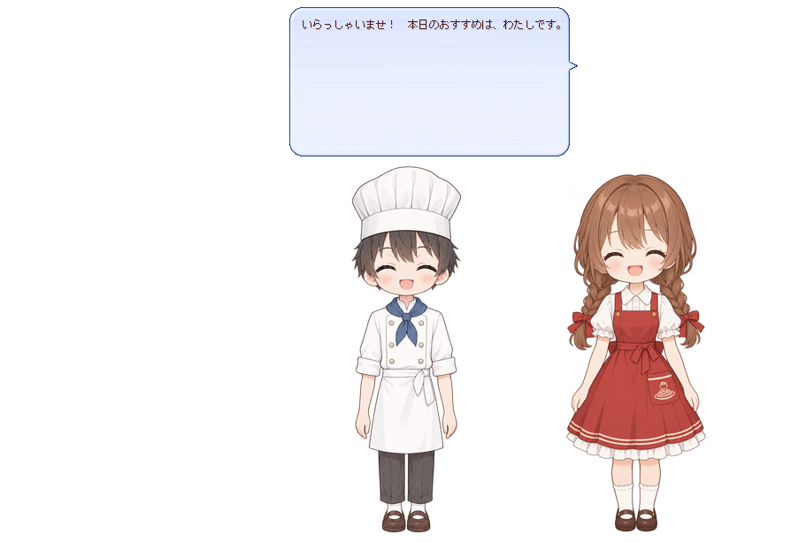

# 1 段目：しゃべらせたい

> 【にっこり】看板娘の第一声を、あなたの言葉に書き換える番ですわ。あなたのゴーストには、最初のひとことがもう入っていますのよ。

> 【アンソニー】拝見しますと、中身はたったの 2 行でございますね。

> 【したり顔】ええ。その 2 行が読めれば、辞書の書き方の芯はもうつかんだも同然ですわ。

---

## 叶えたいこと

- 叶うこと: ゴーストが起動したら、自分の決めたひとことをしゃべる
- この章で触るファイル: `ghost/master/dic/01-boot.pasta`（自分のゴーストに、はじめから入っている）

## 辞書を書く

エディタで自分のゴーストを開き、左のツリーで `dic` の下の `01-boot.pasta` を開く。

```pasta
＃ 1 段目：しゃべらせたい
＃ ゴーストが起動すると、pasta は ＊OnBoot という名前のシーンを呼ぶ。
＃ シーンの中に「アクター名：台詞」の行を書くと、そのアクターがしゃべる。

＊OnBoot
　女の子：いらっしゃいませ！　本日のおすすめは、わたしです。
```

| 行 | 意味 |
| -- | ---- |
| `＃` で始まる行 | コメント。書いても処理されない |
| `＊OnBoot` | シーンの始まり。`＊` の後ろがシーンの名前である |
| `　女の子：…` | アクション行。行の頭を字下げして、`アクター名：台詞` の形で書く |

- ゴーストが起動すると、SSP は `OnBoot` というイベント（知らせ）を送り、pasta は同じ名前のシーンを呼ぶ。
- `女の子` は、`pasta.toml` の `[actor."女の子"]` で決めてあるアクターの名前である。

| イベント | いつ来るか（UKADOC より） |
| -------- | ------------------------- |
| [`OnBoot`](https://ssp.shillest.net/ukadoc/manual/list_shiori_event.html#OnBoot) | 「起動した際に発生。」 |

> 【アンソニー】お嬢様、見本の台詞のままでは、どなたのゴーストか分かりかねますが。

> 【クローディア】ですから、ここであなたの色に染めますのよ。お店の挨拶でも、寝起きのひとことでも、お好きになさいまし。

`女の子：` の後ろの台詞を、自分の決めたひとことに書き換える。

- 行の頭の空白と `女の子：` は、そのまま残す。
- このファイルに触るのは、この段だけである。次の段からは、新しいファイルを `dic` に足して進む。

## 確かめる

1. SSP に自分のゴーストが出ていることを確かめる。
2. `＊OnBoot` の行のすぐ上に出ている「▶ シーンを実行」を押す。

- 成功の目印: 女の子の吹き出しに、書き換えたひとことが出る（書き換える前は「いらっしゃいませ！　本日のおすすめは、わたしです。」と出る）
- 保存と読み込み直しは ▶ が行う。
- 次に SSP を起動したときも、ゴーストはこのひとことから始める。



### うまくいかないときは

- **▶ を押してもしゃべらない** — エディタの下の欄の「出力」に理由が出る。自分のゴーストが出ていなければ、SSP のゴーストを右クリックし、メニューの「ゴースト切り替え」から選ぶ。
- **台詞の行に波線が出る** — 行の頭の空白か、`女の子` の後ろの `：` を消していないかを確かめる。
- ほかの知らせは、[うまく動かないとき](../debug/troubleshooting.md) で引ける。

## もっと詳しく

- [グローバルシーン](../grammar/block-structure.md#グローバルシーン)
- [アクション行の基本構文](../grammar/action-line.md#基本構文)
- [`pasta.toml` の `[actor]`](../reference/pasta-toml.md#actor名前アクター設定)
- [コメント](../grammar/block-structure.md#コメント)

---

> 【高笑い】おほほほ！ あなたの言葉でしゃべりましたわね！ 次は、相方にも口をきかせますわよ。

> 【アンソニー】一人で話し続けるのは、お嬢様だけで十分でございますから。
