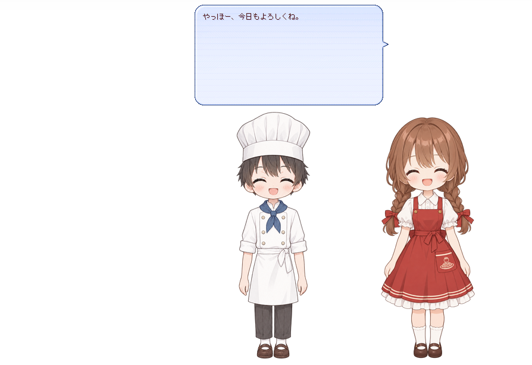

# 1 段目：しゃべらせたい

> 【にっこり】産声をあげる瞬間ですわ。準備で組み上げたあの子に、最初のひとことを授けましょう。

> 【アンソニー】お嬢様、辞書はまだ 1 枚もございませんが。

> 【したり顔】ですから、これから 1 枚目を書きますのよ。たった 2 行で、あの子はしゃべりますわ。

---

## 叶えたいこと

> 【クローディア】この章で叶えるのは「起動したら、ひとことしゃべる」ですわ。辞書を 1 枚足すだけですのよ。

- この章で足すファイル: `ghost/master/dic/01-boot.pasta`
- 叶うこと: ゴーストを起動すると、女の子がひとことしゃべる

## 新しく覚える表現

> 【考え中】ゴーストを起動すると、ベースウェアは「起動しましたわよ」と pasta に知らせてきますの。この知らせを **イベント** と呼び、起動の知らせの名前は `OnBoot` ですわ。

- イベント — ベースウェアが pasta に送る知らせ。起動の知らせの名前は `OnBoot` である

| イベント | いつ来るか（UKADOC より） |
| -------- | ------------------------- |
| [`OnBoot`](https://ssp.shillest.net/ukadoc/manual/list_shiori_event.html#OnBoot) | 「起動した際に発生。」 |

> 【したり顔】行の頭に `＊` を置いて名前を書くと、そこから「シーン」が始まりますの。名前を `OnBoot` にしておけば、起動のたびに pasta がこのシーンを呼びますわ。

```pasta
＊OnBoot
　女の子：やっほー、今日もよろしくね。
```

- `＊OnBoot` — シーンの始まり。`＊` の後ろがシーンの名前である
- `OnBoot` — 起動のイベントと同じ名前である。ゴーストが起動すると、pasta は `OnBoot` という名前のシーンを呼ぶ
- `　女の子：やっほー、…` — アクション行。行の頭を字下げし、`アクター名：台詞` の形で書く
- `女の子` — `pasta.toml` の `[actor."女の子"]` で決めたアクターの名前である

## 辞書ファイルを足す

`ghost/master/dic/01-boot.pasta` を作り、次の内容を UTF-8 で保存する。

```pasta
＃ 1 段目：しゃべらせたい
＃ ゴーストが起動すると、pasta は ＊OnBoot という名前のシーンを呼ぶ。
＃ シーンの中に「アクター名：台詞」の行を書くと、そのアクターがしゃべる。

＊OnBoot
　女の子：やっほー、今日もよろしくね。
```

- `＃` で始まる行はコメントで、処理されない
- このファイルは、この先の段でも書き換えない。次の段からは、新しいファイルを `dic/` に足すだけで進む

## 起動して確かめる

> 【クローディア】いよいよ、あなたのゴーストの初めての起動ですわ。準備の章で `ghost/` の下に置いたあの子を、SSP に呼び出しますのよ。

1. SSP を終了し、もう一度起動する。
2. SSP のメニューから、自分のゴーストに切り替える。

- 成功の目印: 立ち絵が出て、女の子の吹き出しに「やっほー、今日もよろしくね。」と出る
- 立ち絵は、ゴーストが最初の台詞を話すときに出る
- 次からは、SSP を起動すると自分のゴーストが出る。出ていなければ、メニューから切り替える



### うまく起動しないときは

> 【不安】思ったとおりに出てきてくれないときは、慌てずに次を確かめなさいまし。

- **何も表示されない**（立ち絵も吹き出しも出ないとき） — `ghost/master/` に `pasta.dll` が置かれているか、`ghost/master/descript.txt` に `shiori,pasta.dll` の行があるか、`shell/master/` を hello-pasta からフォルダごと写しているかを確かめる
- **`pasta.dll` が読み込めているかを知りたい** — `pasta.dll` が読み込まれると、自分のゴーストのフォルダの中に `ghost/master/profile/pasta/logs/pasta.log` ができる。このファイルができていなければ、`pasta.dll` は読み込めていない（ログの場所は、[`[logging]`](../reference/pasta-toml.md#loggingログ出力) の `file_path` の既定値である）
- **メニューを開く場所が見当たらない** — 立ち絵が出ていない間も、SSP は動いていて、タスクバーに SSP のアイコンがある。SSP ヘルプの [右クリックメニュー](https://ssp.shillest.net/ukadoc/ssphelp/howto-rclick.html) によれば、SSP のメニューは、このアイコンを右クリックしても開く
- **文字化けする・辞書が読めない** — ファイルが UTF-8 で保存されているかを確かめる。`install.txt` と `descript.txt` の先頭に `charset,UTF-8` があるかも確かめる
- **辞書が反映されない**（この段から先で、辞書を足したのにしゃべらないとき） — `ghost/master/dic/` の中に `.pasta` ファイルがあるかを確かめる。`pasta.toml` に `[loader]` を書いていなければ、`dic/` の下の `.pasta` ファイルはすべて読み込まれる（[pasta_patterns](../reference/pasta-toml.md#pasta_patterns) の既定値 `["dic/**/*.pasta"]`）

## もっと詳しく

- [グローバルシーン](../grammar/block-structure.md#グローバルシーン)
- [アクション行の基本構文](../grammar/action-line.md#基本構文)
- [`pasta.toml` の `[actor]`](../reference/pasta-toml.md#actor名前アクター設定)
- [コメント](../grammar/block-structure.md#コメント)

---

> 【高笑い】おほほほ！ しゃべりましたわね！ 次は、相方にも口をきかせますわよ。

> 【アンソニー】一人で話し続けるのは、お嬢様だけで十分でございますから。
