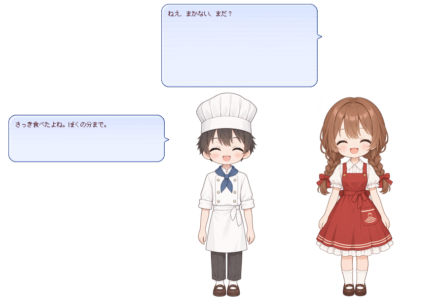

# 2 段目：二人で掛け合いさせたい

> 【考え中】掛け合いの幕開けですわ。あの子ひとりにしゃべらせておくのは、少々もったいないと思いませんこと？

> 【アンソニー】男の子のほうは、1 段目から黙って立ったままでございます。

> 【にっこり】ですから今日は、あの子にも出番を差し上げますの。二人そろえば、おしゃべりは勝手に弾みますわよ。

---

## 叶えたいこと

- 叶うこと: 暇なときに、女の子と男の子が順にしゃべる
- この章で足すファイル: `ghost/master/dic/02-talk.pasta`（`ghost/master/pasta.toml` にも 3 行書き足す）

## 辞書を書く

エディタの左のツリーで `dic` を右クリックし、「新しいファイル」で `02-talk.pasta` を作って、次の内容を書く。

```pasta
＃ 2 段目：二人で掛け合いさせたい
＃ ＊会話 は、暇なときに pasta が呼ぶシーンの名前。
＃ アクション行を並べると、上の行から順に 2 人がしゃべる。
＃ 「：」の前後の空白は無視される。名前の長さがちがうときは、短い名前と「：」の間に全角空白を足して「：」の位置をそろえると読みやすい。

＊会話
　女の子：ねえ、まかない、まだ？
　男の子：さっき食べたよね。ぼくの分まで。
```

| 行 | 意味 |
| -- | ---- |
| `＊会話` | 暇なときに pasta が呼ぶシーンの名前である |
| 並べた 2 つのアクション行 | 上の行から順に、そのアクターの吹き出しでしゃべる |
| `：` の前後の空白 | 無視される。名前の長さがちがうときは、全角空白を足して `：` の位置をそろえると読みやすい |

- `男の子` は、`pasta.toml` の `[actor."男の子"]` で決めてあるアクターの名前である。
- 1 段目の `01-boot.pasta` には触らない。この先も、前の段のファイルは書き換えない。

### おしゃべりの間隔を短くする

> 【アンソニー】お嬢様、「暇なとき」とは、どれほどお待ちすればよろしいので。

> 【不安】何も決めていないと、お茶がすっかり冷めるほど待たされますの。

> 【にっこり】ですから、間隔を短くしておきますわ。足すのは 3 行だけですのよ。

ツリーで `pasta.toml` を開き、末尾に次の 3 行を書き足す。

```toml
[ghost]
talk_interval_min = 45
talk_interval_max = 75
```

| キー | 意味 | 書かないとき |
| ---- | ---- | ------------ |
| `talk_interval_min` | おしゃべりの間隔の下限（秒） | `180` |
| `talk_interval_max` | おしゃべりの間隔の上限（秒） | `300` |

- 次に話すまでの秒数は、この 2 つの値の間から毎回ランダムに決まる。

## 確かめる

1. `＊会話` の行のすぐ上に出ている「▶ シーンを実行」を押す。
2. そのまま触らずに、45〜75 秒ほど待つ。

- 成功の目印（手順 1）: 女の子の吹き出しに「ねえ、まかない、まだ？」と出て、続いて男の子の吹き出しに「さっき食べたよね。ぼくの分まで。」と出る。
- 成功の目印（手順 2）: ▶ を押さなくても、2 人が同じ掛け合いを始める。
- 書き足した `pasta.toml` の保存と読み込み直しも、▶ が行う。



## もっと詳しく

- [シーン名の別名（`＊会話` が暇なときに呼ばれる仕組み）](../grammar/call-jump.md#シーン名の別名)
- [アクション行の基本構文（`：` の前後の空白）](../grammar/action-line.md#基本構文)
- [`pasta.toml` の `[ghost]`（`talk_interval_min`・`talk_interval_max`）](../reference/pasta-toml.md#ghostゴースト動作)

---

> 【目閉じ】言葉を返してくれる相手がいるというのは、よいものですわね。

> 【アンソニー】お嬢様のお話にも、私が毎日お返事しておりますが。

> 【不機嫌】フンッ、あなたのは返事ではなく茶々と申しますのよ。次は、あの子たちに表情をつけて差し上げますわ。
