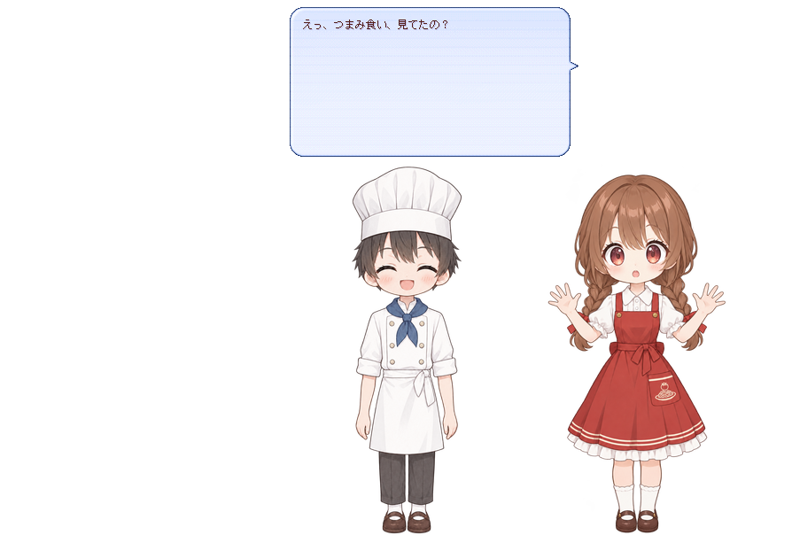
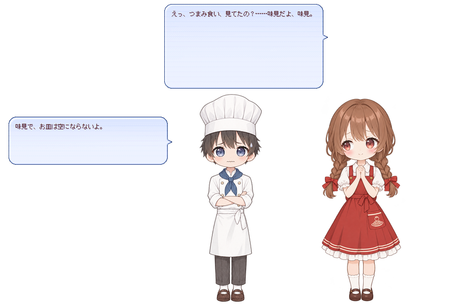

# 3 段目：表情を変えたい

> 【したり顔】顔つきひとつで台詞は化けますのよ。同じひとことでも、驚いた顔と照れた顔では、まるで別の台詞になりますわ。

> 【アンソニー】今のところ、お二人とも同じ顔のまましゃべっておいでです。

> 【不機嫌】それでは役者とは呼べませんわね。今日は、あの子たちに表情というものを仕込みますわよ。

---

## 叶えたいこと

- 叶うこと: 台詞に合わせて、女の子と男の子の表情が変わる
- この章で足すファイル: `ghost/master/dic/03-face.pasta`

## 辞書を書く

`dic` に新しいファイル `03-face.pasta` を作り、次の内容を書く。

```pasta
＃ 3 段目：表情を変えたい
＃ アクター辞書（％アクター名）の下に「＠表情名：\s[サーフェス番号]」を並べて、表情に名前を付ける。
＃ 台詞の頭に ＠表情名 を書くと、その表情でしゃべる。表情名の後ろには空白を置いて台詞と区切る。
＃ 台詞の途中にも ＠表情名 を書ける。\w9 で少し間を置いてから表情を変えると、気持ちの移り変わりが伝わる。

＃ 女の子の表情（サーフェス 0〜8）
％女の子
　＠笑顔：\s[0]
　＠通常：\s[1]
　＠照れ：\s[2]
　＠驚き：\s[3]
　＠泣き：\s[4]
　＠困惑：\s[5]
　＠キラキラ：\s[6]
　＠眠い：\s[7]
　＠怒り：\s[8]

＃ 男の子の表情（サーフェス 10〜18）
％男の子
　＠笑顔：\s[10]
　＠通常：\s[11]
　＠照れ：\s[12]
　＠驚き：\s[13]
　＠泣き：\s[14]
　＠困惑：\s[15]
　＠キラキラ：\s[16]
　＠眠い：\s[17]
　＠怒り：\s[18]

＃ 女の子は 1 行の中で、驚いた顔から照れた顔に変わる
＊会話
　女の子：＠驚き　えっ、つまみ食い、見てたの？\w9＠照れ　……味見だよ、味見。
　男の子：＠困惑　味見で、お皿は空にならないよ。
```

### 表情に名前を付ける

| 行 | 意味 |
| -- | ---- |
| `％女の子` | アクター辞書の始まり。`％` の後ろがアクターの名前で、下の字下げした行がそのアクターのものになる |
| `　＠笑顔：\s[0]` | `＠表情名：\s[サーフェス番号]` の形で、サーフェス 0 番に `笑顔` という名前を付ける |

- サーフェスは、シェルが持つ表情ごとの絵で、番号で指す。
- どの番号がどの顔かは、[サーフェス番号と表情名](../reference/shell.md#サーフェス番号と表情名) の表に絵で並んでいる。
- ここで付けた表情名は、この先の段の辞書でも使うので、9 つとも写す。

### 台詞の中で表情を呼ぶ

| 行 | 意味 |
| -- | ---- |
| `女の子：＠驚き　えっ、…` | 台詞の頭の `＠表情名` で、その表情になってからしゃべる。表情名の後ろの空白は区切りで、吹き出しには出ない |
| `\w9＠照れ` | `＠表情名` は台詞の途中にも書ける。`\w9` は、少し間を置く指示である |
| `男の子：＠困惑　…` | 男の子の行なので、`％男の子` の下の `＠困惑`（`\s[15]`）が使われる |

- `。`・`、`・`！`・`？`・`…` の後ろには、何も書かなくても pasta が間を入れる。

> 【アンソニー】お嬢様、あの「味見」は、どう見てもつまみ食いでございますが。

> 【冷笑】ですから表情が要りますのよ。驚いて、照れる。口より先に、顔が白状しておりますわ。

## 確かめる

1. `03-face.pasta` の `＊会話` の行のすぐ上に出ている「▶ シーンを実行」を押す。

- 成功の目印: 女の子が驚いた顔で「えっ、つまみ食い、見てたの？」と話し、少し間を置いて照れた顔に変わり、「……味見だよ、味見。」と続ける。
- 成功の目印: 男の子が困った顔で「味見で、お皿は空にならないよ。」と返す。
- `会話` という名前のシーンは 2 段目のものと合わせて 2 つになったが、▶ は押した見出しのシーンを鳴らす。





## もっと詳しく

- [グローバルアクター辞書定義](../grammar/actor-dictionary.md#グローバルアクター辞書定義)
- [`pasta.toml` の `[talk]`（句読点の後ろに入る間の長さ）](../reference/pasta-toml.md#talkトーク表示制御)

---

> 【驚き】まあ！ 顔が変わるだけで、あの子たちが急に生き生きしてきましたわ！

> 【アンソニー】お嬢様も、ただいまお顔がくるくると変わっておいでです。

> 【照れ】……い、いちいち実況しなくてよろしいの。次は、あの子たちの話の種を増やして差し上げますわよ。
