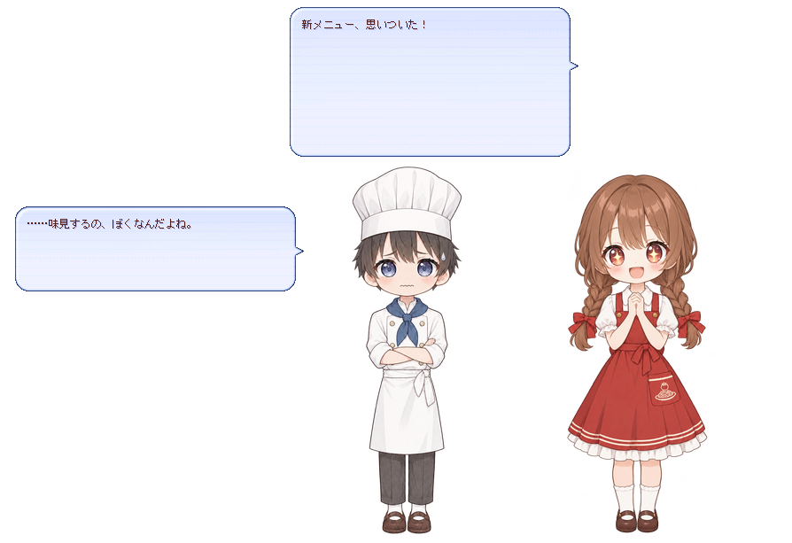

# 4 段目：毎回ちがうことを言わせたい

> 【落胆】十八番ばかりでは飽きられますわ。どんなに気の利いた掛け合いも、毎回同じでは色あせてしまいますのよ。

> 【アンソニー】「まかない、まだ？」は、今朝からもう 20 回ほどうかがいました。

> 【考え中】……数えていましたの？ ともかく今日は、あの子たちの話の種を増やしますわよ。

---

## 叶えたいこと

- 叶うこと: 暇なときのおしゃべりが、そのたびに入れ替わる
- この章で足すファイル: `ghost/master/dic/04-variety.pasta`

## 辞書を書く

`dic` に新しいファイル `04-variety.pasta` を作り、次の内容を書く。

```pasta
＃ 4 段目：毎回ちがうことを言わせたい
＃ 同じ名前のシーンをいくつも書くと、呼ばれるたびにどれか 1 つが選ばれる。
＃ 名前を書かない単独の ＊ 行は、直前のシーンと同じ名前の、別のシーンを始める。
＃ 単独の ＊ はファイルの先頭には書けない。先に名前付きのシーンを書いておく。
＃ ＊会話朝 のように名前を足すと、別の名前のシーンになり、暇なときには呼ばれない。

＊会話
　女の子：＠通常　ご注文を繰り返します。お昼寝、おやつ、お昼寝。
　男の子：＠困惑　だれの注文なの、それ。

＊
　女の子：＠キラキラ　新メニュー、思いついた！
　男の子：＠困惑　……味見するの、ぼくなんだよね。

＊会話
　女の子：＠眠い　ふわあ……ちょっと眠いかも。
　男の子：＠笑顔　寝てていいよ。皿洗いは、残しておくから。
```

| 行 | 意味 |
| -- | ---- |
| 1 つ目と 3 つ目の `＊会話` | 同じ名前のシーンは、いくつでも書ける。呼ばれるたびに、どれか 1 つが選ばれる |
| 単独の `＊` | 直前のシーンと同じ名前の、別のシーンを始める。2 つ目のシーンの名前も `会話` である |

- 2 段目と 3 段目の `＊会話` も、同じ名前の候補になる。候補は、合わせて 5 つである。
- 候補を一巡するまで、同じシーンは選ばれない。
- 単独の `＊` は、ファイルの先頭には書けない。
- `＊会話朝` のように字を足すと別の名前のシーンになり、暇なときには呼ばれない。

> 【アンソニー】お嬢様、5 つもございますと、次に何が出るかは運任せでございますね。

> 【したり顔】ええ、それがよろしいの。次に何を言い出すか分からない子ほど、目が離せませんもの。

## 確かめる

1. `04-variety.pasta` の 3 つの見出し（`＊会話`・`＊`・`＊会話`）の上の「▶ シーンを実行」を、1 つずつ押す。
2. そのまま触らずに待ち、おしゃべりを何回か見る。

- 成功の目印（手順 1）: 押した見出しのシーンが、上から順に出る。
  - 女の子「ご注文を繰り返します。お昼寝、おやつ、お昼寝。」、男の子「だれの注文なの、それ。」
  - 女の子「新メニュー、思いついた！」、男の子「……味見するの、ぼくなんだよね。」
  - 女の子「ふわあ……ちょっと眠いかも。」、男の子「寝てていいよ。皿洗いは、残しておくから。」
- 成功の目印（手順 2）: 45〜75 秒おきのおしゃべりが、5 つの掛け合いの中で入れ替わる。
- ▶ は選ばずに、押した見出しのシーンを鳴らす。選ばれるところは、手順 2 で待って見る。



## もっと詳しく

- [グローバルシーン（同じ名前のシーン・単独の `＊`）](../grammar/block-structure.md#グローバルシーン)

---

> 【にっこり】話の種が増えて、あの子たちもずいぶん賑やかになりましたわね。

> 【アンソニー】次は、台詞の中身まで日替わりになさるおつもりで。

> 【したり顔】察しがよろしいこと。台詞のほんの一語だけを、取り替えてみせますわよ。
