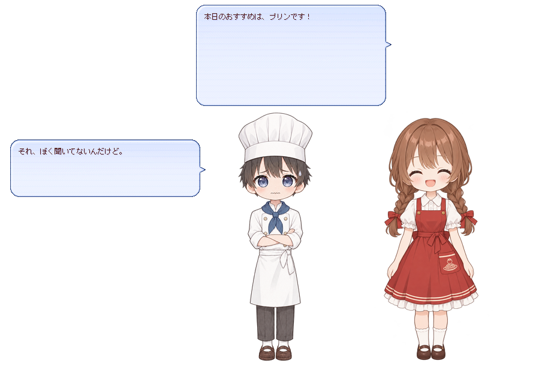

# 5 段目：単語でちょこっと変えたい

> 【クローディア】ひとさじの隠し味を足しますわよ。台詞をまるごと書き足さなくても、ほんの一語を取り替えるだけで、印象は変わりますの。

> 【アンソニー】シーンを増やすより、ずいぶんお手軽でございますね。

> 【目閉じ】ええ。手間を惜しむのではなく、手間のかけどころを選ぶ――それが腕というものですわ。

---

## 叶えたいこと

- 叶うこと: 同じ掛け合いでも、台詞の中のひとことがそのたびに変わる
- この章で足すファイル: `ghost/master/dic/05-words.pasta`

## 辞書を書く

`dic` に新しいファイル `05-words.pasta` を作り、次の内容を書く。

```pasta
＃ 5 段目：単語でちょこっと変えたい
＃ 「＠単語名：候補、候補、候補」と書くと、読点で区切った候補から 1 つが選ばれる単語になる。
＃ 台詞の中に ＠単語名 と書くと、その場所に候補のどれかが入る。単語名の後ろには空白を置いて区切る。

＃ 今日のおすすめ（呼ばれるたびに、どれか 1 つが入る）
＠おすすめ：ナポリタン、カルボナーラ、ペペロンチーノ、プリン

＃ 別れのあいさつ（7 段目で、ゴーストを閉じるときのあいさつにも使う）
＠終了挨拶：またのお越しを！、お疲れさまでした！、ばいばーい！

＊会話
　女の子：＠笑顔　本日のおすすめは、＠おすすめ　です！
　男の子：＠困惑　それ、ぼく聞いてないんだけど。

＊会話
　女の子：＠眠い　ちょっと休憩してくるね。
　男の子：＠通常　うん、＠終了挨拶
　女の子：＠驚き　えっ、帰らないよ！？
```

| 行 | 意味 |
| -- | ---- |
| `＠おすすめ：ナポリタン、カルボナーラ、…` | 単語。`＠単語名：候補、候補、候補` の形で書き、読点で区切った候補から 1 つが選ばれる |
| `本日のおすすめは、＠おすすめ　です！` | 台詞の中の `＠単語名` の場所に、候補のどれかが入る。単語名の後ろの空白は区切りで、吹き出しには出ない |

- 行の頭を字下げせずに書いた単語（グローバル単語）は、どの辞書ファイルのどのシーンからも使える。
- 3 段目の表情名も単語である。アクター辞書の下に字下げして書いた単語は、そのアクターの行で使う。
- 候補を一巡するまで、同じ候補は選ばれない。

> 【アンソニー】お嬢様、パスタ屋のおすすめに、プリンが紛れ込んでおりますが。

> 【したり顔】それが単語の醍醐味ですわ。4 回に 1 回、あの男の子が頭を抱えますのよ。

## 確かめる

1. 1 つ目の `＊会話` の行のすぐ上に出ている「▶ シーンを実行」を、何回か押す。
2. 2 つ目の `＊会話` の「▶ シーンを実行」も、何回か押す。

- 成功の目印（手順 1）: 女の子が「本日のおすすめは、プリンです！」のように話し、押すたびに、おすすめがナポリタン・カルボナーラ・ペペロンチーノ・プリンのどれかになる。男の子は「それ、ぼく聞いてないんだけど。」と返す。
- 成功の目印（手順 2）: 女の子の「ちょっと休憩してくるね。」に、男の子が「うん、またのお越しを！」「うん、お疲れさまでした！」「うん、ばいばーい！」のどれかを返し、女の子が「えっ、帰らないよ！？」と驚く。
- ▶ は押すたびに辞書を読み込み直すので、続けて押すと同じ言葉が出ることもある。



## もっと詳しく

- [グローバル単語定義](../grammar/words.md#グローバル単語定義)

---

> 【クローディア】ひとことが変わるだけで、同じ掛け合いが何度でも新しく聞こえますわね。

> 【アンソニー】お嬢様の高笑いにも、候補を 3 つほどご用意いたしましょうか。

> 【照れ怒り】わ、わたくしの高笑いは一点物ですわよ！ ……次は、あの子たちに時刻を告げさせますわ。
