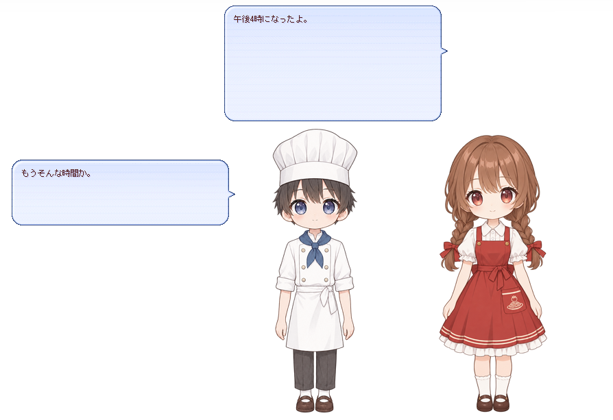

# 6 段目：時刻を知らせたい

> 【目閉じ】鐘を鳴らす役目を授けますわ。時の移ろいを告げるのは、古くから由緒あるお役目ですのよ。

> 【アンソニー】お嬢様のお茶の時刻でしたら、私が毎日お知らせしておりますが。

> 【冷笑】あなたの時報は小言つきですもの。あの子たちには、もっと愛らしく告げさせますわよ。

---

## 叶えたいこと

> 【クローディア】この章で叶えるのは「正時になったら、時刻を知らせる」ですわ。足す辞書は今回も 1 枚。確かめるときは、SSP の時計を進めて、正時を呼び寄せますのよ。

- この章で足すファイル: `ghost/master/dic/06-hour.pasta`
- この章で使いはじめる道具: SSP の開発者用機能と、開発用パレットの「現在時刻の仮想的変更」
- 叶うこと: 正時（毎時 0 分 0 秒）になると、女の子と男の子が時刻を知らせる

## 新しく覚える表現

### 時報のシーン

> 【したり顔】正時になると、pasta は時報のシーンを呼びますの。`＊時報12` のように時刻を付けた名前は、その時刻だけのシーンになりますわ。

```pasta
＊時報12
　女の子：＠笑顔　お昼だよ！お腹すいた～。
　男の子：＠笑顔　もうお昼か、ご飯にしよう。
```

- 正時（毎時 0 分 0 秒）になると、pasta は時報のシーンを呼ぶ
- `＊時報12` — 12 時（正午）だけの時報のシーンである
- 時刻は、`時報` の後ろに半角 2 桁で付ける。24 時間制で、`00`〜`23` のどれかになる

> 【アンソニー】お嬢様、24 の時刻すべてにシーンを書くのでございますか。

> 【にっこり】ご安心なさいまし。その時刻のシーンが無いときは、`＊時報その他` が呼ばれますの。書いていない時刻は、すべてここが引き受けますわ。

- `＊時報その他` — その時刻のシーンが無いときに呼ばれる、時報のシーンである
- この章の辞書では、12 時に `＊時報12` が、ほかの時刻に `＊時報その他` が呼ばれる
- この章の辞書には、`＊時報その他` が同じ名前で 3 つある。4 段目で覚えたとおり、呼ばれるたびにどれか 1 つが選ばれる

### 時刻を台詞に入れる

> 【考え中】では、いまが何時なのかを、どうやって台詞に入れましょうかしら。そこで使うのが `＄時１２` ですの。時報のシーンでは、ここに「午後3時」のような時刻が入っていますわ。

```pasta
＊時報その他
　女の子：＠通常　＄時１２　になったよ。
　男の子：＠通常　もうそんな時間か。
```

- `＄` で始まる名前は変数である。台詞の中に書くと、その場所に変数の値が入る
- `＄時１２` — 12 時間制の時刻が入る変数である。日時が入る変数を、日時変数と呼ぶ
- 時報のシーンでは、日時変数に値が自動で入っている
- `１２` は全角数字で書く
- 変数の後ろには空白を置いて、続く台詞と区切る。この空白は吹き出しには出ない
- 上の女の子の台詞は、午後 3 時の時報なら「午後3時になったよ。」になる

| 時刻 | `＄時１２` の値 |
| ---- | --------------- |
| 0 時 | `深夜0時` |
| 1〜11 時 | `午前1時`〜`午前11時` |
| 12 時 | `正午` |
| 13〜23 時 | `午後1時`〜`午後11時` |

## 辞書ファイルを足す

`ghost/master/dic/06-hour.pasta` を作り、次の内容を UTF-8 で保存する。

```pasta
＃ 6 段目：時刻を知らせたい
＃ 正時になると、pasta は時報のシーンを呼ぶ。＊時報12 のように時刻（半角 2 桁）を付けた名前は、その時刻だけのシーンになる。
＃ その時刻のシーンが無いときは ＊時報その他 が呼ばれる。
＃ 時報のシーンでは、＄時１２ に「午後3時」のような時刻が入っている。変数の後ろには空白を置いて区切る。

＃ 正午だけの時報
＊時報12
　女の子：＠笑顔　お昼だよ！お腹すいた～。
　男の子：＠笑顔　もうお昼か、ご飯にしよう。

＃ ほかの時刻の時報（3 通りから 1 つが選ばれる）
＊時報その他
　女の子：＠通常　＄時１２　になったよ。
　男の子：＠通常　もうそんな時間か。

＊時報その他
　女の子：＠キラキラ　＄時１２　をお知らせします！
　男の子：＠困惑　え、誰に向けて？

＊時報その他
　男の子：＠通常　いま　＄時１２　だって。
　女の子：＠眠い　……もうちょっとだけ寝かせて。
```

- 1〜5 段目のファイルは書き換えない。新しいファイルを `dic/` に足すだけで、この段になる
- 台詞の頭の `＠笑顔`・`＠通常`・`＠キラキラ`・`＠困惑`・`＠眠い` は、3 段目で付けた表情名である

## 起動して確かめる

> 【不安】ただ、時報は正時にしか鳴りませんの。本物の時計が正時を指すまで待っていたら、日が暮れてしまいますわ。

> 【アンソニー】では、お嬢様は時計の前で 1 時間お待ちになるのでございますか。

> 【したり顔】フンッ、待つのは 30 秒で十分ですわ。SSP の時計を、正時の少し手前まで進めてしまえばよろしいのよ。

### 開発者用機能を有効にする

> 【にっこり】時計を進めるために、道具箱をひとつ開けておきますわ。SSP の開発者用機能ですの。ゴーストを作る人のための機能で、この先の段の確かめにも使いますのよ。

1. ゴーストを右クリックし、メニューの「設定」から「本体設定」を開く。
2. 本体設定の「一般」で、「開発者用機能を有効にする」を ON にする。

- 開発者用機能は、ゴーストを作る人のための SSP の機能である。有効にすると、開発用パレットを開けるようになる
- 開発用パレットは、自分のゴーストを選んで `Ctrl+Shift+D` を押すと開く。右クリックメニューの「機能」から「開発用パレット」を選んでも開く
- 初めて ON にするときにダイアログが出たら、先へ進める
- この章では、次の節で開発用パレットの「現在時刻の仮想的変更」を使う
- この設定は、[7 段目](07-greeting.md) でイベントを起こすときと、[13 段目](13-nar.md) で `.nar` を作るときにも使う
- 手順の正本は、SSP ヘルプの [開発者向けヘルプ](https://ssp.shillest.net/ukadoc/ssphelp/dev.html) である

### 時計を正時の手前に進める

> 【考え中】開発用パレットの「現在時刻の仮想的変更」で、SSP の時計だけを正時の 30 秒前に合わせますの。あとは少し待てば、仮想の正時に時報が鳴りますわ。

1. SSP を終了し、もう一度起動する。
2. 自分のゴーストが出ていなければ、メニューから切り替える。
3. 自分のゴーストを選んで `Ctrl+Shift+D` を押し、開発用パレットを開く。
4. 開発用パレットの「現在時刻の仮想的変更」を押す。
5. 開いたダイアログの時刻の欄に今の時刻の 59 分 30 秒を入れて、Apply を押す（今が 10 時 21 分なら `10 : 59 : 30`）。
6. 30 秒ほど待つ。
7. 確かめ終えたら、ダイアログの Reset を押す。

- 成功の目印（12 時）: 女の子の吹き出しに「お昼だよ！お腹すいた～。」と出て、続いて男の子の吹き出しに「もうお昼か、ご飯にしよう。」と出る（`＊時報12`）
- 成功の目印（12 時以外）: 次の 3 つの掛け合いのどれか 1 つが出る（`＊時報その他`）。時刻の所は、仮想の正時の時刻になる。下の 3 つは、15 時（`＄時１２` の値は `午後3時`）の例である
  - 女の子「午後3時になったよ。」、男の子「もうそんな時間か。」
  - 女の子「午後3時をお知らせします！」、男の子「え、誰に向けて？」
  - 男の子「いま　午後3時だって。」、女の子「……もうちょっとだけ寝かせて。」



- 「現在時刻の仮想的変更」は、SSP の時刻を仮想的に変える機能である。pasta は、この仮想の時刻で正時を判定する。日時変数にも、仮想の時刻が入る
- 時報は、仮想の正時になってから数秒後に出る
- 時刻の欄は、クリックして全部選んでから打つ
- 12 時の目印を見るときは、手順 5 で `11 : 59 : 30` を入れる。Apply の後に別の時の 59 分 30 秒を入れ直しても、余分な時報は出ない。時報は、入れ直した時刻の次の正時に 1 回出る
- Reset を押すと、SSP の時刻は OS の時計に戻る。時報は、たいていは次の実際の正時まで出ない（実際の正時から 1 分ほどのうちに Reset すると、その正時の時報が 1 回出ることがある）。日時変数も、実際の時刻に戻る
- Apply や Reset を押した直後に、表示中の吹き出しの文字が消えることがある。辞書の誤りではない
- 時刻を変えなくても、時報は実際の正時（毎時 0 分 0 秒）に出る
- 時報は、おしゃべりの途中には出ない。途中だったときは、おしゃべりが終わってから出る
- 開発用パレットの操作の正本は、SSP ヘルプの [開発用パレット](https://ssp.shillest.net/ukadoc/ssphelp/dev-palette.html) である

## もっと詳しく

- [OnHour（時報のシーンを探す 4 段の候補）](../lua/shiori-events.md#onhour)
- [日時変数（`＄時１２` と、ほかの日時変数）](../grammar/variables.md#日時変数)

---

> 【高笑い】おほほほ！ 時を告げるお役目、あの子たちは見事に果たしましたわ！

> 【アンソニー】お嬢様、時計はお戻しになりましたか。お茶の時刻がずれてしまいますので。

> 【目閉じ】……もう Reset しましたわ。次は、あの子たちに挨拶の作法を仕込みますわ。
