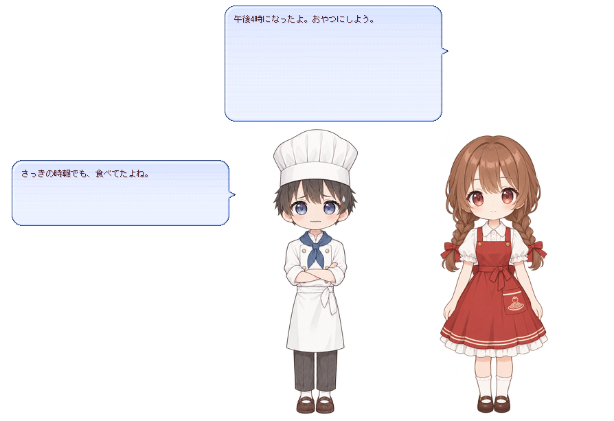

# 6 段目：時刻を知らせたい

> 【目閉じ】鐘を鳴らす役目を授けますわ。時の移ろいを告げるのは、古くから由緒あるお役目ですのよ。

> 【アンソニー】お嬢様のお茶の時刻でしたら、私が毎日お知らせしておりますが。

> 【冷笑】あなたの時報は小言つきですもの。あの子たちには、もっと愛らしく告げさせますわよ。

---

## 叶えたいこと

- 叶うこと: 正時（毎時 0 分 0 秒）になると、女の子と男の子が時刻を知らせる
- この章で足すファイル: `ghost/master/dic/06-hour.pasta`

## 辞書を書く

エディタのツリーで `dic` を右クリックして「新しいファイル」を選び、`06-hour.pasta` という名前で次の内容を書く。

```pasta
＃ 6 段目：時刻を知らせたい
＃ 正時になると、pasta は時報のシーンを呼ぶ。＊時報12 のように時刻（半角 2 桁）を付けた名前は、その時刻だけのシーンになる。
＃ その時刻のシーンが無いときは ＊時報その他 が呼ばれる。
＃ 時報のシーンでは、＄時１２ に「午後3時」のような時刻が入っている。変数の後ろには空白を置いて区切る。

＃ 正午だけの時報
＊時報12
　女の子：＠キラキラ　お昼だよ！　まかないの時間！
　男の子：＠困惑　いちばん忙しい時間なんだけど。

＃ ほかの時刻の時報（3 通りから 1 つが選ばれる）
＊時報その他
　女の子：＠通常　＄時１２　になったよ。おやつにしよう。
　男の子：＠困惑　さっきの時報でも、食べてたよね。

＊時報その他
　女の子：＠キラキラ　＄時１２　です。ラストオーダーのお時間です！
　男の子：＠困惑　……毎時間、ラストオーダーなの？

＊時報その他
　男の子：＠通常　いま　＄時１２　だって。
　女の子：＠眠い　……あと五分だけ、寝かせて。
```

| 行 | 意味 |
| -- | ---- |
| `＊時報12` | 12 時（正午）だけの時報のシーン。時刻は `時報` の後ろに半角 2 桁（`00`〜`23`）で付ける |
| `＊時報その他` | その時刻のシーンが無いときに呼ばれる、時報のシーン |
| `＄時１２` | 12 時間制の時刻が入る変数。`１２` は全角数字で書く |

- 正時になると、pasta は時報のシーンを呼ぶ。
- この辞書では、12 時に `＊時報12` が、ほかの時刻に 3 つの `＊時報その他` のどれか 1 つが呼ばれる。
- 前の段のファイルは書き換えない。

### 時刻を台詞に入れる

> 【アンソニー】お嬢様、いまが何時かは、どなたが台詞に書き込むのでございましょう。

> 【したり顔】誰も書き込みませんわ。時刻のほうから入ってきますの。呼ばなくても来るところは、あなたの小言と同じですわね。

- `＄` で始まる名前は変数で、台詞の中に書くと、その場所に変数の値が入る。
- 時報のシーンでは、`＄時１２` に時刻が自動で入っている。
- 変数の後ろには空白を置いて、続く台詞と区切る。この空白は吹き出しには出ない。

| 時刻 | `＄時１２` の値 |
| ---- | --------------- |
| 0 時 | `深夜0時` |
| 1〜11 時 | `午前1時`〜`午前11時` |
| 12 時 | `正午` |
| 13〜23 時 | `午後1時`〜`午後11時` |

## 確かめる

1. `＊時報12` の行のすぐ上に出ている「▶ シーンを実行」を押す。
2. 3 つある `＊時報その他` の「▶ シーンを実行」を、1 つずつ押す。

- 成功の目印（手順 1）: 女の子「お昼だよ！　まかないの時間！」、男の子「いちばん忙しい時間なんだけど。」と出る
- 成功の目印（手順 2）: 押したシーンの掛け合いが、今の時刻で出る。15 時台に押すと、次の 3 つになる
  - 女の子「午後3時になったよ。おやつにしよう。」、男の子「さっきの時報でも、食べてたよね。」
  - 女の子「午後3時です。ラストオーダーのお時間です！」、男の子「……毎時間、ラストオーダーなの？」
  - 男の子「いま　午後3時だって。」、女の子「……あと五分だけ、寝かせて。」



> 【不安】ただ、▶ で鳴らせるのは台詞だけですの。正時にひとりでに鳴るところは、本物の時計が正時を指すまで見られませんわ。

> 【アンソニー】では、お嬢様は時計の前で 1 時間お待ちになるのでございますか。

> 【したり顔】フンッ、待つのは 30 秒で十分ですわ。SSP の時計を、正時の少し手前まで進めてしまえばよろしいのよ。

### 開発者用機能を有効にする

1. ゴーストを右クリックし、メニューの「設定」から「本体設定」を開く。
2. 本体設定の「一般」で、「開発者用機能を有効にする」を ON にする。

- 有効にすると、自分のゴーストを選んで `Ctrl+Shift+D` を押したときに、開発用パレットが開く。
- この設定は、[7 段目](07-greeting.md)・[13 段目](13-calendar.md)・[14 段目](14-nar.md) でも使う。
- 手順の正本は、SSP ヘルプの [開発者向けヘルプ](https://ssp.shillest.net/ukadoc/ssphelp/dev.html) である。

### 正時にひとりでに鳴るところを見る

1. 自分のゴーストを選んで `Ctrl+Shift+D` を押し、開発用パレットの「現在時刻の仮想的変更」を押す。
2. 時刻の欄に今の時刻の 59 分 30 秒を入れて、Apply を押す（今が 10 時 21 分なら `10 : 59 : 30`）。
3. 30 秒ほど待つ。
4. 確かめ終えたら、ダイアログの Reset を押す。

- 成功の目印: 仮想の正時から数秒後に、`＊時報その他` の掛け合いのどれか 1 つが、その時刻で出る（`11 : 59 : 30` を入れると、`＊時報12` の掛け合いが出る）
- 時刻の欄は、クリックして全部選んでから打つ。
- 時報は、おしゃべりの途中には出ない。おしゃべりが終わってから出る。
- Reset を押すと、SSP の時刻は OS の時計に戻る。
- 操作の正本は、SSP ヘルプの [開発用パレット](https://ssp.shillest.net/ukadoc/ssphelp/dev-palette.html) である。

## もっと詳しく

- [OnHour（時報のシーンを探す 4 段の候補）](../lua/shiori-events.md#onhour)
- [日時変数（`＄時１２` と、ほかの日時変数）](../grammar/variables.md#日時変数)

---

> 【高笑い】おほほほ！ 時を告げるお役目、あの子たちは見事に果たしましたわ！

> 【アンソニー】お嬢様、時計はお戻しになりましたか。お茶の時刻がずれてしまいますので。

> 【目閉じ】……もう Reset しましたわ。次は、あの子たちに挨拶の作法を仕込みますわ。
