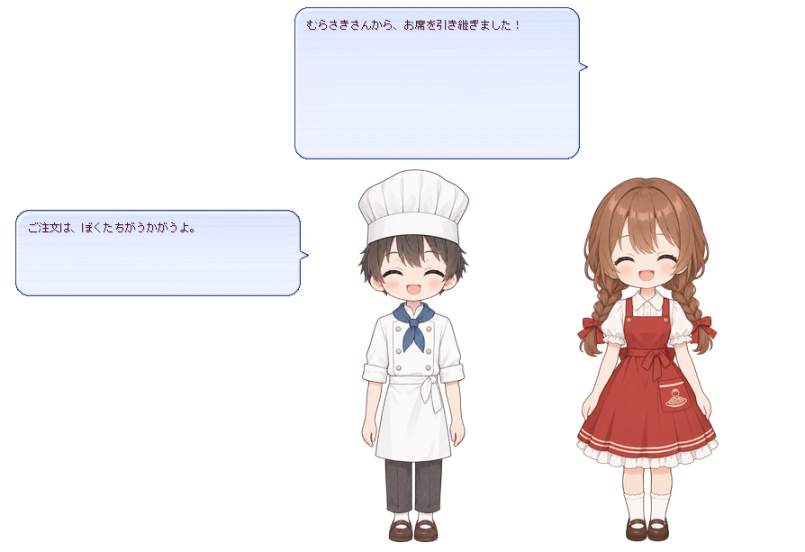

# 7 段目：挨拶したい

> 【お辞儀】礼儀作法のお稽古を始めますわ。まずはお手本を――ようこそ、いらっしゃいまし。と、こう迎えるのが挨拶というものですのよ。

> 【アンソニー】今のところ、お二人のご挨拶は、起動のときのひとことだけでございます。

> 【不機嫌】フンッ、ですから今日あらためますのよ。迎えるとき、送り出すとき、お別れのとき――お客様のお名前くらい、きちんと呼ばせてみせますわ。

---

## 叶えたいこと

- 叶うこと: ほかのゴーストと切り替わるとき・初めて起動したとき・閉じるときに、2 人が挨拶する。おしゃべりの中で、ベースウェアの名前を話す
- この章で足すファイル: `ghost/master/dic/07-greeting.pasta`

## 辞書を書く

エディタのツリーで `dic` を右クリックして「新しいファイル」を選び、`07-greeting.pasta` という名前で次の内容を書く。

```pasta
＃ 7 段目：挨拶したい
＃ ベースウェア（SSP など）は、起動や終了、ゴーストの切り替えのたびにイベントを送ってくる。
＃ イベントと同じ名前のシーンを書いておくと、pasta はそのシーンを呼ぶ。
＃ pasta のマニュアルのイベント一覧に無いイベントも、同じ名前のシーンを書けば応答できる。
＃ どんなイベントがあるかは UKADOC の一覧で調べられる（https://ssp.shillest.net/ukadoc/manual/list_shiori_event.html#OnGhostChanging）。
＃ イベントには付加情報（Reference0、Reference1 …）が付いてくる。
＃ イベントのシーンでは、付加情報が最初から ＄ｒ０〜＄ｒ９ に入っている。変数の後ろには空白を置いて区切る。

＃ ほかのゴーストから切り替わってきたとき（迎え入れ）。
＃ ＄ｒ０ には、直前のゴーストの本体側の名前が入る（emo2 から切り替わってきたときは「むらさき」）。
＃ このシーンで話すと、続けて OnBoot は来ない。何も話さずに終えると（204）、ベースウェアは次に OnBoot を送ってくる。
＊OnGhostChanged
　女の子：＠笑顔　＄ｒ０　さんから、お席を引き継ぎました！
　男の子：＠笑顔　ご注文は、ぼくたちがうかがうよ。

＊OnGhostChanged
　女の子：＠キラキラ　＄ｒ０　さんと、シフト交代だよ！
　男の子：＠通常　ユーザーさん、お冷やはセルフだからね。

＃ ほかのゴーストへ切り替わるとき（送り出し）。OnGhostChanging は pasta のマニュアルの一覧に無いイベント。
＃ ＄ｒ０ には、切り替え先のゴーストの本体側の名前が入る。相手に向けて一言で引き継ぐ。
＃ このシーンで話すと、続けて OnClose は来ない。何も話さずに終えると（204）、ベースウェアは次に OnClose を送ってくる。
＊OnGhostChanging
　女の子：＠笑顔　＄ｒ０　さん、あとはよろしくね！
　男の子：＠通常　ぼくたちは、休憩に入るよ。

＊OnGhostChanging
　女の子：＠キラキラ　＄ｒ０　さん、シフト交代だよ！

＃ 初めて起動したときは、OnBoot の代わりに OnFirstBoot が来る。
＃ このシーンで話すと、続けて OnBoot は来ない。何も話さずに終えると（204）、ベースウェアは次に OnBoot を送ってくる。
＊OnFirstBoot
　女の子：＠笑顔　はじめまして！　ご来店、ありがとうございます。
　男の子：＠通常　来たのは、ぼくたちのほうだけどね。

＃ ゴーストを閉じるときは OnClose が来る。
＃ 応答したら、最後に ＞ゴースト終了 を書いて閉じる（書かないと閉じない）。（３００）は閉じるまでに待つミリ秒。
＃ 何も話さずに終えると（204）、ベースウェアがそのまま閉じる。
＊OnClose
　女の子：＠通常　＠終了挨拶
　男の子：＠通常　また呼んでよね。
　＞ゴースト終了（３００）

＊OnClose
　女の子：＠眠い　本日は閉店です。おやすみなさい……
　男の子：＠通常　看板、しまっておくね。
　＞ゴースト終了（３００）

＃ ＄％プロパティ名 で、ベースウェアのプロパティを読める。ゴースト自身では知りえないことを、ベースウェアに聞ける。
＃ ＄％baseware.name には、いま動いているベースウェアの名前が入る（https://ssp.shillest.net/ukadoc/manual/list_propertysystem.html#baseware.name）。
＊会話
　女の子：＠キラキラ　このお店、＄％baseware.name　の上にあるんだって。
　男の子：＠困惑　……家賃、払ってたっけ。
```

| 行 | 意味 |
| -- | ---- |
| `＊OnGhostChanged` など | イベントと同じ名前のシーン。ベースウェアがそのイベントを送ってくると、pasta が呼ぶ |
| `＄ｒ０` | イベントの付加情報 `Reference0` が入る変数。`＄ｒ９` まであり、`ｒ` と数字は全角で書く |
| `　＞ゴースト終了（３００）` | ゴーストを閉じる行。`＊OnClose` で話したら、最後に書く。`（３００）` は閉じるまでに待つミリ秒 |
| `＄％baseware.name` | ベースウェアのプロパティを読む変数。いま動いているベースウェアの名前が入る |

- 1 段目の `＊OnBoot` も、イベントと同じ名前のシーンである。
- どんなイベントがあるかは、[UKADOC の SHIORI Event 一覧](https://ssp.shillest.net/ukadoc/manual/list_shiori_event.html) で調べる。pasta のマニュアルの [主要イベント](../lua/shiori-events.md#主要イベント) に無い `OnGhostChanging` にも、同じ名前のシーンを書けば応えられる。
- 本体側の名前は、そのゴーストの `descript.txt` の `sakura.name` である。emo2 なら `むらさき` になる。
- `＄ｒ０` と `＄％baseware.name` の後ろには空白を置いて、続く台詞と区切る。
- `＠終了挨拶` は、5 段目で決めた単語である。
- `Reference0` に何が入るかは、イベントごとに違う。この章の 4 つのイベントは、次の表のとおりである。

| イベント | いつ来るか（UKADOC より） | この段で使う Reference（UKADOC より） |
| -------- | ------------------------- | ------------------------------------- |
| [`OnGhostChanged`](https://ssp.shillest.net/ukadoc/manual/list_shiori_event.html#OnGhostChanged) | 「他のゴーストから自ゴーストに切り替えられた際に発生。」 | `Reference0` —「直前のゴーストの本体側の名前。」 |
| [`OnGhostChanging`](https://ssp.shillest.net/ukadoc/manual/list_shiori_event.html#OnGhostChanging) | 「他のゴーストへの切り替え指示があった際に発生。」 | `Reference0` —「切り替わるゴーストの本体側の名前。」 |
| [`OnFirstBoot`](https://ssp.shillest.net/ukadoc/manual/list_shiori_event.html#OnFirstBoot) | 「初回起動した際に発生。」 | —（この段の辞書は使わない） |
| [`OnClose`](https://ssp.shillest.net/ukadoc/manual/list_shiori_event.html#OnClose) | 「終了が指示された際に発生。」 | —（この段の辞書は使わない） |

> 【アンソニー】お嬢様、付加情報を取り出す呪文のようなものは、要らないのでございますか。

> 【にっこり】要りませんわ。名前を呼びたい場所に、`＄ｒ０` と書くだけですのよ。

### 来なくなるイベント

> 【不安】ここにひとつ、落とし穴がありますの。迎え入れの挨拶に続けて、起動の挨拶も出る――そう思い込んで書き進めますと、当てが外れてしまいますわ。

- `＊OnGhostChanged`・`＊OnFirstBoot` が話すと、続けて `OnBoot` は来ない。`＊OnGhostChanging` が話すと、続けて `OnClose` は来ない。
- 何も話さずに終えると（204）、ベースウェアは次にそのイベントを送ってくる。`＊OnClose` が何も話さずに終えると、ベースウェアがそのまま閉じる。
- この章の辞書のシーンは、どれも話す。ほかのゴーストから切り替わってきたときに、1 段目の `＊OnBoot` の台詞は出ない。
- この関係はベースウェアの規則で、根拠は UKADOC の [OnGhostChanged](https://ssp.shillest.net/ukadoc/manual/list_shiori_event.html#OnGhostChanged)・[OnGhostChanging](https://ssp.shillest.net/ukadoc/manual/list_shiori_event.html#OnGhostChanging)・[OnFirstBoot](https://ssp.shillest.net/ukadoc/manual/list_shiori_event.html#OnFirstBoot)・[OnBoot](https://ssp.shillest.net/ukadoc/manual/list_shiori_event.html#OnBoot)・[OnClose](https://ssp.shillest.net/ukadoc/manual/list_shiori_event.html#OnClose) の項にある。

## 確かめる

1. `＊OnFirstBoot` の行のすぐ上に出ている「▶ シーンを実行」を押す。
2. いちばん下の `＊会話` の「▶ シーンを実行」を押す。

- 成功の目印（手順 1）: 女の子「はじめまして！　ご来店、ありがとうございます。」、男の子「来たのは、ぼくたちのほうだけどね。」と出る
- 成功の目印（手順 2）: SSP の上では、女の子「このお店、SSPの上にあるんだって。」、男の子「……家賃、払ってたっけ。」と出る
- `OnFirstBoot` は、初めて起動したときにだけ来る。初めての起動は済んでいるので、▶ で鳴らして確かめる。
- `＊OnGhostChanged`・`＊OnGhostChanging` を ▶ で鳴らすと、`＄ｒ０` の所には相手の名前ではなく、辞書ファイルの場所が、文字の欠けた形で出る。▶ が `Reference0` にファイルを載せて送るためである。

### emo2 と切り替える

> 【にっこり】名前を呼ぶ挨拶には、お相手が要りますわね。お相手は emo2 にお願いしましょう。pasta.dll で作りこまれた、ショーケースのゴーストですのよ。

1. [emo2 の配布ページ](https://ekicyou.github.io/ghost_dev/emo2/) から `emo2.nar` を落として、SSP に出ているゴーストの上へドロップする。
2. 自分のゴーストを右クリックし、メニューの「ゴースト切り替え」から emo2（メニューに出る名前は `えも？？`）に切り替える。
3. emo2 が出たら、emo2 を右クリックし、メニューの「ゴースト切り替え」から自分のゴーストに切り替える。

- 成功の目印（手順 2）: 送り出しの挨拶として、次のどちらかが出る
  - 女の子「むらさきさん、あとはよろしくね！」、男の子「ぼくたちは、休憩に入るよ。」
  - 女の子「むらさきさん、シフト交代だよ！」
- 成功の目印（手順 3）: 迎え入れの挨拶として、次のどちらかが出る
  - 女の子「むらさきさんから、お席を引き継ぎました！」、男の子「ご注文は、ぼくたちがうかがうよ。」
  - 女の子「むらさきさんと、シフト交代だよ！」、男の子「ユーザーさん、お冷やはセルフだからね。」



- emo2 の配布版のゴーストの名前（`name`）は `えも？？` で、本体側の名前（`sakura.name`）は `むらさき` である。
- emo2 も、切り替えのイベントに応えて、相手の名前を呼んで挨拶する。

### スクリプト入力でイベントを起こす

> 【考え中】残るは、お別れの挨拶ですわね。ふつうに閉じれば見られますけれど、確かめるたびに起動し直すのは手間ですの。こちらからイベントを起こしてしまいましょう。

1. 自分のゴーストを選んで `Ctrl+Shift+D` を押し、開発用パレットの「`\-` タグで終了しない」を ON にする。
2. 開発用パレットの「スクリプト入力」を押し、開いた入力ボックス（タイトルは Send）に下の 1 行目を入力して、Enter キーを押す。
3. 手順 2 を何度か繰り返す。
4. 「`\-` タグで終了しない」を OFF に戻す。

```text
\![raise,OnClose,user]
\![raise,OnGhostChanged,むらさき]
\![raise,OnGhostChanging,むらさき]
```

- 成功の目印: 次の 2 つの挨拶のどちらかが出て、ゴーストは閉じない
  - 女の子が「またのお越しを！」「お疲れさまでした！」「ばいばーい！」のどれかを話し、男の子が「また呼んでよね。」と返す
  - 女の子「本日は閉店です。おやすみなさい……」、男の子「看板、しまっておくね。」
- `\![raise,イベント名,Reference0,…]` は、イベントを起こすさくらスクリプトである。イベント名の後ろに書いた値が、`Reference0` から順に入る。
- 2・3 行目を入力すると、emo2 が手元に無くても、迎え入れと送り出しの挨拶を確かめられる。`むらさき` を書き換えると、台詞の中の名前も変わる。
- `＞ゴースト終了` は、ゴーストを終了させるさくらスクリプト `\-` を出す。「`\-` タグで終了しない」を ON にすると、SSP はこの `\-` を無視する。
- ON のままだと、`＊OnClose` が話してもゴーストが閉じない。確かめ終えたら OFF に戻す。
- 開発用パレットを開けないときは、[6 段目の「開発者用機能を有効にする」](06-hour.md#開発者用機能を有効にする) の手順を済ませる。
- `\![raise,…]` の説明は [UKADOC のさくらスクリプト一覧](https://ssp.shillest.net/ukadoc/manual/list_sakura_script.html) に、開発用パレットの操作の正本は SSP ヘルプの [開発用パレット](https://ssp.shillest.net/ukadoc/ssphelp/dev-palette.html) にある。

## もっと詳しく

- [SHIORI イベントとハンドラ（イベントの一覧と、応答の仕組み）](../lua/shiori-events.md)
- [シーン関数フォールバック（イベントと同じ名前のシーンを探す仕組み）](../lua/shiori-events.md#シーン関数フォールバック)
- [リクエスト変数（Reference）（`＄ｒ０`〜`＄ｒ９`）](../grammar/variables.md#リクエスト変数reference)
- [プロパティ変数（`＄％baseware.name`）](../grammar/variables.md#プロパティ変数)
- [UKADOC の OnGhostChanging](https://ssp.shillest.net/ukadoc/manual/list_shiori_event.html#OnGhostChanging)

---

> 【したり顔】迎えて、送って、お別れまで。これであの子たちも、どこへ出しても恥ずかしくありませんわね。

> 【アンソニー】お嬢様も先ほど、画面の向こうのお客様に手を振っておいででした。

> 【照れ】……あ、挨拶には挨拶を返すものですわ。次は、あの子たちが触られたときの反応を仕込みますわよ。
