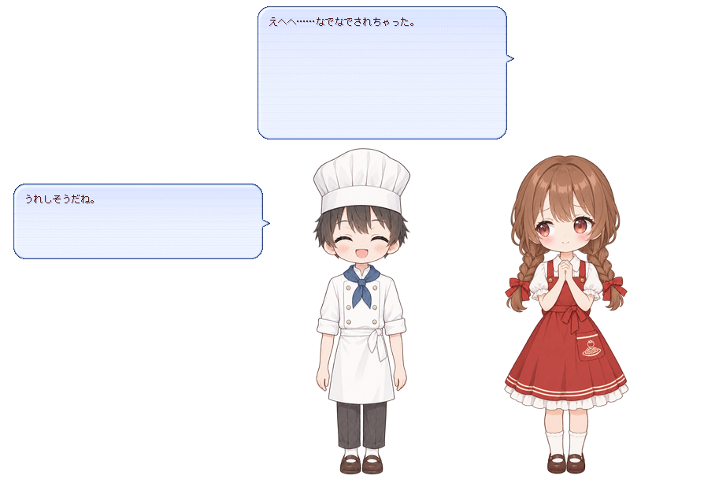

# 8 段目：触ったら反応してほしい

> 【不安】撫でられても知らん顔では、可愛げがありませんわね……。あの子たち、いまは触られても何も返しませんのよ。

> 【アンソニー】お嬢様は、お帽子を直して差し上げるだけで、たいそう驚かれますが。

> 【照れ怒り】あ、あれは不意を突かれただけですわ！ 今日は、あの子たちにも、触られたら応えることを教えますのよ。

---

## 叶えたいこと

> 【クローディア】この章で叶えるのは「触ったら反応する」ですわ。あの子たちをつつくと、驚いたり照れたりしますの。誰のどこを触られたのかで、台詞を変えてみせますわよ。撫でられたときの反応も付けますわ。

- この章で足すファイル: `ghost/master/dic/08-touch.pasta`
- 叶うこと: キャラクターをダブルクリック（つつく）すると、女の子と男の子が反応する。誰のどこをつついたかで、反応が変わる。頭などをマウスで撫でたときにも反応する

## 新しく覚える表現

### つついたときに呼ばれるシーン

> 【したり顔】キャラクターをダブルクリックすることを、つつくと言いますの。つつかれたときの反応は、`つっつき反応` に続けて名前を付けたシーンに書きますわ。名前の後ろに、誰のどこを触ったかを続けますのよ。

```pasta
＃ 女の子の頭をつついたとき
＊つっつき反応女の子Head
　女の子：＠驚き　ひゃっ！\w9＠照れ　頭をつつかれると、くすぐったいよ。
　男の子：＠笑顔　いい音がしたね。
```

- `＊つっつき反応女の子Head` — 女の子の頭をつついたときに呼ばれるシーンである
- `つっつき反応` の後ろに、アクター名（`女の子`・`男の子`）と、部位の名前を続ける
- 部位の名前は、シェルが立ち絵の上に決めている当たり判定の名前である。hello-pasta のシェルは、頭に `Head`、顔に `Face`、体に `Body` と名前を付けている
- 部位の名前は、シェルが付けた名前と 1 文字も違わずに書く
- `その他` — 部位の名前の代わりに書くと、そのアクターのどこを触っても呼ばれる。`＊つっつき反応男の子その他` は、男の子のどこをつついても呼ばれる
- アクター名を省くと、誰を触っても呼ばれる。`＊つっつき反応Face` は、誰の顔をつついても呼ばれる
- `＊つっつき反応その他` は、誰のどこをつついても呼ばれる
- このシーンの名前は、次の節の順に探される

### 名前を探す順

> 【考え中】では、女の子の頭をつついたとき、`女の子Head` と `その他` の両方を書いていたら、どちらが呼ばれるのでしょう。

> 【にっこり】細かい名前のほうが先ですわ。pasta は、細かい名前から順に探して、最初に見つかったシーンを呼びますの。6 段目の、時刻のシーンが無ければ `＊時報その他` を呼ぶ、あの考え方と同じですのよ。

| 探す順 | シーンの名前 | 当たる操作 |
| ------ | ------------ | ---------- |
| 1 | `つっつき反応女の子Head`（アクター＋部位） | 女の子の頭をつつく |
| 2 | `つっつき反応女の子その他`（アクターのどこでも） | 女の子のどこかをつつく |
| 3 | `つっつき反応Head`（部位だけ） | 誰かの頭をつつく |
| 4 | `つっつき反応その他`（どこを触っても） | どこかをつつく |

- 上の表は、女の子の頭をつついたときに探す名前である。男の子の頭なら `女の子` が `男の子` に、顔なら `Head` が `Face` に変わる
- 当たり判定の外（足元など）をつついたときは、部位の名前が付いた段（1 と 3）を飛ばして探す
- 同じ名前のシーンを複数書くと、4 段目で覚えたとおり、呼ばれるたびにどれか 1 つが選ばれる
- この章の辞書は 4 つのつっつき反応を書いている。hello-pasta では、操作ごとに次のシーンが呼ばれる

| 操作 | 呼ばれるシーン |
| ---- | -------------- |
| 女の子の頭をつつく | `＊つっつき反応女の子Head` |
| 男の子のどこかをつつく（頭・顔・体・足元） | `＊つっつき反応男の子その他` |
| 女の子の顔をつつく | `＊つっつき反応Face` |
| 女の子の体か足元をつつく | `＊つっつき反応その他` |

- 男の子の顔をつつくと、`＊つっつき反応Face` より先に、2 番目の `＊つっつき反応男の子その他` が見つかる。だから `＊つっつき反応Face` が呼ばれるのは、女の子の顔だけである

### 撫でたときに呼ばれるシーン

> 【クローディア】撫でられたときの反応は、`さわり反応` に続けて名前を付けたシーンに書きますの。名前の付け方も、探す順も、つっつき反応と同じですわ。

```pasta
＃ 女の子の頭を撫でたとき
＊さわり反応女の子Head
　女の子：＠照れ　えへへ……なでなでされちゃった。
　男の子：＠笑顔　うれしそうだね。
```

- 撫でる — マウスのボタンを押さずに、当たり判定の上でマウスを動かし続けることである
- 撫で始めて 2 秒たった後の、最初のマウスの動きで、さわり反応のシーンが呼ばれる
- キャラクターがしゃべっている間は、撫でても反応しない
- 撫でたと決める決まりの詳しいところは、[つつき・撫でのショートカット](../lua/shiori-events.md#つつき撫でのショートカット) にある
- この章で初めて扱う 2 つのイベントの出典は、次の表のとおりである。どちらも pasta が受け取って、上のシーンを探す

| イベント | いつ来るか（UKADOC より） | この段で使う Reference（UKADOC より） |
| -------- | ------------------------- | ------------------------------------- |
| [`OnMouseDoubleClick`](https://ssp.shillest.net/ukadoc/manual/list_shiori_event.html#OnMouseDoubleClick) | 「左・右ボタンでダブルクリックされた際に発生。」 | `Reference3` —「本体の場合は0、相方の場合は1。」、`Reference4` —「当たり判定の識別子。」 |
| [`OnMouseMove`](https://ssp.shillest.net/ukadoc/manual/list_shiori_event.html#OnMouseMove) | 「マウスが移動した際に発生。」 | `Reference3` —「本体の場合は0、相方の場合は1。」、`Reference4` —「当たり判定の識別子。」 |

- `Reference3` が `0` なら女の子、`1` なら男の子を触ったことになる。pasta は、この番号をアクター名に読み替える
- `Reference4` の当たり判定の識別子が、部位の名前である
- 見本のシェルの当たり判定の名前と、当たり判定を足す・直す方法は、[シェルを自分の絵にする](../reference/shell.md#当たり判定を足す直す) にある

## 辞書ファイルを足す

`ghost/master/dic/08-touch.pasta` を作り、次の内容を UTF-8 で保存する。

```pasta
＃ 8 段目：触ったら反応してほしい
＃ キャラクターをダブルクリックする（つつく）と、「つっつき反応」に続けて名前を付けたシーンが呼ばれる。
＃ 名前の後ろに、アクター名と部位の名前（シェルが当たり判定に付けた名前。頭なら Head）を続けると、
＃ 誰のどこを触ったかで台詞を変えられる。pasta は次の順に名前を探し、最初に見つかったシーンを呼ぶ。
＃ 　つっつき反応女の子Head（アクター＋部位）→ つっつき反応女の子その他（アクターのどこでも）
＃ 　→ つっつき反応Head（部位だけ。誰の頭でも）→ つっつき反応その他（どこを触っても）
＃ 当たり判定の外（足元など）を触ったときは、部位の名前が付いた段を飛ばして次を探す。
＃ 同じ名前のシーンをいくつか書くと、その中から 1 つが選ばれる。
＃ 当たり判定の上をマウスで 2 秒撫でると、「さわり反応」に続けて名前を付けたシーンが同じ順で呼ばれる。しゃべっている間は撫でても反応しない。

＃ 女の子の頭をつついたとき
＊つっつき反応女の子Head
　女の子：＠驚き　ひゃっ！\w9＠照れ　頭をつつかれると、くすぐったいよ。
　男の子：＠笑顔　いい音がしたね。

＃ 男の子は、どこをつついてもこのシーン
＊つっつき反応男の子その他
　男の子：＠困惑　わっ、ぼくのこと、つついた？
　女の子：＠笑顔　ふふ、狙われてるね。

＃ 顔をつついたとき（男の子の顔は、上の「男の子その他」で止まるので、ここに来るのは女の子だけ）
＊つっつき反応Face
　女の子：＠怒り　ほっぺたは、つつかないで～！
　男の子：＠通常　ぷにぷにしてそうだもんね。

＃ それ以外のどこか（女の子の体や足元）
＊つっつき反応その他
　女の子：＠通常　ん？　なにか用事？
　男の子：＠通常　呼ばれたのかな。

＃ 女の子の頭を撫でたとき
＊さわり反応女の子Head
　女の子：＠照れ　えへへ……なでなでされちゃった。
　男の子：＠笑顔　うれしそうだね。

＃ それ以外の所（女の子の顔や体、男の子のどこか）を撫でたとき
＊さわり反応その他
　女の子：＠キラキラ　くすぐったいってば！
　男の子：＠照れ　なんだか照れるね。
```

- 1〜7 段目のファイルは書き換えない。新しいファイルを `dic/` に足すだけで、この段になる
- 1 つ目のシーンの `\w9＠照れ` は、3 段目で覚えた、少し間を置いてから表情を変える書き方である
- 台詞の頭の `＠驚き`・`＠照れ`・`＠笑顔`・`＠困惑`・`＠怒り`・`＠通常`・`＠キラキラ` は、3 段目で付けた表情名である

## 起動して確かめる

> 【にっこり】さあ、触ってごらんなさいまし。つつく場所を変えるたびに、違う反応が返りますわよ。撫でるときは、慌てずにゆっくり動かしますのよ。

1. SSP を終了し、もう一度起動する。
2. 自分のゴーストが出ていなければ、メニューから切り替える。
3. 女の子の頭をダブルクリックする。
4. 男の子の体をダブルクリックする。
5. 女の子の顔をダブルクリックする。
6. 女の子の足元（当たり判定の外）をダブルクリックする。
7. 話し終わるのを待ってから、女の子の頭の上で、ボタンを押さずにマウスを 2 秒以上ゆっくり動かし続ける。
8. 話し終わるのを待ってから、男の子の頭の上で、手順 7 と同じようにマウスを動かし続ける。

- 成功の目印: 手順ごとに、次の表の台詞が出る

| 手順 | 呼ばれるシーン | 台詞 |
| ---- | -------------- | ---- |
| 3 | `＊つっつき反応女の子Head` | 女の子「ひゃっ！頭をつつかれると、くすぐったいよ。」、男の子「いい音がしたね。」 |
| 4 | `＊つっつき反応男の子その他` | 男の子「わっ、ぼくのこと、つついた？」、女の子「ふふ、狙われてるね。」 |
| 5 | `＊つっつき反応Face` | 女の子「ほっぺたは、つつかないで～！」、男の子「ぷにぷにしてそうだもんね。」 |
| 6 | `＊つっつき反応その他` | 女の子「ん？　なにか用事？」、男の子「呼ばれたのかな。」 |
| 7 | `＊さわり反応女の子Head` | 女の子「えへへ……なでなでされちゃった。」、男の子「うれしそうだね。」 |
| 8 | `＊さわり反応その他` | 女の子「くすぐったいってば！」、男の子「なんだか照れるね。」 |




- 手順 7・8 で反応しないときは、まだしゃべっている間に撫でている。話し終わってから、もう一度撫でる

## もっと詳しく

- [つつき・撫でのショートカット（名前を探す順の全部・撫での決まり）](../lua/shiori-events.md#つつき撫でのショートカット)
- [OnMouseDoubleClick](../lua/shiori-events.md#onmousedoubleclick)

---

> 【高笑い】おほほほ！ 触れば応える。これでこそ、傍に置く甲斐がありますわ！

> 【アンソニー】お嬢様、あまり続けて触りますと、あの子たちも目を回します。

> 【不機嫌】フンッ、加減くらい心得ていますわ。次は、あの子たちのほうから尋ねて、お客様に選んでいただきますわよ。
