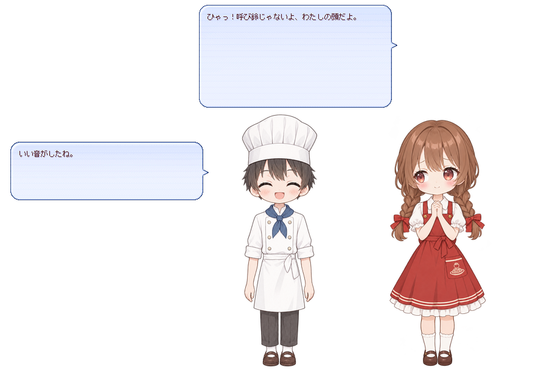

# 8 段目：触ったら反応してほしい

> 【不安】撫でられても知らん顔では、可愛げがありませんわね……。あの子たち、いまは触られても何も返しませんのよ。

> 【アンソニー】お嬢様は、お帽子を直して差し上げるだけで、たいそう驚かれますが。

> 【照れ怒り】あ、あれは不意を突かれただけですわ！ 今日は、あの子たちにも、触られたら応えることを教えますのよ。

---

## 叶えたいこと

- 叶うこと: キャラクターをつつく（ダブルクリックする）か撫でると、2 人が反応する。誰のどこを触ったかで、反応が変わる
- この章で足すファイル: `ghost/master/dic/08-touch.pasta`

## 辞書を書く

エディタのツリーで `dic` を右クリックして「新しいファイル」を選び、`08-touch.pasta` という名前で次の内容を書く。

```pasta
＃ 8 段目：触ったら反応してほしい
＃ キャラクターをダブルクリックする（つつく）と、「つっつき反応」に続けて名前を付けたシーンが呼ばれる。
＃ 名前の後ろに、アクター名と部位の名前（シェルが当たり判定に付けた名前。頭なら Head）を続けると、
＃ 誰のどこを触ったかで台詞を変えられる。pasta は次の順に名前を探し、最初に見つかったシーンを呼ぶ。
＃ 　つっつき反応女の子Head（アクター＋部位）→ つっつき反応女の子その他（アクターのどこでも）
＃ 　→ つっつき反応Head（部位だけ。誰の頭でも）→ つっつき反応その他（どこを触っても）
＃ 当たり判定の外（足元など）を触ったときは、部位の名前が付いた段を飛ばして次を探す。
＃ 同じ名前のシーンをいくつか書くと、その中から 1 つが選ばれる。
＃ 当たり判定の上をマウスで 2 秒撫でると、「さわり反応」に続けて名前を付けたシーンが同じ順で呼ばれる。しゃべっている間は撫でても反応しない。

＃ 女の子の頭をつついたとき
＊つっつき反応女の子Head
　女の子：＠驚き　ひゃっ！\w9＠照れ　呼び鈴じゃないよ、わたしの頭だよ。
　男の子：＠笑顔　いい音がしたね。

＃ 男の子は、どこをつついてもこのシーン
＊つっつき反応男の子その他
　男の子：＠困惑　わっ。ぼくは食材じゃないよ。
　女の子：＠笑顔　鮮度をたしかめてるんだよ。

＃ 顔をつついたとき（男の子の顔は、上の「男の子その他」で止まるので、ここに来るのは女の子だけ）
＊つっつき反応Face
　女の子：＠怒り　ほっぺたは、つつかないで～！
　男の子：＠通常　パン生地みたいだもんね。

＃ それ以外のどこか（女の子の体や足元）
＊つっつき反応その他
　女の子：＠通常　ん？　おかわり？
　男の子：＠困惑　まだ何も出してないよ。

＃ 女の子の頭を撫でたとき
＊さわり反応女の子Head
　女の子：＠照れ　えへへ……なでなでされちゃった。
　男の子：＠笑顔　チップより、うれしそうだね。

＃ それ以外の所（女の子の顔や体、男の子のどこか）を撫でたとき
＊さわり反応その他
　女の子：＠キラキラ　くすぐったいってば！
　男の子：＠照れ　……なでても、大盛りにはならないよ。
```

### つついたときに呼ばれるシーン

| 行 | 意味 |
| -- | ---- |
| `＊つっつき反応女の子Head` | 女の子の頭をつついたときに呼ばれるシーン。`つっつき反応` の後ろに、アクター名と部位の名前を続ける |
| `＊つっつき反応男の子その他` | 部位の名前の代わりに `その他` と書くと、そのアクターのどこをつついても呼ばれる |
| `＊つっつき反応Face` | アクター名を省くと、誰の顔をつついても呼ばれる |
| `＊つっつき反応その他` | 誰のどこをつついても呼ばれる |
| `＊さわり反応女の子Head` など | 撫でたときに呼ばれるシーン。名前の付け方も探す順も、つっつき反応と同じである |

- 部位の名前は、シェルが立ち絵の当たり判定に付けた名前で、1 文字も違わずに書く。見本のシェルは、頭に `Head`、顔に `Face`、体に `Body` と付けている。
- 撫でるとは、ボタンを押さずに、当たり判定の上でマウスを動かし続けることである。撫で始めて 2 秒たった後の、最初のマウスの動きでシーンが呼ばれる。
- 当たり判定の名前と、足す・直す方法は、[シェルを自分の絵にする](../reference/shell.md#当たり判定を足す直す) にある。

> 【アンソニー】お嬢様、`女の子Head` と `その他` の両方に当たるときは、どちらが呼ばれるのでございましょう。

> 【にっこり】細かい名前のほうが先ですわ。6 段目の `＊時報その他` と同じで、ぴったりの名前が無いときだけ、大まかな名前の出番になりますのよ。

| 探す順 | シーンの名前 | 当たる操作 |
| ------ | ------------ | ---------- |
| 1 | `つっつき反応女の子Head`（アクター＋部位） | 女の子の頭をつつく |
| 2 | `つっつき反応女の子その他`（アクターのどこでも） | 女の子のどこかをつつく |
| 3 | `つっつき反応Head`（部位だけ） | 誰かの頭をつつく |
| 4 | `つっつき反応その他`（どこを触っても） | どこかをつつく |

- 上の表は、女の子の頭をつついたときに探す名前である。pasta は、最初に見つかったシーンを呼ぶ。
- 当たり判定の外（足元など）をつついたときは、部位の名前が付いた段（1 と 3）を飛ばして探す。
- 男の子の顔をつつくと、`＊つっつき反応Face` より先に、2 番目の `＊つっつき反応男の子その他` が見つかる。

| イベント | いつ来るか（UKADOC より） | この段で使う Reference（UKADOC より） |
| -------- | ------------------------- | ------------------------------------- |
| [`OnMouseDoubleClick`](https://ssp.shillest.net/ukadoc/manual/list_shiori_event.html#OnMouseDoubleClick) | 「左・右ボタンでダブルクリックされた際に発生。」 | `Reference3` —「本体の場合は0、相方の場合は1。」、`Reference4` —「当たり判定の識別子。」 |
| [`OnMouseMove`](https://ssp.shillest.net/ukadoc/manual/list_shiori_event.html#OnMouseMove) | 「マウスが移動した際に発生。」 | `Reference3` —「本体の場合は0、相方の場合は1。」、`Reference4` —「当たり判定の識別子。」 |

- どちらのイベントも pasta が受け取って、上の順でシーンを探す。`Reference3` の `0` を女の子、`1` を男の子に読み替え、`Reference4` を部位の名前として使う。

## 確かめる

1. `＊つっつき反応女の子Head` の行のすぐ上に出ている「▶ シーンを実行」を押す。
2. 女の子の頭をダブルクリックする。
3. 男の子の体をダブルクリックする。
4. 女の子の顔をダブルクリックする。
5. 女の子の足元（当たり判定の外）をダブルクリックする。
6. 話し終わるのを待ってから、女の子の頭の上で、ボタンを押さずにマウスを 2 秒以上ゆっくり動かし続ける。
7. 話し終わるのを待ってから、男の子の頭の上で、手順 6 と同じようにマウスを動かし続ける。

- 手順 1 の ▶ が、足した辞書を保存して読み込ませる。
- 成功の目印: 手順ごとに、次の表の台詞が出る

| 手順 | 呼ばれるシーン | 台詞 |
| ---- | -------------- | ---- |
| 1・2 | `＊つっつき反応女の子Head` | 女の子「ひゃっ！呼び鈴じゃないよ、わたしの頭だよ。」、男の子「いい音がしたね。」 |
| 3 | `＊つっつき反応男の子その他` | 男の子「わっ。ぼくは食材じゃないよ。」、女の子「鮮度をたしかめてるんだよ。」 |
| 4 | `＊つっつき反応Face` | 女の子「ほっぺたは、つつかないで～！」、男の子「パン生地みたいだもんね。」 |
| 5 | `＊つっつき反応その他` | 女の子「ん？　おかわり？」、男の子「まだ何も出してないよ。」 |
| 6 | `＊さわり反応女の子Head` | 女の子「えへへ……なでなでされちゃった。」、男の子「チップより、うれしそうだね。」 |
| 7 | `＊さわり反応その他` | 女の子「くすぐったいってば！」、男の子「……なでても、大盛りにはならないよ。」 |




- 手順 6・7 で反応しないときは、まだしゃべっている間に撫でている。話し終わってから、もう一度撫でる。

## もっと詳しく

- [つつき・撫でのショートカット（名前を探す順の全部・撫での決まり）](../lua/shiori-events.md#つつき撫でのショートカット)
- [OnMouseDoubleClick](../lua/shiori-events.md#onmousedoubleclick)

---

> 【高笑い】おほほほ！ 触れば応える。これでこそ、傍に置く甲斐がありますわ！

> 【アンソニー】お嬢様、あまり続けて触りますと、あの子たちも目を回します。

> 【不機嫌】フンッ、加減くらい心得ていますわ。次は、あの子たちのほうから尋ねて、お客様に選んでいただきますわよ。
