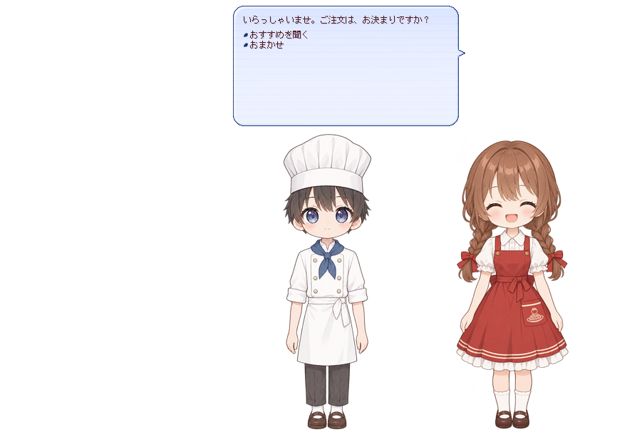
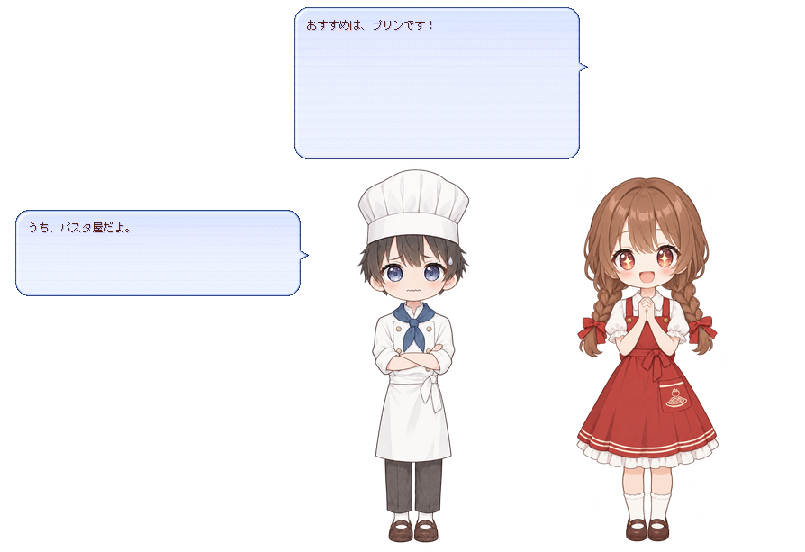

# 9 段目：選ばせたい

> 【したり顔】分かれ道をご用意いたしますわ。話してばかりのあの子たちに、今日は尋ねることを覚えさせますのよ。

> 【アンソニー】お嬢様のお尋ねは、いつも答えがひとつしか用意されておりませんが。

> 【冷笑】あら、迷わずに済んで親切でしょう？ あの子たちのほうは、ちゃんと選べるようにいたしますわよ。

---

## 叶えたいこと

- 叶うこと: 女の子が注文を聞いて、選択肢を出す。選択肢を選ぶと、選んだ先の掛け合いが始まる
- この章で足すファイル: `ghost/master/dic/09-choice.pasta`

## 辞書を書く

エディタのツリーで `dic` を右クリックして「新しいファイル」を選び、`09-choice.pasta` という名前で次の内容を書く。

```pasta
＃ 9 段目：選ばせたい
＃ ＠？ジャンプ先「表示」 と書くと、選択肢が出る。選ばれると、ジャンプ先と同じ名前のシーンへ進む。
＃ 「表示」を省くと、ジャンプ先の名前がそのまま選択肢に出る。
＃ !select(秒) で、選択肢の制限時間を秒で決める。
＃ この ＊つっつき反応その他 は 8 段目と同じ名前なので、8 段目の「その他」に当たる所（女の子の体など）をつつくたびに、8 段目の反応とこの選択肢のどちらかが選ばれる。

＊つっつき反応その他
　女の子：＠笑顔　いらっしゃいませ。ご注文は、お決まりですか？
　＠？本日のおすすめ「おすすめを聞く」
　＠？おまかせ
　!select(10)

＃ 選択肢のジャンプ先。ジャンプ先の名前でシーンを書いておく。
＊本日のおすすめ
　女の子：＠キラキラ　おすすめは、プリンです！
　男の子：＠困惑　うち、パスタ屋だよ。

＊おまかせ
　男の子：＠キラキラ　おまかせだね。腕が鳴るなあ！
　女の子：＠困惑　……前のおまかせ、三時間かかったよね。
```

| 行 | 意味 |
| -- | ---- |
| `　＠？本日のおすすめ「おすすめを聞く」` | 選択肢行。選択肢「おすすめを聞く」を出し、選ばれると `本日のおすすめ` という名前のシーンへ進む |
| `　＠？おまかせ` | `「表示」` を省いた選択肢行。ジャンプ先の名前が、そのまま選択肢に出る |
| `　!select(10)` | キューコマンド行。選択肢の制限時間を 10 秒にする |
| `＊本日のおすすめ`・`＊おまかせ` | 選択肢のジャンプ先のシーン |

- 選択肢行は、行の頭を字下げして `＠？ジャンプ先「表示」` の形で書き、出したい選択肢の数だけ並べる。
- ジャンプ先の名前と `「` の間に、空白は置けない。`!` と `select` と `(10)` の間にも、空白は入れない。
- 制限時間のうちに選ばれなかった選択肢は時間切れになり、どのジャンプ先へも進まない。
- この章の `＊つっつき反応その他` は、8 段目のものと同じ名前である。女の子の体か足元をつつくたびに、8 段目の反応とこの章の選択肢の、どちらか 1 つが選ばれる。

> 【アンソニー】お嬢様、選ばれたあとの道案内は、どなたがなさるのでございますか。

> 【にっこり】pasta にお任せなさいまし。あなたは、ジャンプ先の名前でシーンを書いておくだけでよろしいのよ。

- 選択肢が選ばれると、ベースウェアは `OnChoiceSelectEx` を送ってくる。
- pasta はこのイベントを受け取り、選ばれた選択肢のジャンプ先と同じ名前のシーンへ進む。この仕組みを、自動ルーティングと呼ぶ。
- `＊OnChoiceSelectEx` という名前のシーンは、書かなくてよい。書くと、自動ルーティングの代わりに、そのシーンが実行される。

| 選択肢行 | `Reference0`（選択肢に出る文字） | `Reference1`（選択肢の ID） | 選ばれると進むシーン |
| -------- | -------------------------------- | --------------------------- | -------------------- |
| `＠？本日のおすすめ「おすすめを聞く」` | `おすすめを聞く` | `本日のおすすめ` | `＊本日のおすすめ` |
| `＠？おまかせ` | `おまかせ` | `おまかせ` | `＊おまかせ` |

| イベント | いつ来るか（UKADOC より） | この段で使う Reference（UKADOC より） |
| -------- | ------------------------- | ------------------------------------- |
| [`OnChoiceSelectEx`](https://ssp.shillest.net/ukadoc/manual/list_shiori_event.html#OnChoiceSelectEx) | 「選択肢が選択された際に発生。」 | `Reference0` —「選択肢のテキスト（ラベル）。」、`Reference1` —「選択肢のID。」 |

## 確かめる

1. `＊つっつき反応その他` の行のすぐ上に出ている「▶ シーンを実行」を押す。
2. 選択肢「おすすめを聞く」をクリックする。
3. もう一度 ▶ を押し、選択肢「おまかせ」をクリックする。
4. もう一度 ▶ を押し、何も選ばずに 10 秒待つ。
5. 女の子の体を、何度かダブルクリックする。

- 成功の目印（手順 1）: 女の子の吹き出しに「いらっしゃいませ。ご注文は、お決まりですか？」と出て、続けて選択肢「おすすめを聞く」と「おまかせ」が出る



- 成功の目印（手順 2）: 女の子「おすすめは、プリンです！」、男の子「うち、パスタ屋だよ。」と出る



- 成功の目印（手順 3）: 男の子「おまかせだね。腕が鳴るなあ！」、女の子「……前のおまかせ、三時間かかったよね。」と出る
- 成功の目印（手順 4）: 選択肢が時間切れになり、どちらの掛け合いも出ない
- 成功の目印（手順 5）: つつくたびに、8 段目の反応（女の子「ん？　おかわり？」）か、この章の選択肢のどちらかが出る。2 つを一巡するあいだに、選択肢は 1 回出る

## もっと詳しく

- [選択肢行（`＠？ジャンプ先「表示」`）](../grammar/block-structure.md#選択肢行)
- [キューコマンド行（`!select(秒)`）](../grammar/block-structure.md#キューコマンド行)
- [OnChoiceSelectEx（選ばれた ID のシーンへの自動ルーティング）](../lua/shiori-events.md#onchoiceselectex)

---

> 【にっこり】尋ねて、選んでいただいて、話が進む。ようやく会話らしくなってきましたわね。

> 【アンソニー】先ほどお嬢様が何をお選びになったか、あの子たちは覚えているのでございましょうか。

> 【落胆】それが、きれいさっぱり忘れていますのよ……。次は、終了しても消えない記憶を持たせますわ。
