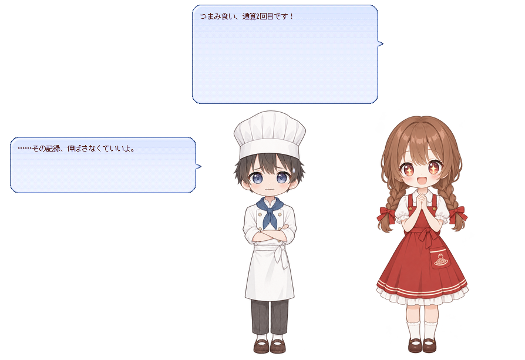

# 10 段目：覚えていてほしい

> 【考え中】物覚えのよい子に育てるには、どうしたものかしら……。いまのあの子たちは、SSP を閉じたら何もかも忘れてしまいますのよ。

> 【アンソニー】お嬢様は、私が 3 年前に割った茶器のことを、いまも覚えておいででございますが。

> 【不機嫌】フンッ、あれは一番のお気に入りでしたもの。今日は、あの子たちにも、消えない記憶を授けますわよ。

---

## 叶えたいこと

- 叶うこと: 女の子が、つまみ食いの回数を数える。ゴーストを終了しても、数は続きから増える
- この章で足すファイル: `ghost/master/dic/10-save.pasta`

## 辞書を書く

`ghost/master/dic/10-save.pasta` を作り、次の内容を書く。

```pasta
＃ 10 段目：覚えていてほしい
＃ ＄＊名前 は、ゴーストを終了しても値が残る変数（グローバル変数）。
＃ ＄＊回数＝＄＊回数＋１ は、いまの値に 1 を足して入れ直す。まだ何も入れていない変数は計算では 0 とみなされるので、初めては 1 になる。
＃ この会話が選ばれるたびに数が 1 つ増える。ゴーストを終了して起動し直しても、数は続きから増えていく。

＊会話
　＄＊回数＝＄＊回数＋１
　女の子：＠キラキラ　つまみ食い、通算＄＊回数　回目です！
　男の子：＠困惑　……その記録、伸ばさなくていいよ。
```

| 行 | 意味 |
| -- | ---- |
| `＄＊回数` | グローバル変数。`＄` のすぐ後ろに `＊` を付けた変数は、ゴーストを終了しても値が残る |
| `　＄＊回数＝＄＊回数＋１` | 代入の行。`＝` の右の値を、左の変数に入れる。ここでは、いまの値に 1 を足して入れ直す |
| 台詞の中の `＄＊回数` | その場所に変数の値が入る。後ろに空白を置いて、続く台詞と区切る |

- pasta-recipe では、ツリーの `dic` を右クリックして「新しいファイル」を選ぶ。
- 1〜9 段目のファイルは書き換えない。
- まだ値を入れていない変数は、計算では 0 とみなされるので、初めての数は 1 になる。
- 値を保存するための行は要らない。

> 【アンソニー】お嬢様、数を 0 に戻す行が見当たりませんが。

> 【したり顔】戻しませんのよ。つまみ食いの記録は、伸びる一方ですもの。

## 確かめる

1. `10-save.pasta` の `＊会話` の行のすぐ上に出ている「▶ シーンを実行」を押す。
2. もう一度「▶ シーンを実行」を押す。
3. SSP を終了し、もう一度起動してから、「▶ シーンを実行」を押す。

- 成功の目印（手順 1）: 女の子「つまみ食い、通算1回目です！」、男の子「……その記録、伸ばさなくていいよ。」と出る
- 成功の目印（手順 2）: 女の子の数が「2回目」になる
- 成功の目印（手順 3）: 女の子の数が「3回目」になる。1 に戻っていなければ、値は終了しても残っている
- ▶ は、押すたびに辞書を読み込み直す。それでも数が 1 に戻らないのは、値が保存されているからである。
- 今の値は、エディタの「保存変数を表示」で見られる。pasta-recipe では表に、VS Code では出力のパネルに `回数` の値が出る。
- このシーンの名前は `会話` なので、暇なときのおしゃべりでも出て、そのたびに数が 1 つ増える。



## もっと詳しく

- [グローバル変数（`＄＊回数`）](../grammar/variables.md#グローバル変数)
- [値が無いときの扱い（まだ値を入れていない変数は、算術で 0 とみなされる）](../grammar/variables.md#値が無いときの扱い)

---

> 【目閉じ】閉じても、また開いても、数は続きから。ささやかな記憶でも、あるとないとでは大ちがいですわ。

> 【アンソニー】では、お嬢様がお茶菓子をつまみ食いなさった回数も、あの子たちに数えさせましょう。

> 【照れ怒り】か、数えなくてよろしいですわ、そんなもの！ 次は、ひとつの話を先へ続けたり、行き先を変えたりしてみせますわよ。
