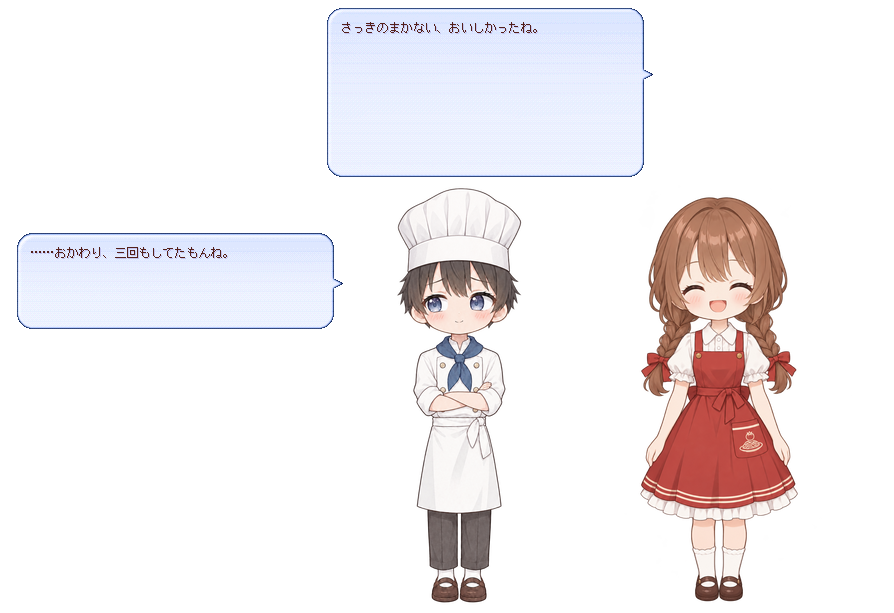

# 11 段目：話を続けたい・分岐させたい

> 【クローディア】話の寄り道と、続きのお預けを授けますわ。ひと息に話して終わるばかりのあの子たちに、今日は行き先のくじ引きを持たせますのよ。

> 【アンソニー】お嬢様の寄り道は、たいてい日が暮れるまでお戻りになりませんが。

> 【高笑い】おほほほ！ 戻ってくるだけ上出来ですわ！ あの子たちの寄り道も、ちゃんと元の話へ戻らせますわよ。

---

## 叶えたいこと

- 叶うこと: おしゃべりが別のシーンへ寄り道して、元の話に戻る。行き先はそのたびに選ばれ、話の続きは次のおしゃべりで話す
- この章で足すファイル: `ghost/master/dic/11-jump.pasta`

## 辞書を書く

`ghost/master/dic/11-jump.pasta` を作り、次の内容を書く。

```pasta
＃ 11 段目：話を続けたい・分岐させたい
＃ ＞シーン名 と書くと、そのシーンを呼んで話を続ける（Call）。呼んだシーンが終わると、次の行に戻ってくる。
＃ 呼び先は、名前の頭が一致するシーンから探す。＞まかない は、名前が「まかない」で始まるシーンをすべて候補にして、そこから 1 つを選ぶ。
＃ ＞チェイントーク と書くと、話はそこでいったん区切られる。続きは、次に暇なときに話す。

＊会話
　女の子：＠キラキラ　ねえ、今日のまかない、なあに？
　男の子：＠通常　ふふん、今日はね……
　＞まかない
　＞チェイントーク
　女の子：＠笑顔　さっきのまかない、おいしかったね。
　男の子：＠照れ　……おかわり、三回もしてたもんね。

＃ ＞まかない の呼び先。呼ばれるたびに、この 3 つのどれかが選ばれる。
＊まかないナポリタン
　男の子：＠笑顔　ナポリタンだよ。
　女の子：＠キラキラ　大盛りで！　……あ、お客さんの気分だった。

＊まかないペペロンチーノ
　男の子：＠通常　ペペロンチーノ。具は、なし。
　女の子：＠困惑　……お給料日前だもんね。

＊まかない試作
　男の子：＠キラキラ　新作の試作だよ。名前は、まだない。
　女の子：＠困惑　……味は、あるんだよね？

＃ シーンの中に ・名前 と書くと、そのシーンの中だけで呼べるローカルシーンになる。
＃ ＞まかない で探せるローカルシーンがあると、ローカルシーンが先に選ばれる。上の ＊まかないナポリタン などは選ばれない。
＊会話
　女の子：＠通常　今日のまかないも、楽しみだなあ。
　＞まかない

　・まかない
　　男の子：＠困惑　今日は、きみが作る番だよ。
　　女の子：＠泣き　えー、食べる係がいいのに。
```

| 行 | 意味 |
| -- | ---- |
| `　＞まかない` | Call。その名前のシーンを呼んで話を続け、呼んだシーンが終わると次の行に戻る |
| 呼び先の探し方 | 名前の頭が一致するシーンをすべて候補にして、1 つを選ぶ（前方一致） |
| `　＞チェイントーク` | 話をそこで区切る。前の台詞はその場で話し、後ろの台詞は次に暇なときに話す |
| `　・まかない` | ローカルシーン。書いたシーンの中からだけ呼べる |

| `＞まかない` を書いたシーン | 呼ばれるシーン |
| --------------------------- | -------------- |
| 1 つ目の `＊会話` | `＊まかないナポリタン`・`＊まかないペペロンチーノ`・`＊まかない試作` のどれか 1 つ |
| 2 つ目の `＊会話` | `・まかない`（探せるローカルシーンがあると、そちらが先に選ばれる） |

- pasta-recipe では、ツリーの `dic` を右クリックして「新しいファイル」を選ぶ。
- 1〜10 段目のファイルは書き換えない。
- `＊まかないナポリタン` などは、名前が `会話` ではないので、暇なときには出ない。
- 2 つの `＊会話` は別々のシーンで、`・まかない` を呼べるのは 2 つ目だけである。

> 【アンソニー】お嬢様、`＊まかない` というシーンは、どこにも見当たりませんが。

> 【にっこり】それでよろしいのよ。名前の頭さえ合っていれば、3 つとも候補になりますの。行き先のくじ引きの出来上がりですわ。

## 確かめる

1. 1 つ目の `＊会話` の行のすぐ上に出ている「▶ シーンを実行」を押す。
2. ゴーストに触らずに、次のおしゃべりを待つ。
3. 2 つ目の `＊会話` の行のすぐ上に出ている「▶ シーンを実行」を押す。

- 成功の目印（手順 1）: 女の子「ねえ、今日のまかない、なあに？」、男の子「ふふん、今日はね……」に続けて、次のどれか 1 つが出る
  - 男の子「ナポリタンだよ。」、女の子「大盛りで！　……あ、お客さんの気分だった。」
  - 男の子「ペペロンチーノ。具は、なし。」、女の子「……お給料日前だもんね。」
  - 男の子「新作の試作だよ。名前は、まだない。」、女の子「……味は、あるんだよね？」


- 成功の目印（手順 2）: 次のおしゃべりで、女の子「さっきのまかない、おいしかったね。」、男の子「……おかわり、三回もしてたもんね。」と出る



- 成功の目印（手順 3）: 女の子「今日のまかないも、楽しみだなあ。」、男の子「今日は、きみが作る番だよ。」、女の子「えー、食べる係がいいのに。」の順に出る。ナポリタンなどの掛け合いは出ない
- 手順 1 の ▶ を押し直すたびに、行き先は 3 つのどれか 1 つになる。
- 続きが出るのは、ゴーストが自分から始める次のおしゃべりである。間隔は [2 段目](02-talk.md) で決めた。
- 手順 2 で続きが出ないときは、待っているあいだに別の台詞が出ている。つつきの反応や時報が台詞を出すか、別の ▶ を押すと、待っていた続きは捨てられるので、手順 1 からやり直す。

> 【不安】続きを待つあいだは、あの子たちに触らないでくださいまし。話の腰を折ると、続きは消えてしまいますの……。

> 【アンソニー】お嬢様も、お話の途中で口を挟まれると、続きを忘れておしまいになります。

## もっと詳しく

- [Call（`＞シーン名` でシーンを呼ぶ）](../grammar/call-jump.md)
- [前方一致によるターゲット解決（名前の頭が一致するシーンが候補になる）](../grammar/call-jump.md#前方一致によるターゲット解決)
- [ローカルシーン（`・名前`）](../grammar/block-structure.md#ローカルシーン)
- [チェイントーク（`＞チェイントーク`）](../grammar/call-jump.md#チェイントーク)
- [スコープ解決アルゴリズム（ローカルシーンが先に選ばれる）](../grammar/call-jump.md#スコープ解決アルゴリズム)

---

> 【したり顔】呼んで、戻って、区切って、また続ける。話の運びは、もうあなたの思いのままですわね。

> 【アンソニー】行き先がくじ引きでは、お供をする身としましては気が休まりません。

> 【にっこり】ご安心なさいまし。次は、行き先を決める役を Lua に任せる、もっと凝った仕掛けをお見せしますわ。
