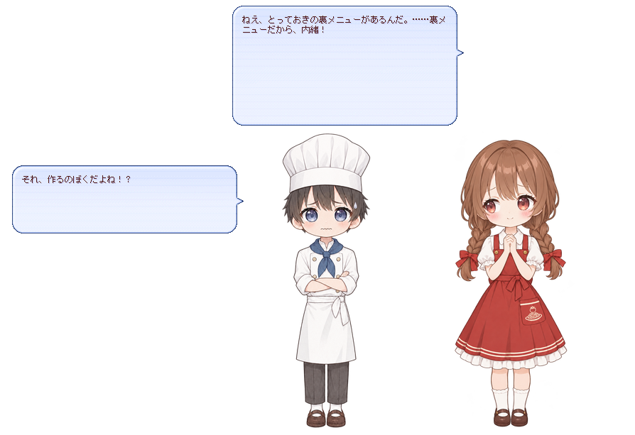

# 12 段目：もっと凝ったことをしたい

> 【冷笑】奥の手をお見せする頃合いですわ。ここまでの書き方では物足りなくなってきた、欲張りなあなたのために。

> 【アンソニー】お嬢様、奥の手とは、最後まで取っておくものではございませんか。

> 【にっこり】もう 12 段目ですもの、出し惜しみはいたしませんわ。辞書の中に、Lua をほんの 3 行だけ書きますのよ。

---

## 叶えたいこと

- 叶うこと: 辞書の中に Lua の関数を書き、話の行き先をその関数に決めさせる
- この章で足すファイル: `ghost/master/dic/12-lua.pasta`

## 辞書を書く

`ghost/master/dic/12-lua.pasta` を作り、次の内容を書く。

````pasta
＃ 12 段目：もっと凝ったことをしたい
＃ シーンの中に ```lua と ``` で囲んだ Lua のブロックを書くと、そのシーンで使う関数を作れる。フェンスの行（```lua と ```）は字下げしない。
＃ function SCENE.名前(act) で作った関数は、＞＠名前（） で呼べる。関数が返した名前のシーンへ話が続く。
＃ ここでは決まった名前を返すだけ。条件で話を分けるだけなら Lua は要らない。シーンに条件を書けばよい。

＊会話
```lua
function SCENE.次の話(act)
    return "とっておき"
end
```
　女の子：＠キラキラ　ねえ、とっておきの裏メニューがあるんだ。
　＞＠次の話（）

　・とっておき
　　女の子：＠照れ　……裏メニューだから、内緒！
　　男の子：＠困惑　それ、作るのぼくだよね！？
````

| 行 | 意味 |
| -- | ---- |
| バッククォート 3 つの行（フェンス）で囲んだ部分 | Lua のブロック。始まりのフェンスには、すぐ後ろに `lua` と書く。フェンスの行は字下げしない |
| `function SCENE.次の話(act)` から `end` まで | 関数を 1 つ作る。`次の話` が関数の名前になる。`act` は pasta から受け取るもので、この章では使わない |
| `return "とっておき"` | 関数が返す値。ここでは、`とっておき` という名前を返す |
| `　＞＠次の話（）` | 関数を呼び、関数が返した名前のシーンへ話を続ける。`（）` は省けない |

- pasta-recipe では、ツリーの `dic` を右クリックして「新しいファイル」を選ぶ。
- 1〜11 段目のファイルは書き換えない。
- Lua は、プログラミング言語の名前である。
- `・とっておき` は 11 段目のローカルシーンで、名前を関数が返す名前と同じにしてある。

> 【アンソニー】お嬢様、決まった名前を返すだけでしたら、`＞とっておき` と書けば済むのではございませんか。

> 【したり顔】よいところを突きますわね。この関数は、ただの稽古台ですの。条件で話を分けるだけなら Lua は要りませんし、Lua の本当の出番は、もっと込み入った仕掛けですのよ。

## 確かめる

1. `12-lua.pasta` の `＊会話` の行のすぐ上に出ている「▶ シーンを実行」を押す。

- 成功の目印: 女の子「ねえ、とっておきの裏メニューがあるんだ。」「……裏メニューだから、内緒！」、男の子「それ、作るのぼくだよね！？」の順に出る
- 後ろの 2 つは `・とっておき` の台詞である。この 2 つが出ていれば、関数が呼ばれて、関数が返した名前のシーンへ話が続いている。
- 辞書に波線が出るときは、フェンスの行を字下げしていないかを確かめる。



## もっと詳しく

- [Lua ブロックの配置（シーンの中の Lua のブロックと、フェンスの書き方）](../grammar/block-structure.md#lua-ブロックの配置)
- [Call ターゲットの形式（`＞＠名前（）` のように、呼び先の名前を式で決める書き方）](../grammar/call-jump.md#call-ターゲットの形式)
- [条件で候補を絞る（条件で話を分けるときは、Lua を使わずシーンに条件を書く）](../grammar/block-structure.md#条件で候補を絞る)
- [Lua マニュアル概要（もっと込み入ったことを Lua で書くときの入口）](../lua/index.md)

---

> 【驚き】まあ！ とうとう Lua にまで手が届きましたのね。これで 12 枚目の辞書もそろいましたわ。

> 【アンソニー】ところでお嬢様の「とっておきの裏メニュー」は、いつお出しいただけるのでございましょう。

> 【目閉じ】それは、まだ内緒ですわ。次は、あの子たちに季節の行事を祝わせますわよ。
