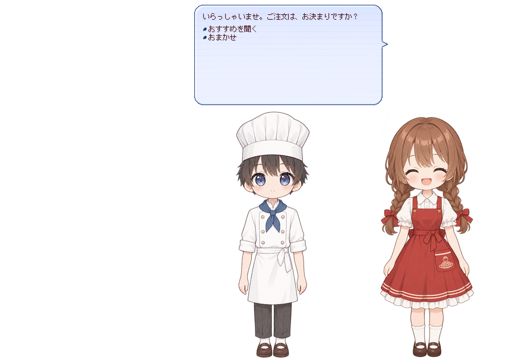

# 入門ガイド

> 【お辞儀】旅の地図をお渡しいたしますわ。入門ガイドへようこそ。このガイドでは、読むより先に、まず動かしていただきますのよ。

> 【アンソニー】プログラミングに触れたことのない方も、お見えのようでございます。

> 【にっこり】ご心配なく。最初の 5 分で、あの子たちはもう、あなたの書いたとおりにしゃべりますわ。

---

## このガイドで作るもの

- 自分で名前を付けたゴースト（デスクトップに立ってしゃべるキャラクター）を 1 体作り、14 段かけて育てる。
- 1 段ごとに、「こんな表現をしたい」を 1 つ叶える。
- 完成した姿の見本が、サンプルゴースト hello-pasta である。
- 要るものは、SSP（Windows でゴーストを動かすソフト）と、辞書を書くエディタの 2 つで、どちらも最初の章で入れる。

## このガイドの進め方

- 1 章で 1 段進む。2〜13 段目は、1 段ごとに辞書ファイルを 1 つ足す。
- 書いたら、エディタの「▶ シーンを実行」を押して、その場でしゃべらせる。
- 詳しい文法は、各章の「もっと詳しく」からリファレンスへ飛ぶ。

> 【アンソニー】お嬢様、気になる章から先に読んでも、よろしいのでございましょうか。

> 【クローディア】いいえ、一覧の順がいちばんの早道ですわ。どの段も、前の段までのファイルがそろっているものとして書いてありますのよ。

## 章の一覧

| 段 | 章 | 叶うこと |
| -- | -- | -------- |
| はじめに | [まず会ってみる](hello.md) | 見本のゴーストを入れて、台詞を 1 行書き換えて、そのとおりにしゃべらせる |
| はじめに | [自分のゴーストを始める](setup.md) | 自分のゴーストを SSP に入れる |
| 1 | [1 段目：しゃべらせたい](01-boot.md) | 起動したら一言しゃべる |
| 2 | [2 段目：二人で掛け合いさせたい](02-talk.md) | 暇なときに 2 人でおしゃべりする |
| 3 | [3 段目：表情を変えたい](03-face.md) | 台詞ごとに表情を付ける |
| 4 | [4 段目：毎回ちがうことを言わせたい](04-variety.md) | 同じ名前のシーンから 1 つ選ばれる |
| 5 | [5 段目：単語でちょこっと変えたい](05-words.md) | 単語がランダムに選ばれる |
| 6 | [6 段目：時刻を知らせたい](06-hour.md) | 正時に時報を話す |
| 7 | [7 段目：挨拶したい](07-greeting.md) | ゴーストが切り替わるとき・初めて起動したとき・閉じるときに挨拶する |
| 8 | [8 段目：触ったら反応してほしい](08-touch.md) | 触られた部位とキャラで台詞を変える |
| 9 | [9 段目：選ばせたい](09-choice.md) | 選択肢を出して選ばれた先へ進む |
| 10 | [10 段目：覚えていてほしい](10-save.md) | 終了しても値が残る |
| 11 | [11 段目：話を続けたい・分岐させたい](11-jump.md) | 話の続きを話す・ランダムにジャンプする |
| 12 | [12 段目：もっと凝ったことをしたい](12-lua.md) | Lua の関数を呼ぶ |
| 13 | [13 段目：季節の行事でしゃべらせたい](13-calendar.md) | 今日の行事で話を変える |
| 14 | [14 段目：配布したい](14-nar.md) | `.nar` にして配る |
| 付録 | [フォルダの中身と文字コード](prerequisites.md) | つまずいたときに、フォルダの中身と文字コードの約束を確かめる |

- 最初に読む章は、[まず会ってみる](hello.md) である。

## 作りこんだ実例

- [emo2](https://ekicyou.github.io/ghost_dev/emo2/) は、pasta.dll で作りこまれたショーケースのゴーストである。
- このガイドでは、[7 段目](07-greeting.md) で、ゴーストを切り替えるときの相手役として招く。

## このガイドの先にあるもの

- [文法リファレンス概要](../grammar/index.md) — 書き方を体系立てて知りたくなったら。
- [Lua マニュアル概要](../lua/index.md) — もっと込み入った仕掛けを書きたくなったら。
- [編集ツールとデバッグの概要](../debug/index.md) — エディタをもっと使いこなしたくなったら。

---

> 【クローディア】準備はよろしくて？ 難しい話は、動かしたあとで十分間に合いますのよ。

> 【アンソニー】お嬢様、ずいぶんと面倒見のよろしいことで。

> 【不機嫌】フンッ、別にあなたが心配だからではありませんわよ。さあ、まずはあの子たちに会いに参りましょう。
