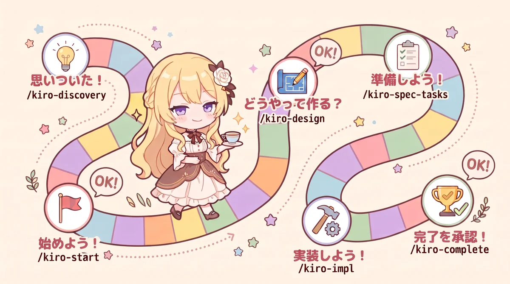
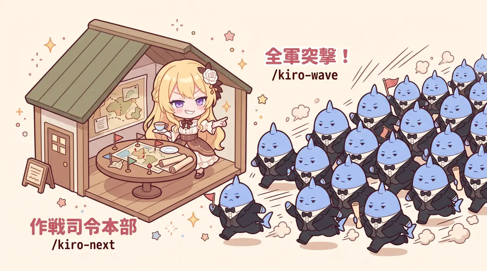

# cc-sdd で回す pasta の開発ワークフロー

> 【したり顔】pasta が毎日どんな手順で作られているのか。今日は舞台裏をお見せしますわ。

> 【アンソニー】お嬢様、それはゴーストづくりのお役には立たないのではございませんか。

> 【目閉じ】ええ、ゴーストを作るだけなら読まなくてよろしくてよ。けれど、どんな手順で育てられてきたかを知れば、pasta の手触りの理由が少し見えてきますの。

---

## この記事について

pastaリポジトリの開発は基本的に令嬢（Claude Code）が主体となってコードを書いています。でも、単純なバイブコーディングではありません。[cc-sdd](https://github.com/gotalab/cc-sdd)（v3.1.0）を土台にした、「仕様駆動開発」ってのを行っています。

仕様駆動ってなんぞや？と疑問になった人はごめんなさい！ここではあえて説明しません！この記事では仕様駆動の本質にはまったく触れずにｗ、どんな風にpasta開発が進んでいるのか、紹介します。



## 思いついた！`/kiro-discovery`

開発のきっかけは些細な思い付きだったり、忘れてたことを思い出したりして気になったりすることから始まります。思いついたら、`/kiro-discovery （アイデアとか要望とか）`を、令嬢に伝えてください。

```sh
/kiro-discovery シーンに属性つけたいな！
```

堅苦しい文体とか作法なんて気にせず、思いついたままプロンプトを打てば、あとは令嬢が良い感じに質問してくれて、specを作って名前を付けてくれます（例：scene-attr）。この名前が開発の基本単位になります。思いついたことを書き終わったら、PRしてマージしましょう。これで、リポジトリが貴方のアイデアを覚えてくれます。いつかきっと、実現されます。

## 始めよう！何を作ろうか！`/kiro-start {spec}`

specが溜まってきたら、`/kiro-discovery 次は何を始めればいい？`って聞いてみてください。令嬢はきっと`/kiro-start scene-attr`がよいよ！って教えてくれます。さあ、開発を始めましょう。

```sh
/kiro-start scene-attr
```

‥‥長考が始まりますのでトイレにでも行きましょう。`/kiro-start`は標準のcc-sddには存在しないリポジトリ拡張です。何を作るのかを考えてから、これでいいか？をまとめて質問してきます。質問内容は「XXXを作りたいそうだけど、これで良い？オススメはこうだよ！」って感じです。

全部推奨案でよいなら「承認」、疑問があるなら「議題1・2を確認したい」と伝えてください。令嬢がディスカッションを開始しますので、よーく考えて何を作るのかを伝えてください。「何を作るか」は、貴方しか知りませんので、頑張って言葉にしましょう！

## どうやって作る？`/kiro-design {spec}`

何を作るのか議論が終わったら、令嬢が「`/kiro-design scene-attr`しましょう！」と言ってきますので、異論がなければそのままプロンプトを打ってください。`/kiro-design`もリポジトリ拡張です。

```sh
/kiro-design scene-attr
```

令嬢は長考しますので、食事にでも行ってください。令嬢は貴方の作りたいもの（要件）を受け取って、「こうやって作ろう」を設計してくれます。全部設計できたら、さっきと同じようにまとめて議題を出してきます。「議題1　こう作る予定、議題2　こう作る予定」あなたは報告を読んで、全部承認するなら「承認」、ディスカッションしたいなら「議題1を確認したい」と伝えてください。

「何を作るか」は完全にあなたの所掌ですが、「どうやって作るか」は令嬢の方が詳しい領域かもしれません。あなたのこだわりを反映したい場合を除けば、設計はそのまま承認するパターンが多いかもしれません。私もだいぶ丸投げ駆動です。。。

## 準備しよう！`/kiro-spec-tasks {spec} -y`

設計が一段落したら、令嬢が「`/kiro-spec-tasks scene-attr`しましょう！」と言ってきます。そのままうのみにせず、`-y`を付けてプロンプトを実行します。

```sh
/kiro-spec-tasks scene-attr -y
```

`-y`がないと文句言ってくることがあります。呪文だと思って何も考えずに伝えてください。令嬢は「こんな順序で開発しよう」と、実行指示書（タスク）を作ります。通常この作業に質問は飛んできませんので、作業が終わるのを待ってください。10分かからないくらいだと思います。

## 実装しよう！`/kiro-impl {spec}`

準備が終わったら令嬢がオススメしてくる、以下のプロンプトをおもむろに実行してください。

```sh
/kiro-impl scene-attr
```

ここからずっと令嬢のターン！簡単なら1時間弱～大規模なら半日近く、ひたすら令嬢はあなたの夢を実現するための作業を行います。たまにトラブルや質問がでて止まることもありますが、基本的には完成するまで黙々と作業してます。ガンバレ頑張れと、祈っておいてください。

## 実装完了を承認！`実装完了を承認` or `/kiro-complete {spec}`

完成したら、令嬢がドヤ顔で完了報告してきますので、「実装完了を承認」と伝えてあげてください。PR作成から最終試験～mainへのマージまで、開発の締めくくりを行ってくれます。終了処理など、リポジトリ固有の終了処理を書いてる独自スキルです。



## まとめて作ろう！`/kiro-next` → `/kiro-wave`

ここまではspec1本の流れでした。令嬢のPro契約なら1令嬢にお願いしますが、Ultra契約とかしてると令嬢たちを複数召喚したくなります。`/kiro-next`は、あなたのアイデア（spec）同士を仕分けして、同時に開発できるウェーブを提案してくれます。しがないノートパソコン開発なので最大8セッションくらいです。一度制限なしに起動したらパソコンがほぼ固まって大変なことになりました；；

ウェーブのPRとマージの後、`/kiro-wave`を実施すると、ウェーブ提案があったspecをまとめて`/kiro-start`してくれます。令嬢たちが貴方に怒涛の質問を投げてきますので、気合を入れて対応してあげてください。

## cc-sdd に足したもの

素のcc-sddに対して、結構独自スキルを追加しています。目的は「人が判断する所をギュッとまとめ、それ以外では丸投げ駆動」を実現するためです。ダラダラと質問されると思考がぼやけますからね。質問自体をエージェントに解決させるスキル設計もあるようですが、趣味プロジェクトで開発者の趣味嗜好まで自動化されちゃったら、それは趣味なの？という哲学が浮かび上がり、判断は手元に寄せています。

実はpastaとarekaは、多分cc-sddで大々的に開発しているオープンソースリポジトリでは世界有数の規模（gemini調べ）だそうですよ！2025年の年末ごろから回してますから、もう1年になりますね。まだまだ道半ばではありますが、15年越しの夢の実現に向けて、令嬢と一緒に進めたらよいな！と考えてますよ。

---

> 【高笑い】おほほ！ 開発者が打つのは、ほんの数行の言葉だけ。あとはわたくしが、要件も設計も実装も、全部こなしてみせますわ！

> 【アンソニー】お嬢様、「丸投げ駆動」と書かれておりますが、よろしいのですか。

> 【照れ怒り】よ、よろしいのです！ 「何を作るか」を決めるのは、あくまで開発者のお仕事。わたくしは、それを形にして差し上げているだけですわ。

> 【にっこり】さあ、あなたも思いついたら `/kiro-discovery` ですわ。いつか必ず、形にしてみせますの。
